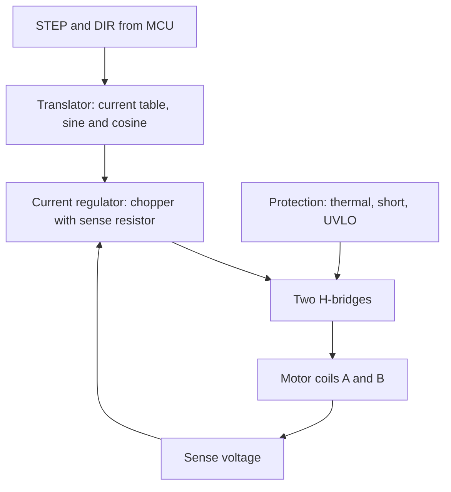

::: testing
Whether you know that a microcontroller **cannot drive a stepper directly** and can describe the whole chain: MCU generates STEP/DIR, a driver chips does the current-controlled H-bridges, and a proper motor supply sits beside the logic. The interviewer wants:

1. The driver: dual H-bridge with current chopping, microstepping and protections, and why a plain GPIO or transistor array is not enough.
2. The MCU side: STEP/DIR/ENABLE and microstep-select lines, timer-generated pulses, acceleration ramps.
3. Supply and passive details: motor supply voltage, bulk capacitor, current limit setting, grounding, never hot-plugging the motor.
4. Practical failure modes: missed steps, overheating, resonance, noise, lost position without homing.
:::

::: why
Stepper drivers are the most common motion hardware in hobby and light-industrial projects, and most "my stepper just buzzes" problems come from a missing current limit, too low a supply voltage, no acceleration ramp or a bad ground. Being able to describe the chain, set the current limit and generate a clean step stream is a core embedded skill. It parallels [[q0365]] (BLDC from a microcontroller) and [[q0387]] (servo).
:::

::: concepts
- **Dual H-bridge**: each phase winding needs current in both directions. See [[q0371]].
- **Current chopping**: the driver regulates winding current with PWM from a high supply. See [[q0377]].
- **STEP/DIR interface**: one pulse equals one (micro)step; DIR sets direction.
- **Timers and PWM**: generating accurate pulse trains. See [[q0145]].
- **Inductive load protection**: flyback and supply decoupling. See [[q0340]].
- **Homing and limit switches**: absolute reference for open-loop position.
:::

::: answer
"A microcontroller can't drive a stepper directly: GPIO pins source a few milliamps, and each winding needs an amp or two in both directions, with current regulation. So I use a stepper driver between them.

The most common arrangement is a step-and-direction driver, something like an A4988, DRV8825 or TMC2209. Inside is a dual H-bridge, a current chopper, a microstep sequencer, and protection like over-temperature and short-circuit. From the microcontroller I need just a few signals: STEP, where each pulse advances one microstep, DIR for direction, ENABLE, and a couple of pins to choose the microstep resolution, or SPI/UART on the smarter drivers. All the sequencing of coil currents is done by the driver.

The other components: a separate motor supply, typically 12 to 24 V or more, much higher than the motor's rated voltage so the current can build quickly, with a bulk capacitor, around 100 microfarads, right at the driver's supply pin to absorb the inductive kick. A common ground between the logic and the motor supply. And I set the current limit with a reference voltage on the driver, usually around the motor's rated current, tuned by temperature and torque.

In firmware, I use a hardware timer to produce the step pulses with precise timing, and I add an acceleration ramp so the rotor can follow instead of stalling; for example, ramp from zero to the target rate over a few hundred milliseconds. I also add limit switches for homing, since position is open loop. And I never disconnect the motor while powered, because the inductive spike can kill the driver."
:::

::: technical
**Chain.**

$$\text{MCU timer (STEP/DIR/EN)}\rightarrow\text{driver (translator, chopper, 2 H-bridges)}\rightarrow\text{motor phases A, B}$$

**Driver signals.**
- STEP: one rising edge per (micro)step; minimum high/low pulse widths on the order of 1 µs (check datasheet).
- DIR: direction; set before the step edge with a setup time.
- ENABLE: outputs on/off (often active low).
- MS1/MS2/MS3 (or SPI/UART): microstep resolution (full, 1/2, 1/4, 1/8, 1/16, up to 1/256 on some).
- VREF (or sense resistor/register): current limit.
- Fault/diagnostic outputs on smarter drivers.

**Current limit.** $I_{trip}=\dfrac{V_{ref}}{A\,R_{sense}}$ where the constant $A$ depends on the part (for example about 8 for the A4988 and 5 for the DRV8825 per commonly used breakout boards; verify against your board). Set the trip current at or slightly below the motor rated current: $I_{RMS}$ vs peak depends on microstepping (peak is $\sqrt2$ × RMS for sinusoidal currents).

**Supply and passives.** Motor supply $V_{mot}$ from roughly 8 to 35 V for popular parts. Rule: supply well above $IR$ (e.g. 24 V for a 2.55 V motor) to give fast current rise. Bulk capacitor $\ge100\;\mu$F near the driver (recommended on common datasheets); more for long leads. Common ground between logic and motor supply. Don't hot-plug the motor.

**Step generation.** Pulse rate $f_{step}=\dfrac{\text{rpm}}{60}\cdot200\cdot n_\mu$. Example: 1 rev/s at 16 microsteps is 3200 steps/s: half-period 156 µs. Timer-based:  $f_{step} = f_{clk}/((\text{PSC}+1)(\text{ARR}+1))$ with toggle or PWM at 50% duty.

**Acceleration profile.** For constant acceleration $\alpha$ (steps/s²) the speed after $n$ steps is $v_n=\sqrt{2\alpha n}$, so the delay between steps is $\Delta t_n=1/v_n$ (clamped at the start). Example: $\alpha=10^5$ steps/s² to a 24 000 steps/s cruise takes $24000/10^5 = 0.24$ s and $24000^2/(2\cdot10^5)=2880$ microsteps.

**Protection and diagnostics.** Over-temperature shutdown, short-to-ground, undervoltage lockout; stall detection (e.g., on TMC-type drivers via back-EMF) can detect missed steps without an encoder (vendor-specific).
:::

::: short
"I use a step/direction driver such as an A4988, DRV8825 or TMC2209: it contains the dual H-bridge, current chopper and microstep sequencer. The microcontroller sends STEP pulses, a DIR level, an enable and microstep-select lines. I add a separate motor supply well above the rated voltage, say 24 V, with a bulk capacitor at the driver, a common ground, and a current limit set via VREF. In firmware I generate steps with a timer, ramp acceleration, and use limit switches for homing."
:::

::: long
"I can't drive a stepper straight from the microcontroller. Each winding needs an amp or two, in both directions, with the current regulated, and the pins can only give a few milliamps. So the standard approach is a step-and-direction driver chip.

That driver is a dual H-bridge, one per phase, plus a current chopper and a microstep sequencer. From the microcontroller I only need a few lines: STEP, where every pulse advances the motor one microstep; DIR, for direction; ENABLE; and a couple of pins to set microstepping, or an SPI or UART interface on smarter drivers like the TMC family. The driver handles sequencing the sine and cosine currents.

The other components matter just as much. The motor needs its own supply, typically 12 to 35 V, far higher than the motor's rated voltage of maybe 3 V, because current rises with L over R and I want full current within a step period. Right at the driver's supply pin I put a bulk capacitor, around 100 microfarads, to absorb the inductive energy and supply the chopping current. Logic and motor supplies share a ground. I set the current limit with a reference voltage: the trip current is VREF divided by a constant times the sense resistor, and I set it near the motor's rated current, then check temperature.

In firmware I generate the step pulses with a hardware timer so the timing is precise and independent of the main loop. I add a trapezoidal acceleration profile: ramp the step rate up, cruise, ramp down. If I jump straight to 2000 full steps per second the rotor often can't follow and just stalls, but ramping at maybe 100,000 steps per second squared works. I also add limit switches and a homing routine because position is open loop.

Practical rules: never unplug the motor while powered, because the inductive spike can destroy the driver; add heat sinking or a fan for currents above about an amp; and if I need to detect missed steps, I'd use a driver with stall detection or add an encoder."
:::

::: terms
- **STEP/DIR**: pulse-and-direction interface to a stepper driver.
- **Translator / sequencer**: driver block that generates the current pattern for each step.
- **Chopper**: PWM current regulation in each winding.
- **VREF**: reference voltage that sets the driver's current limit.
- **Microstep select (MS pins)**: inputs choosing microstep resolution.
- **Decay mode**: how current falls in the winding during chopper off-time (slow, fast, mixed).
- **Homing**: moving to a limit switch to set position zero.
- **Trapezoidal profile**: ramp up, constant speed, ramp down.
:::

::: exceptional
An average answer says "use a driver like an A4988 and send step pulses". An exceptional answer:

- Explains why a driver is needed (current, bidirectional, regulated) and what is inside.
- Lists the signals and the supply architecture (high $V_{mot}$, bulk cap, common ground).
- Sets the current limit with a formula and a sensible target, and mentions $\sqrt2$ peak vs RMS.
- Describes timer-based step generation with numbers and an acceleration ramp.
- Mentions homing, stall detection or encoders, and the hot-plug failure.
- Explains the trade-off between dumb drivers and smart ones (UART/SPI, StealthChop-like quiet modes).
:::

::: mistakes
- **Driving windings directly from GPIO or a ULN2003 and calling it done.** That works only for small unipolar steppers with a series resistor, at poor torque, and with no current regulation.
- **Skipping the acceleration ramp.** Jumping to a high step rate stalls the rotor.
- **Powering the motor from the logic supply.** The current and spikes will brown out the MCU.
- **Setting the current limit too high 'for more torque'.** The motor and driver overheat; torque rises with current, but so does heat ($\propto I^2$).
- **Disconnecting the motor with power on.** Inductive spikes can destroy the driver.
- **No common ground or no bulk capacitor.** Causes erratic step reception and driver resets.
- **Generating steps in software delays.** Timing jitter causes missed steps or rough motion; use hardware timers or DMA.
:::

::: deep
## The chain, drawn

```circuit
{"caption":"MCU, step/dir driver and a bipolar stepper","elements":[
 {"t":"box","at":[0,1],"w":5,"h":9,"label":"","pins":[{"side":"right","pos":2,"name":"STEP"},{"side":"right","pos":3,"name":"DIR"},{"side":"right","pos":4,"name":"EN"},{"side":"bottom","pos":2,"name":"GND"}]},
 {"t":"text","at":[2.5,0],"text":"MCU","anchor":"middle"},
 {"t":"box","at":[10,0],"w":6,"h":12,"label":"","pins":[{"side":"left","pos":3,"name":"STEP"},{"side":"left","pos":4,"name":"DIR"},{"side":"left","pos":5,"name":"EN"},{"side":"left","pos":8,"name":"MS1-3"},{"side":"top","pos":3,"name":"VMOT"},{"side":"bottom","pos":3,"name":"GND"},{"side":"right","pos":2,"name":"1A"},{"side":"right","pos":5,"name":"1B"},{"side":"right","pos":8,"name":"2A"},{"side":"right","pos":11,"name":"2B"}]},
 {"t":"text","at":[19,-1],"text":"stepper driver","anchor":"middle"},
 {"t":"wire","pts":[[5,3],[10,3]]},{"t":"wire","pts":[[5,4],[10,4]]},{"t":"wire","pts":[[5,5],[10,5]]},
 {"t":"wire","pts":[[2,10],[2,13]]},{"t":"gnd","at":[2,13]},
 {"t":"wire","pts":[[13,0],[13,-4]]},{"t":"rail","at":[13,-4],"label":"V_{MOT} 24 V","dir":"up"},
 {"t":"wire","pts":[[13,-4],[8,-4]]},{"t":"dot","at":[13,-4]},
 {"t":"Cpol","a":[8,-4],"b":[8,0],"label":"100 µF","labelSide":"other"},{"t":"gnd","at":[8,0]},
 {"t":"wire","pts":[[13,12],[13,14]]},{"t":"gnd","at":[13,14]},
 {"t":"wire","pts":[[16,2],[20,2]]},{"t":"wire","pts":[[16,5],[20,5]]},
 {"t":"L","a":[20,2],"b":[20,5],"label":"coil A"},
 {"t":"wire","pts":[[16,8],[20,8]]},{"t":"wire","pts":[[16,11],[20,11]]},
 {"t":"L","a":[20,8],"b":[20,11],"label":"coil B"}
]}
```
Figure: Only STEP, DIR and ENABLE (plus microstep-select lines, not wired here) come from the MCU. The driver draws motor current from its own supply, decoupled by a bulk capacitor right at the VMOT pin, and drives each coil with an H-bridge (outputs 1A/1B and 2A/2B). All grounds are common.

## What's inside the driver


Figure: Each STEP edge advances an index into a sine/cosine current table. The chopper compares the winding current (sensed across a resistor) with the table value and switches the H-bridge on and off to hold it. This is why a high supply voltage with chopping beats a resistor in series.

## Setting the current

For an A4988-type board with $R_{sense}=0.068\ \Omega$, trip current is about $V_{ref}/(8R_{sense})$; to get 1.7 A you want $V_{ref}\approx1.7\cdot8\cdot0.068=0.92$ V. For a DRV8825-type board with $R_{sense}=0.1\ \Omega$ and the constant 5: $V_{ref}=1.7\cdot5\cdot0.1=0.85$ V. Reduce for thermal reasons if the driver has no heatsink.

> [!UNCERTAIN]
> Sense resistor values and current constants differ between breakout boards and revisions. Check the board's documentation before setting VREF; a wrong constant can overdrive the driver or starve the motor.

Which current: rated current is usually an RMS or per-phase DC figure for the motor. With sinusoidal microstepping, the peak is $\sqrt2$ of the RMS; some drivers specify the limit as peak, so a 1.7 A rated motor on a peak-limited driver may be set at about 1.7 A peak to stay safe. Check heating: $P=2I^2R$ for the motor; 1.7 A on 1.5 Ω gives 8.7 W, which a NEMA 17 can run hot at (about 80 °C case rise is common) but not enclosed.

## Generating steps with a timer

$$f_{step} = \frac{f_{clk}}{(\text{PSC}+1)(\text{ARR}+1)}$$

Target: 1 rev/s with 16 microsteps = $200\cdot16 = 3200$ steps/s. With a 16 MHz clock, PSC = 15 (1 MHz tick) and ARR = 311 gives $1\text{ MHz}/312=3205$ Hz. Set the compare for about 50% duty so the pulse width (156 µs) comfortably exceeds the 1 µs minimum.

```sim
{"id":"timer-lab","fclk":16000000,"psc":15,"arr":311,"ccr":156}
```
Figure: The timer's output is the STEP signal. Change ARR to change the step rate; change CCR to change the pulse width (keep it above the driver's minimum and below the period). For a changing rate (acceleration), the firmware updates ARR on each step or each few steps in the timer interrupt.

## Acceleration profile

The rotor can only follow if the rotating field's angular acceleration is within its torque capability: $T_{avail}-T_{load}=J\alpha_m$. With constant step acceleration $\alpha$ the speed after $n$ steps is $v_n=\sqrt{2\alpha n}$ and the delay $1/v_n$.

```plot
{"title":"Trapezoidal speed profile for a stepper move","x":{"label":"Time","unit":"s","min":0,"max":1.0},"y":{"label":"Step rate (steps/s)","min":0,"max":26000},
 "vars":{"acc":100000,"vmax":24000},
 "series":[{"label":"step rate","fn":"min(acc*x,min(vmax,acc*(1.0-x)))"}]}
```
Figure: A trapezoidal profile: ramp up at $10^5$ steps/s² for 0.24 s to 24 000 steps/s, cruise, then ramp down symmetrically. Total distance is the area under the curve. Without the ramp the first step rate would exceed the motor's pull-in rate and it would stall.

*(Check: ramp distance each side $24000^2/(2\cdot10^5)=2880$ steps.)*

## Choosing the driver

| Class | Examples (typical) | Notes |
|---|---|---|
| Basic chopper step/dir | A4988, DRV8825 class | Cheap, noisy at low speed, up to 1/16 or 1/32 microsteps |
| Smart silent drivers | TMC2209/TMC2130 class | UART/SPI config, quiet modes, stall detection, interpolation to 256 microsteps |
| Integrated motion controllers | Step/dir + ramp generator in one chip | MCU just sends a target position |
| Discrete H-bridge + MCU PWM | DIY | Needs your own current-control loop; not for beginners |
| Closed-loop stepper drive | With encoder | Detects/corrects lost steps |

Part names here are examples of well-known families; check current datasheets for limits.

## Protection details

- **Inductive kick:** unplugging a powered motor interrupts amps in an inductor: the voltage spike can exceed the driver's rating. Power down first.
- **Supply spikes:** when the motor decelerates it can pump energy back into a supply that can't sink it; the bulk capacitor and possibly a TVS limit the rise.
- **Thermal:** drivers fold back current or shut down when hot; add a heatsink or airflow.
- **Resonance and noise:** microstepping and decay-mode settings help; mid-speed resonance can still cause lost steps.
- **Homing:** open-loop systems need an absolute reference. Move toward a limit switch at slow speed until it triggers; set position to zero; then move relative.

## Worked example: why the supply voltage sets the speed limit

The rule "use a supply well above the rated voltage" can be turned into a number. Take a motor with 1.5 Ω and 3 mH per phase, so $\tau = L/R = 2$ ms, set to 1.7 A (rated $IR = 2.55$ V). To change the state of a phase at full-step drive, the current must swing from $-1.7$ A to $+1.7$ A. Each phase reverses every second step, so requiring the swing to finish within one step period means the phase spends at least half of its dwell at full current; that is the (somewhat conservative) criterion used here. With a supply voltage $V$ across the winding, the current follows $i(t) = V/R - (V/R + 1.7)e^{-t/\tau}$, and it reaches $+1.7$ A when $e^{-t/\tau} = (V/R - 1.7)/(V/R + 1.7)$:

| Supply | Time for the $\pm1.7$ A swing | Max full-step rate | Speed (200 steps/rev) |
|---|---|---|---|
| 12 V | 0.86 ms | 1,160 steps/s | 348 rpm |
| 24 V | 0.43 ms | 2,340 steps/s | 703 rpm |
| 36 V | 0.28 ms | 3,520 steps/s | 1,057 rpm |

Doubling the supply roughly doubles the speed at which the winding can still reach its full current within a step, which is the origin of the torque falling off with speed in the torque-speed curve ([[q0377]]). This is a rough bound from the current swing alone. Back-EMF from the moving rotor subtracts from the available voltage and lowers real limits, and the driver's chopper only starts regulating after the current reaches the setpoint. It also shows why the motor's rated voltage is the wrong supply: at 2.55 V the final current would be exactly 1.7 A, so the swing from $-1.7$ A could only approach it asymptotically and the torque would collapse above roughly a hundred steps per second (reaching even 90% of the setpoint after a reversal takes about 6 ms).

## Worked example: the bulk capacitor is an energy sink

The 100 µF suggestion in the datasheets is not arbitrary. When the driver turns the bridges off, or the rotor decelerates, energy flows back to the supply. Add up the sources for this motor: the magnetic energy in both windings is $2\times\tfrac12LI^2 = 2\times0.5\times0.003\times1.7^2 = 8.7$ mJ, and a rotor of inertia $5.7\times10^{-6}$ kg·m² stopping from 600 rpm (62.8 rad/s) returns up to $\tfrac12J\omega^2 = 11.3$ mJ as it slows (minus friction and copper loss). If the supply cannot sink current, say a bench supply with a series diode, all of that charges the capacitor. For 100 µF at 24 V, the final voltage satisfies $\tfrac12C(V_2^2 - V_1^2) = E$, so $V_2 = \sqrt{24^2 + 2\times0.0201/10^{-4}} = 31.2$ V. That is already close to the 35 V absolute maximum of an A4988-class driver (check your part), so with only 100 µF the peak is within a few volts of damage. With 470 µF the same energy gives 25.7 V, a 1.7 V rise, which is why a larger capacitor is cheap insurance on a supply that cannot sink current. A battery or a supply that can absorb current makes this a non-issue, so the answer depends on the source.

## Where the simple picture breaks

- **Pulse timing.** STEP pulses need a minimum width, and DIR needs setup time before the edge. A software loop with interrupts running can add jitter of microseconds, which at high step rates is a noticeable fraction of the period and becomes audible noise or lost steps. Hardware timers or DMA avoid it.
- **Decay mode.** In the chopper off-time, slow decay recirculates current through the low-side FETs with little ripple but follows falling current targets poorly; fast decay tracks falling targets but adds ripple and noise; mixed decay is a compromise. At high microstep resolutions with the wrong mode, the current waveform distorts and the motor loses smoothness.
- **Interpolation and step rate.** Smart drivers accept 1/16 step input and interpolate to 1/256 internally, which keeps the MCU pulse rate manageable while smoothing the motion. The mechanical resolution is not 256 times better, since friction defines a dead zone as discussed for the motor itself.
- **Long cables and noise.** Motor cables radiate PWM edges. Keep the logic signals away, twist each phase pair, and add small RC filters at STEP and DIR if you see false steps.

## Bench verification

Start with the motor disconnected and the driver powered from a current-limited supply. Check VREF with a meter against the calculation. Power down, connect the motor, power up, and slowly step: the shaft should advance one clear detent per pulse, and the direction should flip with DIR. Put a current probe on one phase at a moderate speed: you should see a chopped sine whose peak equals the setting; if it flat-tops at a lower value the supply is too low or the chopper is limiting. Scope STEP and the driver supply at the same time: dips on VMOT at each step edge indicate decoupling that is too small or wiring that is too long. Run the acceleration ramp and raise the target speed until the first lost step (use a marked wheel and a home switch to find it), then back off by a margin. Finally, check the temperature of the driver and the motor after twenty minutes at the planned duty. Both ought to be steady and below their ratings with the planned airflow.

:::

::: applications
- **3D printer controllers**: step/dir drivers on plug-in modules with a firmware ramp generator.
- **CNC controllers**: external drivers fed by a pulse generator or microcontroller.
- **Pan-tilt camera mounts**: small steppers with UART-configured quiet drivers.
- **Lab automation**: syringe pumps and filter wheels with an MCU-driven stepper.
- **Hobby robots**: stepper plus driver breakout with an Arduino-class board.
:::

::: assumptions
- Bipolar two-phase stepper with an off-the-shelf step/dir driver. Unipolar motors can be driven with transistor arrays, at lower torque, but modern practice favours chopper drivers.
- Driver constants and sense resistor values (A4988/DRV8825-type formulas) are examples from common breakout boards; confirm on yours.
- Supply voltages 12 to 35 V, within the range of popular drivers; higher voltage drivers exist.
- Timer example assumes a 16 MHz clock; adjust for your MCU.
- Open-loop operation; closed-loop adds an encoder feedback path.
:::

::: followups
### Why is the motor supply voltage so much higher than the motor's rated voltage?
The rated voltage is $IR$, which gives the right *steady-state* current. Current rises as $\frac{V}{R}(1-e^{-t/\tau})$ with $\tau=L/R\approx2$ ms, far too slow at high step rates. A 24 V supply reaches 1.7 A in about 225 µs, and the chopper then holds the current at the limit. Higher voltage means higher usable speed.

### How do you set the current limit?
Compute the trip current from VREF and the sense resistor ($I=V_{ref}/(A R_{sense})$, with the driver's constant $A$), set it to roughly the motor's rated current (or somewhat lower for heat), then verify by measuring motor and driver temperature after several minutes at the working duty. Lower current reduces torque approximately in proportion.

### What goes wrong if you skip the acceleration ramp?
At a high starting step rate the rotor can't accelerate fast enough to follow the field. It oscillates or stalls and loses position. Even moderate rates can excite resonance. The ramp raises the speed within the available torque margin.

### How would you detect a lost step without an encoder?
Drivers with stall detection (back-EMF-based) can flag a stall, typically only above a minimum speed. Otherwise use limit switches to verify position periodically, current-based heuristics, or add an encoder (closed loop).

### Scenario: the stepper hums but doesn't turn. What do you check?
Coil wiring: pairs swapped across phases (measure resistance to identify coils), a broken wire, or wrong connections to the driver. Then driver enable and current limit (VREF too low), supply voltage and decoupling, step pulse rate too high (needs a ramp) or a pulse too short, microstep setting, and mechanical jam or too much load. Ohm out each coil, try a very slow step rate, then increase.
:::

::: interpretations
This is the stepper counterpart of [[q0365]] (BLDC from a microcontroller) and [[q0387]] (servo). "What other components do you need?" is answered with the driver, motor supply, bulk capacitor, current-limit setting, and homing/limit switches. For the underlying motor see [[q0376]] and [[q0377]], and for picking the motor [[q0381]].
:::

::: references
- Datasheets and application notes for step/dir stepper driver ICs (for example from Allegro, Texas Instruments and Trinamic/Analog Devices): consult for pin functions, VREF formulas, decay modes and recommended capacitors.
- Kenjo & Sugawara, *Stepping Motors and Their Microprocessor Controls*: driving circuits and microprocessor control.
- Microcontroller reference manuals for timer and DMA features used to generate pulse trains.
- Open-source motion firmware documentation (such as Marlin or Klipper) for acceleration-planning practice; check current docs.
:::

::: rubric
- States the MCU can't drive the stepper directly and why :: Current, bidirectional drive and regulation are required.
- Describes the step/dir driver (dual H-bridge, chopper, sequencer) :: The central component.
- Lists MCU signals: STEP, DIR, ENABLE, microstep select :: The actual interface.
- Mentions the high motor supply, bulk capacitor and common ground :: Where most real faults arise.
- Sets current limit with a formula and sensible target :: Shows practical competence.
- Describes timer-based step generation and acceleration ramps :: Firmware essentials.
- Mentions homing and no hot-plug :: Operational awareness.
:::

::: quiz
```json
[
 {"type":"mcq","level":"fundamental","q":"What does a STEP pulse to a step/dir driver do?","options":["Sets the motor current","Advances the motor by one (micro)step","Changes direction","Enables the output"],"answer":1,"explain":"Each rising edge on STEP advances the translator by one microstep in the direction set by DIR."},
 {"type":"numeric","level":"fundamental","q":"A 200 step/rev stepper at 16 microsteps should turn 1 rev/s. What step pulse rate is required?","answer":3200,"tolerance":0.01,"unit":"Hz","explain":"$200\\cdot16\\cdot1 = 3200$ steps/s."},
 {"type":"numeric","level":"intermediate","q":"Timer clock 16 MHz, PSC = 15, ARR = 311. What step frequency results?","answer":3205,"tolerance":0.01,"unit":"Hz","explain":"$16\\text{ MHz}/16 = 1$ MHz; $1\\text{ MHz}/312 = 3205$ Hz."},
 {"type":"numeric","level":"intermediate","q":"For a driver where $I = V_{ref}/(8R_{sense})$ with $R_{sense}=0.068\\ \\Omega$, what $V_{ref}$ gives 1.7 A?","answer":0.925,"tolerance":0.02,"unit":"V","explain":"$V_{ref}=1.7\\cdot8\\cdot0.068=0.925$ V."},
 {"type":"mcq","level":"intermediate","q":"Why add an acceleration ramp?","options":["To reduce the supply voltage","Because the rotor can't follow a sudden jump to a high step rate","To increase holding torque","To avoid back-EMF"],"answer":1,"explain":"The rotor needs time to accelerate; starting above the pull-in rate causes oscillation and lost steps."},
 {"type":"multi","level":"advanced","q":"Which are good practices when driving a stepper from a microcontroller?","options":["Generate step pulses from a hardware timer","Put a bulk capacitor close to the driver's motor supply pin","Disconnect the motor while the supply is on to check wiring","Use a common ground between logic and motor supply"],"answer":[0,1,3],"explain":"Hardware timers give jitter-free steps, the capacitor absorbs inductive and chopping current, and a common ground is needed. Hot-unplugging the motor can destroy the driver."}
]
```
:::
