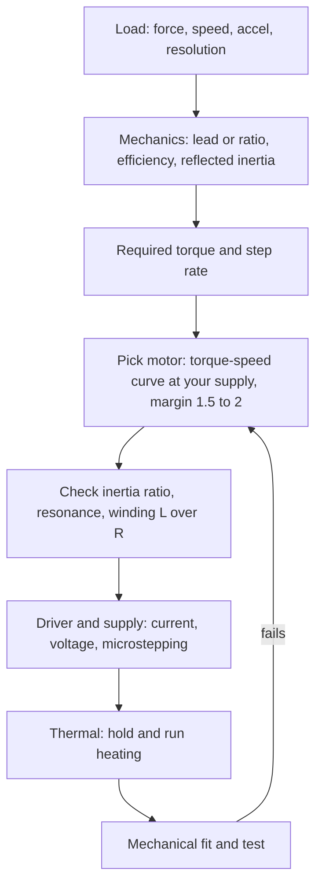

::: testing
Whether you can turn a motion requirement into a **motor and driver selection** using the stepper's real limitations: torque falls with speed, resonance, thermal limits and missed steps. The interviewer wants a method:

1. Load analysis: force/torque (including friction, gravity, acceleration), speed, resolution, duty.
2. Mechanics: transmission ratio and its effect on torque, speed, inertia and resolution.
3. Use the **torque-speed curve at the actual supply voltage**, not the holding torque, with a safety margin.
4. Electrical: rated current, winding resistance/inductance, driver and supply voltage; thermal.
5. Practical items: frame size, shaft, bearings, step angle, wiring, closed-loop need.
:::

::: why
The most common stepper mistake in real projects is choosing by holding torque and finding it can't deliver at speed, or buying a motor whose winding inductance is too high to run fast on the available supply. A short, structured spec procedure prevents that. It is the stepper counterpart of [[q0368]] (BLDC), [[q0354]] (brushed DC) and [[q0388]] (servo), and it ties together the physics in [[q0377]] and the driver details in [[q0380]].
:::

::: concepts
- **Torque-speed (pull-out) curve**: usable torque at a given step rate and supply voltage. See [[q0377]].
- **Holding torque vs dynamic torque**: holding torque is only the zero-speed number.
- **Inertia matching**: load inertia relative to rotor inertia affects acceleration and resonance.
- **Winding resistance and inductance**: set rated voltage ($IR$) and high-speed ability ($L/R$).
- **Step angle and microstepping**: resolution and smoothness. See [[q0378]].
- **Thermal limits**: $2I^2R$ heating at standstill. See [[q0379]].
:::

::: answer
"I'd spec a stepper by working backwards from the load, then checking against the torque-speed curve, not just the holding torque.

First the load: what force or torque do I need, including friction, gravity and acceleration, and at what speed? Say a vertical axis moving 2 kg with an 8 mm lead screw at about 35% efficiency: the force is about 20 newtons, and the torque is $FL/(2\pi\eta)$, about 0.075 N·m. The speed requirement, 50 mm/s, is 375 rpm or 1250 full steps per second.

Then I'd pick a motor whose pull-out torque at that speed, at my supply voltage, is at least double the load, so 0.15 N·m here, which leaves margin for friction variation, resonance and ageing. The holding torque on the datasheet is higher, but it's the zero-speed value. I'd check the inertia: the reflected load inertia should be within roughly a few times the rotor inertia, otherwise it's hard to accelerate and prone to resonance.

Electrically: rated current and resistance give the rated voltage, but I'll run from a much higher supply with a chopper driver, 24 V for example, and a low-inductance winding if I need speed. Then the step resolution: 200 steps per revolution at 8 mm lead is 0.04 mm per full step, with 16 microsteps 2.5 microns, enough for most uses. Finally frame size, mounting, shaft, thermal behaviour at the holding current, and whether a missed step is acceptable or I need a closed-loop stepper with an encoder."
:::

::: technical
**Procedure.**
1. **Load torque** $T_L$ at the motor shaft including friction, gravity, process forces and efficiency: for a lead screw, $T=\dfrac{FL}{2\pi\eta}$; for a belt, $T=F\cdot r_{pulley}/\eta_b$; with a gearbox ratio $N$: $T_m=T_L/(N\eta_g)$.
2. **Acceleration torque:** $T_{acc}=(J_m+J_L')\,\alpha$, with $\alpha$ in rad/s² and reflected inertia $J'_L=J_L/N^2$ (or for linear loads on a screw, $m(L/2\pi)^2$).
3. **Required torque** $T_{req}=T_L+T_{acc}$; apply a safety factor of about 1.5 to 2 for open-loop use.
4. **Speed:** step rate $f=\dfrac{\text{rpm}}{60}\cdot200$ (full steps/s); electrical frequency $f/4$.
5. **Torque-speed curve** at your supply voltage and driver: confirm pull-out torque at $f$ is at least $T_{req}\times$ factor. Use the datasheet curve for the exact voltage; torque changes strongly with voltage and winding.
6. **Inertia ratio** $J_L'/J_m$: keep below about 3 to 10 (rule of thumb; lower for smooth fast motion).
7. **Resolution:** $\Delta x = \dfrac{\text{lead}}{200\cdot n_\mu}$ (screw) and accuracy ±5% of a full step; check required positioning tolerance.
8. **Electrical match:** winding $R$, $L$, rated current; supply $V\gg IR$; low-$L$ windings for high speed, high-$L$ for low-speed, high torque. 8-lead motors: parallel wiring has half the resistance and a quarter of the inductance of series, with twice the current, giving better high-speed torque.
9. **Thermal:** $P=2I^2R$ at holding; check against the motor's temperature limit (often 80 °C rise on the case is typical at rated current in free air; vendor-specific) and enclosure.
10. **Mechanical:** frame (NEMA 17, 23, ...), shaft diameter and type, radial and axial load limits, bearings, mounting, connector.
11. **Closed-loop need:** safety-critical or variable load → closed-loop stepper or servo.

**Typical data to read on a datasheet:** step angle, holding torque, rated current/phase, resistance, inductance, rotor inertia, detent torque, accuracy, weight, insulation class, torque-speed curve with test conditions (supply voltage, driver type, microstepping).
:::

::: short
"I work backwards from the load: compute the torque including friction, gravity and acceleration, for example $T=FL/(2\pi\eta)$ for a lead screw, and the step rate needed for the speed. Then I pick a motor whose pull-out torque at that speed and my supply voltage is at least 1.5 to 2× the requirement, not just a big holding torque. I check inertia ratio, winding inductance versus speed, rated current and heating at hold, resolution with microsteps, frame size and shaft loads, and whether I need a closed-loop version."
:::

::: long
"I'd start from the load and work toward the motor. First, what does the load need: force or torque, speed, acceleration, and how precise the position must be. Take a vertical axis with a 2 kg carriage on an 8 mm lead screw with 35% efficiency. The force is mass times gravity plus acceleration, about 20 newtons, and the motor torque is $FL/(2\pi\eta)$, which is about 0.075 N·m. At 50 mm/s the screw turns at 375 rpm, which is 1250 full steps per second.

Then I check the dynamic torque, which is the number people forget. Stepper holding torque is the zero-speed number; the available torque falls with step rate because of winding inductance and back-EMF. So I go to the motor's torque-speed curve at my supply voltage, say 24 V, and look up the pull-out torque at 1250 steps per second. I want at least double the requirement, so 0.15 N·m, to cover friction variation, resonance and ageing, since there's no feedback to warn me if it starts missing steps.

Next the inertia: the reflected load inertia, here $m(L/2\pi)^2$, about 32 g·cm², compared to the rotor's maybe 50 g·cm², so a ratio under one, which is comfortable.

Electrical: rated current and winding resistance give the rated voltage, but I'll run from 24 V with a chopper driver. If I need higher speed I choose a low-inductance winding, or wire an 8-lead motor in parallel. I check holding heat, $2I^2R$, about 9 W for a typical 1.5 A, 2 Ω motor, and use current reduction at idle.

Resolution: 8 mm lead over 200 steps is 0.04 mm per full step, 2.5 microns at 16 microsteps, more than enough, with ±5%-of-a-step accuracy.

Finally the mechanical fit: frame size, shaft, bearing loads, mounting, and whether a missed step is acceptable. If not, I'd step up to a closed-loop stepper with an encoder or go to a servo."
:::

::: terms
- **Pull-out torque**: maximum torque at a given speed without losing sync.
- **Holding torque**: torque at standstill with rated current.
- **Detent torque**: torque with power off from the permanent magnet.
- **NEMA frame**: standard mounting size designations (NEMA 17 = 42 mm square).
- **Reflected inertia**: load inertia as seen at the motor shaft.
- **Inertia ratio**: load inertia divided by rotor inertia.
- **Series/parallel wiring**: ways of connecting 8-lead windings.
- **Resolution vs accuracy**: smallest commanded move vs actual position error.
:::

::: exceptional
An average answer lists "torque, current, voltage, size". An exceptional answer:

- Starts from the load with a formula and a number (lead-screw torque, acceleration).
- Insists on the torque-speed curve at the actual supply voltage and a margin of 1.5 to 2×.
- Computes the step rate and electrical frequency for the required speed.
- Checks inertia ratio and winding $L/R$ for speed capability, with wiring options.
- Considers heating at hold, resolution versus accuracy, and when closed-loop is justified.
- Ends with a short verification step: test at worst-case load and temperature.
:::

::: mistakes
- **Selecting on holding torque alone.** Dynamic torque at speed can be a fraction of it.
- **No safety margin.** An open-loop system gives no warning when torque runs out; margin is the only protection.
- **Ignoring supply voltage.** The datasheet curve applies at a stated voltage; at lower voltage the torque collapses sooner.
- **Choosing a high-inductance winding for a fast axis.** It gives high holding torque but poor torque at speed.
- **Ignoring inertia and resonance.** High inertia mismatch causes ringing and lost steps.
- **Confusing resolution and accuracy.** 1/256 microstepping doesn't mean 1/256 accuracy.
- **Neglecting heat at standstill.** $2I^2R$ continuous in a closed enclosure can exceed insulation limits.
:::

::: deep
## A repeatable procedure


Figure: The spec flow. The loop back to motor selection is normal: an inertia or thermal check often forces a different winding, frame or supply voltage.

## Worked example: vertical lead-screw axis

**Requirement:** 2 kg carriage, 8 mm lead screw ($\eta\approx0.35$ for a plain trapezoidal screw, vertical), speed 50 mm/s, acceleration 0.5 m/s², resolution 0.01 mm, supply 24 V.

| Quantity | Calculation | Result |
|---|---|---|
| Force | $m(g+a)=2(9.81+0.5)$ | 20.6 N |
| Load torque | $FL/(2\pi\eta)=20.6\cdot0.008/(2\pi\cdot0.35)$ | 0.075 N·m |
| Speed | $50/8=6.25$ rev/s | 375 rpm |
| Full-step rate | $6.25\cdot200$ | 1250 steps/s |
| Electrical frequency | $1250/4$ | 312 Hz |
| Reflected inertia | $m(L/2\pi)^2 = 2(0.008/2\pi)^2$ | $3.2\times10^{-6}$ kg·m² (32 g·cm²) |
| Acceleration torque | $(J_m+J_L)\alpha$ with $\alpha=a\cdot2\pi/L=393$ rad/s², $J_m=54$ g·cm² | about 3.4 mN·m (negligible) |
| Required with 2× margin | $2\cdot0.075$ | 0.15 N·m |
| Resolution | $8\text{ mm}/(200\cdot16)$ | 2.5 µm per microstep (full step 40 µm) |

The load torque is dominated by gravity and screw friction; acceleration is almost free. Self-locking: with $\eta=0.35<0.5$ the screw does not back-drive, so the carriage stays up if power is lost (a design bonus; confirm for your screw).

**Pull-out check.** Read the datasheet curve at 1250 steps/s (375 rpm) at 24 V. For a typical NEMA 17 the pull-out torque might be around 0.28 N·m at this speed (illustrative); we need at least 0.15, so it passes with margin. If the curve gave only 0.12 N·m, we'd use a larger frame, higher supply voltage, a lower-inductance winding, or reduce the speed.

```plot
{"title":"Required torque vs motor capability (illustrative NEMA 17, 24 V)","x":{"label":"Step rate","unit":"steps/s","min":0,"max":6000},"y":{"label":"Torque","unit":"N·m","min":0,"max":0.6},
 "vars":{"th":0.45,"fc":1600},
 "series":[{"label":"motor pull-out (illustrative)","fn":"th/(1+pow(x/fc,2))"}],
 "hlines":[{"at":0.075,"label":"load 0.075 N·m","color":"muted"},{"at":0.15,"label":"required with 2x margin: 0.15 N·m","color":"orange"}],
 "vlines":[{"at":1250,"label":"operating point 1250 steps/s","color":"orange"}],
 "points":[{"x":1250,"y":0.279,"label":"capability about 0.28 N·m"}]}
```
Figure: The orange line is what the design needs (with margin) and the curve is what a typical motor would deliver (a made-up but plausible shape). The operating point is safely above the requirement. As speed rises the curve drops through the requirement near 2260 steps/s here, which is the speed limit of this motor on this supply for this load. The real curve must come from the datasheet at your supply voltage.

> [!UNCERTAIN]
> The plotted motor curve is a smooth model, not a measured curve. Real curves have dips from resonance and depend on driver decay mode, microstepping and supply voltage; always use the manufacturer's curve with the same driver type and voltage.

## Inertia ratio and resonance

A rule of thumb for open-loop steppers is to keep the load-to-rotor inertia ratio below about 3 to 10; lower is better for fast moves and for avoiding resonance problems. Here $J_L'/J_m = 32/54 = 0.6$, comfortable. With a large inertia (a rotating disc or a big gear), you'd add a gearbox ($J_L'=J_L/N^2$) to reduce reflected inertia, at the cost of speed.

## Winding choice: $R$, $L$, current

For a given frame, the winding choice trades current against voltage:

| Winding | Rated current | Inductance | Good for |
|---|---|---|---|
| Low-$L$ (few turns, thick wire) | High (e.g. 2 to 3 A) | Low (1 to 3 mH) | Higher speeds with enough supply voltage and a driver that can deliver the current |
| High-$L$ (many turns) | Low (e.g. 0.5 to 1 A) | High (10+ mH) | Low-speed, high torque with small drivers and low supply voltages |

An 8-lead motor can be wired in series (high $L$, half the current) or parallel (low $L$, double the current). The parallel arrangement has a quarter of the inductance of the series arrangement, with the same total torque at the same power, so better high-speed performance, at the cost of a driver that supplies twice the current.

**Supply voltage rule of thumb.** A common recommendation is a supply of roughly 5 to 20 times (or more) the motor's rated voltage, subject to the driver's limit and the motor's insulation; a more refined limit uses $V\approx32\sqrt{L}$ with $L$ in mH from some vendor application notes.

> [!UNCERTAIN]
> Supply-voltage rules of thumb vary between sources and apply to specific driver families. Use them as a starting point and confirm with the datasheet torque curves and the driver's maximum voltage.

## Thermal

Holding at rated current: $P=2I^2R$. A 1.5 A, 2 Ω motor dissipates 9 W. With an effective thermal resistance of say 8 K/W to ambient (free air, mounted on a metal frame; vendor-specific) the rise is 72 K. In a closed box this can reach insulation limits. Mitigations: idle current reduction (50% current gives 25% heat), a larger frame or heatsink, and a lower current setting that still passes the torque margin.

```sim
{"id":"stepper-lab","mode":"micro","microsteps":16}
```
Figure: Microstepping as you will configure it on the driver: sine/cosine coil currents place the rotor between full-step positions. Use it to see the resolution you can get ("Step size" 0.113°, 3200 steps per revolution), then read "Deflection under load": with the default 0.1 N·m load the rotor sits about 0.41° behind the command, roughly 3.7 microsteps. The restoring torque per microstep is small, so load and friction, not the microstep count, set the real accuracy.

## Other decisions

- **Step angle:** 1.8° (200 steps) is standard; 0.9° (400 steps) gives finer natural resolution and smoother motion at some cost in torque/speed.
- **Frame size:** NEMA 17 (42 mm) for light axes; NEMA 23 (57 mm) for more torque; NEMA 34 beyond that.
- **Shaft:** round or D-cut, diameter, radial and axial load limits (belt tension loads the bearing).
- **Detent torque** matters when power is off; for a vertical axis use a self-locking screw or a brake rather than relying on detent torque.
- **Closed-loop option:** an encoder on the motor allows stall detection or position correction; choose if missed steps are costly.
- **Cable and connector:** current-rated and shielded for long runs.

> [!INTERVIEW]
> The strongest single sentence: "I'd spec from the torque-speed curve at my supply voltage, not the holding torque, with a margin of two because an open-loop system can't tell me when it's running out of torque."
:::

::: applications
- **3D printer axes**: NEMA 17, 1.5 to 2 A, low-inductance windings at 24 V for fast moves.
- **Lead-screw Z axes**: higher holding torque, self-locking screws.
- **CNC routers**: NEMA 23 with 3 to 4 A drivers and 36 to 48 V supplies.
- **Syringe pumps and lab automation**: small steppers with fine microstepping.
- **Camera sliders and telescope mounts**: geared steppers with high reduction.
:::

::: assumptions
- Open-loop operation of a two-phase hybrid stepper with a chopper driver. Closed-loop operation relaxes the safety margin because the drive can detect or correct lost steps.
- Plotted torque curve and thermal resistance values are illustrative, not from a specific motor.
- Inertia and speed rules of thumb (3 to 10× inertia ratio, 1.5 to 2× torque margin) are commonly used practice, not standards.
- Efficiency of the lead screw (0.35) and the friction level are example values; use the screw manufacturer's data.
:::

::: followups
### Why is holding torque the wrong number to size on?
Holding torque is the zero-speed capability. At speed the current can't reach its full value because of winding inductance and back-EMF, so pull-out torque is a fraction of it. For the example axis at 375 rpm, the needed 0.15 N·m should be read off the torque-speed curve at the actual supply voltage, not from the 0.45 N·m holding torque.

### What does a safety margin of 2 cover?
Friction that varies with temperature, wear and lubrication; resonance dips in the torque curve; supply voltage variation; manufacturing spread in the motor; and extra load from unexpected events. In an open-loop system a missed step is silent, so the margin is the protection.

### How does the winding inductance affect which motor you pick?
Higher inductance gives higher holding torque per amp but slower current rise: for a given supply the torque falls at a lower speed. A rough guide: if the application is low-speed and torque-critical, choose high $L$; if speed matters, choose low $L$ and a higher supply voltage. 8-lead motors let you choose by wiring.

### When would you choose a 0.9° motor?
When you want finer natural resolution or smoother low-speed motion without relying on microstepping. The trade-off is typically lower torque at speed and a higher step rate for the same rpm (400 steps/rev), which can push the driver's pulse rate and make the torque fall sooner.

### Scenario: your stepper meets the torque spec on paper but stalls above 800 rpm. What do you check?
The torque-speed curve conditions (supply voltage and driver differ from the datasheet's), winding inductance too high for the speed, current not reaching the setpoint (supply too low, wrong decay mode, VREF too low), resonance near that speed, and acceleration ramp. Measure winding current waveform with a current probe at 800 rpm: if the current droops, it's voltage-limited; raise the supply, change the winding or wiring, or reduce the speed.
:::

::: interpretations
"How do you spec a stepper motor?" parallels [[q0368]] (BLDC), [[q0354]] (brushed) and [[q0388]] (servo). The driver side is in [[q0380]], and the detailed physics of torque falling with speed is in [[q0377]].
:::

::: references
- Kenjo & Sugawara, *Stepping Motors and Their Microprocessor Controls*: torque characteristics and application sizing.
- Acarnley, *Stepping Motors: A Guide to Theory and Practice*: torque-speed characteristics and drive considerations.
- Stepper motor and driver manufacturers' sizing guides and application notes (inertia matching, supply voltage selection, winding selection); consult current vendor documentation.
- Hughes & Drury, *Electric Motors and Drives*: stepper motor chapter.
:::

::: rubric
- Starts from the load: force/torque, speed, acceleration, resolution :: Specs flow from the application.
- Calculates required torque with the mechanical formula (screw/belt/gear) :: Shows quantitative ability.
- Uses the torque-speed curve at the actual supply voltage, not holding torque :: The crucial stepper-specific point.
- Applies a safety margin (about 2×) and explains why :: Open-loop systems have no warning.
- Checks inertia ratio and winding $L$ vs speed :: Prevents resonance and speed shortfall.
- Considers heating at hold and driver/supply selection :: Practical completeness.
- Mentions closed-loop alternatives and resolution vs accuracy :: Shows judgment.
:::

::: quiz
```json
[
 {"type":"numeric","level":"fundamental","q":"A vertical axis carries 2 kg with 0.5 m/s² acceleration. What force (N) must the screw supply? Use $g=9.81$.","answer":20.6,"tolerance":0.01,"unit":"N","explain":"$F=m(g+a)=2\\cdot10.31=20.6$ N."},
 {"type":"numeric","level":"intermediate","q":"Lead screw: $F=20.6$ N, lead 8 mm, efficiency 0.35. Required motor torque in mN·m?","answer":75,"tolerance":0.02,"unit":"mN·m","explain":"$T=FL/(2\\pi\\eta)=20.6\\cdot0.008/(2\\pi\\cdot0.35)=0.075$ N·m $=75$ mN·m."},
 {"type":"numeric","level":"intermediate","q":"The axis moves at 50 mm/s on an 8 mm lead screw with a 200 step/rev motor. What is the full-step rate?","answer":1250,"tolerance":0.01,"unit":"steps/s","explain":"$50/8=6.25$ rev/s, times 200 = 1250 steps/s."},
 {"type":"mcq","level":"intermediate","q":"Why is holding torque the wrong figure for sizing a stepper for a fast axis?","options":["It is always too low","It is the zero-speed value; torque falls with step rate","It includes the gearbox","It depends on the encoder"],"answer":1,"explain":"At speed, winding inductance and back-EMF reduce current and torque, so use the pull-out curve at your supply voltage."},
 {"type":"mcq","level":"advanced","q":"An 8-lead stepper is wired in parallel instead of series. What changes?","options":["Inductance quartered, current doubled, better high-speed torque","Inductance doubled, current halved","Nothing","Resistance doubled"],"answer":0,"explain":"Parallel connection has half the resistance and a quarter of the inductance of series, with twice the current, so better high-speed performance but a more demanding driver."},
 {"type":"truefalse","level":"advanced","q":"Selecting a motor with a safety margin of 2× on dynamic torque is unnecessary for an open-loop stepper because the driver detects missed steps.","answer":false,"explain":"Open-loop steppers cannot detect lost steps; the margin is the only protection against friction variation, resonance and ageing."}
]
```
:::
