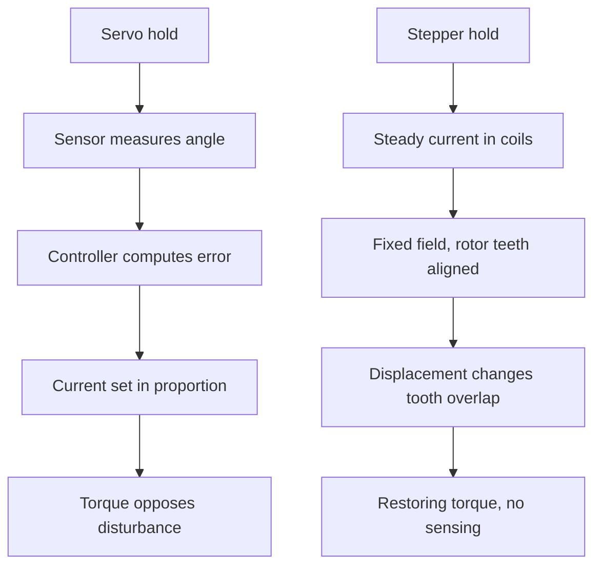

::: testing
Whether you can explain **holding** as a physical equilibrium, not magic: with the coils energised the rotor sits in a potential well, and displacement produces a restoring torque like a spring. The interviewer is checking:

1. The mechanism: magnetic alignment, restoring torque $T\approx-T_h\sin(N_r\Delta\theta)$, stable equilibrium, no feedback loop involved.
2. The numbers: holding torque, stiffness, how far the rotor deflects under load, and the point at which it slips.
3. The costs: continuous current, $2I^2R$ heating, and what current reduction does to holding torque.
4. What happens with power off (detent torque only) and with microstepping.
5. How this differs from a servo, which holds by actively controlling current ([[q0389]]).
:::

::: why
"Holds position" is the stepper's headline feature, and misunderstanding it causes real problems: a vertical axis drops when power is cut, a motor overheats while "doing nothing", a microstepped position drifts under friction, or a load pushes the shaft one tooth over. Understanding the restoring-torque picture lets you predict deflection under load, choose hold current, and decide whether you need a brake or a self-locking screw. It's a good conceptual question because the answer is simple and the consequences are rich.
:::

::: concepts
- **Stable equilibrium and restoring torque**: displacement from the aligned position creates a torque pulling back. See [[q0377]].
- **Holding torque**: peak restoring torque at rated current. See [[q0376]].
- **Detent torque**: small torque from the permanent magnet with power off.
- **Torque proportional to current**: lower current reduces holding torque roughly proportionally.
- **Resistive heating**: $P=2I^2R$ continues while holding. See [[q0379]].
- **Servo holding**: a servo achieves holding by closed-loop current control ([[q0389]] for servo precision).
:::

::: answer
"A stepper holds position because of magnetic alignment. When I leave the right pair of coils energised with a steady DC current, they produce a fixed magnetic field, and the rotor's teeth and magnet settle into the position where they are lined up with that field. That's a stable equilibrium: if something pushes the shaft away, the misalignment creates a torque that pulls it back, like a spring. Nothing is measured or controlled; it's passive.

The strength of that spring is the holding torque. The restoring torque follows roughly a sine of the misalignment, so for small deflections it's linear, and it peaks at one full step away. For a typical NEMA 17 with about 0.45 N·m of holding torque and 50 teeth, a 0.2 N·m load would deflect the shaft about half a degree, and if the load goes above 0.45 N·m, the rotor slips past the peak and jumps by whole electrical cycles, 7.2 degrees, losing position.

The cost is that the current has to keep flowing: 1.7 A through two 1.5 ohm windings is about 8.7 watts of heat even though the motor does no mechanical work. Drivers can reduce the hold current to cut heat, but that reduces holding torque roughly in proportion. With power off, only the small detent torque holds, so a vertical load can fall.

With microstepping, the rotor can hold between full-step positions with the same torque at every position, though at about 70 percent of the datasheet figure if the driver puts the rated current at the sine peak, and friction can leave small errors because the incremental torque per microstep is small. A servo, in contrast, holds by actively measuring position and adjusting current."
:::

::: technical
**Torque-angle model.** For energised windings at rated current, near the equilibrium:

$$T(\Delta\theta)\approx -T_h\sin\!\big(N_r\,\Delta\theta\big)$$

with $\Delta\theta$ the mechanical displacement from equilibrium and $N_r$ the number of rotor teeth (50). Electrical angle $=N_r\Delta\theta$.

- Peak restoring torque (= holding torque $T_h$) at $N_r\Delta\theta=90^\circ$, i.e. $\Delta\theta = 1.8^\circ$ = one full step.
- Unstable point at $180^\circ$ electrical (3.6° mechanical), where the torque is zero again, beyond which the rotor is pulled to the next equilibrium 7.2° away: a slip of one electrical cycle = 4 full steps.
- Small-signal stiffness: $k=\left.\dfrac{dT}{d\theta}\right|_0 = T_hN_r$. For $T_h=0.45$ N·m: $k=22.5$ N·m/rad (about 0.39 N·m per degree for small angles).

**Static deflection under load $T_L<T_h$:**

$$\Delta\theta=\frac{1}{N_r}\arcsin\!\left(\frac{T_L}{T_h}\right)$$

$T_L=0.2$ N·m: $\arcsin(0.444)=26.4^\circ$ electrical $=0.53^\circ$ mechanical. $T_L/T_h=0.5$: 0.60°. $0.8$: 1.06°. $1.0$: 1.8° (at the limit).

**Hold current and heat.** Torque scales roughly with current (until saturation): $T_h(I)\approx T_h\,I/I_{rated}$. Power $P=2I^2R$: at 100% 8.67 W; at 50% current 2.17 W (25%) and about 0.225 N·m holding.

**Power off.** Hybrid motors keep a small detent torque (a few percent of $T_h$, typically tens of mN·m for a NEMA 17; vendor-specific), which holds only tiny loads; VR motors have none.

**Microstepping.** Currents $I\cos\varphi,\ I\sin\varphi$ keep the vector magnitude constant, so the holding torque magnitude is the same at every microstep position, and so is the stiffness. Its value depends on the current convention: datasheet $T_h$ is usually quoted with both phases at rated current, so if the driver's sine peak equals the rated phase current, the microstep holding torque is about $T_h/\sqrt2\approx0.71\,T_h$ (this is what the sim below shows). Resolution of position is limited by friction/stiction deadband: $\Delta\theta_{dead}=\frac1{N_r}\arcsin(T_f/T_h)$.
:::

::: short
"A stepper holds position by magnetic alignment. With the right coils energised with steady current, the rotor sits in a stable equilibrium, and any displacement creates a restoring torque like a spring, roughly $T_h\sin(N_r\Delta\theta)$, so no feedback is needed. Holding torque is the peak of that restoring torque; beyond it the rotor slips by whole electrical cycles. The cost is continuous current and heat; reducing the current reduces holding torque in proportion. With power off only the small detent torque remains."
:::

::: long
"A stepper holds a position because the rotor settles into a magnetic equilibrium and stays there. If I leave a pair of coils energised with steady current, they make a fixed field, and the rotor magnet and teeth line up with that field. Move the shaft away and the misalignment makes a torque pulling it back, so it behaves like a magnetic spring. There's no sensor and no control loop; it's passive.

The strength of this spring is the holding torque. The restoring torque goes roughly as the sine of the electrical misalignment, which is 50 times the mechanical angle for a 50-tooth rotor. For small angles it's a linear spring: for a 0.45 N·m motor the stiffness is about 22 newton-metres per radian. A 0.2 N·m load pushes the shaft about half a degree off. The torque peaks at one full step, 1.8 degrees, away. If the load exceeds the holding torque, the rotor goes over the top, the torque reverses direction, and it snaps to the next equilibrium, a whole electrical cycle, 7.2 degrees, away. That's a lost position, and there's no feedback to notice.

The price is that the current must keep flowing. A NEMA 17 at 1.7 A through two phases of 1.5 ohms dissipates around 8.7 watts doing no work. I can lower the hold current when idle, say to half, which cuts the heat to a quarter but also cuts the holding torque roughly in half, so it needs to still exceed the load with margin. With power off the shaft is held only by detent torque, a few percent of holding torque, so a vertical load can fall unless I use a brake or a self-locking lead screw.

With microstepping, the rotor holds at positions between the full steps, with the same torque at every position, but because the restoring torque for a small displacement is small and friction exists, the final position may be off by a fraction of a microstep. So holding is passive and stiff within its limits, whereas a servo holds by measuring and correcting actively."
:::

::: terms
- **Holding torque**: maximum torque the energised motor resists without slipping.
- **Restoring torque**: torque toward equilibrium produced by displacement.
- **Stiffness**: $dT/d\theta$ at equilibrium, torque per angle.
- **Detent torque**: unpowered torque from the permanent magnet.
- **Slip (lost step)**: rotor jumps to a different equilibrium after overload.
- **Hold (idle) current**: reduced winding current while stationary.
- **Stiction deadband**: displacement range where friction prevents the rotor settling at the exact equilibrium.
- **Electrical angle**: $N_r$ times mechanical angle.
:::

::: exceptional
An average answer says "the coils stay energised and lock the rotor". An exceptional answer:

- Describes the stable equilibrium and restoring torque $T=-T_h\sin(N_r\Delta\theta)$.
- Calculates deflection under load (0.53° for 0.2 N·m on a 0.45 N·m motor) and the slip point.
- States the cost: $2I^2R$ at standstill, and quantifies hold-current reduction (50% current gives 25% heat, about 50% torque).
- Explains power-off holding (detent only) and the vertical-load consequence with a design fix.
- Mentions microstepping and friction deadband, and contrasts with servo holding by feedback.
:::

::: mistakes
- **"Stepper holding needs a feedback loop."** It's passive magnetic alignment.
- **"Holding torque is available when the power is off."** Only the small detent torque is.
- **"Reducing hold current to save heat is free."** Holding torque falls with current, so it must still exceed the load.
- **"If the load is below the holding torque there's no movement."** There's elastic deflection; the shaft sits a fraction of a degree off.
- **"Microstepping gives microstep-accurate holding."** Friction and detent harmonics leave errors; the incremental torque is small.
- **"A stepper stalls gracefully."** Beyond holding torque it jumps by whole electrical cycles (7.2°) and the controller doesn't know.
:::

::: deep
## The magnetic spring

Take coil A energised, coil B off. The stator creates a field pattern with its teeth. The rotor teeth are attracted to the stator teeth of opposite polarity and try to minimise the magnetic energy, which means aligning tooth to tooth. In terms of energy, there's a potential well at each aligned position, and the torque is its negative slope.

```plot
{"title":"Restoring torque vs displacement (T_h = 0.45 N·m, 50 teeth)","x":{"label":"Displacement from equilibrium","unit":"°","min":-4,"max":4},"y":{"label":"Torque (N·m)","min":-0.6,"max":0.6},
 "vars":{"th":0.45,"nr":50},
 "series":[{"label":"T = -T_h sin(N_r Δθ)","fn":"-th*sin(nr*x*pi/180)"},{"label":"small-angle spring k = T_h N_r","fn":"-th*nr*x*pi/180","dashed":true,"color":"muted"}],
 "vlines":[{"at":1.8,"label":"peak at one full step","color":"orange"},{"at":-1.8,"label":"","color":"orange"},{"at":3.6,"label":"","color":"red"}],
 "points":[{"x":0.528,"y":-0.2,"label":"0.2 N·m load: 0.53° deflection"}]}
```
Figure: Near zero the torque is a straight spring line with stiffness 22.5 N·m/rad. It bends over and peaks at ±1.8° (one full step, 90° electrical) at the holding torque. Beyond that the torque falls and reaches zero at 3.6° (the red dashed line, unstable); push further and the torque reverses and drags the shaft to the next equilibrium 7.2° away. The black marker shows the deflection for a 0.2 N·m static load; the orange dashed lines mark the ±1.8° torque peaks.

**Deflection table** (for $T_h=0.45$ N·m, $N_r=50$):

| Load / holding torque | Electrical deflection | Mechanical deflection |
|---|---|---|
| 0.25 | 14.5° | 0.29° |
| 0.5 | 30° | 0.60° |
| 0.8 | 53.1° | 1.06° |
| 1.0 | 90° | 1.80° (at the limit) |
| >1.0 | slips | jumps to next equilibrium, 7.2° |

## Why no feedback is needed

Compare with a servo. A servo motor has no inherent position preference: torque $=K_tI$ is independent of angle. To hold, a sensor measures the angle, a controller computes the error, and drives current in proportion. The "spring" is synthetic, made by the loop (stiffness $=K_tK_p\times$ sensor gain). In a stepper the spring is built into the magnetic circuit: the torque depends on angle intrinsically because the rotor's teeth and the stator's teeth interact.


Figure: Two ways of holding. The servo needs sensor, controller and power electronics all working; the stepper holds with only steady DC current, which is why it is stiff, simple and silent on failure (it simply fails to hold if current fails).

## Cost of holding: heat and current reduction

At rated current each phase dissipates $I^2R$:

$$P_{hold}=2I^2R=2(1.7)^2(1.5)=8.67\;\text{W}$$

| Hold current | Heat | Approx. holding torque (0.45 N·m motor) |
|---|---|---|
| 100% | 8.67 W | 0.45 N·m |
| 70% | 4.25 W | 0.31 N·m |
| 50% | 2.17 W | 0.225 N·m |
| 30% | 0.78 W | 0.135 N·m |

Torque is approximately proportional to current in the linear (unsaturated) region, while heat goes as the square, so reducing current is an efficient way to cut heat as long as the remaining torque exceeds the load plus margin. Drivers have an idle-current setting and a delay; some "ramp down" after a move. A heavy vertical load may need full hold current, or a brake.

> [!UNCERTAIN]
> Torque is only approximately proportional to current; motors saturate at high current and detent torque adds at low current. Use the manufacturer's torque-vs-current data if you rely on a specific reduced setting.

## Holding with power off

With coils unpowered the shaft sees only the detent torque from the permanent magnet. For hybrid motors it's typically a few percent of the holding torque (tens of mN·m on a NEMA 17; check the datasheet), enough for a light mechanism but not a vertical axis. Variable-reluctance motors have none. Options when power-off holding matters:

1. **Self-locking mechanism**: a lead screw with $\eta<0.5$ doesn't back-drive (see [[q0381]]), and worm gears are similar.
2. **Holding brake**: a spring-applied electromagnetic brake that engages when power is removed.
3. **Counterbalance**: reduces the load the motor must hold.
4. **Detent-based designs**: geared steppers with high ratio (gearbox friction holds).

## Microstepping and holding

At microstep position $\varphi$, the currents are $I\cos\varphi$ and $I\sin\varphi$; the combined vector magnitude is constant, so the equilibrium sits at electrical angle $\varphi$ and the stiffness is the same at every microstep. Therefore, in the ideal model, holding torque and spring constant don't change with microstep position. Their value is about $T_h/\sqrt2$ when the sine peak is set to the rated phase current, because the datasheet $T_h$ assumes both phases at rated current; a driver that scales the peak up by $\sqrt2$ recovers the full $T_h$ at the cost of more heat.

In practice the incremental torque for a one-microstep displacement is $T_h\sin(90^\circ/n)$: 9.8% of $T_h$ for $n=16$ and 4.9% for $n=32$. Real motors have detent and harmonic errors and the load has friction. With friction $T_f=20$ mN·m, the stiction deadband is $\arcsin(0.02/0.45)/50=0.05^\circ$, about 0.45 of a 16-microstep ($0.1125^\circ$). So a commanded microstep may leave the shaft about half a microstep off in the direction of the last move, which is why microstep resolution isn't the same as accuracy.

```sim
{"id":"stepper-lab","mode":"micro","microsteps":16}
```
Figure: Step through microstep positions and watch the "Peak holding torque" plot: the rotor rests at positions between full steps, with the coil currents at sine/cosine ratios, and the torque is the same at every position. Note it sits at 283 mN·m, about 71% of the 400 mN·m datasheet $T_h$ line, because the sim puts rated current at the sine peak. The "Deflection under load" readout shows the spring at work: 0.1 N·m of load pushes the rotor about 0.41° off the commanded position.

## What happens when it fails to hold

- **Overload (static or dynamic):** exceeding $T_h$ (or dynamic pull-out torque) makes the rotor jump 7.2° (one electrical cycle, 4 full steps), or multiples. Controller position becomes wrong.
- **Current dropout:** a supply sag, a driver thermal foldback, or a wiring fault reduces current and thus torque; the load drops or shifts.
- **Overheat:** continuous full-current holding can exceed the motor or driver temperature limits, leading to thermal shutdown and loss of hold.
- **Vibration:** external shocks can exceed the dynamic restoring torque and knock it over a tooth.

**Mitigations:** margin (hold torque 2× load), self-locking mechanics, brakes, encoders to detect displacement, thermal design, and stall detection.

> [!INTERVIEW]
> Key sentence: "A stepper holds like a magnetic spring, with stiffness $T_hN_r$, and it only costs power, not control, so a stepper is stiff and simple but it burns $2I^2R$ even when idle."
:::

::: applications
- **Vertical Z axes with lead screws**: self-locking screw plus hold current for stiffness.
- **Camera and telescope mounts**: holding a pointing angle without drift.
- **Valve actuators**: hold position against fluid forces with reduced idle current.
- **3D printers**: hold carriage position between moves, with idle current reduction to stop heating.
- **Instrumentation dials and filter wheels**: positions held between measurements.
:::

::: assumptions
- Two-phase hybrid stepper, rated current in both phases, sinusoidal torque-angle model; real torque curves have harmonics and saturation.
- Holding torque and detent torque values are typical for a NEMA 17 (0.45 N·m, tens of mN·m); check your datasheet.
- Torque is taken proportional to current for reduced hold settings; not exact.
- Static loads only; dynamic loads and vibrations require pull-out torque and damping considerations.
:::

::: followups
### How much does a stepper deflect under a load of half its holding torque?
$\Delta\theta=\arcsin(0.5)/50=30^\circ/50=0.6^\circ$ mechanical (30° electrical). It holds, but the shaft sits 0.6° off the unloaded equilibrium, a third of a full step.

### Why do stepper drivers have an idle current setting?
Holding at full rated current dissipates $2I^2R$ (8.7 W in the example) with no mechanical work. Torque is roughly proportional to current but heat goes with the square, so dropping to 50% current cuts heat to 25% while keeping about half the holding torque, which is enough for many light loads.

### Does a stepper hold position when power is cut?
Only weakly, through detent torque, typically a few percent of holding torque. A vertical load can fall or move. Use a self-locking lead screw, a brake, or a counterweight.

### How is a servo's holding different?
A servo holds by feedback: a sensor measures displacement, a controller increases current in response. The stiffness is set by loop gain and the current limit, and it only draws current in proportion to the disturbance. A stepper's stiffness is built in magnetically and is always there, at constant current, which is stiff and simple but wasteful when idle. See [[q0389]] for servo precision.

### Scenario: a 3D printer's Z axis slowly sags when the printer sits idle with the motor "holding". What's going on?
The idle current reduction is set too low, or the driver's thermal foldback is cutting the current, so holding torque drops below the load. A lead screw with high efficiency (or a belt) doesn't self-lock, so it back-drives. Raise the hold current or disable idle reduction on Z, improve cooling, use a self-locking screw or counterweight, or add a brake.
:::

::: interpretations
"How do stepper motors hold a certain position?" is answered as the magnetic equilibrium and its limits. A servo's equivalent precision question is [[q0389]], and the stepper's general operation is [[q0377]]. Spec implications are in [[q0381]].
:::

::: references
- Kenjo & Sugawara, *Stepping Motors and Their Microprocessor Controls*: static torque-angle characteristics and holding torque.
- Acarnley, *Stepping Motors: A Guide to Theory and Practice*: static torque, stiffness and detent torque.
- Hughes & Drury, *Electric Motors and Drives*: stepping motor static characteristics.
- Stepper driver application notes on idle current reduction and hold torque; consult vendor documentation.
:::

::: rubric
- Explains holding as passive magnetic alignment (stable equilibrium) :: The correct physical mechanism; no feedback.
- Gives the restoring torque model $T=-T_h\sin(N_r\Delta\theta)$ or the spring analogy :: Enables quantitative prediction.
- Quantifies deflection or stiffness with a number :: Shows engineering use of the model.
- States what happens beyond holding torque (slip by 7.2°, position lost) :: The failure mode.
- States the cost: $2I^2R$ at standstill, and hold-current reduction effects :: Practical design consequence.
- Notes power-off holding is only detent torque, with a mechanical fix :: Common real-world trap.
- Mentions microstepping and contrasts with servo holding :: Shows depth and comparison skill.
:::

::: quiz
```json
[
 {"type":"mcq","level":"fundamental","q":"Why does an energised stepper hold position without any feedback?","options":["A hidden encoder corrects it","The rotor settles into a stable magnetic equilibrium with a restoring torque","The supply voltage is regulated","Friction in the gearbox"],"answer":1,"explain":"The energised coils make a fixed field; displacement misaligns the rotor teeth and produces a restoring torque, like a spring."},
 {"type":"numeric","level":"fundamental","q":"A hybrid stepper has 50 rotor teeth. One full step corresponds to how many electrical degrees?","answer":90,"tolerance":0.01,"unit":"°","explain":"A full step is 1.8° mechanical; $50\\cdot1.8^\\circ=90^\\circ$ electrical, where the restoring torque peaks."},
 {"type":"numeric","level":"intermediate","q":"Holding torque is 0.45 N·m, load is 0.225 N·m. What is the static deflection in mechanical degrees? ($N_r=50$)","answer":0.6,"tolerance":0.02,"unit":"°","explain":"$\\arcsin(0.5)=30^\\circ$ electrical, $/50 = 0.6^\\circ$."},
 {"type":"numeric","level":"intermediate","q":"A motor with 2 phases at 1.7 A and 1.5 Ω each is held at 50% current. How much power does it dissipate?","answer":2.17,"tolerance":0.02,"unit":"W","explain":"$2(0.85)^2(1.5)=2.17$ W, one quarter of the 8.67 W at full current."},
 {"type":"mcq","level":"intermediate","q":"The load on a stepper exceeds its holding torque. What happens?","options":["The motor stops and reports an error","The rotor slips by whole electrical cycles (7.2° for 50 teeth) and the controller loses position without knowing","The driver increases current automatically","The rotor rotates continuously in the direction of the load"],"answer":1,"explain":"Beyond the peak torque the restoring torque reverses and the rotor settles into a later equilibrium, a whole electrical cycle away; open-loop control has no way to detect this."},
 {"type":"multi","level":"advanced","q":"Which options help a stepper-driven vertical axis stay up when power is lost?","options":["Self-locking lead screw (low efficiency)","Spring-applied holding brake","Higher microstepping resolution","Counterweight or counterbalance spring"],"answer":[0,1,3],"explain":"With power off only detent torque remains. Mechanical locking, brakes or counterbalance carry the load; microstepping does nothing without power."}
]
```
:::
