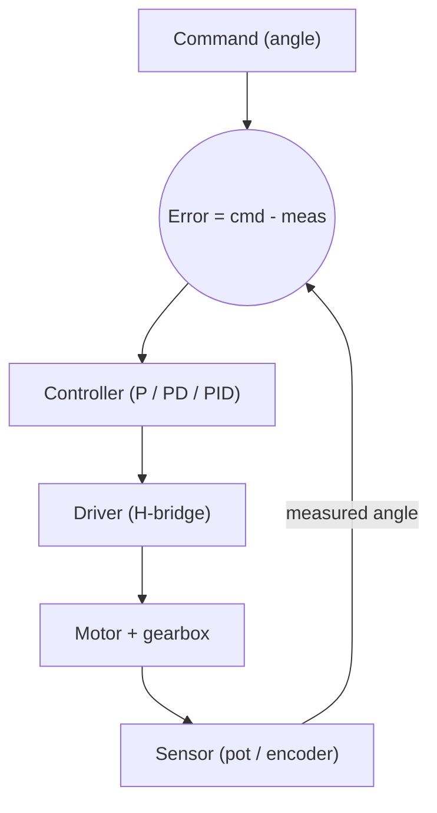

::: testing
Whether you understand that "servo" describes a **system with closed-loop feedback**, not a particular kind of motor. The interviewer wants to hear the three ingredients: an actuator, a position (or speed) sensor, and a controller that compares command to measurement and drives the error to zero. They also want to see that you can separate the cheap hobby servo (RC servo) from the industrial servo drive, and that you know how it differs from a stepper, which usually runs open-loop.
:::

::: why
Anything that has to go somewhere and stay there needs a servo: robot joints, camera gimbals, CNC axes, control surfaces, valves. In an internship you will meet both the hobby servo on a prototype and the servo drive on a production machine, and the same idea (command, sensor, error, correction) underlies both. It is also the cleanest first example of a feedback control loop in hardware, so the question is a fast check on whether you think in loops or only in components.
:::

::: concepts
- **Brushed or brushless motor**: the actuator that turns current into torque. See [[q0333]] and [[q0334]].
- **Position feedback**: a sensor on the output shaft (potentiometer, encoder, resolver, Hall array) reporting where the shaft actually is.
- **Closed-loop control**: compare command to measurement, act on the error. See [[q0389]] for why this gives precision.
- **PWM drive**: the motor voltage is set by duty cycle; see [[q0387]] for how a command signal is generated.
- **Gearbox**: trades speed for torque and resolution; nearly every small servo has one.
- **Open-loop alternative**: a stepper counts steps without checking; see [[q0382]].
:::

::: answer
"A servo motor is a motor packaged with a sensor and a controller so that it goes to a commanded position and holds it. The motor itself can be an ordinary brushed DC motor or a brushless one. What makes it a servo is the feedback loop: a sensor on the output shaft tells a controller where the shaft actually is, the controller compares that to where I asked it to be, and it drives the motor in whichever direction shrinks the error.

The hobby version is what most people have seen. It's a small DC motor, a gearbox, a potentiometer on the output shaft, and a little control board, all in a plastic case with three wires: power, ground and a signal. I send it a pulse every 20 ms, and the pulse width, typically 1 to 2 ms, says which angle I want. The industrial version is the same idea with a brushless motor, an encoder with thousands of counts per turn, and a separate drive that runs nested current, speed and position loops.

So in one line: a servo is a motor plus feedback, and the feedback is what gives you accuracy, holding torque and the ability to reject disturbances."
:::

::: technical
**Definition.** A servomechanism is a closed-loop system in which a controller drives an actuator so that a measured output (position, speed or torque) tracks a reference. A "servo motor" is the motor, feedback device and (usually) drive electronics treated as one unit.

**Loop structure.**
$$e(t) = \theta_{ref}(t) - \theta_{meas}(t),\qquad u(t) = K_p\,e + K_d\,\dot e + K_i\!\int e\,dt$$
$u$ is converted to a motor voltage or current command. For a DC motor with torque constant $K_t$ (N·m/A), the torque is $\tau = K_t I$, and the back-EMF $V_{bemf} = K_e\,\omega$ with $K_e = K_t$ in SI units.

**Hobby (RC) servo.** Three wires (V+ typically 4.8–6 V, GND, signal). Signal: a pulse repeated at about 50 Hz; roughly 1.0 ms to 2.0 ms maps to the travel range with 1.5 ms near center. Those numbers are conventions, not a standard, and many servos extend beyond them. The on-board controller reads a potentiometer coupled to the output shaft, so the loop closes through an analog or digital position measurement, and drives an H-bridge into the motor.

**Industrial servo.** Brushless (PMSM/BLDC) motor, absolute or incremental encoder (often 17 to 24 bits per rev for absolute types), and a drive with three nested loops: an inner current (torque) loop at 10 to 20 kHz or more, a velocity loop in the low kHz and an outer position loop at the lowest bandwidth. Each loop is slower than the one inside it, which keeps the design stable.

**What the servo gives you.**
- Position accuracy set by the sensor, not by the motor.
- Holding torque: if the shaft is pushed, error appears and the controller pushes back.
- Torque on demand: current rises only with load (unlike a stepper that runs at fixed current).

> [!UNCERTAIN]
> Pulse-width ranges, supply voltage and travel angle for hobby servos vary by manufacturer. Treat 1.0–2.0 ms at 50 Hz as the common convention and read the datasheet of the specific part.
:::

::: short
"A servo motor is a motor with a position sensor and a controller built around it, so it goes to a commanded angle and holds it. The controller compares the command with the sensor reading and drives the motor to shrink the error. Hobby servos use a small DC motor, gearbox and potentiometer, commanded by a 1 to 2 ms pulse every 20 ms. Industrial ones use brushless motors with encoders. The feedback is what makes it a servo, not the motor type."
:::

::: long
"A servo motor is really a closed-loop system: an actuator, a feedback sensor and a controller, packaged so it can go to a commanded position and stay there.

Start with the open-loop alternative. If I put a voltage on an ordinary DC motor it just spins at a speed that depends on load and supply, and I have no idea where the shaft ends up. A stepper counts steps and hopes it didn't miss any. A servo instead measures where the output shaft actually is, compares that to what I commanded, and drives the motor in proportion to the error. When the error is zero, it stops pushing; if something shoves the shaft, the error comes back and the controller pushes back.

In a hobby servo, which is the one most people have touched, you get a small brushed motor, a gear train, a potentiometer on the output shaft and a little control board. Three wires: power, ground and signal. I send a pulse every 20 ms and the width, around 1 to 2 ms, is the target angle.

In industrial equipment it's the same idea scaled up: a brushless motor, an encoder that might give 17 bits per turn, and a drive that runs a fast current loop inside a velocity loop inside a position loop.

The properties that follow from feedback are accuracy that depends on the sensor, holding torque against disturbances, and torque that rises only when the load needs it. The trade-off is cost, complexity and the need to tune the loop so it doesn't oscillate."
:::

::: terms
- **Closed-loop control**: the output is measured and fed back to correct the input.
- **Setpoint / reference**: the commanded position the controller is trying to reach.
- **Error signal**: reference minus measurement; what the controller acts on.
- **Feedback device**: potentiometer, encoder, resolver or Hall sensor reporting shaft position.
- **PID**: proportional-integral-derivative control law, the usual servo loop.
- **RC servo**: hobby servo commanded by a 1–2 ms pulse at about 50 Hz.
- **Servo drive**: the power electronics and control board that closes the loop for an industrial motor.
- **Holding torque**: torque the servo produces to resist being moved from its commanded position.
:::

::: exceptional
An average answer says "a motor that goes to an angle" and mentions the 1 to 2 ms pulse. An exceptional answer:
- States that servo means feedback control, not a motor type, and that the motor can be brushed, brushless or even linear.
- Names the three parts (actuator, sensor, controller) and draws the loop with the error signal.
- Contrasts RC servo and industrial servo with real differences (potentiometer vs encoder, one loop vs nested loops).
- Contrasts with a stepper: open loop, constant current, can lose steps.
- Mentions the cost of feedback: tuning, overshoot, and the possibility of oscillation or hunting around the setpoint.
:::

::: mistakes
- **"A servo is a special kind of motor."** It is a motor plus feedback. Correction: say "servo system" or "motor with closed-loop control".
- **Thinking the pulse width is the motor drive.** The pulse is a position command; the servo's own electronics convert it to motor drive.
- **Believing a servo always rotates 180 degrees.** Many hobby servos do about 90 to 180, continuous-rotation versions replace the position meaning with speed, and industrial servos rotate indefinitely.
- **Calling a stepper a servo.** A stepper can be wrapped in an encoder to become a closed-loop stepper, but plain steppers are open loop.
- **Assuming feedback is free.** Too much gain makes the loop ring or oscillate; a poorly tuned servo buzzes at standstill.
:::

::: deep
## Starting from the problem

Suppose I want a robot arm joint to sit at 37 degrees. If I drive a plain DC motor I can set a voltage and a time, but the final angle depends on supply voltage, friction, load and temperature. There is no sensible way to guess it. The fix is old and universal: measure the thing you care about and correct it.


Figure: The servo loop. Everything in the top-to-bottom chain is the same as an ordinary motor drive; the arrow from the sensor back to the error junction is what turns it into a servo.

## What the loop does mathematically

Take a brushed DC motor driving an inertia $J$ through a gearbox. Ignoring inductance for a moment, the motor has terminal voltage $V$, resistance $R$, back-EMF constant $K_e$ and torque constant $K_t$:

$$J\ddot\theta = K_t\,\frac{V - K_e\dot\theta}{R} - b\dot\theta - \tau_{load}$$

With a proportional controller $V = K_p(\theta_{ref} - \theta)$, the steady state (with $\dot\theta = 0$) requires $K_t K_p e / R = \tau_{load}$, so

$$e_{ss} = \frac{R\,\tau_{load}}{K_t K_p}$$

This shows two things. First, the servo has a non-zero error whenever there is a load, which shrinks as the gain rises. Second, the shaft really does push back against a disturbance: the stiffer the loop (higher $K_p$), the smaller the displacement for a given torque. An integral term removes the steady-state error at the cost of more phase lag.

A worked number: $R = 2\,\Omega$, $K_t = 0.02$ N·m/A, load torque 0.01 N·m, $K_p = 20$ V/rad. Then $e_{ss} = 2 \times 0.01 / (0.02 \times 20) = 0.05$ rad, about 2.9 degrees (before the gearbox, which divides this error by the gear ratio if the sensor is on the output shaft and the gear ratio multiplies torque).

```plot
{"title":"Steady-state error vs loop gain (P control only)","x":{"label":"K_p","unit":"V/rad","min":2,"max":100,"log":true},"y":{"label":"e_ss","unit":"deg","min":0,"max":30},
 "vars":{"r":2,"kt":0.02,"tl":0.01},
 "series":[{"label":"e_ss = R·τ / (K_t·K_p)","fn":"(r*tl/(kt*x))*180/PI"}],
 "points":[{"x":20,"y":"(r*tl/(kt*20))*180/PI","label":"K_p = 20 → 2.9°"}]}
```
Figure: Doubling the gain halves the steady-state error. Real servos cannot push gain arbitrarily high because sensor noise, delay and the motor's electrical dynamics eventually make the loop oscillate.

## Anatomy of a hobby servo

1. **Motor**: small coreless or iron-core brushed DC motor.
2. **Gear train**: reduces speed by a ratio of a few hundred, multiplying torque and also reducing how much of the load reflects back to the motor.
3. **Potentiometer** on the output shaft, mechanically linked to the final gear, which gives a voltage proportional to angle.
4. **Control IC + H-bridge**: pulse width is decoded, compared with the pot reading (analog servos) or a digitized reading (digital servos), and the motor is driven forward, reverse or braked, usually with PWM whose duty is proportional to the error.
5. **Deadband**: a small error window, often tens of microseconds of pulse width, inside which the servo does nothing. This prevents hunting but limits resolution.

```sim
{"id":"servo-lab","pulse":1.5,"kp":4,"kd":0.2}
```
Figure: Change the pulse width and watch the output angle chase the target. Raise kp until it overshoots and rings, then raise kd to damp it. Setting kd to zero with a large kp makes it oscillate; that is the same tuning trade-off a real servo drive has.

## Industrial servo systems

The structure is cascaded. The innermost loop regulates motor current (hence torque) and runs fastest, because electrical dynamics are fastest. The velocity loop sets current commands, and the position loop sets velocity commands. A typical bandwidth ordering would be position loop tens of hertz, velocity loop a few hundred hertz and current loop a kilohertz or more; exact figures depend on the drive and mechanics.

Brushless motors are used because they have no brush wear, better heat path (windings on the stator) and high torque density. The drive uses the encoder not only for position but also for commutation: it needs rotor angle to know which phase to energise.

## Servo vs "just a motor" vs stepper

| | DC motor, open loop | Stepper, open loop | Servo |
|---|---|---|---|
| Knows position | No | Assumes it from steps | Measures it |
| Holding torque | None | Yes, at constant current | Yes, current rises with load |
| Fails by | Wrong speed or stop point | Skipped steps, silently | Large error flagged by the drive |
| Cost / complexity | Low | Low | Higher |

## What can go wrong

- **Sensor error becomes position error**: a pot has limited resolution and noise, and wears over time.
- **Hunting**: a servo with too little deadband and noisy feedback jitters around the setpoint.
- **Stall**: if the load exceeds available torque, the error grows, the controller commands full drive and the motor draws stall current. See [[q0390]].
:::

::: applications
- **RC models and robots**: steering and control surfaces driven by hobby servos such as the common 9 g micro servo class.
- **Robot arms and legged robots**: serial-bus smart servos combine motor, gearbox, encoder and controller in one housing.
- **CNC machines and 3D printers (high-end)**: industrial servo drives on axes needing high speed and accuracy.
- **Camera gimbals and antenna pointing**: servo loops stabilise and point against disturbances.
- **Valve and throttle actuators**: automotive and process-control actuators with position feedback.
:::

::: assumptions
The answer assumes the usual meaning of servo motor as a motor with position feedback. Some engineers use "servo motor" loosely for any motor sold with an encoder, or for a brushless motor tuned for dynamic motion. Others use "servo" for the control concept and apply it to speed or torque control too. The hobby-servo description assumes a standard analog-style RC servo; digital servos use a microcontroller and faster update rate, and bus servos (serial protocols) replace the PWM command with digital messages. If the interviewer is from a robotics or CNC background, lean on the industrial description and cascaded loops; if it is a maker or prototyping role, the RC servo description is the one they will have in mind.
:::

::: followups
### What is the difference between a servo and a stepper motor?
A stepper moves in discrete steps and normally runs open loop: the controller assumes the rotor followed. It holds position at constant current and can silently skip steps if overloaded. A servo measures position and corrects, uses current in proportion to load and is faster and more efficient at speed. Steppers win on simplicity and low-speed holding torque. See [[q0382]].

### Can you make a servo from an ordinary DC motor?
Yes. Add a position sensor (potentiometer or encoder) on the output shaft, a controller (a microcontroller running a PID loop works) and an H-bridge. The loop reads the sensor, computes error and sets PWM duty and direction. The tuning of the gains is the real work.

### What does continuous-rotation servo mean?
The position feedback is disconnected or replaced so the pulse width commands speed and direction instead of angle. 1.5 ms means stop, shorter is one direction, longer the other. Useful for cheap robot wheels, but you lose position control.

### What happens if the load is too heavy for the servo?
Error grows, the controller commands full drive, current rises to stall level, the case heats up and the gears may strip. A hobby servo may buzz or chatter. Industrial drives trip on following error or overcurrent. Size for peak torque with margin.

### Harder: a servo hunts back and forth around the target. What do you check?
Hunting usually comes from too much gain, too little damping (kd) or a deadband smaller than the sensor noise or backlash. Mechanical backlash in the gearbox is a classic cause: the sensor is on the output but the motor sees a gap, so the loop overshoots across the gap and reverses. Reduce gain, add damping or filter, increase deadband, or reduce backlash.
:::

::: interpretations
The question is fully general and sits at the head of the servo section. It is followed by [[q0384]] (how it works), [[q0385]] (applications), [[q0386]] (advantages) and so on. This page is the definition; keep the mechanism details for [[q0384]] and the precision argument for [[q0389]].
:::

::: references
- Franklin, Powell and Emami-Naeini, *Feedback Control of Dynamic Systems*: the chapter on a DC motor position servo.
- Horowitz & Hill, *The Art of Electronics*, 3rd ed.: the sections on motors and feedback control.
- Dorf and Bishop, *Modern Control Systems*: DC motor control chapters.
- Manufacturer datasheets for hobby servos and servo drives (pulse range, supply voltage and torque ratings vary by part).
:::

::: rubric
- Defines a servo as a motor plus feedback sensor plus controller :: The feedback loop is the defining feature, not the motor type.
- Describes the loop: command, error, controller, driver, motor, sensor :: Shows you understand how it works rather than reciting a definition.
- Gives the hobby servo implementation (pot, gearbox, 1–2 ms pulse at 50 Hz) :: This is the concrete device the interviewer most likely has in mind.
- Mentions industrial servos with encoders and nested loops :: Shows range beyond hobby parts.
- Contrasts with stepper or open-loop DC motor :: Explains why feedback matters.
- Notes tuning and stability limits :: Feedback brings its own failure mode: oscillation.
:::

::: quiz
```json
[
 {"type":"mcq","level":"fundamental","q":"What makes a motor system a servo?","options":["It uses a brushless motor","It has a position or speed sensor feeding a controller that corrects error","It has a gearbox","It runs from a PWM signal"],"answer":1,"explain":"The defining feature is closed-loop feedback. Brushless motors, gearboxes and PWM drive appear in servos and non-servos alike."},
 {"type":"truefalse","level":"fundamental","q":"In a hobby servo, the 1 to 2 ms pulse directly sets the motor voltage.","answer":false,"explain":"The pulse width is a position command. The servo's internal controller compares it with the potentiometer feedback and drives the motor accordingly."},
 {"type":"numeric","level":"intermediate","q":"A P-controlled servo has $R = 2\\,\\Omega$, $K_t = 0.02$ N·m/A, $K_p = 20$ V/rad and a load torque of 0.01 N·m. What is the steady-state error in degrees?","answer":2.86,"tolerance":0.03,"unit":"deg","explain":"$e_{ss} = R\\tau/(K_tK_p) = 2\\times0.01/(0.02\\times20) = 0.05$ rad = 2.86 degrees."},
 {"type":"mcq","level":"intermediate","q":"Which statement about a plain stepper versus a servo is correct?","options":["A plain stepper measures its position continuously","A servo draws more current when the load increases, a stepper typically does not","A servo cannot hold position when stationary","Stepper motors are always closed loop"],"answer":1,"explain":"Servo current follows the error and so the load; a stepper in open loop runs fixed current and can skip steps silently."},
 {"type":"multi","level":"advanced","q":"Select all likely causes of a servo hunting around its target.","options":["Loop gain too high","Gearbox backlash between motor and output sensor","Insufficient damping (derivative term)","Pulse width exactly 1.5 ms"],"answer":[0,1,2],"explain":"High gain, backlash and low damping all produce limit cycling. A 1.5 ms pulse is simply the center command."}
]
```
:::
