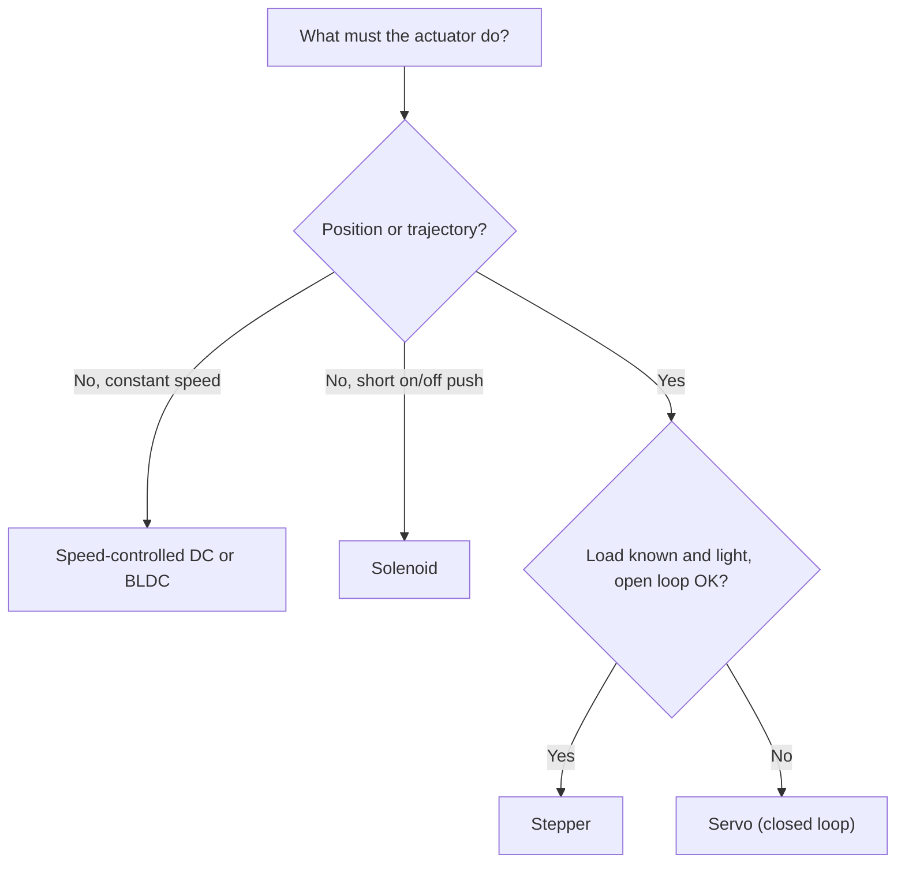

::: basics
### In plain words
Servos are used wherever something must sit at a chosen position, or follow a chosen motion, and stay accurate even when the load pushes back. Examples run from a model-airplane flap to a factory robot arm. If you only need to spin something at a steady speed, use a plain motor. If you only need a short on-off push, use a solenoid.

### Picture it
Think of the steering in a car. You turn the wheel to an angle and the wheels must hold that angle, even when bumps shove them. That is a servo job: a position, held against disturbances. The ceiling fan above you only needs to spin, and a door latch only needs one quick push. Neither needs to know a position, so a servo would be wasted on them.

### Words you need
- **Servo**: a motor with a sensor and controller that goes to a commanded position and holds it. See [[q0383]].
- **Trajectory**: a path of positions over time, which the servo is asked to follow.
- **Disturbance rejection**: pushing back when something tries to move the output.
- **Torque**: the twisting effort at the joint, in newton-meters (N·m).
- **Stall torque**: the most torque the servo gives at zero speed. It is not the torque you can use continuously.
- **Solenoid**: a coil that gives a short on-off push.

### The simplest example
A robot arm holds a 0.5 kg payload 0.30 m from the joint. With the arm horizontal, the joint must supply $0.5 \times 9.81 \times 0.30 = 1.47$ N·m. The arm's own weight raises that to about 1.9 N·m. Pick a servo with at least double that for acceleration and margin, roughly 3.8 N·m of stall torque.

That is the whole idea: say what the job needs, then size from torque. The rest of this page sorts applications by tier, shows when a stepper or plain motor is the better answer, and adds acceleration torque and holding cost.
:::

::: testing
Whether you can connect the servo's defining feature (closed-loop position control) to real jobs, and sort those jobs by what they demand: low-cost angle positioning, tight multi-axis motion, holding against disturbances, or following a moving trajectory. The interviewer is also listening for judgment: you should be able to say when a servo is the wrong answer (continuous spinning at constant speed, or a cheap fixed stroke where a solenoid works) and give one number-based sizing example rather than just listing products.
:::

::: why
Applications are how you show you can use the concept, not just define it. In an internship you will be asked which actuator to choose for a mechanism, and the answer begins with "what does the job need: position, speed, force, holding, cost?" Practising that mapping with servos also prepares you for the sibling questions on advantages ([[q0386]]) and specification ([[q0388]]).
:::

::: concepts
- **Servo basics**: motor, sensor, controller in a loop. See [[q0383]] and [[q0384]].
- **Torque from geometry**: static torque at a joint is force times lever arm; this drives every sizing decision.
- **Position vs speed vs torque control**: servos can be run in any of the three modes.
- **Disturbance rejection**: the loop actively resists external forces, unlike an open-loop actuator.
- **Trajectory tracking**: following a moving command, which depends on loop bandwidth.
:::

::: answer
"Servos show up wherever something has to be at a particular position, or follow a particular motion, and stay accurate even when the load pushes back. At the small end that's hobby and prototyping: RC cars, planes and boats steering and moving control surfaces, robot arms and humanoid joints, camera pan-tilt heads, and the little flaps in a vending machine. At the industrial end it's CNC machines, 3D printers and pick-and-place machines, robot arms in factories, packaging lines, and anything that needs coordinated multi-axis motion.

There's also a middle layer in cars and aircraft: throttle valves, EGR valves, and flight control actuators are servo loops, sometimes with a DC motor and a position sensor and sometimes hydraulic. Camera gimbals use them to cancel out motion.

If I had to choose, I'd say the pattern is: when I need an angle or a trajectory and I care about holding it under load, I reach for a servo. If I just need to spin something at a fixed speed I'd use a plain motor, and if I just need a short push on or off I'd use a solenoid. For sizing, it comes down to torque at the joint, so an arm with a half-kilo payload at 30 cm needs about 1.5 N·m before I add the arm's own weight and margin."
:::

::: technical
**Selection logic.** A servo is justified when at least one holds:
1. The target is a *position or trajectory* rather than just a speed.
2. The load varies, so open-loop accuracy would drift.
3. Disturbances must be rejected (wind on a control surface, a push on a robot leg).
4. Efficient operation matters: current follows load rather than being fixed.

**Typical application classes.**

| Class | Example | What it needs | Typical servo |
|---|---|---|---|
| Limited-angle positioning | Steering, flaps, throttle valve | Angle, hold, low cost | RC servo or automotive DC actuator |
| Multi-joint motion | Robot arm, legged robot | Torque density, coordination | Bus servo or brushless servo with encoder |
| Machine axes | CNC, 3D printer, pick-and-place | Accuracy, speed, tracking | Brushless AC servo, encoder, drive |
| Stabilisation | Camera gimbal, antenna | High bandwidth, small errors | Brushless motor, magnetic encoder, fast loop |

**Sizing sketch for a robot joint.** Static torque $\tau = \sum m_i g\,\ell_i$ with arm horizontal (worst case). For a 0.5 kg payload at 0.30 m and a 0.3 kg arm with centre of mass at 0.15 m:
$$\tau = 0.5(9.81)(0.30) + 0.3(9.81)(0.15) = 1.47 + 0.44 = 1.91\ \text{N·m} \approx 19.5\ \text{kg·cm}$$
Choose stall torque at least about twice the static requirement to allow for acceleration, friction and derating, so about 40 kg·cm class in this example. At other angles the torque falls as $\cos\theta$.

**When not to use a servo.** Continuous constant speed (plain DC or BLDC with speed control), on/off short strokes (solenoid), or very cost-sensitive fixed positions (a mechanical stop). A stepper may be enough for light loads where open-loop is acceptable.

> [!UNCERTAIN]
> Hobby servo torque ratings are usually quoted as "stall torque" at a given voltage; the value usable continuously is much lower and depends on the manufacturer and thermal design.
:::

::: short
"Servos go wherever something has to be at a position or follow a trajectory and hold it against load: RC steering and control surfaces, robot arm joints, camera pan-tilts and gimbals, CNC and 3D printer axes, pick-and-place machines, throttle and valve actuators. I'd use a servo when I need angle or trajectory with disturbance rejection. A plain motor is for constant speed and a solenoid for on-off strokes. Sizing starts with joint torque, force times lever arm, with about 2x margin."
:::

::: long
"I'd split applications by how demanding they are.

At the hobby and prototyping end, an RC servo does steering in cars and boats, moves control surfaces on model aircraft, and drives joints in robot arms and walkers. Camera pan-tilt heads and little mechanisms like vending flaps or door latches use them too, because they're cheap, come with the controller built in and just need a pulse.

At the industrial end, the servo is a brushless motor with an encoder and a proper drive. That's the axes on CNC machines, the head in a 3D printer or pick-and-place machine, robot arms in factories, packaging and labelling lines, and anything with several axes that must move together in a coordinated way.

In between are automotive and aerospace: electronic throttle bodies, valve actuators, flap actuators and control surfaces. Those are servo loops too, often a DC motor plus a position sensor closed in the ECU. And camera gimbals and antenna pointing use fast brushless servos to cancel out disturbances.

What these share is that position matters, the load changes, and I want the system to push back when something disturbs it. If I just need to spin something steadily I'd use a normal motor with speed control, and for a short on-off stroke I'd use a solenoid.

For picking one, I'd start from torque. A half-kilo payload at 30 cm is about 1.5 N·m, plus the arm's own weight is about 1.9 N·m, and I'd want double that for acceleration and margin, so a servo with 40 kg·cm or more of stall torque. Then I'd check speed, supply voltage and duty cycle."
:::

::: terms
- **Joint torque**: static torque needed at an axis, force times lever arm.
- **Stall torque**: maximum torque at zero speed; not continuous.
- **Trajectory tracking**: following a commanded path in time.
- **Disturbance rejection**: the loop's ability to resist external forces.
- **Multi-axis coordination**: several servos following synchronised commands (CNC, robot arms).
- **Gimbal**: servo-stabilised mount that cancels motion.
- **Bus servo**: servo that takes digital commands over a serial bus and reports status.
- **Throttle-by-wire**: automotive position servo on the throttle plate.
:::

::: exceptional
An exceptional answer organises applications by the requirement they satisfy rather than listing them, mentions at least one automotive or industrial case beyond hobby robotics, and gives a sizing number, as above. It also says when a servo is wrong: constant speed, short on/off strokes, or open-loop tasks where a stepper is sufficient. It might add that stabilisation (gimbals) is demanding on loop bandwidth, so those use brushless motors and magnetic encoders rather than potentiometers.
:::

::: mistakes
- **Listing applications without a reason.** Always tie each to the feedback property (position, hold, track, reject).
- **Using stall torque as the working torque.** Continuous torque is a fraction; heating limits it.
- **Using a servo for a pure spin application.** A speed-controlled motor is simpler and cheaper.
- **Forgetting worst-case geometry.** Torque is highest with the arm horizontal; do not size at the vertical position.
- **Believing all robot joints are RC servos.** Industrial arms use brushless servos with encoders and drives.
:::

::: deep
## Requirements first

An actuator question is a requirements question. For any proposed application I ask:

1. **What do I control: position, speed or force?** A steering rack is position; a cooling fan is speed; a gripper may be force.
2. **How accurate and how fast?** This sets the sensor resolution and loop bandwidth.
3. **What loads and disturbances?** Static torque, inertia, impact.
4. **How often and for how long?** Duty cycle determines thermal sizing.
5. **How much can it cost and weigh?**


Figure: A rough decision chart. Servos win when position or trajectory matters and the load is not guaranteed to be benign, because only a closed loop knows when it has failed to arrive.

## Worked example: torque at a robot joint

The static torque of a horizontal arm is the sum of weight times distance:

$$\tau(\theta) = (m_p\,L + m_a\,L/2)\,g\cos\theta$$

with payload 0.5 kg at $L = 0.30$ m and arm mass 0.3 kg. At $\theta = 0$ (horizontal) this is 1.91 N·m. The servo's torque requirement falls as the arm raises.

```plot
{"title":"Static joint torque vs arm angle","x":{"label":"Arm angle from horizontal","unit":"deg","min":0,"max":90},"y":{"label":"Torque","unit":"N·m","min":0,"max":4.2},
 "vars":{"mp":0.5,"L":0.3,"ma":0.3,"g":9.81},
 "series":[{"label":"τ = (m_p L + m_a L/2) g cos θ","fn":"(mp*L+ma*L/2)*g*cos(x*PI/180)"}],
 "hlines":[{"at":"2*(mp*L+ma*L/2)*g","label":"2× margin = 3.8 N·m ≈ 39 kg·cm","color":"orange"}],
 "points":[{"x":0,"y":"(mp*L+ma*L/2)*g","label":"1.91 N·m horizontal"}]}
```
Figure: Worst case is the horizontal pose, 1.91 N·m, about 19.5 kg·cm. The orange line is a 2x design target. Acceleration torque, gearbox friction and temperature derating all eat into the margin, so do not size to the static number alone.

Note kg·cm: 1 kg·cm = 0.0981 N·m, so 1.91 N·m / 0.0981 = 19.5 kg·cm.

## Why servos rather than steppers or plain motors here?

If the arm hits something or the payload is heavier than expected, a stepper in open loop silently loses position, and a plain DC motor has no position at all. A servo shows it as error: the drive can flag "following error too large" and stop. That fault visibility is a large part of why servos win in robots and machine tools.

## Applications by tier

**Hobby / prototyping.** RC servo, 3 wires, 4.8–6 V, 1–2 ms pulse. Typical in robot arms, walking robots, RC cars/planes/boats, pan-tilt cameras, animatronics. Limits: potentiometer wear, limited torque, small duty cycle, plastic gears.

**Robotics.** Bus servos and brushless gimbal-type actuators with encoders: proper torque and speed reporting, current limits, temperature reporting. A common robotics pattern is a brushless outrunner, a planetary gearbox and a magnetic encoder in one module.

**Industrial.** AC servo motors with 17–24 bit encoders (absolute versions retain position without homing), servo drives with current/velocity/position loops, and motion controllers handling coordinated axes and trajectory profiles. CNC machine tools, packaging, semiconductor handling, printing presses.

**Automotive and aerospace.** Throttle plate, turbocharger vane or wastegate actuators, HVAC flaps (often small stepper or DC with feedback), aircraft flight-control actuators (electro-hydraulic or electro-mechanical, with redundant sensors). Safety standards and redundancy start to matter, which is far beyond what a hobby servo offers.

## Experiment

```sim
{"id":"servo-lab","pulse":1.2,"kp":5,"kd":0.25}
```
Figure: Command a position and watch how the loop tracks it. Increase gain to see faster tracking and eventually ringing. A camera gimbal wants a response like the fast, well-damped case; a door flap can tolerate a slow, soft one.

## Sizing beyond the static number: acceleration and RMS torque

The static 1.91 N·m is only the starting point. A servo must also *accelerate* the arm, and its thermal limit is set by RMS torque over the duty cycle, not the peak. Continue the example: payload 0.5 kg at 0.30 m, arm 0.3 kg treated as a uniform rod pivoted at one end.

**Inertia about the joint.** $J = m_pL^2 + \tfrac13 m_aL^2 = 0.5(0.09) + \tfrac13(0.3)(0.09) = 0.045+0.009 = 0.054\ \text{kg·m}^2$.

**Required motion.** Swing 90 degrees (1.571 rad) in 0.5 s with a symmetric accelerate-then-decelerate (triangular velocity) profile. The angular acceleration is $\alpha = 4\theta/t^2 = 4\times1.571/0.25 = 25.1$ rad/s², and the peak speed is $2\theta/t = 6.28$ rad/s (60 rpm).

**Torque.** The acceleration torque is $J\alpha = 0.054\times25.1 = 1.36$ N·m. At the start of an upward swing (arm horizontal) gravity and acceleration add: $1.91 + 1.36 = 3.27$ N·m, which is about 33 kg·cm. Integrating the torque along the whole move numerically gives a peak of 3.27 N·m and an **RMS torque of 2.34 N·m** for the swing (the same for the downward swing). The peak mechanical power, $\tau\omega$, is about 17 W. Compare that with the page's 2x margin line (3.8 N·m): the peak is already 86% of it, so a 0.5 s swing nearly uses up the margin, and a faster move would exceed it. Halving the move time quadruples $\alpha$ and $J\alpha$ to 5.4 N·m.

The practical rule: choose the actuator so that the **peak** torque is under the stall/peak rating at the operating voltage (with margin for gearbox friction and a drooping battery), and the **RMS** torque is under the *continuous* rating. For a hobby servo, the continuous rating is much lower than the stall figure on the label and is often not published (see the uncertain note above), which is why a servo that lifts the load once may overheat when it repeats the move every second.

## The cost of just holding

A servo holding a load against gravity draws current continuously, because the torque must be supplied electrically. If the joint's motor stage looked like the example in [[q0384]] (an output-referred $K_t' = 2.1$ N·m/A, $R=4\ \Omega$ and 6 V), holding 1.91 N·m requires $I = 1.91/2.1 = 0.91$ A and dissipates $I^2R = 3.3$ W in the windings, with no mechanical output at all. With an efficient PWM bridge that is also roughly the supply power (the winding needs only $0.91\times4 = 3.6$ V, so duty is about 0.61 and the 6 V supply delivers about 0.55 A); a linear drive would instead draw the full 0.91 A from 6 V, 5.5 W. A 2 Ah, 7.4 V (14.8 Wh) pack running six such joints would last well under an hour just in static hold: $6\times3.3\approx20$ W gives about 0.75 h at best, and $6\times5.5=33$ W with a linear drive gives 0.45 h. This is the usual reason robot arms use high gear ratios, counterweights or springs, or worm gears that hold position without current. It is also why "servo" does not imply efficient: it is efficient *in motion*, since current follows load, but holding a load is costly.

## Resolution: what the sensor buys you

Positioning accuracy at the tip depends on sensor resolution and the lever arm:

| Sensor | Resolution | Tip resolution at 0.30 m |
|---|---|---|
| Hobby servo potentiometer, 10 bit over 180° | 0.176° (3.07 mrad) | 0.92 mm |
| Industrial 17-bit encoder (one revolution) | 0.00275° (47.9 µrad) | 14 µm |

Real accuracy is worse than resolution: gearbox backlash (often a degree or more in cheap hobby servos, much less in precision gearheads), compliance under load and sensor nonlinearity (a few percent for a potentiometer) all contribute. Placing the encoder on the output shaft (not the motor shaft) removes the backlash from the measured position, which is why robot-joint modules often use dual encoders. The deadband from [[q0384]] and the steady-state sag under load add to this.

## Choosing the tier: a short decision table

| Question | If yes | If no |
|---|---|---|
| Need to know position and hold it under unknown loads? | Servo | Stepper (light, known loads) or plain motor |
| Need coordinated trajectories, fast moves, torque readout? | Industrial or bus servo with encoder | Hobby servo |
| Failure must be safe (throttle, flight control)? | Spring return, dual sensors, diagnostics | Hobby-grade parts acceptable |
| Continuous duty over several minutes? | Size by RMS torque and thermal rating | Peak rating is the limit |

## Verifying a choice on the bench

1. Build the mechanical load (or a lever with known weights) before buying: measure the real inertia and friction by timing a free swing or from the current needed to move at constant speed.
2. Log supply voltage and current during the worst-case move. Confirm the supply does not sag more than the servo tolerates (most hobby servos are specified for a narrow 4.8 to 6 V window).
3. Run the duty cycle for 10 to 20 minutes and feel (or probe with a thermocouple) the case. If it is too hot to hold, the RMS torque exceeds the continuous rating.
4. Stall-test briefly: make sure the failure mode is acceptable (stripped gear, burnt motor, or a safe current-limit fault).

## Limits worth stating

A servo's application is bounded by its torque (including thermal limit), speed, resolution and bandwidth. Hobby servos also stop at end-stops, have limited angle, and fail by stripping gears or burning the motor when stalled. Mention the "what happens when it fails" angle: for a safety-relevant use like a throttle, you need a spring return and dual sensors so loss of power or feedback defaults to a safe state.
:::

::: applications
- **RC cars, planes, boats**: steering and surface actuation via 50 Hz pulse servos.
- **Robot arms and legged robots**: bus servos (e.g. Dynamixel-style smart servos) or brushless actuators with encoders.
- **CNC mills, 3D printers, pick-and-place**: AC servo axes with encoder feedback and trajectory planning.
- **Camera gimbals**: fast brushless servo loops cancel hand motion.
- **Automotive throttle bodies and valve actuators**: DC motor plus position sensor closed in the ECU.
- **Packaging and printing machinery**: synchronised axes following cam profiles electronically.
:::

::: assumptions
The list uses servo in the broad sense (any closed-loop positioner). Some sectors reserve "servo" for a brushless motor with drive and encoder, others for the RC servo. Torque numbers assume a static horizontal arm and ignore dynamic loads; acceleration torque $J\alpha$ and gearbox losses add to the requirement. For a design question, ask about duty cycle, accuracy, and failure behaviour before choosing. A stepper or a direct-drive motor can be the right answer when loads are light and well known or when speed is high and gearing is unwanted.
:::

::: followups
### Why not use a stepper for a robot arm joint?
A stepper in open loop can skip steps when the payload exceeds its pull-out torque and nothing reports it. It also runs at constant current, so it heats at rest, and its torque falls with speed. A servo uses current proportional to load, reports error, and keeps torque at higher speeds. Closed-loop steppers close the gap but cost more. See [[q0382]].

### How would you pick a servo for a 0.4 kg camera on a pan axis?
Compute the torque to accelerate the inertia: for a cylinder-like camera of $J = 2\times10^{-3}$ kg·m² to reach an acceleration of 20 rad/s², $\tau = J\alpha = 0.04$ N·m, plus friction and wind. That is about 0.4 kg·cm, tiny, so a small servo is fine, and the question becomes resolution and smoothness rather than torque.

### What is the difference between a servo used in an RC car and one in a CNC machine?
The RC servo has a potentiometer, one loop and a deadband of about a degree, built for cost. The CNC servo has an encoder with thousands to millions of counts, nested current, velocity and position loops, and runs at kilohertz update rates to track a path within microns. Same principle, very different performance.

### What if the application must hold a position with the power off?
A servo cannot, because holding is active. Add a brake (a spring-applied electromagnetic brake is common in industrial servos), a worm gear that is not back-drivable, or a mechanical lock. Hobby servos with high gear ratios hold a little by friction but should not be relied on.

### Harder: a servo-driven valve oscillates slowly (seconds) even though the loop is tuned. What could be wrong?
A slow oscillation points to an outer loop interacting with the servo: for example a flow controller commanding the valve, with the process delay turning the combination into a limit cycle. Another possibility is stiction: the valve sticks, the integral term winds up, then it breaks free and overshoots (stick-slip). Check with the outer loop in manual, add deadband or dither, and tune the outer loop to be slower than the servo.
:::

::: interpretations
The question is open ended. It is the first of three "servo in the real world" questions: here are the uses, [[q0386]] says why servos win, and [[q0388]] says how to size one. Keep this answer practical and tie each example to a servo property.
:::

::: references
- Siciliano, Sciavicco, Villani, Oriolo, *Robotics: Modelling, Planning and Control*: actuators for robot joints.
- Franklin, Powell and Emami-Naeini, *Feedback Control of Dynamic Systems*: servo and motion-control examples.
- Horowitz & Hill, *The Art of Electronics*, 3rd ed.: motor and servo discussion.
- Servo manufacturer catalogues (hobby and industrial) for typical torque and speed classes.
:::

::: rubric
- Lists applications across hobby, robotics and industrial :: Shows breadth and that you know servos are not only hobby parts.
- Ties each to a servo property (position, hold, track, reject disturbance) :: Reasoning beats listing.
- Mentions at least one automotive or machine-tool example :: Shows real-world awareness.
- Says when not to use a servo (constant speed, on/off stroke) :: Judgment.
- Gives a sizing number: torque = force × lever arm with margin :: Shows engineering habit.
- Notes fault visibility and holding behaviour :: Safety and reliability sense.
:::

::: quiz
```json
[
 {"type":"mcq","level":"fundamental","q":"Which job is best suited to a servo?","options":["Spinning a cooling fan at a constant speed","Holding a robot joint at an angle against a changing load","A short on/off push to open a latch","Generating electricity"],"answer":1,"explain":"Servos are for position or trajectory control with disturbance rejection. A fan wants speed control, and a latch wants a solenoid."},
 {"type":"numeric","level":"intermediate","q":"A horizontal arm carries a 0.5 kg payload at 0.30 m. Ignoring the arm mass, what static torque must the joint provide? ($g = 9.81$ m/s²)","answer":1.47,"tolerance":0.02,"unit":"N·m","explain":"$\\tau = mgL = 0.5\\times9.81\\times0.30 = 1.47$ N·m."},
 {"type":"numeric","level":"intermediate","q":"Convert 1.91 N·m to kg·cm (1 kg·cm = 0.0981 N·m).","answer":19.5,"tolerance":0.02,"unit":"kg·cm","explain":"$1.91/0.0981 = 19.5$ kg·cm."},
 {"type":"truefalse","level":"intermediate","q":"The static torque on a horizontal arm joint is highest when the arm is horizontal.","answer":true,"explain":"The lever arm for gravity is $L\\cos\\theta$ measured from horizontal, maximum at $\\theta = 0$."},
 {"type":"mcq","level":"advanced","q":"Why do industrial robots use servos over open-loop steppers for heavy payloads?","options":["Servos are always cheaper","Servos detect and report lost position instead of silently skipping steps, and torque does not collapse with speed","Steppers cannot move at all","Servos have no inertia"],"answer":1,"explain":"Closed loop gives fault visibility (following error), and servo torque holds up to higher speed whereas stepper torque falls with speed and steps can be lost silently."}
]
```
:::
