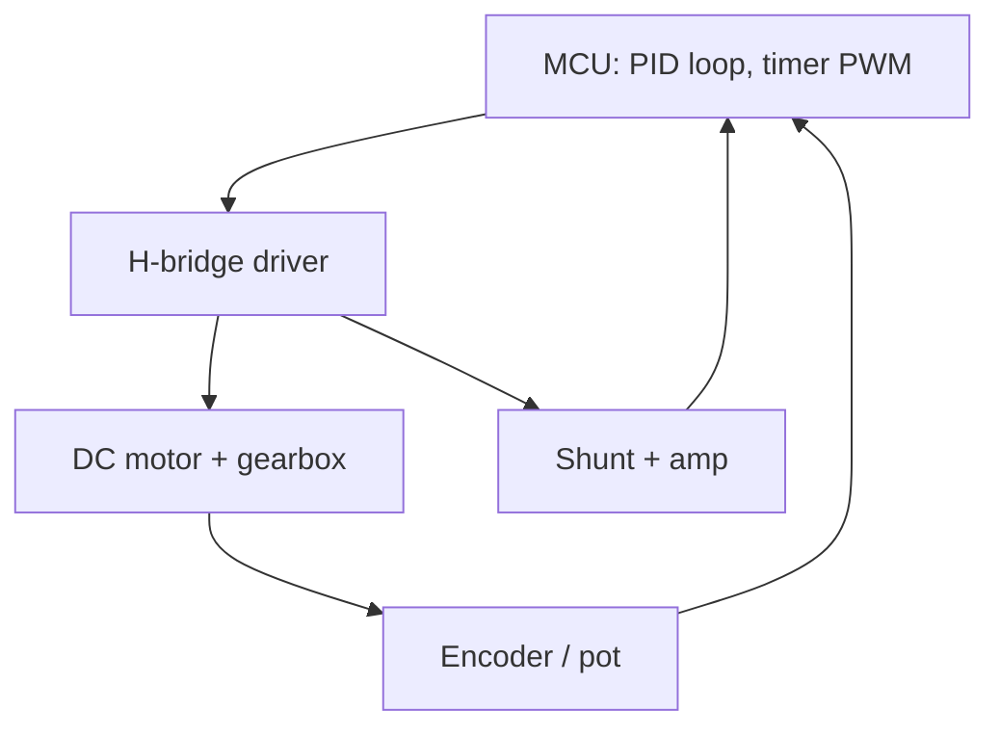

::: testing
Whether you can connect a servo to a real microcontroller without frying either. The interviewer wants the signal story (a 50 Hz, 1–2 ms pulse from a timer), and the power story (servo current is large and spiky, so it needs its own supply, a common ground and bulk capacitance). Bonus: timer arithmetic, jitter-free hardware PWM instead of software delay loops, logic-level compatibility, and what you add if the "servo" is a DC motor with an encoder instead of an RC servo.
:::

::: why
The classic beginner failure is powering a servo from the MCU's 3.3 V or 5 V pin: the MCU resets whenever the servo moves. The second classic is jittery software-timed pulses. Both are about understanding what the servo needs, and whether you do it right is a quick test of hardware judgement. The same checklist (signal, power, ground, protection) extends to any motor driven from a microcontroller.
:::

::: concepts
- **Timer PWM generation**: prescaler, auto-reload and compare registers define period and pulse width. See [[q0789]].
- **Servo command protocol**: 1–2 ms pulse every ~20 ms. See [[q0384]].
- **Current surges**: a servo starting or stalling draws amps; supply impedance causes voltage dips.
- **Common ground**: signal needs a shared reference.
- **Decoupling / bulk capacitor**: local charge reservoir for current spikes.
- **H-bridge and encoder** for DIY servos. See [[q0411]].
:::

::: answer
"For a hobby servo I need three things. First, the signal: a 50 Hz pulse train where the high time is 1 to 2 ms, which I generate with a hardware timer in PWM mode rather than delay loops, so there's no jitter. With a 16 MHz clock I'd set the prescaler to 16 to get a 1 MHz tick, set the period register to 20,000 counts for 20 ms, and write the compare register with the pulse width in microseconds: 1500 for center.

Second, power. A servo can pull an amp or more when it starts or stalls, so I don't power it from the MCU's regulator. I use a separate 5 to 6 volt supply sized for the stall current of all servos, with a bulk capacitor, something like 470 µF, near the servo to absorb spikes.

Third, ground: the supply, servo and MCU all share a common ground, otherwise the signal has no reference.

On the signal line I'd add a small series resistor, a few hundred ohms, for protection. If the MCU is 3.3 V, most servos accept it, but I'd check the datasheet. If I'm building my own servo from a DC motor, I'd also need an H-bridge driver, a position sensor like an encoder or pot, flyback protection and a PID loop in firmware."
:::

::: technical
**Signal generation.** Choose timer clock $f_t = f_{clk}/(PSC+1)$. Period register $ARR$ gives $T = (ARR+1)/f_t$. For $f_{clk} = 16$ MHz, $PSC = 15$: $f_t = 1$ MHz (1 µs tick). $ARR = 19999$ gives $T = 20$ ms (50 Hz). Compare register $CCR$ sets the high time: $t_{pw} = CCR / f_t$; $CCR=1000$ to $2000$ for 1–2 ms, resolution 1 µs, about 0.18° if 1 ms spans 180°. With an 8-bit timer and prescaler 256 the tick is 16 µs and 1 ms is only 62.5 ticks, i.e., 2.9° steps, so use a 16-bit timer where possible.

**Power.** Budget: $I_{supply} \ge \sum I_{stall}\times$ margin. Four servos at 1 A stall each: 4 A; with 1.5× margin, 6 A. A step of load current $\Delta I$ of duration $\Delta t$ into bulk capacitance $C$ gives $\Delta V \approx \Delta I\,\Delta t/C$: 1 A for 100 µs on 470 µF drops 0.21 V. Use a supply with enough regulation and short, thick wires, because wire resistance and inductance cause additional dips.

**Ground.** Star the grounds at the supply, keep servo current return away from the MCU's analog and reference ground, and tie the signal reference to the same node.

**Signal level and protection.** The servo's input is normally a logic-level input referenced to its own supply. A 3.3 V high into a 5 V servo often works but the threshold is vendor dependent; a series resistor of 220 Ω–1 kΩ limits fault current, and a level shifter solves marginal cases. An MCU pin should never be connected to the servo power rail.

**Software.** Use the hardware PWM peripheral and update the compare value rather than bit-banging. Slew-limit the command (ramp the pulse width) to reduce inrush and mechanical shock. Detach (stop sending pulses) cautiously: some servos go limp, others hunt.

**DIY servo (DC motor + encoder).** MCU PWM to an H-bridge driver (see [[q0411]]), direction pins, encoder in quadrature to a timer or counter, current sense, firmware PID at 1–10 kHz, flyback protection, and a separate motor supply.

> [!UNCERTAIN]
> Whether a 3.3 V logic high reliably triggers a 5 V servo input varies by servo model. Test with your parts, or use a level shifter.
:::

::: short
"I generate a 50 Hz pulse with the MCU's hardware timer, 1 to 2 ms wide, e.g. 1 MHz tick, period 20,000, compare 1000 to 2000. The servo gets its own 5 to 6 V supply sized for stall current, with a bulk capacitor near it, because the MCU can't supply those spikes. Grounds are common, and I put a few hundred ohms in series with the signal. For a DIY servo from a DC motor I'd add an H-bridge, encoder and a PID loop."
:::

::: long
"I'll split it into signal, power and ground, and then mention the DIY case.

Signal first. The servo wants a pulse every 20 ms, 1 to 2 ms wide. I use a hardware timer in PWM mode so the edges are exact and don't depend on what the CPU is doing. On a 16 MHz MCU I'd set the prescaler to 16 for a 1 MHz tick, the period register to 20,000 so the frame is 20 ms, and the compare register to the pulse width in microseconds, so 1500 is center. I'd want a 16-bit timer: with an 8-bit timer and big prescaler the resolution is a few degrees per step. In firmware I'd rate-limit changes so the servo doesn't slam.

Power next. A servo might draw an amp or more at start or stall, with short sharp spikes. The MCU's on-board regulator can't deliver that, so I'd use a separate 5 to 6 V supply rated for the sum of all servos' stall currents with margin, like 6 A for four 1 A servos. A bulk capacitor, 470 µF or more, right at the servo covers the spikes: 1 A for 100 µs on 470 µF is a 0.2 V dip. Without it, the rail dips, the MCU browns out and resets, and the servo twitches.

Ground: supply, servo and MCU must share a ground, ideally joined at the supply so servo return current doesn't flow through the MCU's ground. I'd add a 220 to 1 k series resistor on the signal for protection, and check that a 3.3 V logic level is enough for a 5 V servo.

If I'm building my own servo from a DC motor, I'd also need an H-bridge with flyback protection, a position sensor such as an encoder, a current sense for limiting, and a PID loop in firmware."
:::

::: terms
- **Prescaler**: divides the timer input clock.
- **Auto-reload register (ARR)**: sets timer period.
- **Compare register (CCR)**: sets the PWM high time.
- **Stall current**: current drawn at zero speed; sizes the supply.
- **Bulk capacitor**: local energy store that supplies current spikes.
- **Common ground**: shared reference between supply, servo and MCU.
- **Brown-out**: MCU reset when its supply dips below threshold.
- **Slew limiting**: ramping the command to limit inrush and shock.
:::

::: exceptional
An exceptional answer does the timer arithmetic, sizes the supply from stall current with margin, and quantifies the capacitor. It brings up the brown-out symptom and the ground return path, mentions logic-level compatibility honestly as vendor dependent, and describes the DIY servo variant with encoder and H-bridge. It would also mention command ramping and what happens if the pulse train stops.
:::

::: mistakes
- **Powering the servo from the MCU's 5 V pin.** The regulator or USB port collapses under servo current; the MCU resets.
- **Software-timed pulses.** Interrupts add jitter, and the servo twitches. Use hardware timers.
- **Forgetting common ground.** The signal becomes undefined, and the servo behaves randomly.
- **Sizing the supply to running current.** Size it to stall or start current, summed over all servos that can move together.
- **Assuming all servos use 1–2 ms.** Check the datasheet's pulse range and voltage.
:::

::: deep
## The system

```circuit
{"caption":"MCU driving an RC servo with separate supply","elements":[
 {"t":"box","at":[0,0],"w":5,"h":6,"label":"MCU","pins":[{"side":"right","pos":1,"name":"PWM"},{"side":"right","pos":5,"name":"GND"}]},
 {"t":"R","a":[7,1],"b":[11,1],"label":"R_s","value":"330 Ω"},
 {"t":"wire","pts":[[5,1],[7,1]]},
 {"t":"wire","pts":[[11,1],[16,1]]},
 {"t":"box","at":[16,0],"w":5,"h":6,"label":"Servo","pins":[{"side":"left","pos":1,"name":"SIG"},{"side":"left","pos":3,"name":"V+"},{"side":"left","pos":5,"name":"GND"}]},
 {"t":"V","a":[10,3],"b":[10,9],"label":"5–6 V","labelSide":"other"},
 {"t":"wire","pts":[[10,3],[16,3]]},{"t":"dot","at":[12,3]},
 {"t":"Cpol","a":[12,3],"b":[12,9],"label":"470 µF"},
 {"t":"wire","pts":[[5,5],[5,9],[14,9]]},
 {"t":"wire","pts":[[16,5],[14,5],[14,9]]},
 {"t":"dot","at":[10,9]},{"t":"dot","at":[12,9]},{"t":"dot","at":[14,9]},
 {"t":"gnd","at":[10,9]}
]}
```
Figure: Three connections matter. The signal goes through a small series resistor. The servo's V+ comes from its own supply with a bulk capacitor across the servo's pins. All grounds join at one rail so the MCU's ground reference and the servo's return current do not share a long, resistive path.

## Generating the pulse in hardware

The timer counts up from 0 to $ARR$; the output is high while the count is below $CCR$. Everything follows from three numbers:

$$f_t = \frac{f_{clk}}{PSC+1},\quad T = \frac{ARR+1}{f_t},\quad t_{pw} = \frac{CCR}{f_t}$$

With the values from the sim below, $f_t = 16\text{ MHz}/16 = 1$ MHz, $T = 20000/10^6 = 20$ ms, and $t_{pw} = 1500\,\mu s$.

```sim
{"id":"timer-lab","fclk":16000000,"psc":15,"arr":19999,"ccr":1500}
```
Figure: Check the output period reads 20 ms (50 Hz) and the duty reads 7.5 %, which is 1.5 ms. Change ccr to 1000 and 2000 to see the endpoints. Then try psc = 255 with a small arr to see why a coarse tick limits the angle resolution.

```plot
{"title":"Angle resolution vs timer tick (1 ms spans 180°)","x":{"label":"Timer tick","unit":"s","min":1e-7,"max":2e-5,"log":true},"y":{"label":"Degrees per tick","unit":"deg","min":0,"max":4},
 "series":[{"label":"180° per 1 ms / tick","fn":"180*x/1e-3"}],
 "points":[{"x":1e-6,"y":0.18,"label":"1 µs → 0.18°"},{"x":1.6e-5,"y":2.88,"label":"16 µs → 2.9°"}]}
```
Figure: A 1 µs tick is plenty for hobby servos, whose own deadband is typically several microseconds. A 16 µs tick (8-bit timer, prescaler 256 at 16 MHz) gives visibly steppy motion.

## Power budget

Servo supply current: suppose four servos, each 0.2 A moving under light load but 1 A stalled. A robot with all four holding a load might hold 0.3 A each, but a collision or end-stop stalls them at 1 A each. So design the supply for 4 A, plus margin: 6 A. If you cannot afford that, limit simultaneous motion in firmware (stagger servo start times).

A battery's internal resistance also matters: a 2S LiPo can deliver many amps, a USB port cannot. Many servos work from 4.8–6 V, so a 2S Li-ion pack direct would exceed the rating; use a regulator (BEC or buck) to 5–6 V that can supply the peak.

The bulk capacitor sees the same current step as the rail. For a 1 A step lasting $\Delta t$ and a 0.2 V tolerable dip, $C \ge I\Delta t/\Delta V$. For 100 µs that is 500 µF; for 1 ms it is 5 mF, in which case the supply, not the capacitor, must respond (a quick regulator or a lower-resistance cable).

## Ground and noise

Servo motors generate brush noise and large current changes, so they upset sensitive nodes if their return current flows in shared copper. Use a star ground: supply ground to servo ground by one path, to MCU ground by another, joined at the supply. If the servo's connector is long, add a 100 nF ceramic near it in addition to the bulk cap.

## Signal integrity and protection

The signal wire is a 50 Hz pulse with fast edges, so a few hundred ohms in series limits current if the servo or wiring fault pulls the line to supply. The servo input is usually high impedance with an internal pull-down, so no pull-up resistor is needed. Check the logic threshold: if the servo supply is 6 V and its input threshold is a fraction of that, a 3.3 V output may not reliably reach it; use a level shifter or a transistor.

## Firmware practices

1. Use the hardware PWM peripheral, or a servo library based on timer interrupts.
2. Rate-limit: change the pulse by a few microseconds per frame to ramp motion.
3. Start in a known safe state: servos power up and jump to the first pulse they receive. Delay enabling their supply until the MCU outputs a valid pulse, or accept a start jump.
4. Consider what happens if the MCU crashes: the pulse train may stop, and servos behave differently (hold, go limp, or drift).

## If the "servo" is DIY

A DC motor servo needs:


Figure: The MCU closes the loop that an RC servo hides inside its case: PWM and direction to an H-bridge, position back from an encoder, and current sensing for limiting. Add flyback or bridge body diodes (see [[q0411]]) and a separate motor supply with bulk capacitance.
:::

::: applications
- **Hobby robot arm with six servos**: separate 6 V supply with several amps of capacity and a PWM expander.
- **RC receiver to servo**: the receiver outputs the pulse train directly; the battery eliminator circuit (BEC) powers the servos.
- **Camera pan-tilt**: MCU timer drives two servos, with firmware ramping.
- **Door latch or vending flap**: single servo and an N-channel MOSFET to switch servo power off between moves.
- **Servo driver boards (I²C PWM expanders)**: offload timing for many channels.
:::

::: assumptions
The page assumes a standard 3-wire RC servo with a 50 Hz, 1–2 ms command and a 4.8–6 V supply. Pulse range, logic thresholds and supply voltage vary. Digital bus servos use UART or RS-485 packets rather than pulses and need a different interface. Industrial servo drives take analog, pulse/direction or fieldbus commands. The timer calculations are for a generic MCU timer; register names differ between families, but prescaler, period and compare concepts do not. For a servo that draws very little (micro servos) a dedicated supply is less critical but still good practice.
:::

::: followups
### Why does my MCU reset when the servo moves?
The servo's current surge sags the shared supply, dropping the MCU rail below its brown-out threshold, or ground bounce corrupts the MCU's reference. Give the servo its own supply, add bulk capacitance at the servo, and join grounds at a star point.

### How would you control ten servos from one MCU?
Use a timer with multiple compare channels where possible, or a PWM expander (I²C chip with 16 channels). Software can stagger pulses within the 20 ms frame, since they only need 1–2 ms each and can be offset. Stagger movement too, to avoid ten simultaneous inrush currents. Size the supply for worst-case stall times ten.

### What would you do to stop a servo jumping at power-up?
Hold the servo supply off (a MOSFET switch) until the MCU is outputting the correct startup pulse, or send the last known position first. Use a pulldown on the signal line so it is defined during MCU reset. Some servos jump to wherever they are before the first valid pulse.

### Can I drive a servo from a 3.3 V MCU directly?
Often yes, but it depends on the servo's input threshold. If it is a CMOS-style input with a threshold around half the supply (3 V at 6 V supply), 3.3 V is marginal. Test with your supply voltage, or use a level shifter or an open-collector transistor stage.

### Harder: the servo jitters even though the pulse generation is hardware-based. What else could it be?
Supply noise or sag moving the pot reference, an electrically noisy ground, an undersized supply, coupling from the motor leads into the signal wire, or a low-quality servo with a wide deadband. Check the pulse with a scope at the servo end, the supply at the servo pins during motion, and try shorter wires or a ferrite and a capacitor at the servo.
:::

::: interpretations
The question asks "what other components do you need". For an RC servo the answer is supply, bulk capacitor and series resistor. For a servo-like motor system built from a DC motor, the answer includes H-bridge, encoder and current sensing. The page covers both. See [[q0388]] for specifying the servo and the supply.
:::

::: references
- Microcontroller datasheets and reference manuals: timer PWM mode sections (prescaler, auto-reload, compare registers).
- Horowitz & Hill, *The Art of Electronics*, 3rd ed.: servo and motor-driving sections.
- Servo datasheets from the manufacturer of the part used for pulse range, voltage and stall current.
- Mohan, Undeland and Robbins, *Power Electronics*: DC motor drive chapter (for the DIY H-bridge case).
:::

::: rubric
- Specifies the 50 Hz, 1–2 ms pulse and generates it with a hardware timer :: Shows you know the protocol and avoid jitter.
- Does the prescaler/period/compare arithmetic :: Demonstrates ability to implement, not just describe.
- Gives the servo a separate supply sized for stall current :: Avoids the classic brown-out failure.
- Adds a bulk capacitor and explains why with a number :: Shows understanding of transient current.
- Ties grounds together appropriately :: Without a reference the signal is meaningless.
- Mentions logic level compatibility and series resistor :: Practical protection awareness.
- Describes DIY variant (H-bridge, encoder, PID) :: Covers the alternative reading of the question.
:::

::: quiz
```json
[
 {"type":"mcq","level":"fundamental","q":"Why should a servo not be powered from the MCU's own 5 V regulator?","options":["Servos need AC","Stall and start currents of an amp or more sag the rail and reset the MCU","The signal wire needs the MCU's supply","Servos only work at 3.3 V"],"answer":1,"explain":"Servo current is large and spiky, so it should have its own supply with a common ground. The signal pin is separate from power."},
 {"type":"numeric","level":"intermediate","q":"A timer has $f_{clk}=16$ MHz and prescaler register PSC = 15. What is the timer tick frequency?","answer":1,"tolerance":0.01,"unit":"MHz","explain":"$f_t = 16/(15+1) = 1$ MHz, a 1 µs tick."},
 {"type":"numeric","level":"intermediate","q":"With a 1 MHz tick, what ARR value gives a 20 ms period?","answer":19999,"tolerance":0.001,"unit":"counts","explain":"$T = (ARR+1)/f_t$, so $ARR+1 = 0.02\\times10^6 = 20000$ and ARR = 19999."},
 {"type":"numeric","level":"intermediate","q":"A 470 µF capacitor supplies a 1 A load step for 100 µs. By roughly how many volts does the rail dip?","answer":0.21,"tolerance":0.05,"unit":"V","explain":"$\\Delta V = I\\Delta t/C = 1\\times100\\times10^{-6}/470\\times10^{-6} = 0.213$ V."},
 {"type":"multi","level":"advanced","q":"Select the good practices for driving several servos from one MCU.","options":["Common ground between supply, servos and MCU","Stagger servo movements to limit simultaneous inrush","Size the supply for the sum of stall currents with margin","Power all servos from the MCU's 3.3 V regulator"],"answer":[0,1,2],"explain":"A common ground, staggered moves and a stall-sized supply are standard. Powering from the MCU regulator causes brown-outs."}
]
```
:::
