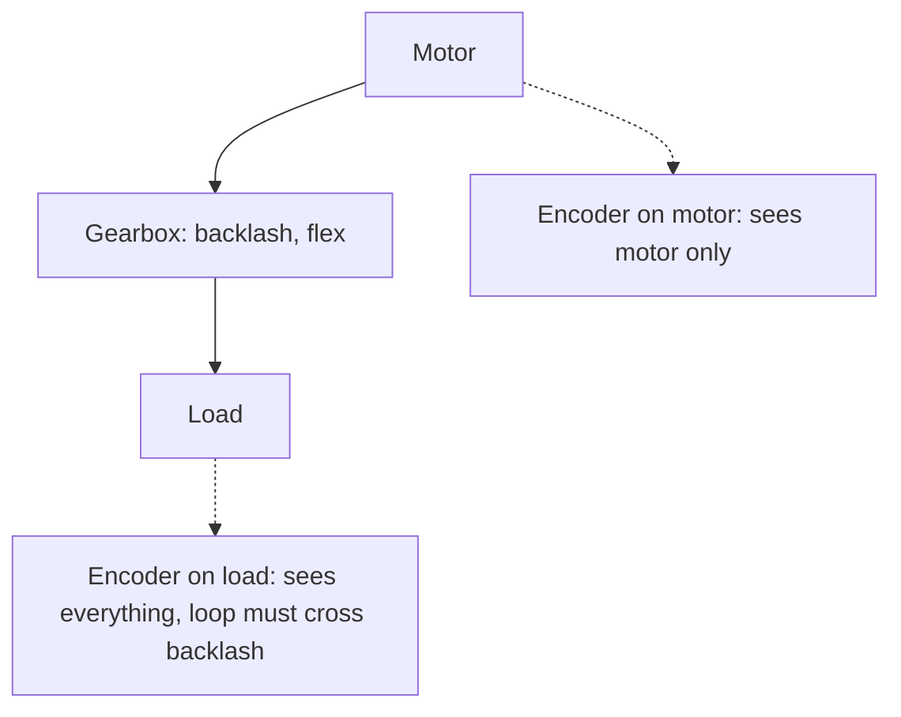

::: basics
### In plain words
A servo is precise because it never trusts the motor. It measures where the shaft really is, compares that with the command, and keeps correcting until the error is nearly zero. So the precision comes from the sensor and the loop, not from how well the motor behaves. Be careful about one word, though: resolution (the sensor's smallest step) is not the same as accuracy (being at the true position).

### Picture it
Think of cruise control in a car. Without it, a hill slows you down and you end up wherever the road takes you. With it, the car measures its speed, sees the drop, and adds throttle until the speed matches the setting. The analogy also shows the catch: if the speedometer itself reads wrong, cruise control holds the wrong speed very precisely.

### Words you need
- **Resolution**: the smallest position step the sensor can report.
- **Accuracy**: how close the position is to the true one.
- **Stiffness**: how little the shaft moves when a load pushes on it. A higher loop gain means a stiffer servo.
- **Integral term**: a control part that keeps increasing the drive until the steady error reaches zero.
- **Backlash**: the free play between meshing gears.

### The simplest example
A 17-bit encoder splits one turn into $2^{17} = 131{,}072$ counts, so each count is about 0.0027 degrees. Put it on the motor behind a 10:1 gearbox, and the output steps are ten times finer, about 0.00027 degrees. Now add 0.5 degrees of backlash between the gearbox and a 100 mm arm. That slop moves the arm tip about 0.87 mm, far more than the encoder could ever resolve.

That is the whole idea: feedback gives the precision, and the mechanics limit it. The rest of this page covers stiffness, the integral term, sensor placement, feedforward, and the error budget.
:::

::: testing
Whether you understand that precision comes from *measuring and correcting*, not from a better motor, and whether you can separate three things that people blur together: resolution (smallest increment the sensor reports), repeatability (return to the same spot) and accuracy (reaching the true position). Good answers cover the feedback loop, high-resolution sensors, gearing, integral action for zero steady-state error, stiffness against disturbances, and then honestly list what limits precision: backlash, compliance, sensor error, friction and noise.
:::

::: why
Precision is the product. A CNC axis, a camera gimbal or a robot arm sells on how close it gets to the commanded position and how well it holds there. Knowing why a servo is precise also tells you where to look when it isn't: sensor, loop gain, or mechanics. This is the "debugging" half of the answer, and interviewers like candidates who bring it up unprompted.
:::

::: concepts
- **Closed-loop error correction**: the controller acts on measured error. See [[q0383]].
- **Encoder resolution**: counts per revolution and quadrature decoding. See [[q0405]].
- **Gearing**: reduces output step size and reflects motor errors down by $N$. See [[q0388]].
- **Integral action**: drives steady-state error to zero against a constant load.
- **Stiffness**: how much the shaft moves per unit disturbance torque.
- **Resolution vs accuracy vs repeatability**: three different numbers.
:::

::: answer
"A servo is precise because it never trusts the motor. It measures where the shaft actually is, compares that to the command, and keeps correcting until the error is basically zero. So the precision of the motion is set by the sensor and the loop, not by how well the motor behaves.

A few things make that work well. First, a high-resolution sensor: a hobby servo's potentiometer gives a fraction of a degree, but an industrial encoder gives thousands to millions of counts per turn, so a 17-bit absolute encoder resolves about 0.003 degrees. Second, gearing: if the encoder is on the motor and there's a 10:1 gearbox, everything gets ten times finer at the output. Third, the loop itself: high proportional gain makes it stiff, so a load pushing on it barely moves it, and an integral term pushes the steady-state error to zero even under a constant load.

The caveat is that resolution isn't accuracy. Backlash in the gears, flex in the shaft, sensor non-linearity, friction and noise all limit what you really get, particularly if the sensor is on the motor and the error is out at the load."
:::

::: technical
**Loop and error.** With position error $e = \theta_{ref}-\theta$ and controller $u = K_p e + K_i\int e\,dt + K_d\dot e$, a constant load torque $\tau_L$ gives:
- P only: $e_{ss} = \dfrac{R\tau_L}{K_tK_p}$ (voltage-mode motor). Stiffness $k = K_tK_p/R$. With $K_t=0.02$ N·m/A, $K_p = 20$ V/rad, $R = 2\,\Omega$: $k = 0.2$ N·m/rad = 0.0035 N·m/deg.
- PI: $e_{ss} \to 0$ for a constant load, since the integrator keeps changing $u$ until $e = 0$. Cost: extra phase lag, so tune for stability, and use anti-windup.

**Resolution.** An $n$-bit rotary encoder gives $360^\circ/2^n$ per count: 12-bit 0.088°, 17-bit 0.0027° (9.9 arcsec), 20-bit 0.00034°. An incremental encoder with 1000 lines and ×4 decoding gives 4000 counts/rev (0.09°); through a 10:1 gearbox with the encoder on the motor, 0.009° at the output.

**Command resolution.** Hobby servo: 1 µs of pulse width = 0.18° if 1 ms spans 180°; deadband of a few µs sets about 0.5–1°.

**Error budget.** Real accuracy is the sum (or RSS, if independent) of: sensor non-linearity and mounting error, quantisation (±½ LSB), backlash if the sensor is not on the load, compliance under load ($\Delta\theta = \tau/k_{mech}$), friction stick-slip, thermal drift, and loop noise. Example (assumed values): sensor 0.01°, backlash residual 0.05°, compliance 0.02°, RSS $=\sqrt{0.01^2+0.05^2+0.02^2} = 0.055^\circ$. Backlash of 0.5° at a 100 mm radius is already 0.87 mm of tip motion.

**Dither and smoothing.** Many drives filter encoder noise, interpolate sine/cosine encoders to 12+ extra bits, and use feedforward (velocity and acceleration) so the loop only corrects small residuals.

> [!UNCERTAIN]
> Accuracy specifications of encoders (arc-seconds, integral non-linearity) differ by model and technology (optical vs magnetic vs resolver). Quote resolution and accuracy separately and check the datasheet for the actual part.
:::

::: short
"A servo is precise because it measures the shaft position and keeps correcting the error, so precision comes from the sensor and loop, not the motor. A high-resolution encoder, say 17 bits is about 0.003 degrees, gearing that makes output steps finer, high loop gain for stiffness and an integral term that drives steady-state error to zero. Resolution isn't accuracy though: backlash, flex, friction and sensor error set the real limit."
:::

::: long
"The core reason is feedback. An open-loop motor ends up wherever the voltage, load and friction take it. A servo measures the actual shaft position, subtracts it from the command, and keeps driving the motor until that error is essentially zero. So the final position depends on the sensor and the loop, not on the motor's imperfections.

Then there are the ingredients that make it good. The sensor: a hobby servo has a potentiometer good to a fraction of a degree, but an industrial servo has an encoder, 17 bits is about 0.003 degrees and some go to 23 bits. Gearing helps too: if the sensor is on the motor shaft and there's a 10:1 gearbox, output resolution is ten times finer. Then loop gain: proportional gain makes the servo stiff, so a disturbance torque barely moves it, and the error for a constant load is the load torque divided by the stiffness. With an integral term the steady-state error goes to zero, because the integrator keeps increasing the drive until the error vanishes.

Finally feedforward and good drive electronics: a fast current loop, low noise, and velocity and acceleration feedforward so the feedback only cleans up small leftovers.

I'd end with the honest caveat: resolution isn't accuracy. A 20-bit encoder doesn't help if there's a half-degree of backlash between motor and load, if the shaft winds up under load, or if friction causes stick-slip. Precision engineering is mostly about putting the sensor as close to what you care about as possible, on the load side, and removing slop."
:::

::: terms
- **Resolution**: smallest position increment the sensor can report.
- **Accuracy**: closeness of reported or achieved position to the true one.
- **Repeatability**: spread when returning to the same commanded position.
- **Stiffness**: torque per unit angular deflection under load.
- **Integral windup**: integrator saturating while the output is limited.
- **Backlash**: free play between meshing gears.
- **Feedforward**: command computed from the expected motion rather than from error.
- **Quantisation error**: ±½ count uncertainty from finite resolution.
:::

::: exceptional
An exceptional answer distinguishes resolution, accuracy and repeatability and gives numbers for each source: bits to degrees, backlash to millimetres at a radius. It derives or states steady-state error and stiffness under P control and explains how integral action removes it, with the anti-windup caveat. It mentions dual-loop (load-side) feedback for backlash, and feedforward. It also acknowledges that high gain is limited by noise, delay and mechanical resonance.
:::

::: mistakes
- **"More encoder bits means more accurate."** Bits are resolution. Accuracy depends on linearity, mounting and mechanics.
- **Assuming feedback fixes everything.** It corrects only what the sensor sees; backlash between motor and load is invisible to a motor-side encoder.
- **"Higher gain is always better."** Too much gain amplifies noise and excites resonance and oscillation.
- **Ignoring friction.** Stick-slip creates limit cycles with integral action (hunting).
- **Confusing repeatability and accuracy.** A servo can repeat to 0.001° while being 0.1° off true.
:::

::: deep
## Resolution, accuracy, repeatability

Three numbers describe how good a position system is, and they are not the same:

| Term | Question it answers | Typical limiting factor |
|---|---|---|
| Resolution | What is the smallest change I can command or see? | Encoder counts, ADC bits, timer tick |
| Repeatability | If I return to the same command, how close do I land each time? | Backlash, friction, noise |
| Accuracy | Is the position I reached the correct physical position? | Sensor linearity, calibration, thermal drift, mounting |

A hobby servo might have 0.18° command resolution, repeatability of about half a degree and accuracy a degree or worse. An industrial axis may have 0.0003° resolution, a few arcseconds of repeatability and an accuracy dominated by the mechanics.

```plot
{"title":"Encoder resolution vs bits","x":{"label":"Bits per revolution","min":8,"max":30},"y":{"label":"Step size","unit":"deg","log":true,"min":1e-5,"max":2},
 "series":[{"label":"360° / 2^n","fn":"360/pow(2,x)"}],
 "points":[{"x":12,"y":"360/pow(2,12)","label":"12-bit 0.088°"},{"x":17,"y":"360/pow(2,17)","label":"17-bit 0.0027°"},{"x":23,"y":"360/pow(2,23)","label":"23-bit 0.00004°"}]}
```
Figure: Each extra bit halves the step. Beyond about 17–20 bits, extra resolution mostly shows sensor noise and mechanical imperfection rather than real position information, which is why you also see accuracy specified in arc-seconds.

## Why feedback gives precision

The motor's behaviour depends on supply voltage, temperature (winding resistance rises ~0.39 %/K for copper), friction and load. Open loop, all of those turn into position error. In a closed loop they become *disturbances* the controller sees as error and fights. For a voltage-driven DC motor with proportional control, the steady-state deflection under a load torque is

$$e_{ss} = \frac{R\,\tau_L}{K_t K_p}$$

so the loop behaves like a torsional spring with stiffness $k = K_tK_p/R$. Doubling the gain halves the deflection. With $K_t = 0.02$, $K_p = 20$, $R = 2$: $k = 0.2$ N·m/rad, which means 0.0035 N·m per degree. A 0.01 N·m load moves it 2.9°. That is a soft servo; real ones have gains orders of magnitude higher, with current-loop-based stiffness.

### Integral action

Add $K_i\int e\,dt$. In steady state with constant load the only way for the integrator output to stop changing is for $e = 0$. The integrator provides exactly the holding torque needed and the error returns to zero. In a gearbox with stiction, this leads to the familiar pattern: error builds until the integrator breaks the shaft free, it overshoots, sticks again, and so on (hunting). A small deadband or friction compensation addresses it.

## Gearing and where the sensor goes

If the encoder is on the motor, motor-side errors are divided by the gear ratio at the output, but anything *after* the encoder (gear backlash, shaft flex, load compliance) is invisible. If the sensor is on the output, the loop sees backlash and has to cross it: precise at the point of measurement but prone to limit cycling.


Figure: Where you mount the sensor decides what the loop can correct. Dual-loop systems use a motor encoder for the fast inner loop and a load encoder for the slow outer loop to get both stability and accuracy.

Backlash example: 0.5° of backlash on a 100 mm radius arm is $0.1\times0.5\times\pi/180 = 0.87$ mm at the tip, which is huge compared with a 0.003° encoder step (5 µm at the same radius). Hence precision gearboxes (harmonic drive, zero-backlash planetary) and direct-drive designs.

```sim
{"id":"encoder-lab","cpr":1024,"rpm":600}
```
Figure: Quadrature decoding at ×4 gives four counts per line. For 1024 lines that is 4096 counts per rev, 0.088°. Notice the trade-off between counting edges over a window (M-method: smooth but delayed, and coarse at low speed) and timing one edge period (T-method: accurate at low speed, coarse at high speed when few timer clocks fit in a period). A servo's velocity estimate makes the same trade-off.

## Feedforward and loop structure

Industrial servos do not rely on feedback alone. The profile generator provides position, velocity and acceleration commands, and the drive adds $K_v\dot\theta_{ref} + K_a\ddot\theta_{ref}$ directly to the command. The feedback only has to correct the small leftover error, so tracking error during motion is small even at modest gain. The inner current loop keeps torque proportional to command regardless of winding temperature and back-EMF.

## What caps the precision

1. **Sensor accuracy**: encoder non-linearity, scale error, eccentricity of the disk, magnet misalignment.
2. **Quantisation**: ±½ count, and the loop's tendency to dither between two counts.
3. **Backlash and compliance**: see above.
4. **Friction**: stick-slip and Coulomb friction cause hunting.
5. **Noise**: sensor noise multiplied by loop gain turns into audible hum and jitter; filters add delay.
6. **Thermal drift**: expansion changes geometry, magnets weaken with heat, electronics drift.
7. **Calibration**: homing and index pulse repeatability define the absolute reference.

## A servo-lab experiment

```sim
{"id":"servo-lab","pulse":1.5,"kp":10,"kd":0.5}
```
Figure: Put the servo at 1.5 ms with some load torque and compare steady-state error at kp = 3 versus kp = 15: the error shrinks with gain (stiffness). Then push kp too high with kd = 0 and watch it ring: that is the limit on how much precision you can buy with gain.
:::

::: applications
- **CNC machine axes**: encoder resolution at the micron level with closed position loops and feedforward.
- **Camera gimbals**: fine position and velocity control to cancel sub-degree motion.
- **Wafer handling and semiconductor stages**: precision gearing or direct-drive linear motors with high-resolution encoders.
- **Robot arms**: dual encoders (motor and joint) and calibration for accuracy.
- **Hobby servos**: modest precision (about a degree) for steering and control surfaces, adequate for most RC uses.
:::

::: assumptions
The stiffness and steady-state error formulas use a voltage-driven, linear motor with proportional control only; real servos use cascaded current and velocity loops so stiffness is higher and the maths changes in detail. Numbers for backlash, encoder accuracy and error budgets are illustrative, not from a specific product. Precision claims vary by technology: absolute magnetic encoders are typically less accurate than optical ones of the same resolution, but cheaper and more robust. "Precise" can mean position accuracy, repeatability or velocity smoothness depending on the application.
:::

::: followups
### What is the difference between resolution and accuracy?
Resolution is the step size the sensor reports. Accuracy is how close the reported position is to the real one. A 20-bit encoder may resolve 0.0003° but be accurate to only a few hundredths of a degree if its disk or magnet is imperfect or mounted off-centre. Calibration and linearisation can improve accuracy.

### How does integral action remove steady-state error?
The integrator accumulates error. As long as $e \ne 0$ its output keeps ramping, increasing the torque command, so the system cannot rest at non-zero error under a constant load. It settles where the integrator provides exactly the needed holding torque and $e = 0$. The cost is added phase lag and the need for anti-windup when output saturates.

### Why not just crank the gain for infinite precision?
Gain amplifies sensor noise and delay. Delay (sampling, filtering, drive lag) means loop phase falls as frequency rises; gain above a limit gives oscillation, and a mechanical resonance (shaft or coupling flex) limits it further. Also quantisation noise at high gain drives the motor to buzz. So gain is traded against noise and stability margin.

### The servo hits the target but drifts as it warms up. Why?
Thermal effects: encoder or magnet drift, expansion of mounts and screws, reduced torque constant as magnets heat, and changing friction. A good servo remains accurate because feedback corrects motor changes, but the sensor and mechanics are outside the loop: calibrate or compensate, or use a thermally stable sensor and structure.

### Harder: your servo has a 20-bit encoder but you measure a 0.3° repeatability error at the load. Where do you look?
Backlash and compliance between the encoder and load are the first suspects: use a load-side encoder or dual loop, reduce gearbox play, preload gears or use a harmonic or direct drive. Then friction (stick-slip), coupling slip, loose set screws, a flexible bracket, or the encoder not on the real axis. Test by moving the load by hand and watching the encoder reading versus an external dial indicator.
:::

::: interpretations
"Precise" is read here as position precision under closed-loop control (resolution, repeatability and accuracy), consistent with the hobby and industrial servo discussion in [[q0383]] and [[q0384]]. If the interviewer means *smoothness* of motion, discuss current-loop quality and encoder interpolation instead.
:::

::: references
- Franklin, Powell and Emami-Naeini, *Feedback Control of Dynamic Systems*: steady-state error, PID and integral action.
- Nise, *Control Systems Engineering*: steady-state error and system type.
- Encoder manufacturers' technical notes on resolution versus accuracy (vendor specific).
- Horowitz & Hill, *The Art of Electronics*, 3rd ed.: feedback and servo sections.
:::

::: rubric
- Attributes precision to closed-loop measurement and correction :: Core idea: the sensor, not the motor, sets the precision.
- Quantifies sensor resolution (bits to degrees) :: Concrete numbers show you can estimate.
- Mentions gearing effect on output resolution :: Links mechanical and electrical design.
- Explains stiffness and integral action for steady-state error :: Shows control understanding.
- Separates resolution, accuracy and repeatability :: A hallmark of precision-engineering literacy.
- Lists limits: backlash, compliance, friction, noise, thermal :: Prevents overclaiming.
- Mentions sensor placement or feedforward :: Advanced insight.
:::

::: quiz
```json
[
 {"type":"mcq","level":"fundamental","q":"What mainly sets the precision of a servo's final position?","options":["The motor's winding resistance","The sensor and control loop that measure and correct error","The supply voltage","The weight of the gears"],"answer":1,"explain":"The loop drives measured error to zero, so the position is as good as the sensor and the loop's ability to correct, not the open-loop motor behaviour."},
 {"type":"numeric","level":"intermediate","q":"What is the step size of a 17-bit absolute encoder, in degrees?","answer":0.00275,"tolerance":0.02,"unit":"deg","explain":"$360/2^{17} = 360/131072 = 0.002747^\\circ$."},
 {"type":"numeric","level":"intermediate","q":"A 1000-line incremental encoder with ×4 decoding sits on a motor driving a 10:1 gearbox. What is the output-shaft step in degrees?","answer":0.009,"tolerance":0.02,"unit":"deg","explain":"4000 counts/rev at the motor gives 40,000 counts per output rev, so $360/40000 = 0.009^\\circ$."},
 {"type":"truefalse","level":"intermediate","q":"Adding an integral term to a position loop can drive steady-state error to zero under a constant load torque.","answer":true,"explain":"The integrator keeps changing the command while error is non-zero, so the system can only rest at zero error where the integrator output supplies the holding torque."},
 {"type":"mcq","level":"advanced","q":"A servo has a motor-mounted 20-bit encoder but the load position repeats only to 0.3°. Most likely cause?","options":["Encoder resolution too low","Backlash and compliance between motor and load that the encoder cannot see","The PWM frequency","Pulse width resolution"],"answer":1,"explain":"The encoder sees only the motor. Gear backlash, shaft flex and coupling slip lie outside the loop, so resolution is not the limit. Use load-side feedback or remove the slop."}
]
```
:::
