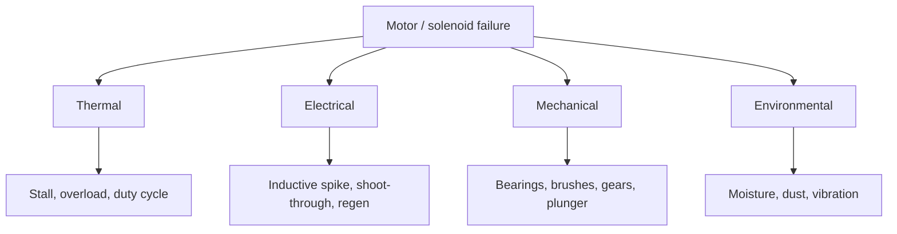

::: basics
### In plain words
Motors and solenoids are coils of copper wire that turn current into motion. They fail in four main ways. They overheat, because current turns into heat when the motion is blocked. They make voltage spikes when switched off, because a coil resists sudden changes in current. They wear mechanically, and they suffer from the environment. Each failure has a standard cure, such as current limiting, a flyback diode, or a duty-cycle limit.

### Picture it
Picture a water pipe with a heavy flow. Slam the tap shut and the moving water has nowhere to go, so pressure spikes and can burst a fitting. That is the voltage spike from switching off a coil. Now picture pushing hard against a wall: you spend lots of effort and nothing moves, so all of it becomes heat in your muscles. That is a stalled motor.

### Words you need
- **Stall**: the shaft cannot turn. With no back-EMF, only the coil's (winding's) resistance limits the current.
- **Back-EMF**: the voltage a spinning motor generates against the supply. See [[q0336]].
- **Flyback diode**: a diode across the coil that gives its current a safe path when the switch opens. See [[q0340]].
- **Duty cycle**: the fraction of time a solenoid is energized. It limits heating.

### The simplest example
A 12 V motor has a 2.4 ohm winding. At stall it draws $12 / 2.4 = 5$ A and dissipates $5^2 \times 2.4 = 60$ W. That heat goes into about 30 g of copper, which warms by roughly 5 °C per second. From 25 °C it reaches 155 °C in about 25 s, which is the limit for common insulation. Separately, switching off 1 A in a 10 mH coil in 10 µs would give a 1 kV spike with no diode or other clamp.

That is the whole idea. The rest of this page adds solenoid-specific traps, mechanical wear, and a layered protection stack: fuse, hardware current limit, firmware, and clamps.
:::

::: testing
Whether you can think like a reliability engineer: list the ways an electromagnetic actuator dies, and for each give the mechanism and a countermeasure. The interviewer wants you to group failures (thermal, electrical, mechanical, environmental), connect them to physics ($I^2R$ heating, $L\,di/dt$ spikes, wear), and propose prevention at the right level: component choice, drive circuit, firmware and mechanical design. A strong answer also mentions solenoid-specific failures (stuck plunger, duty-cycle burn-out).
:::

::: why
Motors and solenoids are among the least reliable parts in most electromechanical products, and the drive electronics are often what kills them, or what they kill. Designing a robust system means anticipating stall, overvoltage spikes, thermal limits and wear before they happen. In an interview this question reveals whether you have debugged real hardware: people who have burned a motor or popped a MOSFET with an inductive spike answer in specifics.
:::

::: concepts
- **Stall and overcurrent**: at zero speed, back-EMF is zero and current is $V/R$. See [[q0336]] and [[q0343]].
- **Inductive kick**: interrupting current in an inductor creates a voltage spike. See [[q0340]].
- **$I^2R$ heating and thermal time constant**: how fast the winding temperature rises.
- **Brush and bearing wear**: mechanical life limits. See [[q0360]].
- **Insulation ageing**: temperature shortens insulation life.
- **Protection circuits**: flyback diode, fuse, current limit, thermal cutoff. See [[q0413]].
:::

::: answer
"I'd group failures by mechanism. Thermal is the big one: if a motor stalls or is overloaded, the current is limited only by winding resistance, so a 12 V motor with a couple of ohms pulls five amps or more and heats at tens of watts in a few grams of copper, which can destroy the insulation in seconds. The same goes for a solenoid left energised too long. Prevention is current limiting, a thermal cutoff or temperature model, stall detection that shuts the drive off, and respecting duty cycle, for instance pulling in a solenoid at full voltage and then dropping to PWM hold.

Second, electrical: inductive spikes when you switch the coil off can punch through the driver, so you add a flyback diode or snubber. Voltage spikes, shoot-through in an H-bridge, and regenerative overvoltage on the supply are the others.

Third, mechanical wear: brushes and commutators wear and arc, bearings fail from load, heat and contamination, a plunger sticks, or the gears strip. Prevention is derating, correct bearing loads, sealing, and maintenance.

And environmental: moisture, dust, vibration, magnets demagnetising from heat. In design I'd use protection in hardware and firmware: fuse, current sense, thermal sensor, flyback protection, and sizing with margin."
:::

::: technical
**Thermal (most common).**
- *Stall / jam*: $I = V/R$, $P = V^2/R$. A 12 V motor with $R = 2.4\,\Omega$ draws 5 A and dissipates 60 W. For 30 g of copper winding ($c \approx 385$ J/kg·K) the adiabatic heating rate is $P/(mc) = 60/(0.03\times385) = 5.2$ K/s: from 25 °C to 155 °C in about 25 s, well before the housing warms up. 
- *Overload (running)*: sustained $I_{rms}$ above the continuous rating.
- *Solenoid duty cycle*: a DC solenoid has steady power $V^2/R$ whether or not the plunger moves; coils are rated for a duty cycle. An AC solenoid whose plunger does not seat keeps low inductance and draws high current, which is a classic burn-out.
- *Insulation ageing*: life falls roughly by half for every 10 K above rating (Montsinger rule of thumb); insulation classes (A 105 °C, B 130 °C, F 155 °C, H 180 °C) set the winding limit.

**Electrical.**
- *Inductive turn-off spike*: $v = L\,di/dt$. 1 A in 10 mH interrupted in 10 µs gives 1 kV without a clamp. Stored energy $\tfrac12LI^2$. Flyback diode, Zener-in-series, snubber or TVS. See [[q0340]].
- *H-bridge shoot-through* if both devices on one leg conduct: add dead time.
- *Regeneration*: a decelerating motor pumps energy into the supply; the bus can overvoltage.
- *Supply sag or brown-out* during inrush causes drive misbehaviour.
- *Arcing and commutator damage*: brush sparking erodes contacts and generates EMI.
- *Winding faults*: turn-to-turn shorts, open circuits, ground faults from insulation breakdown.

**Mechanical.** Bearing wear and contamination, brush/commutator wear ([[q0360]]), shaft or gear damage, rotor imbalance, plunger sticking or mechanical end-stop impact, loose magnets, thermal demagnetisation of permanent magnets.

**Environmental.** Moisture, dust, chemicals, vibration, temperature extremes.

**Prevention toolkit.** Fuse or electronic current limit; current sensing with stall detection; thermal sensor or $I^2t$ model; flyback protection; soft start; dead time; undervoltage and overvoltage lockout; duty-cycle limits; derating; sealed bearings; correct mounting and loads.

> [!UNCERTAIN]
> The "life halves per 10 K" rule is an empirical heuristic, not a law. Real insulation life depends on material, humidity and electrical stress. Class temperatures are standard categories, but each motor datasheet gives its own actual limits.
:::

::: short
"Main failure modes are thermal, electrical and mechanical. Stall or overload makes current V over R, and the winding overheats in seconds, so use current limiting, thermal protection and stall detection. Switching off the coil produces an inductive spike that kills drivers, so use a flyback diode or snubber. Brushes, bearings and plungers wear or stick, and solenoids burn out if held on beyond their duty cycle, so pull in at full voltage and hold with PWM. Derate and add fuses."
:::

::: long
"I'd sort failures by mechanism and attach a fix to each.

Thermal first, because it's the biggest. Copper heating goes as I squared R. If a motor stalls, back-EMF is zero and current is just V over R. A 12 V motor with 2.4 ohms pulls 5 A, that's 60 W into maybe 30 grams of winding, so it heats at about 5 K per second and cooks its insulation in under half a minute. Solenoids are similar: they're rated for a duty cycle and a coil left on will overheat; an AC solenoid whose plunger doesn't seat draws a lot more current and burns out. Fixes: current limiting, a thermal sensor or an I squared t model, stall detection, and driving a solenoid with a pull-in pulse then a PWM hold.

Electrical: when you turn off an inductive load, the current can't stop, so the voltage spikes. 1 A in 10 mH stopped in 10 microseconds is a kilovolt. That kills MOSFETs, so I use a flyback diode or snubber. Others: shoot-through in a bridge, so dead time; regeneration pumping up the supply on braking; brown-outs during inrush.

Mechanical: brushes and commutators wear and arc, bearings fail from heat, load and contamination, gears strip, and plungers stick. I'd derate, choose sealed bearings, use brushless where life matters, and replace brushes on schedule.

Environmental stuff like moisture, dust and vibration need sealing and conformal coating, and permanent magnets can demagnetise if overheated.

In the design I'd protect in layers: fuse, current sense with firmware limits, a temperature sensor, flyback protection and conservative ratings."
:::

::: terms
- **Stall**: shaft prevented from turning; back-EMF zero and current maximum.
- **Inrush current**: initial current surge on energising. See [[q0343]].
- **Flyback diode**: clamp that gives inductor current a path when the switch opens.
- **Duty cycle (solenoid)**: fraction of time energised, limiting coil heating.
- **Insulation class**: standard maximum winding temperature rating.
- **Shoot-through**: both devices in a half-bridge conducting at once.
- **$I^2t$ protection**: thermal model that integrates current squared over time.
- **Demagnetisation**: permanent magnet losing strength due to heat or reverse field.
:::

::: exceptional
An exceptional answer quantifies a failure (the 25-second burn-out example, the 1 kV spike), gives a specific countermeasure for each failure, and shows awareness of system-level protection (hardware backup independent of firmware). It mentions solenoid specifics (duty cycle, pull-in versus hold current, AC plunger seating), brushless versus brushed lifetime, and that failure of a protection element (like a shorted flyback diode) can be a failure mode too. It might add that monitoring trends (current, temperature, vibration) warns of failure before it happens ([[q0393]]).
:::

::: mistakes
- **Assuming a motor is safe because it is rated "12 V".** The rating is for running; stall current is $V/R$ and far higher.
- **Relying on firmware alone.** If the MCU hangs, a hardware fuse or current limit should still protect.
- **Forgetting the flyback path for solenoids.** Every inductive switch needs a clamp.
- **Holding a solenoid at full voltage.** It overheats; drop to a hold current.
- **Ignoring regeneration.** A braking motor can push the bus over its rating.
:::

::: deep
## A map of failure mechanisms


Figure: Most root causes fall into four buckets. Thermal and electrical stress are controlled by the drive; mechanical wear and environment by design and maintenance.

## Thermal: why stall burns out a motor in seconds

At stall, back-EMF is zero, so winding current is just $V/R$. That is the whole story of the "12 V, 1 Ω gives 12 A" question ([[q0342]]). Heating goes into a small mass of copper, so temperature rises fast before heat flows out to the frame. The adiabatic rise rate is $dT/dt = P/(m c)$.

```plot
{"title":"Winding temperature during a stall (adiabatic estimate)","x":{"label":"Time since stall","unit":"s","min":0,"max":40},"y":{"label":"Winding temperature","unit":"°C","min":0,"max":260},
 "vars":{"v":12,"r":2.4,"m":0.03,"c":385,"t0":25},
 "series":[{"label":"T = 25 + (V²/R)·t/(m·c)","fn":"t0+(v*v/r)*x/(m*c)"}],
 "hlines":[{"at":105,"label":"Class A 105 °C","color":"muted"},{"at":155,"label":"Class F 155 °C","color":"orange"}],
 "points":[{"x":15.4,"y":105,"label":"15 s"},{"x":25,"y":155,"label":"25 s"}]}
```
Figure: With 60 W into 30 g of copper the winding reaches class A limits in about 15 s and class F in about 25 s. Real motors have iron and housing mass and some conduction, so reality is somewhat slower, but the order of magnitude is why stall protection should trip in under a few seconds, and why thermal time constants of minutes (housing) do not protect the winding.

Counter-measures:

1. **Current limit** in the driver: limit peak current to a safe multiple of rated.
2. **Stall detection**: high current with no speed or position change for $> t_{stall}$, then shut down.
3. **$I^2t$ model**: integrate $(I^2 - I_{rated}^2)$ and trip when it exceeds a limit that represents the thermal capacity.
4. **Temperature sensing**: see [[q0396]].
5. **Right-size the motor** so normal loads are well below continuous torque.

## Solenoid specifics

A DC solenoid draws $V/R$ in steady state, independent of plunger position. At 12 V and 24 Ω, that is 0.5 A and 6 W continuously, and force is only needed while pulling in. The standard trick is high pull-in current then a reduced hold current, because holding force with the plunger seated needs far less than pull-in force across the air gap. With PWM at duty $D$ and a coil time constant long compared to the PWM period, the average current is $DV/R$ and the dissipation is $D^2V^2/R$, so $D = 0.3$ gives $0.54$ W instead of 6 W (9%).

An AC solenoid is different. Its impedance depends on the air gap: with the plunger out, inductance is small and inrush is several times the sealed current; if it jams open, the coil sees that high current continuously and burns out in seconds to minutes.

## Electrical: inductive turn-off

Interrupting current $I$ in inductance $L$ forces a voltage $v = L\,di/dt$ until the energy $\tfrac12LI^2$ has gone somewhere. With nothing to clamp it, the switch node rises until the transistor avalanches or an arc forms. For 10 mH and 1 A stopped in 10 µs the spike is $10^{-2}\times1/10^{-5} = 1000$ V in the ideal case.

```sim
{"id":"flyback-protection","protection":"none","l":0.01,"i0":1,"vsupply":12}
```
Figure: With protection set to none, the only place for the energy is the 100 pF switch-node capacitance, so the switch voltage spikes to about 10 kV in this ideal model (a real MOSFET would avalanche or arc far below that; tick the avalanche box to see it). Change to diode, zener, rc or tvs: the spike is clamped, but the current decays slower with a plain diode (the coil takes longer to de-energise, bad for solenoid release time) and faster with a Zener or TVS in the path. That trade-off is the engineering decision.

Other electrical failures:

- **Shoot-through** in a bridge: both transistors of a leg on at the same time shorts the supply. Use dead time in the gate driver.
- **Regeneration**: decelerating or an overhauling load drives current back into the supply; a battery can absorb it, a simple DC supply cannot, so the bus voltage rises. Add TVS, a brake chopper, or limit deceleration.
- **Undervoltage during inrush** can reset the controller mid-move.
- **Ground bounce and noise** from commutator arcing can upset sensors and MCUs.

## Mechanical and environmental

- **Brushes**: wear and arcing; sparking increases with current and with inductive load. Brushless motors remove this failure mode.
- **Bearings**: heat, shaft side load, contamination, bearing currents in PWM-driven AC motors.
- **Gears**: stripping in hobby servos from shock loads.
- **Plunger**: sticking from dirt, residual magnetism, or bad alignment.
- **Magnets**: overtemperature or large reverse current can partially demagnetise permanent magnets, permanently reducing $K_t$.
- **Environment**: condensation causes insulation tracking; dust jams; vibration loosens connections.

## A protection stack

1. Fuse or PTC (last resort, slow).
2. Hardware current limit or overcurrent comparator in the driver (fast, independent of firmware).
3. Firmware current/thermal supervision with stall detection.
4. Flyback or TVS clamp at every inductive switch.
5. Dead time and gate-drive protection.
6. Bus overvoltage clamp and undervoltage lockout.
7. Thermal sensor on the winding or housing.
8. Mechanical end stops and torque limiters.

The principle is *defence in depth*: no single element, especially firmware, should be the only thing between a fault and a burned motor.

## Worked example: sizing an I²t stall trip

Take the motor from the stall plot: 12 V supply, 2.4 Ω winding, 30 g of copper, and a continuous rating of 1 A. Stall current is $12/2.4 = 5$ A and stall power is $5^2\times2.4 = 60$ W. The winding's heat capacity is $mc = 0.03\times385 = 11.55$ J/K. Suppose we want the drive to cut power before the winding passes 130 °C (25 K of margin under a class F limit of 155 °C) from a 25 °C start. The heat budget is $11.55\times105 = 1213$ J.

Dividing by $R$ turns that into an $I^2t$ budget, because heat is $\int I^2R\,dt$:

$$\int (I^2 - I_{rated}^2)\,dt \le \frac{1213}{2.4} = 505\ \text{A}^2\text{s}$$

Subtracting $I_{rated}^2$ credits the heat that normal cooling can carry away at rated current. At a 5 A stall the integrand is $25-1 = 24$ A², so the trip fires after $505/24 = 21$ s. At 3 A the integrand is 8 A² and the trip waits 63 s, which is correct because a half-stalled motor heats more slowly. The firmware version is one line per control tick: `acc = max(0, acc + (i*i - IR2)*dt); if (acc > LIMIT) fault();`. The `max(0, ...)` lets the accumulator "cool" when current falls below rated.

Real copper fights back slightly. Resistance rises about 0.39 %/K, so at 130 °C the winding is $2.4\times(1+0.00393\times105) = 3.39$ Ω. At a constant 12 V the stall current falls to 3.5 A and power to 42 W. Integrating that falling power numerically, the winding needs about 24 s to reach 130 °C, not the 20 s a constant-resistance estimate gives. The simple model is conservative, which is the right direction for a protection limit. Where it breaks is on a hot start: if the motor was already warm from the previous move, the accumulator must start non-zero. A real design either leaks the accumulator with a thermal time constant of minutes or reads a temperature sensor at power-up.

## Worked example: release time versus clamp voltage

A solenoid coil of 50 mH and 24 Ω on 12 V carries 0.5 A, storing $\tfrac12LI^2 = 6.25$ mJ. Its natural time constant is $L/R = 2.08$ ms. When the switch opens, a clamp holding the coil at $V_c$ makes the current follow $i(t) = (I_0 + V_c/R)e^{-t/\tau} - V_c/R$, which reaches zero at

$$t_{off} = \tau\ln\!\left(1+\frac{I_0R}{V_c}\right)$$

| Clamp | $V_c$ | Release time | Switch sees |
|---|---|---|---|
| Plain diode | 0.7 V | 6.0 ms | 12.7 V |
| Diode + 30 V Zener | 30.7 V | 0.69 ms | 42.7 V |
| Diode + 60 V Zener | 60.7 V | 0.38 ms | 72.7 V |

```plot
{"title":"Solenoid release time vs clamp voltage (50 mH, 24 Ω, 0.5 A)","x":{"label":"Clamp voltage V_c","unit":"V","min":0.7,"max":100,"log":true},"y":{"label":"Release time","unit":"s","min":0.0002,"max":0.01,"log":true},
 "vars":{"l":0.05,"r":24,"i0":0.5},
 "series":[{"label":"t_off = (L/R)·ln(1 + I0·R/Vc)","fn":"(l/r)*ln(1+i0*r/x)"}],
 "points":[{"x":0.7,"y":0.00604,"label":"diode: 6.0 ms"},{"x":30.7,"y":0.00069,"label":"30 V Zener: 0.69 ms"}]}
```
Figure: Raising the clamp voltage shortens release time roughly as 1/V_c once V_c is well above I0·R = 12 V, with sharply diminishing returns, while the switch stress (supply plus V_c) rises one-for-one.

Nine times faster release costs a 60 V-rated switch instead of a 20 V one, and the Zener must absorb most of the 6.25 mJ per cycle (about 5 mJ with the 30 V clamp; the rest heats the coil resistance). At 10 operations per second that is only about 50 mW, but a 100 Hz valve driver would need a properly rated TVS. This is the trade-off the simulator above lets you see.

## Verifying on the bench

- **Stall current and time:** use a supply with a current limit set just above the expected stall value, clamp the shaft, and log supply current on a scope. The current should fall slowly as the winding heats, matching the tempco estimate above. Never do this with a bare winding on an unlimited supply.
- **Winding temperature without a sensor:** measure cold resistance with a 4-wire meter, run the test, switch off, and re-measure at once. The rise is $\Delta T = (R_{hot}/R_{cold}-1)/0.00393$ for copper. A reading of 3.39 Ω against 2.40 Ω means 105 K. This is how winding temperature is measured in practice, because thermocouples lag the hot spot.
- **Trip verification:** inject a fake stall by holding the shaft and confirm the fault fires at the computed time with a margin. Repeat from a warm start.
- **Switch-node spike:** probe drain-to-source with a short ground spring directly at the transistor, switch the coil off, and confirm the peak equals supply plus clamp voltage with some ringing above it. If it exceeds 80 % of the FET's $V_{DS}$ rating, change the clamp.
:::

::: applications
- **Hobby servo stall protection**: firmware limits time at high error or the servo case melts gears and motors.
- **Automotive window and seat motors**: current-based pinch and stall detection with thermal cut-outs.
- **Solenoid valves**: peak-and-hold drivers to prevent coil overheating.
- **Drone ESCs**: overcurrent and over-temperature shutdown, plus bus overvoltage handling on braking.
- **Industrial servo drives**: following-error, overcurrent, I²t and brake chopper faults.
:::

::: assumptions
The adiabatic temperature calculation assumes all heat goes into the copper mass, with constant winding resistance (resistance rises with temperature at roughly 0.39 %/K for copper, which lowers current slightly for a voltage-driven motor). The solenoid hold-power calculation assumes PWM frequency high enough for coil current to be nearly smooth. Voltage spikes are idealised: real spikes are limited by parasitic capacitance, avalanche of the switch, or arcing. Insulation class figures are standard categories; individual motors may be rated lower. For brushless motors and AC machines failure modes shift towards bearings, inverter stress and demagnetisation.
:::

::: followups
### Why does a flyback diode make a solenoid release more slowly?
With a diode across the coil the current recirculates through the diode drop (about 0.7 V), so the inductor sees roughly $-0.7$ V and decays at $di/dt = -V_D/L$, which is slow. Adding a Zener in series with the diode raises the clamp voltage, so $di/dt$ is larger and release is quicker. A TVS or active clamp does the same. This matters in fast valves or printers.

### How would you protect a motor from stall in firmware?
Sample motor current and speed or position, and shut down if current stays above a threshold for longer than a time, say 100 ms to a few seconds, while speed is near zero. Better still, integrate $I^2t$ so repeated near-limit events count, and back it up with a hardware current limit for the fast case and a thermal sensor for the slow case.

### What is a motor's biggest failure mode and how does it kill it?
Thermal: insulation fails, causing turn-to-turn shorts, which raise current in the shorted turns and cause more heating, until the winding burns out. Stall, overload, poor cooling and PWM losses all feed it.

### How would you avoid brush wear failure altogether?
Use a brushless motor with electronic commutation; its life is limited by bearings. If brushed motors are required, derate current, use precious-metal brushes for low current signal-level motors or carbon for higher power, keep the commutator clean, and add a suppressor to reduce arcing.

### Harder: your H-bridge MOSFETs fail only when the motor brakes hard. Why?
During braking or deceleration the motor acts as a generator, pushing current back into the supply. If the supply cannot sink it (a bench supply or a diode-isolated rail), the bus rises above the MOSFET rating, or the induced spike during reversal exceeds $V_{DS}$. Fix: bus clamp or brake resistor, limit deceleration rate, add bulk capacitance, use a supply or battery that can absorb current, and check that gate-drive dead time prevents shoot-through during reversal.
:::

::: interpretations
The question covers both motors and solenoids and asks for failure modes *and* avoidance. The page treats thermal, electrical, mechanical and environmental failures, with solenoid specifics. [[q0391]] covers dangers to people and equipment, and [[q0399]] and [[q0400]] cover ageing and lifetime stress.
:::

::: references
- Mohan, Undeland and Robbins, *Power Electronics*: DC motor drives and protection.
- Horowitz & Hill, *The Art of Electronics*, 3rd ed.: inductive loads and switching, flyback protection.
- IEC 60085 (electrical insulation thermal classification), by name, for insulation temperature classes.
- Motor and driver manufacturers' datasheets and application notes for stall current and protection features (vendor specific).
:::

::: rubric
- Groups failures into thermal, electrical, mechanical and environmental :: Structured thinking beats a random list.
- Explains stall current $= V/R$ and rapid winding heating :: The core physics of motor burn-out.
- Describes inductive spike and flyback clamp :: The classic driver-killing failure.
- Mentions solenoid duty cycle and pull-in/hold :: Shows knowledge beyond motors.
- Mentions brush/bearing wear and brushless as a fix :: Mechanical reliability awareness.
- Proposes layered protection (fuse, hardware limit, firmware, thermal) :: System-level design.
- Quantifies at least one failure :: Engineering credibility.
:::

::: quiz
```json
[
 {"type":"mcq","level":"fundamental","q":"Why does a stalled motor draw so much current?","options":["Friction increases resistance","Back-EMF is zero so current is limited only by winding resistance","The supply voltage rises","The magnets strengthen"],"answer":1,"explain":"Back-EMF is proportional to speed. At stall it is zero, so $I = V/R$."},
 {"type":"numeric","level":"intermediate","q":"A 12 V motor with 2.4 Ω winding resistance stalls. What power is dissipated in the winding?","answer":60,"tolerance":0.02,"unit":"W","explain":"$I = 12/2.4 = 5$ A, so $P = I^2R = 25\\times2.4 = 60$ W."},
 {"type":"numeric","level":"intermediate","q":"30 g of copper ($c = 385$ J/kg·K) receives 60 W with no heat loss. How fast does it heat up?","answer":5.19,"tolerance":0.03,"unit":"K/s","explain":"$dT/dt = P/(mc) = 60/(0.03\\times385) = 5.19$ K/s."},
 {"type":"numeric","level":"intermediate","q":"A 24 Ω solenoid coil on 12 V is held with 30 % duty PWM (coil current smooth). What is the coil dissipation in watts?","answer":0.54,"tolerance":0.03,"unit":"W","explain":"Average current is $0.3\\times0.5 = 0.15$ A, so $P = I^2R = 0.0225\\times24 = 0.54$ W (versus 6 W continuous)."},
 {"type":"truefalse","level":"advanced","q":"An AC solenoid whose plunger fails to seat will tend to draw more current than normal and may burn out.","answer":true,"explain":"Inductance is lower with the air gap open, so impedance is lower and current is several times the sealed value. Continuous high current overheats the coil."}
]
```
:::
