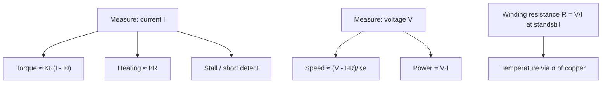

::: testing
Whether you can decide what is worth measuring and why, before reaching for sensors. The interviewer wants a short list tied to purposes: protection (current, temperature, voltage), control (speed, position, torque), efficiency and diagnostics (power, vibration, winding resistance), and for solenoids the stroke and timing signature. They also want you to notice which quantities can be *derived* from cheaper measurements (torque from current, speed from back-EMF, temperature from winding resistance).
:::

::: why
Sensors cost money, board area and wiring. A good engineer measures the minimum set that makes the system safe, controllable and maintainable. Motor current alone often gives protection, torque estimates and stall detection; temperature gives thermal protection; position or speed enables closed-loop control. Understanding what each measurement tells you is the bridge between the failure modes in [[q0390]] and the monitoring and control actions in [[q0393]] and [[q0394]].
:::

::: concepts
- **Motor equations**: $\tau = K_tI$, $V = IR + K_e\omega$ link electrical measurements to mechanical quantities. See [[q0341]].
- **Current**: sets torque and heating. See [[q0336]].
- **Temperature**: sets insulation life and magnet limits.
- **Speed and position**: needed for control; see [[q0402]].
- **Efficiency**: output mechanical power divided by input electrical power.
- **Condition monitoring**: trends in current, vibration and temperature predict failure.
:::

::: answer
"I'd start from why I'm measuring. For protection I want current, temperature and supply voltage. For control I want speed or position, and torque, which for a DC motor I can get from current because torque is roughly $K_t$ times current. For health and efficiency I want input power, and over time trends like winding resistance, vibration and the current needed for the same job.

Current is the most useful single measurement. It tells me load, detects stall and shorts, and with the torque constant gives torque. Temperature of the winding is the other critical one, because it's what actually kills motors. Voltage matters on the supply side, both undervoltage and the overvoltage you get from regeneration, and at the motor terminals for back-EMF.

Speed and position come from an encoder, Hall sensors, a tachometer, or from back-EMF without a sensor. For solenoids I'd add the stroke time and plunger position or at least detect when it's seated, because the current waveform shows a kink when the plunger moves.

If I want to get fancy: vibration or sound for bearing wear, and trend winding resistance, since copper's resistance rises with temperature, which gives winding temperature for free."
:::

::: technical
**Core set and purpose.**

| Quantity | Why | Typical method |
|---|---|---|
| Motor current (average, peak, ripple) | Torque, load, stall, short, efficiency | Shunt + amplifier, Hall sensor |
| Supply / bus voltage | Undervoltage, regeneration overvoltage, power | Divider + ADC |
| Winding / housing temperature | Thermal protection, derating | NTC, RTD, thermocouple, IR, or from resistance |
| Speed | Speed control, stall detection | Encoder, Hall, tach, back-EMF |
| Position | Position control, homing | Encoder, pot, resolver, Hall array |
| Torque | Load and process monitoring | $K_tI$ estimate, strain-gauge torque sensor |
| Vibration / sound | Bearing and imbalance faults | Accelerometer, microphone |
| Solenoid stroke / current signature | Plunger seated, sticking | Current waveform, position sensor, Hall |

**Derived quantities.**
- Electrical input power $P_{in} = VI$. Mechanical output $P_{out} = \tau\omega$. Efficiency $\eta = P_{out}/P_{in}$.
- Example: 12 V, 2 A input, 0.04 N·m at 3000 rpm ($\omega = 314$ rad/s): $P_{out} = 12.6$ W, $P_{in} = 24$ W, $\eta = 52\%$, losses 11.4 W (heat).
- Torque estimate $\tau \approx K_t(I - I_0)$ with $I_0$ no-load current. With $K_t = 0.02$ N·m/A and $I_0 = 0.2$ A, a 2 A reading is about 0.036 N·m (0.04 N·m before subtracting no-load current).
- Winding temperature from resistance: $R(T) = R_0[1+\alpha(T-T_0)]$ with $\alpha \approx 0.0039$/K for copper. 2.0 Ω at 20 °C measuring 2.6 Ω implies $\Delta T = (2.6/2.0-1)/0.00393 \approx 76$ K.
- Speed from back-EMF: $\omega = (V - IR)/K_e$ when current is measured.

**Sampling considerations.** PWM-driven motors have current ripple; measure averaged current for torque and peak for protection. Synchronise ADC sampling to the PWM (mid on-time for low-side shunts). Bandwidth requirements differ: protection needs microseconds, torque control tens of kHz, thermal monitoring seconds.

**Solenoid.** Peak current, time to pull-in (current dip when the plunger moves, caused by motional back-EMF), hold current, release time, coil resistance (heating), and stroke.

> [!UNCERTAIN]
> The temperature coefficient of copper (about 0.39 %/K near room temperature) is a standard value. Magnet-related constants ($K_t$, $K_e$) change with magnet temperature and vary by motor, so calibrate for the specific motor.
:::

::: short
"I'd measure by purpose. Protection: current, winding temperature and supply voltage. Control: speed and position from an encoder or back-EMF, and torque, which comes from current since torque is about Kt times current. Health: input power, efficiency, vibration, and trends like winding resistance, which also gives temperature. For solenoids I'd add the current waveform and stroke time to know whether the plunger actually seated. Current is the single most valuable measurement."
:::

::: long
"I'd start by asking what each measurement is for, because every sensor costs money and board area.

First, protection. Current is the key one: it detects stall, shorts and overload. Temperature of the winding is what actually destroys a motor, so I want that, either with a sensor or by inferring it from winding resistance. And supply voltage, for undervoltage and for the overvoltage you get when the motor regenerates.

Second, control. For speed or position control I need speed and position: an encoder, Hall sensors, or even back-EMF if I'm happy without a sensor. For torque control I can use current, because torque is about $K_t$ times current, minus a small no-load amount.

Third, performance and health. Input electrical power and output mechanical power give efficiency. For a 12 V, 2 A motor making 0.04 N·m at 3000 rpm, output is about 12.6 W out of 24 W in, 52 percent efficient, and the rest is heat. Over time I'd trend the current needed for the same load, winding resistance, vibration and noise, because they drift as bearings wear or insulation degrades.

For solenoids, there's an extra: the current waveform. When the plunger moves it generates back-EMF and the current dips, so the shape of the pull-in current tells me whether it moved, seated or stuck. I'd also time the stroke and keep an eye on coil resistance for heating.

If I could only have one sensor it'd be current, since it's cheap, fast and gives protection, torque and stall detection at once."
:::

::: terms
- **Torque constant $K_t$**: N·m per amp.
- **Back-EMF constant $K_e$**: volts per rad/s.
- **No-load current**: current needed to overcome friction with no load.
- **Efficiency**: mechanical output power over electrical input power.
- **Condition monitoring**: tracking measurements to detect degradation.
- **Winding temperature coefficient**: copper's roughly 0.39 %/K resistance rise.
- **Current ripple**: PWM-induced variation in motor current.
- **Current signature**: the shape of coil current versus time, revealing mechanical events.
:::

::: exceptional
An exceptional answer organises by purpose (protect, control, diagnose), identifies derived quantities (torque from current, temperature from resistance, speed from back-EMF), puts numbers on them (the 52% efficiency example, the 76 K from resistance), and notes sampling considerations (PWM ripple, synchronised sampling, bandwidth per purpose). It also mentions solenoid specific signals, and that one sensor, current, covers several needs.
:::

::: mistakes
- **Listing sensors without purposes.** Say why each is needed.
- **Measuring only current and ignoring temperature.** Slow overloads heat the motor without tripping a peak-current limit.
- **Forgetting PWM ripple.** A single ADC sample of a chopped current is garbage unless timed.
- **Treating torque as perfectly proportional to current.** Magnet temperature, saturation and friction change $K_t$ and the no-load offset.
- **Ignoring supply measurements.** Regeneration overvoltage and brown-outs are leading causes of drive faults.
:::

::: deep
## Start with what the motor equations give you for free

A DC motor has two equations that link electrical and mechanical worlds:

$$\tau = K_t\,I,\qquad V = IR + K_e\,\omega$$

with $K_t = K_e$ in SI units. Measuring current and voltage therefore already tells you torque and speed, within accuracy limits. That is the basis of sensorless methods, and the reason that current is the highest-value measurement.


Figure: Three electrical measurements (I, V, R) yield torque, speed, power, heating, stall detection and winding temperature. Dedicated sensors improve accuracy but are not always needed.

## Protection measurements

**Current.** Fast overcurrent (µs to ms) needs a hardware comparator on the shunt voltage. Slower overload (seconds to minutes) uses an $I^2t$ model in firmware. See [[q0395]] for the measurement chain.

**Temperature.** The winding is the hot spot and the thing to protect, but is hard to reach. Housing temperature lags winding temperature by the thermal time constant, so it under-reads during a fast overload. See [[q0396]], [[q0397]] and [[q0398]].

**Voltage.** Supply undervoltage causes loss of torque and drive misbehaviour; overvoltage from regeneration breaks drivers and capacitors. Measure bus voltage at the driver.

## Control measurements

**Speed.** Encoder pulses, Hall transitions, tachometer voltage or back-EMF ([[q0403]]–[[q0408]]).

**Position.** Encoder, potentiometer, resolver, absolute magnetic sensor ([[q0404]]).

**Torque.** For most systems the current estimate is adequate. For direct measurement a strain-gauge or magnetoelastic torque transducer is used, and is expensive.

## Efficiency and power

A worked example. A brushed motor at 12 V draws 2 A while delivering 0.04 N·m at 3000 rpm:

$$P_{in} = 12\times2 = 24\ \text{W},\quad \omega = \frac{3000\cdot2\pi}{60} = 314.2\ \text{rad/s},\quad P_{out} = 0.04\times314.2 = 12.6\ \text{W}$$
$$\eta = \frac{12.6}{24} = 52\%,\qquad P_{loss} = 11.4\ \text{W}$$

Splitting those losses needs the motor constants. Suppose $K_t = K_e = 0.025$ N·m/A. Back-EMF is $0.025\times314.2 = 7.9$ V, so the $IR$ drop is 4.1 V ($R \approx 2.1\,\Omega$) and copper loss is $I^2R \approx 8.3$ W. The electromagnetic torque is $K_tI = 0.05$ N·m, of which 0.04 N·m reaches the shaft, so 0.01 N·m of friction and iron-loss torque costs $0.01\times314 = 3.1$ W. Together that is the 11.4 W. Tracking loss over time is a health indicator.

```sim
{"id":"dc-motor-lab","view":"curves","v":12,"r":1.2,"kt":0.02}
```
Figure: Look at the efficiency curve against torque. Efficiency is zero at no-load and at stall, and in this low-friction model it peaks at a light load, around 5% of stall torque, then falls almost linearly toward stall. A motor running far from its peak-efficiency point wastes power, and a measurement of $V$, $I$ and speed lets you see where you are on the curve.

## Winding resistance as a thermometer

Copper's resistance rises about 0.39 % per kelvin. If you measure $R$ at a known cold temperature and again when hot, the temperature rise is

$$\Delta T = \frac{R_{hot}/R_{cold}-1}{\alpha}$$

For 2.0 Ω rising to 2.6 Ω with $\alpha = 0.00393$ /K: $\Delta T = 0.3/0.00393 = 76$ K. To measure $R$ you need either a standstill DC measurement, or an estimate from $V$ and $I$ during operation (corrupted by back-EMF unless speed is known). The method gives the *average winding temperature*, which is the one that matters for insulation.

## Health trends

Interesting slow-changing quantities:

- **Current at fixed load and speed**: rising current means rising friction (bearing wear, contamination).
- **No-load current** and noise.
- **Winding resistance**: rising unusual heat or loose connections; falling relative to expectation can point to turn-to-turn shorts.
- **Vibration spectrum**: peaks at bearing defect frequencies and 1× and 2× speed (imbalance, misalignment).
- **Insulation resistance** (megger test, offline).
- **Commutation sparking**: EMI signature in brushed motors.

## Solenoid measurements

A solenoid's current has a signature. With constant applied voltage the current rises as $i = (V/R)(1-e^{-t/\tau})$ with $\tau = L/R$; as the plunger moves, inductance rises and the motional back-EMF momentarily slows or reverses the current rise, producing a dip. When the plunger seats, the current rises again toward $V/R$.

```plot
{"title":"Solenoid pull-in current signature (illustrative shape)","x":{"label":"Time","unit":"s","min":0,"max":0.05},"y":{"label":"Coil current","unit":"A","min":0,"max":0.55},
 "vars":{"v":12,"r":24,"t1":0.004,"tm":0.012,"w":0.0035,"dip":0.07},
 "series":[{"label":"i(t): plunger moves near 12 ms","fn":"(v/r)*(1-exp(-x/t1))-dip*exp(-pow((x-tm)/w,2))"}],
 "hlines":[{"at":"v/r","label":"V/R = 0.5 A","color":"muted"}]}
```
Figure: The qualitative lesson is the dip: plunger motion makes a visible dip in an otherwise smooth exponential rise. Its presence, timing and depth tell you the plunger moved, how long it took, and whether it seated. The shape here is illustrative, not from a specific solenoid.

Missing dip means the plunger did not move (jam). A late dip means high friction or low voltage. Heating: coil resistance rises with temperature, so the final current falls slightly as the coil warms.

## Sampling and bandwidth

- Thermal: 1 Hz is plenty.
- Speed and position control: kHz.
- Torque (current) loop: 10–20 kHz or higher, synchronised to the PWM.
- Overcurrent protection: sub-µs to µs analogue comparator.
- Vibration: kHz to tens of kHz.

## Worked example: how far can you trust a sensorless estimate?

Reuse the motor from the efficiency example: $K_t = K_e = 0.025$ N·m/A, $R = 2.1$ Ω, supply 12 V, current 2 A. Rearranging $V = IR + K_e\omega$ gives the speed estimate

$$\omega = \frac{V - IR}{K_e} = \frac{12 - 2\times2.1}{0.025} = 312\ \text{rad/s} \approx 2980\ \text{rpm}$$

That agrees with the 3000 rpm in the earlier example, so the estimate works on paper. The trouble is how the answer depends on $R$. The $IR$ drop is a third of the supply, so a resistance error is amplified by $IR/(V-IR) = 4.2/7.8 \approx 0.54$ in the speed estimate. If firmware assumes 2.1 Ω but the winding has warmed to 10 % higher (2.31 Ω), the estimate is $(12-4.62)/0.025 = 295$ rad/s, 5.4 % low. After a 40 K rise (copper is 15.7 % higher, 2.43 Ω) it is 286 rad/s, 8.5 % low. Sensorless speed therefore drifts with the very temperature you are trying to monitor, and the error grows with load current because $IR$ grows. At light load and high speed, where $IR \ll V$, it is far more accurate.

Torque has a different problem. $K_tI = 0.05$ N·m is not the shaft torque, because friction and iron losses eat some. The 0.04 N·m delivered at the shaft corresponds to 1.6 A, so the 0.4 A difference is the no-load current $I_0$ (0.01 N·m of loss torque divided by $K_t$). Using $\tau = K_t(I - I_0)$ matters most at light load, where ignoring $I_0$ overstates torque by 25 % here and by much more near no-load. $I_0$ is itself speed- and temperature-dependent (grease thickens when cold), so for a precision torque measurement a load cell or torque transducer is still the answer.

## What each measurement costs

| Quantity | Typical sensor | Bandwidth needed | Main error source |
|---|---|---|---|
| Phase or bus current | Shunt + CSA | 10 kHz+ for torque loop | Offset, PWM noise |
| Bus voltage | Resistor divider + ADC | 100 Hz | Divider tolerance |
| Winding temperature | $\Delta R$ method or embedded NTC | under 1 Hz | Thermal lag, calibration |
| Speed | Encoder or Hall | 1 kHz | Quantization at low speed |
| Vibration | Accelerometer | 10 kHz+ | Mounting resonance |

Choose the cheapest measurement that bounds the failure you care about. A product that only needs "did it stall" needs just current; one that diagnoses bearing wear needs vibration or a long-term current trend.

## Verifying on the bench

- **Measure $K_e$ directly.** Spin the unpowered motor with a drill or a second motor at a known speed (measure with a tachometer or the encoder). With the winding open, read the generated voltage. At 1000 rpm (104.7 rad/s) and $K_e = 0.025$ V·s/rad you should see 2.62 V. Dividing voltage by speed gives $K_e$, and by the equality $K_t = K_e$ in SI units, $K_t$ as well.
- **Measure $R$ with a 4-wire meter,** or measure $V/I$ with the rotor locked at low current so it does not heat. Rotate the shaft to a few positions, because brush and commutator contact resistance varies with angle.
- **Find $I_0$.** Run unloaded at several speeds and plot current against speed. The intercept is the friction current.
- **Compare the estimate to a tachometer.** Log estimated speed against encoder speed across loads and temperatures. The error plot is your specification for the sensorless method.
:::

::: applications
- **Robot joint actuators**: current (torque), position, temperature and bus voltage on every joint.
- **E-bike controllers**: phase current, battery voltage, controller and motor temperature.
- **HVAC and pump predictive maintenance**: current, vibration and temperature trends.
- **Solenoid valves in process control**: coil current signature for diagnostics.
- **Servo drives**: following error, current, temperature, bus voltage and encoder health.
:::

::: assumptions
The torque estimate assumes a brushed DC (or properly commutated brushless) motor with roughly constant $K_t$ and negligible saturation; AC induction motors need a different model. The resistance-based temperature method assumes copper windings and known reference resistance; contact and cable resistance corrupt the measurement. Efficiency numbers are for the single operating point given. The solenoid current shape is illustrative: real shape depends on geometry, magnetic saturation, mechanical load and drive voltage. Required measurement bandwidth and accuracy depend on the purpose (protection vs control vs diagnostics).
:::

::: followups
### If you could only measure one thing, what would it be?
Current. It gives overload and stall protection, torque (via $K_t$), a handle on temperature through $I^2t$ and an indicator of mechanical trouble. It needs only a shunt and an amplifier. Its limits: it does not tell you position, and slow thermal problems need a model or a thermal sensor.

### How can you estimate motor speed without a sensor?
Rearrange the voltage equation: $\omega = (V - IR)/K_e$. With measured terminal voltage and current, and known $R$ and $K_e$, you get speed. It works above a minimum speed (back-EMF must be measurable), breaks down near stall, and $R$ drifts with temperature. For brushless motors, sensorless methods use zero-crossing of back-EMF. See [[q0408]].

### How would you detect that a solenoid failed to move?
Look for the current dip. Command the coil, sample the current with a fast ADC or comparator, and check for the characteristic dip at the expected time. No dip means the plunger did not move. Alternatively use a position sensor (Hall or limit switch) at the end of stroke.

### What would you trend for predictive maintenance on a pump motor?
Current at constant load, vibration spectrum, housing temperature versus load, and winding resistance. A rising current for the same flow, a growing vibration peak at bearing defect frequency or a rising temperature all indicate wear, and the trend, not a single number, gives the early warning.

### Harder: your torque estimate from current is 15% off when the motor is hot. Why?
$K_t$ falls as permanent magnets heat (ferrite and NdFeB flux declines with temperature), and friction changes, shifting the no-load offset. Winding resistance also rises, affecting voltage-based estimates. Compensate with a temperature-dependent $K_t$ from the datasheet or calibration, measure temperature, and check the current sensor's own drift and gain error.
:::

::: interpretations
"Properties" is read as electrical, thermal and mechanical quantities, since motors and solenoids are electromechanical. [[q0393]] answers how to measure them, [[q0395]] focuses on current, [[q0396]] to [[q0398]] cover temperature, and [[q0402]] onwards cover speed and position.
:::

::: references
- Mohan, Undeland and Robbins, *Power Electronics*: DC motor modelling and measurement.
- Franklin, Powell and Emami-Naeini, *Feedback Control of Dynamic Systems*: DC motor model.
- Horowitz & Hill, *The Art of Electronics*, 3rd ed.: measurement and motor sections.
- Motor datasheets for $K_t$, $K_e$, no-load current and thermal parameters (vendor specific).
:::

::: rubric
- Organises measurements by purpose (protect, control, diagnose) :: Shows systems thinking.
- Names current as the key measurement with reasons :: Most valuable single sensor.
- Mentions temperature (winding) and supply voltage :: Completes the protection set.
- Mentions speed and position for control, and sensorless options :: Closes the control loop.
- Derives quantities (torque, speed, temperature, efficiency) from electrical data :: Shows use of motor equations.
- Adds solenoid-specific measurements :: Answers the "motor/solenoid" scope.
- Mentions sampling bandwidth and PWM synchronisation :: Practical competence.
:::

::: quiz
```json
[
 {"type":"mcq","level":"fundamental","q":"Which single measurement gives torque, stall detection and overload protection for a DC motor?","options":["Temperature","Current","Humidity","Shaft angle"],"answer":1,"explain":"Torque is proportional to current, stall shows up as high current, and overload heating goes as $I^2R$."},
 {"type":"numeric","level":"intermediate","q":"A motor at 12 V draws 2 A and delivers 0.04 N·m at 3000 rpm. What is its efficiency (percent)?","answer":52.4,"tolerance":0.03,"unit":"%","explain":"$P_{out} = 0.04\\times314.16 = 12.57$ W, $P_{in} = 24$ W, $\\eta = 52.4\\%$."},
 {"type":"numeric","level":"intermediate","q":"A copper winding measures 2.0 Ω at 20 °C and 2.6 Ω when hot ($\\alpha = 0.00393$/K). What is the temperature rise in K?","answer":76.3,"tolerance":0.03,"unit":"K","explain":"$\\Delta T = (2.6/2.0-1)/0.00393 = 76.3$ K."},
 {"type":"numeric","level":"intermediate","q":"A motor with $K_t = 0.02$ N·m/A draws 2.5 A (ignore no-load current). What torque does it produce?","answer":0.05,"tolerance":0.02,"unit":"N·m","explain":"$\\tau = K_tI = 0.02\\times2.5 = 0.05$ N·m."},
 {"type":"truefalse","level":"advanced","q":"A dip in a solenoid's rising coil current indicates plunger motion generating back-EMF.","answer":true,"explain":"A moving plunger changes inductance and induces a motional voltage, which opposes the applied voltage and slows or reverses the current rise momentarily."}
]
```
:::
