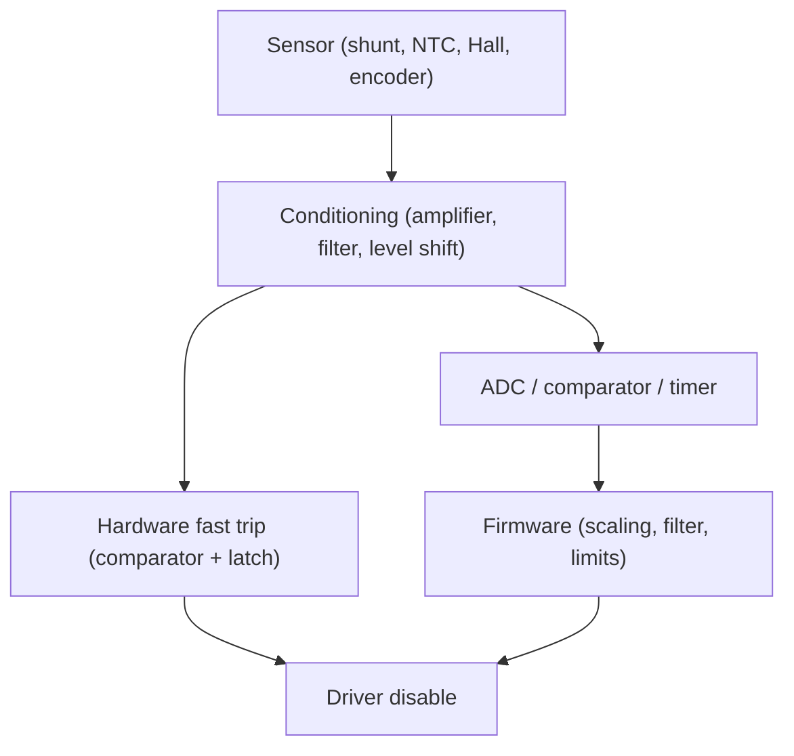

::: basics
### In plain words
To monitor a motor, you build a small sensing chain for each quantity you care about. A sensor turns the physical thing into a tiny electrical signal. An amplifier or filter makes the signal usable. Then an ADC (a converter from voltage to a number) hands it to the microcontroller. For current, the usual sensor is a very small resistor called a shunt. For temperature, it is often a thermistor.

### Picture it
Imagine measuring how fast water flows in a pipe by squeezing in one short, narrow section and reading the tiny pressure difference across it. The difference is small, so you attach a magnifying gauge to make it readable. The shunt is the narrow section, and the amplifier is the magnifier.

### Words you need
- **Shunt resistor**: a tiny resistor in the current path. Its voltage drop, $V = I \times R$, measures the current.
- **Current-sense amplifier**: an amplifier built to boost that small voltage drop.
- **ADC**: a converter that turns a voltage into a number the microcontroller can read.
- **NTC thermistor**: a resistor whose resistance falls as it warms. It is cheap and sensitive.
- **Kelvin connection**: wiring the sense lines straight to the two ends of the shunt, so trace resistance adds no error.

### The simplest example
Pass 10 A through a 5 mΩ shunt. The drop is $10 \times 0.005 = 0.05$ V, or 50 mV. The shunt also burns $10^2 \times 0.005 = 0.5$ W. An amplifier with a gain of 50 turns 50 mV into 2.5 V, which fits a 3.3 V ADC. A 12-bit ADC has steps of about 0.8 mV, so each step is about 3.2 mA of motor current.

That is the whole idea: small signal, amplify, digitize. The rest of this page adds high-side versus low-side shunts, Hall sensors, thermistor dividers, sampling in the middle of the PWM on-time, and a fast hardware trip.
:::

::: testing
Whether you can turn the "what to measure" list from [[q0392]] into a concrete sensing chain: which sensor for each quantity, how its signal gets conditioned and digitised, and what the trade-offs are (accuracy, bandwidth, isolation, cost, intrusiveness). Good answers walk through sensor, conditioning (amplifier, filter, level), ADC or comparator, and processor, and mention PWM noise, common-mode voltage and isolation.
:::

::: why
In a real product you rarely choose "a sensor"; you choose a chain that has to survive switching noise, high common-mode voltages and tight board space, and still deliver a number the firmware can trust. Many field failures of motor controllers trace back to bad measurement: wrong shunt layout, aliasing of PWM ripple, thermistor self-heating, wiring noise. Interviewers use this question to see if you can name components and think about signal integrity.
:::

::: concepts
- **Shunt + current-sense amplifier**: converts current to voltage. See [[q0443]] and [[q0449]].
- **Hall-effect and magnetic current sensors**: isolated current measurement. See [[q0441]].
- **Thermistors, RTDs, thermocouples, IR**: temperature sensing options. See [[q0396]].
- **Encoders, Hall switches, tachometers**: speed and position. See [[q0405]].
- **ADC, comparator and filtering**: turning analogue signals into decisions.
- **Isolation**: separating sensor from the MCU when voltages are high. See [[q0432]].
:::

::: answer
"I'd build one sensing chain per quantity. For current, the standard is a low-value shunt resistor in the motor's return path or in series with the supply, a current-sense amplifier to boost the tiny millivolt signal, and the MCU's ADC to read it, with a comparator for fast overcurrent trips. If I need isolation or a high-voltage bus, I'd use a Hall-effect current sensor instead.

For temperature, an NTC thermistor glued to the housing or wedged against the windings is cheap and easy: a divider and an ADC pin. For higher accuracy or range I'd use an RTD, and a thermocouple for very hot spots. An IR sensor if I can't touch it.

For speed and position, an encoder or Hall sensors, read by a timer in quadrature mode. For bus voltage a resistor divider to the ADC. For vibration, a MEMS accelerometer on the housing.

The things that bite in practice: PWM noise, so sample at the right moment or filter; common-mode voltage on high-side shunts, so use an amplifier rated for it; grounding and shunt layout with a Kelvin connection; and thermistor self-heating and linearisation."
:::

::: technical
**Current.**
- *Shunt + CSA*: $V_s = I R_s$, $V_{out} = G V_s$. Example: 10 A, $R_s = 5\,\text{m}\Omega$, $G = 50$: $V_s = 50$ mV, $V_{out} = 2.5$ V, shunt dissipation $I^2R = 0.5$ W; with a 12-bit, 3.3 V ADC the resolution is $3.3/4096/(R_sG) = 3.2$ mA/LSB.
- *Low-side vs high-side*: low-side is easy (common-mode near ground) but shifts the motor's ground and misses shorts to ground; high-side needs a CSA rated for the bus common-mode voltage. See [[q0447]].
- *Hall / magnetic*: isolated, no insertion loss, lower accuracy and bandwidth limits, offset drift. See [[q0441]].
- *MOSFET $R_{DS(on)}$ sensing*: no extra resistor but temperature-dependent and inaccurate. See [[q0448]].

**Voltage.** Divider to ADC with a filter capacitor; ratio sets full-scale; keep divider impedance low enough for the ADC.

**Temperature.**
- *NTC thermistor*: $R(T) = R_0\exp\!\left[B\left(\tfrac1T-\tfrac1{T_0}\right)\right]$ in kelvin. Highly sensitive, nonlinear, cheap. Self-heating $P = V^2/R$ must be small.
- *RTD (Pt100/Pt1000)*: linear, accurate, needs excitation and amplification.
- *Thermocouple*: wide range, small voltage, needs cold-junction compensation.
- *Digital IC sensor* on the board: easy, but measures board not winding.
- *IR (non-contact)*: see [[q0398]].
- *Winding resistance*: no sensor at all ([[q0392]]).

**Speed/position.** Quadrature encoder (A/B/Z) into a timer in encoder mode; Hall sensors in BLDC motors; resolver for harsh environments; tachogenerator (voltage proportional to speed); back-EMF sensing.

**Vibration/sound.** MEMS accelerometer (with FFT), piezo sensor, microphone.

**Solenoid stroke.** Hall sensor and magnet, limit switch, LVDT or current signature.

**Conditioning and acquisition.**
- Synchronise ADC sampling to the PWM (centre of on-time for low-side sensing) or use an RC / digital filter with a corner well below the PWM frequency and above the control bandwidth.
- Anti-alias before sampling; choose sampling rate $> 2\times$ the highest content you want.
- Fast protection: comparator on the amplified shunt voltage with hardware latch, ignoring ringing with blanking.
- Calibrate offset and gain at power-up (zero current).

> [!UNCERTAIN]
> Accuracy and bandwidth figures for sensor families (Hall, fluxgate, CSAs) differ widely by part. Use the numbers on the datasheet of the sensor you select; the figures here are example calculations.
:::

::: short
"One chain per quantity. Current: low-value shunt, current-sense amplifier and ADC, with a comparator for fast trips, or a Hall sensor if I need isolation. Temperature: NTC thermistor on the housing through a divider, RTD or thermocouple for accuracy or range, IR if contactless. Speed and position: encoder or Hall sensors into a timer. Bus voltage: divider to ADC. Vibration: accelerometer. I'd synchronise sampling to the PWM, filter, and watch common-mode voltage and layout."
:::

::: long
"I think of it as one sensing chain per quantity: sensor, conditioning, converter, and then firmware.

Current is the most important. The standard is a small shunt resistor, a few milliohms, in the motor return or supply path. The voltage across it is tiny: 10 A through 5 milliohms is 50 millivolts, so a current-sense amplifier with a gain of about 50 brings that to 2.5 volts for a 3.3 V ADC. I'd also send the amplified signal to a comparator for a hardware overcurrent trip that doesn't wait for firmware. If the bus is high voltage or I need isolation, I'd use a Hall-effect sensor, which has no insertion loss but is less accurate.

Temperature: an NTC thermistor is the cheapest, a divider and an ADC pin; I'd mount it on the motor housing or against the winding and linearise in firmware. For better accuracy or range there are RTDs and thermocouples, and IR sensors if I can't touch the part.

For speed and position, a quadrature encoder or Hall sensors read by a timer in encoder mode. Bus voltage is a divider to an ADC. Vibration uses a MEMS accelerometer.

The practical issues: PWM makes the current choppy, so I sample at the centre of the on-time or filter it; a high-side shunt needs an amplifier rated for the bus voltage; the shunt needs a Kelvin connection so I measure the resistor, not the trace; thermistors self-heat if you drive them too hard; and I'd calibrate offsets at zero current on power-up."
:::

::: terms
- **Shunt resistor**: low-value resistor whose voltage drop measures current.
- **Current-sense amplifier (CSA)**: amplifier designed for small differential signals on a high common-mode voltage.
- **Hall-effect sensor**: measures magnetic field and so current or position without contact.
- **NTC thermistor**: resistor whose resistance falls with temperature.
- **RTD**: resistance temperature detector, e.g. platinum Pt100.
- **Kelvin connection**: four-wire connection separating current and sense paths.
- **Blanking**: ignoring a comparator for a short time after switching to avoid false trips.
- **Common-mode voltage**: voltage shared by both inputs of an amplifier.
:::

::: exceptional
An exceptional answer gives a worked chain with numbers (10 A, 5 mΩ, gain 50, 12-bit ADC, 3.2 mA/LSB, 0.5 W in the shunt), contrasts high-side and low-side shunts, and mentions PWM synchronisation and Kelvin layout. It selects the temperature sensor based on range, accuracy and mounting, includes self-heating and linearisation, and adds a hardware fast-trip path independent of firmware. It also treats isolation and calibration.
:::

::: mistakes
- **Reading the ADC at a random moment in the PWM cycle.** The chopped current gives garbage; synchronise or filter.
- **Forgetting the shunt's power and heat.** $I^2R$ in the shunt and its temperature coefficient matter.
- **Bad shunt layout.** Without a Kelvin connection, trace resistance adds error.
- **Using a regular op-amp for high-side sensing.** Common-mode voltage can exceed the input range.
- **Driving a thermistor too hard.** Self-heating shifts the reading.
- **Skipping offset calibration.** CSA offset is a large error at small currents.
:::

::: deep
## The measurement chain


Figure: Every quantity has the same skeleton. Note the parallel hardware path: fast faults must not wait for the ADC and firmware loop.

## Current: shunt, amplifier, ADC

```circuit
{"caption":"Low-side shunt measurement with current-sense amplifier","elements":[
 {"t":"rail","at":[6,0],"label":"V_{bat}","dir":"up"},
 {"t":"wire","pts":[[6,0],[6,1]]},
 {"t":"wire","pts":[[6,0],[9,0],[9,1]]},{"t":"dot","at":[6,0]},
 {"t":"M","a":[6,1],"b":[6,5]},
 {"t":"D","a":[9,5],"b":[9,1],"label":"D_1"},
 {"t":"wire","pts":[[6,5],[9,5]]},{"t":"dot","at":[6,5]},
 {"t":"wire","pts":[[6,5],[6,6]]},
 {"t":"nmos","at":[4,8],"label":"Q1"},
 {"t":"term","at":[0,8],"label":"PWM","side":"left"},
 {"t":"wire","pts":[[0,8],[4,8]]},
 {"t":"R","a":[6,10],"b":[6,14],"label":"R_s","value":"5 mΩ","labelSide":"other"},
 {"t":"gnd","at":[6,14]},
 {"t":"wire","pts":[[6,10],[10,10]]},{"t":"dot","at":[6,10]},
 {"t":"wire","pts":[[6,14],[8,14],[8,12],[10,12]]},{"t":"dot","at":[6,14]},
 {"t":"box","at":[10,9],"w":6,"h":4,"label":"CSA","pins":[{"side":"left","pos":1,"name":"IN+"},{"side":"left","pos":3,"name":"IN−"},{"side":"right","pos":2,"name":"OUT"}]},
 {"t":"wire","pts":[[16,11],[19,11]]},
 {"t":"term","at":[19,11],"label":"to ADC","side":"right"}
]}
```
Figure: The shunt sits between the MOSFET source and ground, so the current-sense amplifier's inputs are near ground. The sense wires go to the two ends of the shunt (Kelvin connection) rather than to somewhere along the ground trace. The flyback diode returns current around the motor and the MOSFET, but not through the shunt in this arrangement, so the shunt measures only the on-state current. See [[q0447]] for high-side versus low-side trade-offs.

Numbers: $I = 10$ A, $R_s = 5$ mΩ gives $V_s = 50$ mV, power 0.5 W. Gain 50 gives 2.5 V, leaving headroom to 3.3 V full scale for about 13 A. One ADC LSB on 12 bits is 0.806 mV, so the current resolution is $0.806\text{ mV}/(50\times5\text{ mΩ}) = 3.2$ mA. Offset errors of a few hundred microvolts at the CSA input, multiplied by 50, are tens of millivolts at the output, i.e. tens of mA, so you calibrate zero current.

Because a low-side shunt with a flyback diode around the motor only sees on-time current, the measurement is meaningful only while the low-side FET conducts. Sample at the centre of the on-time. A high-side or in-line shunt sees the motor current during both phases.

```sim
{"id":"current-sense","imax":10,"imin":0.05,"rsense":0.005,"gain":50,"bits":12,"vref":3.3,"side":"low"}
```
Figure: Check the headroom (amplified voltage versus ADC range), the resolution in mA/LSB and the shunt power. Move imax and rsense: a bigger shunt improves resolution but wastes power; a smaller one saves power but costs resolution unless you raise the gain.

## Isolation and Hall sensors

A Hall-effect current sensor measures the magnetic field of the current, either with the conductor passing through a magnetic core (module sensors) or with the current flowing through a short lead-frame path inside the IC package; the output is a voltage proportional to current. It gives galvanic isolation and no series resistance, which is attractive on high-voltage buses and for large currents. Disadvantages are offset drift, limited bandwidth in cheap parts, size and cost. See [[q0441]] and [[q0442]] for the trade-offs.

## Temperature: an NTC divider

```circuit
{"caption":"NTC thermistor divider to an ADC","elements":[
 {"t":"rail","at":[0,0],"label":"3.3 V","dir":"up"},
 {"t":"wire","pts":[[0,0],[0,1]]},
 {"t":"thermistor","a":[0,1],"b":[0,5],"label":"NTC","value":"10 kΩ @ 25 °C"},
 {"t":"R","a":[0,5],"b":[0,9],"label":"R_1","value":"10 kΩ"},
 {"t":"gnd","at":[0,9]},
 {"t":"wire","pts":[[0,5],[4,5]]},{"t":"dot","at":[0,5]},
 {"t":"term","at":[4,5],"label":"to ADC","side":"right"}
]}
```
Figure: With the NTC on top, the ADC voltage rises with temperature. With the NTC on the bottom it falls. Either works; choose by which end of the range needs more resolution.

The NTC model is $R(T) = R_0\exp[B(1/T - 1/T_0)]$. For $R_0 = 10$ kΩ at 25 °C and $B = 3950$ K (a common value, check the datasheet), the divider voltage is:

```plot
{"title":"NTC divider output vs temperature (NTC on top, 10 kΩ bottom, 3.3 V)","x":{"label":"Temperature","unit":"°C","min":0,"max":150},"y":{"label":"V_ADC","unit":"V","min":0,"max":3.4},
 "vars":{"b":3950,"r0":10000,"t0":298.15,"rb":10000,"vcc":3.3},
 "series":[{"label":"V = Vcc·R1/(R_NTC+R1)","fn":"vcc*rb/(r0*exp(b*(1/(x+273.15)-1/t0))+rb)"}],
 "points":[{"x":25,"y":1.65,"label":"25 °C: 1.65 V"},{"x":100,"y":3.085,"label":"100 °C: 3.09 V"}]}
```
Figure: The response is steep near room temperature (about 28 mV/K between 25 and 60 °C) and flattens above 100 °C (about 3 mV/K between 100 and 150 °C). For a motor-protection threshold near 120 to 150 °C you want a resistor value and divider that put the steep part of the curve where you need it, or a different sensor. Linearise with a lookup table or the Steinhart-Hart equation.

Self-heating: 3.3 V across two 10 kΩ at 25 °C puts 0.27 mW in the NTC. That is small, but a high-value thermistor in still air with a dissipation constant of a few mW/K could read a fraction of a kelvin high. Keep it small.

## Speed and position

Quadrature encoder A/B into a timer's encoder interface gives counts in hardware; speed is counts per window or time between edges ([[q0405]]). BLDC motors have three Hall sensors for commutation and coarse speed. Back-EMF sensing needs no sensor but works only above a minimum speed ([[q0408]]).

## Practical issues

1. **PWM noise**: sample synchronously, filter with RC below the PWM frequency.
2. **Common-mode**: pick a CSA whose input common-mode range covers the bus (for high-side sensing).
3. **Ground bounce**: put the sense ground at the shunt, route sense lines as a pair.
4. **Calibration**: measure zero-current offset at start-up when the driver is off.
5. **Isolation**: for high-voltage drives use isolated amplifiers or digital isolators for the MCU interface ([[q0432]]).
6. **Redundancy**: safety functions get independent hardware paths.

## Worked example: choosing the NTC divider for a 120 °C trip

The default 10 kΩ/10 kΩ divider is centered on 25 °C, where the NTC and the fixed resistor are equal and the slope is steepest. A motor-protection threshold of 120 °C lives far out on the flat part. Use $B = 3950$ K (typical, check the datasheet). The thermistor falls to 2486 Ω at 60 °C, 698 Ω at 100 °C, 407 Ω at 120 °C and 200 Ω at 150 °C.

With the 10 kΩ bottom resistor the divider gives 3.171 V at 120 °C and a slope of just 3.2 mV/K. A 12-bit, 3.3 V ADC has an LSB of 0.806 mV, so one count is 0.25 K. That sounds fine until you add analog noise: ADC noise or 5 mV of ripple pickup shifts the reading by 1.6 K. (Component tolerances are a separate budget that the divider choice does not fix: near 120 °C each 1 % of resistor or thermistor tolerance is about 0.4 K, and a ±1 % B tolerance adds about 1.3 K.)

Now choose the fixed resistor equal to the NTC value at the temperature that matters, $R_b = 407$ Ω. The output is 1.650 V at 120 °C (mid-scale, so it is also far from the rails), the slope is 21 mV/K, and one LSB is 0.038 K. That is a gain of 6.6 in sensitivity at the point of interest. The cost is the other end: at 25 °C the output is only 0.129 V, so cold readings are compressed and a 12-bit ADC is no longer ideal for ambient temperature. That is acceptable for an overtemperature trip, which only has to be accurate near the threshold. The second cost is self-heating: at 120 °C the NTC drops 1.65 V across 407 Ω, so it dissipates 6.7 mW, against about 0.04 mW in the 10 kΩ divider at the same temperature. With a typical dissipation constant of a few mW/K that is a self-heating error of one to a few kelvin, so reduce the excitation by using a lower reference or by pulsing the divider only when sampling.

General rule: put the divider's midpoint where you need resolution, and verify the resulting self-heating before you commit.

## Worked example: where in the PWM period to sample current

Use the low-side shunt circuit above with 20 kHz PWM, duty $D = 0.4$, a motor of 0.5 mH and 0.2 Ω on a 12 V bus, and a 5 mΩ shunt with gain 50. The on-time is $0.4\times50\ \mu\text{s} = 20\ \mu$s. In steady state the motor sees an average of $DV_{bus} = 4.8$ V (the sum of its $IR$ drop and back-EMF), so during the on-time the inductor current ramps with slope $(12-4.8)/0.5\text{ mH} = 14.4$ A/ms. Across 20 µs that is a 0.29 A peak-to-peak ripple. Sampling at the middle of the on-time returns the cycle-average current, because for a triangular ripple the midpoint of the rising ramp equals the mean. Sampling at the start or end misreads by half the ripple, ±0.14 A, which is 2.9 % of a 5 A load and large enough to disturb a tight current loop.

The conditioning must be fast enough: the CSA output has to settle within a fraction of the 20 µs on-time, so a CSA with a 1 µs settling time is acceptable but a 20 µs one is not. Switching edges also inject a spike lasting some hundreds of nanoseconds, so a blanking window right after turn-on is normal. At low duty the on-time can become too short to sample at all, and firmware must either hold the last value or switch to a different sensing position.

## Verifying on the bench

- **Zero and span check:** with the driver disabled, record the ADC code (the offset); then pass a known DC current from a bench supply through a series ammeter and verify the scaled reading across the range. A fit through two or three points gives gain and offset calibration constants.
- **Sampling-point check:** toggle a spare GPIO at the ADC trigger and put it on the scope next to the gate drive and the CSA output. The trigger edge should land in the middle of the flat on-time portion, past the switching spike.
- **Temperature check:** compare the NTC reading with a thermocouple at ice water (0 °C), room temperature and an oven or hot plate point near the trip threshold. Allow soak time, since a motor or a thermistor body lags.
- **Fault path:** apply a short on the sense input and confirm the hardware comparator disables the driver without firmware, with the measured latency within the datasheet limit.
:::

::: applications
- **E-bike controller**: shunt and CSA for phase and battery current, NTC on the controller and motor.
- **Servo drive**: Hall or shunt current sensing synchronised to PWM, encoder feedback, thermistor in the motor, bus voltage divider.
- **Automotive actuators**: integrated driver ICs with on-chip current monitor and temperature flags.
- **Solenoid valve controller**: current-sense amplifier for peak-and-hold regulation and diagnostics.
- **Condition monitoring boxes on pumps**: current clamp, accelerometer and temperature probe.
:::

::: assumptions
The chain examples assume a brushed DC motor driven by a low-side MOSFET with a flyback diode; high-side, bridge and three-phase systems use in-line or phase shunts and different timing. Sensor choice depends on voltage, current, accuracy, bandwidth, isolation and cost. The NTC value of $B$ is a typical datasheet number; actual parts have different $B$ and tolerance. Resolution figures ignore amplifier noise and offset, which dominate at small currents. Isolation requirements follow from the system voltage and applicable safety standard, not a fixed rule.
:::

::: followups
### Why sample current in the middle of the PWM on-time?
In a low-side-shunt arrangement the shunt carries motor current only while the low-side FET is on, and the switching edges inject ringing. The middle of the on-time is the quietest point and, for an inductive load, the instantaneous current there is close to the average over the period (for a triangular ripple). Triggering the ADC from the timer's centre-aligned PWM achieves this.

### High-side or low-side shunt?
Low-side: easy, simple amplifier, but shifts the ground reference and cannot see a short from the motor terminal to ground. High-side: sees the supply current and ground faults, keeps the motor grounded, but needs a CSA with high common-mode range. In-line (phase) sensing is best for torque control but needs a high common-mode, fast CSA. See [[q0447]].

### How do you make a thermistor reading more linear?
Use the Steinhart-Hart equation or a lookup table in firmware; or place a fixed resistor in parallel to flatten the curve over a narrow range; or use an RTD or digital sensor that is linear. Pick the divider resistor equal to the NTC's value near the temperature of interest to maximise sensitivity there.

### What is a cheap way to know a motor is stalled without a position sensor?
Watch current and back-EMF: high current plus low back-EMF (or constant measured position) for more than a set time means stall. Debounce so inrush at start does not count. Combine with a thermal model.

### Harder: your current reading jumps whenever the motor starts, though the load is light. What do you check?
Start with sampling time against the PWM edges: ringing and the CSA's settling after the FET switches. Check the ground return: the shunt's sense traces should be Kelvin-connected, and large di/dt in shared copper adds inductive voltage ($L\,di/dt$). Look for CSA saturation or common-mode overload, input filter bandwidth against PWM, and supply sag at start-up that moves the ADC reference.
:::

::: interpretations
"How can these properties be monitored? What sensors/components can you use?" asks for the sensing hardware chain. The deep treatment of temperature sensing and non-contact methods is in [[q0396]], [[q0397]] and [[q0398]], and the current chain is expanded in [[q0395]].
:::

::: references
- Horowitz & Hill, *The Art of Electronics*, 3rd ed.: thermistors, current sensing and measurement chapters.
- Texas Instruments and Analog Devices current-sense amplifier datasheets and application notes (specifics depend on the part chosen).
- Thermistor manufacturers' datasheets for $R$-$T$ tables and $B$ values; Steinhart-Hart equation in standard instrumentation texts.
- Mohan, Undeland and Robbins, *Power Electronics*: motor drive sensing.
:::

::: rubric
- Describes a current chain: shunt, CSA, ADC (plus comparator) :: The canonical answer for motor current.
- Mentions Hall or isolated current sensing as an alternative :: Shows awareness of isolation.
- Selects a temperature sensor by need (NTC, RTD, thermocouple, IR) :: Matches sensor to requirement.
- Includes speed/position sensors (encoder, Hall, back-EMF) :: Complete monitoring set.
- Addresses PWM synchronisation and filtering :: Real-world measurement skill.
- Addresses common-mode, Kelvin layout and calibration :: Shows hands-on experience.
- Provides numbers for the chain :: Confirms understanding.
:::

::: quiz
```json
[
 {"type":"mcq","level":"fundamental","q":"What is the role of the current-sense amplifier in a shunt measurement?","options":["Isolate the motor","Amplify the small shunt voltage to fit the ADC range","Generate PWM","Store energy"],"answer":1,"explain":"The shunt voltage is only millivolts; the amplifier scales it to use the ADC input range and rejects common-mode voltage."},
 {"type":"numeric","level":"intermediate","q":"A 5 mΩ shunt carries 10 A. What power does it dissipate?","answer":0.5,"tolerance":0.02,"unit":"W","explain":"$P = I^2R = 100\\times0.005 = 0.5$ W."},
 {"type":"numeric","level":"intermediate","q":"With a 5 mΩ shunt, gain 50, 12-bit ADC and 3.3 V reference, what is the current resolution in mA per LSB?","answer":3.22,"tolerance":0.03,"unit":"mA","explain":"LSB = 3.3/4096 = 0.806 mV; divide by $R_sG = 0.25$ V/A gives 3.22 mA."},
 {"type":"mcq","level":"intermediate","q":"Why sample a low-side shunt at the centre of the PWM on-time?","options":["The motor is off then","It avoids switching ringing and approximates the average current","The ADC is faster then","The supply is highest then"],"answer":1,"explain":"The on-time centre is away from the switching edges, and for a triangular ripple it equals the cycle-average current."},
 {"type":"truefalse","level":"advanced","q":"A Hall-effect current sensor adds series resistance to the motor circuit, like a shunt.","answer":false,"explain":"A Hall sensor measures the magnetic field around the conductor, so it provides isolation with negligible insertion loss, at the cost of accuracy, offset drift and bandwidth limits."}
]
```
:::
