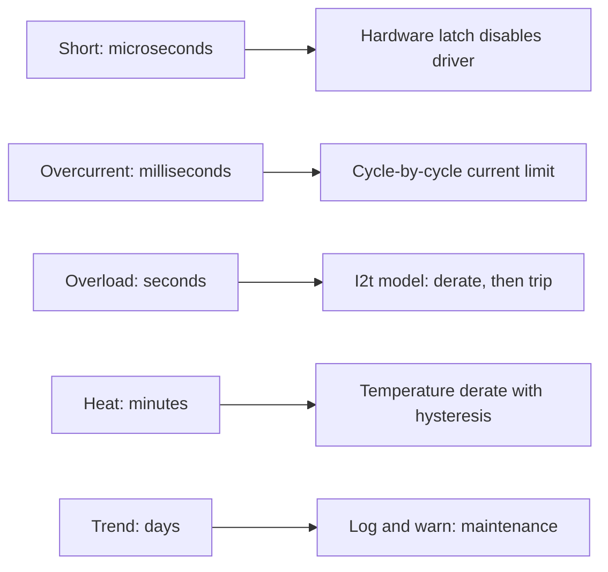
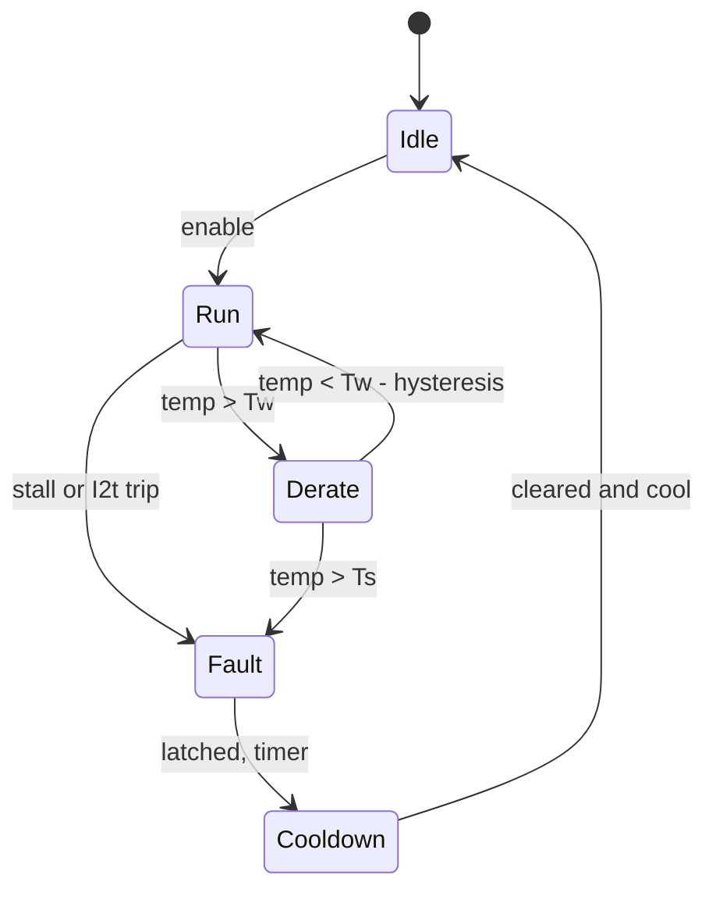

::: basics
### In plain words
Acting on monitoring data means turning a reading into a response that fits how bad and how fast the problem is. A short circuit needs an instant hardware cutoff. A slow overheating needs a gentle reduction in current and, if it keeps rising, a shutdown. A stall needs a stop and a limited number of retries. You choose thresholds carefully, so the system does not trip on harmless events.

### Picture it
Picture a bucket with a small hole in the bottom. Water poured in is the heat made by current. Water leaking out is the heat the motor sheds to the air. A little extra pouring for a short time is fine, because the bucket just fills a bit. Pour too much for too long and it overflows, which means overheating. The protection watches the water level, not the instantaneous pour rate.

### Words you need
- **Hardware trip**: a comparator and latch that disable the driver in microseconds, with no firmware involved.
- **$I^2t$ model**: a running total of squared current over time, which estimates accumulated heat.
- **Derating**: smoothly lowering the allowed current as temperature rises.
- **Hysteresis**: different trip and reset points, so the system does not chatter on and off.
- **Blanking**: ignoring a signal briefly, such as start-up inrush, so it does not look like a fault.

### The simplest example
Take a winding of 2.4 ohms that warms 5 K for each watt, with a 105 K rise limit. Its continuous capability is about 2.96 A. At 5 A the model reaches the limit after about 52 s. At 4 A it takes about 95 s. So the controller tolerates a short 5 A burst, and trips only if the overload lasts. One fixed current threshold cannot do that.

That is the whole idea. The rest of this page adds the severity ladder, stall detection, derating curves, adapting to supply droop, solenoid peak-and-hold, and a state machine with a cool-down.
:::

::: testing
Whether you can close the loop between measurement and action. The interviewer wants a menu of responses ordered by severity (log, derate, limit, stop, latch), each tied to a signal, plus the engineering judgement to choose thresholds, add hysteresis and delays, avoid nuisance trips, and keep hardware backups independent of firmware. The best answers also show a thermal model ($I^2t$ or an RC model) rather than a single temperature threshold, and mention solenoid-specific actions such as peak-and-hold.
:::

::: why
Sensors without responses are just diagnostics. A product that merely reads a temperature does not stop a stalled motor from cooking. Conversely, a controller that trips too eagerly annoys users, and one that never trips breaks hardware. Designing the thresholds, timers and recovery behaviour is a large part of firmware for actuators, and it is a good test of whether you understand the physics (thermal time constants, inrush) well enough to avoid false trips.
:::

::: concepts
- **Current limiting and foldback**: cap or reduce current when overloaded. See [[q0454]] and [[q0456]].
- **Thermal modelling**: winding temperature as a first-order lag of $I^2R$. See [[q0396]].
- **Stall detection**: high current, low speed, for longer than a timer. See [[q0336]].
- **Feedforward and regulation**: compensating for supply voltage and temperature.
- **Fault state machine**: states and transitions for run, derate, fault, recovery.
- **Solenoid drive optimisation**: pull-in then hold. See [[q0415]].
:::

::: answer
"I'd make the response proportional to how bad and how fast the problem is. For quick, severe events like a short circuit, a hardware comparator trips the driver within microseconds, independent of firmware. For overcurrent in normal operation, firmware limits the current, either with a cap or by reducing the PWM, so the motor delivers its peak torque but not more.

For slow problems, like heating, I use a thermal model or a temperature reading and derate: as the winding gets warm, I reduce the current limit smoothly rather than cutting out at one threshold, and if it keeps rising I shut down and latch until it cools with some hysteresis.

For stalls: high current and no motion for more than a set time means stop, wait, maybe retry a couple of times, then latch a fault. For jams on start-up I might try a reversal.

I'd also adapt behaviour: compensate for supply droop so speed doesn't sag, limit acceleration when the bus voltage is low, limit deceleration to avoid regeneration overvoltage. For solenoids, I'd pull in at full voltage then drop to PWM hold to save heat, and check the current signature to detect a stuck plunger.

Then log events and warn the user, because trends tell you maintenance is due."
:::

::: technical
**Response ladder.**

| Condition | Signal | Action |
|---|---|---|
| Short circuit / shoot-through | Comparator on shunt, µs | Hardware latch, disable driver |
| Overcurrent (peak) | Cycle-by-cycle current | PWM chop, current limit |
| Overload (sustained) | $I^2t$ accumulator | Derate, then trip |
| Overtemperature | Sensor or model | Smooth derate, shutdown with hysteresis |
| Stall | $I$ high, speed ~0, $t > t_{stall}$ | Stop, back off, retry or latch |
| Undervoltage | Bus ADC | Reduce power, brown-out lockout |
| Overvoltage (regen) | Bus ADC | Limit decel, brake chopper, stop regenerating |
| Plunger stuck | No current dip, slow stroke | Alarm, retry, log |

**Thermal model for $I^2t$ protection.** Treat the winding as a first-order thermal system: $C_{th}\,\dot T = I^2R - T/R_{th}$ (T is rise above ambient). Time constant $\tau = R_{th}C_{th}$. Example: $R = 2.4\,\Omega$, $R_{th} = 5$ K/W, $\tau = 120$ s, allowable rise 105 K. Continuous capability $I_c = \sqrt{105/(5\times2.4)} = 2.96$ A. At 5 A the steady-state rise would be $60\times5 = 300$ K, so the limit is reached after $t = -\tau\ln(1 - 105/300) = 52$ s; at 4 A, 95 s; at 6 A, 33 s. A tripping rule that integrates this model protects the motor without tripping on harmless short overloads.

**Stall logic.** Trip if $I > I_{stall}$ and $\omega < \omega_{min}$ for longer than $t_{stall}$ (beyond start-up inrush, e.g. 100 ms to a few seconds depending on the motor). Use blanking at start, a retry counter and a cool-down.

**Derating curve.** Reduce the current limit linearly between a warning temperature $T_w$ and a shutdown temperature $T_s$: $I_{lim} = I_{max}(T_s - T)/(T_s - T_w)$. Add hysteresis on recovery.

**Regulation and compensation.** Speed loops compensate for load and supply droop; feedforward on bus voltage keeps duty-to-voltage mapping constant; resistance estimates adjust torque limits as the winding heats.

**Solenoids.** Peak-and-hold: pull in at full voltage for the time the current signature shows the plunger seated (or a fixed time), then regulate to a hold current, with PWM duty $D$ giving $I_{hold} = DV/R$. Re-trigger with a higher current if the hold fails.

> [!UNCERTAIN]
> All thresholds and time constants here are example values. Real values come from the motor's datasheet (rated current, thermal resistance and time constant, insulation class) or from measurement of the actual assembly.
:::

::: short
"I'd match the response to severity. Shorts trip a hardware comparator immediately. Overcurrent gets cycle-by-cycle limiting. Slow overload and heat use an I squared t or thermal model to derate smoothly, then shut down with hysteresis. Stall, meaning high current and no motion for a set time, stops the drive, retries a few times and latches. I'd also compensate for supply droop, limit decel to avoid regeneration, run solenoids at peak then hold current, and log events for maintenance."
:::

::: long
"I'd build it as a ladder, with faster and harder responses for more severe problems.

At the top, a short circuit or shoot-through has to be stopped in microseconds, so that's a comparator on the shunt with a latch that disables the driver, independent of firmware.

Below that, normal overcurrent, like a heavy load or start-up inrush, is handled by current limiting: cycle by cycle, the controller turns off the PWM when the current hits the limit, so the motor delivers peak torque but no more.

For slow overloads I use a thermal model rather than one threshold. A motor's winding behaves like a first-order thermal system. Take a 2.4 ohm motor with a thermal time constant of two minutes and a 105 K allowable rise. Continuous capability is about 3 A. At 5 A, it hits the limit in about 52 seconds; at 4 A in 95 seconds. An I squared t accumulator reproduces that, so the controller tolerates a short 5 A burst and trips on a sustained one. I'd also read a temperature sensor, and derate smoothly as it approaches the limit, with hysteresis on recovery.

Stall is its own case: high current and no movement for longer than start-up inrush, so I'd use a timer, then stop, wait, try once or twice, and latch a fault.

Beyond protection I'd adapt: compensate for supply voltage so speed holds, limit acceleration at low bus voltage, limit deceleration to avoid regenerating into the supply. For solenoids, pull in at full voltage then PWM down to a hold current and use the current signature to confirm it seated.

Finally, log events and warn users, since patterns tell you maintenance is due."
:::

::: terms
- **Foldback current limit**: limit that decreases as a stress (temperature or voltage across the pass element) increases.
- **$I^2t$ protection**: integrating squared current to estimate thermal stress.
- **Derating**: reducing allowed power as temperature rises.
- **Hysteresis**: different trip and reset thresholds to avoid chattering.
- **Blanking time**: interval after an event during which a fault is ignored (e.g. start-up inrush).
- **Latched fault**: fault that remains until explicitly cleared.
- **Peak-and-hold**: high pull-in current followed by lower hold current.
- **Brake chopper**: resistor switched across the bus to dump regenerated energy.
:::

::: exceptional
An exceptional answer presents a severity ladder with timescales, computes a thermal model example to justify an $I^2t$ approach (the 52 s figure), and includes hysteresis, blanking, retries and latching. It keeps a hardware path independent of firmware, mentions adaptation (feedforward, resistance compensation, solenoid peak-and-hold) and logging for predictive maintenance. It states how it would tune thresholds: from the datasheet and from measurement.
:::

::: mistakes
- **Single temperature threshold with no hysteresis.** The system chatters on and off as it cools just below the threshold.
- **Tripping on inrush.** Without blanking, normal start-up looks like a fault.
- **Trusting firmware only.** A crash or a fast short bypasses it.
- **Instant cut-out for all overloads.** A thermal model lets harmless short peaks through and still protects.
- **Retrying forever.** Repeated stall attempts keep heating the motor; use a counter and cool-down.
- **Ignoring the actuator's mechanical state.** Stopping a vertical axis abruptly can drop the load.
:::

::: deep
## Severity and timescale


Figure: Every response has a natural timescale set by the physics it protects against. Fast electrical events need analogue hardware; slow thermal events are better handled by a model that remembers history.

## Thermal modelling for $I^2t$ protection

A motor winding has thermal capacitance $C_{th}$ (J/K) and thermal resistance to ambient $R_{th}$ (K/W). With temperature rise $T$ above ambient:

$$C_{th}\frac{dT}{dt} = I^2R - \frac{T}{R_{th}} \;\Rightarrow\; T(t) = I^2R R_{th}\left(1 - e^{-t/\tau}\right),\quad \tau = R_{th}C_{th}$$

Using $R = 2.4\,\Omega$, $R_{th} = 5$ K/W, $\tau = 120$ s and a 105 K limit (class A or similar; choose your own from the datasheet):

```plot
{"title":"Winding temperature rise for different constant currents","x":{"label":"Time","unit":"s","min":0,"max":180},"y":{"label":"Temperature rise","unit":"K","min":0,"max":140},
 "vars":{"r":2.4,"rth":5,"tau":120},
 "series":[{"label":"3 A","fn":"9*r*rth*(1-exp(-x/tau))","color":"blue"},{"label":"4 A","fn":"16*r*rth*(1-exp(-x/tau))","color":"orange"},{"label":"5 A","fn":"25*r*rth*(1-exp(-x/tau))","color":"red"}],
 "hlines":[{"at":105,"label":"105 K limit","color":"muted"}],
 "points":[{"x":51.7,"y":105,"label":"5 A trips at 52 s"},{"x":95,"y":105,"label":"4 A at 95 s"}]}
```
Figure: The 3 A curve (just above the 2.96 A continuous rating) approaches 108 K, essentially at the limit and takes minutes to get there. The 4 A and 5 A curves cross the limit at 95 s and 52 s. The protection should trip on the *time-current* characteristic of the winding, not on an instantaneous current threshold.

An implementable discrete version, run every control cycle $\Delta t$:

$$\hat T_{k+1} = \hat T_k + \frac{\Delta t}{C_{th}}\left(I_k^2R - \frac{\hat T_k}{R_{th}}\right)$$

with trip at $\hat T > T_{lim}$. If a real temperature sensor is also available, blend them: the model reacts at once, the sensor corrects drift and ambient.

## Derating

A smooth derating curve avoids a cliff at the limit:

```plot
{"title":"Current limit vs measured temperature","x":{"label":"Winding or housing temperature","unit":"°C","min":60,"max":170},"y":{"label":"Allowed current (% of rated)","unit":"%","min":0,"max":110},
 "vars":{"tw":100,"ts":140},
 "series":[{"label":"I_lim = 100 % below T_w, 0 % at T_s","fn":"100*clamp((ts-x)/(ts-tw),0,1)"}],
 "vlines":[{"at":"tw","label":"T_w = 100 °C derate starts"},{"at":"ts","label":"T_s = 140 °C shutdown","color":"red"}]}
```
Figure: Linear derating between a warning and a shutdown temperature. A real design adds hysteresis, for instance re-enabling only after cooling 10 K below the shutdown point.

## Stall handling

A reliable stall detector needs two conditions and a timer. Current alone fails at start-up inrush and during heavy but legitimate loads; speed alone fails during normal slow moves. Use $I > I_{th}$ AND $\omega < \omega_{th}$ for longer than $t_{stall}$, after blanking the start-up period. On trigger: stop the drive, wait for a cool-down, optionally reverse briefly (to free a jam), and retry a limited number of times; after that, latch a fault and report.

For a hobby servo the analogue is a following-error timeout: if the commanded position is not reached within a time, reduce torque.

## Compensation and adaptation

- **Supply droop**: with a battery, bus voltage falls under load. Use voltage feedforward ($D = V_{cmd}/V_{bus}$) so the motor voltage and therefore speed stay constant.
- **Temperature**: $R$ rises about 0.39 %/K, and magnets weaken, so torque per amp falls. Increase the current command or scale torque limits using measured temperature.
- **Regeneration**: limit deceleration so bus voltage stays below its limit, or dump energy in a brake resistor.
- **Low battery**: limit power to avoid brown-out resets.

```sim
{"id":"dc-motor-lab","view":"transient","v":12,"r":1,"l":0.001,"kt":0.02,"load":0.01}
```
Figure: Watch the start-up current spike (inrush) as the motor accelerates: back-EMF rises and current settles. A stall detector must ignore this spike by blanking time or by checking speed as well. Increase load beyond the available torque to see the motor stall at $V/R$.

## Solenoid actions

Peak-and-hold with current regulation:

1. Apply full voltage until current reaches $I_{peak}$ or a time $t_{pull}$ passes (the current dip signature tells you when the plunger has moved, see [[q0392]]).
2. Regulate to $I_{hold}$ using PWM or a hysteretic current controller. At a hold current of 30 % of full, the coil power falls to 9 %.
3. If the dip is not seen within the expected time, flag a stuck plunger, retry at full voltage, then fault.
4. At release, choose the clamp that gives the required release speed ([[q0390]]).

Some solenoid drivers also add a brief boost (higher voltage than nominal) to increase plunger velocity and cycle rate, see [[q0415]].

## State machine


Figure: A simple supervisory state machine. Notice the hysteresis on the way back from Derate and the explicit cool-down before re-arming, so the system cannot oscillate between run and fault.

## Logging for maintenance

Record peak current, number of stalls, time at high temperature, bus voltage excursions. A rising average current for the same task, or rising number of stalls, flags wear or contamination ([[q0399]]).

## Worked example: running the thermal model

Use the numbers from the plot: $R = 2.4$ Ω, $R_{th} = 5$ K/W, $\tau = 120$ s, so $C_{th} = \tau/R_{th} = 24$ J/K, and a 105 K rise limit. The steady-state rise at current $I$ is $I^2RR_{th} = 12I^2$ kelvin, which equals the limit at $I = \sqrt{105/12} = 2.96$ A. That is the thermal continuous rating. For a higher current the trip time follows from solving the exponential:

$$t_{trip} = -\tau\ln\!\left(1-\frac{\Delta T_{lim}}{I^2RR_{th}}\right)$$

| Current | Cold-start trip time | Trip time if ambient is 40 °C (rise budget 90 K) |
|---|---|---|
| 5 A | 52 s | 43 s |
| 4 A | 95 s | 76 s |
| 3.5 A | 150 s | 114 s |
| 3 A | 430 s (steady rise 108 K, only just over the limit) | 215 s |

The last row shows why the model must include ambient: a 3 A load, barely above the 2.96 A continuous rating, takes over 7 minutes to trip from a 25 °C start but only half that on a 40 °C day. Running the discrete update $\hat T_{k+1} = \hat T_k + (\Delta t/C_{th})(I_k^2R - \hat T_k/R_{th})$ with $\Delta t = 1$ ms at a constant 5 A reproduces the 51.7 s analytic trip time to three digits, because $\Delta t/\tau$ is only $8\times10^{-6}$. For a microcontroller you can use a much slower update, even 100 ms, without losing accuracy since the thermal dynamics are minutes long. Run it from the fast current-loop data by averaging $I^2$ over the interval, not by sampling instantaneous current, so PWM ripple does not alias into the estimate.

## Worked example: derating that regulates itself

Apply the linear derating curve above (100 % current up to 100 °C, 0 % at 140 °C) to a motor rated for 4 A with a 40 °C ambient, with a load that always asks for full current. Within the derate region the allowed current is $I = 4(140-T)/40 = 0.1(140-T)$, and the winding settles at $T = 40 + 12I^2$. Substituting, with $x = 140 - T$:

$$140 - x = 40 + 0.12x^2 \;\Rightarrow\; 0.12x^2 + x - 100 = 0 \;\Rightarrow\; x = 25$$

So the system settles at $T = 115$ °C and $I = 2.5$ A, a 37 % reduction in torque but no trip and no oscillation. This is the main argument for derating over a hard cutoff: temperature feedback through the current limit makes the motor find its own sustainable operating point. The price is that loop time constants are minutes, so the actuator slowly becomes weaker, and a hard shutdown at 140 °C still backs it up if something else (blocked airflow, failed cooling) pushes the temperature beyond the curve.

> [!UNCERTAIN]
> Motor thermal parameters ($R_{th}$, $C_{th}$, allowed rise) are rarely complete on datasheets and depend on mounting and airflow. Treat the numbers above as a worked pattern, and identify the real values from a heating test.

## Verifying on the bench

- **Identify the thermal model:** fix the motor to its real mounting, apply a constant current of a few amps, and log winding temperature using the resistance method ($\Delta T = (R_{hot}/R_{cold}-1)/0.00393$), or a thermocouple on the winding if accessible. Fit $T(t) = T_\infty(1-e^{-t/\tau})$. The final value gives $R_{th}$ via $T_\infty = I^2RR_{th}$, and the time to reach 63 % gives $\tau$.
- **Check the trip:** command a current above the rated value and compare the time of the firmware's trip to the independently logged temperature. The firmware should trip before the measured temperature reaches the limit, with the margin you chose.
- **Hot restart test:** immediately after a trip, re-enable and confirm that the accumulator or estimate begins from the hot state, not zero. A model that forgets history lets a repeated stall cycle walk the motor to destruction.
- **Hysteresis:** cool the motor slowly through the re-enable threshold and confirm there is no chatter between derate and run states.
:::

::: applications
- **Power tools**: electronic clutch and thermal derating based on current and temperature.
- **E-bike controllers**: phase-current limiting, battery-current limit, thermal foldback, regen limits.
- **Automotive window and seat motors**: stall and pinch detection by current slope, auto-reverse.
- **Solenoid valve drivers**: peak-and-hold with fault diagnostics.
- **Robot joints**: torque limiting, thermal derating and fault reporting to the supervisory controller.
:::

::: assumptions
The thermal model is single-pole; real motors have multiple time constants (winding to stator to housing to ambient), with fast winding response and slow housing response. Parameters must be measured or taken from the datasheet. The thresholds and times given are illustrative. Stall detection assumes a speed or back-EMF measurement; sensorless systems may rely on current and voltage only. Regulation and feedforward assume a linear motor model; with saturation or strong temperature effects, adaptive or lookup-based compensation is needed. For safety-critical systems, protective actions must meet the applicable functional-safety requirements, not just firmware logic.
:::

::: followups
### Why use $I^2t$ instead of just an overcurrent limit?
An instantaneous limit must be set above the highest legitimate peak (start-up, acceleration), so it permits a dangerous sustained current just below it. Heating depends on the integral of $I^2$ over time with a lag, so a sustained 4 A and a one-second 8 A burst have very different effects. The $I^2t$ model tracks accumulated heat and trips accordingly.

### How would you avoid false trips on motor start-up?
Blank the stall or overcurrent logic for a short interval after enabling (a few tens to hundreds of ms depending on the motor inertia), or require both high current and low speed. Soft-start with an acceleration ramp to lower the inrush. Use cycle-by-cycle limiting to hold the inrush at a safe level rather than tripping.

### What do you do after a thermal shutdown?
Stay off until the temperature falls below a lower reset threshold (hysteresis), possibly after a minimum cool-down time, then re-enable and report that a thermal event happened. If the same event repeats, latch a fault and tell the supervisor, because something is wrong mechanically or with the duty.

### Can a motor run safely above its continuous current?
Yes, for a limited time. Thermal mass lets a motor carry 5 A for 50 seconds even when continuous rating is 3 A, as in the example. The protection must model that time dependence. Running at overload repeatedly without cooling gaps accumulates damage.

### Harder: your controller protects the motor but the motor still dies after months. What do you look at?
Thermal model errors (wrong $R_{th}$, ambient hotter than assumed, blocked airflow), accumulated thermal cycling that is below the trip level but still ageing insulation, a high-ambient installation, repeated retries that stack heat, PWM voltage spikes degrading insulation, or bearing damage from misalignment that no electrical limit sees. Use a real temperature sensor, log the history, and measure vibration. See [[q0399]] and [[q0400]].
:::

::: interpretations
"Alter the behavior" means both protective actions and performance adaptation. The page covers both, with emphasis on protective control. For detailed circuit-level protection of current and voltage see the section starting at [[q0454]].
:::

::: references
- Mohan, Undeland and Robbins, *Power Electronics*: protection and control of DC drives.
- Franklin, Powell and Emami-Naeini, *Feedback Control of Dynamic Systems*: feedback and feedforward concepts.
- Motor and driver manufacturers' application notes on thermal modelling and current limiting (vendor specific).
- IEC 60034-1 (rotating electrical machines, rating and performance), by name, for thermal classes and duty types.
:::

::: rubric
- Ladders responses by severity and timescale :: Matches response to physics.
- Specifies a hardware fast trip independent of firmware :: Safety principle.
- Uses current limiting for overcurrent and $I^2t$ or thermal model for overload :: Shows understanding of thermal dynamics.
- Describes stall detection with current, speed and timer :: Avoids false trips.
- Includes hysteresis, blanking, retry and latch :: Practical robustness.
- Mentions compensation (supply droop, temperature, regen) :: Adaptive behaviour.
- Mentions solenoid peak-and-hold and logging :: Covers the solenoid part and maintenance.
:::

::: quiz
```json
[
 {"type":"mcq","level":"fundamental","q":"Why add hysteresis to an overtemperature shutdown?","options":["To make it trip faster","To prevent chattering on and off around the threshold","To save current","To measure speed"],"answer":1,"explain":"Without hysteresis the temperature drifts around the threshold as the part cools slightly, causing repeated on-off cycling."},
 {"type":"numeric","level":"intermediate","q":"A motor has $R = 2.4\\,\\Omega$, thermal resistance 5 K/W and a 105 K allowable rise. What continuous current can it carry?","answer":2.96,"tolerance":0.02,"unit":"A","explain":"$P_{max} = 105/5 = 21$ W; $I = \\sqrt{21/2.4} = 2.96$ A."},
 {"type":"numeric","level":"intermediate","q":"Same motor, $\\tau = 120$ s, run at 5 A (steady-state rise 300 K). How long until the rise reaches 105 K?","answer":51.7,"tolerance":0.03,"unit":"s","explain":"$t = -\\tau\\ln(1-105/300) = -120\\ln(0.65) = 51.7$ s."},
 {"type":"mcq","level":"intermediate","q":"Which stall-detection rule avoids false trips at start-up?","options":["Trip whenever current exceeds 1 A","Trip if current is high AND speed is near zero for longer than a timer, after blanking the start","Trip on any temperature rise","Trip only on bus overvoltage"],"answer":1,"explain":"Inrush has high current but the motor soon speeds up. Requiring low speed plus a timer separates a real stall from start-up."},
 {"type":"truefalse","level":"advanced","q":"A hardware overcurrent trip is unnecessary if the firmware samples current at 10 kHz.","answer":false,"explain":"Shorts and shoot-through develop in microseconds and firmware may be hung or too slow; a hardware latch protects independently of software."}
]
```
:::
