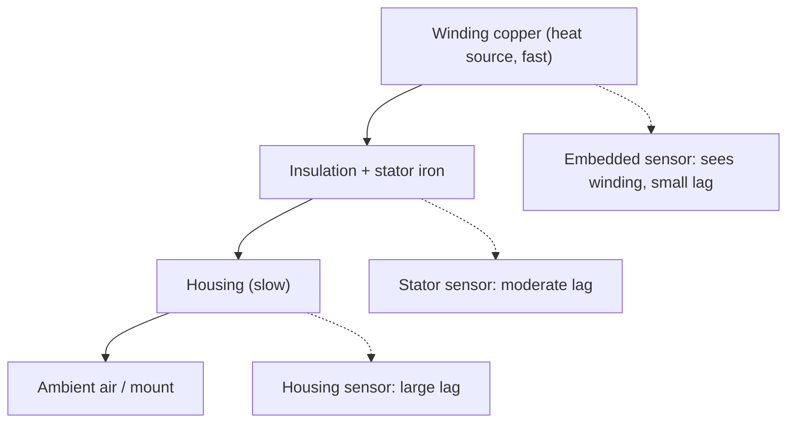

::: basics
### In plain words
You can detect the temperature of a motor or solenoid in several ways. The cheap, common choice is an NTC thermistor, a resistor that changes with heat, read through a voltage divider. Fancier sensors trade cost for accuracy or range. A thermal fuse or switch can protect the coil with no electronics at all. The winding is also its own thermometer, because copper's resistance rises with temperature.

### Picture it
Think of taking a fever temperature. A thermometer on the skin of your forearm reads lower than your core, and it takes minutes to catch up when the fever spikes. A motor is the same. The copper winding is the core, and the housing is the skin. During a stall the winding heats within seconds, while the housing lags far behind. So place the sensor as close to the winding as you can.

### Words you need
- **NTC thermistor**: a resistor whose resistance falls as it warms. It is cheap and very sensitive, but not linear.
- **RTD (Pt100)**: a platinum resistor with a steady, linear change of 0.385 Ω per kelvin.
- **Self-heating**: the sensor warming itself from the current you pass through it, which skews the reading.
- **Thermal lag**: the delay between the winding's temperature and the sensor's reading.

### The simplest example
Put a 10 kΩ NTC on top of a 10 kΩ resistor, across 3.3 V. The ADC node reads 2.643 V. That means the NTC is $10 \times (3.3 / 2.643 - 1) = 2.49$ kΩ, which corresponds to about 60 °C. Now use the winding itself: a coil that is 2.0 Ω cold and 2.6 Ω hot has warmed by about 76 K. And if a housing sensor lags 10 s behind a winding heating at 5 K/s, it under-reads by 50 K.

That is the whole idea: pick the sensor, then mind where it sits. The rest of this page compares sensors, converts the NTC curve, and covers lead resistance and thermal lag.
:::

::: testing
Whether you can name the temperature-sensing options for an actuator, choose among them using range, accuracy, response time and mounting, and know the practical traps: self-heating, lead resistance, linearisation, thermal lag between winding and sensor, and the trick of inferring winding temperature from its own resistance. A good answer also separates *protection* devices (thermal fuse, bimetal switch, PTC) from *measurement* sensors (NTC, RTD, thermocouple, IC) and says where each would be mounted.
:::

::: why
Winding temperature is the quantity that decides motor life and when a motor must be derated or stopped ([[q0390]], [[q0394]]), yet the hot spot is buried inside the motor. Real products embed a thermistor in the winding or on the stator, or infer temperature from resistance. Choosing and placing the sensor, and understanding its lag, is a routine design decision; interviewers use the question to see if you consider physical placement and measurement error, not just the part name.
:::

::: concepts
- **Thermistors (NTC/PTC)**: large, nonlinear resistance change; cheap. See [[q0393]].
- **RTD (Pt100/Pt1000)**: accurate, nearly linear metal resistance.
- **Thermocouple**: Seebeck voltage from a junction of dissimilar metals; wide range.
- **IC temperature sensors**: analogue or digital output, limited range.
- **Winding resistance method**: copper resistance rises about 0.39 %/K. See [[q0392]].
- **Thermal lag**: heat flows from winding to sensor through insulation and air gaps, so the reading trails.
- **Protection devices**: thermal fuse, bimetal switch, PTC resettable fuse.
:::

::: answer
"There are a few ways, depending on how accurate and how fast I need to be. The cheapest and most common is an NTC thermistor, a resistor whose resistance drops as it heats, wired as a divider into an ADC. I'd glue it to the housing, or for a better reading embed it in the winding or stator. For better accuracy or a wider range there's a platinum RTD, like a Pt100, which is very linear but needs a precise excitation and amplifier, and thermocouples for really hot spots, where the tiny microvolt-level signal needs cold-junction compensation. Small IC sensors work too, but their range is limited and they usually measure board temperature, not the winding.

A neat trick is that the winding itself is a thermometer: copper's resistance rises about 0.4 percent per kelvin, so if I measure its resistance cold and hot I get average winding temperature with no sensor. A 2.0 ohm winding that reads 2.6 ohms hot is about 76 degrees above where it started.

For pure protection I'd use a thermal cutoff: a bimetal thermostat or thermal fuse in series with the coil, which opens at a set temperature without any electronics.

The caveats: the sensor lags the winding, so I set the threshold lower or use a model; thermistors self-heat if driven too hard; and I'd linearise the NTC curve in firmware."
:::

::: technical
**Sensor comparison.**

| Sensor | Principle | Range (typical) | Strengths | Weaknesses |
|---|---|---|---|---|
| NTC thermistor | $R = R_0e^{B(1/T-1/T_0)}$ | about −40 to 150 °C (parts vary) | Cheap, sensitive (about −4.4 %/K at 25 °C for $B$ = 3950 K), small, fast | Nonlinear, interchangeability, self-heating |
| PTC (switching) | Resistance jumps at a transition temperature | Fixed trip point | Simple protection, motor-embedded sensors common | Not a general thermometer |
| RTD (Pt100/Pt1000) | $R = R_0(1+\alpha T)$, $\alpha \approx 0.00385$/K | −200 to 600 °C | Accurate, linear, stable | Small signal ($0.385\,\Omega$/K for Pt100), needs excitation, 3/4-wire for leads |
| Thermocouple (type K) | Seebeck voltage ≈ 41 µV/K | to 1000 °C+ | Rugged, fast, wide range | Tiny signal, cold-junction compensation, noise |
| IC sensor (LM35-style analogue, digital I²C) | Silicon bandgap | −55 to 125/150 °C | Linear, easy | Limited range, measures its own package |
| Bimetal / thermal fuse | Mechanical or alloy melt | Fixed trip | No electronics; fail-safe | One-shot (fuse) or crude (bimetal) |
| Winding resistance | Copper tempco | Up to insulation limit | No extra sensor, true average winding temperature | Needs accurate $R$ and a cold reference |
| IR | Radiated power | −50 to 1000 °C+ | Contactless, see [[q0398]] | Emissivity, field of view |

**NTC readout.** Divider with fixed resistor $R_1$ to ADC: $V = V_{cc}R_1/(R_{NTC}+R_1)$ if NTC on top. Invert: $R_{NTC} = R_1(V_{cc}/V-1)$, then $T = \left[\tfrac1{T_0}+\tfrac1B\ln\tfrac{R}{R_0}\right]^{-1}$ (kelvin). Example: $V = 2.643$ V with 3.3 V, $R_1=10$ kΩ: $R_{NTC} = 2486\,\Omega$, giving $T = 60.0$ °C for $B=3950$ K. For wider accuracy use Steinhart-Hart or a lookup table.

**Self-heating.** Dissipation $P = V^2/R$ in the sensor times the self-heating thermal resistance (K/W) gives the error. Pt100 at 1 mA dissipates about 0.14 mW at 138 Ω; keep excitation low and use ratiometric measurement.

**RTD wiring.** Lead resistance is a significant error for Pt100 (0.385 Ω/K): use 3-wire or 4-wire connection.

**Thermocouple.** Output $V = S\,(T_{hot} - T_{cold})$, $S\approx 41\,\mu$V/K for type K; 100 K difference gives about 4.1 mV. Measure cold-junction temperature and add its equivalent voltage.

**Winding resistance method.** $\Delta T = (R_{hot}/R_{cold}-1)/\alpha$. For 2.0 → 2.6 Ω: 76 K.

**Placement.** Winding (embedded) gives the best protection; stator core or end-turn next; housing lags by the thermal time constant of the frame, so it is useful for ambient and cooling checks but poor for fast overloads. On a solenoid, sensors go on the coil bobbin or coil outer layer.

**Lag.** If the sensor reads a first-order lagged version of the winding temperature with time constant $\tau_s$, the reading trails a ramp by $\tau_s\,\dot T$. For a stall heating at 5 K/s with a 10 s lag you under-read by 50 K.

> [!UNCERTAIN]
> Usable ranges and accuracies depend on the specific sensor part, glass- or epoxy-encapsulated thermistors, and calibration. Check datasheets. The $B$ value of 3950 K is a common example, not a universal number.
:::

::: short
"The common options are an NTC thermistor in a divider, cheap and sensitive, an RTD like Pt100 for accuracy, a thermocouple for high temperatures, or an IC sensor for board temperature. For protection a thermal fuse or bimetal switch needs no electronics. And since copper resistance rises about 0.4 percent per kelvin, I can infer average winding temperature from its resistance. I'd embed the sensor in the winding if I can, because housing sensors lag, and watch for self-heating and linearisation."
:::

::: long
"I'd choose by accuracy, range, speed and where it can physically go.

The workhorse is an NTC thermistor. Its resistance falls steeply with temperature, about 4 percent per kelvin at room temperature, so a divider and an ADC pin give good resolution, and it's cheap and tiny so I can embed it in the winding or glue it to the stator. The downside is it's nonlinear, so I convert with the beta equation or a lookup table, and I keep the drive current small so it doesn't self-heat. For example, 2.64 V on a 3.3 V divider with a 10 kΩ resistor means the NTC is 2.5 kΩ, which is 60 degrees.

If I need accuracy and linearity, a platinum RTD like a Pt100 changes 0.385 ohms per degree, but it needs excitation and a bridge or amplifier, and 3- or 4-wire connections so lead resistance doesn't matter. For very hot spots a thermocouple works, giving about 41 microvolts per kelvin for type K, which requires cold-junction compensation. IC sensors are easy but limited to roughly 125 degrees and usually see board temperature.

For pure protection, a thermal fuse or bimetal switch embedded in the winding opens at a set temperature with no electronics.

The sensorless option is to use the winding as a thermometer. Copper's resistance rises about 0.39 percent per kelvin, so a 2.0 ohm winding measuring 2.6 ohms is about 76 degrees warmer.

The real engineering is placement and lag. The winding is the hot spot, but the sensor on the housing lags it by the frame's thermal time constant, so in a stall it reads far too low, and I'd either embed it or add a thermal model."
:::

::: terms
- **NTC thermistor**: negative-temperature-coefficient resistor.
- **Beta ($B$) parameter**: describes the thermistor's exponential resistance curve.
- **RTD**: resistance temperature detector, e.g. platinum Pt100.
- **Seebeck effect**: voltage generated by a temperature difference across dissimilar metals.
- **Cold-junction compensation**: correcting a thermocouple for the temperature of its reference end.
- **Self-heating**: sensor warming itself from its excitation power.
- **Thermal lag**: delay between a temperature change at the source and at the sensor.
- **Thermal cutoff (thermal fuse)**: one-shot device that opens at a set temperature.
:::

::: exceptional
An exceptional answer compares sensors on range, accuracy, cost and mounting, gives the NTC readout and conversion with numbers, mentions RTD lead compensation and thermocouple cold junction, and uses the winding-resistance trick with a calculation. It identifies where the sensor goes (embedded winding versus housing), quantifies thermal lag (a 10 s lag at 5 K/s under-reads by 50 K), and separates protection devices from measurement. It also mentions self-heating and redundancy.
:::

::: mistakes
- **Mounting the sensor on the housing and trusting it for stall protection.** The winding heats far faster than the frame.
- **Linear conversion of an NTC.** The curve is exponential; linearising over a wide range gives large errors.
- **Ignoring self-heating.** Too much excitation current reads high.
- **Two-wire Pt100 over long leads.** Lead resistance is read as temperature.
- **Forgetting cold-junction compensation.** A thermocouple measures a *difference*.
- **Using an IC sensor on the PCB as "motor temperature".** It reads the board, not the winding.
:::

::: deep
## Why placement matters more than part number

A motor is a stack of thermal masses: copper winding (small mass, high heat source), insulation and laminations, then the housing and the air or mounting. Heat is generated in the copper and conducts outwards. During a sudden overload the winding temperature climbs fast while the housing barely moves.


Figure: Sensor location sets the thermal lag. For overload protection you want the sensor as close to the winding as possible (or a model). A housing sensor is fine for ambient and cooling checks, but too slow for stall events.

A first-order lag model for the sensor: $\tau_s\,\dot T_{sensor} = T_{winding} - T_{sensor}$. During a stall that heats the winding at 5 K/s with $\tau_s = 10$ s, the sensor trails by $\tau_s\times5 = 50$ K in steady ramp. By the time the housing shows 105 °C the winding could be 155 °C.

## NTC thermistors in detail

The beta model: $R(T) = R_0\exp\left[B\left(\frac1T-\frac1{T_0}\right)\right]$, temperatures in kelvin.

```plot
{"title":"Resistance vs temperature: NTC (B = 3950 K, 10 kΩ at 25 °C) vs Pt100","x":{"label":"Temperature","unit":"°C","min":-20,"max":150},"y":{"label":"Resistance","unit":"Ω","log":true,"min":50,"max":120000},
 "vars":{"b":3950,"r0":10000,"t0":298.15},
 "series":[{"label":"NTC 10k","fn":"r0*exp(b*(1/(x+273.15)-1/t0))","color":"orange"},{"label":"Pt100","fn":"100*(1+0.00385*x)","color":"blue"}],
 "points":[{"x":25,"y":10000,"label":"NTC 10 kΩ"},{"x":100,"y":138.5,"label":"Pt100 138.5 Ω"}]}
```
Figure: On a log axis the NTC is close to a straight line (exponential in 1/T) spanning nearly three decades from −20 to 150 °C, while the Pt100 hardly moves (about 92 to 158 Ω over the same range). The NTC gives huge sensitivity but is nonlinear; the Pt100 is linear but you need a precise, low-noise measurement of a 0.385 Ω/K change.

**Readout.** NTC on top of the divider, $R_1 = 10$ kΩ, 3.3 V: at 60 °C the NTC is 2486 Ω and the node is $3.3\times10/(2.486+10) = 2.643$ V. Invert to get resistance, then temperature. For a 12-bit ADC near 100 °C the divider changes only about 3 mV/K while one LSB is 0.8 mV, so each LSB is roughly 0.27 K there. That is still adequate, but a different fixed resistor would shift the sensitive region to the temperature that matters (the protection threshold).

**Self-heating.** The 10 kΩ NTC across 3.3 V and a 10 kΩ divider dissipates about 0.27 mW at 25 °C. With a dissipation constant of order 1 mW/K for an epoxy bead in air (datasheet value, varies a lot) that is a few tenths of a kelvin of error. Embedded in a winding it conducts away much better.

## PTC and thermal cutoffs

Switching PTC thermistors (the motor-protection type) have a very sharp resistance rise above a trip temperature; embedded in windings and read by a relay or comparator they provide a go/no-go signal with no linearisation. Thermal fuses (alloy pellet melts) are one-shot, bimetal thermostats reset. Both trip at a fixed temperature set by the part. Use them as a hardware backstop in addition to a measurement.

## Thermocouples and RTDs

A type K thermocouple produces about 41 µV/K relative to its reference junction, so 100 K difference gives 4.1 mV. You need a low-offset amplifier, filtering, and cold-junction compensation (measure the reference junction temperature, e.g. with an IC sensor, and add its equivalent). Dedicated thermocouple interface ICs do this for you. An RTD changes $0.385\,\Omega$/K on a 100 Ω base; with 1 mA excitation that is 385 µV/K, and you need to eliminate lead resistance (3- or 4-wire) and keep self-heating low (0.14 mW at 138 Ω and 1 mA).

## Winding resistance: no sensor needed

Copper: $R(T) = R_{ref}[1+\alpha(T-T_{ref})]$, $\alpha \approx 0.00393$ /K at 20 °C. Measuring the winding resistance gives the *average* winding temperature, which is what you want for insulation life.

$$T = T_{ref} + \frac{1}{\alpha}\left(\frac{R}{R_{ref}}-1\right)$$

Example: $R_{ref} = 2.0\,\Omega$ at 20 °C, measuring $R = 2.6\,\Omega$ gives $T = 20 + 76 = 96$ °C. In practice you measure resistance by injecting a small DC current (while stopped or by briefly interrupting drive and reading $V/I$) or estimate $R$ from $V$ and $I$ while running with knowledge of the back-EMF. Drift sources: contact resistance, cable resistance, current sensor error. It is the standard way motor manufacturers measure temperature rise in type tests.

> [!TIP]
> If the motor is a three-phase BLDC, the same method works on the phase resistance, and many drives estimate it online for temperature protection and torque compensation.

```sim
{"id":"rc-transient","kind":"rl","r":2.4,"l":0.001,"vs":12,"drive":"step"}
```
Figure: The RL step response shows that the electrical time constant L/R is milliseconds while thermal time constants are tens of seconds to minutes. Because of that separation, a quick DC injection to measure $R$ settles in a few time constants of the electrical circuit, long before the winding temperature changes.

## Choosing

| Need | Choose |
|---|---|
| Cheap protection with firmware readout | NTC embedded in winding or on stator |
| Pure hardware cutoff | Thermal fuse or bimetal thermostat in series |
| Precision, calibration, instrumentation | Pt100/Pt1000 with 3/4-wire |
| Very hot components, rugged | Thermocouple |
| Rotating or hard-to-reach part | IR (see [[q0398]]) |
| No sensor allowed | Winding resistance, model |

For a solenoid the same logic applies, with the sensor on the coil. For permanent-magnet motors also think about *magnet* temperature ([[q0397]]).
:::

::: applications
- **Motor windings in industrial drives**: embedded PTC or Pt1000 read by the drive for overtemperature trips.
- **E-bike hub motors**: NTC in the winding fed back to the controller to derate current.
- **Solenoid valves**: coil resistance monitoring for temperature compensation of hold current.
- **Power tools**: NTC on the controller board and thermal cutoff on the motor.
- **Laboratory motor testing**: winding resistance method for temperature rise tests.
:::

::: assumptions
Numbers use the standard beta model for an NTC and the nominal temperature coefficients of copper and platinum; real parts differ in $B$ value, tolerance and range. The thermal lag example assumes a first-order sensor lag and a constant heating rate. The winding resistance method assumes copper windings and a reliable reference resistance at a known temperature; aluminium windings have a different coefficient (about 0.0039–0.004/K, check the material). For AC and three-phase motors, measuring resistance while energised requires care (DC injection or model-based estimators). For a solenoid, the coil is the winding and the method is the same.
:::

::: followups
### Why does a housing-mounted thermistor not protect a motor from a stall?
The winding heats in seconds while the housing needs minutes, so at the moment the housing reads a safe temperature the winding insulation may already be damaged. Either embed the sensor, or use a thermal model based on current ($I^2t$), or both. See [[q0394]].

### How do you linearise an NTC?
Use the beta equation or Steinhart-Hart equation to calculate $T$ from $R$, or a lookup table with interpolation. For a narrow range you can add a parallel resistor to flatten the curve, but that lowers sensitivity. Pick the divider resistor close to the NTC value at the temperature you care most about.

### What does a 3-wire RTD connection do?
It uses two leads to form a bridge in such a way that equal lead resistances cancel, assuming the leads are matched. A 4-wire connection separates current and sense pairs and removes lead resistance entirely. Needed because a Pt100's 0.385 Ω/K is comparable to a few ohms of cable.

### Could you use a diode as a temperature sensor?
Yes. A forward-biased silicon diode's voltage falls about 2 mV/K at constant current, and is used in many temperature ICs (and in on-chip sensors). It is cheap and linear over a modest range but needs a calibrated current source and offset trimming for accuracy.

### Harder: the winding resistance method reads 20 K high even at idle. Why?
Contact or cable resistance in the measurement, a current-sense offset, or resistance reference taken at the wrong temperature (the "cold" value was measured warm or at a different ambient). Also resistive paths such as brushes and the commutator in a brushed motor add resistance that does not track winding temperature. Measure with a four-wire method at the motor terminals, subtract known extras, and take the reference after a long soak at a known ambient.
:::

::: interpretations
The question asks how to detect temperature; [[q0397]] asks which temperatures are worth measuring or can be measured, and [[q0398]] asks for contactless methods. This page covers the contact and sensorless methods and sets up that discussion.
:::

::: references
- Horowitz & Hill, *The Art of Electronics*, 3rd ed.: temperature sensing (thermistors, RTDs, thermocouples) in the instrumentation sections.
- IEC 60751 (industrial platinum resistance thermometers), by name, for the Pt100 characteristic and tolerance classes.
- IEC 60584 (thermocouples), by name, for type K voltage tables.
- Thermistor and sensor manufacturers' datasheets for $R$-$T$ tables and dissipation constants; IEC 60034-1 for motor temperature rise testing by name.
:::

::: rubric
- Lists several sensor types with their principles :: Breadth of options.
- Chooses sensors on range, accuracy, cost, mounting :: Engineering judgement.
- Gives the NTC divider and conversion, with a number :: Practical competence.
- Mentions the winding-resistance method with a calculation :: Clever, sensor-free approach.
- Mentions protection devices (thermal fuse, bimetal, PTC) :: Fail-safe thinking.
- Discusses placement and thermal lag :: The key practical issue.
- Mentions self-heating and RTD lead compensation :: Measurement accuracy.
:::

::: quiz
```json
[
 {"type":"mcq","level":"fundamental","q":"Which sensor has a resistance that falls as temperature rises and is widely used on motor windings for firmware readout?","options":["Pt100 RTD","NTC thermistor","Type K thermocouple","Thermal fuse"],"answer":1,"explain":"An NTC thermistor's resistance decreases with temperature; an RTD's rises, a thermocouple gives a voltage, and a thermal fuse is a one-shot switch."},
 {"type":"numeric","level":"intermediate","q":"A winding measures 2.0 Ω at 20 °C and 2.6 Ω when hot ($\\alpha = 0.00393$/K). What is the hot temperature in °C?","answer":96.3,"tolerance":0.02,"unit":"°C","explain":"$\\Delta T = (2.6/2.0-1)/0.00393 = 76.3$ K, so $T = 20+76.3 = 96.3$ °C."},
 {"type":"numeric","level":"intermediate","q":"A 10 kΩ NTC on top of a 10 kΩ divider from 3.3 V reads 2.643 V at the node. What is the NTC resistance in kΩ?","answer":2.49,"tolerance":0.02,"unit":"kΩ","explain":"$R_{NTC} = R_1(V_{cc}/V - 1) = 10\\,(3.3/2.643-1) = 2.49$ kΩ, which is 60 °C for $B=3950$ K."},
 {"type":"numeric","level":"intermediate","q":"A type K thermocouple produces about 41 µV/K. What voltage corresponds to a 150 K difference between hot and cold junctions, in mV?","answer":6.15,"tolerance":0.03,"unit":"mV","explain":"$150\\times41\\,\\mu\\text{V} = 6150\\,\\mu\\text{V} = 6.15$ mV."},
 {"type":"mcq","level":"advanced","q":"A housing-mounted sensor lags the winding by 10 s and the winding is heating at 5 K/s. Approximately how much does the sensor under-read?","options":["5 K","10 K","50 K","0 K"],"answer":2,"explain":"A first-order lag trails a steady ramp by (time constant) × (ramp rate) = 10 s × 5 K/s = 50 K."}
]
```
:::
