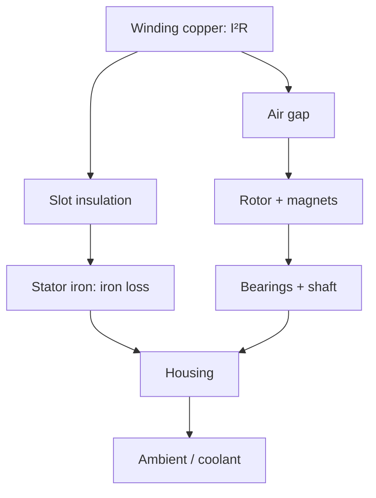

::: testing
Whether you understand a motor as a thermal network with several distinct temperatures that matter for different reasons, and whether you can say which are measurable directly, which only indirectly, and which are the limiting ones. The interviewer is looking for winding (average and hot spot), stator, rotor/magnets, bearings, housing, brushes and commutator, and also the drive electronics (MOSFET junction, shunt, board) and ambient. A strong answer pairs each with its failure mechanism and the practical way to get at it.
:::

::: why
A single "motor temperature" number hides the fact that the limiting temperature depends on the failure mode: insulation fails at the winding hot spot, permanent magnets demagnetise in the rotor, bearing grease degrades at the bearing, brushes fail at the commutator. Which one you measure decides whether your protection works. It also matters for drive design: a MOSFET junction you cannot touch is often the first part to fail.
:::

::: concepts
- **Thermal network**: heat flows from copper through insulation, iron, air gap and frame to ambient. See [[q0396]].
- **Winding hot spot vs average**: insulation limit applies to the hottest point; resistance gives the average.
- **Insulation classes**: standard maximum temperatures for winding insulation.
- **Magnet temperature limits**: remanence falls with temperature, and over-temperature can demagnetise.
- **Bearing lubricant limits**: grease ageing and viscosity.
- **Junction temperature**: semiconductor temperature calculated from power and thermal resistance.
:::

::: answer
"There isn't one motor temperature; there are several, each tied to a different failure. The most important is the winding, since the copper is where the heat is made and the insulation is what dies. I care about the hot spot, but I can usually only measure the average, through a sensor embedded in the end turns or by looking at winding resistance. Then the stator core and the housing, which lag the winding but are easy to measure and tell you about cooling and ambient.

In a permanent-magnet motor the rotor and magnets matter too. Neodymium magnets lose strength as they heat, about 0.1 percent per kelvin of flux, and they can partly demagnetise if they get too hot, but the rotor spins, so you can't put a sensor on it. You estimate it from a model, or from the back-EMF constant, or use IR or telemetry in test.

Bearings: grease has a temperature limit, and bearing temperature rising relative to the housing is a sign of wear. In brushed motors, the commutator and brushes run hot and wear.

Finally the electronics: the MOSFET junction, the shunt and the board. I can't measure the junction directly, but I can compute it from power loss and thermal resistance, or measure the case or an NTC on the board and add a margin.

Which ones I can measure directly: anything stationary and reachable. Rotating parts need IR, slip rings or estimation."
:::

::: technical
**Temperatures of interest and their limits.**

| Temperature | Why it matters | Limit / indicator | How to get it |
|---|---|---|---|
| Winding average | Insulation life, copper loss | Insulation class limit (IEC 60085: A 105, E 120, B 130, F 155, H 180 °C) | Embedded NTC/PTC/Pt1000, resistance method |
| Winding hot spot | Where insulation fails first | Class limit, with allowance over the average | Embedded sensor at end turn, thermal model |
| Stator iron / core | Iron loss, bridges winding to frame | Below the winding | Surface or embedded sensor |
| Rotor / magnets | Flux and demagnetisation | Magnet grade limit (e.g. NdFeB grades from about 80 to 200 °C maximum operating temperature by grade, vendor-dependent) | Model, back-EMF constant, IR, telemetry |
| Bearings | Grease and bearing life | Grease rating (often about 100–150 °C, vendor-dependent) | Housing or bearing-seat sensor, vibration |
| Housing / frame | Touch temperature, cooling | Safety limit, ambient plus rise | Surface sensor, IR |
| Brushes / commutator | Brush wear, sparking | Material dependent | IR in test, estimation |
| Driver junction ($T_j$) | MOSFET and IC failure | Datasheet maximum (typically 150–175 °C) | Calculation from $P$, $R_{\theta}$; internal sensors; $V_f$ method |
| Shunt, PCB, connectors | Tempco drift, solder, plastics | Component limits | NTC on board |
| Ambient / coolant | Sets the baseline | System spec | Ambient sensor |

**Magnet temperature effect.** For NdFeB the remanence falls roughly 0.11–0.12 %/K (vendor and grade dependent). With −0.12 %/K, a 100 K rise cuts flux by about 12%, so $K_t$ and $K_e$ fall 12% (torque per amp falls, speed per volt rises). Ferrite magnets behave differently: remanence falls with heat, but coercivity falls at low temperature, so demagnetisation risk is at cold.

**Hot spot vs average.** The resistance method returns the average winding temperature. The hot spot can be higher by an allowance that depends on the motor design (cooling path, slot fill); standards allow for it in their limits but you should check the motor manufacturer's guidance.

**Junction temperature calculation.** $T_j = T_a + P\,R_{\theta JA}$ (or $T_c + P\,R_{\theta JC}$ with a measured case temperature). Example: a MOSFET with $R_{DS(on)} = 8$ mΩ (hot) at 20 A dissipates $P = 20^2\times0.008 = 3.2$ W (conduction only). With $R_{\theta JA} = 30$ K/W and ambient 25 °C: $T_j = 25 + 96 = 121$ °C.

**Life rule of thumb.** Insulation life roughly halves for each 10 K above its rated temperature, so +20 K means a quarter of the life and +30 K an eighth (empirical heuristic).

> [!UNCERTAIN]
> Magnet maximum operating temperatures, remanence tempco, grease ratings and the "life halves per 10 K" rule are approximate and vary with vendor, grade, geometry and operating point. Use datasheet values for the actual materials.
:::

::: short
"Several temperatures matter. The winding, average and hot spot, limits insulation life, so I embed a thermistor or use resistance. The stator and housing lag but are easy to measure. For permanent-magnet motors the rotor magnets matter: NdFeB loses about 0.1 percent flux per kelvin and can demagnetise, but you can't sense it directly, so I estimate it. Bearings have a grease limit, brushes wear, and the MOSFET junction has to be computed from power and thermal resistance. Rotating parts need IR, telemetry or models."
:::

::: long
"I'd say there are several temperatures, each tied to a different failure.

First the winding. That's where heat is generated and where insulation fails. The hot spot in the end turns is the real limit, but what I can measure is usually the average: with an embedded thermistor, or from winding resistance. Insulation classes give the limits, 105 for class A, 130 for B, 155 for F, 180 for H, and life roughly halves for every ten degrees above.

Second, the stator iron and housing. They lag the winding, so they're no good for fast overloads, but they're easy to measure and tell you about cooling and ambient.

Third, in a permanent-magnet motor, the rotor and magnets. Neodymium flux falls by roughly 0.12 percent per kelvin, so at 100 degrees of rise the torque constant is down about 12 percent, and if it gets too hot for the magnet grade it can partly demagnetise, permanently. The rotor spins, so I can't just stick a thermistor on it. I'd estimate it from a model, from the drift in the back-EMF constant, or measure it in test with an IR sensor or telemetry.

Fourth, bearings. Grease has a temperature limit, and a bearing that runs hotter than the housing signals trouble. In brushed motors, the commutator and brushes run hot and wear.

Finally the electronics: the MOSFET junction, the shunt and the board. I can't touch a junction, so I compute it: a 20 amp load through 8 milliohms is 3.2 watts, and at 30 K per watt that's about 96 degrees above ambient, so around 120 °C. I'd measure board temperature with an NTC and use a model for the junction."
:::

::: terms
- **Hot spot**: the hottest location in the winding, which limits insulation life.
- **Insulation class**: standard temperature rating of winding insulation (A, B, F, H).
- **Remanence ($B_r$)**: magnetic flux density a magnet retains; falls with temperature.
- **Demagnetisation**: permanent loss of magnet strength from heat or reverse field.
- **Junction temperature $T_j$**: temperature of the semiconductor die.
- **Thermal resistance $R_\theta$**: K/W from die to case or ambient.
- **Temperature rise**: temperature above ambient.
- **End turns**: portions of winding outside the stator slots, often the hot spot.
:::

::: exceptional
An exceptional answer treats the motor as a thermal network, relates each temperature to its failure mechanism and limit, and distinguishes measurable from inferred ones. It quotes insulation classes by name, shows the magnet tempco effect on $K_t$ with a calculation, includes the drive's junction temperature calculation, and says how rotating parts are handled (model, IR, telemetry, $K_e$ drift). It mentions hot spot versus average and the heuristic for life halving per 10 K, flagged as a heuristic.
:::

::: mistakes
- **Treating "motor temperature" as one number.** Winding, magnet, bearing and junction temperatures have different limits and different sensors.
- **Using the housing temperature as the winding limit.** The winding can be tens of kelvin hotter.
- **Forgetting magnet temperature in PM motors.** Torque per amp falls and demagnetisation is possible.
- **Assuming a junction can be measured with a thermocouple on the case.** The die is hotter by $P R_{\theta JC}$.
- **Quoting insulation limits as temperature rise rather than absolute temperature.** Class limits include the ambient assumption; check the standard's definitions.
:::

::: deep
## A thermal network, not a thermometer

Heat is generated in several places: copper loss $I^2R$ in the winding, iron loss in the stator laminations, friction in bearings and brushes, eddy and hysteresis in the rotor magnets and sleeves (especially with PWM harmonics), and switching and conduction loss in the drive. It then flows through insulation, iron, the air gap, the housing and finally to ambient or coolant.


Figure: Heat sources feed a network of thermal resistances and capacitances. The winding is the hottest and fastest-changing node; the housing is the slowest and coolest. Rotor heat leaves mainly through the air gap and shaft, which is why the rotor can run hotter than the stator in some designs, and why it is hard to measure.

## Winding: the one that kills motors

Insulation classes (IEC 60085 designation): A 105 °C, E 120 °C, B 130 °C, F 155 °C, H 180 °C maximum winding temperature. Motors are often rated by temperature *rise* with an assumed ambient (commonly 40 °C), plus an allowance for hot spot. Life is exponential in temperature; as a rule of thumb it halves per 10 K above the rating.

```plot
{"title":"Insulation life vs temperature above rating (rule of thumb: halves per 10 K)","x":{"label":"Temperature above rated limit","unit":"K","min":-20,"max":40},"y":{"label":"Relative life","min":0.1,"max":5,"log":true},
 "series":[{"label":"life = 2^(−ΔT/10)","fn":"pow(2,-x/10)"}],
 "points":[{"x":0,"y":1,"label":"rated: 1×"},{"x":20,"y":0.25,"label":"+20 K: 0.25×"},{"x":-10,"y":2,"label":"−10 K: 2×"}]}
```
Figure: Running 10 K cooler than the limit doubles insulation life; 20 K hotter quarters it. That exponential sensitivity is why even modest derating pays off, and why accurate winding temperature matters. The rule is an approximation, not a guarantee.

## Permanent magnets: temperature changes the motor

$B_r$ falls linearly with temperature for most magnet materials. With NdFeB at about −0.12 %/K (grade dependent):

$$K_t(T) = K_t(20\,^\circ\text{C})\,[1 - 0.0012\,(T - 20)]$$

At 120 °C: $K_t$ is 88% of its cold value. For a servo drive, that means needing 13.6% more current for the same torque ($1/0.88 = 1.136$), which in turn adds copper loss: a feedback loop of heating. The motor's no-load speed rises, since $\omega_{nl} = V/K_e$.

```plot
{"title":"Torque constant vs magnet temperature (NdFeB, −0.12 %/K, illustrative)","x":{"label":"Magnet temperature","unit":"°C","min":20,"max":160},"y":{"label":"K_t relative to 20 °C","min":0.7,"max":1.05},
 "series":[{"label":"K_t(T)/K_t(20)","fn":"1-0.0012*(x-20)"}],
 "points":[{"x":120,"y":0.88,"label":"120 °C: 0.88"}]}
```
Figure: A 100 K rise cuts torque per amp by 12%. Magnet grades differ in tempco and in the temperature at which partial irreversible demagnetisation starts (higher for SH/UH/EH-type grades than for standard N grades); the working point of the magnet in its magnetic circuit also matters.

The rotor is hard to measure. Options: embedded wireless telemetry (lab), IR sensing through a window in test ([[q0398]]), or estimating from the drift in $K_e$ (back-EMF at a given speed) or from a thermal model fed with losses.

## Bearings and lubrication

Bearing grease ages faster with temperature (a similar halving rule applies, with a lower break-point), and bearing temperature typically sits a few kelvin above the housing. A bearing that runs significantly hotter than the housing, or hotter at the same load than it did before, indicates wear, misalignment or lubrication loss ([[q0399]]).

## Brushes and commutator

Brush wear rate depends on current, speed, atmosphere and temperature. Commutator hot spots are caused by arcing. You rarely instrument these, but IR thermography shows bright spots on a commutator during tests.

## The drive electronics

The MOSFET junction temperature is not measurable directly, but can be calculated and checked:

$$T_j = T_a + P\,R_{\theta JA}$$

Example: $I = 20$ A through $R_{DS(on)} = 8$ mΩ (hot value, typically 1.5–1.8 times the 25 °C value) gives $P = 3.2$ W; with $R_{\theta JA} = 30$ K/W the junction is 96 K above ambient, so 121 °C at 25 °C ambient. Add switching loss and it is higher. Parts with on-chip sensors report junction temperature; otherwise measure the case or the board near the device and compute. Because $R_{DS(on)}$ rises with temperature, power rises too, and the calculation must be solved consistently (iterate).

The shunt's temperature changes its value (tempco), and connectors and solder have their own limits.

## What can actually be measured

| Directly | Indirectly or by special means |
|---|---|
| Housing, ambient, stator (surface), board | Winding average (resistance), hot spot (model) |
| Winding with embedded sensor | Rotor and magnets (model, $K_e$, IR, telemetry) |
| Driver case or board near device | Junction (calculation, on-chip sensor, $V_f$ method) |

## Putting it together

A practical protection scheme uses: an embedded winding sensor for the slow protection, an $I^2t$ model for fast overloads ([[q0394]]), a board NTC and an on-chip sensor or model for the drive, and ambient temperature for derating. For permanent-magnet machines, a magnet temperature estimate keeps the torque constant accurate and avoids demagnetisation.
:::

::: applications
- **Industrial servo motors**: embedded PTC or Pt1000 in the winding; drives estimate magnet temperature for torque compensation.
- **EV traction motors**: stator winding sensors plus rotor-temperature estimators because magnet temperature limits torque.
- **Brushless drone motors**: ESC measures its own FET temperature; motor temperature is inferred or limited by current.
- **Hobby servos**: no direct sensing; the case gets hot and gears or motor fail after stall.
- **Test labs**: thermocouples embedded in the winding and IR thermography for rotor and commutator.
:::

::: assumptions
Insulation class values are standard categories of maximum winding temperature; actual motors use a rating (rise at a specified ambient) and a hot-spot allowance whose values depend on the standard and motor type. Magnet tempco and demagnetisation temperature depend on grade, shape and operating point; the 0.12 %/K figure is typical for NdFeB, not exact. The junction calculation uses steady-state thermal resistance; transient overloads need thermal impedance curves. Life-versus-temperature rules are empirical. For brushed motors the commutator and brushes behave differently from brushless designs, and for solenoids the coil is the dominant concern with similar insulation limits.
:::

::: followups
### Why is the winding hot spot hotter than the average temperature?
Heat has to flow from the interior of the slot out through insulation to the iron, so conductors in the middle of the slot or in the end turns (where cooling is poorer) run hotter than the average. The resistance method gives the average of all turns. Motor designers add an allowance, or use embedded sensors at the expected hot spot.

### How would you know the magnets have been damaged by heat?
The torque constant (or back-EMF constant) will be permanently lower. Measure back-EMF at a known speed when cold and compare with the original. Another sign is higher current for the same torque and a lower no-load voltage per rpm. A drive that tracks $K_e$ can warn of this.

### Why does a hotter motor need more current for the same torque?
Because magnet flux falls with temperature, $K_t$ falls, so $I = \tau/K_t$ rises. The extra current adds copper loss, raising the temperature further. Winding resistance also rises (about 0.39 %/K), which adds more loss at a given current. Both effects make the thermal behaviour self-reinforcing.

### How do you estimate MOSFET junction temperature in a motor drive?
$T_j = T_{board} + P\,R_{\theta}$ with $P$ from conduction ($I^2R_{DS(on)}$ with the hot value) plus switching loss, $R_\theta$ from the datasheet and layout (copper area), and $T_{board}$ from an NTC close to the device. Check against the datasheet's transient thermal impedance for short overloads, and verify on the bench with a thermocouple or IR camera.

### Harder: the motor casing is only 60 °C but the motor smells hot and the torque has fallen. What do you suspect?
The winding or the magnets are far hotter than the housing: a prolonged overload with a poor thermal path, a failed fan, or a stalled/low-speed high-torque operation without enough cooling. Torque fell because $K_t$ dropped with magnet temperature and resistance rose. Check the embedded sensor, the resistance, the $K_e$ drift, and whether the housing sensor lags a rapid thermal event. Stop and let it cool; insulation may already be damaged.
:::

::: interpretations
"Which temperatures do you want to/can you measure?" has two parts: which are of interest (winding, magnets, bearings, brushes, housing, electronics, ambient) and which are physically measurable (stationary, accessible ones) versus inferred. The page answers both. [[q0396]] covered the sensors; [[q0398]] covers contactless methods for moving parts.
:::

::: references
- IEC 60085 (electrical insulation, thermal evaluation and designation), by name, for insulation classes.
- IEC 60034-1 (rotating electrical machines, rating and performance), by name, for temperature rise and thermal classes.
- Magnet manufacturers' datasheets for $B_r$ tempco and maximum operating temperature by grade.
- MOSFET datasheets for $R_{DS(on)}$ versus temperature and thermal resistance; Mohan, Undeland and Robbins, *Power Electronics*, for device thermal modelling.
:::

::: rubric
- Recognises multiple temperatures, each tied to a failure mode :: Systems thinking about the thermal network.
- Winding average vs hot spot and insulation class limits :: The dominant failure mechanism.
- Magnet temperature effects on $K_t$ and demagnetisation :: Key PM motor consideration.
- Bearings, housing, brushes mentioned with purposes :: Completeness.
- Drive junction temperature computed from power and $R_\theta$ :: Includes the electronics.
- Distinguishes measurable vs estimated (rotating parts) :: Practical constraint.
- Uses numbers (12% $K_t$ drop, 121 °C junction) :: Quantitative maturity.
:::

::: quiz
```json
[
 {"type":"mcq","level":"fundamental","q":"Which temperature most directly limits the life of a motor's insulation?","options":["Housing surface","Winding (especially the hot spot)","Ambient air","Shaft end"],"answer":1,"explain":"Insulation is in contact with the windings; its ageing is controlled by the winding temperature, with the hot spot as the worst case."},
 {"type":"numeric","level":"intermediate","q":"NdFeB magnets lose about 0.12 %/K of flux. By what percent does $K_t$ fall when the magnets heat from 20 °C to 120 °C?","answer":12,"tolerance":0.03,"unit":"%","explain":"$0.0012\\times100 = 0.12$, so $K_t$ is 12% lower."},
 {"type":"numeric","level":"intermediate","q":"A MOSFET dissipates 3.2 W with $R_{\\theta JA} = 30$ K/W in 25 °C ambient. What is the junction temperature?","answer":121,"tolerance":0.02,"unit":"°C","explain":"$T_j = 25 + 3.2\\times30 = 121$ °C."},
 {"type":"numeric","level":"intermediate","q":"By the 'life halves per 10 K' rule, what fraction of rated life remains when running 30 K above the rated temperature?","answer":0.125,"tolerance":0.02,"unit":"×","explain":"$2^{-30/10} = 2^{-3} = 0.125$."},
 {"type":"truefalse","level":"advanced","q":"A housing-mounted sensor reading 60 °C guarantees the winding is below 60 °C.","answer":false,"explain":"The housing lags and sits at the end of the thermal path. The winding can be tens of kelvin hotter, especially during overloads."}
]
```
:::
