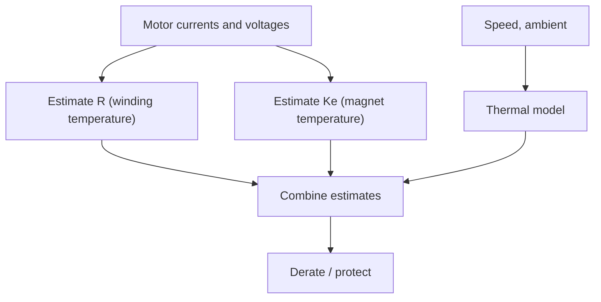

::: testing
Whether you know the non-contact options and their real limitations. The interviewer expects infrared thermometers and thermopile sensors, thermal cameras, and an honest account of emissivity (shiny metal reads cold), spot size, reflections and window materials. Beyond IR, strong candidates mention indirect electrical methods (winding resistance, back-EMF constant), thermal models, wireless or slip-ring telemetry for rotors, fibre-optic sensors, and temperature-indicating paints. They should say which method for which part (rotor, commutator, stationary winding).
:::

::: why
Rotors, commutators and moving carriages cannot easily carry wired sensors, yet they are often where limits are hit (magnets, brushes). Non-contact measurement is also useful in lab characterisation and field diagnostics, where you cannot open the machine. But IR is notoriously easy to get wrong: reading a shiny motor shaft with the emissivity set for paint can under-read by tens of degrees. Showing you know that is a mark of a practical engineer.
:::

::: concepts
- **Thermal radiation**: emitted power rises as $T^4$; Stefan-Boltzmann law. See [[q0396]].
- **Emissivity ($\varepsilon$)**: fraction of ideal black-body radiation a surface emits.
- **Thermopile IR sensor**: small voltage from absorbed IR across a thermocouple stack.
- **Field of view and spot size**: distance-to-spot ratio.
- **Indirect electrical estimation**: resistance and back-EMF constant as thermometers. See [[q0397]].
- **Telemetry**: wireless or slip-ring transmission from rotating sensors.
:::

::: answer
"The first thing most people reach for is infrared. An IR thermometer or a small thermopile sensor looks at the surface and infers temperature from the radiation it emits, and a thermal camera does the same for a whole image. That's handy for a moving shaft or a commutator because nothing touches it. The big catch is emissivity: painted or black surfaces emit well, around 0.95, but bare shiny metal might be 0.1, so an IR gun set for 0.95 aimed at a bright shaft at 100 degrees might read 35. I'd put a bit of matte tape or black paint on the spot, or calibrate against a contact reading.

Other options: you can infer temperature electrically without touching anything, from the winding's resistance, or from drift in the back-EMF constant for the magnets. A thermal model fed by current and speed can estimate winding and rotor temperatures. For a rotor in a lab, I'd use wireless telemetry or a slip ring with an embedded sensor. Fibre-optic sensors work in high-voltage and high-EMI places. And for a cheap check, temperature-indicating paint or labels change colour irreversibly at a set temperature.

Practical issues are spot size, so the sensor sees only the part I care about; reflections from hot surroundings; and windows, because ordinary glass blocks long-wave IR."
:::

::: technical
**Physics.** A surface at temperature $T$ with emissivity $\varepsilon$ emits $M = \varepsilon\sigma T^4$ ($\sigma = 5.67\times10^{-8}$ W/m²K⁴). An IR sensor responds to the net radiation from its field of view: $S \propto \varepsilon\,\sigma(T_{obj}^4 - T_{bg}^4) + \text{(reflected component)}$.

**Emissivity error.** If the instrument assumes $\varepsilon_s$ while the true value is $\varepsilon$ (ignoring reflections), the apparent temperature is
$$T_{app} = \left[T_{bg}^4 + \frac{\varepsilon}{\varepsilon_s}\left(T_{obj}^4 - T_{bg}^4\right)\right]^{1/4}$$
Example: object at 100 °C, background 25 °C, $\varepsilon_s = 0.95$. With $\varepsilon = 0.95$: 100 °C. $\varepsilon = 0.8$: 90.9 °C. $\varepsilon = 0.5$: 70.5 °C. $\varepsilon = 0.1$ (polished metal): 35.8 °C. Reflections of warm surroundings add further error.

**Spot size.** Distance-to-spot ratio (D:S) of 10:1 means a 30 mm spot at 0.3 m. Measuring a 10 mm winding bundle with a larger spot averages in the cooler background.

**Sensor types.**
- *Handheld IR thermometer / pyrometer*: spot measurement.
- *Thermopile IR sensor (e.g. digital thermopile modules)*: small, cheap, 10s of ms response, embedded in products; field of view of several degrees to tens of degrees.
- *IR (thermal) camera*: full image, calibrated for emissivity, expensive; used in tests.
- *Fibre-optic sensors* (fluorescence decay or Bragg grating): immune to EMI, can be embedded in windings; costly.
- *Temperature-indicating paints and labels*: irreversible colour change at set temperatures (peak recorder).

**Indirect electrical.**
- *Winding resistance* from terminal measurements gives the average winding temperature (no sensor).
- *Back-EMF constant* drift for the magnet temperature: $K_e(T) = K_e(20)[1 - 0.0012(T-20)]$ for NdFeB; measure $K_e$ from back-EMF and speed.
- *Thermal model*: lumped network fed with $I$, $\omega$, ambient; calibrate against a contact measurement.

**Rotor telemetry.** Slip rings (wear, noise), inductively powered wireless transmitters on the shaft, or batteryless RF/optical links; mainly lab and test-cell use.

**Windows.** Standard glass and polycarbonate block most long-wave IR; use IR-transparent windows (germanium, ZnSe, or special polymers) if viewing through a guard.

> [!UNCERTAIN]
> Emissivity values depend on surface finish, oxidation and wavelength; the values 0.95 (matte painted/black) and 0.1 (polished metal) are typical illustrations. Use a reference measurement or an emissivity table for your specific surface.
:::

::: short
"Infrared: a thermopile sensor or IR thermometer reads the surface from a distance, and a thermal camera gives an image. The catch is emissivity: black or painted surfaces are around 0.95 but shiny metal might be 0.1, so a bare shaft at 100 °C can read about 36 °C. Fix with matte tape or paint. Without optics, I can infer temperature from winding resistance or back-EMF constant, use a thermal model, or use telemetry or fibre-optic sensors on rotors. Watch spot size and reflections."
:::

::: long
"For parts I can't touch, there are optical and indirect methods.

The common one is infrared. Every surface radiates in proportion to its emissivity times temperature to the fourth power, and a thermopile sensor, an IR thermometer or a thermal camera converts that into a temperature. It's great for a rotating shaft, a commutator or a moving carriage. The classic mistake is emissivity: a matte black or painted surface has an emissivity near 0.95, so the reading is right. Bare polished metal might have 0.1, so most of what the sensor sees is reflection and the reading is far too low. I worked an example: a shaft at 100 degrees with the instrument set for 0.95 reads about 36 degrees if the metal's emissivity is 0.1. The fix is to put a patch of matte tape or black paint on the spot, or calibrate against a contact measurement. Also check the spot size, since a 10:1 sensor at 30 centimetres sees a 3 centimetre circle, and avoid reflections from hot neighbours and windows that block IR.

Without optics: the winding is its own thermometer, so measuring resistance gives average temperature, and the magnet temperature shows up as drift in the back-EMF constant, about 0.12 percent per kelvin for neodymium. A thermal model fed by current and speed can estimate rotor and winding temperatures, calibrated against a test.

For a lab rotor, I'd use wireless telemetry or a slip ring; fibre-optic sensors if there's high voltage or EMI; and for a quick, cheap peak check, temperature-indicating paint or labels."
:::

::: terms
- **Emissivity**: fraction of black-body radiation a real surface emits.
- **Stefan-Boltzmann law**: radiated power per area is $\varepsilon\sigma T^4$.
- **Thermopile**: series-connected thermocouples that give a voltage from absorbed IR.
- **Distance-to-spot ratio (D:S)**: how large an area the sensor averages at a given distance.
- **Reflected apparent temperature**: background IR reflected from the target into the sensor.
- **Fibre-optic temperature sensor**: dielectric sensor using optical effects, immune to EMI.
- **Telemetry**: wireless data transfer from a moving or rotating sensor.
- **Peak-indicating paint**: coating that changes colour permanently above a set temperature.
:::

::: exceptional
An exceptional answer states emissivity as the central limitation, quantifies it (shiny metal reading about 36 °C for a true 100 °C), proposes fixes (matte tape or paint, calibration with a contact reference), and handles spot size, reflections and windows. It offers non-optical alternatives (winding resistance, back-EMF constant, models, telemetry, fibre-optic, indicator paint) and matches them to the part (rotor, commutator, stationary winding). It notes that for continuous protection a sensor looking at a stationary part (or an estimate) is more robust than IR on a moving one.
:::

::: mistakes
- **Trusting an IR reading on bare metal.** Low emissivity makes it read low.
- **Ignoring spot size.** Background averaged into the measurement.
- **Shooting through glass or a plastic guard.** Many windows block long-wave IR.
- **Forgetting reflections.** A hot lamp or motor nearby reflects off shiny parts.
- **Treating IR as a primary protection sensor in dirty environments.** Dust, oil and steam on the lens corrupt readings.
- **Assuming a thermal camera is automatically accurate.** It needs the correct emissivity and reflected temperature settings.
:::

::: deep
## Why IR works and why it misleads

Every object above absolute zero radiates. The total power per unit area from a black body is $\sigma T^4$; a real surface radiates $\varepsilon\sigma T^4$ with $0 < \varepsilon < 1$. Opaque surfaces also *reflect* a fraction $1-\varepsilon$ of the radiation falling on them. An IR sensor cannot tell emission from reflection; it just sees radiance.

For an opaque object at $T_{obj}$ in surroundings at $T_{bg}$, the radiance reaching the sensor is
$$L \propto \varepsilon\,\sigma T_{obj}^4 + (1-\varepsilon)\,\sigma T_{bg}^4$$
and the instrument converts $L$ to temperature assuming a set $\varepsilon_s$. For a high-emissivity surface the first term dominates and the reading is good. For polished metal the second term dominates: you are mostly measuring the surroundings reflected in the metal.

```plot
{"title":"Indicated temperature of a 100 °C object (set ε = 0.95)","x":{"label":"True emissivity ε","min":0.05,"max":1.3},"y":{"label":"Indicated temperature","unit":"°C","min":0,"max":110},
 "vars":{"tb":298.15,"to":373.15,"es":0.95},
 "series":[{"label":"T_app (emission only model)","fn":"pow(pow(tb,4)+(x/es)*(pow(to,4)-pow(tb,4)),0.25)-273.15"}],
 "hlines":[{"at":100,"label":"true","color":"muted"}],
 "points":[{"x":0.1,"y":35.8,"label":"polished metal 0.1 → 35.8 °C"},{"x":0.5,"y":70.5,"label":"0.5 → 70.5 °C"},{"x":0.95,"y":100,"label":"0.95 → 100"}]}
```
Figure: The reading collapses as emissivity falls. The plot ignores the reflected term (which pushes the reading towards background temperature rather than below it), so it shows the optimistic case. For bare metal the practical fix is to change the emissivity: tape, paint, or an oxidised or anodised patch.

## Practical IR measurement checklist

1. **Make the target emissive.** Matte black tape or paint (emissivity around 0.95) on the exact point of interest; measure there, and compare with a contact sensor once to confirm.
2. **Spot size.** A 10:1 D:S sensor at 0.3 m averages over 30 mm. A thermopile module with a 90° field of view sees almost everything in front of it, so use optics or measure close.
3. **Reflections.** Shield from hot objects, lamps and sunlight; for a high-reflectivity target use the reflected-temperature compensation on a camera.
4. **Windows and dirt.** IR-transparent windows only; keep the lens clean from oil mist and dust.
5. **Ambient drift.** The sensor itself has a temperature; cheap modules compensate internally but need time to equilibrate.
6. **Motion.** Rotating shaft at high speed is fine for a thermopile (response of tens of ms) for average readings, but a hot spot on a rotating surface is smeared; for that, use a fast IR detector or camera with short exposure.

## Thermopile sensors in products

Small digital IR thermometer modules (a thermopile plus a signal chain with I²C or SMBus output) cost a few USD and can watch a motor housing, a brush holder or a commutator from a few centimetres. Typical resolution is a fraction of a kelvin with accuracy of a few kelvin depending on ambient, distance and emissivity (datasheet-specific). Use them as a *secondary* measurement unless calibrated; for the primary protection use a contact or embedded sensor if possible.

## Indirect electrical methods

**Winding resistance** ([[q0396]]): no hardware, true average. For a rotating motor it can be done at drive level by injecting a small DC current in the phases or by estimating $R$ online.

**Back-EMF constant** for magnet temperature: with $K_e(T) = K_e(20)\,[1-\alpha_m(T-20)]$, and $\alpha_m \approx 0.0012$/K for NdFeB. Measure back-EMF at a known speed, e.g. during coast-down, and invert:
$$T = 20 + \frac{1}{\alpha_m}\left(1 - \frac{K_e(T)}{K_e(20)}\right)$$
If $K_e$ reads 4.8% below its cold value, $T = 20 + 0.048/0.0012 = 60$ °C. This gives the average magnet temperature without touching the rotor, but requires accurate speed and voltage measurement and knowledge of $\alpha_m$ and any irreversible loss.


Figure: A sensorless thermal observer fuses resistance, back-EMF constant and a lumped thermal model. It needs no wiring to the rotor and can be corrected by occasional contact measurements.

## Thermal model

A lumped model with a node for the winding, one for the rotor and one for the housing, fed by the loss terms ($I^2R$, iron loss, friction) and connected by thermal resistances measured from step tests, estimates rotor temperature under all operating conditions. Accuracy depends on calibration; validate against embedded or telemetry measurements in the lab.

## Telemetry and slip rings

For test cells and R&D: a small battery or inductively powered transmitter mounted on the shaft with a thermocouple or thermistor on the rotor, sending data wirelessly; or slip rings (noise, wear). For production this is rarely used because of cost and reliability.

## Fibre-optic

Fluorescent-decay or fibre Bragg grating sensors can be embedded in windings or placed in high-voltage and strong-EMI environments (large generators, MRI-adjacent equipment) because they are dielectric. Expensive, but they give a true winding hot-spot measurement.

## Indicator paints and labels

Colour-change paints and strips show the *peak* temperature reached (irreversible). They cost almost nothing and give a post-test record of the hottest point on a commutator, rotor sleeve or housing, which is useful for finding hot spots before placing a sensor.

## Choosing

| Situation | Method |
|---|---|
| Quick check on a housing or commutator | IR thermometer with matte spot |
| Hot-spot imaging in test | Thermal camera, emissivity set |
| Production monitoring of a rotating motor | Winding resistance + thermal model; thermopile as secondary |
| Rotor in a test cell | Telemetry or fibre-optic |
| Peak temperature record | Indicator paint |
| High-voltage or EMI environment | Fibre-optic |
:::

::: applications
- **Test cells**: thermal cameras and rotor telemetry for characterising PM motors.
- **Railway and industrial maintenance**: handheld IR guns on motor bearings and terminals during rounds.
- **EV drive units**: sensorless rotor magnet temperature estimation from back-EMF and models.
- **Printers and 3D printers**: thermopile sensors for non-contact heater and motor housing monitoring.
- **Brushed-motor development**: IR imaging or paint to find commutator hot spots.
:::

::: assumptions
The emissivity calculation uses a simplified emission-only model and a single wavelength-independent emissivity; real IR sensors respond over a wavelength band, and emissivity varies with wavelength, angle and temperature. The sensorless back-EMF method assumes an NdFeB-like linear tempco and no irreversible demagnetisation. Thermopile modules vary in accuracy, field of view and ambient compensation. For safety-critical protection, rely on a contact or embedded sensor and a thermal model with margin; non-contact readings are best used as secondary or diagnostic data. For solenoids, the coil is stationary, so a contact sensor on the coil is usually better than IR.
:::

::: followups
### Why does a shiny shaft read cold on an IR thermometer?
Low emissivity means it emits little IR, and what the sensor sees is mostly reflections of the cooler surroundings. Because the instrument assumes high emissivity, it interprets the low radiance as a low temperature. A patch of matte tape or black paint makes it emit properly.

### How could you measure rotor magnet temperature in a production motor?
Estimate it. Measure back-EMF constant from the drive's voltage and speed during operation or coast-down and compare with the cold value, since NdFeB flux falls about 0.12 %/K; combine with a thermal model driven by current, speed and housing temperature. Calibrate against a lab telemetry measurement on prototypes.

### What's the advantage of fibre-optic sensing?
It is dielectric and immune to electromagnetic interference, so it can sit in a high-voltage winding or inside strong fields, and it can measure the actual hot spot. Disadvantages are cost, fragile fibre, and a separate optical readout unit.

### Can an IR sensor see through a plastic guard?
Usually not for long-wave IR: ordinary glass and most plastics are opaque to the 8–14 µm band that thermopile sensors use. Use an IR-transparent window (germanium, ZnSe, or a specific polyethylene film) or measure through a gap.

### Harder: your thermopile sensor reads fine on the bench but 15 K high inside the product. Why?
The sensor's own body temperature is higher in the enclosure, and thermopiles are sensitive to the temperature difference between sensor and target; if the on-chip compensation lags (sensor heating up non-uniformly), the reading drifts. Also reflections from warm internal surfaces, a wider field of view picking up hotter components, and emissivity differences between the bench target and the real part. Check by comparing against a contact sensor, shield the field of view, and calibrate in the installed condition.
:::

::: interpretations
"Contactless ways to measure temperature" is read mainly as optical (IR) methods plus indirect electrical and telemetry methods, since the motor may be moving. The earlier [[q0396]] covers contact sensors; [[q0397]] lists the temperatures that matter, which determines where a contactless method is needed.
:::

::: references
- Horowitz & Hill, *The Art of Electronics*, 3rd ed.: infrared and temperature measurement sections.
- Incropera and DeWitt, *Fundamentals of Heat and Mass Transfer*: radiation, emissivity and the Stefan-Boltzmann law.
- Thermal-camera and IR-sensor manufacturers' guides on emissivity and reflected temperature settings (vendor-specific).
- IEC 60034-1 for motor temperature rise measurement methods by name.
:::

::: rubric
- Names IR (thermopile, thermometer, camera) as the main contactless method :: The expected answer.
- Explains emissivity and its effect, ideally with numbers :: The key limitation.
- Gives practical fixes (matte tape, calibration) and mentions spot size, reflections, windows :: Hands-on competence.
- Offers indirect electrical methods (resistance, back-EMF constant, models) :: Contactless without optics.
- Mentions telemetry, fibre-optic and indicator paints :: Specialised alternatives.
- Matches the method to the part and use (protection vs lab) :: Engineering judgement.
:::

::: quiz
```json
[
 {"type":"mcq","level":"fundamental","q":"Why does a polished metal shaft read too cold on an IR thermometer set for emissivity 0.95?","options":["Metal conducts heat away","Low emissivity means little emitted IR and much reflected ambient radiation","IR cannot see metal","The shaft is spinning"],"answer":1,"explain":"A low-emissivity surface radiates weakly and reflects its surroundings, so the sensor sees too little radiance and the instrument assumes it came from a cooler object."},
 {"type":"numeric","level":"intermediate","q":"A 10:1 distance-to-spot IR thermometer is 0.3 m from the target. What is the spot diameter in mm?","answer":30,"tolerance":0.02,"unit":"mm","explain":"Spot diameter = distance / ratio = 300 mm / 10 = 30 mm."},
 {"type":"numeric","level":"intermediate","q":"An NdFeB motor's back-EMF constant reads 4.8% below its cold value ($\\alpha_m = 0.0012$/K, cold = 20 °C). What is the magnet temperature in °C?","answer":60,"tolerance":0.02,"unit":"°C","explain":"$\\Delta T = 0.048/0.0012 = 40$ K, so $T = 20+40 = 60$ °C."},
 {"type":"mcq","level":"intermediate","q":"Which sensing method is immune to electromagnetic interference and can be embedded in a high-voltage winding?","options":["Thermopile IR sensor","Type K thermocouple","Fibre-optic temperature sensor","NTC thermistor"],"answer":2,"explain":"Fibre-optic sensors are dielectric and optical, so they do not pick up EMI or provide a conductive path at high voltage."},
 {"type":"truefalse","level":"advanced","q":"For a first-pass fix to an IR reading of bare shiny metal, applying a small patch of matte tape or black paint can improve accuracy.","answer":true,"explain":"The coating raises the surface emissivity to about 0.95 at the measured spot, so the sensor sees mostly emitted radiation from the actual surface temperature."}
]
```
:::
