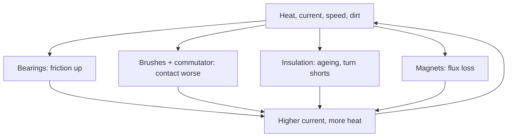

::: testing
Whether you can connect wear mechanisms to measurable performance changes. The interviewer wants the physical causes (brush and commutator wear, bearing wear and lubricant loss, insulation ageing, magnet demagnetisation, contamination), what each does to electrical and mechanical behaviour (no-load current up, efficiency down, noise and vibration up, speed and torque constant shifting, heating up), and how you would notice it in the field (trend monitoring). A strong answer includes numbers and a view of failure-rate behaviour over life (bathtub curve) and solenoid-specific ageing.
:::

::: why
Products stay in service for years, and motors are usually the first wear-out component. Predicting and detecting degradation lets you schedule maintenance before failure, or design controllers that tolerate drift (a torque constant that falls, friction that rises). In an interview, it shows you think about the whole lifecycle, not just beginning-of-life specs, and that you can turn symptoms into diagnoses.
:::

::: concepts
- **Brushes and commutator wear**: see [[q0359]] and [[q0360]].
- **Bearing life**: fatigue, lubricant degradation, contamination.
- **Insulation ageing**: thermal ageing, voltage stress, moisture.
- **Magnet demagnetisation**: irreversible loss of flux.
- **Motor model**: $\tau = K_tI$, $V = IR + K_e\omega$, plus friction. See [[q0392]].
- **Failure-rate curve**: infant mortality, useful life, wear-out.
:::

::: answer
"As a motor ages, nearly everything gets slightly worse, and the symptoms point to the cause. Friction goes up as bearings wear and grease degrades, so the no-load current rises, the motor runs hotter and noisier, and for the same voltage and load it's a bit slower. In a brushed motor the brushes wear down, spring force drops, contact resistance rises and the commutator gets grooved and sparky, so you get noise, EMI and more voltage drop. The winding insulation slowly degrades with heat, which can end in turn-to-turn shorts, lower resistance and a collapsing torque constant. Magnets can lose strength if they've been overheated, so the torque constant falls and you need more current for the same torque.

Overall efficiency drops. I worked an example: a motor that's 73 percent efficient at its operating point new might be 61 percent after friction nearly triples and the magnets lose 10 percent, drawing about 2.6 amps instead of 2.15.

The reliability picture is the bathtub curve: early failures, a long flat useful life, then wear-out where the failure rate climbs. Solenoids age too: plunger and guide wear, spring fatigue, residual magnetism that makes them stick, and coil insulation.

The practical response is to trend current at a fixed load, vibration, temperature and noise, and replace or service before the wear-out region."
:::

::: technical
**Mechanisms and signatures.**

| Mechanism | Physical effect | Measurable signature |
|---|---|---|
| Bearing wear / grease loss | Friction up, play, vibration | No-load current ↑, vibration spectrum peaks, noise, temperature ↑ |
| Brush wear (brushed) | Shorter brushes, lower spring force, groove in commutator | Contact resistance ↑, voltage drop ↑, sparking, EMI ↑, speed ripple |
| Commutator film / contamination | Unstable contact | Noisy current, erratic speed |
| Insulation ageing | Thermal / electrical degradation; turn-turn shorts | Insulation resistance ↓, resistance ↓ and current ↑ in shorted case, heat |
| Winding / connection degradation | Oxidation, loose terminals | Resistance ↑ (hot spots), imbalance between phases |
| Magnet demagnetisation | Flux loss (overheat, reverse field) | $K_t$ and $K_e$ ↓, speed ↑ at given $V$, current ↑ for torque |
| Rotor imbalance / eccentricity | Mass shift, bearing wear | 1× speed vibration |
| Gear wear (gearmotors) | Backlash, tooth loss | Position error, noise, torque ripple |
| Contamination (dust, oil, moisture) | Friction, tracking, corrosion | Increased current, insulation leakage |

**Effect on performance (worked example).** Motor: $V = 12$ V, $R = 1.2\,\Omega$, load torque 0.04 N·m.
- New: $K_t = K_e = 0.02$, no-load (friction) current $I_0 = 0.15$ A. Current $I = \tau/K_t + I_0 = 0.04/0.02+0.15 = 2.15$ A; speed $\omega = (V - IR)/K_e = (12-2.58)/0.02 = 471$ rad/s = 4498 rpm; efficiency $\tau\omega/(VI) = 0.04\times471/(12\times2.15) = 73\%$.
- Aged: $K_t = K_e = 0.018$ (−10%), $I_0 = 0.40$ A, $R = 1.26\,\Omega$ (+5%): $I = 2.22+0.40 = 2.62$ A; $\omega = (12-3.30)/0.018 = 483$ rad/s = 4613 rpm; efficiency 61%.
- Note speed goes *up* with lost flux at a given voltage, while current and heat rise: weaker magnets are not a "slower motor", they are a "hungrier" one.

**Bearing life.** Rolling-element bearing basic life $L_{10} = (C/P)^3$ million revolutions (ISO 281 style, for ball bearings), where $C$ is dynamic load rating and $P$ equivalent load. Example: $C = 2000$ N, $P = 200$ N gives $10^3$ Mrev, or 5556 h at 3000 rpm. Halving the load multiplies life by 8. Lubricant ageing and contamination often shorten real life below this.

**Brushed motor life.** Typically hundreds to thousands of hours depending on current, speed, brush grade and environment (vendor-specific). Brushless motors are limited by bearings and insulation, often tens of thousands of hours.

**Failure-rate curve.** Infant mortality (manufacturing defects), constant-rate useful life (random failures), wear-out (increasing hazard). Weibull analysis with shape $k>1$ models wear-out.

**Solenoids.** Plunger/guide wear, spring fatigue (changes force and stroke), residual magnetism (slower release), coil insulation and overheating, contact bounce in the driving relay, contamination. Pull-in current signature changes: later or shallower dip ([[q0392]]).

> [!UNCERTAIN]
> Life numbers for brushes and bearings depend strongly on operating conditions and vendor. Treat the $L_{10}$ calculation as an idealised estimate; use manufacturer life data when available.
:::

::: short
"Motors drift as they age. Bearings wear and grease degrades, so friction and no-load current rise, with more noise and heat. Brushes shorten and the commutator grooves, increasing contact resistance and sparking. Insulation ages and can short turns; magnets can lose strength, lowering the torque constant so you need more current per newton-metre. Efficiency falls, a 73 percent motor might drop to 61. Reliability follows a bathtub curve, so I'd trend current, vibration and temperature to catch wear-out early."
:::

::: long
"I'd think of aging as a few distinct mechanisms, each with its own signature.

Mechanically, bearings wear and the grease breaks down or gets contaminated. Friction goes up, so the no-load current rises, the motor runs hotter and louder, and there are characteristic peaks in the vibration spectrum. Bearing life follows roughly a cube law in load: halving the load gives eight times the life.

In a brushed motor the brushes wear down and the springs lose force, the commutator gets grooved and filmy, contact resistance goes up, there's more sparking and electrical noise, and the speed becomes uneven. That's why brushed motors have limited life and brushless are favoured when life matters.

Electrically, winding insulation ages with temperature, with life roughly halving for every 10 degrees above the rated limit. Eventually turns short, resistance drops, current and heat rise and the torque constant falls. Magnets can lose flux if they've been overheated or hit with a reverse field.

What does that look like in performance? Take a 12 V motor at 0.04 N·m. New, it draws about 2.15 A at roughly 4500 rpm and is about 73 percent efficient. Nearly triple the friction, lose 10 percent of the flux and add 5 percent resistance, and it draws 2.6 A, runs slightly faster and is about 61 percent efficient, so it runs hotter, which accelerates the ageing.

Reliability follows a bathtub curve: early failures, a long flat region, and then wear-out. Solenoids age similarly, with plunger wear, spring fatigue and sticking from residual magnetism.

So in design I'd trend no-load or fixed-load current, vibration, temperature and noise, and schedule maintenance before the wear-out region."
:::

::: terms
- **Bathtub curve**: failure rate versus time with early, constant and wear-out phases.
- **Weibull distribution**: statistical model for failure times; shape parameter above 1 indicates wear-out.
- **$L_{10}$ life**: time or revolutions by which 10% of bearings fail.
- **No-load current**: current needed to spin the unloaded motor, a measure of friction.
- **Demagnetisation**: loss of magnet strength.
- **Commutator film (patina)**: surface layer that forms between brush and commutator.
- **Condition monitoring**: tracking measurements to detect degradation.
- **Predictive maintenance**: servicing based on measured condition rather than fixed intervals.
:::

::: exceptional
An exceptional answer links each wear mechanism to a measurable symptom, works through a numeric before-and-after performance example (73% vs 61% efficiency, speed up with lost flux), distinguishes brushed from brushless life limiters, uses the $L_{10}$ cube-law for bearings and the 10 K rule for insulation (flagged as heuristics), and describes the bathtub curve and a monitoring plan. It also covers solenoids and notes the positive feedback loop between heat and ageing.
:::

::: mistakes
- **"Weak magnets make it slower."** At a fixed voltage the no-load speed rises; the motor draws more current for the same torque.
- **Only mentioning brushes.** Bearings and insulation dominate in brushless motors.
- **Treating ageing as a single number.** Different mechanisms leave different signatures.
- **Believing the failure rate is constant.** Wear-out makes it rise with time.
- **Ignoring the feedback loop.** Higher friction means more current and heat, which speeds up the ageing.
:::

::: deep
## Where the wear comes from

Every moving or electrically stressed part has a wear-out mechanism. Most of them are accelerated by temperature, current, speed and contamination, so the conditions of use matter as much as the calendar.


Figure: The ageing mechanisms all feed back into more current and heat, which accelerates the same mechanisms. This positive feedback is why degradation tends to accelerate near the end of life and why catching early symptoms pays off.

## Performance change: a worked example

Use the steady-state motor equations with a friction term as a no-load current:

$$I = \frac{\tau_L}{K_t} + I_0,\qquad \omega = \frac{V - IR}{K_e},\qquad \eta = \frac{\tau_L\,\omega}{V\,I}$$

| State | $K_t=K_e$ | $I_0$ | $R$ | $I$ | Speed | Efficiency |
|---|---|---|---|---|---|---|
| New | 0.020 | 0.15 A | 1.20 Ω | 2.15 A | 4498 rpm | 73% |
| Friction only (×2.7) | 0.020 | 0.40 A | 1.20 Ω | 2.40 A | 4354 rpm | 63% |
| Aged: flux −10%, friction up, $R$ +5% | 0.018 | 0.40 A | 1.26 Ω | 2.62 A | 4613 rpm | 61% |

(At 0.04 N·m load, $V = 12$ V.) Friction alone slows the motor slightly; lost flux speeds it up and raises current. Combined effects can cancel in speed while efficiency falls significantly. This is why *speed* is a poor health indicator on its own, and why monitoring *current at a fixed operating point* is more revealing.

```sim
{"id":"dc-motor-lab","view":"curves","v":12,"r":1.2,"kt":0.018}
```
Figure: Set kt to 0.020 and then 0.018 to see how reduced flux changes the stall torque (lower), no-load speed (higher) and efficiency curve. A weaker motor has a lower stall torque and a higher no-load speed, so the torque-speed line pivots rather than shifts.

## Bearings

Rolling bearing basic rating life is
$$L_{10} = \left(\frac{C}{P}\right)^3\ \text{million revolutions}$$
(ball bearings; roller bearings use an exponent of 10/3). With $C = 2000$ N and $P = 200$ N, $L_{10} = 1000$ million revolutions, or 5556 h at 3000 rpm. Halve the load to 100 N: $L_{10} = 8000$ Mrev (44,444 h). Side loads from belts, gears and imbalance dominate $P$ in practice. $L_{10}$ is the life reached by 90% of bearings, assuming clean, properly lubricated conditions; in real motors lubricant life and contamination often limit earlier.

Symptoms of failing bearings: rising no-load current and noise, increased vibration at bearing defect frequencies, temperature rising relative to the housing, play at the shaft.

## Brushes and commutator

Brushes wear by friction and electrical erosion; as they shorten the spring force drops (higher contact resistance, bounce, sparking) until contact is lost; the commutator forms grooves and a patina that changes friction. Signatures: more electrical noise and EMI, uneven speed (ripple at commutator segment frequency), higher voltage drop, hot brush holders. See [[q0360]] and [[q0359]]. Mitigation: brush material selection, spring design, current derating; replace brushes vs the whole motor depends on cost and commutator condition.

## Insulation and thermal ageing

Winding insulation breaks down chemically at high temperature; with a rule of thumb that life halves per 10 K over the rated temperature. Voltage spikes from PWM edges add electrical stress at turn level, and moisture and contamination create leakage paths. Signature: falling insulation resistance (megger test), partial discharge in high-voltage machines, and eventually turn-to-turn shorts, which show as a drop in resistance, unbalanced phase currents and heating.

## Magnets

Overheating or strong reverse fields can irreversibly reduce magnet flux. Loss of 10% flux is a 10% loss in $K_t$ and $K_e$; the drive sees back-EMF lower at a given speed. A drive that tracks $K_e$ can detect it.

## Failure-rate behaviour

```plot
{"title":"Bathtub curve (illustrative hazard rate)","x":{"label":"Operating time","unit":"h","min":0,"max":20000},"y":{"label":"Hazard rate (relative)","min":0,"max":3},
 "vars":{"t0":14000,"k":6},
 "series":[{"label":"infant + constant + wear-out","fn":"1.2*exp(-x/600)+0.25+0.8*pow(x/t0,k)"}],
 "xspans":[{"from":0,"to":2000,"label":"early failures"},{"from":2000,"to":10000,"label":"useful life"},{"from":10000,"to":20000,"label":"wear-out"}]}
```
Figure: The shape, not the numbers, is the point: a high early hazard from manufacturing defects, a low flat region of random failures, then a rising hazard as wear mechanisms take over. Preventive replacement is justified at the start of the wear-out region; before that it wastes good parts.

## Trending: what to log

1. **Current at a repeatable operating point** (fixed speed and load, e.g. a self-test run). A rise of 10–20% over baseline is a flag.
2. **Winding resistance and insulation resistance** at standstill.
3. **Vibration and sound** spectra (bearing frequencies, 1× and 2× running speed).
4. **Temperature** at fixed load and ambient.
5. **Back-EMF constant** (magnet health) from a coast-down or from the drive's estimator.
6. **Start-up voltage** (the minimum voltage to begin moving): a stiction proxy.
7. **Hours and starts** counters for brushes and gearboxes.

## Solenoids

Aging in solenoids is mostly mechanical and thermal: guide-bushing and plunger wear, spring fatigue (changes pull-in force and release), residual magnetism and contamination (stiction, slower release), repeated impacts at end-stops, coil insulation heating cycles, and in AC types, shading-ring damage. The current signature at pull-in changes: the dip comes later or shallower as friction rises ([[q0392]]).
:::

::: applications
- **Predictive maintenance on pumps and fans**: tracking motor current and vibration trends.
- **Robot joints**: monitoring friction (current at constant velocity) to schedule actuator replacement.
- **Automotive fuel pumps and window motors**: brush wear limits life; drivers use current ripple counting for position and diagnostics.
- **Valves with solenoid actuators**: stroke-time and current-signature monitoring.
- **Consumer products (power tools, vacuum cleaners)**: brush life sets product lifetime; brushless adopted for longer life.
:::

::: assumptions
The worked example uses a simple steady-state model with friction as a constant no-load current and assumes the ageing effects can be represented as changes in $K_t$, $I_0$ and $R$. Real ageing is not uniform, and friction depends on speed and temperature. The $L_{10}$ formula idealises the bearing and omits lubricant, contamination and misalignment factors. The bathtub curve is a conceptual model; actual hazard functions depend on product and use. Life of brushed motors is highly dependent on brush grade, current density, speed, atmosphere and duty; brushless motors depend more on bearing and insulation life. Solenoid ageing depends on duty cycle (number of operations) and whether AC or DC.
:::

::: followups
### What would you monitor to tell that a motor is wearing out?
The best single indicator is current at a fixed, repeatable operating point: rising current means rising friction or falling flux. Add vibration (bearing peaks), temperature at fixed load, and for brushed motors electrical noise and speed ripple. Compare to a baseline recorded when new.

### Why might a motor speed up as its magnets weaken?
Back-EMF is $K_e\omega$; with weaker magnets $K_e$ is lower, so at a given supply voltage the motor must spin faster before back-EMF balances the applied voltage: no-load speed $= V/K_e$ rises. Meanwhile torque per amp falls, so under load the current rises. It is a field-weakening effect.

### How do you tell bearing wear from insulation ageing?
Bearing wear raises friction: no-load current up, noise and vibration, temperature at the bearing. Insulation ageing shows up in electrical measurements: insulation resistance falls, phase resistances or inductances become unbalanced, and in turn-to-turn shorts the motor gets hotter at the same load. Vibration spectrum and megger tests separate them.

### Do brushless motors age?
Yes, but differently. No brush wear, so life is limited by bearings, insulation and magnets, plus the electronics (capacitors, MOSFETs). Typical brushless life is much longer than brushed, and PWM-induced bearing currents and voltage spikes are their own ageing mechanisms.

### Harder: a fleet of identical motors shows current rising faster in some units. What do you check?
Operating conditions first: higher ambient or poorer cooling, higher load or side loads (belt tension, misalignment), more starts per hour, contamination, lubricant differences or a bad batch of bearings. Compare vibration spectra and temperatures between units, check installation torque and alignment, and correlate with duty logs. A batch effect shows as clustering by manufacturing date.
:::

::: interpretations
"How do motors perform as they age?" is read as the change in performance and behaviour over life, with mechanisms. [[q0400]] covers the stresses that cause the ageing, and [[q0401]] addresses the thin-wire, high-current question that determines whether coils burn out. For failure modes in more abrupt cases see [[q0390]].
:::

::: references
- ISO 281 (rolling bearings, dynamic load ratings and rating life), by name, for the $L_{10}$ formula.
- IEC 60034-1 and IEC 60085 for motor thermal classes and ageing, by name.
- Mohan, Undeland and Robbins, *Power Electronics*: DC and brushless motor basics.
- Reliability engineering texts on the bathtub curve and Weibull analysis (e.g. general reliability engineering references); motor manufacturers' life data (vendor-specific).
:::

::: rubric
- Names the main ageing mechanisms (bearings, brushes, insulation, magnets) :: Coverage of the real causes.
- Links each to a measurable symptom :: Turns knowledge into diagnosis.
- Gives a numeric performance change (current, speed, efficiency) :: Quantitative understanding.
- Mentions bathtub curve / wear-out behaviour :: Reliability perspective.
- Distinguishes brushed from brushless life limits :: Practical engineering knowledge.
- Includes solenoid ageing :: Answers the motor/solenoid scope.
- Proposes trending and predictive maintenance :: Actionable result.
:::

::: quiz
```json
[
 {"type":"mcq","level":"fundamental","q":"Which change is a typical sign of bearing wear?","options":["No-load current falls","No-load current and noise rise","Back-EMF constant doubles","The supply voltage rises"],"answer":1,"explain":"Worn or dry bearings raise friction, so more current is needed to spin the motor, and noise and heat increase."},
 {"type":"numeric","level":"intermediate","q":"A bearing has dynamic rating $C = 2000$ N and sees equivalent load $P = 200$ N. What is $L_{10}$ in millions of revolutions (ball bearing, exponent 3)?","answer":1000,"tolerance":0.02,"unit":"Mrev","explain":"$L_{10} = (C/P)^3 = 10^3 = 1000$ million revolutions."},
 {"type":"numeric","level":"intermediate","q":"For the same bearing, if the load is halved to 100 N, by what factor does $L_{10}$ increase?","answer":8,"tolerance":0.02,"unit":"×","explain":"$(C/P)^3$ scales as $P^{-3}$; halving $P$ multiplies life by $2^3 = 8$."},
 {"type":"numeric","level":"intermediate","q":"A 12 V motor ($R = 1.2\\,\\Omega$, $K_t = K_e = 0.02$ N·m/A) has 0.15 A no-load current and carries 0.04 N·m. What current does it draw?","answer":2.15,"tolerance":0.02,"unit":"A","explain":"$I = \\tau/K_t + I_0 = 0.04/0.02 + 0.15 = 2.15$ A."},
 {"type":"truefalse","level":"advanced","q":"If a PM motor's magnets weaken, its no-load speed at a given voltage falls.","answer":false,"explain":"No-load speed is about $V/K_e$. Lower $K_e$ from weaker magnets means a higher no-load speed, while torque per amp drops and current under load rises."}
]
```
:::
