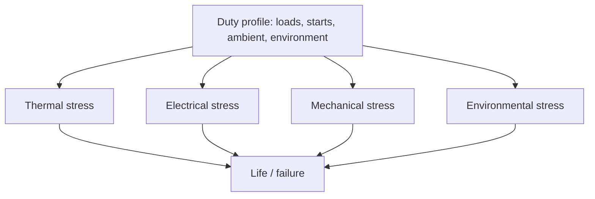

::: testing
Whether you can enumerate the stress types a motor sees and tie each to the damage it causes: thermal (steady and cycling), electrical (inrush, voltage spikes, PWM edges, bearing currents), mechanical (start/stop, reversals, shock, vibration, side loads, speed), and environmental (moisture, dust, temperature, chemicals), plus magnetic stress on the magnets. Strong answers quantify at least one, such as plugging a motor drawing twice the stall current, and connect stresses to design rules (derate, soft start, protection, sealing, test qualification).
:::

::: why
Life-limiting stress is rarely "normal running". It is the starts, stalls, reversals, spikes, thermal cycles and dirt. Designers who list the stresses early can pick motor class, protection and enclosure to match, and write meaningful qualification tests (thermal cycling, vibration, humidity, life-cycle). This question probes whether you think in terms of a duty profile and environment, not a datasheet's nominal point.
:::

::: concepts
- **Inrush and stall**: current limited only by $R$ at zero speed. See [[q0345]] and [[q0343]].
- **Inductive and PWM voltage stress**: spikes and fast edges on winding insulation. See [[q0340]].
- **Thermal cycling and steady heat**: see [[q0397]].
- **Mechanical loading**: shock, vibration, side load, torque reversals.
- **Environment**: humidity, dust, chemicals, temperature extremes.
- **Accelerated testing**: using higher stress to predict life.
:::

::: answer
"I'd group them into thermal, electrical, mechanical and environmental.

Thermal: the winding runs hot continuously, which ages insulation, and it cycles hot and cold every time the motor is used, which fatigues solder, wire bonds, brush connections and adhesives through expansion mismatch.

Electrical: every start is an inrush. A 12 V motor with a 1.2 ohm winding sees up to 10 amps at the instant of start, five times a typical running current, which means 25 times the heating for as long as it lasts. If you reverse a spinning motor by flipping the supply, which is called plugging, the back-EMF adds to the supply, so the current can be twice the stall current. Then there are voltage spikes from switching inductive loads, and with PWM drives the fast edges stress the first turns of the winding and can drive currents through the bearings.

Mechanical: starts, stops and reversals put torque shocks into gears and couplings; side loads from belts and gears wear bearings; vibration and shock loosen things; and rotor stress rises with the square of speed.

Environmental: moisture and condensation, dust that jams or conducts, chemicals, salt, temperature extremes and altitude.

So I'd design for the duty profile: soft start, protection, sealing, derating, and then validate with thermal cycling, vibration and life tests."
:::

::: technical
**Stress inventory.**

| Class | Stress | Damage |
|---|---|---|
| Thermal | Continuous winding temperature | Insulation ageing (life roughly halves per 10 K above rating, heuristic) |
| Thermal | Thermal cycling ($\Delta T$ per cycle, cycles per day) | Fatigue of solder joints, bonds, adhesives, brush shunts (Coffin-Manson type behaviour) |
| Electrical | Inrush and stall current ($V/R$) | Overheating, brush arcing, contact welding in relays, supply sag |
| Electrical | Plugging (reversing at speed) | Current $(V+K_e\omega)/R$; torque shock |
| Electrical | Inductive spikes, regeneration | Insulation and driver stress, bus overvoltage |
| Electrical | PWM edges (high $dv/dt$), long cables | Turn-to-turn stress, partial discharge in high-voltage motors, bearing currents |
| Mechanical | Start/stop and reversal cycles | Gear tooth fatigue, coupling wear, brush wear |
| Mechanical | Shock and vibration | Fastener loosening, brush bounce, solder cracks |
| Mechanical | Radial/axial/overhung loads | Bearing fatigue ($L_{10}\propto P^{-3}$) |
| Mechanical | Overspeed | Centrifugal stress $\propto\omega^2$ on rotor, commutator, magnets, bonding |
| Environmental | Humidity, condensation | Insulation leakage, corrosion, tracking |
| Environmental | Dust, oil, chemicals, salt | Contamination, seal and lubricant attack, jamming |
| Magnetic | Reverse field / large current | Demagnetisation of permanent magnets |

**Worked numbers.** Motor: 12 V, $R = 1.2\,\Omega$, $K_e = 0.02$ V·s/rad, rated running current 2 A.
- Stall/inrush: $I = 12/1.2 = 10$ A, five times rated, so heating is $(10/2)^2 = 25$ times.
- Plugging from 300 rad/s: $I = (12 + 0.02\times300)/1.2 = 15$ A, versus 5 A when running at that speed with the supply applied normally, and 10 A at stall. Plugging from the no-load speed (600 rad/s) is $(12+12)/1.2 = 20$ A, twice stall.
- Overspeed: centrifugal stress scales with $\omega^2$, so 20% overspeed means 44% more stress.
- Duty: 100 starts per day for 5 years is about 182,500 starts, which is why the life of brushes, relays and gear teeth is quoted in cycles, not hours.

**Design responses.** Soft start (current limit or ramp), regeneration and plugging limits, flyback and snubbers, filters or dv/dt limits on long PWM cables, inverter-grade insulation systems, shaft grounding or insulated bearings when bearing currents arise, sealing (IP rating) and conformal coat, thermal derating, vibration-rated connectors, and qualification testing.

> [!UNCERTAIN]
> Quantitative life models (Coffin-Manson exponents, the 10 K rule, bearing-current thresholds) are empirical and product-specific. Use them for ranking stresses and planning tests, not as precise predictions.
:::

::: short
"Four groups. Thermal: steady heat ages insulation and cycling fatigues joints. Electrical: inrush is V over R, so a 12 V, 1.2 ohm motor sees 10 A at start, 25 times the heating of a 2 A run; plugging can double stall current; plus inductive spikes and PWM edges stressing insulation and bearings. Mechanical: start-stop shocks, side loads, vibration, overspeed. Environmental: moisture, dust, chemicals. I'd soft-start, protect, derate, seal and qualify with cycling and life tests."
:::

::: long
"I'd sort the stresses into thermal, electrical, mechanical and environmental, and then tie each one to a design rule.

Thermal stress is both steady and cyclic. Steady heat ages the winding insulation; the usual rule is life halves for every ten degrees above the rating. Cycling, hot and cold every use, fatigues solder joints, brush connections and adhesives because materials expand differently.

Electrically, every start is an inrush. A 12 V motor with a 1.2 ohm winding can pull 10 A at the instant of start, five times a typical 2 A running current, which is 25 times the heating while it lasts. Reversing a spinning motor, called plugging, adds the back-EMF to the supply: from the no-load speed it's 24 V across 1.2 ohms, 20 A, double the stall current. Add inductive spikes when you switch, regeneration pumping up the bus, and for PWM drives the fast voltage edges which stress the first turns of the winding and can push currents through the bearings.

Mechanically: each start, stop and reversal shocks gears and couplings, belts and gears put side loads on the bearings, and bearing life goes as load to the minus three. Vibration loosens things and makes brushes bounce. And rotor stress goes as speed squared, so a bit of overspeed is expensive.

Environmentally: humidity and condensation cause leakage and corrosion, dust and oil contaminate, chemicals attack seals, and temperature extremes affect grease and materials.

Design response: soft start, current limits, no plugging without limits, clamps and filters, correct enclosure, derating. And I'd validate with accelerated tests: thermal cycling, humidity, vibration and a life test at the real duty profile."
:::

::: terms
- **Inrush current**: initial current at start before back-EMF builds.
- **Plugging**: reversing the supply on a spinning motor to brake it.
- **Thermal cycling**: repeated heating and cooling that fatigues materials.
- **Coffin-Manson**: empirical model relating cycles to failure to temperature swing.
- **$dv/dt$**: voltage rise rate of PWM edges.
- **Bearing current**: current driven through bearings by common-mode voltage in inverter-fed machines.
- **IP rating**: ingress protection class (dust and water).
- **Accelerated life test**: testing at higher stress to estimate life quickly.
:::

::: exceptional
An exceptional answer gives a stress inventory and attaches numbers to at least two (stall heating factor of 25, plugging current of twice stall, overspeed squared law, start counts). It names the duty profile as the starting point, distinguishes cyclic from steady stress, mentions PWM-related insulation and bearing-current stress, and closes with design mitigations and qualification tests. It also notes that environment can dominate life even when the electrical design is perfect.
:::

::: mistakes
- **Only listing "heat".** Cycling, electrical transients and mechanical loads matter equally.
- **Ignoring starts.** Inrush and mechanical shock accumulate with cycle count, not hours.
- **Treating plugging as a normal braking method.** It can double stall current and damage gears.
- **Forgetting environment.** Moisture and contamination kill many motors long before wear-out.
- **Using ratings at the wrong conditions.** Ratings assume a duty cycle, ambient and mounting.
:::

::: deep
## Start from the duty profile

A motor's life is determined by what it is asked to do: loads, speeds, number of starts, ambient, contamination. Write down the profile before choosing a motor. Then each part of it maps to a stress.


Figure: All four stress families come from the same duty profile. A design review should ask for the profile first, since a datasheet cannot know whether the motor will be started twice a day or twice a second.

## Electrical stress: inrush, stall and plugging

At rest the back-EMF is zero, so the winding current is $V/R$ ([[q0345]], [[q0343]]). For $V = 12$ V, $R = 1.2\,\Omega$: 10 A. If rated running current is 2 A, heating during the transient is 25× normal. Inductance limits only the rate of rise ($\tau_e = L/R$, typically ms), so the peak is reached quickly.

Plugging reverses the supply on a spinning motor. The back-EMF $K_e\omega$ now *adds* to the supply:

$$I_{plug} = \frac{V + K_e\omega}{R}$$

```plot
{"title":"Motor current vs speed: normal run, and plugging (12 V, 1.2 Ω, Ke = 0.02)","x":{"label":"Speed","unit":"rad/s","min":0,"max":600},"y":{"label":"Current","unit":"A","min":0,"max":22},
 "vars":{"v":12,"r":1.2,"ke":0.02},
 "series":[{"label":"normal drive: (V − Ke·ω)/R","fn":"(v-ke*x)/r","color":"blue"},{"label":"plugging: (V + Ke·ω)/R","fn":"(v+ke*x)/r","color":"red"}],
 "hlines":[{"at":"v/r","label":"stall = 10 A","color":"muted"}]}
```
Figure: The normal-drive current falls from the stall value as the motor speeds up. Reversing at speed starts at *more* than stall and falls as the motor slows: from 600 rad/s (no load) it begins at 20 A, double the stall current, giving a huge torque and current shock in the gearbox and brushes. Drives that need fast reversal limit current or use dynamic braking.

```sim
{"id":"dc-motor-lab","view":"transient","v":12,"r":1.2,"l":0.001,"kt":0.02,"load":0.01}
```
Figure: Watch the start-up current peak near $V/R$ and fall as speed builds. Increase the load to see a motor that cannot accelerate, staying at high current. Each such start contributes thermal and mechanical stress.

**Voltage transients.** Switching an inductor produces $v = L\,di/dt$ ([[q0340]]). In a PWM drive each edge has a high $dv/dt$ (tens of V/ns for modern devices on higher-voltage drives, less for low-voltage motor drivers). In inverter-fed AC motors, long cables can double the voltage at the motor terminals through reflection, and the first turns of the winding take most of the stress; inverter-duty insulation systems and output filters mitigate this. Common-mode voltage also drives bearing currents that pit the races ("fluting").

**Undervoltage and overvoltage** change speed and torque and, with battery supplies, deep discharge or regenerative overvoltage cause misbehaviour of the drive.

## Thermal stress

- **Steady**: insulation ageing ([[q0397]]).
- **Cycling**: each heating cycle expands copper, iron, magnets and housing differently. Over thousands of cycles this fatigues solder joints, brush shunts, wire terminations and adhesive bonds. Failure cycles vary roughly as $\Delta T^{-n}$ (Coffin-Manson, with $n$ typically 2–4 depending on material), so halving the temperature swing can raise cycle life by a large factor.
- **Gradients**: fast heating (stall) causes differential expansion even if the final temperature is modest.

## Mechanical stress

- **Starts, stops, reversals**: torque shock $\propto J\alpha$ plus the motor's peak torque; gears and couplings fatigue over cycle counts. 100 starts/day over 5 years is 182,500 starts.
- **Side and axial loads**: belt tension and gear forces. Bearing life scales as $P^{-3}$, so a 20% higher load costs about 42% of the life ($1.2^{-3}=0.58$).
- **Shock and vibration**: fasteners loosen, brush bounce rises, solder joints crack, rotors can rub.
- **Overspeed**: centrifugal stress in the rotor, commutator bars and magnet retention scales as $\omega^2$; 20% overspeed means 44% higher stress.
- **End-stop impact and jams**: sudden stall with the full stored energy of the rotor ([[q0391]]).

## Environmental stress

Humidity and condensation reduce insulation resistance and cause tracking and corrosion; dust and metal swarf jam or short; oil and chemicals swell seals and degrade grease and insulation varnish; salt fog corrodes housings and connectors; low temperature stiffens grease and raises start current (higher friction), while high ambient reduces the allowable winding rise; altitude reduces air-cooling capability. Enclosure (IP code), seals, conformal coating and material selection are the design responses.

## Magnetic stress

A large reverse current (plugging, a short, regeneration faults) can push a permanent magnet's operating point past its knee and partially demagnetise it. The risk is highest at high temperature. Drives limit current and temperature for this reason.

## Qualification: turning stresses into tests

| Stress | Test |
|---|---|
| Thermal cycling | Temperature cycling between operating extremes, hundreds to thousands of cycles |
| Humidity | Damp-heat soak, insulation resistance monitoring |
| Vibration/shock | Random vibration and shock profile at the product level |
| Duty/cycle life | Run the real duty cycle (starts, loads, reversals) to a cycle count |
| Overload | Stall, plugging and locked-rotor tests within the allowed fault time |
| Electrical | Surge, EMC and spike tests; insulation (hi-pot) tests |

Accelerated testing uses higher temperature, load or cycling rate than service; extrapolation requires an acceleration model (Arrhenius for thermal ageing, Coffin-Manson for cycling) and caution, since a stress that changes the failure mechanism invalidates the extrapolation.

## Design responses summary

1. Soft start and current limit to tame inrush.
2. Controlled braking, not plugging.
3. Clamps, snubbers and filters for voltage transients; inverter-duty or filtered outputs for long cables.
4. Derate temperature and current; thermal management.
5. Sealing, coating and material choices for environment.
6. Mechanical: couplings with compliance, correct bearing selection, balancing, guards.
7. Qualification by duty profile and accelerated testing.
:::

::: applications
- **Automotive actuators**: qualified against thermal cycling, vibration, humidity and millions of cycles.
- **Industrial servo drives with long cables**: output filters and inverter-duty motors for PWM stress.
- **Garage door and gate motors**: inrush, stall and weather stress on cheap gearmotors.
- **Power tools**: stall, shock and dust; brush and commutator life.
- **Robotics**: reversal and shock stress on geared joints, requiring torque limiting and compliance.
:::

::: assumptions
The numbers assume a brushed DC motor with constant $R$ and $K_e$; AC and brushless machines have similar principles but different current paths. Thermal cycling and life exponents are empirical and depend on materials and design. PWM-related stresses matter most for higher-voltage drives and long cable runs; for 12 V hobby motors the dominant stresses are inrush, mechanical shock and brush wear. The qualification table is generic; automotive, aerospace and industrial standards specify their own profiles. Solenoids see similar stresses (thermal duty, spikes, impact at the end-stop) with plunger impact usually dominating mechanical life.
:::

::: followups
### Why does a hot motor accelerate its own ageing?
Higher temperature increases winding resistance (about 0.39 %/K), so more heat for the same current; magnets lose flux, so more current for the same torque; grease degrades faster and friction rises. All raise losses and heat further. That positive feedback makes thermal margin very valuable.

### How would you reduce start-up stress?
Use a soft start: ramp the voltage or limit current with a current loop, so peak current is a small multiple of rated. For a brushed motor this also reduces brush arcing and gear shock; for heavy loads, ramp over hundreds of milliseconds, and monitor stall time. A series resistor or NTC inrush limiter works in simple circuits.

### What is plugging and why avoid it?
Reversing the supply while the motor is still turning forward. Back-EMF adds to the supply, so the current is $(V+K_e\omega)/R$, up to twice the stall current, with a large braking torque. It stresses the gear train, brushes and the driver, and heats the winding. Use dynamic braking or controlled deceleration instead.

### Which stress would you test first for a new motor application?
The one most different from what the motor was qualified for. For a high-start-count application it is cycle life (starts, reversals); for a hot enclosure it is thermal ageing and cycling; for outdoor use it is humidity and ingress; for inverter drives it is insulation and bearing currents. Start from the duty profile and failure risks.

### Harder: a motor passes a 1000 hour constant-load life test but fails in the field in months. What did the test miss?
Probably cycling and transient stress: the field profile has many starts, stalls and thermal cycles, vibration and contamination, which a steady constant-load test does not apply. Also possible: higher field ambient, supply transients, misalignment or side loads in the real mounting, or humidity. Rebuild the test around the measured field duty profile, including starts, thermal cycling and environmental exposure.
:::

::: interpretations
"What kind of stress may a motor experience in its lifetime?" asks for a taxonomy of stresses over the motor's life, not a single failure. [[q0399]] describes how the motor performs as these stresses accumulate, [[q0390]] lists the failure modes, and [[q0391]] covers hazards to people. This page focuses on the stress sources and quantifies a few.
:::

::: references
- Mohan, Undeland and Robbins, *Power Electronics*: DC motor starting, braking and plugging.
- IEC 60034-1 (rotating electrical machines, rating and performance) and IEC 60085 (insulation thermal classes), by name.
- Standards for inverter-fed motor insulation stress (e.g. IEC 60034-18 series), by name; check the exact part for the application.
- Reliability engineering references on Coffin-Manson and Arrhenius acceleration models; bearing manufacturers' catalogues for $L_{10}$ life.
:::

::: rubric
- Organises stresses into thermal, electrical, mechanical, environmental :: Structured coverage.
- Mentions inrush/stall and plugging with numbers :: Quantifies the main electrical stress.
- Mentions voltage spikes and PWM edge stress :: Modern drive-specific stress.
- Distinguishes steady heat from thermal cycling :: Different failure mechanisms.
- Mentions mechanical shock, side loads, overspeed :: Mechanical coverage.
- Covers environment (humidity, dust, chemicals) :: Often the real killer.
- Proposes mitigations and qualification tests :: Closes the loop.
:::

::: quiz
```json
[
 {"type":"numeric","level":"fundamental","q":"A 12 V motor has a 1.2 Ω winding. What is the current at the instant of start (back-EMF zero)?","answer":10,"tolerance":0.02,"unit":"A","explain":"$I = V/R = 12/1.2 = 10$ A."},
 {"type":"numeric","level":"intermediate","q":"The motor's rated running current is 2 A. By what factor is winding heating higher at the 10 A stall current?","answer":25,"tolerance":0.02,"unit":"×","explain":"Heating goes as $I^2$: $(10/2)^2 = 25$."},
 {"type":"numeric","level":"intermediate","q":"The same motor ($K_e = 0.02$ V·s/rad) is spinning at 600 rad/s at no load, and the supply is reversed (plugging). What is the initial current in A?","answer":20,"tolerance":0.02,"unit":"A","explain":"$I = (V + K_e\\omega)/R = (12+12)/1.2 = 20$ A, twice the stall current."},
 {"type":"numeric","level":"intermediate","q":"If a bearing's load rises by 20%, by what factor does $L_{10}$ change (exponent 3)?","answer":0.579,"tolerance":0.03,"unit":"×","explain":"$L_{10}\\propto P^{-3}$, so $1.2^{-3} = 0.579$."},
 {"type":"mcq","level":"advanced","q":"A motor passes a constant-load life test but fails early in the field with frequent starts. What does this suggest?","options":["The test was too short in hours only","Cycling stresses (starts, thermal cycles, shock) were not represented in the test","The motor was too efficient","The supply voltage was too stable"],"answer":1,"explain":"Many failure mechanisms depend on cycle count (inrush, thermal cycling, gear shock). A steady test does not apply them."}
]
```
:::
