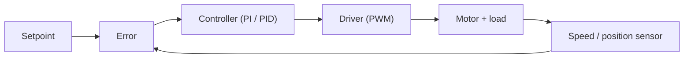

::: testing
Whether you think of a motor or solenoid as a *system with a job* rather than a part you switch on. The interviewer wants to hear that you know the difference between open-loop and closed-loop actuation, can name concrete reasons feedback is needed (disturbance rejection, positioning, commutation, protection, diagnostics), and can connect a measurement to an action. Good candidates mention solenoids too (plunger arrival, soft landing, jam detection) and not just rotating motors. It is also a quick check that you understand why a motor's speed is *not* simply set by the voltage you apply.
:::

::: why
Almost every real actuator application ends up asking "where is it, and how fast is it going?" A 3D printer axis, a camera gimbal, a valve actuator, a window lift, a BLDC drone motor and a fuel injector all need that answer for control, for safety, or for both. Without it you are driving blind: the load changes, the battery sags, the motor heats up and the behaviour drifts. In interviews this question opens the whole sensing-and-feedback thread ([[q0403]] to [[q0408]]) and leads directly to "how would you alter the behaviour based on what you measured?" ([[q0394]]).
:::

::: concepts
- **Open-loop vs closed-loop control**: open-loop applies a command and hopes; closed-loop measures the result and corrects the command. The measurement is the whole point.
- **Speed droop**: a DC motor's speed falls as load torque rises, because the extra current drops more volts across the winding resistance. See [[q0352]].
- **Back-EMF** ($E = K_e\omega$): the motor itself carries speed information in its terminal voltage. See [[q0341]].
- **Commutation**: brushless motors need the rotor angle to know which phase to energise. See [[q0363]].
- **Stall / jam**: the mechanical failure state where the shaft stops, current climbs to $V/R$ and the winding overheats. See [[q0336]].
- **Solenoid stroke**: a plunger has a start and end position; whether it arrived, and how hard it hit, matters for life and noise.
:::

::: answer
"Short version: because voltage doesn't actually set speed or position, it only sets what the motor *tries* to do. Load, supply voltage and temperature all move the answer, so if you care about the result you have to measure it.

There are about five reasons I'd give. One, speed regulation: a brushed motor droops as load goes up, so a fan, a pump or a conveyor drifts unless you feed the speed back. Two, positioning: a robot joint, a printer axis, a valve or a gimbal needs to know where the shaft is, which means an encoder, a Hall sensor or a pot. Three, commutation: a brushless motor needs rotor angle just to spin correctly. Four, protection and diagnostics: if speed is zero while I'm commanding current, that's a stall or jam and I should cut power before the winding cooks. A speed that's lower than expected for a given current can also tell me the bearings are wearing. Five, efficiency and comfort: knowing speed lets me limit inrush and ramp smoothly.

Solenoids are the same story in a smaller box. I want to know whether the plunger actually arrived, how fast it hit the end stop since that drives noise and wear, and whether it jammed. Once it's closed I can drop the coil to a hold current and save a lot of heat."
:::

::: technical
**Why voltage does not fix speed.** For a brushed PM motor in steady state, $V = IR + K_e\omega$ and $T = K_t I$ (with $K_t = K_e$ in SI units). Eliminating $I$:

$$\omega = \frac{V}{K_e} - \frac{R}{K_e K_t}\,T$$

Speed is a straight line that falls with load torque $T$. With $V = 12$ V, $R = 1\ \Omega$, $K_t = K_e = 0.02$ V·s/rad, the no-load speed is $600$ rad/s (5,730 rpm), and at $T = 0.1$ N·m it is already $350$ rad/s (3,340 rpm). The slope is $R/(K_eK_t) = 2{,}500$ rad/s per N·m. That slope is the open-loop error you have to feed back.

**Reasons to measure, and what each needs.**

| Goal | Quantity | Typical sensor | Action |
|---|---|---|---|
| Hold a speed | speed | encoder, tach, Hall, BEMF | PI loop on duty cycle |
| Reach a position | position | encoder, pot, magnetic angle sensor | PID / motion profile |
| Commutate BLDC | rotor angle (6 or finer) | Hall sensors, BEMF zero-crossing, encoder | choose phase pair |
| Detect stall / jam | speed ≈ 0 with current high | any speed estimate + current sense | cut power, retry, fault |
| Detect lost steps | position error | encoder on stepper | recover, re-home |
| Solenoid arrival | end-of-stroke event | Hall, switch, current dip | drop to hold current |
| Soft landing | plunger velocity near end | position sensor, current signature | shape the drive |

**Resolution targets.** A control loop needs the measurement to be fast and fine enough. A rule of thumb for a speed loop is to sample at least 10 times the closed-loop bandwidth. Position resolution should be at least several times finer than the accuracy you need, because quantisation shows up as jitter and limit-cycling.

**Sensored or sensorless.** A discrete sensor costs money, wiring and a failure point. Back-EMF, current ripple counting and solenoid current signatures give "free" information from the existing electrical terminals ([[q0408]]), at the cost of accuracy at low speed.
:::

::: short
"Voltage only sets what a motor tries to do. Load, supply and temperature change what it actually does, so for speed control, positioning, BLDC commutation, stall and jam detection and diagnostics you need to measure speed or position and close the loop. For a solenoid the equivalent is knowing the plunger arrived, how hard it hit, and whether it jammed, so you can drop to a hold current, soften the landing and flag faults."
:::

::: long
"The core reason is that a motor is not a voltage-to-speed converter. For a brushed motor, speed is the supply voltage over the back-EMF constant, minus a droop term proportional to load torque. So at a fixed voltage the speed changes whenever the load or the battery changes. If the application cares about the result, say a conveyor, a pump or a printer axis, I need to measure speed and close a loop around it.

Position is the next reason. Anything that has to go somewhere and stop, a robot joint, a valve, a gimbal, needs a position sensor, whether that's an encoder, a pot or a magnetic angle sensor. Stepper motors can get away without one until they lose steps, which is exactly why closed-loop steppers exist.

Third, brushless motors literally can't be commutated without rotor position, so Hall sensors, an encoder or back-EMF sensing are part of the drive.

Fourth is protection and diagnostics. If I'm commanding torque and the shaft isn't turning, that's a stall or jam. I want to cut or limit current before the winding overheats. Over longer times, a speed that sags for the same current tells me about friction and wear.

For solenoids it's the same logic on a shorter time scale. I want to confirm that the plunger arrived, because a missed actuation in a valve or lock is a functional failure. I want to know the impact velocity, because slamming into the end stop makes noise and shortens life. And once it's pulled in, I can drop to a hold current and save most of the heat.

The practical choice is sensored versus sensorless. Encoders and Halls are accurate but cost money and wires. Back-EMF and current signatures cost nothing but get poor at low speed."
:::

::: terms
- **Closed-loop control**: the controller compares a measured output with a setpoint and adjusts the drive to reduce the error.
- **Speed droop (load regulation)**: the fall in motor speed as load torque increases at constant voltage.
- **Commutation**: switching current between windings in step with rotor position.
- **Stall**: shaft stopped while the drive is energised. Current is limited only by winding resistance, $V/R$.
- **Encoder**: a sensor that outputs pulses or a code proportional to shaft rotation ([[q0405]]).
- **Sensorless**: inferring speed or position from electrical signals the drive already has, such as back-EMF ([[q0408]]).
- **Soft landing**: shaping a solenoid's drive so the plunger arrives slowly, reducing noise, bounce and wear.
- **Hold current**: the lower coil current that keeps a pulled-in plunger closed.
:::

::: exceptional
An average answer lists "speed control and position control". An exceptional answer:

- Starts from the physics: speed is $V/K_e - (R/K_eK_t)T$, so open-loop speed *must* wander, and quantifies it with a number.
- Names the **action** that each measurement triggers (PI loop, commutation step, current cut, hold-current drop), not just the measurement.
- Includes **protection** (stall, jam, lost steps) and **diagnostics** (wear, aging), which is where many real products get their value.
- Covers **solenoids** unprompted: arrival detection, soft landing, hold current and cycle counting.
- Mentions the **cost of sensing** (wires, cost, failure modes) and the sensorless alternative, showing a systems view.
:::

::: mistakes
- **"PWM duty sets speed, so I don't need feedback."** Duty sets the *average voltage*. Speed also depends on load torque and supply voltage, so it drifts. Feedback is what makes speed repeatable.
- **Only thinking about position control.** Commutation, stall detection and diagnostics are at least as common reasons. Include them.
- **Forgetting solenoids.** The question says "motor/solenoid". Mention plunger arrival, soft landing and hold current.
- **Assuming a stepper never needs feedback.** Open-loop steppers lose steps silently at overload or resonance; feedback detects that.
- **Treating a missing speed signal as "motor off".** Zero speed with current flowing is a stall, which is a hazard. See [[q0390]].
- **Ignoring sensor cost and reliability.** A sensor adds wiring, EMI sensitivity and a new failure mode. Say when sensorless is good enough.
:::

::: deep
## The open-loop problem

Take the simplest motor model: armature resistance $R$, torque and back-EMF constants $K_t = K_e$. Steady state gives

$$V = IR + K_e\omega,\qquad T_{load} = K_t I \;\Rightarrow\; \omega = \frac{V - R\,T_{load}/K_t}{K_e}$$

Every extra N·m of load torque needs $1/K_t$ more amps, which costs $R/K_t$ more volts across the winding, and those volts are no longer available to balance back-EMF, so speed falls. The same effect happens if the supply sags by a volt. Suppose a fan is tuned to run at 3,000 rpm unloaded (6.28 V). Add a load torque of 0.05 N·m and it falls to about 1,800 rpm, a 40% drop, with no change in command.

```plot
{"title":"Speed vs load torque: open loop vs closed loop","x":{"label":"Load torque","unit":"N·m","min":0,"max":0.24},"y":{"label":"Speed","unit":"rpm","min":0,"max":3600},
 "vars":{"v":12,"r":1,"kt":0.02,"ke":0.02,"vo":"0.02*3000*pi/30"},
 "series":[{"label":"open loop (fixed 6.28 V)","fn":"(vo - r*x/kt)/ke*30/pi","color":"red"},{"label":"closed loop (voltage raised as needed, 12 V max)","fn":"min(3000,(v - r*x/kt)/ke*30/pi)","color":"accent"}],
 "hlines":[{"at":3000,"label":"3,000 rpm setpoint","color":"muted"}],
 "points":[{"x":0.05,"y":1806,"label":"40% sag at 0.05 N·m"},{"x":0.1143,"y":3000,"label":"closed loop runs out of voltage"}]}
```
Figure: With a fixed 6.28 V the speed falls linearly with load (red). A speed loop measures the sag and raises the PWM duty to hold 3,000 rpm (blue) until the 12 V rail is exhausted at about 0.114 N·m. Beyond that point no controller can help, which is why sizing the motor and supply still matters.

Closed loop in one picture:


Figure: The sensor closes the loop. Everything the sensor can see (load, supply, temperature) is automatically compensated; everything it can't see (a bad sensor, a slipping coupling after the sensor) is not.

## Reason 1: regulate speed

A closed loop needs a speed estimate with enough resolution and low enough delay. Typical practice is a PI controller running at 1 to 20 kHz updating duty cycle from the error, with the speed measured from an encoder ([[q0405]]) or Hall pulse train ([[q0403]]). The gain you get is roughly the loop gain: with a loop gain of 100, a 40% open-loop droop becomes about 0.4%.

## Reason 2: reach and hold a position

A position loop typically wraps a speed loop (cascade), which wraps a current loop. Position sensing options appear in [[q0404]]. Resolution requirements follow the accuracy you need: a lead screw with 2 mm of travel per revolution and a 0.05 mm accuracy target needs at least $2/0.05 = 40$ counts per revolution, and in practice you want several times finer than that so quantisation does not show up as jitter. Counts per revolution scale quickly with gearing: a 12 CPR (pulses) motor encoder decoded 4x through a 30:1 gearbox gives $12\times4\times30 = 1{,}440$ counts per output revolution, i.e. 0.25 degrees.

## Reason 3: commutation

A BLDC motor has no brushes to switch current, so the controller must know the rotor angle. Three Hall sensors give 6 distinct states per electrical revolution (60 electrical degrees each). With 7 pole pairs that is 42 states per mechanical revolution, about 8.6 mechanical degrees per state. Sensorless drives use back-EMF zero crossings instead, which fail at standstill and very low speed. See [[q0364]].

## Reason 4: protect the hardware

At stall, $\omega = 0$ and $I = V/R$. For our 12 V, 1 Ω motor that is 12 A, 144 W in the winding, enough to damage it within seconds if the winding can't dissipate that power. A speed sensor makes stall detection trivial: "duty commanded, current high, speed zero for more than 100 ms means fault". Without a speed sensor you can still infer it from current plus back-EMF, but a direct sensor is more reliable. Related: [[q0343]] on inrush and [[q0395]] on current measurement.

Other protection uses:
- **Jam and end-stop detection** for window lifts, valves and locks: current rises while speed drops to zero, so the controller reverses or stops.
- **Overspeed** when a load is lost (a motor with a broken coupling will run at no-load speed, $V/K_e$).
- **Lost-step detection** on steppers with an encoder.

## Reason 5: diagnostics and aging

Speed at a given current and voltage is a health indicator. If the friction torque grows (dry bearing, contaminated gearbox), speed at constant voltage falls, or current at constant speed rises. Counting revolutions or cycles also gives lifetime data for brush wear or relay-like actuators ([[q0399]]).

## Solenoids: why speed and position matter there

A solenoid does a short, violent movement. Typical numbers for a small DC solenoid are strokes of a few mm to a couple of cm and transit times of a few ms to tens of ms. Reasons to measure it:

1. **Confirm actuation.** A valve or lock that did not move is a functional failure that a plain on/off drive can't see.
2. **Soft landing.** The plunger impact velocity sets noise, bounce and fatigue. Reducing it by shaping the drive extends life and reduces click noise ([[q0415]]).
3. **Hold-current optimisation.** Once the plunger is closed, the air gap is nearly zero and a fraction of the pull-in current will hold it. Detecting arrival tells you *when* to drop the current. A coil that holds at 0.5 A instead of 2 A dissipates $I^2R = 3$ W instead of 48 W for a 12 Ω coil.
4. **Fault detection.** A jammed plunger shows a different current waveform from a free one ([[q0406]]).

## Experiment

```sim
{"id":"dc-motor-lab","view":"curves","v":12,"r":1,"l":0.001,"kt":0.02,"load":0.05}
```
Figure: Look at the torque-speed line: it is the same straight line as the plot above. Switch the model to the transient view and watch current peak at start (stall current) and fall as back-EMF builds with speed. That fall in current *is* speed information.

## What this implies for design

- Pick the **sensor class** from the use case. Binary arrival: limit switch or Hall. Speed regulation: encoder or tach. Absolute position after power-up: absolute encoder or pot ([[q0404]]).
- Decide whether you can live **sensorless**: if the application never runs near zero speed and accuracy needs are loose, back-EMF is free ([[q0408]]).
- Plan the **fault actions** before the happy path: what happens on stall, on overspeed, on a missing sensor signal?
:::

::: applications
- **3D printer / CNC axes**: encoder or step-count plus homing switches for position, closed-loop steppers to detect lost steps.
- **Brushless drone and fan motors**: rotor angle from back-EMF zero crossings (sensorless ESC) or Halls, speed as the control variable.
- **Automotive window lifts and sunroofs**: Hall pulse counting in the motor for position and anti-pinch (a sudden speed drop plus current rise reverses the motor).
- **Robot arm joints and gimbals**: absolute magnetic encoders for position, current sensing for torque.
- **Solenoid valves (fluid dosing, injectors)**: plunger arrival detection from the current dip to confirm actuation and to adapt drive timing.
- **Door locks and latches**: confirming the bolt moved fully, then dropping to a hold or release.
:::

::: assumptions
- The motor model assumes a **brushed PM DC motor** with $K_t = K_e$ and ignores friction. With viscous friction the no-load speed is a bit lower and the droop slightly different, but the shape is the same.
- "Closed-loop fixes it" assumes the **loop is stable** and the actuator has headroom (voltage and current). At the supply limit, speed droops again.
- For **AC induction motors**, slip plays the role of droop. For **steppers**, speed is set by the step rate until the load exceeds pull-out torque.
- For **solenoids**, the "right" sensing depends on the application: a binary yes/no arrival is far cheaper than full position tracking, so ask what the requirement is.
- The numerical examples use a small illustrative motor; real motors differ, but the equations hold.
:::

::: followups
### What's the cheapest way to know a motor has stalled?
Watch current. A running motor draws $(V - K_e\omega)/R$; a stalled one draws $V/R$. A sense resistor plus comparator or ADC reading sits well above running current and stays there while the shaft is stopped. Add a timeout (100 ms or so) so normal start-up inrush ([[q0343]]) doesn't trip it. If you need to tell a slow-moving load from a jam, add a speed signal such as a Hall pulse.

### When would closed-loop speed control be a bad idea?
When the sensor adds more problems than it solves. A cheap hobby fan or a toy needs no precision, so open loop is fine. Also if the loop bandwidth is limited by sensor resolution or delay (a one-pulse-per-rev tach at low speed), a badly tuned loop can oscillate. Check that the measurement is fast and fine enough before trusting it.

### Why does a BLDC motor need rotor position when a brushed one doesn't?
In a brushed motor the commutator and brushes mechanically switch current between windings in sync with the rotor. A BLDC has stationary windings and a rotating magnet, so electronics must do that switching, and it has to know where the magnet is. Wrong timing drops torque and can reverse it. See [[q0363]].

### How would you detect that a solenoid actually pulled in, without adding a sensor?
Watch the coil current. When the plunger moves it generates a motional back-EMF $i\,\frac{dL}{dx}v$, which makes the current rise, dip and then rise again as the plunger arrives. The location of the dip tells you the arrival time. If the dip is missing the plunger didn't move. It's detailed in [[q0406]].

### Your closed-loop speed controller keeps winding up whenever the load is jammed. What do you do?
Add anti-windup (clamp the integrator when the output saturates) and a stall detector that cuts or ramps down current after a timeout. Otherwise the integrator keeps growing, and when the jam clears the motor lurches. Also limit the maximum current in the inner loop so a long jam can't overheat the winding.
:::

::: interpretations
"Speed and/or position" covers both rotating motors (rpm, angle) and linear actuators and solenoids (velocity, stroke). I answer for both and call out the differences. The question is about *why*; the *how* is covered in the siblings [[q0403]] (motor rpm), [[q0404]] (motor position), [[q0405]] (encoders), [[q0406]] and [[q0407]] (solenoid speed and position) and [[q0408]] (back-EMF sensing).
:::

::: references
- Fitzgerald, Kingsley & Umans, *Electric Machinery*: DC machine equivalent circuit and torque-speed characteristic.
- Franklin, Powell & Emami-Naeini, *Feedback Control of Dynamic Systems*: motor speed and position control examples; effect of feedback on disturbance rejection.
- Horowitz & Hill, *The Art of Electronics*, 3rd ed.: motor drive and feedback discussions in the chapters on control and on power switching.
- Krishnan, *Permanent Magnet Synchronous and Brushless DC Motor Drives*: commutation and rotor position sensing.
:::

::: rubric
- Explains that voltage does not fix speed: speed droops with load and varies with supply and temperature :: This is the physical reason feedback is needed, not just a list of applications.
- Names speed regulation and position control as closed-loop reasons :: These are the textbook reasons and the minimum expected.
- Mentions commutation of brushless motors :: Shows you know rotor angle is required for operation, not only for performance.
- Covers protection and diagnostics (stall, jam, lost steps, aging) :: Safety and reliability are often the real driver in products.
- Addresses solenoids: arrival detection, soft landing, hold current :: The question explicitly says motor/solenoid.
- Links a measurement to an action (PI loop, cut power, drop to hold current) :: Measurement without a response is not engineering.
- Notes sensor cost/reliability and sensorless alternatives :: Shows a system-level trade-off view.
:::

::: quiz
```json
[
 {"type":"mcq","level":"fundamental","q":"A brushed DC motor is driven with a fixed PWM duty. Its load torque doubles. What happens to the steady-state speed?","options":["It stays the same because voltage is fixed","It rises because torque rises","It falls, because the extra current drops more voltage across the winding resistance","It doubles"],"answer":2,"explain":"Steady state gives $\\omega = (V - R T/K_t)/K_e$. More torque needs more current, more $IR$ drop, less voltage left to balance back-EMF, so speed falls."},
 {"type":"truefalse","level":"fundamental","q":"A shaft that is not turning while the drive is commanding current is a normal operating condition for a brushed motor.","answer":false,"explain":"Zero speed with current flowing is a stall. Current is limited only by $V/R$ and the winding can overheat quickly, so the controller should detect it and cut or limit power."},
 {"type":"numeric","level":"intermediate","q":"A 12 V motor has $R = 1\\ \\Omega$ and $K_t = K_e = 0.02$ N·m/A. What is the stall current?","answer":12,"tolerance":0.01,"unit":"A","explain":"At stall $\\omega = 0$ so there is no back-EMF: $I = V/R = 12/1 = 12$ A."},
 {"type":"numeric","level":"intermediate","q":"Using $V = 12$ V, $R = 1\\ \\Omega$, $K_t = K_e = 0.02$, what is the speed at 0.1 N·m load torque? Give it in rpm.","answer":3342,"tolerance":0.02,"unit":"rpm","explain":"$\\omega = (12 - 1\\cdot0.1/0.02)/0.02 = (12-5)/0.02 = 350$ rad/s, which is $350\\cdot60/(2\\pi) = 3{,}342$ rpm."},
 {"type":"multi","level":"advanced","q":"Select all useful reasons to measure solenoid plunger position or arrival.","options":["Drop the coil to a hold current once the plunger has closed","Detect that a valve or lock failed to move","Reduce impact velocity (soft landing) to cut noise and wear","Make the coil resistance larger"],"answer":[0,1,2],"explain":"Arrival detection enables hold-current reduction, functional fault detection and soft-landing control. Coil resistance is a property of the winding, not something measuring position changes."}
]
```
:::
