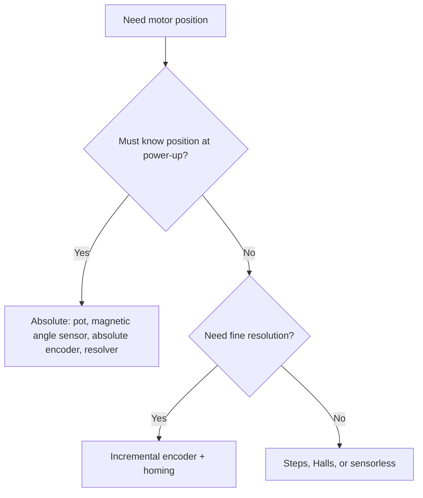

::: testing
Whether you know the *families* of position sensing and can match one to a requirement. The hidden skills: absolute versus incremental (does it know where it is at power-up?), resolution versus accuracy, single-turn versus multi-turn, contact versus contactless, and the sensorless options (step counting, back-EMF, hard-stop homing). The best answers ask "how much resolution, absolute or relative, what environment, what cost?" before choosing.
:::

::: why
A position loop is only as good as its sensor. Wrong choice means a robot that loses its zero after a power cut, a gimbal that jitters from quantisation, or a window lift that cannot tell open from closed. Position sensing is also a good vehicle for interviewers to see if you can compare technologies on specific numbers rather than adjectives.
:::

::: concepts
- **Incremental vs absolute**: incremental sensors count changes from an unknown start; absolute sensors report a unique code at every angle. See [[q0405]].
- **Resolution vs accuracy**: resolution is the smallest step reported; accuracy is how close to the true angle. Resolution can exceed accuracy.
- **Homing**: driving to a known reference (switch, index pulse, hard stop) to initialise an incremental count.
- **Gear ratio**: a gearbox multiplies angular resolution at the output but adds backlash.
- **Commutation sensing**: Hall sensors give coarse position (60 electrical degrees) for BLDC motors. See [[q0363]].
- **Dead reckoning**: integrating speed over time to estimate position; errors accumulate. See [[q0403]].
:::

::: answer
"It depends what I need: resolution, whether it has to know where it is at power-up, and what it costs. I think of it as three families.

First, direct angle sensors. A potentiometer on the shaft is the cheap one: read the wiper with an ADC and you get absolute angle over maybe 270 degrees. A magnetic angle sensor, a Hall array under a magnet on the shaft, gives 12 bits or more, absolute, contactless, and can go all the way round 360. An optical or magnetic absolute encoder does the same with higher resolution. Resolvers are the rugged option in harsh environments.

Second, incremental encoders. An optical quadrature encoder counts steps from where it started, so I need a homing routine or an index pulse. Resolution is great and it's cheap, but it forgets position at power-off.

Third, sensorless or implicit. A stepper counts steps and, as long as it doesn't skip, that's position. Brushless motors have Hall sensors that give about 60 electrical degrees of position, which is enough for commutation but not for precision. And with brushed motors I can integrate speed or count commutator ripple.

Then there's a gear ratio: put the sensor on the motor shaft and the resolution at the output is multiplied by the gear ratio, but backlash means I don't know the true output position."
:::

::: technical
**Resolution arithmetic.** An $N$-bit absolute sensor reports $2^N$ positions per turn: 12 bits is $360/4096 = 0.088^\circ$; 14 bits is $0.022^\circ$. A 10-bit pot ADC reading over a 270° electrical travel gives $270/1024 = 0.26^\circ$; 12-bit gives $0.066^\circ$ (before noise and linearity error, typically ±0.5 to ±1% of full scale for a cheap pot, vendor-dependent).

An incremental encoder with $P$ lines decoded 4x gives $4P$ counts per revolution. With a gearbox of ratio $G$ (sensor on the motor), output resolution is $360/(4PG)$: a 12-line encoder with 30:1 gearing is $360/1440 = 0.25^\circ$.

**Accuracy vs resolution.** Resolution says how finely you can read; accuracy depends on eccentricity, magnet misalignment, linearity, gear backlash and thermal drift. An optical encoder has high resolution and good accuracy; a cheap magnetic sensor has high resolution but the integral nonlinearity can be a degree or so if the magnet is off-axis.

**Brushless commutation sensors.** Three Hall sensors spaced 120 electrical degrees apart produce 6 states per electrical revolution, i.e. $60^\circ_e$ each. With $p$ pole pairs, mechanical resolution is $60^\circ/p$, so 7 pole pairs gives about $8.6^\circ$ mechanical. That is enough to commutate, but not enough for precision positioning without interpolation.

**Stepper step counting.** A 1.8° stepper has 200 full steps per rev; microstepping (e.g. 16x) gives 3,200 microsteps per rev, but microstep *accuracy* is much worse than resolution. Position is only valid if no steps were lost; a stall or resonance silently breaks it.

**Sensorless estimates.** Back-EMF integration ([[q0408]]) gives relative position for BLDC/sensorless drives above a minimum speed. Brushed-motor current ripple counting gives a count per commutator segment crossing (e.g. 12 counts per rev for a 12-segment commutator), sufficient for window lifts and seats but not precision.

**Homing.** Incremental systems zero on a limit switch, an index pulse or a mechanical hard stop (detected by stall current). Absolute sensors remove the homing step.
:::

::: short
"I'd pick between absolute and incremental. Absolute options are a potentiometer, a magnetic angle sensor (12 bits or more, contactless) or an absolute encoder. Incremental means an optical quadrature encoder, which needs homing at power-up. Brushless motors have Hall sensors good for commutation (about 60 electrical degrees). Steppers count steps if they don't slip. The gear ratio multiplies output resolution but adds backlash. I'd choose on resolution, absolute versus relative, environment and cost."
:::

::: long
"I split it by what the sensor knows at power-up. Absolute sensors tell me the angle immediately: a potentiometer into an ADC is the cheapest, though limited to about 270 degrees and it wears. A magnetic angle sensor, a Hall array under a diametrically magnetised magnet on the shaft, gives 12 to 14 bits over a full turn with no contact, which is my default for small actuators. Optical absolute encoders and resolvers sit above that for higher accuracy or harsh environments.

Incremental sensors, mainly optical quadrature encoders, give very fine resolution and direction but only relative to wherever they started. So I need a homing sequence, a limit switch or index pulse, after every power-up. A 12-line motor encoder decoded four times through a 30-to-1 gearbox gives 1,440 counts per output revolution, a quarter of a degree.

Then there are the implicit ones. Steppers count commanded steps, which is position as long as they don't stall; a closed-loop stepper adds an encoder to catch lost steps. Brushless motors usually have three Hall sensors giving six states per electrical revolution. With seven pole pairs that's about 8.6 mechanical degrees: fine for commutation, too coarse for positioning on its own. And sensorless approaches such as integrating back-EMF or counting commutator ripple work with no hardware but only at reasonable speed, with accumulating error.

Two caveats I'd always raise. Resolution isn't accuracy: a 14-bit magnetic sensor with a misaligned magnet can still be a degree off. And if the sensor is on the motor and not the load, gear backlash makes the true output position uncertain, so sometimes you want a second sensor on the output."
:::

::: terms
- **Absolute encoder**: outputs a unique code for each angle, so no homing is needed.
- **Incremental encoder**: outputs pulses per angle step; the controller keeps a running count ([[q0405]]).
- **Index (Z) pulse**: one pulse per revolution used as a reference.
- **Resolver**: a rotating transformer with sine and cosine outputs, rugged and absolute over one turn.
- **Potentiometer**: a variable resistor whose wiper voltage is proportional to angle.
- **Hall sensor**: a magnetic-field-to-voltage sensor used for rotor position and magnet-based angle sensing.
- **Homing**: driving to a known reference to initialise an incremental position.
- **Backlash**: free play in gears that makes output position differ from motor position.
:::

::: exceptional
An average answer lists "encoder, potentiometer". An exceptional answer:

- Organises the options by **absolute vs incremental** and says what happens at power-up.
- **Quantifies resolution** ($360/2^N$, $4P\cdot G$ counts per output rev) and separates it from accuracy.
- Mentions **BLDC Halls** and what their 60° electrical granularity means for mechanical resolution.
- Covers **stepper step counting** and its failure mode (lost steps).
- Raises **where the sensor sits** (motor vs load shaft, backlash) and **sensorless options** with limits.
:::

::: mistakes
- **Equating resolution and accuracy.** A 14-bit sensor is not accurate to 14 bits; misalignment, linearity and noise matter.
- **Using an incremental encoder without a homing plan.** After a power cycle, position is unknown.
- **Trusting stepper commands as position under load.** Lost steps are silent. Use an encoder or stall detection if it matters.
- **Placing the sensor on the motor and assuming perfect output accuracy.** Gearbox backlash and compliance put an error between motor and load.
- **Using Hall commutation sensors for precision position.** They give only 6 states per electrical rev.
- **Forgetting multi-turn.** Single-turn absolute sensors lose count of how many revolutions have happened (lead screws, multi-turn joints). Use a gear-based, battery-backed or counted solution.
:::

::: deep
## Start with the requirement

Before choosing a sensor ask four questions:

1. **Range**: less than one turn (a valve, a hobby servo arm) or many turns (a lead screw, a winch)?
2. **Absolute needed?** Can the system home at start, or must it know where it is immediately (safety-critical, no travel allowed)?
3. **Resolution and accuracy**: how many degrees or microns?
4. **Environment and cost**: dust, oil, vibration, temperature, wiring, price.


Figure: A first-pass selection tree. Most small actuators end up in "magnetic angle sensor" (absolute) or "incremental encoder with a homing switch".

## Absolute direct sensing

**Potentiometer.** A voltage divider whose ratio is the wiper angle. Pros: trivial, absolute, ratiometric (supply variations cancel if the ADC reference is the same rail). Cons: wear, noise at the wiper, limited rotation and a dead zone at the ends. Hobby servos use exactly this: the output-shaft pot closes the position loop ([[q0383]]).

**Magnetic angle sensors.** A diametrically magnetised magnet at the end of the shaft over a Hall array or magnetoresistive sensor produces sine and cosine signals; the chip computes $\theta = \text{atan2}(V_{sin}, V_{cos})$ and outputs it as SPI, I²C, PWM or analog. Typical resolution is 12 to 14 bits, i.e. $0.088^\circ$ to $0.022^\circ$. Pros: contactless, rugged, cheap, no wear. Cons: accuracy depends on magnet alignment and air gap, and stray magnetic fields from the motor itself. A 1 mm eccentric magnet can add a degree or more of error (typical, vendor-dependent), so mechanical design matters.

**Optical absolute encoders.** A coded disc (Gray code or serial track) with photodetectors. Very high resolution (up to 20+ bits). Cost and dust sensitivity are the trade-offs.

**Resolvers.** A rotor winding excited at kHz; two stator windings give $\sin\theta$ and $\cos\theta$ amplitude-modulated outputs. Very rugged (high temperature, shock), used in aerospace and automotive traction. Needs a resolver-to-digital converter.

## Incremental sensing

Optical or magnetic **quadrature encoders** ([[q0405]]) count transitions. Resolution is cheap to get: 1,000 lines times 4 is 4,000 counts per revolution. After power-up, the controller has to **home**:

- Drive to a limit switch, then back off to a known edge.
- Or find the **index pulse** (one per rev) and set the count to zero.
- Or drive to a **hard stop** and detect the stall by current ([[q0395]]) or speed.

Multi-turn mechanisms (lead screws) need homing against a travel switch because the index only identifies the angle, not the turn.

## Brushless Halls and what they can and cannot do

```timing
{"signals":[{"name":"Hall 1","wave":"111000111000","color":"red"},{"name":"Hall 2","wave":"001110001110","color":"green"},{"name":"Hall 3","wave":"100011100011","color":"accent"}],"marks":[{"t":2,"label":"60° sectors"}],"hscale":1.0}
```
Figure: Three Hall outputs 120 electrical degrees apart produce six distinct codes per electrical revolution (101, 100, 110, 010, 011, 001 in the order they appear). That is perfect to choose which two phases to energise, but each code spans 60 electrical degrees, so position is only known to 60 degrees divided by the pole pairs. Precision position needs an encoder or interpolation between Hall edges using speed.

## Stepper motors

A stepper moves a fixed angle per step (1.8° for 200 steps per rev), so the *commanded step count* is the position if no steps are lost. Microstepping increases resolution but the actual position error stays on the order of a fraction of a full step. Lost steps occur if torque demand exceeds pull-out torque or at resonance, and are silent. See [[q0382]]. Closed-loop steppers add an encoder to detect and correct that.

## Sensorless and estimated position

- **Integrating speed**: $\theta = \int\omega\,dt$ from a BEMF-based speed ([[q0408]]); error accumulates, so it needs periodic re-homing.
- **Commutator ripple counting** (brushed): a 12-segment commutator gives 12 current ripples per revolution (in a 2-pole motor), so $30^\circ$ per count. Counts are easily missed or doubled at the speed extremes, so position drifts without limit switches.
- **Stall detection at the end stops** gives a free homing routine.

## Gearing and where to put the sensor

Putting the encoder on the **motor** shaft multiplies resolution at the output by $G$ but includes backlash. Putting it on the **load** shaft sees the truth but has coarser effective resolution and puts gear dynamics inside the loop, which can destabilise it. High-end robot joints use both (dual-encoder joints).

Example: 12-line encoder, 4x decoding, $G = 30$: $12\times4\times30 = 1{,}440$ counts per output turn, $0.25^\circ$. For a lead screw with 2 mm lead, that is $2\text{ mm}/(4\times12\times30)=1.4\ \mu$m of linear resolution (backlash and screw error are much larger).

## Experiment

```sim
{"id":"servo-lab","pulse":1.5,"kp":4,"kd":0.2}
```
Figure: A hobby servo is a position loop around a potentiometer. Change the commanded pulse width and watch the output angle follow; then lower `kp` or raise `kd` to see how loop gain trades stiffness against overshoot.

## What I'd say about accuracy

Quote a **budget**: sensor resolution, sensor nonlinearity, mounting eccentricity, gear backlash, thermal drift, and the speed of the position loop. Only the sum tells you the achievable position accuracy.

## Worked example: getting speed out of a position sensor

Take a 1000-line optical encoder with 4x decoding, so 4000 counts per revolution. At 10 rpm the shaft turns 0.167 rev/s, or 667 counts/s. If firmware computes speed by counting edges in a 1 ms window, it sees 0.67 counts per window, which is zero or one. One count in 1 ms corresponds to $(1/4000\text{ rev})/1\text{ ms} = 0.25$ rev/s = 15 rpm, so the measurement jumps between 0 and 15 rpm for a true 10 rpm. That is a useless signal for a velocity loop. The other method times the gap between edges with a fast timer: at 10 rpm edges arrive every 1.5 ms, and a 10 MHz timer (100 ns tick) resolves that to 0.0067 %. So the rule is edge-counting at high speed, period-measuring at low speed, with real servo drives switching between them or using a combined method. The same logic shows why a position loop on a heavily geared motor needs a high-resolution sensor even when the output turns slowly.

## Worked example: error budget for a magnetic angle sensor

A magnetic angle IC produces a sine and a cosine signal and computes $\theta = \text{atan2}(V_{sin},V_{cos})$. Its errors come mostly from imperfections in those two signals, not from the converter. Numerically evaluating the arctangent over a full turn gives these peak errors:

| Imperfection | Peak angle error |
|---|---|
| 2 % gain mismatch between sine and cosine | 0.57° |
| 1 % offset in one channel | 0.57° |
| 14-bit quantization (LSB = 0.022°) | ±0.011° |
| 12-bit quantization (LSB = 0.088°) | ±0.044° |

The rules of thumb are that an amplitude mismatch of $\varepsilon$ gives roughly $\varepsilon/2$ radians of peak error and an offset of a fraction $\delta$ of the amplitude gives roughly $\delta$ radians. So quantization is almost irrelevant, and a "14-bit" sensor can be accurate to only half a degree. This is the reason for the factory trimming and auto-calibration features advertised on these parts, and for the effect of mounting: an off-center magnet or a tilted chip also distorts the two signals. Combine independent contributions by root-sum-square. With 0.57° gain error, 0.57° offset error, 0.044° quantization and a 0.3° backlash at the output, the total is $\sqrt{0.57^2+0.57^2+0.044^2+0.3^2} = 0.86°$, dominated by signal quality and not by bits.

## Worked example: Hall sectors on a motor with pole pairs

Three Halls give six states per electrical revolution, 60° apart. A BLDC with 4 pole pairs has one electrical turn per 90° of mechanical turn, so each Hall sector is $60/4 = 15°$ of shaft angle, or 24 states per revolution. That is fine for commutation but crude for position control: ±7.5° around each edge. Interpolating between edges using the measured speed is common (position estimate = last edge angle + speed × elapsed time), and it works only if the speed is changing slowly relative to the edges.

## Verifying on the bench

- **Compare to a reference:** couple the sensor to a higher-resolution one (a lab encoder or a rotary stage) and sweep a full rotation slowly. Plot error against angle. A once-per-turn sine shows offset or eccentricity; a twice-per-turn sine shows gain mismatch.
- **Check direction and index:** rotate by hand and confirm the count increases with the expected direction, and that the index fires once per rev at a repeatable angle. Verify the index pulse on a scope against A and B.
- **Repeatability of homing:** home 100 times from both directions and look at the spread. The difference between the two directions is the backlash or the switch hysteresis.
- **Missed counts:** run a long move and return to the starting point. A non-zero residual error means lost counts, which in a stepper are lost steps and in an encoder system usually noise on A and B.
:::

::: applications
- **Hobby and RC servos**: potentiometer on the output shaft in the control loop.
- **Robot joints and camera gimbals**: magnetic absolute angle sensors (12 to 14 bits) per joint.
- **CNC and 3D printers**: stepper step counting with limit-switch homing; closed-loop variants add encoders.
- **BLDC fans, drones and e-bikes**: three Halls for commutation; sometimes an encoder for precise control.
- **Automotive seat/window motors**: commutator ripple or Hall pulse counting plus end-stop detection.
- **Aerospace actuators and EV traction**: resolvers for ruggedness.
:::

::: assumptions
- "Position of a motor" is taken to be **shaft angle**. For linear actuators or solenoids see [[q0407]].
- The sensor is on the **motor shaft** unless stated; the load position may differ because of backlash and compliance.
- Accuracy figures for magnetic sensors and potentiometers vary a lot by part and installation; the numbers here are typical ranges, not guarantees. Check the datasheet.
- If the interviewer's context is a particular motor type (stepper, BLDC, servo), the answer shortens to that branch.
:::

::: followups
### What is the difference between resolution and accuracy for a position sensor?
Resolution is the smallest increment the sensor reports (e.g. 0.088° for 12 bits). Accuracy is how close the reading is to the true angle, limited by nonlinearity, eccentricity, alignment, temperature and noise. A 14-bit sensor on a poorly aligned magnet can be accurate only to about a degree. Always specify both.

### Your incremental encoder system loses its zero after a power cycle. How do you fix it?
Add a homing routine: drive until a limit switch or index pulse triggers and set the count to zero; or drive to a hard stop and detect the stall. If homing travel is unacceptable, switch to an absolute sensor, or add a battery-backed multi-turn absolute encoder.

### How would you get position out of a brushless motor that only has Hall sensors?
Counting Hall edges gives $60^\circ_e$ per edge; divide by the pole pairs. Between edges, interpolate using the measured speed ($\theta \approx \theta_{edge} + \omega\,\Delta t$). That improves resolution but not absolute accuracy. For a servo-grade position loop, add an encoder.

### A stepper-driven axis is off by a few millimetres after a long print. What happened and what do you do?
Likely lost steps from too much acceleration, current too low, or resonance. Steps skipped silently and the controller still thinks it is where it commanded. Fixes: lower acceleration, raise current, microstep smoothly, or add a closed-loop encoder or stall detection. Re-home periodically.

### The motor has a gearbox with 1° of backlash and the encoder is on the motor. Does that limit your positioning accuracy?
Yes, if load direction reverses. The encoder tells you the motor position, not the output, so you have up to 1° of uncertainty when the direction changes. Options: preload (anti-backlash gear), approach the target from a single direction, or add an output-side sensor.
:::

::: interpretations
"Position of a motor" most often means shaft angle for a rotating motor. For a linear motor or a solenoid the question becomes stroke position, treated separately in [[q0407]]. If the interviewer is thinking about a **stepper**, the answer is mostly step counting plus closed-loop options.
:::

::: references
- Bolton, *Mechatronics*: position transducers, potentiometers, encoders and resolvers.
- Krishnan, *Electric Motor Drives* and *Permanent Magnet Synchronous and Brushless DC Motor Drives*: Hall-sensor commutation and position estimation.
- Franklin, Powell & Emami-Naeini, *Feedback Control of Dynamic Systems*: position servo loops and the effect of sensor placement.
- Magnetic angle sensor and encoder-IC datasheets from major vendors (check the current datasheet for accuracy and alignment tolerances).
:::

::: rubric
- Separates absolute and incremental sensing and their power-up behaviour :: This is the fundamental dividing line in position sensing.
- Lists several concrete sensors (pot, magnetic, optical encoder, resolver) :: Breadth of options is expected.
- Computes resolution ($360/2^N$ or $4PG$ counts) :: Shows quantitative thinking.
- Distinguishes resolution from accuracy :: A classic interview probe.
- Mentions homing for incremental systems :: Practical necessity.
- Covers BLDC Halls and stepper step counting, including limits :: Shows motor-specific knowledge.
- Notes gear backlash and sensor placement :: Shows system-level insight.
:::

::: quiz
```json
[
 {"type":"numeric","level":"fundamental","q":"A 12-bit absolute magnetic encoder covers 360°. What is its resolution in degrees per count?","answer":0.0879,"tolerance":0.02,"unit":"°","explain":"$360/2^{12} = 360/4096 = 0.0879^\\circ$."},
 {"type":"mcq","level":"fundamental","q":"What must an incremental encoder system do after power-up?","options":["Nothing; it knows the angle","Home to a switch, index pulse or hard stop to establish a reference","Recalibrate the ADC","Reverse the motor"],"answer":1,"explain":"An incremental encoder only counts changes. After power-off the count is lost, so a known reference is needed."},
 {"type":"numeric","level":"intermediate","q":"A 12-line quadrature encoder (4x decoding) sits on a motor with a 30:1 gearbox. Counts per output revolution?","answer":1440,"tolerance":0.01,"unit":"counts","explain":"$12\\times4 = 48$ counts per motor rev; times 30 gives 1,440 per output rev (0.25° each)."},
 {"type":"numeric","level":"intermediate","q":"A BLDC motor with 7 pole pairs has three Hall sensors giving 6 states per electrical revolution. What is the mechanical angle per state in degrees?","answer":8.57,"tolerance":0.02,"unit":"°","explain":"One electrical revolution is $360/7 = 51.4^\\circ$ mechanical; divided into 6 states gives $8.57^\\circ$."},
 {"type":"truefalse","level":"advanced","q":"A 14-bit magnetic angle sensor is therefore accurate to 14 bits of angle.","answer":false,"explain":"Resolution is not accuracy. Magnet misalignment, air-gap variation, stray fields and nonlinearity can leave errors of around a degree even with fine resolution."},
 {"type":"mcq","level":"advanced","q":"Which statement about an open-loop stepper used as a position sensor is correct?","options":["It is absolute after power-up","It is accurate only as long as no steps are lost","Microstepping makes position accurate to the microstep","Position error cannot occur under load"],"answer":1,"explain":"A stepper's commanded steps equal position only if it follows every step. Overload or resonance skips steps silently, and microstep accuracy is far worse than microstep resolution."}
]
```
:::
