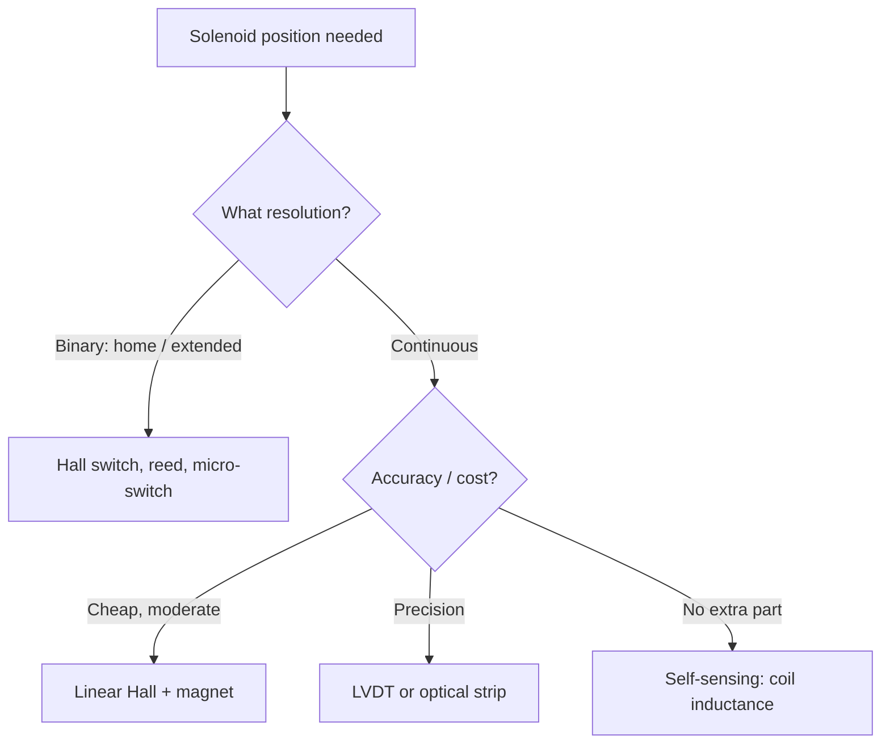

::: basics
### In plain words
How you measure a solenoid plunger's position depends on what you need to know. If you only need "home or extended," a limit switch, reed switch, or Hall switch with a small magnet is enough. For a continuous position you can use a linear Hall sensor, an LVDT (a precise contactless sensor), a sliding potentiometer, or an optical strip. Or you can use the coil itself, because its inductance rises as the plunger closes the gap.

### Picture it
Think of a trombone. The pitch of a note tells you how far the slide is out. A solenoid coil works similarly: its inductance, an electrical "pitch," changes as the plunger slides in. You send a small test pulse and read the response to learn the position, with no extra sensor.

### Words you need
- **Inductance**: how strongly a coil resists a change in its current. More iron inside the coil means more inductance, so the current rises more slowly.
- **Hall switch**: a magnetic sensor with an on-off output. A magnet on the plunger triggers it.
- **Linear Hall sensor**: gives a voltage that follows the magnetic field. Its output does not change in a straight line with distance.
- **LVDT**: a set of coils around an iron core fixed to the plunger. Its output follows the position, with no contact.

### The simplest example
An example solenoid has 48 mH of inductance with the plunger open and 170 mH when closed. Apply a 5 V test pulse for 100 µs, short enough that the plunger does not move. The current rises by $V t / L$. Open, that is $5 \times 0.0001 / 0.048 = 10.4$ mA. Closed, it is only 2.9 mA. A simple threshold on that current can tell you "closed" without any added part.

That is the whole idea. The rest of this page compares each sensor, the Hall nonlinearity, how an LVDT works, the inductance method's limits, and calibration against temperature and mounting error.
:::

::: testing
Whether you can choose a *linear* position sensing method for a short-stroke actuator and match it to the need: binary arrival, a few discrete positions, or continuous position. You should know the usual suspects (end switches, Hall sensors, LVDT, potentiometer, optical), and the clever sensorless one: the coil's inductance depends on plunger position, so measuring inductance measures position. Strong candidates quantify resolution and mention the nonlinearity of magnetic sensors.
:::

::: why
A plain on/off solenoid needs only "did it arrive?", which a cheap Hall switch answers. A proportional solenoid, a valve spool or a linear actuator needs the actual position in a feedback loop. Cost, space and reliability constraints often forbid a sensor, so knowing how to use the coil itself is valuable. It is also the linear counterpart of [[q0404]], so interviewers use it to check that you can transfer ideas.
:::

::: concepts
- **Binary vs continuous sensing**: a limit/Hall switch gives one bit; an LVDT or linear Hall gives a continuous signal.
- **Inductance vs position**: closing the air gap raises $L$, so $L(x)$ encodes position. See [[q0334]].
- **LVDT**: a contactless transformer sensor whose output amplitude and phase give displacement.
- **Hall effect**: a semiconductor outputs a voltage proportional to magnetic field; a magnet on the plunger makes it a position sensor.
- **Ratiometric measurement**: output proportional to supply, read by an ADC with the same reference, cancelling supply error.
- **Calibration / linearisation**: magnetic sensors are nonlinear; use a lookup table or two-sensor ratio. See [[q0404]] for resolution versus accuracy.
:::

::: answer
"It depends on what I need to know. If it's just 'is the plunger home or extended', a limit switch, reed switch or a Hall switch with a small magnet on the plunger does the job for a few cents.

If I need continuous position, there are a few choices. An analog linear Hall sensor with a magnet on the plunger gives a voltage that varies with distance. It's cheap and contactless, but the field falls off roughly with the cube of distance, so I'd linearise with a lookup table. An LVDT is the precision option: a primary coil excited at a few kHz and two secondary coils; the plunger is a ferrite core, and the difference of the secondary voltages is proportional to displacement. That's what proportional valves use. A linear potentiometer or an optical linear encoder strip also work.

The sensorless trick is that the coil itself is a position sensor. The inductance goes up as the air gap closes, so if I apply a small test pulse that's too weak to move the plunger and measure how fast the current rises, I get L and so position. For example with an inductance going from 48 millihenries open to 170 closed, the rise time constant changes by 3.5 times, which is easy to see.

Then I check resolution, linearity, temperature drift, and whether I can fit the sensor in the housing."
:::

::: technical
**Binary sensing.** Limit/micro switches (contact, bounce), reed switches (magnet on plunger), Hall switches (digital output, hysteresis, contactless). Two switches at the ends give "home/extended/in transit".

**Analog linear Hall.** A magnet on the plunger moves relative to a fixed Hall element. Field magnitude of a dipole falls approximately as $1/d^3$ on axis, so the output is strongly nonlinear: sensitivity is high near the magnet and low far away. Linearise with a table or by using two sensors and taking a ratio; ratiometric output (supply-proportional) cancels supply variation. Temperature drift of magnet strength (a few hundredths of a percent to a few tenths of a percent per kelvin depending on material, vendor-dependent) limits absolute accuracy.

**LVDT.** A primary winding excited with a sinusoid (typically a few kHz, vendor-dependent), two series-opposed secondaries, and a movable ferromagnetic core. Output $V_A - V_B \propto x$ about the centre with a sign (phase) that tells direction; demodulation by a synchronous detector. Contactless (infinite mechanical resolution, limited by electronics noise), good linearity over a defined range, but needs excitation/demodulation electronics and space.

**Linear potentiometer.** A resistive track and wiper, absolute, cheap, but wears and adds friction.

**Optical or magnetic linear strip encoders.** Incremental, as in [[q0405]], with resolution from microns; mostly in long-stroke actuators.

**Self-sensing by inductance.** With a voltage step $V_t$ small enough not to move the plunger, the current is $i = (V_t/R)(1 - e^{-t/\tau})$ with $\tau = L(x)/R$. Early on $\mathrm{d}i/\mathrm{d}t \approx V_t/L$, so after $t_s$: $\Delta i \approx V_t t_s/L$. Measure $\Delta i$ (or the time to reach a threshold) to get $L$, and map $L \to x$ with a calibration table. Alternatively inject a high-frequency small signal and measure impedance $|Z| = \sqrt{R^2 + (\omega L)^2}$. Limitations: $L(x)$ is flat when the gap is large (poor resolution at open position), eddy currents and saturation alter $L$, and temperature changes $R$.

**Resolution estimate.** For the illustrative solenoid in the page, $L$ is 48 mH open and 170 mH closed. A 0.1 mm move changes $L$ by 0.33% near open, but 3.1% near closed, so sensitivity improves by 10x near the end of travel.
:::

::: short
"For just home or extended, a limit switch, reed or Hall switch. For continuous position: a linear Hall sensor with a magnet on the plunger (nonlinear, so linearise), an LVDT (precise, contactless, needs excitation), a linear pot, or an optical strip. Sensorless: inductance depends on air gap, so a small test pulse measures L and hence position, best near the closed end. I'd pick on resolution, linearity, temperature drift and space."
:::

::: long
"I start from what the system needs. If it only has to know whether the plunger is home or extended, a limit switch, a reed switch or a Hall switch with a magnet on the plunger is cheap and robust, and two of them tell me the plunger is in transit in between.

For continuous position there are three families. A linear Hall sensor with a magnet on the plunger is cheap and contactless. The catch is that the field falls roughly as the cube of distance, so the response is strongly nonlinear. I'd linearise with a lookup table, or use two sensors and take a ratio, and use a ratiometric ADC reading so supply noise cancels. An LVDT is the precision choice: an excited primary, two secondaries and a ferrite core on the plunger. The difference of the secondaries is proportional to displacement and its phase gives the direction. Proportional valves use it, and the cost is the excitation and demodulation electronics. Then there are linear potentiometers and optical strips, which work but add friction or cost.

The sensorless approach uses the fact that inductance depends on the air gap. With a short, low-voltage test pulse that can't move the plunger, the current rise rate is V over L, so I can measure L and look up position. In an example solenoid, L goes from 48 millihenries open to 170 closed, so the time constant changes 3.5 times. Sensitivity is poor when the gap is large and good near the end, which is ideal for detecting arrival.

Whatever I choose I'd check resolution, linearity, temperature drift and mounting space, and calibrate on the real part."
:::

::: terms
- **Limit switch / reed / Hall switch**: binary position detectors.
- **Linear Hall sensor**: analog output proportional to local magnetic field.
- **LVDT**: linear variable differential transformer; contactless linear displacement sensor.
- **Ratiometric**: output scales with the supply; read with the same reference to cancel it.
- **Self-sensing**: using the actuator's own electrical behaviour (inductance) to infer position.
- **Linearisation**: correcting a nonlinear sensor response by table or computation.
- **Stroke**: the usable travel of the plunger.
- **Hysteresis (sensor)**: the difference in switching point on approach versus retreat.
:::

::: exceptional
An average answer lists "limit switch, Hall, LVDT". An exceptional answer:

- Starts with the **requirement** (binary versus continuous, resolution, cost).
- Knows the **nonlinearity** of magnetic sensing and how to deal with it.
- Explains **how an LVDT works** in one sentence and why proportional valves use it.
- Offers the **self-sensing inductance** method with a numeric example and states its limitations.
- Mentions **temperature drift, calibration and mounting tolerance**.
:::

::: mistakes
- **Using an analog Hall sensor and assuming a linear output.** The field is highly nonlinear in distance. Calibrate or use a ratio.
- **Using a test pulse large enough to move the plunger.** Keep the test energy small: the force $\tfrac12 i^2\,\mathrm{d}L/\mathrm{d}x$ must stay far below the spring preload.
- **Assuming inductance sensing works equally everywhere.** Sensitivity is low at large gaps. It is best near closing.
- **Ignoring temperature.** Coil resistance changes with temperature and magnet strength drifts, so calibrate over temperature or compensate.
- **Mounting tolerance.** A 0.2 mm magnet-to-sensor offset can look like a position error comparable to the signal you want.
- **Putting a metal object or steel housing near a Hall/LVDT sensor** without checking: it changes the field and the calibration.
:::

::: deep
## Choose by the requirement


Figure: Start from the resolution you need. In practice most on/off solenoids use a switch; proportional valves use an LVDT; low-cost products try self-sensing first and add a sensor only if accuracy demands it.

## Binary sensing

A **Hall switch** (digital output with hysteresis) mounted at the end of travel with a small magnet in or on the plunger gives a clean, contactless end-stop signal. Debounce is rarely needed. A **reed switch** is cheaper but bounces and has limited life with inductive/capacitive loads. A **micro-switch** is robust but adds a mechanical load and wear.

Two switches give three states: home, extended, and in transit. The *time in transit* is itself a useful diagnostic ([[q0406]]).

## Analog linear Hall sensor

The sensor outputs $V_{out} = V_{0} + S\,B$, where $B$ is the field normal to the chip. On the axis of a small magnet $B$ decreases roughly as the inverse cube of distance. For a magnet that approaches from 12 mm to 2 mm of the sensor as the plunger closes:

```plot
{"title":"Linear Hall response vs plunger travel (illustrative dipole model)","x":{"label":"Plunger travel","unit":"mm","min":0,"max":10},"y":{"label":"Sensor field (% of maximum)","unit":"%","min":0,"max":110},
 "series":[{"label":"B ∝ 1/d³, d = 12 − x mm","fn":"100*pow(2/(12-x),3)","color":"accent"},{"label":"ideal linear","fn":"10*x+0","color":"muted","dashed":true}],
 "points":[{"x":5,"y":"100*pow(2/7,3)","label":"only 2.3% of max at mid-stroke"}]}
```
Figure: Roughly 1/d³ field means the response is flat for the first half of the travel and then rises steeply. Half way through the stroke the signal is only a few percent of its end value, so resolution is poor there and excellent near the sensor. Fixes: two sensors with a ratio, a magnet geometry (sensor offset beside the path rather than head-on) or a lookup table.

(The model is illustrative; actual field depends on the magnet and sensor geometry.)

Use a **ratiometric** sensor with the same reference voltage as the ADC so supply variation cancels; temperature compensation in the sensor reduces the magnet drift to a few hundred ppm per kelvin in good parts (vendor-dependent).

## LVDT

An LVDT has a primary winding in the centre, two secondary windings on either side connected in opposition, and a ferromagnetic core attached to the plunger. At centre both secondaries get equal flux and the net output is zero. Move the core and one secondary gets more flux, so the difference signal grows linearly with displacement over its range and its phase flips on the other side:
$$V_{out} = V_{A} - V_{B} \approx k\,x\,V_{exc}$$
A synchronous demodulator (or an LVDT signal-conditioner IC) recovers a DC voltage with sign. Properties: no contact between core and coils, very high resolution (limited by noise, can be sub-micron), robust to dirt, oil and high temperature, and linear over its rated range. Cost: coil assembly plus an excitation/demodulation circuit, and a stroke-to-length ratio less than 1. Proportional hydraulic valves commonly have an LVDT on the spool for closed-loop control.

## Linear potentiometer and optical strip

A linear pot is a resistive track with a wiper. It is absolute and trivial, but wears out and adds friction, not good for a million-cycle solenoid. An optical or magnetic **strip encoder** reads graduations as in [[q0405]] (incremental, resolution microns). Both are more suitable for longer strokes (centimetres and up).

## Self-sensing through inductance

Why it works: the inductance depends on the reluctance of the magnetic circuit, dominated by the air gap. Using the illustrative model from [[q0406]] with $L(x) = 30\text{ mH} + 0.21\text{ mH·m}/(11.5\text{ mm} - x)$:

```plot
{"title":"Coil inductance vs plunger travel (illustrative)","x":{"label":"Plunger travel","unit":"mm","min":0,"max":10},"y":{"label":"Inductance","unit":"mH","min":0,"max":180},
 "series":[{"label":"L(x)","fn":"1000*(0.03+0.00021/(0.0115-x*0.001))","color":"accent"}],
 "points":[{"x":0,"y":48.3,"label":"48 mH open"}],"hlines":[{"at":170,"label":"170 mH closed","color":"muted"}]}
```
Figure: Inductance rises slowly at first, then steeply as the gap closes. This is why inductance sensing is most sensitive near the closed position: a 0.1 mm step changes $L$ by only 0.33% at the open end, but 3.1% around x = 9 mm.

**Test-pulse method.** Apply a low voltage step (say $V_t = 5$ V for $t_s = 100\ \mu$s, with the supply or a separate low-level source) and measure the current at $t_s$:
$$\Delta i \approx \frac{V_t\,t_s}{L}$$
For $L = 48$ mH, $\Delta i = 10.4$ mA; for $L = 170$ mH, 2.9 mA. With a 1 Ω sense resistor, 10 mA is 10 mV, so you would add a gain of about 100 before a 12-bit ADC (0.8 mV per count at 3.3 V full scale, which is 8 µA per count at the shunt after gain). That resolves roughly 0.1% of the 10 mA signal, so noise and calibration, not the ADC, set the accuracy. The test force is $\tfrac12 i^2\,\mathrm{d}L/\mathrm{d}x = \tfrac12(0.0104)^2(1.6\text{ H/m}) \approx 87\ \mu$N, about 14,000 times smaller than the 1.2 N spring preload, so the plunger does not move.

**Practical caveats.**
- Eddy currents in a solid plunger and the housing make $L$ depend on frequency and speed; test pulse timing should be fixed.
- Saturation matters if the coil already carries drive current. Self-sensing is most reliable with the coil off or during a controlled sensing window.
- Copper resistance changes with temperature, which affects the exponential shape; use the early slope ($V/L$) rather than the final value.
- It needs calibration per part (or per production lot), typically a table of $L$ versus measured position.

## Sizing the resolution

Position resolution of an LVDT or sensor-based system is $\Delta x = \text{sensor noise (V)}/\text{sensitivity (V/mm)}$. For a Hall setup whose sensitivity at mid-stroke is, for example, 10 mV/mm and noise 1 mV rms, $\Delta x = 0.1$ mm rms, plenty for an "arrived or not" decision but poor for proportional control. The sensitivity curve, not just the ADC bit count, determines resolution.

## Experiment

```sim
{"id":"flyback-protection","protection":"zener","l":0.17,"i0":2,"vsupply":24}
```
Figure: Not a position sensor, but it shows what the closed-state inductance (170 mH, $I = 2$ A) does at turn-off. The same large $L$ that gives self-sensing its signal near closing also stores more energy ($\tfrac12 L I^2 = 0.34$ J) that your protection network must handle ([[q0413]]).

## Putting it together

| Method | Output | Typical strengths | Typical weaknesses |
|---|---|---|---|
| Hall / reed switch | binary | cheapest, rugged | no continuous info |
| Linear Hall + magnet | analog, nonlinear | cheap, contactless | nonlinear, drift, alignment |
| LVDT | analog, linear | precision, rugged | electronics, size |
| Linear pot | analog | trivial | wear, friction |
| Optical/magnetic strip | incremental | high resolution | long strokes only, cost |
| Inductance (self-sensing) | derived | no extra part | calibration, nonlinearity, eddy currents |
:::

::: applications
- **Proportional hydraulic and pneumatic valves**: LVDT on the spool for closed-loop position.
- **Door locks and latches**: Hall switch confirms bolt extended or retracted.
- **Fuel and gas valves**: end-of-stroke detection by Hall or self-sensing.
- **Voice-coil actuators and linear motors**: linear Hall or optical strips for closed-loop positioning.
- **Test equipment**: laser displacement or LVDT to characterise solenoid force and stroke curves.
- **Industrial cylinders**: magnetic piston position switches (reed or Hall) on the cylinder wall.
:::

::: assumptions
- "Position of a solenoid" means **plunger stroke position** of a linear solenoid. Rotary solenoids use rotary angle sensors ([[q0404]]).
- The numerical inductance values are from an **illustrative model**, not a specific part; the shape (slow then steep rise as the gap closes) is typical, but the detail depends on geometry and saturation.
- The Hall field law $1/d^3$ is for a small magnet on axis; real magnets with finite size and sensor offset geometry behave differently.
- Self-sensing assumes the plunger **doesn't move during the test** and that the **coil is not already saturated**.
- Accuracy numbers for sensors (LVDT linearity, Hall drift) are vendor-dependent; check datasheets.
:::

::: followups
### How does an LVDT produce a signed output?
Two secondary windings are connected in opposition. With the core centred the induced voltages cancel. Moving the core one way increases the coupling to one secondary and decreases the other, giving a net voltage in phase with the excitation; moving it the other way gives a net voltage 180 degrees out of phase. A synchronous demodulator turns that into a signed DC level.

### You only have the coil terminals. How would you detect that the plunger is fully closed?
Apply a small test pulse and measure the current rise. With the plunger closed, $L$ is at its maximum so $\mathrm{d}i/\mathrm{d}t = V/L$ is at its minimum. Or watch the current signature during pull-in for the dip minimum ([[q0406]]). Calibrate the threshold for supply and temperature.

### A Hall-based position sensor reads differently in winter and summer. Why?
Magnet remanence and Hall sensitivity both drift with temperature, and the mechanics expand. Typical magnets lose a few hundredths to a few tenths of a percent of field per kelvin depending on the material. Use a sensor with temperature compensation, a ratiometric two-sensor scheme, or calibrate over temperature.

### What resolution do you need to catch a plunger that is 0.2 mm short of closing?
You need the sensor to resolve better than 0.2 mm *and* have its signal-to-noise large at that position. With a Hall sensor 1/d³ field, sensitivity is highest at the end of travel, so it's relatively easy; with inductance sensing the sensitivity is also high near closing. An LVDT would resolve far finer but may be overkill.

### Why might you avoid inductance self-sensing in a product?
It needs per-unit calibration, it is sensitive to temperature, eddy currents, saturation and drive history, and the sensing pulse must be interleaved with actuation. If you need robust absolute position over the whole stroke, a physical sensor is the simpler, more reliable path.
:::

::: interpretations
"Position of a solenoid" is read as linear plunger position (or at least end-of-stroke detection). If the interviewer wants only "has it actuated?", the binary options are enough; I cover both. The speed analogue is in [[q0406]] and the BEMF viewpoint in [[q0408]].
:::

::: references
- Bolton, *Mechatronics*: LVDT, potentiometric and Hall-effect displacement sensors.
- Woodson & Melcher, *Electromechanical Dynamics*: reluctance actuators and inductance as a function of gap.
- Fraden, *Handbook of Modern Sensors*: LVDT and magnetic position sensing principles.
- Hall-sensor and LVDT conditioner datasheets from major manufacturers (check current datasheets for linearity and drift).
:::

::: rubric
- Distinguishes binary arrival detection from continuous position :: Matching the sensor to the need is the core engineering decision.
- Names several suitable sensors (switch, linear Hall, LVDT, pot, optical strip) :: Shows breadth.
- Explains how an LVDT or a Hall sensor generates the signal :: Demonstrates understanding rather than name-dropping.
- Notes magnetic nonlinearity and linearisation :: A practical limit of Hall sensing.
- Describes self-sensing via inductance and why it is best near closing :: The creative, coil-based answer.
- Mentions calibration, temperature and mounting tolerance :: Real-world accuracy limits.
- Gives numbers (e.g. L range, resolution, test current) :: Quantitative support.
:::

::: quiz
```json
[
 {"type":"mcq","level":"fundamental","q":"Which sensor is best if you only need to know whether a solenoid plunger is fully extended?","options":["LVDT","Hall switch with a magnet on the plunger","Optical encoder","Strain gauge"],"answer":1,"explain":"A Hall (or reed or limit) switch gives a clean binary signal at low cost. An LVDT or encoder is overkill for a yes/no question."},
 {"type":"truefalse","level":"fundamental","q":"Closing the air gap of a solenoid increases its inductance.","answer":true,"explain":"A smaller gap reduces the reluctance of the magnetic circuit, so flux linkage per amp, i.e. inductance, rises. This is the basis of self-sensing and of the pull-in force."},
 {"type":"numeric","level":"intermediate","q":"A 5 V test pulse is applied for 100 µs to a coil with L = 170 mH (R negligible over this time). What is the current rise?","answer":2.94,"tolerance":0.02,"unit":"mA","explain":"$\\Delta i = V t/L = 5\\times100\\times10^{-6}/0.17 = 2.94$ mA."},
 {"type":"numeric","level":"intermediate","q":"An LVDT's output is 2.0 V per 10 mm of displacement. What displacement corresponds to 0.65 V?","answer":3.25,"tolerance":0.02,"unit":"mm","explain":"Sensitivity is 0.2 V/mm, so $x = 0.65/0.2 = 3.25$ mm."},
 {"type":"mcq","level":"advanced","q":"For a magnet moving toward a fixed Hall sensor with field roughly $\\propto 1/d^3$, where is the sensor most sensitive?","options":["Far from the sensor","Near the sensor","Uniformly everywhere","Sensitivity does not depend on distance"],"answer":1,"explain":"The derivative of $1/d^3$ is $-3/d^4$, which is largest when $d$ is small. Far away the signal is almost flat, so resolution is poor."},
 {"type":"truefalse","level":"advanced","q":"Inductance self-sensing is equally precise across the whole stroke.","answer":false,"explain":"In the example, a 0.1 mm step changes L by 0.33% at the open end but 3.1% near closed, so sensitivity varies by roughly 10x. It is best near the closed end."}
]
```
:::
