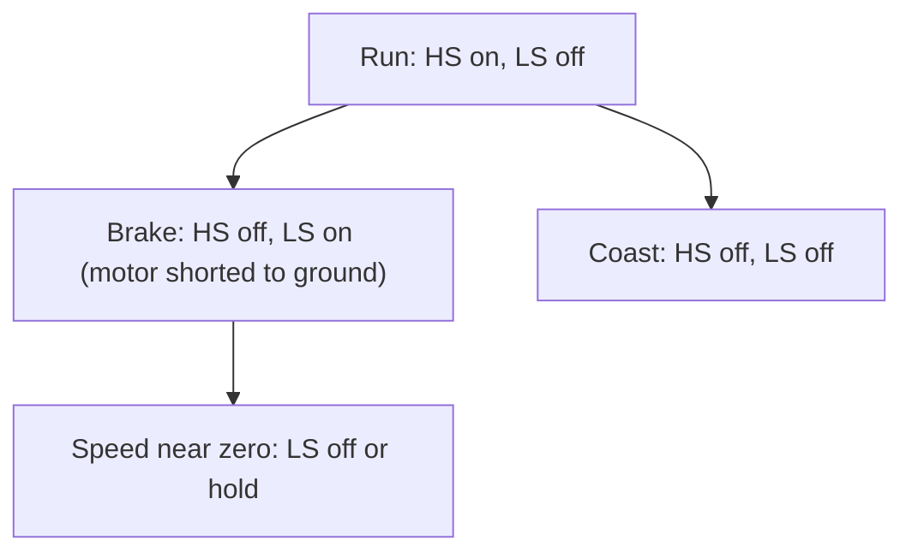

::: basics
### In plain words
A single switch can only let a motor coast, so it slows down on friction, which can take seconds. To brake, you give the motor's own generated voltage a path to push current through. The simplest way is to connect the motor's two terminals together by turning on the drive's bottom (low-side) switches. The motor then works as a generator into its own winding and slows itself down. This braking is strong at high speed and fades to nothing at standstill.

### Picture it
Picture a spinning merry-go-round with a paddle dipped in thick syrup. The faster it spins, the harder the syrup pushes back, and as it slows, the drag fades. It slows quickly at first and then creeps to a stop. A shorted motor is that paddle, and the drag grows in proportion to speed.

### Words you need
- **Coast**: both terminals open. Only friction slows the motor.
- **Dynamic braking**: shorting the terminals, so the motor's back-EMF drives a current that opposes the rotation.
- **Back-EMF**: the voltage a spinning motor generates, $E = K_e \omega$. See [[q0341]].
- **Plugging**: applying reverse drive voltage while spinning forward. It brakes harder but is riskier.

### The simplest example
A motor has $K_e = 0.02$ V per rad/s and a 1 Ω winding, and spins at 3000 rpm, or 314 rad/s. Its back-EMF is $0.02 \times 314 = 6.28$ V. Short the terminals and the brake current starts at $6.28 / 1 = 6.28$ A. The speed then falls to about 37% of its value every 48 ms or so for a small rotor (that is the time constant), compared with about 1 s of coasting. Plugging with 12 V reversed would start at $(12 + 6.28)/1 = 18.3$ A and must be cut at zero speed, or the motor spins backward.

That is the whole idea. The rest of this page derives the exponential stop, shows the H-bridge brake states, and covers current limits, how braking energy can push up the supply voltage, and holding with a mechanical brake.
:::

::: testing
Whether you know that a single-switch drive can only *coast*, and that active braking needs a second path: usually shorting the motor terminals through low-side switches or adding a brake switch. The interviewer wants the physics (a spinning motor is a generator, shorting it makes it brake itself), the numbers (peak brake current is $E/R$, stopping time follows a time constant), and the safety angle (current limits, supply pump-up, no holding torque at standstill). Strong candidates distinguish braking from reversing ("plugging") and bring up when a mechanical brake is the right answer.
:::

::: why
Stopping matters as much as starting: a saw blade, a robot arm, a conveyor or a vehicle that takes seconds to coast to rest is a safety problem or a performance problem. Braking also stresses the electronics: the current can exceed the starting current, and returned energy can pump the supply voltage. Interviewers use this question to see whether you think about the drive as a bidirectional energy path.
:::

::: concepts
- **Back-EMF and generator action**: a spinning motor produces $E = K_e\omega$ and can source current. See [[q0341]].
- **Dynamic (short-circuit) braking**: shorting the terminals makes the motor dissipate its kinetic energy in its own resistance.
- **Coast (free-wheel)**: both terminals open; the motor slows by friction only.
- **Plugging (reverse-current braking)**: applying reverse voltage for the fastest stop, at high current.
- **Regenerative braking**: returning energy to the supply. See [[q0412]].
- **Half-bridge / H-bridge**: the switch topologies that make braking possible. See [[q0422]] and [[q0424]].
:::

::: answer
"With a single low-side switch I can only coast: turn it off and the motor spins down on friction, which can take seconds. To brake I need a path that lets the motor's own back-EMF drive current through something that dissipates the energy.

The simplest way is to short the motor terminals. A spinning motor is a generator, so shorting it makes a current of E over R flow, which creates a torque opposing rotation. In a half-bridge with the motor to ground, I turn on the low-side FET and switch off the high side. In an H-bridge I turn on both low-side FETs, or both high-side FETs. For a 12 V motor with 0.02 V per rad per second and 1 ohm winding at 3,000 rpm, E is 6.3 V so the brake current starts at 6.3 A and decays exponentially with a time constant of about 50 ms for a small rotor, versus a full second coasting.

Things I'd watch: the brake current can be larger than the running current, so the FETs and winding need to take it, or I PWM the brake to limit it. Braking torque falls to zero with speed, so it can't hold a load at standstill; I'd need a mechanical brake or an active hold. If I want a faster stop, I can briefly reverse the voltage, plugging, but then I must cut the drive at zero speed or it spins up backwards. And with regenerative braking the energy goes back into the supply, so if the supply can't absorb it the bus voltage can rise dangerously."
:::

::: technical
**Brake current and torque.** With the terminals shorted the armature equation is $0 = iR + L\,di/dt + K_e\omega$. Neglecting $L$ (valid when electrical time constant $\ll$ mechanical): $i = -K_e\omega/R$ and brake torque
$$T_b = K_t\frac{K_e\omega}{R} = \frac{K_tK_e}{R}\,\omega$$
This is a viscous damper with coefficient $B_e = K_tK_e/R$. Combined with the rotor inertia $J$ and viscous friction $b$:
$$J\frac{d\omega}{dt} = -(b + B_e)\omega\ \Rightarrow\ \omega(t) = \omega_0\,e^{-t/\tau_b},\quad \tau_b = \frac{J}{b + K_tK_e/R}$$

**Numbers.** $K_t = K_e = 0.02$, $R = 1\ \Omega$, $J = 2\times10^{-5}$ kg·m², $b = 2\times10^{-5}$ N·m·s/rad. Coast: $\tau = J/b = 1$ s. Short-circuit brake: $B_e = 4\times10^{-4}$, $\tau_b = 2\times10^{-5}/(4.2\times10^{-4}) = 47.6$ ms. At 3,000 rpm ($\omega_0 = 314$ rad/s): peak brake current $K_e\omega_0/R = 6.28$ A, peak torque $0.126$ N·m, kinetic energy $\tfrac12J\omega_0^2 = 0.99$ J.

**Plugging.** Apply the opposite voltage $-V$: $i = -(V + K_e\omega)/R$, up to $(12 + 6.28)/1 = 18.3$ A at the start: 50% more than the stall current. Torque is much larger ($0.37$ N·m), and it is nearly constant at a current limit $I_{lim}$: deceleration $\alpha = K_tI_{lim}/J$. With $I_{lim} = 6$ A, $\alpha = 6{,}000$ rad/s² so the stop from 314 rad/s takes 52 ms. The drive *must* disable at $\omega \approx 0$.

**Braking without a bridge.** (a) Half-bridge with motor to ground: low-side ON shorts the motor. (b) Single-direction drive: add a brake FET (or relay contact) across the motor, optionally with a series brake resistor $R_b$ to limit current to $E/(R + R_b)$ and put the heat outside the motor. (c) Passive: a diode alone gives no braking.

**Energy and the supply.** The kinetic energy $\tfrac12J\omega^2$ ends up in the winding resistance (dynamic braking) or is returned to the bus (regen). Regenerated energy can charge the bulk capacitor: the upper bound is $\Delta V$ from $\tfrac12C(V_f^2 - V_i^2) = E_k$: for $E_k = 0.99$ J and $C = 470\ \mu$F starting at 12 V, a lossless return would reach 66 V. Real systems lose much of it in $R$ and may have loads on the bus, but a bench supply (which cannot sink current) plus small capacitance needs a clamp, a brake chopper or a battery.

**Holding.** $T_b \to 0$ as $\omega \to 0$. Static holding torque needs a mechanical brake, a position loop, a worm gear or a stepper's detent/holding torque.
:::

::: short
"A single low-side switch can only coast. To brake I give the motor's back-EMF a short-circuit path: in a half-bridge, turn on the low-side FET; in an H-bridge, turn on both low sides. The motor then acts as a generator into its own resistance and stops in a time constant of tens of milliseconds instead of seconds. I'd check the brake current, E over R, against FET and winding ratings, limit it with PWM if needed, and remember braking has no holding torque at standstill."
:::

::: long
"With a single low-side MOSFET, turning it off only lets the motor coast, so it spins down on friction, which could take seconds. For braking I need a path for the motor's own current.

The easiest approach is dynamic braking: short the motor terminals. A spinning motor generates back-EMF Ke times omega, and if the terminals are shorted that drives a current E over R through the winding, producing a torque that opposes rotation. In a half-bridge with the motor between the switch node and ground, I turn on the low-side FET; in an H-bridge, both low-side FETs, or both high-side. As an example, a 12 volt motor with Ke of 0.02 and 1 ohm at 3,000 rpm has 6.3 volts of back-EMF, so the brake current starts at 6.3 amps. The speed decays exponentially, with a time constant of roughly 50 milliseconds for a small rotor, instead of a second coasting.

The design points: the brake current can be larger than the running current for a fast, low-resistance motor, so the FETs and winding must handle it, or I chop the brake with PWM to limit it. Dynamic braking torque falls to zero as speed does, so it can't hold a load; for that I need a mechanical brake or a position loop.

If I need an even faster stop, I can plug: briefly apply reverse voltage. That gives a very high current, up to V plus E over R, here about 18 amps, so I'd limit it and, crucially, cut the drive at zero speed, otherwise the motor accelerates backwards.

And regenerative braking sends energy back into the supply, which is efficient, but if the source can't absorb current, like a bench supply or a diode-fed rail, the bus voltage rises, so I'd need a clamp, braking resistor or battery to take it."
:::

::: terms
- **Coast**: both motor terminals open; deceleration only from friction.
- **Dynamic braking**: motor terminals shorted (or loaded by a resistor), dissipating energy in the motor.
- **Plugging**: applying reverse drive voltage while spinning forward.
- **Regenerative braking**: returning kinetic energy to the supply.
- **Brake chopper**: a switch and resistor that dumps excess bus energy.
- **Back-EMF**: $E = K_e\omega$. See [[q0341]].
- **Electrical braking vs mechanical brake**: the latter provides holding torque.
- **Bus pumping**: rise of supply voltage when a motor regenerates into a bus that cannot absorb it.
:::

::: exceptional
An average answer says "short the motor terminals". An exceptional answer:

- Says that a single switch **can only coast** and that braking needs a second path.
- Derives **$T = K_tK_e\omega/R$** and gives the **exponential stop** with a time constant, with numbers.
- Distinguishes **dynamic, plugging and regenerative** braking and the risks of each.
- Notes the **current limit** and FET/winding stress, **no holding torque** and **bus pumping**.
- Knows the half-bridge and H-bridge switch states for braking and mentions when a **mechanical brake** is needed.
:::

::: mistakes
- **Believing "off" is braking.** Switching the drive off just coasts. Braking needs a conductive loop.
- **Shorting a motor through the high side and low side of the same leg.** That's shoot-through. Short through *both low sides* or *both high sides* of an H-bridge, never one leg's top and bottom.
- **Ignoring brake current.** For a low-resistance motor at high speed, $E/R$ can exceed the starting current and trip protections or damage the FETs.
- **Expecting dynamic braking to hold position.** Torque goes to zero with speed; a load can back-drive the shaft.
- **Leaving reverse drive on at zero speed (plugging).** The motor reverses and accelerates the other way.
- **Not considering the supply.** Regenerated energy raises the bus voltage if there is no sink. See [[q0412]].
:::

::: deep
## Why a motor brakes when you short it

Every term in the motor equation matters. A permanent-magnet motor with the shaft spinning at $\omega$ is a generator with open-circuit voltage $E = K_e\omega$. Close a loop across the terminals and a current flows:

$$i = \frac{K_e\omega}{R}\quad(\text{ignoring }L)$$

That current in the field produces a torque $K_t i$ that opposes the rotation, because the generator action converts mechanical power $T\omega$ into electrical power $i^2 R$ in the winding. The mechanical energy $\tfrac12 J\omega^2$ leaves as heat in the motor resistance.

For $K_t = K_e = K$, $T_b = (K^2/R)\omega$: proportional to speed, like a viscous damper. It follows that dynamic braking is aggressive at high speed and gentle at low speed: a mechanically exponential approach to zero with time constant

$$\tau_b = \frac{J}{b + K^2/R}$$

```plot
{"title":"Stopping from 3,000 rpm: coast vs dynamic brake vs current-limited plugging","x":{"label":"Time","unit":"s","min":0,"max":0.4},"y":{"label":"Speed","unit":"rpm","min":0,"max":3200},
 "vars":{"w0":314.16,"tauc":1,"taub":0.0476,"alpha":6000},
 "series":[{"label":"coast (friction only, τ = 1 s)","fn":"3000*exp(-x/tauc)","color":"muted"},{"label":"short-circuit brake (τ = 47.6 ms)","fn":"3000*exp(-x/taub)","color":"accent"},{"label":"plugging, 6 A limit (cut at 0)","fn":"max(0,3000-alpha*x*60/(2*pi))","color":"red"}],
 "hlines":[{"at":100,"label":"100 rpm","color":"muted"}]}
```
Figure: Coasting barely slows in 0.4 s. Dynamic braking falls exponentially (95% of the speed gone in about 0.14 s) but the last bit is slow because torque vanishes with speed. A current-limited plugging stop has constant deceleration and reaches zero in about 52 ms, but only if the drive switches off exactly then. Model: $J = 2\times10^{-5}$ kg·m², $K = 0.02$, $R = 1\ \Omega$, $b = 2\times10^{-5}$ N·m·s/rad.

Time to slow from 3,000 to 100 rpm: dynamic brake $\tau_b\ln30 = 162$ ms; coast $1\text{ s}\times\ln30 = 3.4$ s; plugging with 6 A limit about 50 ms.

## How to build it

### Half-bridge with the motor to ground


Figure: In a half-bridge whose motor returns to ground, the low-side switch on shorts the motor, which is exactly dynamic braking. Turning both off is coasting. Never turn both on.

### H-bridge: brake with the low-side pair

```circuit
{"elements":[
 {"t":"rail","at":[11,0],"label":"V_M","dir":"up"},
 {"t":"wire","pts":[[6,0],[16,0]]},{"t":"dot","at":[11,0]},
 {"t":"wire","pts":[[6,0],[6,2]]},{"t":"wire","pts":[[16,0],[16,2]]},
 {"t":"nmos","at":[4,4],"label":"Q_1","bodyDiode":true},
 {"t":"nmos","at":[4,8],"label":"Q_2","bodyDiode":true,"color":"accent"},
 {"t":"nmos","at":[18,4],"label":"Q_3","flip":true,"bodyDiode":true},
 {"t":"nmos","at":[18,8],"label":"Q_4","flip":true,"bodyDiode":true,"color":"accent"},
 {"t":"wire","pts":[[6,6],[8,6]]},{"t":"wire","pts":[[14,6],[16,6]]},
 {"t":"M","a":[8,6],"b":[14,6],"label":"M"},
 {"t":"wire","pts":[[6,10],[16,10]],"flow":true},
 {"t":"gnd","at":[11,10]},{"t":"dot","at":[11,10]},
 {"t":"term","at":[4,4],"label":"G1 = 0","side":"left"},
 {"t":"term","at":[4,8],"label":"G2 = 1","side":"left"},
 {"t":"term","at":[18,4],"label":"G3 = 0","side":"right"},
 {"t":"term","at":[18,8],"label":"G4 = 1","side":"right"},
 {"t":"text","at":[11,3],"text":"I_{brake} = E/R","anchor":"middle"}
]}
```
Figure: Braking an H-bridge: both low-side FETs (Q₂, Q₄) on, both high-side off. The motor's back-EMF (positive at the left terminal after forward drive through Q₁ and Q₄) pushes current out of the left terminal, down through Q₂, along the ground rail (the animated wire) and up through Q₄ into the right terminal: the reverse of the drive current, which is why the torque opposes rotation. The supply is not involved. Using both high sides instead is equivalent but puts the current through the supply rail.

Both low sides is often preferred because the gate drive is simpler (no bootstrap needed for the low side, and the brake works even when the bootstrap capacitor has discharged). See [[q0424]] for the full comparison of half-bridge and H-bridge braking and [[q0411]] for the direction table.

```sim
{"id":"h-bridge-lab","mode":"h"}
```
Figure: Click the two low-side switches on, with both high-side off: the sim highlights the brake path. Compare with all four off (coast, current freewheels through body diodes) and with one high and one low diagonal (drive).

## Braking current: do the sums

With $E = 6.28$ V at 3,000 rpm and $R = 1\ \Omega$: peak brake current 6.28 A, torque 0.126 N·m, power at the start $i^2R = 39$ W, decaying with $e^{-2t/\tau_b}$. Energy dissipated equals the kinetic energy, 0.99 J:

$$\int_0^\infty i^2R\,dt = \tfrac12J\omega_0^2\quad(\text{if friction is neglected})$$

If a motor spins a *big* inertia, say 100x larger ($J = 2\times10^{-3}$), energy is 99 J and $\tau_b$ is 4.7 s: a long braking time but the same peak current 6.28 A (current depends only on speed). Heat in the winding: 99 J into a motor with, say, 20 J/K thermal mass is about 5 K of rise; frequent braking cycles add up.

If $E/R$ exceeds the allowed current (the motor's peak rating or the FET's), limit it:

- **PWM the brake**: turn the low sides on for a fraction of the period; the effective brake resistance becomes larger.
- **Brake resistor** $R_b$ in series: $I = E/(R + R_b)$.
- **Current-limited plugging** with a controlled H-bridge.

## Plugging

Plugging applies reverse voltage. With $i = -(V + E)/R$, the initial current is the stall current plus $E/R$. Controlled with a current limit (via PWM and shunt sensing, see [[q0395]]) it produces constant torque and the shortest stopping time. The danger is zero crossing: at $\omega = 0$ the drive keeps pushing and the motor reverses. You need a speed sensor or a back-EMF estimate ([[q0408]]) to cut the drive at zero.

## Regeneration

If, instead of shorting, the H-bridge drives the motor with a voltage slightly *below* the back-EMF while keeping the bridge switching (a synchronous buck/boost action), current flows back into $V_M$. That recovers energy but requires a sink. Details in [[q0412]].

## Holding

Electrical braking cannot hold a stopped shaft. A load (gravity, spring) will slowly back-drive the motor against the shorted winding; the rate is $T_{load}/B_e$: a 0.01 N·m load on the example motor turns it at $0.01/4\times10^{-4} = 25$ rad/s (239 rpm). Fixes: a worm or high-ratio gearbox (self-locking), a spring-applied mechanical brake, or a position loop that holds with active current.
:::

::: applications
- **Power tools (drills, saws, angle grinders)**: dynamic braking stops the blade within a fraction of a second after trigger release.
- **Robot joints and AGV wheels**: active braking and holding via H-bridge drivers plus mechanical brakes for power-off.
- **Printers and scanners**: braking a carriage motor to stop at a position without overshoot.
- **Electric vehicles and e-bikes**: regenerative braking into the battery.
- **Washing machines and fans**: shorted-winding brake after power is cut (some designs).
- **Hobby ESCs and RC cars**: "drag brake" and reverse-plug braking modes.
:::

::: assumptions
- A **brushed PM DC motor**; for BLDC motors the same ideas apply per phase (short all three lower phases for dynamic braking), see [[q0364]].
- The **armature inductance** is neglected in the exponential model; it adds an initial transient and matters when $L/R$ is not small compared with $\tau_b$.
- **Viscous friction** only; real friction has a Coulomb part that stops the motor abruptly at low speed.
- The **supply** is an ideal source for dynamic braking (not involved) but not for regen.
- Inertia, $K$ and $R$ values are an illustrative small motor.
:::

::: followups
### What's the difference between shorting through the high sides and through the low sides?
Electrically the same loop through the motor. The current path differs: with both low sides it stays on the ground rail; with both high sides it runs through the supply rail. Low sides are common because gate driving is easier. In either case the FETs' body diodes also conduct if the polarity reverses. See [[q0424]].

### The brake current is higher than my FETs can take. What do I do?
Chop the brake: PWM the low-side FETs so the average brake current is limited. Or add a series brake resistor, or brake in steps (fast regen first, short later). If the motor is a low-resistance high-speed one, also consider limiting the speed before braking.

### Why is plugging dangerous?
Current can reach $(V+E)/R$, more than stall. The winding and FETs see it, the gearbox sees a torque shock, and if you don't disconnect at zero speed the motor reverses. You need a current limit and a zero-speed detector.

### When would you use a mechanical brake instead?
When you need holding torque at standstill, safety on power loss (fail-safe, spring-applied electromagnetic brakes), or the electrical brake can't dissipate the energy. Combine: electrical braking to slow down, mechanical to hold.

### What happens to the bus when a motor regenerates into a bench supply?
The supply can't sink current, so the current charges the bulk capacitors and the bus voltage rises. A 0.99 J return into 470 µF would drive a 12 V bus to about 66 V in the lossless limit, destroying electrolytics and FETs. Add a TVS or brake chopper, more capacitance, or use dynamic (short) braking instead of regen.
:::

::: interpretations
"Motor braking" in a drive context means *electrical* braking of a DC motor (dynamic, plugging, regen). "What if you need motor braking?" follows [[q0409]] (single-switch drive) so the answer begins with "you need a second path". The categories and their trade-offs are the subject of [[q0412]]; the half-bridge versus H-bridge braking comparison is [[q0424]].
:::

::: references
- Mohan, Undeland & Robbins, *Power Electronics: Converters, Applications and Design*: DC motor drives, four-quadrant operation and regeneration.
- Fitzgerald, Kingsley & Umans, *Electric Machinery*: DC machine as generator, dynamic braking.
- Krishnan, *Electric Motor Drives*: braking methods for DC and PM motors.
- Texas Instruments, brushed DC motor driver datasheets (brake/coast/forward/reverse truth tables): see current TI documentation.
:::

::: rubric
- States that a single switch only coasts; braking needs a path :: Shows understanding of the problem.
- Explains dynamic braking as shorting the generator and gives the switch states :: The core mechanism.
- Gives the current and torque relation $i = E/R$, $T \propto \omega$ :: Quantitative understanding.
- Mentions plugging and its cut-off at zero speed :: The faster but riskier method.
- Mentions regeneration and bus pumping :: Energy-flow awareness.
- Notes current stress/limiting and no holding torque :: Practical limits.
- Gives a numerical example :: Demonstrates calculation skill.
:::

::: quiz
```json
[
 {"type":"mcq","level":"fundamental","q":"A drive uses one low-side MOSFET. Turning the MOSFET off will:","options":["Brake the motor quickly","Let the motor coast","Reverse the motor","Hold the shaft in place"],"answer":1,"explain":"With the terminals open nothing loads the generator; the motor slows only by friction. Braking needs a conductive loop across the motor."},
 {"type":"numeric","level":"fundamental","q":"A motor with $K_e = 0.02$ V·s/rad at 3,000 rpm has terminals shorted, winding resistance 1 Ω. What is the initial brake current?","answer":6.28,"tolerance":0.02,"unit":"A","explain":"$E = 0.02\\times314.16 = 6.28$ V; $I = E/R = 6.28$ A."},
 {"type":"numeric","level":"intermediate","q":"With $J = 2\\times10^{-5}$ kg·m², $b = 2\\times10^{-5}$ N·m·s/rad, $K = 0.02$, $R = 1\\ \\Omega$, what is the short-circuit braking time constant?","answer":47.6,"tolerance":0.02,"unit":"ms","explain":"$\\tau = J/(b + K^2/R) = 2\\times10^{-5}/(2\\times10^{-5} + 4\\times10^{-4}) = 47.6$ ms."},
 {"type":"numeric","level":"intermediate","q":"Plugging a 12 V motor ($R = 1\\ \\Omega$) at $E = 6.28$ V with no current limit gives what initial current?","answer":18.28,"tolerance":0.02,"unit":"A","explain":"Reverse voltage and back-EMF add: $(12 + 6.28)/1 = 18.28$ A."},
 {"type":"truefalse","level":"advanced","q":"Shorting an H-bridge by turning on Q1 and Q2 (the high and low switch of the same leg) is a valid way to brake the motor.","answer":false,"explain":"That connects the supply directly across the leg, a shoot-through fault. Brake by turning on both low-side (or both high-side) switches, which shorts the motor, not the supply."},
 {"type":"multi","level":"advanced","q":"Select all risks of regenerative or plugging braking.","options":["Bus voltage rise if the supply can't sink current","Peak current exceeding the starting current","Motor reversing if the drive is not cut at zero speed","Loss of back-EMF so the motor cannot generate"],"answer":[0,1,2],"explain":"Regeneration pumps the bus, plugging produces $(V+E)/R$ and reversal at zero speed is the classic failure. Back-EMF is exactly what makes braking possible."}
]
```
:::
