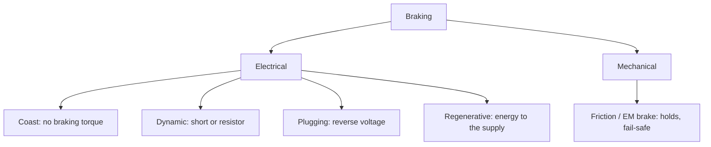

::: basics
### In plain words
There are five ways to slow a motor. Coasting just removes power and lets friction act. Dynamic braking shorts the motor so it acts as a generator and burns its energy as heat. Plugging applies reverse voltage for the fastest stop, at a high current. Regenerative braking sends the energy back into the supply. Mechanical brakes use friction and are the only kind that hold at standstill.

### Picture it
Think of stopping a car. Lifting off the gas and coasting is slow and uncontrolled. Downshifting to let the engine drag the car is like dynamic braking: it works well at speed and fades as you slow. Slamming into reverse is like plugging: abrupt, and it drives you backward if you hold it. A hybrid that charges its battery while slowing is regenerative. Friction brakes are mechanical, and only the parking brake holds you on a hill.

### Words you need
- **Dynamic braking**: shorting the motor, or loading it with a resistor, so its generated current opposes the rotation.
- **Plugging**: reversing the applied voltage while the motor is still spinning forward.
- **Regenerative braking**: returning the motion's energy to the supply through the drive's switches.
- **Holding torque**: the torque available at zero speed.

### The simplest example
A small 12 V motor with a 1 Ω winding makes 0.02 V per rad/s of speed and 0.02 N·m per amp. It spins at 3000 rpm, holding about 0.99 J of motion energy. Shorted, it brakes with 6.28 A and 0.126 N·m, but at 100 rpm the torque has faded to 0.0042 N·m. Plugging would start at about 18.3 A. Now hang a 0.01 N·m load on the shaft. The shorted motor still turns at about 25 rad/s, roughly 240 rpm, so electrical braking alone cannot hold a load still.

That is the whole idea: compare torque against speed, current, and where the energy goes. The rest of this page adds the torque-speed curves, how regeneration can push up the supply voltage, mechanical brake types, and an energy budget check.
:::

::: testing
Whether you can map the braking landscape and compare the methods on the criteria that matter: stopping time, current and thermal stress, holding torque at standstill, energy flow, and complexity. A good answer names coasting (not really braking), dynamic (short-circuit/resistive) braking, plugging (reverse-current), regenerative braking, and mechanical braking, and says what each is good and bad at. Extra credit for knowing how it changes for BLDC, steppers and AC motors, and for the bus-pumping hazard of regeneration.
:::

::: why
The right braking method is a system decision: a power tool wants a fast, cheap stop with no returned energy, an electric vehicle wants to recover energy, a robot arm wants a brake that holds when power is lost, and a lift needs a fail-safe brake by regulation. Getting it wrong shows up as burnt FETs, a pumped bus, a stopped-but-drifting load, or a stopping distance that is too long. Interviewers use this question to see whether you can compare options, not just name them ([[q0410]] is the "how do I build it" companion).
:::

::: concepts
- **Motor as generator**: back-EMF $E = K_e\omega$ lets a spinning motor source current. See [[q0341]].
- **Quadrants of operation**: motoring versus braking, forward versus reverse; braking is operation with torque opposite to speed.
- **Dissipation vs recovery**: kinetic energy $\tfrac12J\omega^2$ is either burned (in the motor, a resistor, a mechanical brake) or returned to a source.
- **Holding torque**: ability to hold at zero speed; electrical braking mostly lacks it.
- **Current decay modes (fast/slow)**: the same switch-state choices appear inside PWM current control ([[q0411]]).
- **Half-bridge vs H-bridge braking**: see [[q0424]].
:::

::: answer
"I'd group them into five. First, coasting, which isn't really braking: you just remove power and friction slows it, so it's slow and uncontrolled.

Second, dynamic braking: short the motor terminals, or connect a resistor across them. The motor acts as a generator and dissipates its kinetic energy in the winding or the resistor. It's simple and cheap, needs no supply, and gives strong torque at high speed, but the torque falls to zero with speed so it can't hold, and the current can be high.

Third, plugging or reverse-current braking: apply opposite voltage. It's the fastest, with high constant torque, but it draws more than stall current, stresses everything, and you must cut it at zero speed or the motor reverses.

Fourth, regenerative braking: control the bridge so the motor's current flows back into the supply. It recovers energy and is the most efficient, but it needs a bridge that can do it and a source that can absorb the energy, otherwise the bus voltage rises. Electric vehicles and trains use this.

Fifth, mechanical braking: friction or electromagnetic brakes. It provides holding torque and can be fail-safe, spring-applied and released with power, but it wears and generates heat in the brake.

In practice combine them: electrical braking for the fast slowdown and a mechanical brake for holding and as the safety backup."
:::

::: technical
**Common model.** $J\,\dot\omega = T_{brake} - b\omega$ with $\omega$ the speed; kinetic energy $E_k = \tfrac12J\omega^2$. For the example motor ($K = 0.02$, $R = 1\ \Omega$, $J = 2\times10^{-5}$ kg·m², 3,000 rpm): $E_k = 0.99$ J.

| Method | Mechanism | Torque vs speed | Peak current | Energy goes to |
|---|---|---|---|---|
| Coast | terminals open | friction only | 0 | friction heat |
| Dynamic (short) | terminals shorted | $K^2\omega/R$ (zero at zero speed) | $E/R$ | winding $R$ |
| Dynamic (resistor) | shunt $R_b$ | $K^2\omega/(R+R_b)$ | $E/(R+R_b)$ | winding and $R_b$ |
| Plugging | reverse $V$ | $K(V + K\omega)/R$, or constant at current limit | up to $(V+E)/R$ | winding $R$ (plus source work) |
| Regenerative | bridge boosts $E$ to bus | set by controlled current | controlled | back to the source (minus losses) |
| Mechanical | friction / EM brake | controllable, nonzero at zero speed | brake coil only | brake heat |

**Numbers at 3,000 rpm.** Short-circuit brake: 6.28 A, torque 0.126 N·m, decreasing to 0.0042 N·m at 100 rpm. Plugging unlimited: 18.3 A, torque 0.37 N·m; at a 6 A limit constant 0.12 N·m. Energy 0.99 J.

**Regeneration conditions.** Current flows back to the supply only if the bridge presents a voltage to the motor below $E$ but the bus is above $E$ (a boost-like action using the motor inductance), or the bridge is switched so the motor current charges the bus during the off-time of the low-side switches. The returned current charges the bus capacitance; with source impedance or load on the bus the bus voltage rises by $\Delta V$; for a lossless upper bound with $C = 470\ \mu$F and 12 V initially, 0.99 J would lift the bus to about 66 V. Batteries absorb it (within charge-current limits); rectifier-fed buses and bench supplies do not.

**Holding.** Dynamic and plugging give zero torque at $\omega = 0$; regen at zero speed is limited by $E \to 0$. Only mechanical brakes (or an active position loop, or non-backdrivable gearing) hold. Example: a 0.01 N·m load back-drives the shorted example motor at $0.01/(K^2/R) = 25$ rad/s (239 rpm).

**Other motor types.** BLDC: short all three low-side switches (or high-side) for dynamic braking, regen by controlled phase currents ([[q0364]]). Steppers: shorting windings gives damping; holding torque and detent torque hold position at power on ([[q0378]]). Induction motors: DC injection braking (a DC current in the stator) and regen via drives (vendor-specific).
:::

::: short
"Five kinds: coast, which is just letting friction work; dynamic braking, shorting the terminals or adding a resistor so the motor dissipates its energy as a generator; plugging, reversing the voltage for the fastest stop at high current; regenerative braking, returning energy to the supply with a bridge; and mechanical brakes for holding torque and fail-safe. Electrical braking loses torque as speed drops, so combine it with a mechanical brake for holding."
:::

::: long
"I'd split braking into electrical and mechanical, and electrical into four types.

Coasting is where you just remove drive, so it's the baseline: slow, uncontrolled, friction only.

Dynamic braking shorts the motor terminals or puts a resistor across them. A spinning motor is a generator, so it pushes a current of E over R through the short, which creates a torque against rotation. Its torque is proportional to speed, so it's strong at the start and fades to nothing at standstill. It's simple and robust, needs no power, but it dumps all the energy in the winding, and the peak current could exceed ratings; a series brake resistor or PWM limits it.

Plugging means applying reverse voltage while the motor's still spinning. The current is V plus E over R, here about 18 amps for a 12 volt motor, so it's brutal but fast, and if I don't cut it at zero speed the motor runs backward. With a current limit it gives constant deceleration.

Regenerative braking controls the bridge so that the motor's energy flows back to the source. It's the most efficient and what EVs do, but I need a bridge able to boost, and a source that can accept the current, otherwise the bus voltage climbs; a bench supply can't take it.

Mechanical brakes, friction discs or spring-applied electromagnetic brakes, are the only ones that hold at zero speed and are fail-safe on power loss, so any application with gravity or a safety requirement has one.

So the typical design is regen or dynamic braking to slow down, and a mechanical brake to hold and for emergency stop."
:::

::: terms
- **Dynamic braking**: dissipating kinetic energy in the motor or a resistor by loading the generator.
- **Regenerative braking**: returning kinetic energy to the supply.
- **Plugging (reverse-current braking)**: reversing applied voltage to produce braking torque.
- **Brake chopper / brake resistor**: a switch and resistor that absorb excess bus energy.
- **Holding torque**: torque available at zero speed.
- **Fail-safe (spring-applied) brake**: a brake that engages when power is removed.
- **DC injection braking**: braking an AC motor by applying DC to the stator.
- **Four-quadrant drive**: a drive that can motor and brake in both directions.
:::

::: exceptional
An average answer lists "regenerative, dynamic, plugging". An exceptional answer:

- Includes **mechanical** and **coast** and explains when each is used.
- Gives the **torque-speed behaviour** of each method (dynamic is $\propto\omega$, plugging high and nearly constant, regen controlled).
- **Quantifies** current and torque for an example motor.
- Mentions **energy flow** (dissipated or recovered) and the **bus-pumping** hazard.
- States who **holds at zero speed** and mentions BLDC/stepper/AC variations.
:::

::: mistakes
- **Calling regenerative braking free.** It needs a bridge capable of it and a sink for the energy; efficiency is limited by winding and switch losses and by battery charge-current limits.
- **Expecting dynamic braking to stop a load that gravity drives.** Torque is zero at zero speed. Use a mechanical brake.
- **Not limiting plugging current.** $(V+E)/R$ can exceed ratings.
- **Treating coast as braking.** It adds no braking torque.
- **Forgetting thermal limits of electrical braking.** Energy goes into the winding or resistor; repeated stops heat it.
- **Ignoring the supply.** A bench supply or diode-fed bus cannot absorb regenerated energy. See [[q0410]].
:::

::: deep
## A map of the options


Figure: Electrical braking uses the motor as a generator, with the energy burned (dynamic, plugging) or returned (regen). Mechanical brakes are independent of the motor's electrical state, which is why they are used for holding and safety.

## Torque against speed: the key comparison

Take the example motor ($K = 0.02$ N·m/A, $R = 1\ \Omega$, $V = 12$ V). The braking torque as a function of speed for each method:

```plot
{"title":"Braking torque vs speed (illustrative 12 V motor, current limits where noted)","x":{"label":"Speed","unit":"rpm","min":0,"max":3000},"y":{"label":"Braking torque","unit":"N·m","min":0,"max":0.4},
 "vars":{"k":0.02,"r":1,"v":12,"ilim":6},
 "series":[{"label":"dynamic (short): K²ω/R","fn":"k*k*(x*pi/30)/r","color":"accent"},{"label":"plugging, unlimited: K(V+Kω)/R","fn":"k*(v+k*(x*pi/30))/r","color":"red","dashed":true},{"label":"plugging, 6 A limit","fn":"min(k*(v+k*(x*pi/30))/r,k*ilim)","color":"red"},{"label":"regen at 4 A (fades at very low speed)","fn":"k*4*clamp(x/200,0,1)","color":"green"}],
 "hlines":[{"at":0.01,"label":"0.01 N·m load","color":"muted"}]}
```
Figure: Dynamic braking torque is proportional to speed and nearly vanishes near zero (0.0042 N·m at 100 rpm). Plugging gives much more torque, constant if current-limited, but must be cut at zero speed. Regen can hold a constant torque but fades at low speed because the back-EMF is no longer enough to push current into the bus (shape illustrative). Where the dynamic-braking line is below the grey line (under about 240 rpm), a 0.01 N·m load wins: gravity or a spring will back-drive the motor at that speed.

> [!UNCERTAIN]
> The regenerative curve is a sketch. The low-speed fade depends on the converter topology, the bus voltage and the motor inductance (boost action); real drives hold regen to lower speeds, with dynamic braking blended in.

## Dynamic braking

Short circuit or a resistor $R_b$ across the motor terminals: $T = K^2\omega/(R+R_b)$. With $R_b$ the peak current is lower and heat appears in $R_b$ instead of the winding (useful for large motors). The equation is a pure viscous damper, so the speed decays exponentially with $\tau = J/(b + K^2/(R + R_b))$. For the example motor: 47.6 ms short-circuited; with a 2 Ω resistor $\tau = 2\times10^{-5}/(2\times10^{-5} + 1.33\times10^{-4}) = 131$ ms.

Pros: no supply needed (works on power failure if the short is made by a normally-closed relay contact), simple, robust. Cons: weak at low speed, no holding, all energy in the winding/resistor, peak current.

## Plugging

Reverse voltage gives $i = -(V + K\omega)/R$. With a current limit it provides a constant torque (very short stopping time $J\omega_0/(K I_{lim}) = 52$ ms here). Energy: the source also does work during plugging. With the 6 A limit the winding dissipates $I^2R\,t = 36\text{ W}\times0.052\text{ s} = 1.9$ J, about twice the 0.99 J of kinetic energy; the difference comes from the source (the applied reverse voltage must rise from about 0 V to 6 V as the back-EMF falls, averaging near 2.9 V at 6 A, about 0.9 J).

This is why plugging is usually reserved for emergency stops and servo drives with proper limits, or when the supply can handle it.

## Regenerative braking

If the drive can operate as a boost converter, the motor's inductance and back-EMF push current into the bus. The power returned is $P = E\cdot I$ minus losses; the energy recovered is a fraction of $\tfrac12J\omega^2$ (the rest is lost in $R$, friction and switches). In an EV battery pack the limit is the charge-current allowance (cold or full packs refuse regen) and then friction brakes blend in.

Bus effect: the returned charge raises the bus voltage unless something absorbs it:
- A **battery** (best).
- **Other loads** on the bus (multi-axis machines share regen energy).
- A **brake resistor with chopper**: when the bus exceeds a threshold, a switch connects a power resistor.
- A **TVS or clamp** for small energies.

```sim
{"id":"h-bridge-lab","mode":"h"}
```
Figure: Compare brake (both low sides), coast (all off: body-diode freewheel path) and drive states. Regeneration would need synchronous switching that this simple model doesn't show, but the current path through body diodes after turn-off is the "fast decay" version of regen.

## Mechanical braking

- **Friction brakes** (disc, drum): the energy goes to heat in the brake.
- **Electromagnetic spring-applied brakes**: springs clamp a disc; a solenoid releases them when powered, so they are fail-safe and hold at zero speed. Used on elevators, robot joints, servo motors with brakes.
- **Power-off holding in gearmotors**: worm gears are self-locking (non-backdrivable) above a certain ratio.
- Also **eddy-current/hysteresis brakes** and **hydraulic** for other applications.

Costs: wear, release delay (tens of ms), coil power for release, and the need to coordinate the electrical stop and the brake engagement to avoid wearing the brake while the motor still drives.

## Choosing

| Need | Method |
|---|---|
| Cheap, fast stop, no returned energy | dynamic (short) or resistor |
| Fastest stop, drive can limit current | current-limited plugging |
| Energy efficiency, battery on bus | regenerative |
| Hold at zero speed, fail-safe | mechanical spring-applied |
| Large inertia, repeated stops | resistor + chopper or regen |

A real drive combines: regen to slow, dynamic brake at low speed, mechanical brake to hold. A servo with a brake releases it only when the drive is enabled.

## Energy budget quick check

For any braking design compute $E_k = \tfrac12J\omega^2$ and ask where it goes. Example: a 0.5 kg·m² flywheel at 3,000 rpm has $E_k = 24.7$ kJ. At 12 V that is impossible to dissipate in a small winding; it needs a drive with a brake resistor or regen. Cycle rate matters too: 24 kJ every 10 s is 2.5 kW of average braking power.
:::

::: applications
- **Power tools and mixers**: shorted-winding dynamic braking to stop the blade fast.
- **Electric vehicles, e-bikes and trains**: regenerative braking, with mechanical brakes for holding and emergencies.
- **Servo drives and robot joints**: regen/dynamic with spring-applied holding brakes.
- **Cranes and elevators**: regen into the grid, or brake choppers, plus fail-safe mechanical brakes.
- **Industrial AC drives**: brake chopper with resistor, DC injection or regen units.
- **Hobby RC ESCs**: drag brake (shorting) and active brake.
:::

::: assumptions
- The numerical examples use a **small brushed PM motor** with constant $K_t = K_e$, and a viscous friction model; real friction has a Coulomb component.
- **Regen** assumes a bridge capable of boost-mode current control and a bus that can accept energy; the torque curve shown is a qualitative sketch.
- The comparison is made at the **motor shaft**; with gearboxes, reflected inertia and back-drivability change the picture ([[q0349]]).
- For **BLDC** and **AC** motors, equivalents exist (shorting phases, DC injection), but details are vendor- and controller-specific.
- Energy numbers ignore bearing, windage and core losses.
:::

::: followups
### Which braking method is fastest, and what's the catch?
Plugging with a current limit: constant torque from full speed to zero (52 ms for the example), versus about 160 ms to reach 100 rpm with dynamic braking. The catch is the very high current (above stall), thermal stress, mechanical shock to the gearbox, and the need to detect zero speed and cut the drive.

### Why does a motor with dynamic braking still creep when a load pulls on it?
Dynamic braking torque is proportional to speed. At zero speed it's zero, so any steady load torque makes the motor turn until the braking torque $K^2\omega/R$ equals the load. For 0.01 N·m on the example motor that's 25 rad/s (about 240 rpm). Use a mechanical brake or active holding.

### How do you handle the energy from regeneration if the supply is a bench supply?
Don't regenerate into it. Use dynamic braking instead, or clamp the bus with a brake chopper and resistor or a TVS. Add bulk capacitance if the energy is small. Check the supply's behaviour: many cannot sink current and might latch up or trip.

### Why do elevator and robot brakes engage when power is removed?
Safety. A spring-applied brake clamps the shaft by default; an electromagnet releases it only while energised. Loss of power, a cable break or a controller fault brings the brake on, so the load can't fall. Electrical braking alone can't do this because it relies on the drive and doesn't hold at standstill.

### How would braking differ for a stepper?
Steppers can't coast down easily if driven, but they stop in step with the command, and holding torque keeps the rotor in place when energised. Shorting the windings gives dynamic damping; cutting power leaves only detent torque. Deceleration ramps in the step profile do the "braking" and are essential to avoid losing steps ([[q0378]]).
:::

::: interpretations
"Different kinds of motor braking" is answered here as a comparison among *electrical* methods (dynamic, plugging, regenerative), *coast* as the baseline and *mechanical* brakes. For the circuit-level how-to with a bridge, see [[q0410]] and [[q0424]]. For BLDC, steppers and AC motors the equivalents are noted but not derived.
:::

::: references
- Mohan, Undeland & Robbins, *Power Electronics*: DC motor drives, four-quadrant operation, regeneration.
- Krishnan, *Electric Motor Drives: Modeling, Analysis and Control*: dynamic braking, regenerative braking and plugging.
- Fitzgerald, Kingsley & Umans, *Electric Machinery*: DC machine as generator and braking.
- Drive and servo manufacturers' application notes on brake resistors and spring-applied brakes (check the specific vendor documentation).
:::

::: rubric
- Names coast, dynamic, plugging, regenerative and mechanical braking :: Covers the full landscape.
- Describes the mechanism of each (generator action, reversed voltage, energy returned) :: Shows understanding, not just names.
- Compares torque, current and holding capability :: The decision criteria.
- Mentions where the energy goes and the bus-pumping hazard :: Energy-flow awareness.
- Knows plugging must be cut at zero speed and current-limited :: Safety.
- Notes that only mechanical braking holds at standstill and can be fail-safe :: Practical system knowledge.
- Gives a numerical example :: Quantitative skill.
:::

::: quiz
```json
[
 {"type":"mcq","level":"fundamental","q":"Which braking method returns energy to the power source?","options":["Dynamic braking with a resistor","Plugging","Regenerative braking","Coasting"],"answer":2,"explain":"Regeneration controls the bridge so motor current flows back into the supply. Dynamic braking and plugging dissipate the energy as heat; coasting just lets friction act."},
 {"type":"truefalse","level":"fundamental","q":"Dynamic (short-circuit) braking can hold a motor stationary against a steady load torque.","answer":false,"explain":"Dynamic braking torque is $K^2\\omega/R$, which is zero at zero speed. A steady load will turn the motor until the speed-proportional braking torque matches it."},
 {"type":"numeric","level":"intermediate","q":"A shorted motor ($K = 0.02$, $R = 1\\ \\Omega$) spins at 100 rpm. What is the dynamic braking torque?","answer":0.0042,"tolerance":0.03,"unit":"N·m","explain":"$\\omega = 100\\pi/30 = 10.47$ rad/s; $T = K^2\\omega/R = 4\\times10^{-4}\\times10.47 = 0.0042$ N·m."},
 {"type":"numeric","level":"intermediate","q":"Same motor with a 2 Ω brake resistor in series with the short. What is the peak brake current at 3,000 rpm?","answer":2.09,"tolerance":0.02,"unit":"A","explain":"$E = 6.28$ V; $I = E/(R + R_b) = 6.28/3 = 2.09$ A."},
 {"type":"numeric","level":"intermediate","q":"A flywheel of $J = 0.5$ kg·m² spins at 3,000 rpm. How much kinetic energy must a braking system handle, in kJ?","answer":24.7,"tolerance":0.02,"unit":"kJ","explain":"$\\omega = 314.16$ rad/s; $E = 0.5\\times0.5\\times314.16^2 = 24{,}674$ J = 24.7 kJ."},
 {"type":"mcq","level":"advanced","q":"A motor regenerates into a diode-rectified DC bus with no battery and little load. What is the likely result?","options":["The energy disappears","The bus voltage rises","The motor stops instantly","The diodes conduct backwards and return power to the grid"],"answer":1,"explain":"Rectifier diodes can't pass reverse current, so the returned charge accumulates on the bus capacitors and the voltage climbs until a chopper or clamp absorbs it."}
]
```
:::
