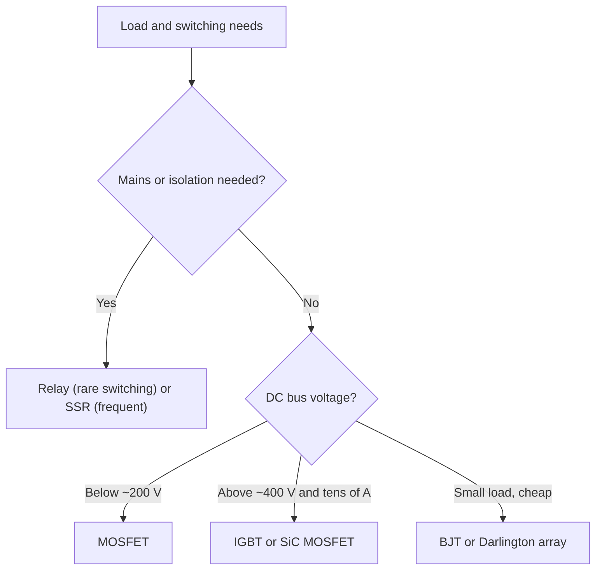

::: basics
### In plain words
To switch a motor or solenoid you can use a mechanical relay, a solid-state relay (SSR), a MOSFET, a BJT, or an IGBT. They differ in how much power they waste while on, how fast they switch, how hard they are to drive, and whether they isolate the load from the logic. Pick by the job: voltage, current, switching speed, and isolation. For a 12 V PWM motor, use a MOSFET.

### Picture it
Think of a wall light switch versus an electronic dimmer. The wall switch is a mechanical relay. It clicks slowly, it wears out, and it fully separates the circuits. It cannot flicker thousands of times a second. The dimmer is like a MOSFET: silent, fast, and long-lived, and it can vary the average power. But it does not isolate the circuits. The analogy breaks in one place: an IGBT or SSR sits between them, with a fixed voltage drop that wastes heat.

### Words you need
- **Electromechanical relay (EMR)**: a coil that moves metal contacts. It has almost no on-state loss and gives isolation, but it is slow and wears.
- **SSR**: a solid-state relay, an optically isolated semiconductor switch.
- **$R_{DS(on)}$**: a MOSFET's on-resistance. Conduction loss is $I^2 R_{DS(on)}$.
- **$V_{CE(sat)}$**: the fixed voltage drop across a saturated BJT or IGBT.
- **IGBT**: a MOSFET-gated bipolar device for high voltage and current at moderate frequency.

### The simplest example
Compare what each switch wastes carrying 5 A. A MOSFET with 10 mΩ loses $5^2 \times 0.01 = 0.25$ W. A BJT with 0.3 V saturation plus base drive loses about 1.9 W. A relay's contacts lose under 1 W, plus about 0.4 W in the coil. A triac SSR at 1.2 V loses 6 W, and an IGBT at 1.3 V loses about 6.5 W. For a 12 V motor with 20 kHz PWM, only the MOSFET both switches fast enough and wastes almost nothing.

That is the whole idea: start from the requirements, then check the numbers. The rest of this page adds relay DC arc limits, AC versus DC SSRs, the MOSFET-IGBT crossover, BJT base drive, and a selection tree.
:::

::: testing
Whether you can choose a switch from requirements rather than habit. The interviewer wants the physical differences (contacts versus semiconductors; voltage-controlled versus current-controlled; unipolar versus bipolar conduction), the numbers that decide (on-state drop or resistance, switching speed, drive power, voltage and current range, isolation, lifetime), and a decision rule: which one for a 12 V PWM motor, a mains solenoid, a 600 V inverter, or an occasional high-current polarity reversal.
:::

::: why
Picking the switch sets efficiency, size, cost, EMI, drive complexity and reliability. An IGBT on a 12 V motor wastes a volt or more as heat; a relay on a PWM line fails in days; a BJT on a high-current motor needs a heat sink where a MOSFET would not. Real engineers make this call all the time, and an interviewer can quickly see whether you reason with numbers or with slogans.
:::

::: concepts
- **Conduction loss**: resistive ($I^2R_{DS(on)}$) for MOSFETs, "knee plus resistance" ($V_{CE(sat)}I$) for BJTs and IGBTs. See [[q0409]].
- **Switching loss and speed**: charge storage and tail currents limit how fast each device can switch. See [[q0418]].
- **Drive requirements**: gate voltage (MOSFET/IGBT) versus base current (BJT) versus coil power (relay).
- **Isolation**: relays and SSRs isolate; transistors do not. See [[q0434]].
- **Contact life and arcing**: DC inductive loads arc at relay contacts. See [[q0413]].
- **Voltage rating domain**: MOSFETs dominate below about 200 V; IGBTs above about 600 V; in between, overlap (vendor- and application-dependent).
:::

::: answer
"I'd compare them on a few axes: voltage and current range, on-state loss, switching speed, drive effort, and isolation.

An electromechanical relay has metal contacts: essentially zero on-state loss, works for AC or DC, and gives isolation for free. The downsides: it switches in milliseconds, can't do PWM, wears out, bounces, and DC inductive loads make nasty arcs at the contacts, so the DC rating is far below the AC rating and the contact life drops a lot. Good for infrequent switching, isolation, and polarity reversal with a DPDT.

A solid-state relay packages an optocoupler and a switch, so it's isolated, silent and long-lived. AC types use a triac, so they have about a volt of drop and only work on AC. DC types use MOSFETs. Costly, with leakage and heat.

For the discrete transistors: a power MOSFET is voltage-driven, has a resistive on-state, with milliohms at low voltage, and switches in tens of nanoseconds, so it's the default for PWM motor and solenoid drives up to about 100 to 200 volts. A BJT is current-driven, with a saturation voltage of 0.2 to 0.7 volts, so a high-current drop and base drive loss; it's cheap for small loads, and Darlington arrays are common. An IGBT combines a MOSFET gate with a bipolar output: low conduction loss at high voltage, but a fixed voltage drop of a volt or two and tail current that limits frequency, so it wins above a few hundred volts and tens of amps at tens of kilohertz.

For a 12 volt motor I'd use a MOSFET; for mains switching, a relay or SSR; for a 400 volt motor drive, IGBTs or SiC."
:::

::: technical
**Representative orders of magnitude** (all vendor- and part-dependent; read datasheets):

| | EMR | SSR (AC, triac) | SSR (DC, MOSFET) | MOSFET | BJT | IGBT |
|---|---|---|---|---|---|---|
| Control | coil current (about 0.2 to 0.5 W for small relays) | LED current | LED / photovoltaic driver | gate voltage | base current ($I_B \approx I_C/10$ forced) | gate voltage |
| On-state | contact resistance (10s of mΩ) | about 1 to 1.5 V drop | $R_{on}$ mΩ to Ω | $R_{DS(on)}$ mΩ | $V_{CE(sat)}$ 0.2 to 0.7 V | $V_{CE(sat)}$ about 1.5 to 2.5 V |
| Voltage | up to hundreds of V (AC/DC rated differently) | 24 to 600 V AC | 5 to 100s V DC | 12 to 1,000 V (low-$R$ below about 200 V) | up to a few hundred V | 600 V to 6.5 kV |
| Speed | 5 to 15 ms operate | half-cycle (zero-cross) | 0.1 to 5 ms | 10s of ns | 100s of ns to µs (storage) | 100s of ns, tail current |
| PWM | no | no | slow only | yes (to MHz) | yes (to 10s of kHz) | yes (to about 20 to 50 kHz) |
| Isolation | yes | yes (optical) | yes (optical) | no | no | no |
| Life | $10^5$ electrical, $10^7$ mech. (typical) | long | long | long | long | long |

**Conduction loss at 5 A:** MOSFET ($R = 10$ mΩ): $5^2\times0.01 = 0.25$ W. BJT ($V_{CE(sat)} = 0.3$ V, forced beta 10 and $V_{BE} = 0.8$ V): $0.3\times5 + 0.8\times0.5 = 1.9$ W. IGBT ($1.3$ V at 5 A): 6.5 W. Triac SSR ($1.2$ V): 6 W. A relay ($R_c = 30$ mΩ): 0.75 W. The relay's coil adds 0.4 W.

**Voltage scaling.** For a unipolar MOSFET, $R_{DS(on)}$ per area grows steeply with breakdown voltage (roughly $V_{BR}^{2.4\text{ to }2.6}$), so above a few hundred volts a MOSFET at a given die size has high $R$; an IGBT's conductivity modulation gives a nearly constant $V_{CE(sat)}$. The crossover current, where $I^2R_{DS(on)} = V_{CE(sat)}I$ or a knee-plus-resistance model, moves with voltage: for the illustrative models in the plot below it is about 5.3 A.

**Relay contact ratings.** AC and DC ratings differ: AC arcs extinguish at current zero, DC arcs persist; so a relay rated for 10 A at 250 V AC may be rated only for a fraction of that at 30 V DC resistive, and much less for an inductive DC load. Datasheets list resistive and inductive ratings; arc suppression (a diode, RC or varistor across the load) and a derating of 2x or more are usual.

**BJT specifics.** To saturate: $I_B \ge I_C/\beta_{forced}$, with forced beta 10 typical for power BJTs; storage time limits turn-off; Darlington pairs (e.g. ULN2003-type arrays with 7 channels at about 500 mA each and built-in clamp diodes) have drops of 1 V or more.

**IGBT specifics.** Positive temperature behaviour at high current helps paralleling; tail current at turn-off; no body diode (co-packaged anti-parallel diode in modules); short-circuit withstand time of a few µs.
:::

::: short
"Relay: contacts, zero on-state loss, isolation, AC or DC, but slow, wears, can't PWM, and DC inductive arcs hurt. SSR: isolated, silent, but about a volt drop (triac types) and AC-only unless MOSFET-based. MOSFET: voltage-driven, milliohm resistance, fast, the default for low-voltage PWM. BJT: cheap, current-driven, 0.2 to 0.7 V drop. IGBT: high voltage and current with constant drop, slower. 12 V motor: MOSFET. Mains: relay or SSR. 400 V inverter: IGBT or SiC."
:::

::: long
"I'd compare on voltage and current range, conduction loss, switching speed, drive effort and isolation.

An electromechanical relay is a coil moving metal contacts. On-state loss is almost zero, it handles AC or DC, and the coil is isolated from the load. But it takes ten milliseconds to operate, it can't do PWM, contacts wear and bounce, and a DC inductive load makes arcs, so the DC rating is far below the AC rating and I'd derate heavily and add arc suppression. It's good for slow, occasional switching and polarity reversal.

A solid-state relay puts an optocoupler in front of a power switch. It's silent, long-lived and isolated. AC versions use a triac, so about a volt of drop and AC only; DC versions use MOSFETs, with some on-resistance and leakage. They're more expensive and the drop means heat.

Then the transistors. A power MOSFET is voltage-driven, with a resistive on-state of milliohms at low voltage, and switches in nanoseconds, so it's the default for PWM motor and solenoid drives up to about 100 volts or so. Conduction loss is I squared R, so five amps through ten milliohms is a quarter watt. A BJT is current-driven, with a saturation voltage around 0.3 volts and base drive of about a tenth of the collector current, so the same five amps costs about two watts. It's fine for small loads, and Darlington arrays like the ULN2003 are convenient. An IGBT has a MOSFET gate and a bipolar output, so it keeps a roughly constant drop of a volt or two even at high voltage, but tail current limits it to a few tens of kilohertz. It wins at a few hundred volts and tens of amps.

So: 12 volt motor, a MOSFET; mains switching, a relay or SSR; a 400 volt drive, IGBT or SiC; small loads from logic, a transistor array."
:::

::: terms
- **EMR**: electromechanical relay; a coil actuates mechanical contacts.
- **SSR**: solid-state relay; optically isolated semiconductor switch.
- **Triac**: bidirectional thyristor for AC switching.
- **$R_{DS(on)}$**: on-resistance of a MOSFET.
- **$V_{CE(sat)}$**: collector-emitter saturation voltage of a BJT or IGBT.
- **Forced beta**: collector-to-base current ratio used when deliberately saturating a BJT.
- **Tail current**: slowly decaying current at IGBT turn-off from stored charge.
- **Zero-cross switching**: SSR turning on near the AC zero crossing to reduce EMI.
:::

::: exceptional
An average answer lists pros and cons of each device. An exceptional answer:

- Starts from the **application** (voltage, current, frequency, isolation, duty) and derives the choice.
- Gives **numbers** (conduction loss at a real current for each device, drive power).
- Explains **why** (unipolar versus bipolar conduction, $R_{DS(on)}$ rising with voltage rating, tail current).
- Knows the **relay DC-inductive derating** and the AC/DC SSR distinction.
- Mentions the **mid-way options**: Darlington arrays, GaN/SiC, driver ICs, and when to use each.
:::

::: mistakes
- **Using the relay's AC rating for a DC motor.** DC arcs don't self-extinguish; contacts weld or erode. Use the DC (and inductive) rating.
- **Putting a triac SSR on a DC load.** It latches on and can't turn off (no zero crossing).
- **Assuming IGBTs are always better at high power.** At low voltage a MOSFET beats them on conduction and speed.
- **Underestimating BJT base drive.** Forced beta of 10 means 10% of the load current from the driver.
- **Ignoring SSR heat.** A triac SSR at 10 A drops about 12 W and needs a heat sink.
- **PWMing a relay.** It kills the contacts and the coil mechanism. Relays are for on/off only.
- **Forgetting the freewheel path** for any of these when the load is inductive. See [[q0413]].
:::

::: deep
## Four ways to switch a load

Every switch trades four things: what it costs you while on, how fast it switches, how hard it is to drive, and whether it isolates.

**Mechanical contacts (EMR).** A coil produces force to close contacts; on-resistance is the contact (10 to 100 mΩ). The load side is galvanically isolated from the coil. Weaknesses are mechanical: operate and release time of milliseconds, bounce (0.1 to several ms), wear, and, for DC inductive loads, arcing. Arcing happens at the opening contacts because the inductive current must continue; the gap voltage rises until air breaks down, and the arc erodes the contacts. A typical quoted principle: arcs sustain above roughly 12 V and a few hundred mA with common contact materials (rough, material-dependent), so a 12 V motor is in the arcing regime. A diode across the load makes the problem vanish at the contacts but slows the load's current decay.

**Optically isolated semiconductor switches (SSR).** The LED current is the control; the output stage is a triac (AC), back-to-back MOSFETs (AC/DC) or a single MOSFET (DC). Triac SSRs are cheap and robust for resistive and inductive AC loads (heaters, AC motors), switching at the zero crossing to limit EMI; the voltage drop is about 1 to 1.5 V, so at 10 A you dissipate 10 to 15 W and need a heat sink. DC SSRs with MOSFET outputs are common and have low on-resistance but can be slow (the photovoltaic driver charges the gate slowly), so PWM is limited.

**MOSFET.** A unipolar device: in the on state the channel is a resistor. Conduction loss $P = I^2R_{DS(on)}$; with $R_{DS(on)}$ of a few milliohms for 30 to 60 V parts, a 20 A motor load loses only a few watts. It switches by charging and discharging a small gate capacitance (nC) so it can run at 100 kHz to MHz. High voltage MOSFETs have larger on-resistance: a 600 V part is hundreds of milliohms hot for a typical size.

**BJT.** A bipolar device whose collector current is controlled by base current. Saturation voltage 0.2 to 0.7 V (power parts) and $I_B \approx I_C/10$. Storage time at turn-off (hundreds of ns to µs) limits frequency. Darlington pairs raise gain but increase the drop to about 1 V or more. Still unbeatable for cost on small loads, e.g. 7-channel Darlington arrays with built-in clamp diodes, a common solenoid/relay driver with logic-level inputs.

**IGBT.** MOSFET input, bipolar output. At high voltage, conduction is dominated by conductivity modulation, so $V_{CE(sat)}$ stays around 1.5 to 2.5 V almost independent of blocking voltage. Its weakness is turn-off: stored charge leaves as a tail current, adding switching loss and limiting practical frequency to roughly 20 to 50 kHz (vendor- and generation-dependent). IGBT modules typically carry an anti-parallel diode.

```plot
{"title":"Conduction loss vs current (illustrative device models)","x":{"label":"Load current","unit":"A","min":0,"max":20},"y":{"label":"Conduction loss","unit":"W","min":0,"max":40},
 "series":[{"label":"MOSFET 40 V, 10 mΩ","fn":"0.01*x*x","color":"accent"},{"label":"MOSFET 600 V, 250 mΩ hot","fn":"0.25*x*x","color":"orange"},{"label":"IGBT 0.9 V + 80 mΩ","fn":"0.9*x+0.08*x*x","color":"red"},{"label":"BJT 0.3 V + base drive","fn":"0.38*x","color":"green"},{"label":"Triac SSR 1.2 V","fn":"1.2*x","color":"muted","dashed":true}],
 "points":[{"x":5.3,"y":"0.25*5.3*5.3","label":"HV MOSFET = IGBT near 5.3 A"}]}
```
Figure: At low voltage the 10 mΩ MOSFET is far below everything else even at 20 A (4 W). A high-voltage MOSFET has a quadratic loss that overtakes the IGBT's near-linear loss above a crossover current (5.3 A for these made-up models), which is why IGBTs take over at high voltage and current, but only for moderate switching frequency. The BJT's linear loss ignores switching and storage effects. All models are illustrative, not datasheet values.

> [!UNCERTAIN]
> The device parameters in the plot are illustrative round numbers; real crossover currents depend strongly on the specific parts, temperature and switching frequency (where IGBT tail and MOSFET gate/capacitive losses enter).

```sim
{"id":"mosfet-lab","view":"switch","vdd":12,"rd":12}
```
Figure: Look at how the MOSFET behaves as a switch: with enough gate drive it sits in the triode region as a small resistor, so its drop is proportional to current ($V = IR_{DS(on)}$) and shrinks toward zero at light load, unlike the roughly fixed knee voltage of a saturated BJT or IGBT. Lower $V_{gs}$ and watch it slide into saturation, where the dissipation readout jumps.

## Isolation, drive and speed

| Question | Best choice |
|---|---|
| Need galvanic isolation of the load from logic, no extra parts | relay or SSR |
| PWM above 1 kHz | MOSFET (or IGBT at high V); never a relay |
| Switch AC mains, resistive or inductive | triac SSR or relay; zero-cross for EMI |
| 12 to 48 V DC motor | MOSFET, with a driver IC if bidirectional |
| 3.3 V logic directly driving a small solenoid or relay coil | transistor/MOSFET or Darlington array |
| 400 V DC bus inverter | IGBT or SiC MOSFET module |
| Occasional polarity reversal of a large DC motor | DPDT relay (or contactor) |
| Silent, long life, no maintenance | SSR or MOSFET |


Figure: A first-pass selection tree. Boundaries are approximate; efficiency, frequency, cost and thermal limits move them.

## Practical details that decide it

- **Drive power**: relay coil 0.4 W at 12 V is 33 mA continuously; a MOSFET gate draws almost nothing at DC; a BJT needs 10% of the load current as base current.
- **Heat**: compute the watts: at 20 A a 5 mΩ MOSFET dissipates 2 W; a triac SSR 24 W; an IGBT about 50 W (illustrative model).
- **EMI and dv/dt**: SSR zero-cross switching and relays are quiet; fast MOSFETs and IGBTs radiate unless slowed ([[q0419]]).
- **Failure mode**: relays fail open or welded; MOSFETs usually fail short (and the motor runs away), so critical systems add a second means of removing power.
- **Cost and size**: MOSFETs and BJTs are cheapest per amp at low voltage; SSRs and relays are cheapest for one-off isolation.

> [!INTERVIEW]
> Ask the interviewer for the constraints before choosing: "What's the voltage, current, switching frequency and do we need isolation?" Then give the choice and the number that justifies it. That is what they are listening for.
:::

::: applications
- **Battery-powered motor and solenoid drives (12 to 48 V)**: power MOSFETs, often in driver ICs.
- **Appliance heaters and mains pumps**: triac SSRs or relays.
- **Industrial PLC outputs**: relays or SSRs for isolation, Darlington/transistor arrays for 24 V solenoids.
- **EV traction inverters and industrial drives (400 V and above)**: IGBT or SiC modules.
- **Automotive**: relays for lamp and pump switching, MOSFET high-side switches for PWM loads.
- **Reversing a winch or linear actuator at low switching rate**: DPDT relay pair or contactors.
:::

::: assumptions
- The comparison is at **DC or low-frequency AC** with loads from a few watts to a few kilowatts; very high-power and high-frequency devices (SiC, GaN, thyristors) are outside the scope except as mentions.
- Device numbers are **typical ranges** and **illustrative models**; vendor-dependent. Always check datasheets, especially relay DC/inductive ratings and SSR derating curves.
- The best answer **changes with requirements**: isolation or mains switching moves the answer to relays/SSRs regardless of the efficiency of semiconductors.
- GaN and SiC MOSFETs shift the crossover to higher voltages and frequencies and reduce IGBT usage, but cost and drive requirements differ.
- Safety certifications (creepage, clearance, approvals) are separate, mandatory for mains.
:::

::: followups
### Why does a relay rated 10 A at 250 V AC handle much less at 30 V DC with an inductive load?
AC current passes through zero twice per cycle, extinguishing arcs naturally. DC current doesn't, so the arc keeps burning as contacts separate, and an inductive load makes it worse since the current keeps trying to flow. The DC rating is therefore a fraction of the AC rating, often a few amps at 30 V DC resistive, and lower for inductive loads. Use a diode across the load, a DC-rated relay, or a MOSFET.

### When would an IGBT beat a MOSFET?
At high blocking voltage (several hundred volts and above) and high current with moderate switching frequency, e.g. a 400 V traction inverter at 8 to 16 kHz. The IGBT's conductivity modulation keeps $V_{CE(sat)}$ around 1.5 to 2 V, while a MOSFET of the same size has a high $R_{DS(on)}$. At 12 to 48 V a MOSFET wins in every respect. SiC MOSFETs now compete at high voltage with fast switching.

### What's wrong with driving a 2 A motor with a plain BJT from a 3.3 V GPIO?
You need base current of about $2/10 = 0.2$ A, far above a GPIO's capacity, so you'd need a driver stage or a Darlington (with a 1 V drop). A logic-level MOSFET needs almost no DC drive current and has a lower drop. Using the BJT directly would not saturate it, so the transistor dissipates heavy power in the linear region.

### Could you PWM a solid-state relay to control a motor?
A triac or zero-cross AC SSR cannot do it; it needs AC zero crossings. A DC MOSFET SSR can for slow PWM (hundreds of Hz), but its turn-on and turn-off times (up to ms) limit the frequency and increase loss. For speed control use a MOSFET driver rather than an SSR.

### What if you need isolation and PWM at 20 kHz?
Use a MOSFET (or half-bridge) driven through an isolated gate driver: an optocoupler or digital isolator with a gate driver on the isolated side, and a floating or bootstrapped supply for the driver ([[q0434]]). That keeps the isolation barrier while permitting fast switching.
:::

::: interpretations
"Drive circuits" here means the *power switching element* for an inductive load. The listing "etc." suggests also mentioning Darlington arrays, triacs, thyristors and wide-bandgap devices, which I include briefly. For how to spec a discrete transistor see [[q0417]]; for driver ICs [[q0416]]; for the switching-frequency limits that separate the devices [[q0418]].
:::

::: references
- Mohan, Undeland & Robbins, *Power Electronics: Converters, Applications and Design*: power semiconductor switches (BJT, MOSFET, IGBT, thyristors) and their characteristics.
- Horowitz & Hill, *The Art of Electronics*, 3rd ed.: relays, SSRs and power switching.
- Relay and SSR manufacturers' application notes on contact ratings and arc suppression (check the manufacturer's documentation for DC and inductive ratings).
- Infineon, onsemi and similar application notes comparing MOSFET and IGBT selection (consult current documentation).
:::

::: rubric
- Compares the devices on voltage/current range, conduction loss, speed, drive and isolation :: These are the actual selection criteria.
- Gives numbers for conduction loss at a stated current :: Demonstrates quantitative comparison.
- Explains relay limitations (DC arcing, speed, life, no PWM) :: Relay misuse is a common failure.
- Distinguishes AC (triac) and DC SSRs :: A frequent misunderstanding.
- Explains MOSFET versus IGBT trade-off and the voltage domain of each :: Core power electronics knowledge.
- Notes BJT drive requirements and Darlington drops :: Details that decide small-load drivers.
- Selects a device for a stated application and justifies it :: The practical end result.
:::

::: quiz
```json
[
 {"type":"numeric","level":"fundamental","q":"A MOSFET with $R_{DS(on)} = 10$ mΩ carries 5 A. What is the conduction loss?","answer":0.25,"tolerance":0.02,"unit":"W","explain":"$P = I^2R = 25\\times0.01 = 0.25$ W."},
 {"type":"numeric","level":"fundamental","q":"A triac SSR drops 1.2 V. How much power does it dissipate at 10 A?","answer":12,"tolerance":0.02,"unit":"W","explain":"$P = V I = 1.2\\times10 = 12$ W, so a heat sink is needed."},
 {"type":"mcq","level":"intermediate","q":"Which device is the best choice for a 20 kHz PWM drive of a 12 V motor?","options":["Electromechanical relay","Triac SSR","Power MOSFET","Thyristor"],"answer":2,"explain":"A MOSFET switches in nanoseconds, has milliohm on-resistance at low voltage and negligible DC drive power. Relays and triac SSRs can't PWM at that rate, and thyristors can't be turned off by the gate."},
 {"type":"truefalse","level":"intermediate","q":"A relay's AC contact rating can be used for a DC inductive load of the same voltage and current.","answer":false,"explain":"DC arcs do not extinguish at current zero and inductive loads make them worse, so the DC inductive rating is much lower than the AC rating. Derate or use a different switch."},
 {"type":"numeric","level":"intermediate","q":"A power BJT switches 2 A with forced beta of 10. What base current is needed (in mA)?","answer":200,"tolerance":0.02,"unit":"mA","explain":"$I_B = I_C/\\beta_{forced} = 2/10 = 0.2$ A = 200 mA, more than a GPIO can supply."},
 {"type":"mcq","level":"advanced","q":"Why do IGBTs displace MOSFETs at several hundred volts and tens of amps at moderate frequency?","options":["IGBTs have no switching losses","Conductivity modulation gives a nearly constant $V_{CE(sat)}$ while high-voltage MOSFETs have large $R_{DS(on)}$","IGBTs need no gate drive","IGBTs switch faster than MOSFETs"],"answer":1,"explain":"High-voltage unipolar MOSFETs have high on-resistance; an IGBT's injected carriers keep the drop around 1.5 to 2 V. The price is tail current and lower switching frequency."}
]
```
:::
