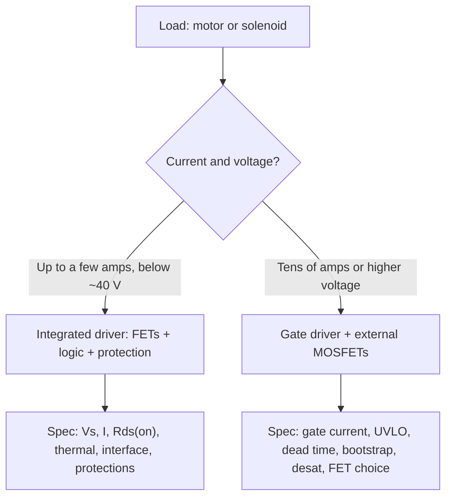

::: basics
### In plain words
Specifying a driver IC (the chip that switches the motor's current) means turning your load and your supply into a datasheet checklist. Check the voltage range, including spikes. Check the continuous current by heat, not by the headline number. Check the interface, the protections, and the package. A "3 A" driver may not deliver 3 A for long on your board.

### Picture it
Think of a car rated "200 km/h". It hits that briefly on a test track, not all day in desert heat. A driver's "peak current" is like the top speed. Its continuous current depends on how well the chip sheds heat on your board. The datasheet shows the test-track number, and you must work out the desert number.

### Words you need
- **On-resistance**: the resistance of the chip's switches when on. Hot, it is 1.4 to 1.7 times the 25 °C value.
- **Thermal resistance**: how many degrees the chip warms per watt, which depends on your board's copper.
- **Junction**: the silicon inside the chip. Its temperature is the one that matters.
- **Thermal shutdown**: the chip turns itself off when too hot, then back on once it cools.

### The simplest example
A 12 V motor has a 1 Ω winding, so it stalls at 12 A, and it runs at 2 A. The IC has 0.4 Ω of hot on-resistance, 40 °C/W of thermal resistance, and a 3.6 A current limit, in 60 °C surroundings. Running at 2 A loses $2^2 \times 0.4 = 1.6$ W, so the junction reaches $60 + 64 = 124$ °C, which is acceptable. At the 3.6 A limit during a stall, it loses 5.2 W and wants to rise about 207 °C, so thermal shutdown cycles. The fix is a stall timeout, more copper, or a bigger part.

That is the whole idea. The rest of this page covers voltage headroom, current limit choice, interface and protection checklists, and when to switch to separate transistors with their own driver chip.
:::

::: testing
Whether you can turn a load and a system into a datasheet checklist and spot the traps: a "3 A" driver that can't deliver 3 A continuously without a heat sink, a 12 V part on a 12 V bus that sees 40 V transients, or a stall current well above the current limit. The interviewer wants a structured list (voltage, current, on-resistance and thermal, interface, protections, features, package) and a worked check that uses real numbers and ends with "so I would pick a part with X margin, and verify Y".
:::

::: why
Driver ICs are how most products drive motors and solenoids: they bundle the FETs, level shifting, dead time, current sensing and protections into a small package. Choosing badly is a classic cause of field failures (overheating, nuisance faults, destroyed parts at start-up). This question shows whether you read datasheets critically: absolute maximum versus operating, peak versus continuous, 25 °C versus real board temperature.
:::

::: concepts
- **Integrated vs gate-driver ICs**: the former has power FETs inside (low to moderate current); the latter drives external FETs (high current/voltage). See [[q0417]].
- **Operating vs absolute maximum ratings**: the former is where specs are guaranteed; the latter is a survival limit.
- **Thermal limits**: $T_j = T_a + P R_{\theta JA}$; "continuous current" depends on the board.
- **Stall / inrush / current limit**: the drive must survive $V/R$ or limit it. See [[q0343]].
- **Protections and diagnostics**: OCP, OTP, UVLO, shoot-through lockout, fault pin.
- **Interface**: PWM/DIR, IN1/IN2, SPI, and logic levels. See [[q0429]].
:::

::: answer
"I'd start from the load and the system, then walk through the datasheet.

Voltage: the operating range has to cover the supply, including headroom for transients and regeneration. A 12 volt system that can see 14.4 volts charging and a load dump or bus pumping needs something like a 28 to 40 volt part, not a 12 volt part. Current: I'd check the motor's stall current, V over R, and the running current, then compare with the IC's continuous and peak ratings, but the continuous rating is thermal, so I'd compute the loss from the on-resistance, I squared times the high plus low side Rds(on) at hot temperature, multiply by the thermal resistance of the package on my board, and make sure the junction stays below the limit with margin.

Then features: the interface, PWM and direction or two inputs, logic levels to match my 3.3 V MCU, maximum PWM frequency, current limit or current sensing, decay and brake modes, slew-rate control for EMI. Protection: overcurrent, thermal shutdown, undervoltage lockout, shoot-through protection, and a fault pin so the MCU knows. Also sleep current for battery products, the package and its thermal pad, qualification if automotive, and cost and availability.

I'd finish with a check at the worst case: stall at maximum temperature and minimum supply, and see what the IC does, ideally limits and survives."
:::

::: technical
**Checklist with numbers.**

| Property | What to check | Rule of thumb |
|---|---|---|
| Supply voltage | operating range covers $V_{min}$ to $V_{max}$ including transients | operating max $\ge 1.5\times$ nominal; abs max $\ge$ clamped surge |
| Continuous current | at your ambient and PCB, not 25 °C and a test board | $T_j \le T_{j,max} - $ margin (e.g. 20 °C) |
| Peak / current limit | above start-up inrush, below stall of the motor and FET SOA | limit set about 1.5 to 2x running |
| $R_{DS(on)}$ (HS + LS) | at hot temperature (1.4 to 1.7x the 25 °C figure) | $P = I_{rms}^2R_{tot}$ |
| Thermal resistance | $R_{\theta JA}$ from the datasheet is a test-board number; check copper and thermal pad | design the PCB copper |
| Interface | PWM+DIR, IN1/IN2, PH/EN, SPI; logic thresholds; 3.3 V compatible | match MCU |
| PWM frequency | max input frequency; dead time; switching loss | 20 kHz+ for silence |
| Current regulation | internal sense/limit, chopping, decay modes, VREF | needed for steppers, torque control |
| Protection | OCP, OTP, UVLO, shoot-through, short to supply/ground | fault pin, latched or auto-retry |
| EMI features | slew-rate control, spread spectrum | reduce radiated noise |
| Power modes | sleep current, wake time | battery products |
| Package | thermal pad, size, pitch; assembly | DFM |
| Qualification | AEC-Q100, ESD ratings | automotive |

**Worked check.** 12 V brushed motor, $R = 1\ \Omega$ (stall 12 A), running 2 A, ambient up to 60 °C. Candidate: an integrated H-bridge whose high-side plus low-side on-resistance is $R_{tot} = 0.4\ \Omega$ at the hot junction temperature (the datasheet's 25 °C figure would be about 1.5x lower), $R_{\theta JA} = 40$ °C/W on your board, $T_{j,max} = 150$ °C, current limit 3.6 A.
- Running: $P = 2^2\times0.4 = 1.6$ W, $\Delta T = 64$ °C, $T_j = 124$ °C: OK (26 °C margin).
- At the 3.6 A current limit (stall): $P = 3.6^2\times0.4 = 5.2$ W, $\Delta T = 207$ °C: thermal shutdown. The part survives (OTP) but cycles; fix by a stall timeout, better copper (lower $R_{\theta JA}$), or a bigger part.
- Direct stall at 12 A if there's no limit: 58 W: destroyed.

**Voltage headroom.** 12 V nominal system: 14.4 V charging; regeneration from a motor with 1 J kinetic energy on a 470 µF bus can pump the voltage far higher ([[q0412]]); automotive load dump up to tens of volts. Choose abs max with margin and add a TVS.

**Gate-driver IC vs integrated.** Integrated drivers are convenient up to a few amps (some up to tens of amps). Beyond that, use a gate driver (half-bridge or three-phase) with external MOSFETs: spec the driver's peak gate current (source/sink, A), supply (UVLO, bootstrap diode and capacitor for high side), propagation delay and matching, dead-time programmability, desaturation or $V_{DS}$ monitoring and isolation ([[q0417]]).
:::

::: short
"I'd start from the motor's supply range including transients, stall and running current. Then check the IC's operating voltage with headroom, continuous current thermally using hot $R_{DS(on)}$ and $R_{\theta JA}$, peak or limit above inrush, then features: interface and logic level, PWM frequency, current regulation, decay modes, protections (OCP, OTP, UVLO, shoot-through, fault pin), sleep current, package and cost. Finally I'd check the worst case, stall at hot ambient."
:::

::: long
"I'd start from the load. For a motor I'd get the supply range with transients, running current, and the stall or start-up current, which is V over R. For a solenoid, pull-in and hold currents and the inductance.

Then I'd walk the datasheet. Voltage: the operating range must cover the supply with margin. A 12 volt battery system sees about 14.4 volts when charging, plus regeneration and load dump, so I'd want something like a 28 or 40 volt part with a TVS. Current: the headline number is often a peak at 25 degrees on a test board. The real limit is thermal: the loss is the rms current squared times high-side plus low-side on-resistance at hot temperature, and the temperature rise is that times the package's thermal resistance on my board. For example 2 amps through 0.4 ohms is 1.6 watts, which with 40 degrees per watt gives 64 degrees of rise, fine. But the stall current limited at 3.6 amps would be 5 watts and hit thermal shutdown, so I'd add a stall timeout and good copper.

Next, features: the interface, PWM plus direction or two inputs, logic threshold for a 3.3 volt MCU, PWM frequency up to 100 kilohertz or so, current limit or sensing output, brake and coast modes, slew-rate control for EMI. Then protection: overcurrent, thermal shutdown, undervoltage lockout, shoot-through prevention, and a fault pin so the MCU can react. Also sleep current for a battery product, package and thermal pad, automotive qualification if needed, and cost and second sources.

For high current or voltage I'd switch to a gate-driver IC with external FETs and spec the gate current, bootstrap and dead time."
:::

::: terms
- **Integrated driver**: IC containing power FETs and control logic.
- **Gate driver**: IC that drives external power FETs.
- **Absolute maximum rating**: stress limit that must not be exceeded; no operation guaranteed.
- **$R_{\theta JA}$**: junction-to-ambient thermal resistance (board dependent).
- **OCP / OTP / UVLO**: overcurrent, over-temperature and undervoltage protections.
- **Current chopping / decay mode**: PWM current regulation scheme and its recirculation type.
- **Slew-rate control**: adjustable edge speed to reduce EMI.
- **nFAULT**: open-drain fault output.
:::

::: exceptional
An average answer lists "voltage, current, interface". An exceptional answer:

- Specs **from the load**: stall/inrush, running current, supply with transients and regeneration.
- Treats **continuous current as thermal**: computes $P = I^2R_{DS(on),hot}$ and $T_j$ with $R_{\theta JA}$ and board copper.
- Distinguishes **absolute maximum, operating and peak** ratings.
- Checks the **worst case (stall, hot, low supply)** and what the IC does.
- Lists **protections and diagnostics**, and knows when to move to a **gate-driver + external FET** design.
:::

::: mistakes
- **Choosing by the peak current on the front page.** Continuous current is limited by heating on your board.
- **Spec'ing for nominal supply only.** Regeneration and transients can exceed the absolute maximum rating.
- **Ignoring stall.** Motors stall; the driver must limit or survive it.
- **Using the 25 °C $R_{DS(on)}$.** Hot $R_{DS(on)}$ is 1.4 to 1.7x higher.
- **Assuming 3.3 V logic compatibility.** Check $V_{IH}$ and absolute input limits.
- **Not providing the copper for the thermal pad.** The $R_{\theta JA}$ in the datasheet needs the specified copper area and vias.
- **Overlooking sleep current** in battery products and the wake-up time.
:::

::: deep
## Two kinds of "driver IC"


Figure: The first decision is integrated versus gate-driver. Integrated parts are simpler, smaller and include protections; gate drivers scale to power but put the FET choice and layout on you ([[q0417]]).

```circuit
{"elements":[
 {"t":"box","at":[0,1],"w":4,"h":6,"label":"MCU","pins":[{"side":"right","pos":2,"name":"PWM1"},{"side":"right","pos":3,"name":"PWM2"},{"side":"right","pos":5,"name":"nFLT"}]},
 {"t":"box","at":[9,1],"w":6,"h":8,"label":"Driver IC","pins":[{"side":"left","pos":2,"name":"IN1"},{"side":"left","pos":3,"name":"IN2"},{"side":"left","pos":5,"name":"nFAULT"},{"side":"right","pos":2,"name":"OUT1"},{"side":"right","pos":5,"name":"OUT2"},{"side":"top","pos":3,"name":"VM"},{"side":"bottom","pos":2,"name":"ISEN"},{"side":"bottom","pos":4,"name":"GND"}]},
 {"t":"wire","pts":[[4,3],[9,3]]},{"t":"wire","pts":[[4,4],[9,4]]},{"t":"wire","pts":[[4,6],[9,6]]},
 {"t":"rail","at":[12,-1],"label":"V_M","dir":"up"},{"t":"wire","pts":[[12,-1],[12,1]]},
 {"t":"wire","pts":[[15,3],[18,3]]},{"t":"wire","pts":[[15,6],[18,6]]},
 {"t":"M","a":[18,3],"b":[18,6],"label":"M"},
 {"t":"R","a":[11,9],"b":[11,12],"label":"R_{sense}"},{"t":"gnd","at":[11,12]},
 {"t":"gnd","at":[13,9]}
]}
```
Figure: What an integrated brushed-DC driver looks like from outside: two control inputs, a fault output, a supply, two motor outputs and a sense resistor to ground (some parts have internal sensing). The datasheet specs each of these pins; the motor and the sense resistor are yours to choose.

## Step 1: start from the load

Gather before opening any datasheet:

1. **Supply**: nominal, minimum, maximum, and transients: hot-plug, load dump, regeneration pumping.
2. **Motor**: rated voltage, running current at your load, stall current $V/R$, inrush, inductance, whether it reverses.
3. **Solenoid**: pull-in current, hold current, coil resistance and inductance, release-time needs ([[q0415]]).
4. **Control**: MCU logic level, available pins, PWM frequency, whether you need torque (current) control.
5. **Environment**: ambient temperature range, size and cost limits, regulatory (automotive, safety).

## Step 2: voltage rating

Let $V_{max}$ be the highest steady-state supply plus margin. Select a part whose *operating* maximum voltage is above it. The *absolute maximum* must sit above any clamped transient. Rule of thumb: operating max $\ge 1.5\times V_{nom}$ for a 12 V system with possible regen (a 28 to 40 V part), and always a TVS if the supply is a car battery or long cable. The IC's UVLO threshold must also be below the lowest supply you want it to function at (crank, brownout).

## Step 3: current: thermal first, then peak

The datasheet shows "$I_{OUT}$ = 3 A peak" or "continuous 2 A at $T_A = 25\ °C$ on a 4-layer board". Your real limit comes from heat:

$$T_j = T_a + I_{rms}^2\,R_{tot}(T_j)\,R_{\theta JA}\le T_{j,max} - \text{margin}$$

with $R_{tot} = R_{DS(on),HS} + R_{DS(on),LS}$ at hot temperature, plus switching loss (typically small at 20 kHz). The package's $R_{\theta JA}$ depends heavily on copper area and thermal vias.

```plot
{"title":"T_j vs RMS current (default R_tot = 0.4 Ω, Rθ = 40 °C/W, T_a = 60 °C)","x":{"label":"RMS motor current","unit":"A","min":0,"max":5},"y":{"label":"Junction temperature","unit":"°C","min":20,"max":300},"vars":{"r":0.4,"th":40,"ta":60},"series":[{"label":"T_j = T_a + I²·R·Rθ","fn":"ta+x*x*r*th","color":"accent"}],"hlines":[{"at":150,"label":"T_j max (typical 150 °C)","color":"red"},{"at":125,"label":"design limit with margin","color":"orange"}],"points":[{"x":2,"y":"ta+4*r*th","label":"2 A running"},{"x":3.6,"y":"ta+12.96*r*th","label":"3.6 A stall limit"}],"params":[{"name":"r","label":"R_tot (hot)","min":0.1,"max":1,"value":0.4,"step":0.05,"unit":"Ω"},{"name":"th","label":"Rθ","min":10,"max":80,"value":40,"unit":"°C/W"},{"name":"ta","label":"Ambient T_a","min":25,"max":85,"value":60,"unit":"°C"}],"readouts":[{"label":"T_j at 2 A","expr":"ta+4*r*th","unit":"°C"},{"label":"T_j at 3.6 A","expr":"ta+12.96*r*th","unit":"°C"},{"label":"Current for T_j = 125 °C","expr":"sqrt((125-ta)/(r*th))","unit":"A"}]}
```
Figure: The junction temperature grows with $I^2$. At 2 A the example IC is within its margin; at its own 3.6 A current limit it would exceed any junction rating by far, so the thermal shutdown will cycle. "Peak current" is a transient rating, not a continuous one. More copper (lower $R_{\theta JA}$) or a lower $R_{DS(on)}$ part moves the curve down. Drag Rθ down to 20 °C/W (more copper) and the 2 A running point falls to 92 °C; drag the ambient up to 85 °C and the current that reaches the 125 °C design limit drops from about 2.0 A to about 1.6 A.

Current limit must be set between running and stall: too low and you can't start the motor; too high and you don't protect. Many drivers allow setting it with a sense resistor or a reference pin. For solenoids, check the pull-in current (before hold current regulation).

## Step 4: interface and control features

- **Input mapping**: PWM+DIR (one pin sets speed, one direction), IN1/IN2 truth table (forward, reverse, brake, coast), PH/EN. Match the control scheme (sign-magnitude or antiphase, [[q0411]]).
- **Logic levels**: $V_{IH}$ must be below your MCU's high level (3.3 V MCUs need $V_{IH} \le 2$ V typically; check absolute input limits too).
- **PWM range**: maximum input frequency (20 to 100+ kHz), minimum pulse width, dead time and switching speed.
- **Current regulation**: internal sensing and chopping, decay mode selection (slow/fast/mixed), current limit reference.
- **Brake and coast**: whether both are available ([[q0410]]).
- **Slew-rate control** for EMI: slower edges lower emissions and ringing but increase switching loss.
- **Charge pump** for 100% duty on high-side N-FETs.

## Step 5: protections and diagnostics

| Feature | Behaviour to check |
|---|---|
| Over-current protection (OCP) | threshold, blanking time, latched or auto-retry |
| Thermal shutdown (OTP) | trip and recovery thresholds, warning flag |
| UVLO / OVLO | thresholds, hysteresis |
| Shoot-through protection | fixed dead time, lockout |
| Short to supply or ground, open-load detection | for automotive or safety systems |
| Stall detection | built-in or via current monitor |
| Fault output | open-drain; read by MCU; what causes it |
| Reverse-battery or ESD | ratings, need for external parts |

Decide whether you want latched faults (safer) or auto-retry (simpler, but hammering a short repeatedly is bad).

## Step 6: power modes and package

Battery products: sleep (standby) current, wake time and whether the outputs are high-Z in sleep. Package: thermal pad and via requirements, solderability, creepage for higher voltages. Qualification: AEC-Q100 for automotive. Second source and lifecycle.

## A worked selection

Requirement: 12 V, 2 A running, 12 A stall, bidirectional, 3.3 V MCU, ambient 60 °C, battery-powered with long sleep periods.

1. Supply 8 to 14.4 V, regen possible: choose operating max $\ge 28$ V, add a TVS and bulk capacitance.
2. Running 2 A: need $T_j \le 125$ °C with margin. $R_{tot,hot} \le 0.4\ \Omega$ with $R_{\theta JA} \le 40$ °C/W. Or find a part with 0.2 Ω hot.
3. Stall 12 A: choose a driver with a current limit in the 3 to 4 A range and thermal shutdown, and implement a firmware stall timeout (e.g. 500 ms, [[q0402]]) so shutdown cycling doesn't occur; or accept a bigger part.
4. Interface: IN1/IN2 with 3.3 V thresholds and a 20 kHz+ PWM.
5. Protections: OCP, OTP, UVLO, nFAULT.
6. Sleep current below 10 µA: with a 2 Ah battery, 10 µA is 23 years if it were the only drain; the motor use dominates.

That produces a short list of candidates; check the plots in the datasheet (thermal derating, $R_{DS(on)}$ vs temperature, current limit vs temperature) and validate on a real board with a stalled motor at the highest ambient.

> [!INTERVIEW]
> Close your answer with the verification step: "I'd stall the motor on the bench at maximum ambient and watch the junction temperature and the fault behaviour." It shows you don't trust datasheet headline numbers.
:::

::: applications
- **Brushed DC motor driver ICs (integrated H-bridge)** in printers, toys, robot wheels and appliances.
- **Solenoid and relay driver arrays** (multi-channel low-side drivers with clamps) in industrial I/O.
- **Automotive door/seat/mirror/pump drivers** with diagnostics (open-load, short detection) and AEC-Q100 qualification.
- **Stepper drivers** with current chopping and microstepping ([[q0380]]).
- **Gate driver ICs** for high-current motor or power-stage drives with external MOSFETs.
- **Smart high-side switches** for lamps, solenoids and heaters with built-in current limit.
:::

::: assumptions
- A **single brushed motor or solenoid**; BLDC and stepper drivers have additional specs (commutation, microstepping, three-phase).
- **Numbers** ($R_{DS(on)}$, $R_{\theta JA}$, current limits) are **illustrative**; read the specific datasheet and its test conditions.
- Thermal calculations use a **steady-state, lumped** model; short stalls benefit from the package's thermal mass, long stalls do not.
- Integrated-versus-gate-driver boundaries (a few amps, about 40 V) are rules of thumb; there are integrated parts well above them.
- Cost, availability and company standards often decide between otherwise equal parts.
:::

::: followups
### The datasheet says 3 A continuous. Why might it overheat at 2 A in your product?
The rating assumes a specific test board with large copper, an ambient of 25 °C, and may use $R_{DS(on)}$ at 25 °C. In your product the ambient may be 60 °C, the copper area smaller, $R_{DS(on)}$ 1.5x higher when hot and the enclosure sealed. Recompute $T_j = T_a + I^2R\,R_{\theta JA}$ with real numbers and check the derating curve.

### How do you choose the current limit?
Above the running current plus inrush that the motor needs to start, below what the driver and motor can survive. Typically 1.5 to 2x the running current. Some drivers offer fixed internal limits; others have a sense resistor and reference to set it. Then validate against the stall case and the thermal calculation.

### When would you pick a gate driver plus external MOSFETs over an integrated driver?
When current or voltage exceeds what integrated parts handle thermally (tens of amps or above about 40 to 60 V), when you need lower $R_{DS(on)}$ than the integrated FETs, or when you want to choose FETs and the heat sink separately. The cost is layout, dead-time tuning, bootstrap design and protection that you must design yourself ([[q0417]]).

### What features matter for a solenoid driver compared to a motor driver?
Low-side or high-side switch type, built-in flyback clamp or Zener for fast release ([[q0415]]), current regulation for peak-and-hold, diagnostics (open load, short), and a high enough voltage rating for the clamp. No need for bidirectional drive or braking (unless a latching solenoid).

### The driver keeps reporting a fault when the motor starts. What do you check?
Whether the current limit or OCP trips on inrush: look at the start-up current on a scope; increase blanking, ramp the PWM (soft start) or raise the limit. Check the supply droop and UVLO (a long cable can sag the supply at start), thermal shutdown from repeated trips, and noise coupling into the sense pin.
:::

::: interpretations
"Driver IC" is read as an **integrated motor/solenoid driver** (with FETs), with the **gate-driver IC** case noted. The follow-up [[q0417]] covers discrete transistor specs; [[q0414]] compares switch technologies in general. Stepper and BLDC drivers add their own specifications ([[q0380]], [[q0375]]).
:::

::: references
- Texas Instruments and other vendors' motor-driver selection guides and datasheets: check the current datasheets for thermal derating curves and test conditions.
- Mohan, Undeland & Robbins, *Power Electronics*: device and thermal considerations in power-stage design.
- Horowitz & Hill, *The Art of Electronics*, 3rd ed.: power switching and thermal design.
- JEDEC thermal standards (JESD51 series) for the definition of $R_{\theta JA}$ and its test conditions.
:::

::: rubric
- Starts from the load and system (supply range, stall and running current) :: Specifications must be derived from requirements.
- Checks voltage rating with headroom for transients and regeneration :: A common failure mode.
- Treats continuous current as thermal using hot $R_{DS(on)}$ and $R_{\theta JA}$ :: Distinguishes real engineering from spec-sheet reading.
- Considers current limit, stall behaviour and inrush :: Motor-specific insight.
- Lists interface, PWM frequency, logic levels, decay/brake modes :: Control integration.
- Lists protections and diagnostics (OCP, OTP, UVLO, shoot-through, fault pin) :: Robustness.
- Mentions package, sleep current, qualification, and verification on a real board :: Completeness.
:::

::: quiz
```json
[
 {"type":"numeric","level":"fundamental","q":"A driver IC has high-side plus low-side $R_{DS(on)}$ = 0.4 Ω (hot). The motor runs at 2 A RMS. What is the conduction power in the IC?","answer":1.6,"tolerance":0.02,"unit":"W","explain":"$P = I^2R = 4\\times0.4 = 1.6$ W."},
 {"type":"numeric","level":"intermediate","q":"With $R_{\\theta JA} = 40$ °C/W, 1.6 W dissipated and $T_a = 60$ °C, what is the junction temperature?","answer":124,"tolerance":0.02,"unit":"°C","explain":"$T_j = 60 + 1.6\\times40 = 124$ °C."},
 {"type":"mcq","level":"fundamental","q":"A 12 V battery system can see regenerated energy and transients. Which operating voltage rating is the most sensible choice for the driver?","options":["12 V","15 V","28 V to 40 V","3.3 V"],"answer":2,"explain":"Transients, charging (14.4 V) and regeneration can lift the supply well above 12 V, so choose a part with at least 1.5x margin on the operating maximum, plus a TVS."},
 {"type":"numeric","level":"intermediate","q":"With the same 0.4 Ω IC limited to 3.6 A at stall, what power does it dissipate?","answer":5.18,"tolerance":0.02,"unit":"W","explain":"$P = 3.6^2\\times0.4 = 5.18$ W; with 40 °C/W that is a 207 °C rise: thermal shutdown."},
 {"type":"truefalse","level":"advanced","q":"The headline 'peak current' of a driver IC is the current you can run continuously.","answer":false,"explain":"Peak current is a transient rating. Continuous current is set by $T_j$: $I^2R_{tot}R_{\\theta JA}$ on your board at your ambient."},
 {"type":"multi","level":"advanced","q":"Select all useful protections for a motor driver IC.","options":["Over-current protection","Thermal shutdown","Undervoltage lockout","A larger gate-source capacitance"],"answer":[0,1,2],"explain":"OCP, OTP and UVLO are standard protections; they handle stall, overheating and brown-outs. Gate capacitance isn't a protection feature."}
]
```
:::
