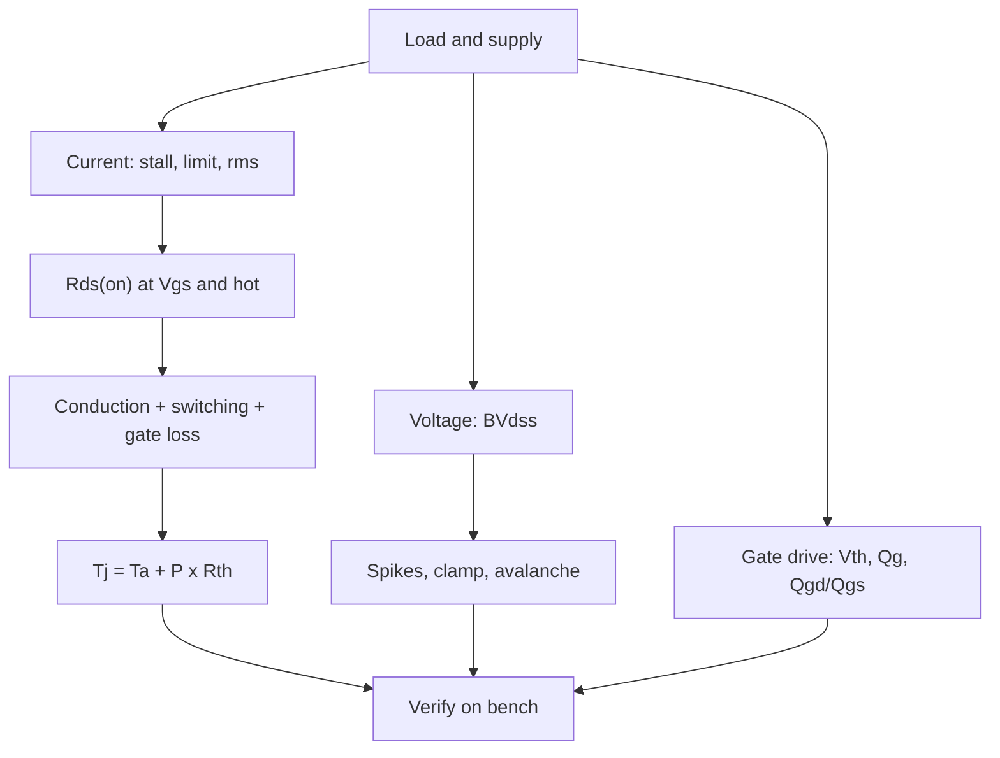

::: basics
### In plain words
Picking a separate (discrete) power transistor means working from the circuit to the datasheet. The voltage rating must survive the supply plus the spike when the coil switches off. The current rating comes from stall or the current limit, but what really limits it is heat. That depends on its on-resistance, $R_{DS(on)}$, at your real gate voltage and temperature.

### Picture it
Think of choosing a rope to hang a load. It must survive the jerk when the load drops, not just the still weight: that is the voltage rating against the spike. A rope rated at room temperature may weaken in a hot shed, just as $R_{DS(on)}$ rises when hot. And a strong rope can be too stiff for your pulley: a transistor whose gate your driver cannot charge quickly.

### Words you need
- **MOSFET**: the usual power transistor. Its gate is the control pin. When on, it acts as a small resistance.
- **Voltage rating**: the most voltage the switch can block when off.
- **Logic-level MOSFET**: one that turns fully on from a low gate voltage, such as 2.5 V or 4.5 V, so a microcontroller can drive it.
- **Gate charge**: the charge the driver must push into the gate to switch it. More charge means slower switching.
- **Thermal resistance**: degrees of warming per watt of loss.

### The simplest example
A 12 V motor runs at 5 A (rms, the heating-equivalent value), with a 15 A stall limit. A flyback diode holds turn-off spikes to 12.7 V, so a 40 V logic-level MOSFET has plenty of margin. If it has 10 mΩ at 25 °C, it has about 16 mΩ hot, so conduction loss is $5^2 \times 0.016 = 0.4$ W. Switching loss at 20 kHz is only about 0.06 W. With 50 °C/W of thermal resistance, that adds about 23 °C over the surroundings.

That is the whole idea: derive the part from the circuit. The rest of this page adds thermal feedback, gate-charge checks, safe operating limits, and bench verification.
:::

::: testing
Whether you can go from application requirements to a MOSFET (or BJT/IGBT) datasheet and pick the right numbers: voltage rating with margin for spikes, current from stall and inrush, $R_{DS(on)}$ at the *actual gate voltage and hot*, gate threshold and charge for the drive you have, thermal resistance and junction temperature, safe operating area and avalanche energy if there is no clamp, body-diode behaviour for bridges, and Miller immunity. A strong answer includes a worked example with power and temperature numbers and ends with how to verify.
:::

::: why
The transistor is where heat, voltage stress and switching loss meet. A part chosen by "30 V, 60 A, cheap" can still fail in a motor drive because the $R_{DS(on)}$ is specified at 10 V gate but you drive it with 3.3 V, or because the spike exceeds the rating, or because the real stall current melts it. In interviews this question separates people who have read a datasheet critically from those who pick by the headline numbers.
:::

::: concepts
- **Breakdown voltage $BV_{DSS}$**: must exceed supply plus spikes and clamp. See [[q0413]].
- **$R_{DS(on)}$ vs $V_{GS}$ and temperature**: spec at your gate voltage and hot. See [[q0409]].
- **Gate charge $Q_g$, $Q_{gd}$**: sets drive current, switching time and loss. See [[q0431]].
- **Thermal**: $T_j = T_a + P R_{\theta}$; $R_{DS(on)}$ rises with $T_j$.
- **SOA and avalanche (EAS)**: survival in linear mode and unclamped inductive switching.
- **Body diode**: freewheel conduction, $V_{SD}$, $t_{rr}$ and $Q_{rr}$ in bridges. See [[q0411]].
:::

::: answer
"I'd work from the load. Voltage: the drain must survive the supply plus the flyback clamp plus ringing, so I'd pick maybe twice the supply, a 40 volt part on a 12 volt rail, more if the clamp is a Zener or TVS. Current: not the running current but stall or the current limit, 12 amps of stall for a 12 volt, 1 ohm motor, or a 15 amp limit, so I'd choose a part with a continuous rating comfortably above that, though the real limit is heat.

Heat is where $R_{DS(on)}$ comes in. I'd look at $R_{DS(on)}$ at my actual gate voltage, which for a 3.3 or 5 volt drive means a logic-level part specified at 4.5 or 2.5 volts, and at hot temperature, which is around 1.5 times the room temperature value. Conduction loss is I squared R, then add switching loss, about a half V I times the rise and fall times times frequency, and gate-drive loss. Then junction temperature is ambient plus that power times the thermal resistance, and I'd keep it under about 125 degrees.

Other things: gate charge, so the driver can switch it fast, and a Miller ratio, the gate-drain charge over gate-source charge, so a drain edge doesn't turn it on. The safe operating area if I'll ever run it in linear mode, avalanche rating if I don't clamp, and the body diode for a bridge. Then I'd verify on the bench: waveforms for spikes and temperature at stall."
:::

::: technical
**Specification chain for a 12 V brushed motor (running 5 A rms, stall limit 15 A, 20 kHz PWM, 3.3 V gate drive via a gate driver at 5 V).**

1. **Voltage**: $BV_{DSS} \ge 1.5$ to $2\times(V_S + V_{spike})$. Flyback clamped by a diode: $V_S + 0.7 + \text{ringing}$ (a few volts) so 30 V would do, 40 V gives margin for hot-plug transients. With a 36 V Zener clamp: $12 + 36.7 = 48.7$ V, so $\ge 60$ V.
2. **Current**: continuous $I_D$ rating (at the case temperature, so derate) $\ge$ 15 A, pulsed rating above stall inrush, but sized by heat: $P = I_{rms}^2 R_{DS(on),hot}$.
3. **$R_{DS(on)}$**: at $V_{GS}$ actually applied (for 5 V drive, specified at 4.5 V; for 3.3 V, at 2.5 V or 3.3 V) and at $T_j$: $R_{hot} \approx R_{25}(1 + \alpha(T_j - 25))$ with $\alpha \approx 0.005$ to $0.007$ /K for silicon MOSFETs (about 1.5 to 1.7x at 125 °C). For $R_{25} = 10$ mΩ: 16 mΩ hot. Conduction loss at 5 A: $25\times0.016 = 0.4$ W.
4. **Switching loss**: $P_{sw} \approx \tfrac12 V I (t_r + t_f) f = 0.5\times12\times5\times100\text{ ns}\times20\text{ kHz} = 0.06$ W; gate drive: $Q_g V_g f = 20\text{ nC}\times5\times20\text{ k} = 2$ mW; $C_{oss}$ loss $\tfrac12C_{oss}V^2f$ (about 0.7 mW for 500 pF at 12 V).
5. **Gate**: threshold $V_{th}$ (min and max over temperature; drops with $T_j$) must be well below the drive; $V_{GS(max)}$ above the drive and any overshoot (±20 V typical). Total $Q_g$ and $Q_{gd}$ set the edge time: $t \approx Q/I_g$; $Q_{gd} = 5$ nC with 0.1 A gives 50 ns.
6. **Miller immunity**: $Q_{gd}/Q_{gs} < 1$ (rule of thumb) so a rising drain doesn't pull the gate over threshold; $C_{rss}\,\mathrm{d}v/\mathrm{d}t$ current times the off-state gate resistance should stay below $V_{th}$.
7. **Thermal**: $R_{\theta JC}$ (junction to case/pad) and the PCB $R_{\theta JA}$; $T_j = T_a + P R_{\theta}$ including the $R_{DS(on)}$-temperature feedback.
8. **SOA / avalanche**: if the FET ever operates in linear mode (slow edges, linear speed control, soft-start) check the SOA curves at the relevant pulse width and temperature (the 25 °C curve is optimistic; many modern low-$R_{DS(on)}$ trench parts have poor linear-mode SOA). If there is no clamp, check unclamped inductive energy $E = \tfrac12 L I^2$ against $E_{AS}$ (single-pulse avalanche energy), derated for temperature.
9. **Body diode**: forward drop $V_{SD}$ (0.7 to 1 V) conducts freewheel in a bridge during dead time; $Q_{rr}$ adds switching loss and shoot-through spikes when the opposite FET turns on. Low-$Q_{rr}$ parts or Schottky assist help at high frequency.
10. **Package and layout**: current capability of bond wires, thermal pad, source inductance (Kelvin source pin), creepage.
:::

::: short
"Voltage: at least twice the supply plus clamp, e.g. 40 V on a 12 V rail. Current: size from stall or the current limit, but the real limit is heat, so use hot $R_{DS(on)}$ at my actual gate voltage, which means logic-level for 3.3 or 5 V drive, and compute $I^2R$ plus switching and gate loss against thermal resistance. Then gate charge and the $Q_{gd}/Q_{gs}$ ratio for drive and Miller immunity, SOA or avalanche if unclamped, and the body diode for bridges."
:::

::: long
"I start from the load and work down the datasheet.

Voltage first. The FET must survive the supply plus whatever the flyback clamp allows plus ringing. With a plain diode on a 12 volt rail a 30 volt part is enough, but I'd use 40 volts for margin; with a 36 volt Zener clamp I'd want 60 volts or more.

Current: I size from the stall current or the current limit, not the running current. A 12 volt, 1 ohm motor stalls at 12 amps. But what really limits it is heat. I look at the $R_{DS(on)}$ at the gate voltage I'm actually applying, so for a 3.3 or 5 volt drive I want a logic-level part specified at 2.5 or 4.5 volts, and I use the hot value, about 1.5 times the 25 degree figure. Conduction loss is I squared R. For example 5 amps rms through 16 milliohms hot is 0.4 watts. Then I add switching loss, about half V I times rise plus fall time times frequency, which is 60 milliwatts at 20 kilohertz, and gate-drive loss, which is small. Junction temperature is ambient plus power times thermal resistance, and I remember $R_{DS(on)}$ rises with temperature, so I check for runaway at the highest current.

Then drive: gate charge sets how fast my driver can switch it, and the ratio of gate-drain to gate-source charge tells me whether a fast drain edge will turn it back on through the Miller capacitance. I check the safe operating area if it can ever be in linear mode, and the avalanche energy if I don't clamp. For a bridge I look at the body diode drop and reverse-recovery charge.

Finally, I verify on the bench: spike amplitude at the drain, gate waveforms and temperature at stall."
:::

::: terms
- **$BV_{DSS}$**: drain-source breakdown voltage.
- **$R_{DS(on)}$**: on-resistance at a specified $V_{GS}$ and temperature.
- **$Q_g$, $Q_{gd}$, $Q_{gs}$**: total, gate-drain (Miller) and gate-source charge.
- **$V_{GS(th)}$**: gate threshold voltage.
- **SOA**: safe operating area; allowed $V_{DS}$-$I_D$ combinations versus pulse width.
- **$E_{AS}$**: single-pulse avalanche energy rating.
- **$R_{\theta JC}$ / $R_{\theta JA}$**: junction-to-case/ambient thermal resistance.
- **$Q_{rr}$**: body-diode reverse-recovery charge.
:::

::: exceptional
An average answer says "voltage rating, current rating, $R_{DS(on)}$". An exceptional answer:

- **Chains requirements**: voltage from supply + clamp + ringing; current from stall; $R_{DS(on)}$ at actual $V_{GS}$ and hot.
- Computes **conduction, switching and gate losses** and the resulting $T_j$ with the $R_{DS(on)}$-temperature feedback.
- Knows **$Q_g$/$Q_{gd}$/Miller immunity** and the **logic-level** threshold pitfalls.
- Mentions **SOA and avalanche** (and that a clamp removes the avalanche requirement) and the **body diode** for bridges.
- Ends with **bench verification** (spike, gate and thermal checks at stall).
:::

::: mistakes
- **Using the headline $I_D$ rating.** It assumes a 25 °C case temperature and infinite heat sinking. Compute heat from $R_{DS(on)}$.
- **$R_{DS(on)}$ spec at 10 V for a 3.3 V drive.** At 3.3 V the FET may be barely on. Check the table or curve at your $V_{GS}$.
- **Using 25 °C $R_{DS(on)}$.** Hot resistance is 1.5 to 1.7x higher.
- **Ignoring spikes.** Drain ringing can exceed the supply by 50% or more; pick $BV_{DSS}$ accordingly and verify with a scope.
- **Running a trench FET in linear mode** (slow ramp, linear speed control) without checking SOA. Hot spots can destroy it.
- **Neglecting threshold drift.** $V_{th}$ falls with temperature, so a FET with low $V_{th}$ can turn on from noise when hot.
- **Over-sizing the FET** (very low $R_{DS(on)}$): higher $Q_g$ and $C_{oss}$ means more switching loss and a stronger driver. Optimise, don't maximise.
:::

::: deep
## Start from the load and the circuit

Requirements first (example): 12 V brushed motor, $R = 1\ \Omega$ (stall 12 A), running at 5 A rms, current limit at 15 A (the stall current itself reaches 14.4 A on a 14.4 V charging rail, more with a cold winding), 20 kHz PWM, flyback via a diode, MCU 3.3 V with a gate driver delivering 5 V, ambient to 60 °C, thermal resistance of the PCB footprint $R_{\theta JA} = 50$ °C/W.


Figure: The specification chain. Each datasheet number answers a specific question about the circuit; the end is a bench test that closes the loop.

## Voltage rating

Peak drain voltage = supply + clamp voltage + overshoot. With a flyback diode the clamp is $V_f \approx 0.7$ V, but real layouts add ringing from loop inductance: overshoot of 20% to 50% of the supply is common in unoptimised boards, i.e. a few volts to 6 V on 12 V. A 30 V part is therefore the absolute minimum; 40 V gives margin for hot-plug transients. If you use a Zener/TVS clamp for fast release ([[q0415]]), add the clamp voltage ($12 + 36.7 = 48.7$ V so a 60 V part). Lower $BV_{DSS}$ means lower $R_{DS(on)}$ per area and less cost, so don't over-margin by factors of 5.

## Current: stall defines the stress, heat defines the rating

Stall current at 12 A flows if the shaft is locked. If the drive limits to 15 A, the FET sees up to 15 A pulses: the datasheet's pulsed-current rating (single pulse, specified pulse width) and SOA matter, and the average $P = I^2R$ determines temperature. Continuous rating "$I_D$ = 60 A" assumes the case at 25 °C. On a PCB the realistic continuous current is set by thermal resistance. Always compute:

$$P_{cond} = I_{rms}^2\,R_{DS(on)}(T_j,V_{GS})$$

## $R_{DS(on)}$ versus gate voltage and temperature

The datasheet's headline $R_{DS(on)}$ is often at $V_{GS} = 10$ V. At 4.5 V the number may be 20 to 40% higher; at 2.5 V higher still; at 3.3 V a part that is not logic-level might not conduct properly. Look at the $R_{DS(on)}$ vs $V_{GS}$ curve and the table rows.

Temperature: silicon MOSFET on-resistance increases roughly linearly with $T_j$, with a coefficient of about 0.5 to 0.7% per kelvin (hence 1.5 to 1.7x at 125 °C). This creates a positive feedback loop: more heat, more resistance, more heat. Solve it self-consistently:

$$T_j = T_a + \theta\,I^2R_{25}\,[1 + \alpha(T_j - 25)] \;\Rightarrow\; T_j = \frac{T_a + \theta I^2R_{25}(1 - 25\alpha)}{1 - \theta I^2R_{25}\alpha}$$

which diverges when $\theta I^2R_{25}\alpha = 1$, i.e. at $I = \sqrt{1/(\theta R_{25}\alpha)}$. For $R_{25} = 10$ mΩ, $\theta = 50$ °C/W and $\alpha = 0.006$ that is 18.3 A.

```plot
{"title":"Junction temperature vs current: with and without the Rds(on)-temperature feedback","x":{"label":"RMS current","unit":"A","min":0,"max":17},"y":{"label":"Junction temperature","unit":"°C","min":50,"max":300},
 "vars":{"th":50,"r":0.01,"a":0.006,"ta":60},
 "series":[{"label":"naive: cold Rds(on)","fn":"ta+th*x*x*r","color":"muted","dashed":true},{"label":"self-consistent (Rds rises with Tj)","fn":"(ta+th*x*x*r*(1-25*a))/(1-th*x*x*r*a)","color":"red"}],
 "hlines":[{"at":150,"label":"150 °C","color":"orange"}],
 "points":[{"x":5,"y":76.4,"label":"5 A: 76 °C"},{"x":10,"y":146.4,"label":"10 A: 146 °C"}]}
```
Figure: At the 5 A running current the FET sits at 76 °C. The naive calculation with cold $R_{DS(on)}$ underestimates temperature, increasingly so above 8 A (92 °C naive versus 108 °C real). Near 18 A thermal runaway makes the temperature diverge: the real limit is much lower than a datasheet current rating suggests. Illustrative parameters; the thermal resistance depends on copper area.

## Switching and gate losses

At 20 kHz the switching loss of the example is small:

- **Overlap loss**: $\tfrac12 V I (t_r + t_f) f = 0.06$ W (100 ns total).
- **$C_{oss}$ loss**: $\tfrac12 C_{oss}V^2 f \approx \tfrac12\times500\text{ pF}\times144\times20\text{ k} = 0.7$ mW (at 12 V) so negligible.
- **Gate drive**: $Q_gV_gf = 2$ mW.

At 200 kHz these are 10 times higher; see [[q0418]].

## Gate characteristics

Check:
- **$V_{GS(th)}$ min/max**: the minimum value (hot) must be above worst-case gate noise when off; the maximum (cold) must be well below the drive when on.
- **$V_{GS(max)}$**: ±20 V typical; check that gate drive plus overshoot is within it (some logic-level parts allow only ±8 or ±12 V).
- **$Q_g$ (total), $Q_{gd}$ (Miller), $Q_{gs}$**: $Q_g$ at your drive voltage decides the drive power and edge time: $t_{edge} \approx Q_{gd}/I_{g,plateau}$. With a 5 V driver and a 3 V plateau, $R_g = 10\ \Omega$ gives $I_g = 0.2$ A, so 5 nC takes 25 ns.
- **Miller ratio $Q_{gd}/Q_{gs}$**: a rule-of-thumb figure of merit; below 1 gives better immunity to $\mathrm{d}v/\mathrm{d}t$-induced turn-on.

```sim
{"id":"gate-drive","vdrive":5,"rg":10,"qg":20e-9,"lg":10e-9,"vth":1.5}
```
Figure: Raise or lower $R_g$ and watch the Miller plateau, the switching losses and the ringing. A small $R_g$ gives fast edges and visible gate ringing if loop inductance is high; a large $R_g$ is slow and lossy. Setting $V_{drive}$ to 3.3 V shows the plateau squeezed toward the threshold.

## SOA, avalanche and the body diode

- **SOA**: the plot of allowed $V_{DS}$ and $I_D$ for various pulse widths. Needed when the FET spends time in saturation: slow soft-start, linear current limiting, or a stalled motor under current limit where the FET shares the voltage. Trench MOSFETs optimised for low $R_{DS(on)}$ have a pronounced thermal instability in linear mode (they lose SOA at low $V_{GS}$ and high $V_{DS}$), so for linear-mode operation pick parts specified for it.
- **Avalanche**: if you rely on the FET's own breakdown to clamp (not recommended for repeating events), $E_{AS}$ must exceed $\tfrac12 LI^2$: for a 10 mH, 1 A load, 5 mJ. Datasheet $E_{AS}$ ratings are single-pulse at a stated starting temperature, usually 25 °C, and derate strongly with temperature and repetition.
- **Body diode**: in a bridge, $V_{SD}$ (0.7 to 1 V) conducts during dead time; $Q_{rr}$ is the charge to sweep out when the opposite FET turns on, a loss and a spike source. For 12 V motor drives it is minor; at higher frequency or voltage it matters (GaN has no body-diode recovery).

## Choosing between candidates: figures of merit

For switching applications, $R_{DS(on)}\times Q_g$ (or $\times Q_{gd}$) is a quick figure of merit: low resistance versus low switching charge. A lower $R_{DS(on)}$ part has a larger die, so higher $C_{oss}$, $Q_g$ and cost. At 20 kHz conduction dominates, so pick lower $R_{DS(on)}$; at 500 kHz switching dominates, pick lower $Q_g$.

## BJT and IGBT notes

For a BJT: $V_{CEO}$ rating, $I_C$ with $h_{FE}$ at that current and temperature (forced beta about 10 for saturation), $V_{CE(sat)}$, storage time, SOA (second breakdown), and base drive. For an IGBT: $V_{CES}$, $V_{CE(sat)}$ at the operating current, $E_{on}/E_{off}$, short-circuit withstand time, and a co-packaged diode. See [[q0414]].

## Verification on the bench

1. Probe drain-source at turn-off with a short ground spring: peak $V_{DS}$ below 80% of $BV_{DSS}$.
2. Probe gate-source: no overshoot beyond $V_{GS(max)}$, no false turn-on during the opposite switch's edge.
3. Measure case temperature (thermocouple or IR camera) at stall with the current limit, over 10 minutes or until stable.
4. Check start-up and cold-hot extremes; cold raises $V_{th}$, hot lowers it.
:::

::: applications
- **12 V brushed motor drives in cars and robots**: 30 to 60 V trench MOSFETs with milliohm $R_{DS(on)}$.
- **Solenoid valve drivers**: 60 to 100 V MOSFETs when Zener clamps are used for fast release.
- **Cordless tool and e-bike drives (24 to 72 V)**: 80 to 150 V MOSFETs in paralleled arrays.
- **Fan and pump controllers**: logic-level SO-8 or DPAK MOSFETs on 3.3 V PWM.
- **Automotive low-side drivers**: MOSFETs with integrated clamp (self-protected) or external Zener clamps.
- **Mains motors (230 V)**: 600 V superjunction MOSFETs or IGBTs ([[q0414]]).
:::

::: assumptions
- A **silicon N-channel MOSFET** in a **low-side or half-bridge** drive of a DC load; GaN, SiC, BJTs and IGBTs follow similar logic with different parameters.
- **PWM at 20 kHz** and a **diode or low clamp**; high-frequency or high-voltage designs shift the emphasis to switching losses and $Q_{rr}$ ([[q0418]]).
- **Temperature coefficients** (0.5 to 0.7%/K), $R_{\theta JA}$ and parasitics are typical values; check the datasheet and measure.
- The **illustrative numbers** (10 mΩ, $Q_g$ = 20 nC, $R_{\theta JA}$ = 50 °C/W) don't correspond to a specific part.
- Layout effects (source inductance, loop area, Kelvin connections) are treated in the PCB section.
:::

::: followups
### Why can a 100 A-rated MOSFET fail at 20 A?
The 100 A rating is derived from $\sqrt{(T_{j,max} - 25)/(R_{\theta JC}R_{DS(on),hot})}$ with the case held at 25 °C by an ideal heat sink. On a PCB the thermal resistance is much larger; at 20 A with a 16 mΩ hot $R_{DS(on)}$ the FET dissipates 6.4 W, which at $R_{\theta JA} = 50$ °C/W is a 320 °C rise: far beyond any junction limit. Also package limits (bond wires) and SOA apply. Compute from heat.

### How do you pick the gate resistor and driver for the FET?
Choose the edge speed from the loss versus EMI/overshoot trade-off: $t \approx Q_{gd}/I_g$ with $I_g = (V_{drive} - V_{plateau})/R_g$. A 10 Ω resistor with a 5 V driver and 3 V plateau gives about 200 mA, so 5 nC switches in 25 ns. Check gate ringing and $\mathrm{d}v/\mathrm{d}t$ on a scope, and make the turn-off path low impedance (smaller turn-off resistor or diode) to avoid Miller turn-on ([[q0431]]).

### When does the SOA curve matter for a motor drive?
When the FET operates in the linear region: slow soft-starts, linear speed control, active current limiting (a stalled motor with a linear limiter), or if the gate drive is too weak and it switches slowly. In ordinary hard-switched PWM with fast edges, the time in saturation is nanoseconds and SOA doesn't limit, except at short-circuit or stall events.

### What makes a MOSFET "logic-level"?
A low and tightly specified threshold, and $R_{DS(on)}$ guaranteed at low $V_{GS}$ (4.5 V or 2.5 V). A standard-level part is specified at 10 V; at 3.3 V it may have 5 to 10 times the resistance or be nearly off. Always read the $R_{DS(on)}$ table at your drive voltage and hot.

### What if the MOSFET has a much lower $R_{DS(on)}$ than needed: any downside?
A larger die with more gate charge and output capacitance: higher switching and gate-drive loss, slower edges for the same driver, more cost and sometimes a worse Miller ratio. At 20 kHz this barely matters, at higher frequencies it does. Choose the lowest total loss, not the lowest $R_{DS(on)}$.
:::

::: interpretations
"Spec your transistors" is taken to mean selecting a **power MOSFET** (the most common discrete choice for DC motor and solenoid drives) with notes on BJTs and IGBTs. The companion question for a packaged driver is [[q0416]]; the choice between switch technologies is [[q0414]]; switching-frequency limits in [[q0418]].
:::

::: references
- Sedra & Smith, *Microelectronic Circuits*: MOSFET characteristics and switching behaviour.
- Mohan, Undeland & Robbins, *Power Electronics*: power MOSFET parameters, switching losses and gate drive.
- Manufacturer power-MOSFET datasheets and application notes on SOA, avalanche rating and gate charge interpretation (check Infineon, onsemi, Vishay and others for current documents).
- JEDEC standards on thermal measurement (JESD51 series) and MOSFET ratings.
:::

::: rubric
- Chooses $BV_{DSS}$ from supply, clamp and ringing with margin :: Avoids the most destructive failure.
- Sizes current from stall/limit and checks heat, not the headline rating :: Shows thermal-first thinking.
- Uses $R_{DS(on)}$ at the actual $V_{GS}$ and hot :: A classic datasheet trap.
- Estimates conduction, switching and gate-drive losses and $T_j$ :: Quantitative design.
- Considers threshold, $V_{GS(max)}$, $Q_g$, $Q_{gd}/Q_{gs}$ and Miller :: Gate-drive compatibility.
- Mentions SOA, avalanche/clamp and body diode :: Robustness details.
- Verifies on the bench :: Closes the design loop.
:::

::: quiz
```json
[
 {"type":"numeric","level":"fundamental","q":"A FET has $R_{DS(on)}$ = 10 mΩ at 25 °C and about 1.6x that when hot. It carries 5 A rms. What is the conduction loss when hot?","answer":0.4,"tolerance":0.03,"unit":"W","explain":"$R_{hot} = 16$ mΩ; $P = 25\\times0.016 = 0.4$ W."},
 {"type":"mcq","level":"fundamental","q":"You drive a FET gate from 3.3 V. Which datasheet entry matters most?","options":["$R_{DS(on)}$ at $V_{GS} = 10$ V","$R_{DS(on)}$ at $V_{GS} = 2.5$ V or 3.3 V","$V_{GS(max)}$ only","The 25 °C continuous current"],"answer":1,"explain":"The device must be fully enhanced at the gate voltage you actually provide. The 10 V figure may be much lower than reality at 3.3 V."},
 {"type":"numeric","level":"intermediate","q":"A 12 V rail with a flyback path clamped at 36.7 V above the supply. What minimum $BV_{DSS}$ would you choose (round up to a standard rating)?","answer":60,"tolerance":0.01,"unit":"V","explain":"$V_{DS,peak} = 12 + 36.7 = 48.7$ V; with margin choose the next standard rating, 60 V."},
 {"type":"numeric","level":"intermediate","q":"Estimate switching loss: 12 V, 5 A, $t_r + t_f = 100$ ns, 20 kHz, using $\\tfrac12 VI(t_r+t_f)f$.","answer":0.06,"tolerance":0.03,"unit":"W","explain":"$0.5\\times12\\times5\\times100\\times10^{-9}\\times20{,}000 = 0.06$ W."},
 {"type":"truefalse","level":"advanced","q":"Because $R_{DS(on)}$ rises with temperature, a MOSFET's self-heating is a positive feedback that can lead to thermal runaway at high enough current.","answer":true,"explain":"More current gives more heat, more $R_{DS(on)}$, more heat. The temperature diverges when $\\theta I^2R_{25}\\alpha \\ge 1$. Practical designs stay far below that point."},
 {"type":"multi","level":"advanced","q":"Select all checks needed if the MOSFET might spend time in linear mode (slow ramp or linear limiter).","options":["Safe operating area at the pulse width and temperature","Single-pulse avalanche energy only","Thermal resistance and $T_j$","Body-diode reverse recovery only"],"answer":[0,2],"explain":"Linear-mode operation dissipates $V_{DS}I_D$ in the channel; SOA and thermal limits govern. Avalanche and $Q_{rr}$ relate to other events."}
]
```
:::
