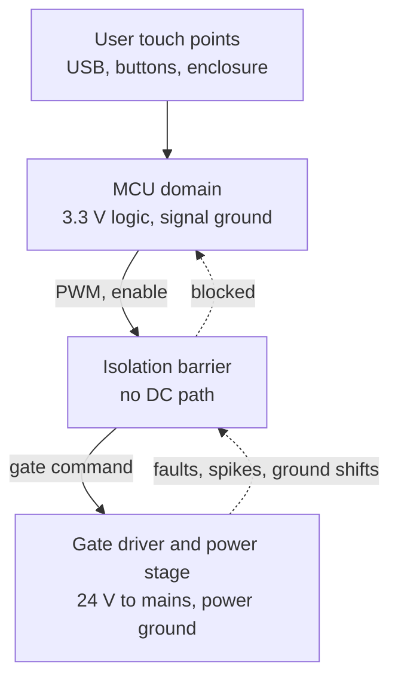

::: testing
Whether you can justify isolation as an engineering decision, not a reflex. The interviewer expects reasons grouped by type, numbers where possible, and the cost side:

1. **Safety**: keeping hazardous voltage away from people and from low-voltage logic.
2. **Protection**: a failed power stage must not take the MCU and everything connected to it with it.
3. **Signal integrity and ground**: shared return currents and switching noise shift the MCU's ground; isolation breaks the loop.
4. **Level shifting and floating references**: bridges and sensors that sit at a different or moving potential.
5. **Trade-offs**: cost, board area, delay, power, data rate, wear-out, common-mode noise through the barrier capacitance, creepage and clearance.
:::

::: why
Isolation is how real products meet safety standards and survive faults. It is also expensive and annoying, so you want to know when it is mandatory (mains-powered, medical, industrial), when it is useful (noisy motors, floating sensors), and when it is unnecessary (a 12 V robot with a single battery). Being able to put numbers on the benefits and costs, for example 1 V of ground bounce versus a 50 mA CMTI current, is what separates a considered answer from "because safety".
:::

::: concepts
- **Ground reference and return paths**: all currents return to their source; shared returns create shared voltage ([[q0001]], [[q0004]]).
- **Ground bounce**: $v=L\,di/dt$ on the shared return ([[q0011]]).
- **Galvanic isolation**: no DC conduction path across the barrier ([[q0436]]).
- **Isolation devices**: optocouplers, digital isolators, transformers ([[q0433]], [[q0434]]).
- **Common-mode transient immunity**: the barrier capacitance conducts dv/dt ([[q0436]]).
- **Fault propagation**: a shorted FET can place the motor rail on the gate and the MCU pin ([[q0429]]).
:::

::: answer
"Isolation is important for safety, protection and noise.

Safety is the first one: if the power side has mains or even 48 volts and a person can touch the low-voltage side, like a USB port or a button, then a fault must not connect them. That's the legal and standards-driven reason for isolating, with specified creepage and clearance and a rated barrier voltage.

Second is protection. In a motor drive, if a MOSFET fails short it can put the full motor supply on the gate, and through the gate resistor onto the MCU pin. A 3.3 volt microcontroller won't survive 24 volts. An isolation barrier keeps the failure confined to the power side.

Third is noise and ground. If the motor current returns through the same ground trace as the microcontroller, then every PWM edge puts voltage on that shared return: 10 amps stepping in 100 nanoseconds through 10 nanohenries is a volt. That shifts the MCU's ground relative to its signals and corrupts ADC readings and logic levels. Isolation lets the two grounds float relative to each other. It also handles floating references, like a high-side driver or a current sensor on a switching node.

The trade-offs are cost, board area, and the need for an isolated power supply on one side. There's propagation delay and limited bandwidth, which matters for fast control loops, and wear-out for optocouplers because the LED ages. The barrier has capacitance, so fast common-mode transients still couple across, which is why the common-mode transient immunity spec matters. And you need to respect creepage and clearance on the PCB. So I'd isolate when there's a safety requirement, a hazardous voltage, or a really noisy or floating power stage, and not when a well-laid-out ground and a single low-voltage supply will do."
:::

::: technical
**Reasons, with numbers.**

| Reason | Mechanism | Example |
|---|---|---|
| Safety | Barrier rated for working and fault voltages; creepage/clearance on the PCB | Mains-powered appliance, medical equipment, 48 V+ industrial |
| Fault containment | A shorted FET connects the power rail to the gate and driver pin | 24 V on a 3.3 V GPIO (abs max about 4 V) destroys the pin |
| Ground bounce | Shared return carries switching current: $v=L\,di/dt+IR$ | 10 A in 100 ns through 10 nH: 1 V; 10 A through 5 mΩ: 50 mV DC offset |
| Floating references | Gate drive and sensing at a moving node | High-side driver at 600 V switching node; shunt on a motor phase |
| Ground loops | Two grounds joined by a long cable form a loop that picks up noise | Sensors on a separate machine frame |

**Trade-offs.**

| Cost | Details |
|---|---|
| Money and board area | Isolator IC, isolated DC-DC converter or bootstrap alternative, extra creepage slots |
| Power | Both sides need supplies; opto LEDs draw mA; isolated DC-DC has 60 to 80% efficiency |
| Delay and speed | Optocouplers: hundreds of ns to µs and slower; digital isolators: tens of ns typical *(device-specific)* |
| Skew and jitter | Matters for dead time and PWM resolution |
| Reliability | LED aging reduces CTR in optocouplers; barrier lifetime specs for high voltage |
| EMI/CMTI | Barrier capacitance $C_{iso}$ (about 1 pF) conducts common-mode dv/dt: $I=C_{iso}\,dv/dt$ |
| Complexity | More parts, more supplies, startup and fault states on each side |

**Common-mode transient current.** $I=C_{iso}\,\dfrac{dv}{dt}$. For $C_{iso}=1$ pF: 10 V/ns gives 10 mA, 50 V/ns gives 50 mA, 100 V/ns gives 100 mA. If the receiver cannot reject that, it produces glitches: so isolators are rated for **CMTI** (kV/µs).

**Barrier impedance.** $|Z|=1/(2\pi fC_{iso})$: 1 pF at 100 MHz is 1.6 kΩ; at 1 MHz it is 159 kΩ; at DC infinite. High-frequency common-mode noise passes more easily than DC or 50/60 Hz.

> [!UNCERTAIN]
> Isolator delay, CMTI, working-voltage and surge ratings vary widely by technology and vendor. The ranges quoted are typical orders of magnitude; read the datasheet and the applicable safety standard for the real numbers.
:::

::: short
"Isolation matters for safety (keeping hazardous voltage away from people and logic), for protection (a shorted FET can't put the motor rail on the MCU pin), and for noise, because switching current on a shared ground shifts the MCU's reference by volts. It also gives floating references for high-side drives and sensors. The trade-offs are cost, area, an isolated power supply, delay and limited bandwidth, optocoupler aging, and the barrier's capacitance, which still passes fast common-mode transients, so I'd choose by CMTI, speed and voltage rating."
:::

::: long
"There are four reasons I'd give for isolation, and then the costs.

The first is safety. If the power side has mains, or even 48 volts, and a person can touch the logic side, say through a USB port, a button or a connector, a single fault must not connect them. Standards specify the barrier's working voltage, creepage and clearance. That's often the deciding reason, and it's not negotiable.

The second is protection. In a motor drive a MOSFET can fail short and put the motor supply on its gate, then through the gate resistor onto the microcontroller pin. A 3.3 volt MCU doesn't survive 24 volts. An isolation barrier confines that fault to the power side.

The third is noise and ground. If motor current shares a ground trace with the microcontroller, PWM edges put voltage on it. Ten amps stepping in 100 nanoseconds through 10 nanohenries of trace is a volt, and it shifts the MCU's ground relative to its analog and logic signals. Even DC resistance matters: 10 amps through 5 milliohms is 50 millivolts of ADC error. Isolation lets the two grounds float relative to each other and breaks ground loops.

The fourth is floating references, like the gate drive of a high-side FET or a current sensor at the switching node, which are at a different or moving potential.

The trade-offs: cost and area, since I need the isolator and often an isolated supply for the far side. Delay and bandwidth: optocouplers are hundreds of nanoseconds to microseconds, digital isolators faster, and this affects dead time and control loops. Optocouplers age because the LED degrades. The barrier has about a picofarad of capacitance, so a 50 volt per nanosecond edge still pushes 50 milliamps across, which is why I check the common-mode transient immunity spec. And I have to respect creepage and clearance on the layout. So I isolate for safety, hazardous or very noisy power stages, and floating signals, and I don't when a low-voltage, single-supply system with good grounding will do."
:::

::: terms
- **Galvanic isolation**: no DC electrical path between two circuits ([[q0436]]).
- **Isolation barrier rating**: working and withstand voltage the barrier is certified for.
- **Creepage and clearance**: surface and air distances between conductors for safety.
- **CMTI**: common-mode transient immunity, the maximum $dv/dt$ across the barrier without error, in kV/µs.
- **Ground bounce**: voltage on a shared return caused by $L\,di/dt$ and $IR$.
- **Ground loop**: a loop formed by two ground connections; picks up noise.
- **Isolated supply**: a DC-DC converter with a transformer that powers the far side of an isolator.
- **Working voltage**: the maximum continuous voltage across the barrier.
:::

::: exceptional
**An average answer** says "for safety and to protect the microcontroller".

**An exceptional answer**:
- Splits the reasons: safety, fault containment, ground noise, floating references.
- Quantifies ground bounce ($L\,di/dt$ and $IR$) and the 24 V-on-a-3.3 V-pin failure.
- Lists the trade-offs with specifics: isolated supply, delay, bandwidth, aging, $C_{iso}$ and CMTI, creepage.
- Gives the decision rule: mandatory for hazardous voltage, helpful for noisy power stages, unnecessary for single low-voltage supplies with careful grounding.
- Notes that isolation is not magic: barrier capacitance, shared shields and a long ground-loop cable can still reintroduce coupling.
:::

::: mistakes
- **"Isolation removes all noise."** It blocks DC and low-frequency ground loops, but $C_{iso}$ passes high-$dv/dt$ common-mode noise.
- **Isolating the signal but not the power.** Without an isolated supply on the far side the barrier is bypassed.
- **Forgetting creepage/clearance on the PCB.** A great isolator is useless if copper on both sides is 1 mm apart.
- **Choosing a slow optocoupler for a fast PWM.** Propagation delay and skew eat the dead time.
- **Isolating by reflex** in a 12 V single-battery robot where the cost and complexity buy nothing.
:::

::: deep
## What isolation separates


Figure: The barrier carries the intent (PWM, enable) one way and fault status the other, while blocking DC and low-frequency energy. User-accessible parts sit on the safe side.

An isolation barrier divides the system into two **domains** with separate ground references. Information crosses by light, magnetic field or electric field, not by wire. Each domain needs its own supply, so a signal isolator is usually paired with an isolated DC-DC converter or, for a gate drive, a bootstrap or a dedicated supply ([[q0433]], [[q0434]]).

## Reason 1: Safety

If a product connects to mains or to a battery pack above about 60 V DC, a single fault must not place hazardous voltage on anything a user can touch. Standards for product safety define **basic** insulation (one layer), **double** or **reinforced** insulation (two layers or one equivalent layer) and the creepage and clearance needed for a given working voltage and pollution degree ([[q0433]]). Isolators carry ratings such as "withstand 3 to 5 kVrms for 1 minute" and a working-voltage rating; the standard decides which you need.

> [!UNCERTAIN]
> The exact clause numbers and voltage thresholds depend on the product standard (for example IEC 62368-1 for information and communication equipment, IEC 60601-1 for medical equipment). Treat them as design-input requirements to be confirmed with the applicable standard and a safety engineer.

## Reason 2: Fault containment

Think of the failure chain in the circuit of [[q0429]]: the FET fails short drain-to-gate (a classic overstress failure), so the 24 V rail appears at the gate. Through $R_g$ the pin is now driven to 24 V against a 3.3 V part with an absolute maximum of about 4 V. The pin's ESD structure conducts, the supply rail through the MCU's own protection diode carries the fault current, and the MCU, any USB host or programmer connected to it, and the computer attached to *that* may be damaged. A barrier makes the fault local: a failed power stage costs a driver board, not the controller and the lab.

## Reason 3: Ground bounce and ground loops

```plot
{"title":"Ground bounce on a shared return: V = L·di/dt (10 A step)","x":{"label":"current rise time","unit":"s","min":1e-8,"max":1e-6,"log":true},"y":{"label":"voltage on shared ground","unit":"V","min":0.01,"max":100,"log":true},
 "vars":{"i":10},
 "series":[{"label":"L = 1 nH","fn":"1e-9*i/x","color":"green"},{"label":"L = 10 nH","fn":"1e-8*i/x","color":"accent"},{"label":"L = 100 nH","fn":"1e-7*i/x","color":"red"}],
 "points":[{"x":1e-7,"y":1,"label":"10 nH, 100 ns: 1 V"}]}
```
Figure: A 10 A current step through 10 nH of shared return produces 1 V in 100 ns, a hundred times the noise margin of an ADC reading. Faster edges or more inductance make it worse. The DC part adds $IR$: 10 A through 5 mΩ is 50 mV.

Isolation moves the *signal* reference away from the *power* return. A star-connected or well-planed shared ground can often manage the same problem in a low-power product; isolation is the heavy hammer when it can't.

Ground loops are the low-frequency cousin: two grounds connected by a long cable form a loop that picks up magnetic fields and carries unwanted current. Isolating the signal at one end breaks the loop.

## Reason 4: Floating and moving references

A high-side switch's gate drive is referenced to the switch node, which moves hundreds of volts in nanoseconds. A shunt on a motor phase is at the phase voltage. A thermocouple or a voltage sense may be at an unknown potential relative to the controller. Each needs **isolated** (or level-shifted) signal transfer. Below about 50 V, bootstrap drivers and level shifters do this without galvanic isolation; above, or when safety requires it, an isolated gate driver with its own floating supply is used ([[q0427]]).

## The barrier is not perfect: $C_{iso}$ and CMTI

The barrier is a capacitor across which common-mode voltage can still push current:

$$I_{cm}=C_{iso}\frac{dv}{dt}.$$

| $dv/dt$ | $I_{cm}$ for 1 pF |
|---|---|
| 10 V/ns | 10 mA |
| 50 V/ns | 50 mA |
| 100 V/ns | 100 mA |

A receiver must reject that current without glitching: the **CMTI** spec (kV/µs) says how fast a common-mode edge it tolerates. Modern wide-bandgap switching, with 50 to 100 V/ns edges, needs isolators with CMTI well above 100 kV/µs (device-specific; check the datasheet). The impedance of the barrier falls with frequency: $|Z|=1/(2\pi fC_{iso})$ is 159 kΩ at 1 MHz and 1.6 kΩ at 100 MHz for 1 pF, so fast noise still crosses.

## The trade-off table

| Aspect | What you give up | Mitigation |
|---|---|---|
| Cost / area | Isolator, isolated supply, creepage slots, extra connectors | Integrated isolated gate drivers, digital isolators with integrated DC-DC |
| Power | Two supplies; opto LED current; 60 to 80% isolated DC-DC efficiency | Low-power isolators, run the far side from the power rail |
| Speed | Optocoupler tens of µs worst case or hundreds of ns for fast types; digital isolators tens of ns *(typical, device-specific)* | Choose by delay and skew; compensate dead time |
| Reliability | Optocoupler CTR aging, temperature drift | Design for end-of-life CTR with margin ([[q0434]]) |
| EMI | $C_{iso}$ couples common-mode noise | Low-$C_{iso}$ parts, shielding, common-mode choke |
| Layout | Creepage/clearance, no copper under the barrier | Slots, spacing rules from the standard |

```sim
{"id":"opto-isolator","vgpio":3.3,"rled":430,"ctr":0.5,"rpull":4700,"vcc":5}
```
Figure: An optocoupler channel is the simplest isolator. Lower $CTR$ (aging) and a larger pull-up and watch the low-level and rise-time behaviour: the price of isolation shows up as speed and margin.

## When to isolate and when not to

| Situation | Isolate? |
|---|---|
| Mains-powered product with a user-accessible port | Yes (safety) |
| Medical equipment | Yes, to the applicable standard |
| Industrial 24 V field wiring, long cables | Usually yes (surge, ground loops) |
| 48 V battery pack with BMS and communication | Often (hazard, noise) |
| Single 12 V battery robot, 3 A motors, compact board | Usually no: star ground, local decoupling |
| High-voltage inverter, GaN/SiC half-bridge | Yes, isolated gate drivers with high CMTI |
| Precision measurement near a switching converter | Often yes, or a differential/isolated amplifier |

The answer to "do I need it?" is a risk-and-requirement decision, not a default.

## A short example of a cost-benefit judgement

A 24 V, 10 A motor controller with a USB debug port and a 3.3 V MCU: no mains, so no safety isolation needed. But the 10 A ground return through 10 nH produces 1 V of bounce; if the MCU's ADC measures a 0 to 3.3 V sensor on the same plane, 1 V is a 30% error. Option A: lay out a star ground with the power return separate and a Kelvin connection to the sensor, no isolation, near-zero cost. Option B: isolate the PWM and the sensor. B is expensive but robust. I'd pick A for a 24 V board and B once there is mains or a safety rule.
:::

::: applications
- **Mains-powered appliances and power supplies**: reinforced isolation between line and user-accessible circuitry.
- **Medical devices**: patient-isolation requirements for equipment connected to people.
- **Industrial automation**: isolated digital and analog I/O, fieldbus transceivers (RS-485, CAN) in noisy environments.
- **Motor drives and inverters**: isolated gate drivers and isolated current/voltage sensing.
- **EV chargers and battery systems**: isolated communication and BMS interfaces at high voltage.
- **Test and measurement**: isolated front ends to avoid ground loops and protect the instrument.
:::

::: assumptions
- Discussion applies to MCU-to-power-stage interfaces; the reasoning also holds for sensors and communication buses.
- "Isolation" means galvanic isolation unless noted; level shifters and bootstrap are non-isolated alternatives for modest voltages.
- Example numbers (10 A step, 10 nH, $C_{iso}=1$ pF) are illustrative.
- Safety requirements depend on the product, the market and the applicable standard; they are inputs to the design, not choices.

If the interviewer says "low-voltage, single battery, no user access", the answer shifts to protection and grounding without isolation, plus an optional barrier for the noisiest signal.
:::

::: followups
### What if you can't afford isolation on the PWM signal?
Use clean grounding: separate power and signal returns joined at a single point, a Kelvin connection to the MCU ground, a series gate resistor, a gate pull-down, and clamping on the gate. Add a TVS or a clamp diode to the MCU pin and a fuse or current limit on the power side. This handles noise and many faults, though not a safety requirement.

### Does an optocoupler isolate against fast common-mode noise?
Only up to its CMTI. Its capacitance (about 0.5 to 2 pF) passes $C\,dv/dt$ current to the output phototransistor, which may cause false triggering at $dv/dt$ above tens of V/ns. Better optos and digital isolators have CMTI of 25 to 100+ kV/µs *(vendor-specific)*; also lower the pull-up impedance so a given coupled current gives less voltage.

### Why do you also need an isolated power supply?
Signals can cross by light or field, but the far-side circuit still needs power referenced to its own ground. If both sides share a supply, the barrier is bypassed. Use an isolated DC-DC, a transformer winding, or a supply derived from the power side.

### How does isolation affect a fast control loop?
The isolator's propagation delay and skew add to the loop delay and reduce phase margin. For a current loop at 50 kHz bandwidth, 100 ns is negligible; for GaN at MHz it is not. Also isolator jitter and part-to-part skew limit how short your dead time can be.

### What would you check on a board with an isolator that still shows noise?
The barrier capacitance path: the layout under the isolator (no copper crossing), the shield and chassis connections, the far-side supply's interwinding capacitance, cable shields tied to both sides, and whether the noise correlates with a $dv/dt$ edge, which points to the CMTI path.
:::

::: interpretations
"Why is isolation important?" is about *this* context, controlling a power stage from an embedded device ([[q0429]]); it is not about isolation of IC substrates or of ground planes on a PCB, though the vocabulary overlaps. The follow-on questions [[q0433]] (what kinds of isolation), [[q0434]] (optos), [[q0435]] (an optocoupler circuit) and [[q0436]] (galvanic isolation) split the topic, so this page concentrates on the *reasons* and the *trade-offs*.
:::

::: references
- IEC 62368-1 and IEC 60601-1 (product-safety standards; consult the current editions for insulation, creepage and clearance requirements).
- Horowitz & Hill, *The Art of Electronics*, 3rd ed.: grounding, ground loops and isolation (opto, transformer, capacitive).
- Henry Ott, *Electromagnetic Compatibility Engineering*: grounding and common-impedance coupling.
- Isolator and optocoupler datasheets and application notes (for example from Texas Instruments, Analog Devices, Skyworks/Silicon Labs, Broadcom): working voltage, CMTI and lifetime definitions.
:::

::: rubric
- Gives safety, protection, ground noise and floating-reference reasons :: The four standard answers.
- Quantifies at least one benefit (ground bounce, fault voltage) :: Shows engineering sense.
- Lists trade-offs: cost, area, isolated supply, delay, bandwidth, aging :: The second half of the question.
- Mentions $C_{iso}$ and CMTI :: The barrier is not perfect.
- Mentions creepage/clearance and standards :: Awareness of how isolation is actually certified.
- Gives a decision rule for when to isolate :: Judgement rather than dogma.
:::

::: quiz
```json
[
 {"type":"mcq","level":"fundamental","q":"Which is NOT a primary reason to isolate a microcontroller from a power stage?","options":["Safety from hazardous voltage","Containing a fault such as a shorted FET","Reducing the MOSFET's $R_{DS(on)}$","Breaking ground loops and ground bounce"],"answer":2,"explain":"Isolation does not change the FET's on-resistance. It addresses safety, fault containment, and noise."},
 {"type":"numeric","level":"intermediate","q":"A 10 A current steps in 100 ns through 10 nH of shared ground. What voltage appears on the shared return (V)?","answer":1,"tolerance":0.02,"unit":"V","explain":"$V=L\\,di/dt=10\\text{ nH}\\times10\\text{ A}/100\\text{ ns}=1$ V."},
 {"type":"numeric","level":"intermediate","q":"An isolator has 1 pF of barrier capacitance. A common-mode edge of 50 V/ns crosses it. What current flows through the barrier (mA)?","answer":50,"tolerance":0.02,"unit":"mA","explain":"$I=C\\,dv/dt=1\\text{ pF}\\times50\\text{ V/ns}=50$ mA."},
 {"type":"truefalse","level":"intermediate","q":"If the signal path has an isolator but both sides share the same power supply and ground, the system is still galvanically isolated.","answer":false,"explain":"A shared supply or ground provides a DC path around the barrier. Each side needs its own, isolated reference."},
 {"type":"multi","level":"advanced","q":"Select the real costs of adding an isolation barrier.","options":["Added propagation delay and skew","An isolated power supply for the far side","Optocoupler LED aging reduces CTR over life","Higher gate-oxide breakdown voltage in the FET"],"answer":[0,1,2],"explain":"The first three are genuine costs; the last has nothing to do with isolation."},
 {"type":"mcq","level":"advanced","q":"A GaN half-bridge switches with 100 V/ns edges. What isolator parameter is most critical?","options":["Its LED forward voltage","CMTI (common-mode transient immunity)","Its package size","Its input resistance"],"answer":1,"explain":"At 100 V/ns the barrier capacitance injects $C\\,dv/dt$ current (100 mA for 1 pF); the isolator must reject it, so CMTI well above the system $dv/dt$ is the critical spec."}
]
```
:::
