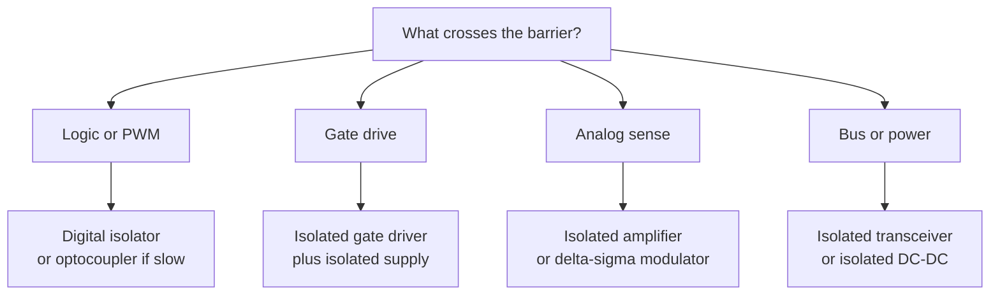

::: testing
Whether you can map a system's needs to the right kind of isolation, rather than recite a list of devices. The phrase "what sort of isolations" has several axes, and a strong answer organizes them:

1. **What is crossing the barrier**: digital control signals, gate-drive signals, analog sense signals, communication buses, or power.
2. **How it crosses**: optical, magnetic (transformer or coil), capacitive, or other.
3. **How strong the barrier must be**: functional, basic, double or reinforced insulation, and the voltage rating.
4. **Performance needs**: speed, delay and skew, CMTI, lifetime, temperature and cost.
:::

::: why
In an embedded power system you rarely need "isolation" in general. You need an isolated gate driver here, an isolated current-sense amplifier there, an isolated CAN transceiver on the bus, and an isolated DC-DC to power the far side, each with its own rating and trade-offs. Picking the wrong one means a motor controller that fails safety certification, a PWM that arrives with distorted pulse widths, or a gate drive that false-triggers on dv/dt. This question tests whether you know the menu and the selection logic.
:::

::: concepts
- **Galvanic isolation** and why it is needed ([[q0432]], [[q0436]]).
- **Optical coupling**: LED and photodetector ([[q0434]], [[q0435]]).
- **Magnetic and capacitive coupling**: transformer, coil-on-chip, and capacitive digital isolators.
- **Insulation grades**: functional, basic, supplementary, double and reinforced insulation, set by the safety standard.
- **CMTI and propagation delay**: the main performance parameters ([[q0432]]).
- **Isolated power transfer**: a transformer-based DC-DC converter for the far side ([[q0170]]).
:::

::: answer
"I'd start by asking what has to cross the barrier and how strong the barrier needs to be.

For a signal like a PWM or enable from a microcontroller, the options are an optocoupler or a digital isolator. The optocoupler uses an LED and a phototransistor: cheap and familiar, but slow, with an LED that ages. A digital isolator uses a tiny transformer or capacitor on a chip: faster, lower power, better matched, and longer-lived, which is what I'd choose for PWM at tens of kilohertz or SPI. For a gate driver on a high-voltage bridge, I'd use an isolated gate driver, which combines the isolator and a strong output stage, and which needs an isolated supply for the output side. For current or voltage sensing at the motor phase, an isolated amplifier or a delta-sigma modulator. For a bus like CAN or RS-485, an isolated transceiver. And for power, an isolated DC-DC converter, a transformer-based module.

Then the grade of isolation. If it's a low-voltage system with no user access, functional isolation, or none, is enough. If mains is involved or there's a safety standard, I need basic or reinforced insulation with a rated working voltage and surge rating, and the creepage and clearance to match. I'd choose the part by working voltage, isolation rating, CMTI, propagation delay and skew, supply current and temperature range, and then layout the PCB to respect the clearance."
:::

::: technical
**By signal type.**

| What crosses | Typical isolator | Notes |
|---|---|---|
| Logic: enable, PWM, SPI, UART | Digital isolator (capacitive or magnetic); optocoupler for slow signals | Delay and skew matter for PWM and SPI |
| High-side/bridge gate drive | Isolated gate driver (digital isolator + driver) with isolated supply; pulse-transformer driver | Needs high CMTI, peak current, UVLO |
| Analog sense (shunt current, voltage) | Isolated amplifier, isolated delta-sigma modulator, Hall/flux-gate sensor | Isolation plus accuracy |
| Fieldbus (CAN, RS-485, USB) | Isolated transceiver | Bus protocols |
| Power for the far side | Isolated DC-DC (transformer), flyback, or integrated module | Efficiency 60 to 80% typical, small |

**By coupling mechanism.**

| Mechanism | Strengths | Weaknesses |
|---|---|---|
| Optical (optocoupler) | Simple, cheap, robust, high isolation voltage, familiar | Slow, LED aging (CTR drops), temperature drift, high input current, limited speed |
| Capacitive (digital isolator, silicon dioxide barrier) | Fast, low skew, long life, small, low power | Common-mode noise sensitivity if CMTI is low; depends on vendor |
| Magnetic (coil-on-chip or discrete pulse transformer) | Fast, very high CMTI available, can transfer power | Magnetic-field sensitivity, size for discrete |
| Magnetic discrete transformer | High power, high voltage | Bulky, needs AC drive and rectification |

**By insulation grade.** Standards define **functional** insulation (needed for operation only), **basic** insulation (one layer of protection), **supplementary** (an extra layer), and **double/reinforced** (two layers, or one equivalent to two). *Which you need depends on the product standard, the working voltage and the pollution degree.* Isolator datasheets give isolation voltage (for example 3 to 5 kV$_{rms}$ for 1 minute for typical parts, higher for reinforced parts), working voltage, surge rating, and creepage/clearance of the package.

> [!UNCERTAIN]
> Exact insulation requirements, voltage thresholds and certification marks vary by standard and application; the numbers in isolator datasheets are test and rating conditions, not a guarantee that a product complies. Treat them as inputs to be confirmed against the applicable standard.

**Key selection parameters.** Working voltage; isolation (withstand) voltage and surge; CMTI (kV/µs); propagation delay, pulse-width distortion and channel-to-channel skew; data rate; supply current; operating temperature and lifetime; package creepage/clearance; default output state (fail-safe) when the input is unpowered.

**PWM example.** 20 kHz, 12-bit resolution gives a time step of $1/(20\text{ kHz}\times4096)=12.2$ ns. An isolator with 5 ns pulse-width distortion adds 0.4 LSB of error; one with 500 ns of distortion (a slow optocoupler) makes the low bits meaningless and may exceed the dead time.
:::

::: short
"It depends on what crosses the barrier and how strong it needs to be. For logic and PWM I'd use a digital isolator, or an optocoupler if it's slow. For a high-voltage bridge, an isolated gate driver with an isolated supply. For motor current sensing, an isolated amplifier or delta-sigma modulator. For buses like CAN or RS-485, an isolated transceiver, and for power, an isolated DC-DC. The grade is set by the standard: basic or reinforced insulation for mains, with working voltage, CMTI, delay and creepage as the selection parameters."
:::

::: long
"I like to organize it by what has to cross the barrier, then by how it crosses, then by how strong the barrier has to be.

First, what crosses. A control signal, like a PWM or an enable from the microcontroller: that's a digital isolator or an optocoupler. A gate drive for a high-side or high-voltage FET: an isolated gate driver, which is an isolator plus an output stage that can source several amps, and it needs its own isolated supply on the output side. An analog sense signal like motor current: an isolated amplifier or an isolated delta-sigma modulator, since passing an analog signal across a barrier accurately takes more than an optocoupler. A bus, say CAN or RS-485 or USB: an isolated transceiver. And power for the other side: an isolated DC-DC converter, a small transformer-based module.

Second, how it crosses. Optical is the classic: an LED and a photodetector. It's cheap and robust, but it's slow, the LED ages so the current transfer ratio drops over the product's life, and it drifts with temperature. Capacitive and magnetic digital isolators put a barrier of silicon dioxide or polyimide on the chip and send the signal across as a modulated high-frequency carrier. They're faster, lower power, have tight timing, and last longer, so for PWM and SPI that's what I'd use. A discrete pulse transformer is the older magnetic option and can pass power as well.

Third, the grade. If this is a 24 volt system with no user access, I might only need functional isolation or none. If there's mains, or a medical or other safety standard, I need basic or reinforced insulation, with a rated working voltage, a withstand voltage and a surge rating, plus the creepage and clearance in the layout.

And I select by performance: common-mode transient immunity, propagation delay and skew, because with 12-bit PWM at 20 kilohertz one least-significant bit is 12 nanoseconds, plus power, temperature and the default state when the input side loses power."
:::

::: terms
- **Optocoupler (photocoupler)**: LED and photodetector in one package ([[q0434]]).
- **Digital isolator**: IC that transmits logic across a capacitive or magnetic barrier.
- **Isolated gate driver**: gate-driver IC with an isolation barrier between control and output sides.
- **Isolated amplifier / modulator**: analog or delta-sigma interface across a barrier for sensing.
- **Isolated DC-DC converter**: transformer-based supply with galvanic isolation.
- **Functional / basic / double / reinforced insulation**: grades of insulation defined by safety standards.
- **Working voltage**: continuous voltage the barrier is rated to withstand.
- **Pulse-width distortion (PWD)**: difference in rising and falling propagation delay.
:::

::: exceptional
**An average answer** says "optocouplers or digital isolators".

**An exceptional answer**:
- Organizes by **what crosses** (signal, gate drive, analog sense, bus, power) and gives a device for each.
- Compares the **mechanisms** (optical, capacitive, magnetic) with their real weaknesses (aging, CMTI, speed).
- Distinguishes **insulation grades** and says the grade comes from the standard, not preference.
- Gives selection parameters and a numerical consequence: PWM resolution vs pulse-width distortion; dead time vs skew.
- Remembers the isolated supply and the layout (creepage/clearance, no copper under the barrier).
:::

::: mistakes
- **Saying "optocoupler" for every case.** Slow and aging; poor for PWM, SPI and gate drive above a few kHz.
- **Ignoring the isolated supply.** The far-side circuit needs power too.
- **Conflating isolation voltage with working voltage.** A 5 kV test voltage doesn't mean 5 kV continuous.
- **Choosing a low-CMTI part for a fast bridge.** It produces false transitions.
- **Forgetting fail-safe defaults.** What does the output do when the input side is unpowered? A gate driver should default to off.
:::

::: deep
## A map of the options


Figure: The first question is what has to cross; each answer has a standard device family.

## By how it crosses

**Optical.** An LED on the input side modulates light that a photodiode or phototransistor detects on the output. The barrier is the transparent insulating material between them. Strengths: simple, cheap, high isolation voltage, no switching noise generation. Weaknesses: the LED loses efficiency with time and temperature (the CTR falls, [[q0434]]), speed is limited by the phototransistor, the input draws milliamps, and pulse-width distortion is large for slow types. High-speed logic-gate optocouplers (an integrated photodiode and amplifier) are faster but pricier.

**Capacitive isolators.** The barrier is a thin silicon dioxide capacitor on chip. The input is encoded (for example as high-frequency on-off keying), crosses the capacitor, and is decoded. Strengths: very fast, little skew, low power, small, multi-channel, long lifetime. Weakness: the barrier capacitance conducts common-mode dv/dt, so CMTI is a key spec, and the oxide limits working voltage compared with thicker polymer barriers.

**Magnetic isolators.** Coil-on-chip (a transformer with polyimide as the dielectric) sends short pulses or modulated signals. Strengths: fast, high CMTI available, can be extended to transfer power. Weakness: sensitivity to strong external magnetic fields in some parts, depending on construction and shielding.

**Discrete pulse transformers.** Used for high-power gate drive and isolated supplies. They pass AC (pulses or switching waveforms) and need DC restoration or a modulation scheme to carry a PWM duty cycle.

## By signal type

### Control logic (PWM, enable, SPI)

A digital isolator is usually the right answer. The quantity that matters for PWM is **pulse-width distortion and skew** compared with the PWM time step:

```plot
{"title":"PWM time resolution vs switching frequency","x":{"label":"PWM frequency","unit":"Hz","min":1e3,"max":1e6,"log":true},"y":{"label":"one LSB of duty","unit":"s","min":1e-9,"max":1e-3,"log":true},
 "series":[{"label":"8-bit: 1/(f·256)","fn":"1/(x*256)","color":"green"},{"label":"12-bit: 1/(f·4096)","fn":"1/(x*4096)","color":"accent"},{"label":"16-bit: 1/(f·65536)","fn":"1/(x*65536)","color":"red"}],
 "hlines":[{"at":5e-9,"label":"digital isolator PWD ≈ 5 ns (typical order)","color":"muted"},{"at":5e-7,"label":"slow optocoupler PWD ≈ 0.5 µs (typical order)","color":"orange"}]}
```
Figure: At 20 kHz, 12-bit PWM needs 12 ns of timing resolution; a 5 ns distortion barely matters, but a 0.5 µs one swamps it (and may exceed the dead time). The two horizontal lines are typical orders of magnitude, not datasheet values.

### Gate drive for a bridge

For a high-voltage half-bridge (say 400 V or more), the high-side driver sits on a node that swings with $dv/dt$ of tens of V/ns. **Isolated gate drivers** put the isolator, the driver and UVLO in one package, typically offering several amps of peak output and high CMTI. They need a floating supply on the output side: a bootstrap (limited), an isolated DC-DC, or a transformer winding ([[q0427]]).

For low-voltage motor bridges (below about 60 V) a non-isolated half-bridge driver with bootstrap, plus careful grounding, is usually enough and far cheaper ([[q0432]]).

### Analog sensing

Motor-phase current measured with a shunt sits at the phase potential. Options:

- **Isolated delta-sigma modulator**: the shunt voltage is digitised on the high side and the bitstream crosses the barrier; the MCU filters it. Good accuracy and CMTI.
- **Isolated amplifier**: analog output proportional to the shunt voltage.
- **Hall-effect or flux-gate current sensors**: galvanic isolation by magnetics, no shunt loss, at some cost in bandwidth and offset.

### Buses and power

CAN, RS-485 and USB have isolated transceiver ICs that include the isolator and sometimes integrated isolated power. For the far-side supply, an **isolated DC-DC** (a small flyback or push-pull with a transformer) delivers 0.5 to a few watts at 60 to 80% efficiency typically.

## By insulation grade

| Grade | Meaning in words | Typical use |
|---|---|---|
| Functional | Insulation needed for the circuit to work; no safety claim | Between two signal domains in a low-voltage system |
| Basic | One layer of protection against shock | Single fault allowed only with another protective measure |
| Supplementary | A second layer added to basic insulation | Part of double insulation |
| Double | Basic plus supplementary | User-accessible mains products |
| Reinforced | A single system equivalent to double | Isolators rated for reinforced insulation, used at the user boundary |

> [!UNCERTAIN]
> The definitions and required creepage/clearance, test voltages and working-voltage limits are given by the specific standard (for example IEC 62368-1, IEC 60601-1, IEC 61800-5-1, VDE 0884-series for isolators) and depend on pollution degree, overvoltage category and altitude. Do not rely on this table for compliance.

For a SELV (safe extra-low voltage) product below the standard's threshold, functional isolation may be all that's needed for noise reasons. For a mains-powered product with a user-accessible port, the user-side circuit needs reinforced isolation (or double) from the mains.

## Selecting a part: a checklist

| Parameter | Why |
|---|---|
| Working voltage (continuous) | Must exceed the maximum voltage across the barrier in service |
| Isolation (withstand) and surge voltage | Fault and transient capability |
| CMTI (kV/µs) | Must exceed the system's $dv/dt$ with margin |
| Propagation delay, PWD, skew | PWM resolution, dead time, SPI timing |
| Data rate | Signal bandwidth |
| Supply current and range | Both sides need supplies |
| Default output | Fail-safe state when the input side loses power |
| Temperature and lifetime | Optocoupler CTR aging, barrier lifetime |
| Package creepage/clearance | Matches the working voltage and standard |

## Layout reminders

- Keep **no copper under or across the barrier** (a slot in the PCB can increase creepage).
- Place the isolated DC-DC and the isolator so that the barrier gap is respected end to end.
- Decouple each side with its own ceramic capacitor close to the isolator.
- Route the signal so that the receiving side's return does not run through the transmit side's noisy return.

## A concrete selection

A 48 V, 20 A motor drive, no mains, USB service port, 3.3 V MCU, 100 kHz current loop: the hazard threshold isn't exceeded, so basic functional isolation for noise is enough. I'd isolate the USB (a cheap isolated USB port or an isolated UART) to protect the laptop, use a digital isolator on the PWM only if layout cannot separate the grounds, and use a non-isolated half-bridge driver. If it were a 400 V DC-bus inverter with a user-accessible interface, I'd use reinforced-rated isolated gate drivers with a high-CMTI rating, an isolated delta-sigma current measurement, and an isolated supply for each high side, and design the PCB creepage to the standard.
:::

::: applications
- **Industrial PLC I/O and fieldbuses**: isolated digital inputs, isolated CAN and RS-485 transceivers.
- **Variable-frequency drives and servo drives**: isolated gate drivers and isolated phase-current sensing.
- **Solar and energy-storage inverters**: reinforced isolation between DC bus, grid and user interface.
- **Medical and patient-connected equipment**: isolated sensor front ends and power.
- **EV traction inverters and on-board chargers**: automotive-qualified isolated gate drivers and modulators.
- **Lab instruments and data-acquisition systems**: isolated analog and digital front ends.
:::

::: assumptions
- The system is a microcontroller controlling a power stage; other contexts (patient isolation, hot-swap) have their own standards.
- Speed, CMTI, and delay figures are typical orders of magnitude; read datasheets.
- "Isolation" means galvanic isolation across a defined barrier.
- Insulation grade and rating requirements come from the applicable standard and are not chosen freely.
- The far-side circuit needs a supply that is itself isolated or generated on that side.

For a hobbyist or low-voltage board, "what sort of isolation" often just means an optocoupler or a cheap digital isolator for a signal; the selection logic above still tells you when that is not enough.
:::

::: followups
### Optocoupler or digital isolator for 20 kHz PWM?
A digital isolator: lower and more consistent propagation delay and skew, no LED aging, lower power and better CMTI at similar cost. A standard phototransistor optocoupler has tens of µs of response and large pulse-width distortion, which can eat the PWM resolution and dead time.

### Do you always need an isolated gate driver for a half-bridge?
No. Below about 60 V a bootstrapped non-isolated driver with good layout works. Isolated drivers are for high-voltage systems, safety barriers, floating references on a switching node, or when the control ground must be separate from the power stage ([[q0432]]).

### What is "reinforced" isolation and why would you need it?
It is a single insulation system that gives the protection of two layers (double insulation) against shock. Standards require it between the hazardous side and anything a user can touch (a USB port, a front-panel button). The isolator must be certified for it, and the PCB creepage/clearance must meet the same rating.

### How would you measure current in a motor phase at high voltage?
With a shunt and an isolated delta-sigma modulator or isolated amplifier, giving a digital or analog signal referenced to the MCU, or with a Hall or flux-gate sensor for no shunt loss. I'd check the CMTI of the isolation stage since the shunt sits on the switching node.

### What can go wrong with a digital isolator when its input side is unpowered?
The output state can be undefined or default to high or low depending on the part. For a gate driver the default must be "off". Choose parts with a specified fail-safe output state and add a pulldown on the output.
:::

::: interpretations
"What sort of isolations would you want?" is open-ended; the page reads it as *which kinds of isolation, and for what*, in the context of the *Control from Embedded Device* section. The answer is organized by signal type, coupling mechanism and insulation grade. The optocoupler details are in [[q0434]] and [[q0435]], the definition of galvanic isolation is [[q0436]], and the reasons for isolating at all are [[q0432]]. If the interviewer meant "types of isolation in a power converter" (isolated versus non-isolated topologies), mention that isolated DC-DC converters use transformers and appear in [[q0170]].
:::

::: references
- Product-safety standards for insulation and creepage/clearance (for example IEC 62368-1, IEC 60601-1, IEC 61800-5-1); consult current editions for the actual requirements.
- Isolator, isolated gate driver and optocoupler datasheets and application notes (for example from Texas Instruments, Analog Devices, Infineon, Broadcom, Skyworks) on CMTI, working voltage and delay.
- Horowitz & Hill, *The Art of Electronics*, 3rd ed.: isolation techniques (optical, transformer, capacitive).
- Mohan, Undeland & Robbins, *Power Electronics*: gate and base drive circuits, including isolated drives.
:::

::: rubric
- Organizes by what crosses: logic, gate drive, analog sense, bus, power :: Matches the device to the job.
- Compares optical, capacitive and magnetic mechanisms with real pros and cons :: Technical depth.
- Mentions insulation grades and that the standard sets them :: Realistic about safety.
- Names selection parameters (working voltage, CMTI, delay/skew, fail-safe default) :: Design-level thinking.
- Notes the isolated supply requirement :: A common omission.
- Gives a numerical example (PWM LSB vs distortion, or CMTI vs dv/dt) :: Shows quantitative sense.
:::

::: quiz
```json
[
 {"type":"mcq","level":"fundamental","q":"Which isolation device is the best fit for a 20 kHz PWM with 12-bit resolution?","options":["A slow phototransistor optocoupler","A digital isolator with low pulse-width distortion","A mechanical relay","A pulse transformer without DC restoration"],"answer":1,"explain":"A digital isolator has small, repeatable delays. A slow optocoupler's pulse-width distortion can exceed the PWM resolution."},
 {"type":"numeric","level":"intermediate","q":"How large (in ns) is one LSB of duty for a 12-bit PWM at 20 kHz?","answer":12.2,"tolerance":0.03,"unit":"ns","explain":"$1/(f\\cdot2^{12})=1/(20\\text{ kHz}\\times4096)=12.2$ ns."},
 {"type":"mcq","level":"intermediate","q":"For measuring motor-phase current on a 400 V inverter with a shunt at the switching node, the best isolation approach is","options":["A standard optocoupler with an op-amp","An isolated delta-sigma modulator or isolated amplifier","A level-shifting resistor divider","Nothing, the MCU ground handles it"],"answer":1,"explain":"The shunt is at a moving, high-voltage potential and needs an accurate, high-CMTI isolated measurement."},
 {"type":"truefalse","level":"intermediate","q":"An isolation voltage rating of 5 kV (1 minute test) means the barrier can operate continuously at 5 kV.","answer":false,"explain":"The test (withstand) voltage is a short-duration test. The continuous working voltage rating is much lower and is the number to compare with the system."},
 {"type":"multi","level":"advanced","q":"Select parameters you would check when choosing an isolated gate driver for a SiC half-bridge.","options":["CMTI","Peak output current","Fail-safe default output and UVLO","LED forward voltage"],"answer":[0,1,2],"explain":"A digital-isolator-based gate driver doesn't have an LED; the others set false-trigger immunity, switching speed and safe behaviour on power loss."},
 {"type":"mcq","level":"advanced","q":"A system has a 48 V motor bus, a 3.3 V MCU and a USB port to a laptop. No mains. What is the most reasonable isolation strategy?","options":["Reinforced isolation on every signal","No isolation anywhere, ever","Good grounding and non-isolated drivers for the power stage, with isolation (or at least protection) on the USB/debug port","An optocoupler on each power rail"],"answer":2,"explain":"Below the hazardous-voltage thresholds the main need is noise control and protecting the laptop; isolating the external port is cheap and effective, while the power stage needs good layout rather than full barriers."}
]
```
:::
