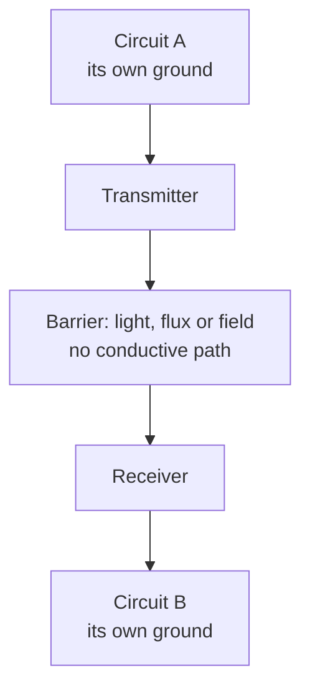

::: basics
### In plain words
Galvanic isolation means two circuits have no direct conductive path between them, so no steady current can flow from one to the other. They can still exchange information or power, using light, a magnetic field or an electric field across a thin gap. It lets the two sides sit at very different voltages and keeps a fault on one side from reaching the other. It is not perfect: fast voltage jumps can still leak across through the small capacitance of the barrier.

### Picture it
Picture two rooms separated by a thick glass wall. You can wave, and the person inside sees you. You can tap on the glass and they feel the vibration. But nobody can walk through. The rooms can even be at different temperatures. A very hard slam, though, can shake the glass and rattle things on the other side. That slam is a fast voltage edge passing through the barrier capacitance. The analogy leaves out power: the far room still needs its own heater, meaning its own supply.

### Words you need
- **Conductive path**: a route where DC current can flow, such as a wire or a shared ground. See [[q0001]].
- **Barrier capacitance ($C_{iso}$)**: the small capacitance across the gap, around 1 pF in a signal isolator.
- **Common-mode voltage**: a voltage that appears on both wires of one side relative to the other side's reference.
- **CMTI**: the fastest common-mode voltage edge the isolator tolerates without error.
- **Working voltage**: the voltage the barrier can withstand continuously, which is lower than the short test voltage.

### The simplest example
Take a 1 pF barrier. For DC its impedance is effectively infinite, so no DC current crosses. At 1 MHz its impedance is $1 / (2\pi \times 10^6 \times 10^{-12}) = 159$ kΩ, still large. But a fast edge of 50 V/ns pushes $1\text{ pF} \times 50\text{ V/ns} = 50$ mA across, which can cause glitches. So isolation blocks steady and slow stuff well and fast edges poorly. That is the whole idea. The rest of this page covers the four ways signals cross (magnetic, optical, capacitive and mechanical), what isolation buys you, what it does not, and the difference between test voltage and working voltage.
:::

::: testing
Whether you can define galvanic isolation precisely and also state its **limits**. A good answer has three layers:

1. The definition: two circuits with no direct conductive (DC) path between them, yet able to exchange information or energy.
2. The mechanisms: light, magnetic fields, electric fields (capacitive), or mechanical/acoustic coupling.
3. The caveats: the barrier has capacitance, so high-frequency common-mode still crosses; isolation has a voltage rating, not infinite; and "isolated" circuits still need a defined reference or they float.
:::

::: why
"Galvanic isolation" appears in every safety, interface and power-supply datasheet: isolated DC-DC converters, digital isolators, isolated gate drivers, RS-485 transceivers. Knowing exactly what it does and does not do is what lets you choose the right part, avoid fake safety (a floating system with no protective earth), and understand why fast common-mode edges still cause trouble. It is the definitional question behind [[q0432]], [[q0433]], [[q0434]] and [[q0435]].
:::

::: concepts
- **Conductive path**: a route for DC current; galvanic isolation removes it ([[q0001]]).
- **Capacitor**: blocks DC, passes AC: $Z=1/(j\omega C)$ ([[q0022]], [[q0025]]).
- **Transformer coupling**: energy passes by magnetic flux, with no DC connection ([[q0039]]).
- **Optical coupling**: LED and detector ([[q0434]]).
- **Common-mode voltage and CMTI**: dv/dt across the barrier ([[q0432]]).
- **Reference (ground) of each side**: each isolated circuit needs its own defined potential.
:::

::: answer
"Galvanic isolation means two parts of a circuit have no direct electrical connection: no conductive path for DC current. They can't share a wire or a ground. But information or energy can still cross, by some other physical means. The classic ways are light, as in an optocoupler; a magnetic field, as in a transformer or a coil on a chip; or an electric field through a capacitor, as in a capacitive digital isolator. The word comes from Galvani, from the idea of galvanic current, meaning current through a conductor.

What it buys you is that the two sides can sit at completely different voltages: a microcontroller on one side and a 400 volt DC bus or mains on the other, with a high-voltage withstand rating on the barrier. It breaks ground loops, blocks DC and low-frequency common-mode, and keeps a fault on one side from reaching the other.

But it's not perfect. The barrier has capacitance, about a picofarad for a signal isolator and tens of picofarads for a power transformer, so fast common-mode transients still push current across, which is why common-mode transient immunity matters. It has a finite voltage rating, a working voltage and a withstand voltage. And each side still needs its own supply and reference; isolating the signal isn't enough if the power isn't isolated too."
:::

::: technical
**Definition.** Two circuits are galvanically isolated if there is no conductive path (no DC path) between them; the isolation resistance is very large (GΩ or more) and the leakage current at the rated test voltage is small. Signals and power cross by non-conductive coupling.

**Coupling methods.**

| Method | Medium | Carries | Examples |
|---|---|---|---|
| Magnetic | Flux through a core or across a polyimide-insulated coil | Power and AC/pulse signals | Transformers, isolated DC-DC converters, coil-on-chip isolators |
| Optical | Light through a transparent insulator | Signals (and some power in photovoltaic couplers) | Optocouplers, photo-MOSFET and photo-triac relays |
| Capacitive | Electric field across a thin dielectric (SiO$_2$) | AC/high-frequency modulated signals | Capacitive digital isolators |
| Mechanical | Relay armature, reed contacts | Contact closure (signal or power) | Relays |
| Acoustic/other | Piezoelectric or magnetoresistive sensing | Signals | Some specialized isolators and sensors |

**What the barrier looks like electrically.** A high resistance $R_{iso}$ ($\gtrsim10^{9}\ \Omega$) in parallel with a coupling capacitance $C_{iso}$. At DC the capacitor is open, so no conduction; at frequency $f$: $|Z|=1/(2\pi fC_{iso})$.

| $f$ | $|Z|$ for 1 pF | $|Z|$ for 10 pF |
|---|---|---|
| 50/60 Hz | about 2.7 GΩ | about 270 MΩ |
| 1 MHz | 159 kΩ | 15.9 kΩ |
| 100 MHz | 1.6 kΩ | 159 Ω |

Common-mode current through the barrier is $I=C_{iso}\,dv/dt$: 1 pF with 50 V/ns gives 50 mA.

**Ratings.** Working voltage (continuous), withstand voltage (test, typically for 1 minute), surge/impulse voltage, partial-discharge behaviour, and creepage/clearance for the package. *Defined by the applicable safety standard and the device datasheet.*

**What isolation does and doesn't do.**
- Does: blocks DC and low-frequency common-mode, breaks ground loops, withstands specified voltage, prevents fault propagation.
- Doesn't: block high-frequency common-mode through $C_{iso}$; guarantee safety by itself (a floating system still needs a protective earth, correct insulation grade and creepage); power the far side (that needs an isolated supply).
:::

::: short
"Galvanic isolation means two circuits have no direct conductive path, so no DC current, yet they still exchange signal or power through light, a magnetic field or an electric field across a capacitor. It lets the two sides sit at completely different voltages, breaks ground loops and contains faults. But the barrier has a little capacitance, so fast common-mode transients still cross, it has a finite voltage rating, and the far side still needs its own isolated supply."
:::

::: long
"Galvanic isolation means that two parts of a system are connected so they can exchange information or power, but with no direct conductive connection between them. No wire, no shared ground, no DC path for current. The term goes back to Galvani and the idea of current through a conductor: 'galvanic' means 'by conduction', and isolation means you've removed that.

How can they communicate then? By some other physical coupling. With an optocoupler, an LED sends light across a gap to a detector. With a transformer, a changing current in one winding creates a magnetic flux that induces voltage in the other, which is how isolated power supplies and coil-on-chip isolators work. With a capacitive isolator, a signal is sent as a high-frequency modulated field across a thin oxide layer: a capacitor blocks DC but passes AC. A relay does it mechanically.

The benefits are that the two sides can sit at completely different voltages. A microcontroller on one side and a 400 volt bus on the other, with a barrier rated for it. Ground loops are broken because there's no shared conductor for the loop current. Faults are contained.

The limits matter just as much. The barrier is physically a pair of conductors separated by an insulator, so it has capacitance. For a signal isolator that's about a picofarad, for an isolated power transformer, tens of picofarads. A picofarad is 160 kilohms at 1 megahertz, but with a 50 volt per nanosecond edge, it passes 50 milliamps, which is why common-mode transient immunity is a key spec. The barrier has a finite rating, a working voltage and a test voltage, and package creepage and clearance. And each side needs its own supply and reference; if both sides share a power rail, you've bypassed the isolation. Also, an isolated system with no earth connection can float to any voltage, so isolation alone isn't a safety guarantee."
:::

::: terms
- **Galvanic isolation**: no conductive path between two circuits; energy and information cross by non-conductive coupling.
- **Isolation barrier**: the insulating structure (oxide, polyimide, mold compound, air gap) between the two sides.
- **Common-mode voltage**: voltage shared by both conductors relative to the other side's reference.
- **CMTI**: the maximum rate of change of common-mode voltage a device tolerates without error.
- **Barrier (coupling) capacitance ($C_{iso}$)**: the capacitance across the isolation barrier.
- **Working voltage / withstand voltage**: continuous rated voltage / short-duration test voltage.
- **Creepage and clearance**: surface and air distances required between conductors.
- **Isolated supply**: a DC-DC converter with a transformer that powers the far side.
:::

::: exceptional
**An average answer** says "no electrical connection between two circuits".

**An exceptional answer**:
- Defines it as **no DC conductive path** and lists the coupling methods (optical, magnetic, capacitive, mechanical) with an example of each.
- Puts a number on the barrier capacitance and its impedance versus frequency, and on the common-mode current $C\,dv/dt$.
- Separates **working voltage** from **withstand voltage** and mentions creepage/clearance.
- Notes the common mistakes: forgetting the isolated supply, or assuming an isolated system with no earth is automatically safe.
- Ties it to practical consequences: ground loops, fault containment, floating references.
:::

::: mistakes
- **"Isolated means no coupling at all."** There is always some capacitance; DC is blocked, high-frequency common-mode is not.
- **Signal isolation without power isolation.** A shared supply or ground defeats it.
- **Equating a high test voltage with a high continuous rating.** The two are different numbers.
- **Thinking a transformer passes DC.** It passes only changing flux; DC is blocked, so isolated supplies chop DC to AC first.
- **Assuming "isolated" is "safe".** Safety needs the right grade of insulation, creepage, and usually a protective earth on the right part of the system.
:::

::: deep
## The idea

A circuit needs a closed loop for current to flow. If two circuits share no conductor, then no steady current can flow between them. But information can still be sent by something other than a wire: a light pulse, a magnetic field change, an electric field change. Each circuit keeps its own reference potential, which can differ from the other's by hundreds or thousands of volts.


Figure: Information (and energy) crosses through a transmitter, a non-conductive coupling medium and a receiver. The two grounds are separate and can sit at different potentials.

## Four ways to cross the barrier

**1. Magnetic (transformer).** A current in the primary produces flux; a changing flux induces a voltage in the secondary, $v=N\,d\Phi/dt$ ([[q0039]]). There is no DC path, only a magnetic circuit, but a transformer passes only *changes*: DC power must first be chopped into AC (as in a flyback or push-pull converter) and rectified on the secondary.

```circuit
{"caption":"Isolated DC-DC stage: a transformer carries power across the barrier; C_iso is the unavoidable coupling capacitance","elements":[
 {"t":"Vsq","a":[0,2],"b":[0,6],"label":"chopped DC"},
 {"t":"wire","pts":[[0,2],[6,2]]},{"t":"wire","pts":[[0,6],[6,6]]},
 {"t":"dot","at":[0,6]},{"t":"gnd","at":[0,6]},
 {"t":"xfmr","at":[6,2],"dots":true},
 {"t":"wire","pts":[[10,2],[13,2]]},
 {"t":"D","a":[13,2],"b":[17,2],"label":"D"},
 {"t":"wire","pts":[[17,2],[22,2]]},{"t":"dot","at":[19,2]},
 {"t":"C","a":[19,2],"b":[19,6],"label":"C_o"},
 {"t":"R","a":[22,2],"b":[22,6],"label":"load"},
 {"t":"wire","pts":[[10,6],[22,6]]},{"t":"dot","at":[19,6]},{"t":"gnd","at":[22,6],"style":"chassis"},
 {"t":"wire","pts":[[3,6],[3,10]]},{"t":"dot","at":[3,6]},
 {"t":"wire","pts":[[16,6],[16,10]]},{"t":"dot","at":[16,6]},
 {"t":"C","a":[3,10],"b":[16,10],"label":"C_iso (about pF to tens of pF)","color":"orange"},
 {"t":"text","at":[8,13],"text":"coupling through the barrier","muted":true,"anchor":"middle"}
]}
```
Figure: Power crosses in the transformer (AC only). The primary and secondary share no conductor, so the secondary ground is free to sit at any DC voltage relative to the primary ground. But the windings, the core and the PCB form a small capacitance $C_{iso}$ (orange) from one side to the other, and that is the path for fast common-mode transients.

**2. Optical.** An LED converts current to light; a photodetector converts light back to current ([[q0434]]). The barrier is a transparent insulator. Good for signals; photovoltaic couplers can also pass a few µW to mW of power.

**3. Capacitive.** A small capacitor formed by thin oxide layers transmits a high-frequency encoded signal. A capacitor blocks DC and passes AC, so this *is* galvanically isolating: charge doesn't cross, only displacement current. The barrier thickness and dielectric strength set the voltage rating.

**4. Mechanical.** A relay's coil moves an armature that closes a separate contact circuit. Contact and coil are isolated by air and insulation.

## The barrier as a circuit element

Every isolation barrier is two conductors separated by an insulator, so it is a resistor $R_{iso}$ (GΩ or more) in parallel with a capacitor $C_{iso}$. At DC only $R_{iso}$ matters; at AC the capacitor dominates.

```plot
{"title":"Barrier impedance versus frequency","x":{"label":"frequency","unit":"Hz","min":10,"max":1e9,"log":true},"y":{"label":"|Z| = 1/(2π f C)","unit":"Ω","min":10,"max":1e11,"log":true},
 "series":[{"label":"C_iso = 1 pF (signal isolator)","fn":"1/(2*pi*x*1e-12)","color":"accent"},{"label":"C_iso = 10 pF (small isolated DC-DC)","fn":"1/(2*pi*x*1e-11)","color":"orange"},{"label":"C_iso = 100 pF","fn":"1/(2*pi*x*1e-10)","color":"red"}],
 "vlines":[{"at":60,"label":"60 Hz mains","color":"muted"},{"at":1e8,"label":"100 MHz","color":"muted"}]}
```
Figure: At mains frequency even 100 pF is about 27 MΩ, so low-frequency common-mode is blocked. By 100 MHz, 1 pF is only 1.6 kΩ and 100 pF is 16 Ω: fast edges and high-frequency noise pass the barrier. (The capacitance values are illustrative; real parts range from about 0.5 pF for a signal isolator to tens or hundreds of pF for a power transformer.)

Common-mode current is $I=C_{iso}\,dv/dt$. For 50 V/ns across 1 pF: 50 mA. For 10 pF and a 1 V/ns edge: 10 mA. That is why isolators specify **CMTI** and why isolated supplies with low interwinding capacitance are chosen for fast bridges ([[q0432]]).

## What galvanic isolation gives you

| Benefit | Why |
|---|---|
| **Different potentials** | The two sides can differ by up to the working voltage of the barrier: safe operation of a low-voltage controller against a high-voltage bus |
| **No ground loops** | No common conductor, so no loop current from ground potential differences |
| **Fault containment** | A short on one side doesn't send current into the other (within the rating) |
| **Floating references** | Sensing and gate drive at a moving node (high-side, shunts, thermocouples) |
| **Safety compliance** | Basic, double and reinforced insulation systems rely on galvanic isolation ([[q0433]]) |

## What it doesn't give you

- **No infinite voltage rating.** Breakdown at the rated voltage, or over time (partial discharge) degrades it.
- **No high-frequency isolation.** Barrier capacitance conducts fast transients.
- **No power isolation by itself.** A signal isolator with a shared supply is a signal path with a bypass.
- **No guarantee of safety.** A floating system can drift to a high voltage relative to earth; protective earth, insulation grade and creepage still matter.
- **No immunity to magnetic fields or large $dv/dt$** if the receiver is poorly designed.

## Isolated versus non-isolated: where the line falls

A non-isolated buck converter shares ground between input and output: current can flow in a loop through both. A **flyback** or **forward** converter has a transformer: input and output have no conductive link. A resistive divider or level shifter reduces voltage but isn't isolation: there is a resistive path, so a fault on one side can drive current into the other ([[q0170]]). Isolation is about the *topology of the conduction paths*, not the voltage ratio.

> [!INTERVIEW]
> A concise strong answer: "No conductive path between the two sides; signal or power crosses by light, a magnetic field or a capacitor. It lets the two sides sit at different potentials, breaks ground loops and contains faults, but the barrier has capacitance, so fast common-mode transients still cross; I check CMTI and the barrier rating, and I make sure the far side has an isolated supply too."
:::

::: applications
- **Isolated DC-DC converters and flyback power supplies** (mains to low-voltage output).
- **Digital isolators and isolated interfaces** (SPI, I²C, UART, CAN, RS-485, USB).
- **Optocouplers and solid-state relays** for industrial I/O.
- **Isolated gate drivers** for IGBT, SiC and GaN bridges.
- **Medical patient-connected equipment** with patient-isolation barriers.
- **Isolated sensing**: current and voltage measurement at a switching node or high-voltage bus.
:::

::: assumptions
- "Galvanic" is taken as "by conduction", so "galvanic isolation" means the absence of a DC conductive path; some authors use it loosely for any "electrical isolation".
- Barrier capacitance values quoted (1 pF, 10 pF, 100 pF) are illustrative; device datasheets give actual values.
- Ratings and test conditions depend on the product standard and the isolator; this page doesn't give compliance values.
- The isolated sides each have a defined reference or an intentionally floating but safe configuration.

If the interviewer asks about "isolation" in an IC sense (substrate isolation, well isolation, deep n-well), that is a different meaning; here it is the system-level galvanic barrier.
:::

::: followups
### Does a capacitive isolator count as galvanic isolation if it uses a capacitor?
Yes. A capacitor does not pass DC; the signal crosses as displacement current of a high-frequency carrier. There is no conductive path for charge to cross the dielectric. The rating comes from the thickness and strength of the dielectric.

### Why can an isolated system still have common-mode noise problems?
Because $C_{iso}$ passes fast common-mode transients. For example 1 pF and 50 V/ns injects 50 mA. Remedies: a part with high CMTI, lower barrier capacitance, symmetrical layout, common-mode chokes, shielding.

### Is a transformer an isolated device even though it has windings that look like wires?
Yes: the windings are insulated from each other; energy crosses via the magnetic flux. A transformer will not pass DC (a DC input just saturates or acts as a short for the primary), so it has to be fed AC or pulses. An *autotransformer* shares a winding and is not isolated.

### What's the difference between isolation voltage and working voltage?
The isolation (withstand) voltage is the voltage the barrier survives in a short test, often 1 minute. The working voltage is what it can tolerate continuously over its lifetime, typically far lower. Compare your system's maximum continuous barrier voltage with the working voltage rating and use the withstand rating for surge and test requirements.

### If I use an isolated signal path, can I power both sides from the same supply?
Not if you want isolation: a shared supply provides a DC path. Power the far side from an isolated DC-DC converter or a transformer winding, so the two sides share no conductor.
:::

::: interpretations
This is the definitional question in the *Control from Embedded Device* group. The page answers "what is it" (the definition, mechanisms, limits). The reasons and trade-offs are in [[q0432]], the technology menu in [[q0433]], optocouplers in [[q0434]] and an optocoupler design in [[q0435]]. Some sources use "galvanic isolation" and "electrical isolation" interchangeably; strictly, galvanic isolation specifies the absence of a conduction path, which is the sense used here.
:::

::: references
- Horowitz & Hill, *The Art of Electronics*, 3rd ed.: isolation techniques, transformers, optocouplers and capacitive coupling.
- Henry Ott, *Electromagnetic Compatibility Engineering*: common-mode coupling and the effect of interwinding capacitance.
- Isolator and isolated-DC-DC application notes and datasheets (Texas Instruments, Analog Devices, Murata, Skyworks/Silicon Labs): working voltage, withstand voltage, CMTI and barrier capacitance definitions.
- Product-safety standards (IEC 62368-1, IEC 60601-1) for insulation grades; consult the current editions.
:::

::: rubric
- Defines it as no conductive (DC) path between the two circuits :: The core definition.
- Lists the coupling methods: magnetic, optical, capacitive, mechanical :: Shows how signal and energy cross.
- States what it buys: different potentials, no ground loops, fault containment :: The reason to use it.
- States the limits: $C_{iso}$, finite voltage rating, need for isolated supply :: Prevents over-claiming.
- Quantifies barrier impedance or $C\,dv/dt$ :: Shows quantitative understanding.
- Mentions standards, working versus withstand voltage and creepage :: Awareness of how isolation is actually rated.
:::

::: quiz
```json
[
 {"type":"mcq","level":"fundamental","q":"What defines galvanic isolation?","options":["Lower voltage on the output side","No conductive (DC) path between the two circuits","Use of an optocoupler specifically","A shared ground with a filter"],"answer":1,"explain":"Galvanic isolation means the circuits share no conductive path. Coupling can be optical, magnetic, capacitive or mechanical, but never a wire."},
 {"type":"truefalse","level":"fundamental","q":"A transformer provides galvanic isolation between its windings, but it does not pass DC.","answer":true,"explain":"Energy crosses via magnetic flux, so only changing currents transfer; DC supplies are chopped into AC before the transformer."},
 {"type":"numeric","level":"intermediate","q":"What is the impedance (in kΩ) of a 1 pF barrier capacitance at 1 MHz?","answer":159,"tolerance":0.02,"unit":"kΩ","explain":"$|Z|=1/(2\\pi fC)=1/(2\\pi\\times10^6\\times10^{-12})=159$ kΩ."},
 {"type":"numeric","level":"intermediate","q":"A 2 pF barrier sees a common-mode edge of 25 V/ns. What current (mA) flows across it?","answer":50,"tolerance":0.02,"unit":"mA","explain":"$I=C\\,dv/dt=2\\text{ pF}\\times25\\text{ V/ns}=50$ mA."},
 {"type":"mcq","level":"advanced","q":"A designer uses a digital isolator for the signals but powers both sides from one 5 V rail with a common ground. What is the result?","options":["Full galvanic isolation","No galvanic isolation: the shared supply and ground form a DC path around the barrier","Better CMTI","Lower propagation delay"],"answer":1,"explain":"Isolation requires that the sides share no conductor. A common rail and ground bypass the barrier, defeating it."},
 {"type":"multi","level":"advanced","q":"Select the true statements about an isolation barrier.","options":["It has finite capacitance, so fast common-mode transients still cross","It blocks DC and low-frequency common-mode voltage","A higher test (withstand) voltage rating always means a higher continuous working voltage rating","A floating isolated system can still need a protective earth for safety"],"answer":[0,1,3],"explain":"Test voltage and working voltage are separate ratings, and the working voltage is much lower. The other three are correct."}
]
```
:::
