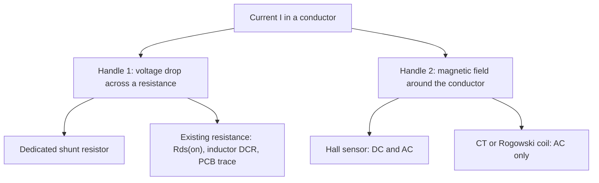

::: testing
Whether you know that a circuit can't "see" current directly, so every method **converts current into something you can measure**, almost always a voltage. The interviewer wants a short, organized menu (resistive, magnetic, and "free" resistance already in the circuit) rather than one memorized trick.

Hidden sub-skills:

1. You know the trade space: accuracy, insertion loss, bandwidth, isolation, DC capability, cost.
2. You can name the physics behind each method (Ohm's law, Faraday induction, Hall effect).
3. You can pick a method for a stated situation instead of listing them all with equal weight.
:::

::: why
Almost every power circuit needs to know its current: a buck converter limiting inductor current, a motor driver doing torque control, a battery pack counting coulombs, a hot-swap controller deciding whether to trip. The very first design decision is *how* to sense it, because that choice sets the power lost, the accuracy, and whether the sensor can survive a short circuit. In interviews this is the opener for the whole current-sensing block ([[q0440]] to [[q0453]]). A candidate who can organize the options in 30 seconds and then go deep on one signals real design experience.
:::

::: concepts
- **Ohm's law** ($V = IR$): the simplest current-to-voltage converter is a resistor in series with the load. See [[q0001]].
- **Series connection**: to measure current you have to put the sensor *in the path* (or next to it, for magnetic sensing). See [[q0004]] for KCL, which is why a series element sees the full current.
- **Magnetic field of a current**: a current $I$ makes a field $B = \mu_0 I/(2\pi r)$ around a wire. Magnetic sensors measure that field instead of dropping voltage.
- **Faraday induction**: a changing current induces a voltage in a nearby coil. That's the principle behind current transformers and Rogowski coils. See [[q0441]].
- **Common-mode vs differential signals**: the sense signal is small and rides on top of a bus voltage that may be large. See [[q0115]].
- **ADC full-scale and resolution**: the measurement ends up in an ADC, so the signal must fit its range. See [[q0446]].
:::

::: answer
"The core idea is that you never measure current directly, you convert it to a voltage. There are really three families.

First, resistive: put a small sense resistor, a shunt, in series with the load and measure the voltage across it, $V = IR$. Usually I'd amplify that with a current sense amplifier and feed it to an ADC. It's cheap, accurate, and works from DC up to high frequency, but it burns $I^2R$ power and has no isolation.

Second, use a resistance that's already there. A MOSFET's on-resistance, $V_{DS} = I \cdot R_{DS(on)}$, or an inductor's DC resistance with an RC filter. No extra loss, but the accuracy is poor because those resistances drift with temperature and vary part to part.

Third, magnetic: Hall-effect sensors for DC and AC, current transformers or Rogowski coils for AC only. They give isolation and almost no insertion loss, but they cost more, take space, and drift in offset.

So my default for a low-voltage board is a shunt plus CSA. I'd go to Hall or a transformer when I need isolation or have hundreds of amps."
:::

::: technical
All methods turn $I$ into a measurable quantity:

| Family | Principle | Output |
|---|---|---|
| Shunt resistor | $V = I R_{s}$ | mV across $R_s$ |
| Parasitic resistance | $V_{DS} = I R_{DS(on)}$ or $V = I R_{DCR}$ | tens of mV to hundreds of mV |
| Hall sensor | Lorentz force on carriers in a field $B \propto I$ | $V_H \propto B$, then amplified |
| Current transformer | $I_p N_p = I_s N_s$ | $I_s$ through a burden $R_b$: $V = I_p R_b N_p/N_s$ |
| Rogowski coil | $v = M\,dI/dt$ | needs an integrator to get $I$ |
| Fluxgate / closed-loop Hall | null the core flux with a feedback winding | very accurate, DC to high bandwidth, expensive |
| Current mirror (SenseFET) | a small slice of the power FET carries $I/N$ | small current, converted by a resistor |

**Shunt numbers.** $R_s = 10\ \text{m}\Omega$ at 5 A gives 50 mV and dissipates $I^2R = 0.25$ W. The drop is 50 mV, so a 12-bit 3.3 V ADC (LSB 0.81 mV) would resolve only about 81 mA per count without an amplifier, and the whole 0 to 5 A range would use just 62 of its 4096 codes, which is why a gain stage is normally added.

**Magnetic numbers.** A straight wire carrying 10 A produces $B = \mu_0 I/(2\pi r) = 0.2$ mT (2 gauss) at 1 cm. That is only a few times the Earth's field (roughly 0.25 to 0.65 gauss), which is why Hall sensors use cores or differential arrangements to reject stray fields.

**Selection rules of thumb.** Below roughly 50 to 100 A and with a shared ground, a shunt wins on cost and accuracy. Above that, or with isolation requirements (mains, high-voltage bus, medical), go magnetic. For AC-only measurement in a transformer environment a CT is nearly free. For protection that only needs a threshold, Rds(on) or inductor DCR is often good enough.
:::

::: short
"You convert current to a voltage. The common ways are a series sense resistor with an amplifier, which is cheap, accurate and DC-capable but dissipates power; using an existing resistance like a MOSFET's Rds(on) or inductor DCR, which is free but inaccurate; and magnetic sensing, Hall sensors or current transformers, which give isolation and low loss but cost more and drift. For a low-voltage board I'd default to a shunt plus a current sense amplifier."
:::

::: long
"You can't measure current directly, so every technique converts it into something you can measure, usually a voltage.

The workhorse is a shunt: a small precision resistor in series with the load. The voltage across it is $I R$, and because it's tiny, say 50 millivolts at full current, I follow it with a current sense amplifier that scales it up for the ADC. It's cheap, linear, accurate to a fraction of a percent, and works from DC to hundreds of kilohertz. The costs are that it dissipates $I^2R$, it drops a little voltage in the supply path, and it has no isolation.

Second family: reuse a resistance that's already in the circuit. In a buck converter I can measure the voltage across the low-side MOSFET while it's on, or across the inductor's DC resistance with an RC network. That's lossless and free, but Rds(on) moves with temperature by maybe 50 percent over the range and varies part to part, so it's fine for overcurrent protection, not for precision.

Third family: magnetic. Hall-effect sensors sense the field around the conductor, so they work for DC and AC, and they're isolated, with almost no insertion loss. The downsides are cost, offset drift, and sensitivity to stray fields. For AC only, a current transformer is simple and rugged, and a Rogowski coil handles very large, fast currents but needs an integrator.

How I'd choose: low voltage and under about 50 amps, shunt plus CSA. Need isolation or hundreds of amps, Hall or transformer. Just need a trip point, Rds(on) sensing. I'd also ask what accuracy, bandwidth, and power budget they care about before committing."
:::

::: terms
- **Shunt / sense resistor**: a low-value, precise resistor placed in series with the load so its voltage drop represents the current.
- **Insertion loss (burden)**: the voltage drop and power the sensor adds to the circuit being measured.
- **Current sense amplifier (CSA)**: an amplifier built to amplify a small differential voltage riding on a large common-mode voltage ([[q0449]]).
- **Hall-effect sensor**: a semiconductor element that outputs a voltage proportional to the magnetic field through it.
- **Current transformer (CT)**: a transformer whose primary is the conductor; AC only, output current is $I_p/N$.
- **Rogowski coil**: an air-core coil that outputs $M\,dI/dt$; needs an integrator.
- **Galvanic isolation**: no conductive path between the measured circuit and the measurement electronics.
- **Common-mode voltage**: the voltage both sense terminals share relative to ground, for example the bus voltage in high-side sensing.
:::

::: exceptional
**An average answer** lists "shunt resistor, Hall sensor, current transformer" and stops.

**An exceptional answer**:
- Opens with the unifying idea: every method converts current into voltage, through resistance or through magnetic field.
- Organizes into families and attaches a number or consequence to each (for example "10 mΩ at 5 A is 50 mV and 250 mW").
- States the main trade-off for each in one phrase: loss and no isolation (shunt), accuracy and temperature (Rds(on)), cost and offset drift (Hall), AC only (CT).
- Gives a selection rule tied to a scenario, and asks about accuracy, bandwidth, isolation and power budget before choosing.
- Mentions where the sensor goes (high side vs low side, [[q0447]]) and that the measurement ends in an ADC that sets the required voltage range.
:::

::: mistakes
- **Saying "connect an ammeter in series" and stopping.** A bench ammeter is itself a shunt plus meter, and it adds a burden voltage. In a real product you need an embedded method.
- **Putting a current transformer on a DC line.** A CT only works with changing current; DC saturates the core and gives no output.
- **Ignoring the power dissipation of the shunt.** At 30 A even 5 mΩ is 4.5 W. Always compute $I^2R$.
- **Believing Rds(on) is a precise resistor.** It varies with temperature, gate drive and part tolerance, so it is a rough sensor.
- **Forgetting the common-mode voltage.** With a high-side shunt on a 48 V bus, the sensing amplifier must tolerate 48 V on its inputs.
- **Treating Hall sensors as drift-free.** Offset and sensitivity both drift with temperature and stress; precision parts compensate this internally.
:::

::: deep
## The unifying idea: turn current into voltage

A voltmeter or ADC can only read voltage, so current has to be converted. There are exactly two physical handles on a current: it **drops voltage across any resistance** it flows through, and it **creates a magnetic field** around the conductor. Every method on this page uses one of those two handles.


Figure: Two physical handles, current-induced voltage drop and current-induced field, produce all the common sensing methods. Everything on the resistance branch dissipates power and connects electrically to the circuit; everything on the field branch is isolated.

## Method 1: the shunt resistor

Put a small resistor $R_s$ in series with the load. By KCL the same current flows through it, so $V_s = I R_s$. Because $V_s$ is small, an amplifier (a CSA, [[q0449]]) scales it to fill the ADC range.

```circuit
{"caption":"Low-side shunt","elements":[
 {"t":"V","a":[0,2],"b":[0,8],"label":"V_{bat}"},
 {"t":"wire","pts":[[0,2],[0,0],[6,0],[6,1]]},
 {"t":"Z","a":[6,1],"b":[6,5],"label":"Load"},
 {"t":"R","a":[6,5],"b":[6,8],"label":"R_s","value":"10 mΩ","labelSide":"other"},
 {"t":"wire","pts":[[6,8],[6,10],[0,10],[0,8]]},
 {"t":"gnd","at":[3,10]},
 {"t":"dot","at":[6,5]},{"t":"dot","at":[6,8]},
 {"t":"wire","pts":[[6,5],[8,5],[8,4],[10,4]]},
 {"t":"wire","pts":[[6,8],[8,8],[8,6],[10,6]]},
 {"t":"box","at":[10,3],"w":4,"h":4,"label":"CSA","pins":[{"side":"left","pos":1,"name":"+"},{"side":"left","pos":3,"name":"-"},{"side":"right","pos":2}]},
 {"t":"wire","pts":[[14,5],[16,5]]},{"t":"text","at":[15,4.4],"text":"OUT","muted":true,"anchor":"middle"},
 {"t":"box","at":[16,3],"w":4,"h":4,"label":"ADC","pins":[{"side":"left","pos":2,"name":"IN"}]},
 {"t":"arrow","a":[2.3,-0.6],"b":[3.7,-0.6],"label":"I"}
]}
```
Figure: The load current flows down through R_s to ground. The two sense wires tap the resistor's own terminals, and the CSA turns the millivolt drop into a signal sized for the ADC.

Numbers for a 5 A load with $R_s = 10\ \text{m}\Omega$: $V_s = 50$ mV, $P = I^2 R_s = 0.25$ W. Fine on a board, and a 1 W-rated 2512 resistor has 4x margin.

## Method 2: use a resistance that's already there

If the circuit already has a resistance in the current path, you can read its drop and save the extra loss.

- **MOSFET Rds(on)**: while a switch is fully on, $V_{DS} = I R_{DS(on)}$ ([[q0448]]). Zero added loss, but $R_{DS(on)}$ rises roughly 40 to 100 percent between 25 and 125 °C depending on the part, and varies part to part.
- **Inductor DCR**: a buck's inductor has a few mΩ of winding resistance. An RC filter across the inductor reproduces the inductor current as a voltage, because the filter's time constant cancels the inductor's $L/R$. Copper has a temperature coefficient of about 0.39 percent per °C, so an NTC is often added to compensate.
- **PCB trace**: possible in a pinch (copper trace of known geometry), but with tens of percent error over temperature, so only for rough monitoring.

The shared weakness: you don't control the resistance, so absolute accuracy is poor. These are mainly for **protection and peak-current control**, where ±10 to 20 percent is acceptable, see [[q0225]].

## Method 3: magnetic sensing

A conductor carrying $I$ produces a field. Sensors that measure the field never touch the circuit, which gives isolation and negligible insertion loss.

- **Hall-effect**: a thin semiconductor plate with a bias current develops a transverse voltage $V_H \propto B$. Works at DC. Integrated parts (conductor on a package pin, sensor next to it) output a voltage proportional to current.
- **Current transformer**: primary turns carry the current, secondary drives a burden resistor. A 1000:1 CT with 10 A in the primary gives 10 mA, and a 100 Ω burden turns that into 1 V. AC only.
- **Rogowski coil**: air-core flexible coil giving $v = M\,dI/dt$; add an integrator to recover $I$. No saturation, so it handles huge pulsed currents, but no DC.
- **Fluxgate / closed-loop Hall**: a feedback winding forces the core flux to zero, so the sensor is linear and accurate from DC to high frequency. Used in precision metering and large drives, and costs a lot more.

More detail is on [[q0441]].

## Method 4: scaled copy of the current

Many power MOSFETs and gate-driver ICs include a SenseFET: a small fraction of the cells, say 1/5000, with a separate source pin. It carries $I/N$ with the same drain voltage, so a small resistor on that pin gives a voltage proportional to $I$. It is lossless in the main path, and fast, but the mirror ratio is only good to a few percent and also moves with temperature.

## Which one when?

| Situation | Typical choice |
|---|---|
| Low-voltage board, under about 50 A, accuracy matters | Shunt + CSA |
| Overcurrent trip, no budget for a resistor | Rds(on) or SenseFET |
| Buck converter peak-current mode | Rds(on), DCR, or SenseFET |
| Mains, motor drive, isolation required | Hall or CT |
| Hundreds of A, DC | Closed-loop Hall or fluxgate |
| Large AC current in a power system | Rogowski or CT |

Interactive version for the shunt method: the sim below computes the resulting signal, power and ADC headroom as you change the range.

```sim
{"id":"current-sense","imax":5,"imin":0.01,"rsense":0.01,"gain":50,"bits":12,"vref":3.3,"side":"low"}
```
Figure: At these settings 5 A gives 50 mV, 2.5 V after the gain of 50, and 0.25 W in the shunt, but notice the warning: the 10 mA minimum sits inside the amplifier's dead zone (its output cannot swing below about 5 mV and it has 150 µV of offset), so anything under about 25 mA reads zero. Drop $R_{sense}$ to 1 mΩ: the shunt loss falls to 25 mW, but each ADC count is now 16 mA and the dead zone grows to 250 mA. Raise it to 0.1 Ω: the shunt burns 2.5 W and the amplifier clips above about 0.65 A. That is the whole shunt trade-off.

## Real hardware notes

- Layout matters: the sense wires must connect directly to the resistor pads (Kelvin connection, [[q0557]]), not to the high-current trace, or trace resistance corrupts the reading.
- Hall sensors need to be oriented correctly and kept away from other current-carrying traces and magnets.
- Whatever the method, the final step is almost always an ADC or comparator, so plan the range first ([[q0446]], [[q0453]]).
:::

::: applications
- **Battery management**: a low-side shunt (a few mΩ) with a coulomb-counting IC to track state of charge.
- **Motor drivers**: phase or low-leg shunts feed an ADC for torque control; integrated drivers monitor $V_{DS}$ for short-circuit protection.
- **Buck/boost converters**: peak current mode uses Rds(on) or SenseFET sensing for cycle-by-cycle limiting.
- **Home energy meters and EV chargers**: current transformers or Hall sensors give isolated AC measurement.
- **Server hot-swap / power monitoring**: high-side shunt plus digital power monitor reporting I and V over I²C.
- **Welding and industrial drives**: Rogowski coils measure very large pulsed currents.
:::

::: assumptions
- The answer assumes a typical electronics context: currents from mA to maybe 100 A, voltages up to a few hundred volts. At the extremes (µA leakage, kA fault currents) the menu changes: transimpedance amplifiers or electrometers at one end, Rogowski coils and shunts built from bus bars at the other.
- "Measure current" is taken to mean **on a board in a product**. On the bench you would use an ammeter, a clamp meter, a current probe on a scope, or a power-supply readback. Mention these if the interviewer seems to mean lab work.
- Quoted temperature behavior of Rds(on) and DCR is typical, not universal.

> [!UNCERTAIN]
> Accuracy figures for Hall sensors and CTs depend heavily on vendor and grade. Treat anything beyond "percent-level for open-loop Hall, tenths of a percent for closed-loop" as something to confirm in a datasheet.
:::

::: followups
### Which method would you pick for a 3.3 V, 2 A sensor on a battery-powered board?
A shunt and a CSA. At 2 A, a 25 mΩ resistor drops 50 mV and dissipates $I^2R = 0.1$ W, which is tolerable. I'd put it on the low side if the load can tolerate a small ground lift, otherwise high side. Hall sensors are too power-hungry and too imprecise at this level.

### Why can't you use a current transformer for DC?
A transformer only couples a changing flux. With DC the secondary sees no induced voltage, and the DC flux in the core biases it toward saturation. So CTs measure AC, and for DC you need a shunt, Hall sensor or fluxgate.

### How would you measure current in a high-voltage (400 V) bus when the controller is on a 3.3 V ground?
You need isolation or level shifting. Options: a Hall or closed-loop sensor, which is isolated by construction; a shunt with an isolated amplifier or isolated delta-sigma modulator; or a high-side CSA rated for the bus voltage if the signal can be level-shifted safely. Safety standards usually push you to a real isolated solution.

### What if the shunt's power dissipation is too high?
Reduce $R_s$ and increase gain (the CSA makes up for the smaller signal), or switch to a lossless method such as Rds(on) or inductor DCR sensing, or go magnetic. The cost of reducing $R_s$ is smaller signal against fixed offset, so check low-current accuracy ([[q0445]]).

### Scenario: your shunt reading is correct at room temperature but drifts 5 percent when the board warms up. What do you suspect?
First, the shunt's own temperature coefficient, but a good metal-strip part at 50 ppm/°C moves only 0.5 percent over 100 °C. Five percent points to something else: the CSA gain or offset drift, a Kelvin routing mistake where trace resistance (copper at +0.39 percent per °C) is part of the measurement, or if it is Rds(on) sensing, the normal temperature rise of Rds(on). I would test by forcing a known current with a lab supply at two temperatures and see which stage changes.
:::

::: interpretations
"How can you to measure current?" has a stray "to"; it means "how can you measure current?". It is also deliberately broad. The interviewer may be thinking **on-board sensing** (the rest of this section), or **lab measurement** (ammeter, clamp, scope current probe). Start with one sentence on the board-level view, then ask or offer the lab view. See [[q0440]] for why you want to measure it and [[q0442]] for the full comparison of mechanisms.
:::

::: references
- Horowitz & Hill, *The Art of Electronics*, 3rd ed.: sections on current sensing, current-sense amplifiers and Hall-effect sensors in the analog and power chapters.
- Texas Instruments, "Current Sensing" application material and the INA-series current-sense amplifier datasheets (manufacturer documentation of shunt-based sensing).
- Allegro MicroSystems and similar Hall-effect current-sensor datasheets for integrated magnetic sensing.
- Erickson & Maksimovic, *Fundamentals of Power Electronics*: current-mode control chapter for how converters use sensed inductor current.
:::

::: rubric
- States that all methods convert current into a measurable voltage :: This shows you understand the principle rather than a list of parts.
- Describes the shunt resistor method with $V = IR$ and an amplifier/ADC :: It is the default method and the baseline for every comparison.
- Mentions using existing resistance (Rds(on), inductor DCR) and its accuracy limits :: Shows awareness of lossless protection-grade sensing.
- Mentions magnetic methods (Hall, CT, Rogowski) with DC vs AC capability :: Isolation and DC capability are the typical deciding factors.
- Gives at least one trade-off per method (loss, accuracy, cost, isolation) :: The interviewer is testing judgment, not recall.
- Ties the choice to a scenario (current level, isolation, accuracy) :: A selection rule is the difference between a list and an engineering answer.
- Notes common-mode voltage or the ADC range as design constraints :: These are what actually break real designs.
:::

::: quiz
```json
[
 {"type":"mcq","level":"fundamental","q":"What do virtually all current sensing methods have in common?","options":["They require breaking the circuit","They convert current into a voltage (or field) that can be measured","They only work for DC","They need an isolated supply"],"answer":1,"explain":"Circuits and ADCs read voltages, so current has to be converted: through a resistance (shunt, Rds(on)) or through its magnetic field (Hall, CT). Magnetic sensors do not need to break the circuit, and many work at AC only."},
 {"type":"numeric","level":"fundamental","q":"A 20 mΩ shunt carries 4 A. What power does it dissipate?","answer":0.32,"tolerance":0.02,"unit":"W","explain":"$P = I^2 R = 16 \\times 0.02 = 0.32$ W. The voltage drop is 80 mV."},
 {"type":"mcq","level":"fundamental","q":"Which sensor cannot measure DC current?","options":["Shunt resistor","Hall-effect sensor","Current transformer","Fluxgate sensor"],"answer":2,"explain":"A CT depends on Faraday induction, so it needs a changing current. DC would only saturate the core. Shunts, Hall sensors and fluxgates all respond to DC."},
 {"type":"numeric","level":"intermediate","q":"A 1000:1 current transformer measures a 25 A (RMS) primary current. The burden resistor is 50 Ω. What RMS voltage appears across the burden?","answer":1.25,"tolerance":0.02,"unit":"V","explain":"Secondary current = 25 A / 1000 = 25 mA. $V = I_s R_b = 0.025 \\times 50 = 1.25$ V."},
 {"type":"multi","level":"intermediate","q":"Select all methods that give galvanic isolation between the measured circuit and the electronics.","options":["Hall-effect sensor","Low-side shunt resistor","Current transformer","MOSFET Rds(on) sensing"],"answer":[0,2],"explain":"Hall sensors and CTs sense the magnetic field, so there is no conductive path. A shunt and Rds(on) sensing both connect the measuring electronics to the circuit by wires."},
 {"type":"truefalse","level":"advanced","q":"Because Rds(on) sensing adds no extra resistor, it is the most accurate way to sense current.","answer":false,"explain":"It has no added loss, but Rds(on) varies with temperature (roughly 40 to 100 percent over 25 to 125 °C), gate drive and part-to-part tolerance. It is a rough, protection-grade sensor unless calibrated and temperature-compensated."}
]
```
:::
