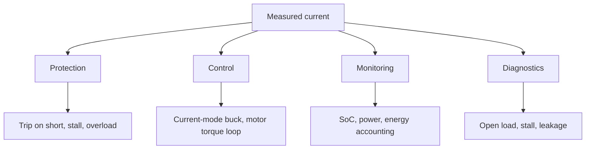

::: basics
### In plain words
Current is the quantity that heats wires, makes motor torque and tells you how much battery charge has moved. Voltage alone often cannot show these things. So products measure current for four jobs: protection (shut down on a short), control (regulate a power converter or motor), monitoring (battery charge and power) and diagnostics (spot a stalled motor or a broken wire). The job decides how fast and how accurate the measurement must be.

### Picture it
Think of the water meter on a house. It spots a burst pipe because flow suddenly jumps (protection). It can tell a pump how hard to work (control). It adds up the total for the bill (monitoring). And a flow of zero while a tap is open tells you something is blocked (diagnostics). A burst pipe needs a fast alarm, but billing needs a precise total. The analogy leaves out the heat: in electronics, the flow itself causes damage by warming the pipes.

### Words you need
- **Overcurrent protection**: shutting off when current exceeds a safe limit.
- **Torque constant ($k_t$)**: how much twisting force (newton-meters) a motor makes per amp.
- **Coulomb counting**: adding up current over time to track battery charge.
- **Stall current**: the large current a motor draws when its shaft cannot turn.
- **Offset**: a small constant error in the reading, which adds up when you integrate.

### The simplest example
Short a 12 V supply through 10 µH of wiring. The current rises at $V / L = 12 / 10\ \mu\text{H} = 1.2$ A per microsecond, so it reaches 12 A after 10 µs. A trip circuit with a 1 µs delay catches it near 1 or 2 A over the limit. A slow check every 100 µs would let it reach about 120 A. Now take battery tracking: a 10 mA offset on a 2 Ah cell is $0.01 \times 1 / 2 = 0.5\%$ of capacity per hour. That is the whole idea. The rest of this page links each job to the sensor it needs and covers why protection wants speed while metering wants low offset.
:::

::: testing
Whether you understand that current is the quantity that actually **damages hardware, produces torque, and tells you how much energy is left**, and that a product usually can't achieve those goals by watching voltage alone.

The interviewer is looking for a structured answer with distinct reasons (protection, control, monitoring/telemetry, diagnostics), each tied to a real example, not just "to know how much current there is". Bonus points for linking each reason to the sensing requirement it creates: bandwidth for protection, accuracy for metering, linearity and phase for motor control.
:::

::: why
The reason you measure current decides *how* you measure it. A fast overcurrent trip needs microsecond response and doesn't care about 5 percent accuracy; a battery fuel gauge needs 0.5 percent accuracy and a long-term stable offset but can be slow; a motor controller needs both bandwidth and linearity. Candidates who can say "I'd choose the sensing method based on which of these jobs it's doing" immediately sound like designers rather than parts-pickers. It is also the natural lead-in to protection questions ([[q0454]], [[q0459]]) later in the list.
:::

::: concepts
- **Ohm's law and power**: $P = I^2R$ heating in wires, traces, FETs and windings is driven by current, so current is the thermal stress variable. See [[q0001]].
- **Torque in a DC motor**: $\tau = k_t I$, so current is a direct proxy for torque. See the motor sections.
- **Charge conservation**: $Q = \int I\,dt$, so integrating current tracks battery charge (coulomb counting).
- **Current-mode control**: converters regulate by sensing inductor current, see [[q0225]].
- **Sensing methods**: shunt, Rds(on), Hall and so on, see [[q0439]].
- **Fault current**: a short circuit is defined by a current surge. Voltage alone doesn't reveal it fast enough.
:::

::: answer
"I measure current for four main reasons.

First, protection. Current is what overheats and destroys things, so I want a fast overcurrent limit to shut down on a short or stall before a FET, trace or connector cooks.

Second, control. In a switching converter, peak-current-mode control senses inductor current every cycle for faster response and automatic current limiting. In a motor driver, current is proportional to torque, so closing a current loop gives me torque control and smooth start-up.

Third, monitoring. A battery management system integrates current over time to estimate state of charge, and a power monitor multiplies it by voltage to report watts for power budgeting, thermal management, or billing.

Fourth, diagnostics. Current tells me whether a load is connected, if a motor is stalled, if a sensor is shorted, or if a channel has degraded, which voltage alone often can't.

The reason shapes the sensor: protection needs speed, metering needs accuracy and low offset drift, control needs bandwidth and linearity."
:::

::: technical
**Reasons, each with its governing equation.**

| Purpose | Relationship | What the sensor needs |
|---|---|---|
| Protection | $\Delta T = P\,\theta = I^2R\,\theta$; short circuits rise at $dI/dt = V/L$ | Fast response (hundreds of ns to µs), threshold accuracy ±10 to 20 percent is often fine |
| Converter control | peak/valley current mode, inductor current ramp $\Delta I = (V_{in}-V_{out})D T/L$ | Bandwidth well above switching frequency's blanking, low noise |
| Motor torque | $\tau = k_t I$, back-EMF $= k_e\omega$ | Linear, phase-accurate samples at the PWM center, bandwidth to several kHz |
| Charge / SoC | $Q = \int I\,dt$ | Low offset, low drift, high resolution at small currents |
| Power / efficiency | $P = V I$ | Accuracy at both V and I; sample simultaneously |
| Diagnostics | stall/no-load/short signatures | Moderate accuracy, detects thresholds |

**Why not just watch voltage?** A short circuit on a stiff supply may only sag the rail by a little before the supply's own current limit or the wiring heats up. The voltage across a fuse or shunt is the early and unambiguous signature. For a motor, voltage tells you the command; current tells you the actual load.

**Coulomb counting error from offset.** Integrating a measurement with a constant offset $I_{os}$ gives an error $Q_{err} = I_{os} t$. For a 2 Ah cell and a 10 mA offset, that's 0.5 percent of capacity per hour, or 12 percent per day if not corrected ($0.01\,\text{A}\times 24\,\text{h} = 0.24$ Ah). That is why fuel-gauge ICs recalibrate offset at rest and correct drift against open-circuit voltage.

**Short-circuit timing.** With 12 V across a 10 µH wiring loop, $dI/dt = 1.2$ A/µs, so the current reaches 12 A in 10 µs. A protection circuit with a 1 µs response is meaningful; one with a 1 ms response is not.
:::

::: short
"Four reasons. Protection, because current is what overheats and destroys hardware, so you need a fast overcurrent trip. Control, because converters use inductor current for current-mode control and motors produce torque proportional to current. Monitoring, because integrating current gives battery state of charge and multiplying by voltage gives power. And diagnostics, like detecting a stalled motor or missing load. The purpose sets the spec: protection wants speed, metering wants low offset, control wants bandwidth."
:::

::: long
"There are four jobs current measurement does, and each one asks for something different from the sensor.

The first is protection. Damage in electronics is mostly thermal, and heating is $I^2R$, so a short or a stall shows up as a current surge long before anything else tells you. I want a comparator that trips in microseconds, and for that I don't need great accuracy, ten or twenty percent on the threshold is fine. A cheap solution is sensing the voltage across the MOSFET or a small shunt.

The second is control. In a buck converter running peak-current-mode, sensing the inductor current each cycle gives me fast loop response and a built-in current limit. In a brushed or brushless motor, torque is proportional to current, so a current loop is how I get smooth, controllable torque and avoid slamming the supply on startup. Here I care about bandwidth, linearity, and sampling at the right point in the PWM cycle.

The third is monitoring. A battery management system integrates current to track state of charge, so it needs very low offset, because a ten milliamp offset on a 2 amp-hour cell is about half a percent of capacity per hour. And a power monitor multiplies current by voltage to report watts for thermal management or billing.

The fourth is diagnostics: a motor drawing no current is disconnected, a motor drawing stall current is jammed, and a rail with excess idle current has a leaking part.

So when someone asks how I'd sense current, the first thing I ask is which of these jobs it's doing, because that sets bandwidth, accuracy, and cost."
:::

::: terms
- **Overcurrent protection (OCP)**: shutting down or limiting when current exceeds a threshold.
- **Current-mode control**: a converter control scheme where the inner loop regulates inductor current and the outer loop sets its target.
- **Torque constant ($k_t$)**: motor constant relating torque to current, $\tau = k_t I$.
- **Coulomb counting**: integrating current over time to track charge.
- **State of charge (SoC)**: remaining battery capacity as a fraction of full.
- **Stall current**: the current a motor draws with its rotor locked, limited only by winding resistance and supply.
- **Offset drift**: a slow change in the sensor's zero reading; it integrates into large errors in coulomb counting.
- **Telemetry**: reporting measured quantities (V, I, P) to a host for monitoring or logging.
:::

::: exceptional
**An average answer** says "to protect the circuit and to know how much power it uses".

**An exceptional answer**:
- Splits the reasons into protection, control, monitoring and diagnostics, with a concrete example for each.
- Explains *why current and not voltage*: heating is $I^2R$, torque is $k_t I$, charge is $\int I\,dt$.
- Connects each purpose to a different sensor requirement (speed vs accuracy vs bandwidth).
- Gives one quantitative example such as offset error accumulating in coulomb counting, or the $dI/dt = V/L$ short-circuit rise.
- Notes the practical consequence: the same board may use *two* sensing paths, a fast coarse comparator for protection and a slow precise one for metering.
:::

::: mistakes
- **Answering only "protection".** Control and monitoring are at least as common reasons in real products.
- **Saying "voltage is enough".** Voltage tells you little about a stiff-source short or a motor's actual load.
- **Ignoring the requirements each purpose creates.** Using a 1 kHz-bandwidth, 1-percent sensor for cycle-by-cycle protection will not catch a short in time.
- **Forgetting that offset accumulates when integrating.** In SoC estimation, a small constant offset becomes a large error over hours.
- **Claiming current sensing is only for big power systems.** Even a 3.3 V microcontroller board uses it for USB limits, battery gauges and load detection.
:::

::: deep
## Why current is the variable that matters

Three physical quantities are proportional to current, which is why it keeps being the thing we need to know:

1. **Heat**: dissipation in any resistance is $I^2R$. Wire gauge, trace width, connector ratings, FET selection and fuse ratings are all current-limited, so the safe operating condition is stated in current.
2. **Force/torque**: in an electromagnetic actuator, force follows $B\,I\,\ell$. A motor's torque is $k_t I$.
3. **Charge**: $Q = \int I\,dt$. Energy storage (battery, supercap) is tracked by charge or energy, both integrals of current.


Figure: Four jobs for the same measurement. Each job puts a different demand on the sensor: speed for protection, bandwidth and linearity for control, low offset for monitoring, moderate accuracy for diagnostics.

## 1. Protection: catch it before it cooks

A short circuit across a source limited only by wiring inductance rises at $dI/dt = V/L$. With 12 V across 10 µH of loop inductance that's 1.2 A/µs. A FET with a 100 A pulse rating and a 10 µs survival time must be turned off in a few µs.

```plot
{"title":"Short-circuit current rise vs time (12 V source, 10 µH loop)","x":{"label":"Time","unit":"s","min":0,"max":"20e-6"},"y":{"label":"Current","unit":"A","min":0,"max":30},
 "vars":{"v":12,"l":"10e-6"},
 "series":[{"label":"I(t) = V t / L","fn":"v*x/l"}],
 "hlines":[{"at":12,"label":"12 A after 10 µs","color":"orange"}],
 "vlines":[{"at":"10e-6","label":"10 µs"}]}
```
Figure: With only wiring inductance limiting it, the current climbs by 1.2 A every microsecond. A comparator-based trip with ~1 µs total delay can stop it near 1 to 2 A over threshold; a slow ADC-based trip checking every 100 µs would let it reach 120 A.

Hence protection sensors are chosen for **speed and robustness**: a comparator watching the drop across a small shunt, or the drain-source voltage of the FET ([[q0448]]), with a threshold accuracy of ±10 to 20 percent. Details of design and responses are in [[q0455]] and [[q0456]].

## 2. Control: current is the inner loop

In a buck converter, the inductor current waveform is a triangle with slope $(V_{in}-V_{out})/L$ during the on-time. Sensing it each cycle gives **current-mode control**: the switch turns off when the current reaches the level requested by the voltage loop. Benefits: the inductor becomes a controlled current source, the control loop loses a pole, and each cycle is automatically current-limited ([[q0225]], [[q0226]]).

In a motor, torque $\tau = k_t I$. A brushed DC motor at stall draws $I = V/R_a$, which may be ten times its rated current. Without a current loop the supply collapses or the FET dies at start-up. A closed current loop with bandwidth of a few kHz gives controllable torque, and a speed or position loop wraps around it.

For control, the sensor needs good linearity and bandwidth, and the sampling instant should avoid switching noise, for example in the center of the PWM on-time for a low-side shunt.

## 3. Monitoring: the integrator and the multiplier

Two derived quantities:

- **Charge**: $Q(t) = Q_0 - \int I\,dt$. Fuel gauges ("coulomb counters") do this.
- **Power**: $P = VI$. Power monitors multiply simultaneous samples.

The danger is integrating error. A sensor with a constant offset $I_{os}$ makes the charge estimate walk away linearly.

```plot
{"title":"State-of-charge error from sensor offset (2 Ah cell, no correction)","x":{"label":"Time","unit":"h","min":0,"max":24},"y":{"label":"SoC error","unit":"%","min":0,"max":30},
 "vars":{"cap":2},
 "series":[{"label":"offset = 2 mA","fn":"100*0.002*x/cap"},{"label":"offset = 10 mA","fn":"100*0.01*x/cap","color":"orange"},{"label":"offset = 25 mA","fn":"100*0.025*x/cap","color":"red"}],
 "hlines":[{"at":5,"label":"5% error","color":"muted"}]}
```
Figure: A 10 mA offset reaches 5 percent SoC error after 10 hours and 12 percent after a day. This is why gauge ICs use very low-offset sensing (micro-volt-class amplifiers on a milliohm shunt) and periodically re-zero at rest.

```sim
{"id":"soc-estimator","offset":0.01,"gainErr":0.01}
```
Figure: Set offset and gain error to zero and the coulomb-counting trace tracks the true SoC; then raise only the offset and watch it drift even during the parked intervals when the load is idle (the blended estimator snaps back at each park using the open-circuit voltage). Raise only the gain error and notice the error grows only while charge is actually moving.

## 4. Diagnostics

Current signatures are cheap, informative checks:

- **Motor stall**: current climbs to $V/R_a$ while speed (back-EMF, encoder) stays zero.
- **Open load**: a load driver reading near-zero current while commanded on indicates a broken wire.
- **Short to ground/battery**: current above the nominal envelope.
- **Aging**: rising idle current in a rail can mean a leaking capacitor or damaged IC.

## How the purpose sets the sensor

| Job | Speed | Accuracy | Offset | Typical choice |
|---|---|---|---|---|
| Fast protection | 100 ns to 5 µs | ±10 to 20% | not critical | Comparator on FET $V_{DS}$ or small shunt |
| Current-mode control | ≥ switching rate | ±5% | moderate | Rds(on), DCR or SenseFET |
| Motor torque | 10 to 100 µs | ±1 to 2% | moderate | Shunt + CSA, sampled in PWM |
| Fuel gauge | seconds | ±0.5% | very low | µV-offset shunt amplifier, or integrated gauge |
| Power telemetry | ms | ±1% | low | High-side shunt + digital monitor |

Many boards therefore have **two** current paths: a quick comparator for protection and a precise amplified path to the ADC for control or reporting. That redundancy is deliberate, not wasteful.
:::

::: applications
- **Laptop and phone charging**: the charger IC regulates constant current in the CC phase, then tapers it. It also limits input current to the USB or adapter rating.
- **BLDC/servo drives**: phase-current sensing for field-oriented control and torque limiting.
- **Smartphone fuel gauges**: coulomb counters with milliohm shunts report remaining capacity.
- **Hot-swap and eFuse controllers**: sense inrush current and trip within microseconds on a short.
- **Data-center power monitors**: report rail current and power to a baseboard management controller for capping and billing.
- **Battery-powered IoT**: measuring microamp sleep current to validate battery life.
:::

::: assumptions
- Assumes a general electronics context where current is the dominant stress variable. In very high-voltage or RF systems, voltage or power may be the main constraint instead.
- "Control" is taken to include both power conversion and motor drives; the details differ ([[q0225]] for bucks).
- Numbers such as 10 µH of loop inductance and 12 V are illustrative; real supplies often have current limits, resistance, or inductance that change the slope.
- If the interviewer is thinking about **lab measurement** (why measure current on the bench: power budgeting, validating sleep current, finding shorts), the same four categories still apply, with "validation" and "debugging" added.

> [!UNCERTAIN]
> Required protection response times depend on the device's short-circuit withstand time, which is vendor and part specific. Treat the "few µs" figure as a typical order of magnitude, not a rule.
:::

::: followups
### Why not just use a fuse for protection?
A fuse is a one-shot, slow, and imprecise device. It protects against fire but not against transient overloads you want to ride through, and it needs replacing. Electronic protection (comparator + FET or eFuse) trips fast, resets automatically, and can be programmed. Fuses are still used as a final backstop where safety standards require.

### What bandwidth do you need for motor current sensing?
The loop crossover is usually a few kHz up to 10 kHz for a servo, and the measurement should be at least about 10x that, say 50 to 100 kHz, with sampling synchronized to the PWM. If PWM is at 20 kHz, you typically take one sample per PWM period at the center of the low-side on-time to avoid switching spikes.

### How accurate does a battery fuel gauge's current measurement need to be?
Enough that errors don't accumulate: sub-percent gain error and an offset well under the standby current. For a 2 Ah cell, a 1 mA offset is 0.05 percent per hour, or about 1.2 percent per day, which can be corrected by periodic recalibration against open-circuit voltage.

### Scenario: your product occasionally resets when a motor starts. How could current measurement help diagnose it?
Put a scope on the supply current with a current probe or use a shunt. A start-up inrush or stall spike probably pulls the supply down, causing a brownout reset. Seeing a 10 A spike for 20 ms on a 3 A-rated rail confirms it. Fixes: soft start via current-limited PWM ramp, larger bulk capacitance, or current limiting in firmware using the existing current sensor.

### What if you can only afford one current sensing path for both protection and metering?
Then compromise at the sensor: use a shunt with a fast amplifier and route its output both to a comparator (for protection) and to the ADC (for metering). The shunt value is sized for the metering resolution and the comparator threshold is set above full scale, with careful attention to amplifier saturation and recovery time so a short doesn't leave the output stuck.
:::

::: references
- Erickson & Maksimovic, *Fundamentals of Power Electronics*: chapters on current-programmed control.
- Mohan, Undeland & Robbins, *Power Electronics: Converters, Applications, and Design*: sections on converter protection and control.
- Krishnan, *Electric Motor Drives*: current control and torque production in DC and AC drives.
- Fuel-gauge and battery-monitor datasheets from major IC vendors (coulomb-counting architecture sections).
:::

::: rubric
- Gives protection as a reason and links it to current causing damage ($I^2R$ heating, short circuits) :: Protection is the canonical answer, and the physical reason shows understanding.
- Gives control as a reason, with a concrete example (current-mode converter or motor torque) :: Shows that sensing is part of the feedback loop, not just monitoring.
- Gives monitoring/telemetry (SoC by coulomb counting, power) :: Covers the accuracy-critical use case.
- Mentions diagnostics (stall, open load, leakage) :: Rounds out a complete answer.
- Ties the purpose to sensor requirements (speed, accuracy, bandwidth, offset) :: This is what makes the answer useful to a designer.
- Includes a number (short-circuit $dI/dt$, offset drift, torque relation) :: Quantification signals engineering depth.
- Notes why voltage is not sufficient :: Anticipates the obvious "why not just measure voltage" follow-up.
:::

::: quiz
```json
[
 {"type":"mcq","level":"fundamental","q":"A DC motor's torque is proportional to which measurable electrical quantity?","options":["Supply voltage","Winding current","Back-EMF","Switching frequency"],"answer":1,"explain":"$\\tau = k_t I$. Voltage sets speed (through back-EMF), but torque tracks current, which is why a current loop gives torque control."},
 {"type":"mcq","level":"fundamental","q":"Which purpose most demands a *fast* current measurement (sub-microsecond to a few µs)?","options":["Battery state-of-charge tracking","Short-circuit protection","Monthly energy billing","Idle-current logging"],"answer":1,"explain":"A short circuit's current rises at $V/L$, often amps per microsecond, so the trip must be fast. SoC, billing and logging can average over seconds."},
 {"type":"numeric","level":"intermediate","q":"A current sensor has a constant +20 mA offset and is used to coulomb-count a 4 Ah battery. By what percentage of capacity does the SoC estimate drift in 10 hours?","answer":5,"tolerance":0.02,"unit":"%","explain":"Error charge $= 0.02\\ \\text{A}\\times 10\\ \\text{h} = 0.2$ Ah. $0.2/4 = 5\\%$."},
 {"type":"numeric","level":"intermediate","q":"A 24 V rail shorts through 20 µH of loop inductance (assume nothing else limits the current). How many amps flow after 5 µs?","answer":6,"tolerance":0.02,"unit":"A","explain":"$I = V t/L = 24 \\times 5\\text{e-}6 / 20\\text{e-}6 = 6$ A."},
 {"type":"multi","level":"intermediate","q":"Select the jobs for which integrating or amplifying a small current accurately (low offset) matters most.","options":["Coulomb counting in a fuel gauge","Detecting a hard short with a comparator","Measuring microamp sleep current","Precision power telemetry"],"answer":[0,2,3],"explain":"Low offset matters when currents are small or integrated over time: fuel gauges, sleep-current measurement, and power telemetry. A hard short is a huge current where a 10 to 20 percent threshold is fine."},
 {"type":"truefalse","level":"advanced","q":"A precise, slow current measurement is a good substitute for a fast comparator in short-circuit protection.","answer":false,"explain":"A slow measurement (for example an ADC sampled every 100 µs or filtered at 1 kHz) lets a short climb at amps per microsecond to destructive levels before the firmware reacts. Protection needs speed; metering needs accuracy. Boards often use both."}
]
```
:::
