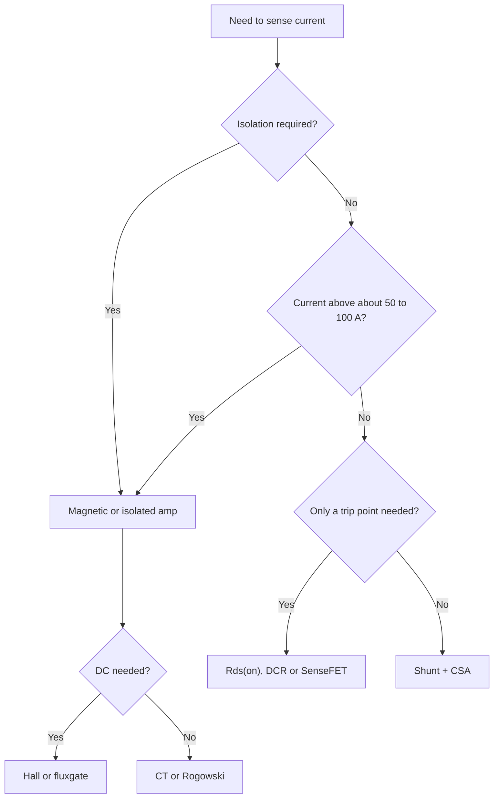

::: basics
### In plain words
There is no single best current sensor. Each method trades accuracy, power loss, speed, DC ability, isolation and cost. A shunt resistor with an amplifier is the accurate, cheap default but wastes power as current grows and has no isolation. Reusing the resistance of a transistor switch is free but rough. Magnetic sensors give isolation and handle large current but cost more and are poor at small currents. You pick by the current, the isolation need and the smallest current you care about.

### Picture it
Think of choosing a vehicle. A bicycle is cheap, precise and fine for a light load, but it is hopeless for hauling bricks. A truck carries any load but is costly and clumsy for small trips. A shunt is the bicycle and a magnetic sensor is the truck. Using the free resistance of a MOSFET is like borrowing a neighbor's bike: no cost, but you cannot count on its condition. Many boards combine two: a cheap fast path and a precise slow one.

### Words you need
- **Insertion loss**: the voltage and power a sensor takes from the circuit, $I^2 R$ for a shunt. See [[q0443]].
- **Offset**: a small fixed zero error, which matters more as the current gets smaller. See [[q0445]].
- **DC capability**: whether the sensor can read steady current.
- **Isolation**: no conductive path between the measured circuit and the electronics.
- **Rds(on) sensing**: using a MOSFET's own on-resistance as the sense resistor. See [[q0448]].

### The simplest example
A 2 mΩ shunt at 100 A burns $100^2 \times 0.002 = 20$ W, but at 10 A it burns only 0.2 W, so shunts stop scaling at high current. Now compare small-current accuracy. A 10 mΩ shunt with a 100 µV amplifier offset has an equivalent error of $0.0001 / 0.01 = 10$ mA. A Hall sensor with 66 mV per amp and 15 mV of offset has an error of about 227 mA. At 100 mA, the shunt is much better. That is the whole idea. The rest of this page compares the methods on six axes and ends with recommendations.
:::

::: testing
Whether you can **compare engineering options along the axes that matter** and then make a recommendation, rather than reciting "pros and cons" for each in isolation. The axes are: accuracy (including at small currents), insertion loss, bandwidth/speed, DC capability, isolation, cost and size, and robustness to overload.

The interviewer is also checking that you know the *boundaries*: where a shunt stops being sensible (very high current, isolation, high voltage), and where "free" methods like Rds(on) are good enough (protection) versus not (metering).
:::

::: why
In a real design review nobody asks "what is a Hall sensor?"; they ask "why a Hall sensor and not a shunt for this 60 A bus?" The tradeoff answer is the decision. Choosing wrong costs real money: a shunt in a 100 A line dissipates tens of watts, while a Hall sensor on a 1 A battery rail has an offset larger than the signal. This question is the synthesis of [[q0439]] (the menu), [[q0441]] (magnetic sensing) and [[q0443]] to [[q0448]] (the resistive options).
:::

::: concepts
- **Insertion loss**: a sense element in series dissipates $I^2R_s$ and drops $IR_s$. See [[q0443]].
- **Offset vs signal size**: a fixed offset is a bigger error fraction when the signal is small, so shunt value and sensor offset set the *low-current* accuracy. See [[q0445]].
- **DC capability**: resistive and Hall/fluxgate sensors see DC; transformers and Rogowski coils don't. See [[q0441]].
- **Isolation**: magnetic sensors are isolated by construction; resistive sensors need an isolated amplifier to cross a barrier.
- **Common-mode voltage**: for resistive sensing, where the shunt sits (high or low side) sets the common-mode range the amplifier must handle. See [[q0447]].
- **Speed and bandwidth**: protection wants nanosecond-to-microsecond response; metering can be slow.
:::

::: answer
"I compare them on accuracy, loss, bandwidth, DC capability, isolation and cost.

A shunt resistor with a current sense amp is the default: very accurate, linear, DC to hundreds of kilohertz, cheap, and small. Its costs are $I^2R$ loss, a voltage drop in the path, and no isolation. It scales badly above about 50 to 100 amps.

Sensing across a MOSFET's Rds(on) or an inductor's DCR is free in terms of loss and parts, but it's only accurate to maybe 10 to 20 percent because the resistance moves with temperature. That's fine for overcurrent protection and peak current mode, not for metering.

Magnetic sensors, Hall and current transformers, give isolation and negligible loss and can handle hundreds of amps. But they cost more, take more board space, have offset and temperature drift, and are poor at small currents. A CT is AC only.

So my rule: low voltage and moderate current, shunt plus CSA. Need isolation or very high current, Hall or CT. Just need a trip point, use Rds(on) or the inductor. The deciding factors are always accuracy at the smallest current I care about, power budget, and whether there's a safety barrier."
:::

::: technical
**Comparison table** (typical figures; vendor- and design-dependent).

| Method | Typical accuracy | Insertion loss | Bandwidth | DC | Isolated | Cost/size |
|---|---|---|---|---|---|---|
| Shunt + CSA | 0.1 to 1% (offset-limited at low I) | $I^2R_s$ | DC to ~hundreds kHz (CSA-limited) | Yes | No | Low |
| Rds(on) | 10 to 30% uncalibrated | none | fast (blanking-limited) | Yes (when on) | No | Free |
| Inductor DCR (RC) | 5 to 10% | none | up to converter bandwidth | Yes | No | Low |
| SenseFET | 3 to 10% | none | fast | Yes | No | Free (in IC) |
| Open-loop Hall | 1 to 3% | small (integrated conductor, mΩ-class) | DC to tens of kHz | Yes | Yes | Moderate |
| Closed-loop Hall / fluxgate | 0.1 to 1% | small | DC to 100s of kHz | Yes | Yes | High |
| CT | 0.5 to 1% (AC) | ~0 | ~50 Hz to 100s of kHz | No | Yes | Low |
| Rogowski | 1% (AC, with integrator) | 0 | up to MHz | No | Yes | Moderate |

**Loss scaling.** Shunt loss $P = I^2R_s$ grows with the square of current, while magnetic sensors have a fixed bias/quiescent cost plus a (tiny) primary resistance. A 2 mΩ shunt at 100 A burns 20 W. At 10 A, the same shunt burns 0.2 W.

**Low-current accuracy.** Equivalent current error from amplifier or sensor offset is $I_{err} = V_{os}/R_s$ for a shunt and $V_{os}/S$ for a Hall sensor with sensitivity $S$ (V/A). With $V_{os} = 100\ \mu\text{V}$ on 10 mΩ: 10 mA. With 15 mV on 66 mV/A: 227 mA. So shunts win by 20x at small currents.

**Common-mode.** Resistive sensing puts the sense voltage on top of the bus: a 48 V bus needs a CSA with 48 V common-mode range and enough CMRR (about 114 dB to keep a 10 mV signal's error under 1 percent for a 48 V swing, see [[q0447]]).
:::

::: short
"A shunt plus current-sense amp is the accurate, cheap, DC-capable default, but it dissipates I-squared-R and has no isolation. Rds(on) or inductor DCR sensing is lossless and free but only 10 to 20 percent accurate, so it's for protection. Hall and CT sensors give isolation, no loss and high current range, but cost more, drift, and are poor at low current, and CTs are AC only. I'd choose by current level, isolation need, accuracy at the lowest current, and power budget."
:::

::: long
"I'd compare them along six axes: accuracy, power loss, bandwidth, DC capability, isolation, and cost, and then pick based on which ones the product actually cares about.

Start with the shunt plus current-sense amplifier. It's the most accurate low-cost option, usually better than a percent, it's linear, it works down to DC and up to a few hundred kilohertz, and it's tiny. The downsides are that it burns $I^2R$, it drops voltage in the supply path, and it isn't isolated. At 100 amps even a 2 milliohm shunt is 20 watts, so it stops scaling.

Next, the 'free' resistances. Sensing across a MOSFET's on-resistance or an inductor's DCR adds no loss or components, and it's fast. But Rds(on) changes roughly 50 percent over temperature, and varies from part to part, so you get 10 to 20 percent accuracy. That's perfect for cycle-by-cycle current limit or short-circuit protection, and not good enough for fuel gauging.

Then magnetic sensors. A Hall sensor reads the field of the current, so it's isolated, has negligible loss, and works at DC. A CT is even simpler and lossless, but AC only. The costs are money, board space, offset and temperature drift, and stray-field sensitivity. A Hall sensor's offset might equal 200 milliamps of error, so it's bad at small currents where a shunt shines.

My selection logic: if it's low voltage and under 50 amps, shunt and CSA. If I need isolation or hundreds of amps, Hall or CT. If I just need a trip threshold, Rds(on) or inductor DCR. And in many designs I use two: a fast cheap one for protection and an accurate one for metering."
:::

::: terms
- **Insertion loss / burden**: power and voltage drop a sensor adds to the circuit being measured.
- **Equivalent input offset current**: offset voltage divided by sensitivity, $V_{os}/R_s$ or $V_{os}/S$. It sets accuracy at low current.
- **Bandwidth**: highest frequency the sensor tracks within a stated error; sets whether it can be used for protection or control.
- **Galvanic isolation**: no conductive path between the measured circuit and the electronics.
- **Dynamic range**: ratio of the largest to smallest current measured at useful accuracy.
- **Temperature coefficient**: fractional change per °C; ~50 ppm/°C for good shunts vs thousands of ppm/°C for Rds(on) and copper.
- **Cycle-by-cycle limiting**: shutting each switching pulse when current crosses a threshold; needs fast, not necessarily precise, sensing.
- **Closed-loop sensor**: sensor that nulls the field with a compensation winding, trading cost for accuracy.
:::

::: exceptional
**An average answer** says "shunts are simple but lossy, Hall sensors are isolated but expensive".

**An exceptional answer**:
- Compares along named axes and fills the table with numbers (10 to 20 percent for Rds(on), about 20 W for 2 mΩ at 100 A).
- Highlights the crossover point: loss grows as $I^2$ for shunts, so above roughly 50 to 100 A (or when isolation is needed) magnetic sensing wins.
- Explains the low-current asymmetry: the shunt's equivalent offset current (10 mA) vs a Hall sensor's (hundreds of mA).
- Separates *protection* sensing (speed, ±10 to 20 percent) from *metering* sensing (offset, drift, resolution).
- Recommends by scenario and mentions combining two paths (fast comparator plus precise ADC path).
:::

::: mistakes
- **Declaring a winner.** There is no best sensor, only the best for a given current, isolation need, accuracy and budget.
- **Forgetting low-current accuracy.** Hall sensors look great at 30 A and awful at 100 mA because of offset.
- **Quoting only the shunt's resistor tolerance.** Real accuracy includes amplifier offset and gain error, tempco, thermal EMF and layout (Kelvin).
- **Saying Hall sensors are lossless.** Integrated parts have a primary conductor with mΩ-class resistance and a supply current.
- **Using Rds(on) for metering.** It's too temperature- and part-dependent unless calibrated and compensated.
- **Overlooking isolation as a pass/fail requirement.** If safety standards demand isolation, shunts need an isolated amplifier or modulator, or you switch to magnetic.
:::

::: deep
## A framework: decide by five questions

Before comparing parts, ask the questions that fork the decision:

1. **How much current, and what range?** (sets loss and signal size)
2. **Is there a safety barrier or a floating high-voltage bus?** (sets isolation)
3. **DC or AC only?** (rules out CTs and Rogowski coils for DC)
4. **How accurate must it be at the *smallest* current of interest?** (sets offset budget)
5. **Is it for protection, control, or metering?** (sets speed vs accuracy)


Figure: A first-pass decision flow. It is a heuristic, not a law: exceptions such as a 5 A mains line (CT or isolated shunt amplifier) or a 150 A battery pack with a busbar shunt are common.

## Axis 1: power loss and why current level matters

A shunt dissipates $P = I^2R_s$. To keep a fixed voltage drop you'd scale $R_s \propto 1/I$ and then $P = V_{drop}\cdot I$ still grows linearly with $I$. In practice the sense signal needs a minimum voltage (to beat offset), so loss scales up with current.

```plot
{"title":"Sensor power loss vs current","x":{"label":"Load current","unit":"A","min":1,"max":200,"log":true},"y":{"label":"Dissipation","unit":"W","min":0.01,"max":100,"log":true},
 "series":[{"label":"Shunt 1 mΩ","fn":"x*x*0.001"},{"label":"Shunt 5 mΩ","fn":"x*x*0.005","color":"orange"},{"label":"Shunt 20 mΩ","fn":"x*x*0.02","color":"red"},{"label":"Integrated Hall (≈1 mΩ + 50 mW)","fn":"x*x*0.001+0.05","color":"green","dashed":true}],
 "hlines":[{"at":1,"label":"1 W: typical single-resistor limit","color":"muted"}]}
```
Figure: Loss scales as I². A 5 mΩ shunt crosses 1 W near 14 A, and a 20 mΩ shunt near 7 A. The integrated Hall curve assumes a ≈1 mΩ primary plus 50 mW of supply power, so it is about the same as a 1 mΩ shunt at high current: Hall's real advantage is isolation and range, not necessarily lower loss.

> [!UNCERTAIN]
> Integrated Hall sensors list their internal conductor resistance in the datasheet; around 1 mΩ is common for ±30 A class parts but check your device.

The real trade is not "Hall has no loss" but "a shunt with enough resistance to give signal at low current becomes impractical at high current". A very-low-value busbar shunt (for example 50 µΩ) at 400 A burns 8 W and gives 20 mV, which needs a very low-offset amplifier, whereas a Hall sensor gives a large output with no such constraint.

## Axis 2: accuracy depends on the current you care about

All sensors have a gain error (a percent of reading) and an offset error (a fixed number of amps). Total error at a current $I$ is roughly

$$\varepsilon(I) \approx \varepsilon_{gain} + \frac{I_{offset}}{I}$$

| Method | Gain error | Equivalent offset current |
|---|---|---|
| 10 mΩ shunt + CSA ($V_{os}$ = 100 µV) | 0.5% | 10 mA |
| 1 mΩ shunt + CSA ($V_{os}$ = 100 µV) | 0.5% | 100 mA |
| Open-loop Hall (66 mV/A, 15 mV offset) | 1% | 227 mA |
| Rds(on) (5 mΩ, comparator offset 5 mV) | 20 to 40% | 1 A |
| Closed-loop Hall (precision) | 0.2% | tens of mA |

At a 100 mA reading, the 10 mΩ shunt is ~10.5 percent off from offset alone, the Hall sensor over 200 percent. At 10 A, both are within a couple of percent. The plot in [[q0441]] shows this effect directly.

## Axis 3: speed, bandwidth and what limits it

- **Rds(on), SenseFET**: effectively instantaneous, but you must blank the switching edge (ringing and the transition produce false readings), typically 50 to 200 ns.
- **Shunt + CSA**: limited by CSA bandwidth and settling (often 100 kHz to a few MHz at low gain, falling with gain) and by shunt inductance for large $dI/dt$ ([[q0444]]).
- **Hall**: open-loop tens of kHz; closed-loop up to hundreds of kHz; both have delay of a few µs.
- **CT/Rogowski**: set by magnetizing inductance (low end) and leakage/self-resonance (high end).

For short-circuit protection in a motor drive you may use a desaturation (V_DS) comparator at ~1 µs plus a precise shunt channel for control. That is the "two paths" idea.

## Axis 4: isolation and common mode

A shunt directly connects the electronics to the bus. If that bus floats at 400 V relative to the controller, the CSA must be an isolated one (isolated amplifier or delta-sigma modulator), which costs and adds delay. A Hall sensor or CT crosses the barrier magnetically for free. For high-side shunts on a 48 V bus, a CSA with a 48 V common-mode range and ~100 dB CMRR is cheap and fine. Where each applies is in [[q0447]].

## Axis 5: cost, size, robustness

A shunt and CSA is a few tenths of a dollar to a dollar. Hall sensors cost more (a dollar or two for integrated; tens of dollars for closed-loop modules). Shunts survive huge overcurrent for short times (their resistance is metal), while Rds(on) sensing relies on the FET staying on, and Hall cores can saturate or get magnetized by a fault, shifting offset afterwards.

## Putting it together: three scenarios

1. **3S Li-ion pack, 5 A, fuel gauge.** Low-side 10 mΩ shunt + a low-offset gauge IC. Offset (10 mA equivalent) matters because the gauge integrates.
2. **48 V e-bike motor, 40 A.** Low-side phase shunts at 1 mΩ with CSAs (around 40 mV at full current), plus Rds(on) comparator as backup protection. Shunt loss is $40^2\times0.001 = 1.6$ W per shunt, tolerable.
3. **Three-phase 400 V drive, 100 A.** Isolated Hall or isolated shunt amplifiers on each phase. Shunts would need an isolated modulator; the cost balance is closer than people think.

```sim
{"id":"current-sense","imax":40,"imin":0.5,"rsense":0.001,"gain":50,"bits":12,"vref":3.3,"side":"low"}
```
Figure: The 48 V e-bike example: 40 A in 1 mΩ gives 40 mV, 2.0 V after the gain of 50, about 16 mA per ADC count, and 1.6 W in the shunt, which the sim flags against its default 1 W rating (pick the 2 or 3 W rating). Now increase $R_{sense}$ to 10 mΩ: the amplifier clips above about 6.5 A and the shunt would burn 16 W. Then switch to the high side and raise the bus voltage to 48 V: the INA180-class amplifier is outside its 26 V common-mode range, so select the INA240-class part.
:::

::: applications
- **Phone/laptop battery gauges**: milliohm shunt plus low-offset coulomb counter; accuracy at low currents dominates.
- **Buck converter controllers**: SenseFET or inductor DCR for peak current limit, because speed beats accuracy.
- **Industrial servo drives**: isolated shunt amplifiers or closed-loop Hall on each phase for torque control.
- **EV battery packs**: busbar shunt with isolated measurement, or Hall sensors, plus a redundant path for safety.
- **Smart plugs and meters**: shunt with isolated measurement IC, or CT for mains measurement.
- **Solar inverters**: Hall or CT sensors for AC output, shunts on DC inputs.
:::

::: assumptions
- Numbers (accuracy, bandwidth) are typical for commonly available parts and shift considerably with grade and vendor.
- "Shunt" assumes a proper Kelvin-connected, low-TCR, metal-element resistor with a good amplifier, not a trace or a cheap thick-film chip.
- The 50 to 100 A crossover is a guideline: with good thermal design, busbar shunts operate at hundreds of amps, and some isolated products use shunts at very low currents.
- This comparison assumes a single conductor and no unusual environment. High-EMI, high-temperature, or high-vibration conditions favor or penalize different sensors.

> [!UNCERTAIN]
> Accuracy and bandwidth ranges in the table are order-of-magnitude typical values. Check the specific part's datasheet before using them in a design.
:::

::: followups
### When would you choose a Hall sensor over a shunt at 20 A?
When isolation is required (mains or a high-voltage floating bus), when the sensor must be remote from the power conductor, or when the board can't dissipate the shunt's heat. At 20 A a 2 mΩ shunt dissipates 0.8 W, which is manageable, so absent an isolation need I'd still use the shunt for better accuracy at low currents.

### Why is Rds(on) sensing unsuitable for a fuel gauge?
A fuel gauge integrates current for hours, so it needs small offset and gain error over temperature. Rds(on) changes by tens of percent with temperature, varies part to part, and can only be sensed while the FET is on. Any systematic error integrates into SoC drift.

### What's the cheapest way to add overcurrent protection to a motor driver?
Use the FET's drain-source voltage: a comparator watching $V_{DS}$ against a threshold (many gate-driver ICs include this as a VDS-monitor or desaturation function). It adds no loss or resistor, responds in hundreds of nanoseconds to microseconds, and is accurate enough for ±20 percent protection.

### Scenario: your shunt-based measurement is accurate at 20 A but reads 30 percent high at 200 mA. What's going on and what would you change?
An offset: the equivalent offset current is about 60 mA (30 percent of 200 mA), so the amplifier or shunt-layout offset is 60 mA times the shunt resistance, for example 600 µV on 10 mΩ, which is plausible for an amplifier with poor offset, thermoelectric EMFs, or a leakage path. Fix with a zero-drift CSA, calibrate the zero-current reading in firmware, or increase the shunt resistance (accepting more loss) or use a two-range design.

### What if you need both fast protection and accurate metering?
Use two sensing paths from the same shunt or different elements: a comparator or a fast low-gain CSA output for protection, and a higher-gain, filtered, precise channel to the ADC for metering. This avoids asking one amplifier to be both fast and low-noise/precise.
:::

::: interpretations
"Describe tradeoffs between different current sensing mechanisms" is open-ended. The safe reading is: sense resistor (shunt), Rds(on)/DCR (lossless parasitic), and magnetic (Hall/CT/Rogowski), compared on accuracy, loss, speed, isolation, DC support and cost. Individual deep dives are on the neighbouring pages: [[q0441]] (magnetic), [[q0444]] (shunt pros and cons) and [[q0448]] (Rds(on)). Answer at the family level first, then offer to go deeper on one.
:::

::: references
- Horowitz & Hill, *The Art of Electronics*, 3rd ed.: current-sensing and instrumentation amplifier sections.
- Erickson & Maksimovic, *Fundamentals of Power Electronics*: current-sensing discussion within current-programmed control.
- Texas Instruments and Analog Devices current-sense amplifier datasheets and application material (shunt-based sensing).
- Hall-effect and fluxgate current sensor datasheets from major vendors (Allegro, LEM) for representative specifications.
:::

::: rubric
- Compares on explicit axes (accuracy, loss, bandwidth, DC, isolation, cost) :: Structured comparison is what the question is asking for.
- Gives the shunt's pros (accurate, simple, DC to high f) and cons (loss, no isolation, drop) :: The baseline against which all others are judged.
- Covers Rds(on) or DCR as lossless but inaccurate and temperature dependent :: Shows knowledge of protection-grade methods.
- Covers Hall and CT/Rogowski with DC capability and isolation, and their costs :: Completes the three families.
- Notes low-current accuracy and offset as a decisive axis :: A subtle point that separates experience from textbook knowledge.
- Notes $I^2R$ scaling and the current level where shunts stop making sense :: Quantifies the crossover.
- Ends with a scenario-based recommendation :: Tradeoff questions are about making the decision.
:::

::: quiz
```json
[
 {"type":"mcq","level":"fundamental","q":"Which sensing method adds essentially no insertion loss and is fast, but is only accurate to roughly 10 to 30 percent?","options":["Precision shunt resistor","Closed-loop Hall sensor","MOSFET Rds(on) sensing","Current transformer"],"answer":2,"explain":"Rds(on) sensing reuses the FET's own resistance, so there is no added loss, but Rds(on) varies with temperature and part-to-part. A shunt and a closed-loop Hall are accurate; a CT is accurate but AC-only."},
 {"type":"numeric","level":"fundamental","q":"A 2 mΩ shunt carries 100 A. What is its power dissipation?","answer":20,"tolerance":0.02,"unit":"W","explain":"$P = I^2R = 10^4 \\times 0.002 = 20$ W. The drop is 200 mV."},
 {"type":"mcq","level":"intermediate","q":"You must measure 40 A DC on a floating 400 V bus with the controller on a different ground. Which is the most natural solution?","options":["Low-side shunt and a standard CSA","Hall-effect sensor or isolated shunt amplifier","Current transformer","Rogowski coil"],"answer":1,"explain":"The barrier requires isolation, and the current is DC. Hall sensors (or an isolated amplifier on a shunt) work at DC. CTs and Rogowski coils can't do DC, and a standard CSA isn't isolated."},
 {"type":"numeric","level":"intermediate","q":"A Hall sensor has 100 mV/A sensitivity and 25 mV offset. Ignoring gain error, what is the error at a 500 mA reading, as a percentage?","answer":50,"tolerance":0.02,"unit":"%","explain":"Offset current $= 0.025/0.1 = 0.25$ A. At 0.5 A, that is 50 percent."},
 {"type":"multi","level":"intermediate","q":"Select the methods that can measure DC current.","options":["Shunt + CSA","Current transformer","Closed-loop Hall","Rogowski coil"],"answer":[0,2],"explain":"The shunt (Ohm's law) and Hall (static field) respond to DC. CTs and Rogowski coils depend on a changing flux, so they measure AC only."},
 {"type":"truefalse","level":"advanced","q":"Because shunt power scales as I squared, a shunt always loses to a Hall sensor above 20 A.","answer":false,"explain":"Integrated Hall sensors also have mΩ-class conductor resistance, so their loss at 30 A is comparable to a 1 mΩ shunt. Hall wins when you need isolation or very high current, not automatically at 20 A. A properly designed 1 to 2 mΩ shunt at 20 A dissipates under 1 W and offers better small-current accuracy."}
]
```
:::
