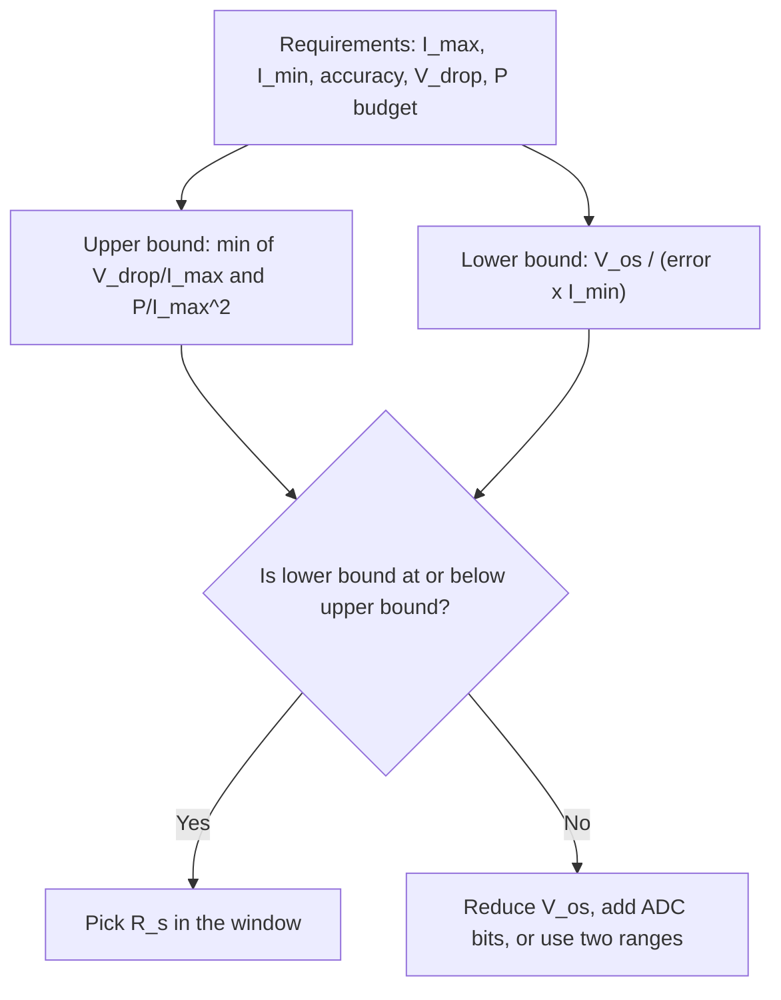

::: basics
### In plain words
Choosing a sense resistor means finding a value that fits inside a window. If it is too large, it wastes power, drops the load voltage and heats up. If it is too small, the signal at low current disappears into noise and the amplifier's offset (its small built-in zero error). The allowed drop and power at full current set the upper limit; the smallest current you must measure sets the lower limit. Then you pick power rating, tolerance and construction.

### Picture it
Picture adjusting the opening of a turnstile that counts people. Too narrow and it jams the crowd and gets hot. Too wide and the counter cannot tell a person from a gust of wind. In between, it counts well without slowing anyone. Sometimes no setting works, and you need a better counter.

### Words you need
- **Sense voltage**: the voltage across the shunt at full current, $I_{max} R_s$. See [[q0443]].
- **Power derating**: running a part well below its rated power, so it stays cool and accurate.
- **Equivalent offset current**: $V_{os} / R_s$, the smallest current distinguishable from the amplifier's offset.
- **TCR**: how much the resistance drifts with temperature. See [[q0444]].
- **Four-terminal resistor**: a part with separate pads for current and sensing.

### The simplest example
Take $I_{max} = 10$ A with a drop of at most 100 mV and a power budget of 0.5 W. The drop limit gives $0.1 / 10 = 10$ mΩ. The power limit gives $0.5 / 100 = 5$ mΩ, so the upper bound is 5 mΩ. Now require 1% accuracy at 0.1 A. With a 100 µV offset, the lower bound is $10^{-4} / (0.01 \times 0.1) = 100$ mΩ, which is above the upper bound, so the window is empty. With a 5 µV zero-drift amplifier the lower bound drops to 5 mΩ, and the design works. That is the whole idea. The rest of this page covers the rest of the spec and how to fix an empty window.
:::

::: testing
Whether you can turn a requirement ("sense 0.1 to 10 A with 1 percent accuracy on a 12 V rail") into a specific resistor: value, power rating, tolerance, TCR, construction, and package, and whether you can reason about the consequence of picking the value too high or too low.

This is a design-trade-off question. The key insight the interviewer wants is that **the value has an upper bound set by loss and drop and a lower bound set by signal versus offset/noise/resolution**, and that you choose inside that window.
:::

::: why
Picking the shunt is the first design decision in any current-sense chain, and it ripples through everything else: the amplifier gain ([[q0453]]), the ADC range ([[q0446]]), thermal design, and layout. Get it too big and you burn watts and sag the load; too small and your lowest current disappears into the offset. Engineers who can walk through this window quickly (in an interview or a design review) are the ones who don't have to respin boards.
:::

::: concepts
- **Ohm's law and power**: $V_s = IR_s$ and $P = I^2R_s$ set the upper bound. See [[q0443]].
- **Offset and resolution**: low-current accuracy sets the lower bound: $I_{min} \gtrsim V_{os}/(\varepsilon R_s)$. See [[q0444]].
- **Power derating**: continuous rating falls with temperature; run at 50 percent or less of rating for accuracy.
- **TCR and tolerance**: determine gain accuracy over temperature.
- **ESL and construction**: metal-strip, reverse-geometry and 4-terminal types for low inductance and Kelvin sensing.
- **ADC range**: the amplified signal must fit the converter. See [[q0446]] and [[q0453]].
:::

::: answer
"I spec it in three steps. First, I find the window for the resistance value. The upper limit comes from how much voltage drop and power I'm willing to waste at maximum current: $R_{max} = \min(V_{drop}/I_{max},\ P_{budget}/I_{max}^2)$. The lower limit comes from the smallest current I need to resolve accurately: the signal $I_{min}R_s$ has to be comfortably bigger than the amplifier's offset and the ADC's step, so $R_{min} = V_{os}/(\varepsilon I_{min})$ for an error target $\varepsilon$.

Then I choose the value in that window, usually toward the middle or at the largest affordable value, and spec the rest: power rating at least twice $I_{max}^2R$ with derating for temperature, 0.5 to 1 percent tolerance, a low TCR of 25 to 100 ppm per degree, low inductance for switching circuits, and a four-terminal or Kelvin-pad package.

If it's too big, I waste power, drop the load voltage, and may overheat it. If it's too small, the signal is lost in offset and noise at low current and I get poor resolution, so I'd need a lower-offset amplifier or more gain."
:::

::: technical
**Value window.**

Upper bound (loss, drop, thermal): 
$$R_{s,max} = \min\!\left(\frac{V_{drop,max}}{I_{max}},\ \frac{P_{max}}{I_{max}^2}\right)$$

Lower bound (offset/accuracy at $I_{min}$ for error fraction $\varepsilon$):
$$R_{s,min} = \frac{V_{os}}{\varepsilon\, I_{min}}$$

Plus resolution: one ADC LSB corresponds to $\Delta I = \frac{V_{LSB}}{G R_s}$.

**Example.** $I_{max} = 10$ A, $I_{min} = 0.1$ A, drop ≤ 100 mV, loss ≤ 0.5 W, target 1 percent at $I_{min}$.
- $R_{max} = \min(0.1/10,\ 0.5/100) = \min(10\ \text{m}\Omega,\ 5\ \text{m}\Omega) = 5$ mΩ.
- With a 100 µV-offset amp: $R_{min} = 10^{-4}/(0.01\times0.1) = 100$ mΩ. **Window is empty.**
- With a 5 µV zero-drift amp: $R_{min} = 5\times10^{-6}/(0.01\times0.1) = 5$ mΩ. **Window is one point: 5 mΩ.**

So 5 mΩ, $V_{s,max} = 50$ mV, $P_{max} = 0.5$ W. Pick a 1 W or 2 W part (≥2x derating), TCR ≤ 50 ppm/°C, 1 percent.

**Power rating.** Choose $P_{rated} \ge 2 I_{max}^2 R_s$ at the operating temperature (derating curves typically start dropping above 70 °C). Check pulse capability for inrush and faults.

**Accuracy budget.** Tolerance (0.5 to 1 percent) + TCR × ΔT (50 ppm × 60 °C = 0.3 percent) + amplifier gain error + offset term.
:::

::: short
"I find the allowed window for the resistance. The upper limit is set by voltage drop and power at maximum current, $R \le \min(V_{drop}/I_{max}, P/I_{max}^2)$. The lower limit is set by the smallest current I need to measure: the signal must beat amplifier offset, so $R \ge V_{os}/(\varepsilon I_{min})$. Then I pick a low-TCR, low-ESL part rated at least twice the dissipation. Too big wastes power and drops voltage; too small loses low currents in offset and noise."
:::

::: long
"Speccing a sense resistor is about finding the window the value has to live in, then choosing the other parameters.

The upper bound is about cost to the system. At maximum current, the resistor drops $I R$ from my load's supply and burns $I^2R$. So I decide how much drop I can tolerate, maybe 100 millivolts on a 12 volt rail, and how much power the part and the board can handle, maybe half a watt. The smaller of the two resistances those give me is my maximum.

The lower bound is about signal. At the smallest current I care about, the sense voltage is $I_{min}R$, and it has to be much bigger than the amplifier's offset, or I can't tell it from zero. If I want one percent accuracy at 100 milliamps with 100 microvolts of offset, I need at least 100 milliohms. If that clashes with my upper bound, I have a dynamic-range problem, and I solve it with a lower-offset, zero-drift amplifier, or a higher-resolution ADC, or two ranges.

Then the rest of the spec: power rating at least double the dissipation, since resistors drift when run hot; tolerance of 0.5 to 1 percent; TCR of 25 to 100 ppm; low inductance if there are fast edges; and a four-terminal or Kelvin-pad footprint.

If I choose too big, I waste power, sag the supply, and heat the resistor so its value moves. If I choose too small, the signal drowns in offset, noise and ADC quantization at low current, and layout resistance becomes a big fraction of the shunt."
:::

::: terms
- **Sense voltage / full-scale sense voltage**: $I_{max}R_s$, typically 20 to 250 mV for CSAs.
- **Power derating**: reducing allowed dissipation as ambient temperature rises.
- **Pulse rating**: surge capability of the resistor, much higher than continuous for short times.
- **Four-terminal (Kelvin) resistor**: package with separate force and sense pads.
- **Dynamic range**: ratio $I_{max}/I_{min}$ over which accuracy is required.
- **Equivalent offset current**: $V_{os}/R_s$.
- **Reverse-geometry (long-side terminal)**: low-inductance chip shape with terminals on the long edges.
- **Self-heating**: temperature rise from dissipation, causing resistance drift.
:::

::: exceptional
**An average answer** says "pick a small value for low loss with enough power rating".

**An exceptional answer**:
- Frames it as a *window* with an upper bound (drop, power) and a lower bound (offset, resolution), with formulas.
- Works a numerical example, discovers the window can be empty, and states the fixes (zero-drift amp, bigger ADC, range switching, calibration).
- Lists the full spec: value, power with derating and pulse rating, tolerance, TCR, ESL, 4-terminal package, and thermal layout.
- Describes both failure modes (too big / too small) with consequences.
- Mentions the layout interaction: Kelvin connection, and trace resistance versus shunt value.
:::

::: mistakes
- **Choosing the value only by full-scale voltage.** That ignores the low-current end, where offset dominates.
- **Rating the part at exactly the dissipation.** A resistor at its limit runs hot and drifts. Derate to 50 percent or less.
- **Ignoring pulse and fault conditions.** A short or inrush may carry many times rated current. Check surge ratings.
- **Using generic thick-film chip resistors.** They have high TCR (hundreds of ppm/°C) and can have poor pulse tolerance; use metal-strip or metal-film current-sense parts.
- **Forgetting that tolerance isn't the whole accuracy.** TCR, self-heating, amplifier errors and layout also count.
- **Picking an unreasonably small shunt** without checking that PCB trace resistance (about 0.5 mΩ per square for 1 oz copper) is much smaller.
:::

::: deep
## Step 1: the value window

You want the sense voltage large enough to measure accurately at the lowest current and small enough not to hurt at the highest. These two constraints bound $R_s$ from both sides.


Figure: The design flow. When the window is empty, the fix is never "pick a number anyway" but to change something: a lower-offset amplifier, more resolution, or range switching.

### Upper bound

$$R_{max} = \min\left(\frac{V_{drop}}{I_{max}},\ \frac{P_{budget}}{I_{max}^2}\right)$$

Examples at $I_{max} = 10$ A: a 100 mV drop budget gives 10 mΩ, a 0.5 W budget gives 5 mΩ. The tighter one wins.

### Lower bound

At the smallest current, $V_s = I_{min}R_s$. If amplifier offset $V_{os}$ is the dominant error, the relative error is $V_{os}/(I_{min}R_s)$, so

$$R_{min} = \frac{V_{os}}{\varepsilon I_{min}}$$

If other terms matter (noise, ADC LSB), add them: error voltage $\approx \sqrt{V_{os}^2 + V_n^2} + V_{LSB}/2$ referred to the input.

```plot
{"title":"Error at 100 mA vs shunt value (offset only)","x":{"label":"R_s","unit":"Ω","min":0.001,"max":0.2,"log":true},"y":{"label":"Error at 0.1 A","unit":"%","min":0.01,"max":100,"log":true},
 "vars":{"imin":0.1},
 "series":[{"label":"100 µV offset (standard CSA)","fn":"100*100e-6/(imin*x)","color":"orange"},{"label":"5 µV offset (zero-drift)","fn":"100*5e-6/(imin*x)"}],
 "hlines":[{"at":1,"label":"1% target","color":"muted"}]}
```
Figure: Error at the smallest current falls as 1/R_s. A 100 µV amplifier needs 100 mΩ to reach 1 percent at 0.1 A; a 5 µV zero-drift amplifier needs only 5 mΩ. The intersection with the 1 percent line is the minimum R_s.

```plot
{"title":"Dissipation at 10 A vs shunt value","x":{"label":"R_s","unit":"Ω","min":0.001,"max":0.2,"log":true},"y":{"label":"Power","unit":"W","min":0.05,"max":50,"log":true},
 "series":[{"label":"P = I²R at 10 A","fn":"100*x","color":"red"}],
 "hlines":[{"at":0.5,"label":"0.5 W budget","color":"muted"}]}
```
Figure: Loss rises linearly with R_s. The 0.5 W line crosses at 5 mΩ, which is the upper bound in the example. Putting the two plots side by side shows the window: lower bound from the first plot, upper bound from this one.

## Step 2: the other parameters

| Parameter | Typical choice | Why |
|---|---|---|
| Power rating | ≥ 2x $I_{max}^2R_s$ (more if hot ambient) | Derating, drift and margin |
| Tolerance | 0.5 to 1% (0.1% if high accuracy needed) | Gain error |
| TCR | 25 to 100 ppm/°C | Gain drift with temperature |
| Construction | Metal-strip / metal-foil for low R | Low TCR, high surge, low ESL |
| ESL | < 2 nH for switching circuits | Avoid $L\,dI/dt$ spikes |
| Footprint | 4-terminal or Kelvin pads | Excludes joint and trace resistance |
| Pulse rating | Check datasheet vs inrush/fault | Survive surges |
| Thermal | Copper pours at both pads; no neighbors sensitive to heat | Keep self-heating small |

Package power: 1206 is typically 0.25 to 0.5 W, 2512 is typically 1 to 3 W for current-sense series; check the datasheet because ratings depend on mounting copper.

## What happens if it's too big

- **Power**: $I^2R_s$ wasted, which for a battery product is lost runtime and for a motor is heat.
- **Voltage drop**: load sees $V_{supply} - I R_s$. For a low-side shunt, the load's ground lifts by $IR_s$, which can break logic levels or ADC references. For a 5 V rail with 0.5 V drop, you lose 10 percent of the supply.
- **Self-heating**: the resistance drifts, and in extreme cases the part or board burns.
- **Clipping**: sense voltage at full-scale exceeds the amplifier's input range or output swing (a CSA with a ±100 mV input range clips on a 250 mV signal).
- **Efficiency**: for DC-DC converters, extra loss shows up directly in efficiency numbers.

## What happens if it's too small

- **Offset dominates**: the minimum measurable current rises ($V_{os}/R_s$).
- **Quantization**: with gain $G$, current per ADC LSB is $V_{LSB}/(GR_s)$. Halving $R_s$ doubles it. At 12 bits and 3.3 V, $V_{LSB} = 0.806$ mV; with $G=50$ and 1 mΩ, that's 16 mA per count.
- **Noise**: the amplifier's noise (nV/√Hz × bandwidth) is a larger fraction of the signal.
- **Layout error**: trace and joint resistance (hundreds of µΩ to mΩ) is a big fraction of the shunt, and has a high tempco.
- **Common-mode rejection error** from the bus swing is a larger fraction of the tiny signal.

You can recover some resolution with more gain, but gain also amplifies offset, so there's a floor ([[q0453]]).

## Interactive check

```sim
{"id":"current-sense","imax":10,"imin":0.1,"rsense":0.005,"gain":50,"bits":12,"vref":3.3,"side":"low"}
```
Figure: With 5 mΩ and gain 50, the output reaches 2.5 V at 10 A. The sim's default amplifier has 150 µV of offset (a standard CSA), so it reports about 32 percent worst-case error at 0.1 A: this is the empty-window case from the example. Tick "Offset calibrated" to see what removing the offset buys. Try 1 mΩ: the 0.1 A signal is only 5 mV after the gain, about 6 ADC counts, and falls inside the amplifier's output dead zone. Try 50 mΩ: the output clips above about 1.3 A, so you'd have to reduce the gain.

## Worked spec

Requirements: 12 V rail, 0.1 to 10 A, 1 percent at 0.1 A, drop ≤ 100 mV, 0.5 W.

1. Window: 5 mΩ (with 5 µV-offset zero-drift CSA).
2. Rated power: $10^2\times0.005 = 0.5$ W, so select a 2 W part (4x margin), because at 85 °C ambient a 1 W part may derate to about 0.5 W.
3. Tolerance 1 percent, TCR 50 ppm/°C; self-heating 0.5 W × 40 K/W = 20 °C gives 0.1 percent gain shift.
4. Footprint: 2512 Kelvin pads, or 4-terminal 2512 for low-inductance.
5. Check CSA gain ([[q0453]]): $V_{s,max} = 50$ mV; gain 50 gives 2.5 V. Resolution: 0.806 mV/(50×0.005) = 3.2 mA per count at the ADC.

> [!UNCERTAIN]
> Zero-drift CSAs with offsets in the single-µV range exist, but typical values (including drift) vary by part. Verify against the specific datasheet, including offset drift over temperature.
:::

::: applications
- **Battery packs**: 1 to 5 mΩ shunts for 10 to 50 A pack current, with low-offset gauges.
- **USB-C / PD sinks**: 5 to 20 mΩ shunts for 3 to 5 A.
- **Point-of-load converters**: 1 to 5 mΩ external sense resistors for accurate current limit.
- **Motor drivers**: 2 to 20 mΩ shunts sized so $V_s$ fills the CSA range at stall.
- **Servers**: 0.5 to 2 mΩ high-side shunts for rail power monitoring.
- **Test equipment**: multi-range shunt banks (ohms to µΩ) switching to cover µA to A.
:::

::: assumptions
- Assumes offset is the dominant low-current error. In high-gain, high-bandwidth systems, noise or ADC quantization may set the floor instead.
- Assumes steady-state current. For pulsed loads, use pulse ratings and thermal impedance rather than continuous derating.
- Drop and power budgets are system choices: a 12 V motor may tolerate 200 mV, a 3.3 V sensor rail only 20 mV.
- If the interviewer already gives the amplifier's input range, the design is anchored differently: choose $R_s$ so that $I_{max}R_s$ equals the amplifier's full-scale input; see [[q0446]] and [[q0453]].
- Alternative valid answers: two-range sensing (switch between two shunts) or dual-gain channels when the window is empty.
:::

::: followups
### How would you handle a 10,000:1 current range, say 1 mA to 10 A?
A single shunt can't cover it. Options: two shunts and a switch (or two parallel sense paths with different gains), a log amplifier, a high-resolution (16 to 24 bit) delta-sigma ADC, or a zero-drift amplifier with high gain on a mid-value resistor and an ADC with programmable gain. The window arithmetic tells you quickly that one resistor won't do.

### How do you choose the power rating?
Compute $I_{max}^2R_s$ at the worst expected continuous current, then multiply by at least 2 for derating and drift, and check the datasheet's derating curve at your ambient temperature and the pulse rating for fault and inrush. Also check the board: the rating usually assumes specific copper area.

### Why use a 4-terminal sense resistor?
It provides separate pads for force current and sense, so the measured voltage excludes the solder joint and trace resistance. For milliohm values, the contact and trace resistance may be 10 to 50 percent of the shunt, with a poor tempco; a 4-terminal part removes that error.

### Scenario: your design needs a 1 mΩ shunt for loss reasons but the offset error at low current is too large. What can you do?
Use a zero-drift amplifier to cut the offset by 10x to 50x; increase the gain and ADC resolution; calibrate out the zero-current offset at start-up; or use two ranges where the low-current path uses a larger resistor in parallel with an analog switch. Also check thermal EMF and layout, since at 1 mΩ even 10 µV is 10 mA.

### What if the load voltage can't tolerate any drop at all?
Use a lossless method (Rds(on) or inductor DCR sensing, [[q0448]]), a magnetic sensor ([[q0441]]), or a shunt with a very small resistance and a very low-offset amplifier. Or put the shunt on the high side with a CSA so the load's ground is not lifted.
:::

::: references
- Horowitz & Hill, *The Art of Electronics*, 3rd ed.: current-sensing and precision-resistor sections.
- Texas Instruments and Analog Devices current-sense application material on selecting shunt values and gains.
- Vendor datasheets for current-sense resistors (metal-strip, 4-terminal): derating curves, TCR, pulse ratings, ESL.
- Erickson & Maksimovic, *Fundamentals of Power Electronics*: sensing in current-mode converters.
:::

::: rubric
- Identifies two bounds on $R_s$: loss/drop at $I_{max}$ and signal vs offset at $I_{min}$ :: The window concept is the heart of the question.
- Gives the formulas and a worked numerical example :: Demonstrates calculation skill, not just concepts.
- Specs power rating with derating and checks pulse capability :: Real resistors fail from underrating.
- Specs tolerance, TCR, and low-ESL/4-terminal construction :: Complete part spec rather than a single number.
- Explains consequences of too big (loss, drop, heating, clipping) :: Directly answers the second half of the question.
- Explains consequences of too small (offset, resolution, noise, layout error) :: The other half.
- Notes how to resolve a conflict (lower-offset amp, more bits, two ranges) :: Shows design flexibility.
:::

::: quiz
```json
[
 {"type":"numeric","level":"fundamental","q":"Maximum current is 20 A and the loss budget is 1 W. What is the maximum shunt resistance?","answer":2.5,"tolerance":0.02,"unit":"mΩ","explain":"$R_{max} = P/I^2 = 1/400 = 2.5$ mΩ."},
 {"type":"mcq","level":"fundamental","q":"What happens if the sense resistor is too small?","options":["Too much power is dissipated","The signal at low current is lost in amplifier offset and noise","The ADC clips at full scale","The resistor saturates"],"answer":1,"explain":"A tiny shunt makes a tiny signal, so offset, noise and quantization are a large fraction of it at low current. Large power and clipping are symptoms of a shunt that is too big."},
 {"type":"numeric","level":"intermediate","q":"An amplifier has 50 µV offset. You need 2 percent accuracy at 50 mA. What is the minimum shunt value?","answer":50,"tolerance":0.02,"unit":"mΩ","explain":"$R_{min} = V_{os}/(\\varepsilon I_{min}) = 50\\text{e-}6/(0.02\\times0.05) = 0.05$ Ω = 50 mΩ."},
 {"type":"numeric","level":"intermediate","q":"Max drop 80 mV and loss budget 0.4 W at 8 A. What is the largest allowed shunt value in mΩ?","answer":6.25,"tolerance":0.02,"unit":"mΩ","explain":"Drop limit: 0.08/8 = 10 mΩ. Power limit: 0.4/64 = 6.25 mΩ. The smaller wins: 6.25 mΩ."},
 {"type":"multi","level":"intermediate","q":"Which are valid ways to resolve an empty value window (lower bound above upper bound)?","options":["Use a lower-offset (zero-drift) amplifier","Use two sense ranges","Pick the upper bound anyway and accept the error","Use a higher-resolution ADC or add calibration"],"answer":[0,1,3],"explain":"Reducing offset, splitting the range, or improving resolution/calibration all move the lower bound or remove the conflict. Ignoring the lower bound just shifts the error onto the low-current accuracy."},
 {"type":"truefalse","level":"advanced","q":"A resistor rated 1 W is acceptable for a continuous 1 W dissipation in a 85 °C ambient.","answer":false,"explain":"Ratings are specified at about 70 °C and derate above it, and running at the limit raises temperature and drifts the resistance via TCR. Use at most about 50 percent of the derated rating."}
]
```
:::
