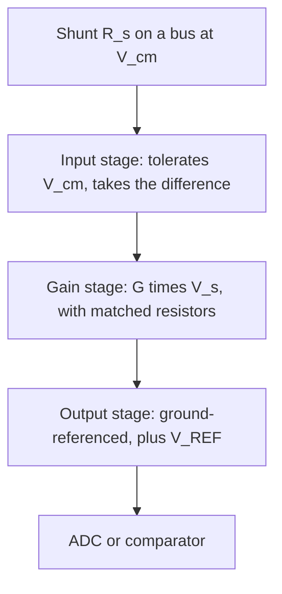

::: testing
Whether you understand the CSA as a **purpose-built amplifier for a specific job**: take a small differential voltage across a shunt, reject a large common-mode voltage, apply a precise fixed gain, and produce a ground-referenced output for an ADC or comparator.

The interviewer wants to hear the signal chain, the key specs that define one (gain, CM range, CMRR, offset, bandwidth), and why it exists as a dedicated part rather than "an op-amp with resistors". The detail of how it differs from a regular op-amp is its own question ([[q0451]]).
:::

::: why
Almost every current monitor, battery gauge, motor drive and power supply uses one. A shunt gives millivolts; an ADC wants volts; the shunt may sit on a 48 V bus while the ADC lives at 3.3 V. The CSA is the part that bridges those gaps in one small IC with factory-matched resistors, which makes high-side sensing practical and accurate. Knowing what it does tells you what to ask of it ([[q0452]]) and when you need one ([[q0450]]).
:::

::: concepts
- **Differential amplification**: output proportional to $V_+ - V_-$, rejecting what is common to both. See [[q0115]].
- **Op-amp with feedback**: closed-loop gain set by resistor ratios; ideal op-amp rules. See [[q0124]].
- **Common-mode range and CMRR**: how large a voltage the inputs tolerate and how well it is rejected. See [[q0447]].
- **Shunt resistor**: the source of the small sense voltage. See [[q0443]].
- **Level shifting/reference**: output can be offset by a REF pin for bidirectional current.
- **Resistor matching**: gain accuracy and CMRR depend on ratios, which integrated resistors hold much better than discrete ones.
:::

::: answer
"A current sense amplifier is a specialized amplifier that measures the small voltage across a sense resistor and turns it into a ground-referenced signal for an ADC or comparator. Its job is three things: amplify the millivolt-level differential voltage with a precise fixed gain, like 20, 50, 100 or 200; reject the common-mode voltage that the shunt sits on, which on the high side can be tens of volts; and shift the output so it works with a single-supply ADC, often with a reference pin so negative currents are visible too.

Internally it's built like a difference amplifier with laser-trimmed, matched resistors, or a clever input stage that lets the inputs go well beyond the supply rail. So $V_{out} = G \cdot I \cdot R_{sense} + V_{ref}$.

The key specs are gain and gain error, offset voltage, which sets the lowest current I can measure, common-mode voltage range and CMRR, bandwidth, and output swing. I'd use one any time the shunt signal is too small for the ADC or sits on a bus voltage."
:::

::: technical
**Transfer function.**
$$V_{out} = G\,(V_{IN+} - V_{IN-}) + V_{REF} = G\,I\,R_s + V_{REF}$$

For unidirectional parts $V_{REF}=0$ (grounded). For bidirectional parts $V_{REF}$ is typically $V_{CC}/2$ or externally set.

**Classic implementation.** A difference amplifier built on an op-amp with four resistors, where $R_2 = R_1$ at the inverting input, and $R_4 = R_3 = G R_1$:
$$V_{out} = \frac{R_4}{R_2}(V_A - V_B) + V_{REF}\ \ (\text{when } R_3/R_1 = R_4/R_2)$$
For $G = 50$ with $R_1 = R_2 = 1$ kΩ and $R_3 = R_4 = 50$ kΩ.

**CMRR from matching.** For resistor mismatch $\varepsilon$ (each resistor off by up to $\varepsilon$ in the worst direction), $\text{CMRR}\approx\frac{1+G}{4\varepsilon}$. For $G = 50$: $\varepsilon = 1\%$ gives 62 dB, 0.1 percent gives 82 dB, 0.01 percent gives 102 dB. Integrated, trimmed networks reach 100 to 120 dB, which discrete 1 percent resistors cannot.

**Key parameters.**
- Gain and gain error (for example ±0.1 to ±1 percent) and its drift.
- Input offset voltage (from a few µV for zero-drift types up to ~1 mV) and drift. Equivalent current error $V_{os}/R_s$.
- Common-mode input range (can exceed supply, to 26 V, 80 V, 100 V or more on some families) and CMRR.
- Bandwidth and slew (falls with gain), settling time.
- Output swing (distance to rails), quiescent current, supply range.
- Unidirectional vs bidirectional; some include a comparator or an ADC.

> [!UNCERTAIN]
> Standard gain options (20, 50, 100, 200 V/V) and common-mode ranges differ by product family and vendor; confirm against the datasheet of the specific part.
:::

::: short
"A current sense amplifier takes the small voltage across a shunt, rejects the large common-mode bus voltage it sits on, multiplies the difference by a precise fixed gain like 20 or 50, and outputs a ground-referenced voltage for an ADC or comparator, often with a reference pin for bidirectional current. Inside it's a difference amplifier with trimmed matched resistors, so $V_{out} = G\,I\,R_{sense} + V_{ref}$. Key specs are gain error, offset, common-mode range, CMRR and bandwidth."
:::

::: long
"A current sense amplifier, or CSA, is a purpose-built amplifier for reading the voltage across a sense resistor.

The problem it solves: the shunt gives me maybe 50 millivolts at full current, which is too small and the wrong kind of signal for an ADC. Worse, if the shunt is on the high side of a 24 or 48 volt bus, both terminals sit near the bus voltage, and the useful signal is the tiny difference between them. A CSA does three things. It amplifies the difference by a fixed, accurate gain, commonly 20, 50, 100 or 200 volts per volt. It rejects the common-mode voltage, so the bus voltage doesn't leak into the reading, and many CSAs tolerate common-mode far above their own supply. And it outputs a single-ended, ground-referenced voltage the ADC can read, often with a reference pin so bidirectional current maps around mid-scale.

Internally, the simplest version is a difference amplifier with four resistors around an op-amp. The key is that the resistors are on-chip and trimmed, so the ratios are matched to 0.01 percent or better, which gives gain accuracy and a CMRR of 100 decibels or more. Other architectures use a different input stage to survive high common-mode.

So the output is $V_{out} = G\,I\,R_{sense} + V_{ref}$, and what I look at in a datasheet is gain error, input offset, which sets my minimum current as offset over resistance, common-mode range, CMRR, bandwidth, and output swing near the rails. Some versions also add a comparator for overcurrent, or an ADC and digital interface for power monitoring."
:::

::: terms
- **CSA (current sense amplifier)**: amplifier optimized for small differential signals on a large common-mode voltage.
- **Gain (V/V)**: fixed ratio of output to differential input, for example 50 V/V.
- **Common-mode range**: allowed voltage on both inputs relative to ground; may exceed the supply.
- **CMRR**: rejection of the common-mode voltage, in dB.
- **Input offset voltage**: output-referred zero error divided by gain; sets low-current accuracy.
- **REF pin**: sets the output level at zero current; enables bidirectional sensing.
- **Zero-drift (chopper) amplifier**: architecture with µV-level offset and low drift.
- **Gain error**: deviation of real gain from nominal, in percent.
:::

::: exceptional
**An average answer** says "it amplifies the voltage across the sense resistor".

**An exceptional answer**:
- States the three jobs: gain, common-mode rejection and level shift to a ground-referenced output.
- Gives the transfer function with a REF term and the typical gain options.
- Explains *why it's integrated*: matched resistors give CMRR and gain accuracy that discrete parts can't, and the input stage handles bus voltages above the supply.
- Names the key specs and the one with design implications: offset sets $I_{min} = V_{os}/R_s$.
- Mentions variants (bidirectional, zero-drift, with comparator or ADC) and the high-side vs low-side use.
:::

::: mistakes
- **Calling it just "an op-amp".** A CSA's matched resistor network and common-mode input stage are the point ([[q0451]]).
- **Forgetting the REF pin.** With a grounded reference a unidirectional CSA can't show negative current.
- **Assuming output can reach 0 V.** Many CSAs swing only to within tens of mV of ground, so tiny currents are lost unless offset by REF.
- **Ignoring bandwidth versus gain.** Higher gain parts have lower bandwidth, which matters for fast protection.
- **Using a gain so high the output clips.** $G I_{max}R_s$ must stay below the output's maximum swing ([[q0453]]).
- **Believing CMRR is infinite.** It's finite and frequency-dependent, which matters on PWM buses.
:::

::: deep
## The job in one picture


Figure: The chain inside and around a CSA. The first block deals with the large common-mode voltage, the second applies the precise gain, and the last presents a signal the ADC can use.

## A difference amplifier is the heart

The simplest CSA is an op-amp with four resistors:

```circuit
{"caption":"Difference-amplifier core of a CSA (G = R4/R2 = 50)","elements":[
 {"t":"term","at":[0,0],"label":"to load","side":"top"},
 {"t":"wire","pts":[[0,0],[0,2]]},
 {"t":"R","a":[0,2],"b":[0,8],"label":"R_s"},
 {"t":"wire","pts":[[0,8],[0,10]]},
 {"t":"term","at":[0,10],"label":"from supply","side":"bottom"},
 {"t":"dot","at":[0,2]},{"t":"dot","at":[0,8]},
 {"t":"wire","pts":[[0,2],[2,2],[2,5]]},
 {"t":"R","a":[2,5],"b":[6,5],"label":"R_2","value":"1 kΩ"},
 {"t":"wire","pts":[[6,5],[10,5]]},
 {"t":"dot","at":[8,5]},
 {"t":"wire","pts":[[8,5],[8,3]]},
 {"t":"R","a":[8,3],"b":[12,3],"label":"R_4","value":"50 kΩ"},
 {"t":"wire","pts":[[12,3],[16,3],[16,6]]},
 {"t":"wire","pts":[[0,8],[2,8],[2,7]]},
 {"t":"R","a":[2,7],"b":[6,7],"label":"R_1","value":"1 kΩ","labelSide":"other"},
 {"t":"wire","pts":[[6,7],[10,7]]},
 {"t":"dot","at":[8,7]},
 {"t":"R","a":[8,7],"b":[8,10],"label":"R_3","value":"50 kΩ"},
 {"t":"term","at":[8,11],"label":"V_{REF}","side":"bottom"},
 {"t":"wire","pts":[[8,10],[8,11]]},
 {"t":"opamp","at":[10,6]},
 {"t":"wire","pts":[[14,6],[19,6]]},
 {"t":"dot","at":[16,6]},
 {"t":"term","at":[19,6],"label":"V_{out}","side":"right"},
 {"t":"arrow","a":[1.3,6.2],"b":[1.3,4.6],"label":"I"}
]}
```
Figure: Current flows up through R_s from the supply (bottom) to the load (top), so the bottom node is higher. That node feeds the non-inverting input through R_1, with R_3 to V_REF; the top node feeds the inverting input through R_2 with feedback R_4. Because R_4/R_2 = R_3/R_1 = 50, V_out = 50·(V_bottom − V_top) + V_REF.

With the resistor ratio matched, the common-mode voltage cancels:
$$V_{out} = \frac{R_4}{R_2}(V_A - V_B) + V_{REF}$$

The gain is $R_4/R_2 = 50$. The drawback is limited common-mode range: both inputs of the op-amp see the bus voltage scaled down by the resistor divider, so the op-amp's own supply and input range limit what bus voltage it tolerates, and the quality of rejection depends on resistor matching:

$$\text{CMRR} \approx \frac{1+G}{4\varepsilon}$$

| Resistor tolerance $\varepsilon$ | CMRR ($G=50$) |
|---|---|
| 1% | 62 dB |
| 0.1% | 82 dB |
| 0.01% | 102 dB |
| 0.001% (trimmed on-chip) | 122 dB |

Discrete 0.1 percent resistors give an 82 dB CMRR; that is the first reason an integrated CSA exists.

## Other architectures

- **Level-shifting input stage**: high-side CSAs often use input resistors into a transconductance stage that makes a current proportional to $V_s$ (referenced to the supply), then converts that current to a ground-referenced voltage across an output resistor. The inputs can sit well above the amplifier's own supply, because they never connect to a ground-referenced op-amp input directly.
- **Divider-based input**: some CSAs attenuate the common-mode before the gain stage to handle tens of volts and then amplify.
- **Zero-drift (chopper) types**: microvolt-level offset, enabling small shunts.
- **Isolated amplifiers/modulators**: for common-mode in the hundreds of volts, with a galvanic barrier.
- **Digital power monitors**: integrate the amplifier, an ADC, and I²C reporting of current, bus voltage and power.

> [!UNCERTAIN]
> Specific internal topologies are vendor- and part-dependent; the key behaviours (gain, CM range, offset) come from the datasheet.

## What you design with

A CSA's datasheet maps to four design questions:

1. **Does it survive my bus voltage?** Common-mode range vs the bus, including transients.
2. **Does the gain fit my ADC?** $G\,I_{max}R_s$ below the output swing ([[q0453]]).
3. **Is the low-current accuracy enough?** $I_{err}=V_{os}/R_s$ ([[q0445]]).
4. **Is it fast enough?** Bandwidth and settling at that gain, important for protection and PWM.

More detail in [[q0452]].

## Numbers

Take a shunt of 10 mΩ, $I_{max}=5$ A, $G=50$, 3.3 V ADC:
- $V_s=50$ mV, $V_{out}=2.5$ V (76 percent of full scale).
- Offset 100 µV × 50 = 5 mV at the output, equal to 10 mA of current.
- LSB (12 bit) 0.806 mV corresponds to $0.806\,\text{mV}/(50\times0.01)=1.6$ mA per count.

```sim
{"id":"current-sense","imax":5,"imin":0.01,"rsense":0.01,"gain":50,"bits":12,"vref":3.3,"side":"low"}
```
Figure: Change `gain` and watch the amplified voltage move against the ADC range: too little gain wastes resolution, too much clips at full scale. The CSA's job is to put the largest expected signal just under full scale.

## Bidirectional use

With a REF pin set to mid-supply, zero current gives $V_{REF}$, positive current moves the output up and negative current moves it down:

$$V_{out}=V_{REF}+G\,I\,R_s$$

The available swing is $\pm(V_{REF}-V_{min})$ on the low side and $(V_{max}-V_{REF})$ on the high side, which halves the usable range per direction compared with a unidirectional part. Battery chargers and motor drives (regeneration) need this.
:::

::: applications
- **Battery chargers and fuel gauges**: bidirectional CSA on a shunt measuring charge and discharge current.
- **Motor controllers**: CSAs on low-leg or phase shunts feeding the MCU's ADC.
- **Server and PC power rails**: high-side CSAs or digital power monitors reporting rail current.
- **Solenoid and valve drivers**: current regulation with CSA feedback.
- **USB power switches and PD controllers**: current limiting and reporting.
- **Industrial 4–20 mA and process equipment**: CSAs for loop current readout.
:::

::: assumptions
- Describes a conventional analog CSA with an integrated gain. Some products (digital power monitors, isolated amplifiers) contain a CSA front end plus more.
- The four-resistor difference amplifier is used as the teaching model. Real high-voltage CSAs use different input stages, and the CMRR formula applies to the resistor network only.
- Gain values (20/50/100/200 V/V) are common but not universal; some families offer 500 or 1000 V/V, or adjustable gain with external resistors.
- The question can also be answered at a block level ("it amplifies the sense voltage"), then deepened if the interviewer asks.
:::

::: followups
### Why not just use an op-amp and four resistors?
You can, when the bus is within the op-amp's supply, the CMRR from 0.1 percent resistors is adequate, and you accept the part count and layout effort. A CSA gives much better matching, a common-mode range beyond the supply, a calibrated gain, lower offset and smaller size. See [[q0451]].

### What does the REF pin do?
It sets the output voltage at zero input, so $V_{out}=V_{REF}+G\,V_s$. With REF at mid-scale, negative currents (charging, regeneration) appear as outputs below mid-scale. With REF grounded, the output can only go positive.

### Why does a CSA's bandwidth drop as its gain increases?
The internal amplifier has a fixed gain-bandwidth product, so closed-loop bandwidth is roughly $GBW/G$. A part with 1 MHz bandwidth at gain 20 may have only 100 kHz at gain 200. That matters for fast overcurrent protection.

### Scenario: your CSA output reads 25 mV with no load current. What could be the cause?
Input offset times gain: for example 500 µV × 50 = 25 mV. Check the datasheet's offset and whether the part has an output-swing floor, since some CSAs cannot output below tens of mV. Calibrate the zero in firmware, use a zero-drift part, or bias with REF so zero is not at the rail.

### What if the bus voltage exceeds the CSA's common-mode rating?
Use a part with a higher rating, divide down or level-shift (with care about gain accuracy), put the shunt on the low side, or use an isolated amplifier or Hall sensor. Also check transients, such as load-dump on automotive systems or inductive spikes, against the abs-max rating.
:::

::: references
- Horowitz & Hill, *The Art of Electronics*, 3rd ed.: difference amplifiers and current-sensing circuits.
- Sedra & Smith, *Microelectronic Circuits*: difference amplifier, CMRR with resistor mismatch.
- Texas Instruments and Analog Devices current-sense amplifier families: datasheets and application material (gain options, CM range, bidirectional operation).
- Franco, *Design with Operational Amplifiers and Analog Integrated Circuits*: difference and instrumentation amplifiers.
:::

::: rubric
- Defines a CSA as an amplifier for the small differential voltage across a shunt :: Core definition.
- States its three functions: gain, common-mode rejection, level shift to ground reference :: Why it's not just any amplifier.
- Gives $V_{out}=G\,I\,R_s+V_{ref}$ and typical gains :: Quantitative understanding.
- Explains integrated matched resistors give high CMRR and gain accuracy :: Reason for existence.
- Names key specs: gain error, offset, CM range, CMRR, bandwidth, output swing :: What to look for in a datasheet.
- Mentions bidirectional operation / REF :: Common practical feature.
- Links offset to minimum measurable current :: Shows system thinking.
:::

::: quiz
```json
[
 {"type":"numeric","level":"fundamental","q":"A CSA with gain 100 V/V and a 5 mΩ shunt carries 4 A (REF = 0 V). What is the output voltage?","answer":2,"tolerance":0.02,"unit":"V","explain":"$V_s = 4\\times0.005 = 20$ mV. $V_{out} = 100\\times0.020 = 2.0$ V."},
 {"type":"mcq","level":"fundamental","q":"What is the main purpose of a CSA's REF pin?","options":["Set the gain","Set the output level at zero current so negative currents can be measured","Supply the shunt","Select high-side or low-side"],"answer":1,"explain":"$V_{out}=V_{REF}+G V_s$. With REF at mid-scale, negative current moves the output below mid-scale. Gain is set internally or by external resistors, not by REF."},
 {"type":"numeric","level":"intermediate","q":"A bidirectional CSA with REF = 1.65 V, gain 20, and a 10 mΩ shunt sees −5 A. What is the output voltage?","answer":0.65,"tolerance":0.02,"unit":"V","explain":"$V_s=-0.05$ V. $V_{out}=1.65+20\\times(-0.05)=0.65$ V."},
 {"type":"numeric","level":"intermediate","q":"A difference amplifier with $G = 50$ is built with resistors that each have 0.1 percent worst-case mismatch. Estimate its CMRR in dB using CMRR ≈ (1+G)/(4ε).","answer":82,"tolerance":0.02,"unit":"dB","explain":"$51/(4\\times0.001)=12{,}750$, and $20\\log_{10}(12750)=82.1$ dB."},
 {"type":"multi","level":"intermediate","q":"Select the specs that determine the minimum current a CSA-based system can accurately measure.","options":["Input offset voltage","Shunt resistance","Bandwidth","Output swing near ground"],"answer":[0,1,3],"explain":"Minimum current is about $V_{os}/R_s$, and if the output cannot swing to near 0 V the lowest signals are clipped. Bandwidth affects speed, not the zero-current floor."},
 {"type":"truefalse","level":"advanced","q":"Increasing a CSA's gain from 20 to 200 always improves overall measurement accuracy.","answer":false,"explain":"Higher gain amplifies offset and noise too, reduces bandwidth, and increases the risk of clipping at full scale. It improves ADC resolution relative to the signal only up to the point where the amplifier's own errors dominate."}
]
```
:::
