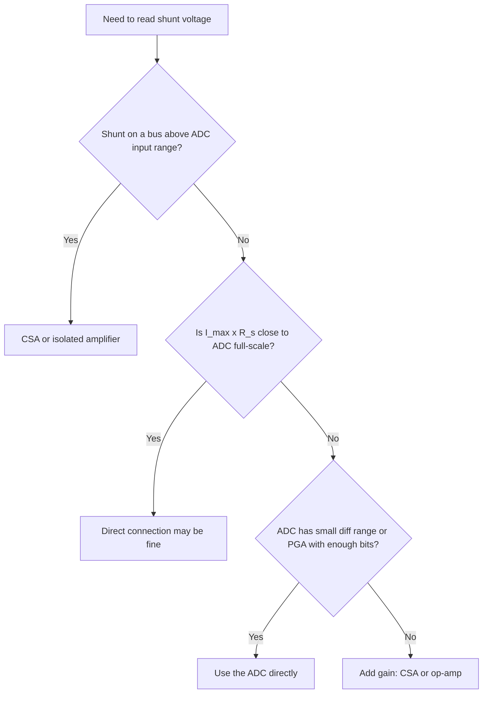

::: testing
Whether you can decide, from requirements, **if a bare shunt-to-ADC connection is enough or an amplifier is mandatory**. The reasons are specific: the signal is too small for the ADC's resolution, the shunt sits on a common-mode voltage the ADC cannot accept, the output must be level-shifted for bidirectional current, or noise and ground offsets would swamp millivolts.

The interviewer also wants the counter-case: when you don't need one (an ADC with a small differential range, a comparator-only protection circuit, low currents where a large shunt is fine).
:::

::: why
Adding a CSA costs money, board area, an error budget (offset, gain error) and a new failure point; leaving it out can make a design unmeasurable. Being able to justify the part from the numbers is a core design skill and the natural follow-up to [[q0446]], where direct sizing gave an impossible resistor. This question is the "should I?" before [[q0452]] ("which one?") and [[q0453]] ("what gain?").
:::

::: concepts
- **Signal vs ADC range**: the shunt gives $I R_s$ in mV; the ADC wants volts. See [[q0446]].
- **ADC resolution**: amps per LSB is $V_{LSB}/R_s$ without gain, $V_{LSB}/(GR_s)$ with it.
- **Common-mode voltage**: a high-side shunt sits at the bus, outside the ADC's input range. See [[q0447]].
- **Offset and noise**: a signal of tens of mV sits close to ADC offset and noise.
- **Level shifting for bidirectional current**: the output must be biased around a reference. See [[q0449]].
- **Differential vs single-ended inputs**: a differential ADC input removes some need for an amplifier.
:::

::: answer
"You need a CSA when the shunt voltage can't be fed directly to the ADC. There are four typical reasons.

One, the signal is too small. A 10 milliohm shunt at 5 amps gives only 50 millivolts, while a 12-bit, 3.3 volt ADC has a step of 0.8 millivolts, so I'd resolve only about 80 milliamps per count. A gain of 50 brings that to about 1.6 milliamps and fills the ADC range.

Two, common-mode. If the shunt is on the high side of a 12, 24 or 48 volt bus, both ends are far above what the ADC or an ordinary op-amp can tolerate, and I need something that handles the common-mode and reports just the difference.

Three, level shifting and polarity. For bidirectional current I need the output biased around a reference, so the ADC can see both directions.

Four, noise and accuracy. Amplifying at the shunt, with a good differential input, keeps the signal well above the ADC's noise and rejects ground bounce.

I wouldn't need one if the ADC itself has a small differential input range or a programmable gain stage, for example a delta-sigma metering ADC with plus or minus 250 millivolts, or if I just want a rough overcurrent trip that a comparator can do directly, or if the current is so small I can use a large shunt."
:::

::: technical
**Decision criteria (quantified).**

1. **Resolution.** Amps per LSB without gain: $\Delta I = V_{FS}/(2^N R_s)$. Need ≤ the required current resolution. Example: 3.3 V, 12-bit, $R_s=10$ mΩ gives 80.6 mA/LSB; with $G=50$, 1.6 mA/LSB.
2. **Signal vs offset.** ADC input offset and noise are typically hundreds of µV to mV; with a 50 mV full-scale signal that's 1 to 2 percent unless amplified.
3. **Common-mode.** If $V_{cm}$ at the shunt exceeds the ADC/op-amp input range (usually $0\ldots V_{DD}$), a CSA with a high-CM input is needed.
4. **Polarity.** Bidirectional signals need an offset (REF) to fit a unipolar ADC.
5. **Burden.** If the allowed burden is mV rather than volts, amplification is the only way to reach full-scale.

**Direct sensing is acceptable when:** $R_s I_{max}$ can be near $V_{FS}$ without unacceptable drop (low currents), or the ADC accepts a small differential range with enough resolution (for example ±250 mV, 16-bit: 7.6 µV/LSB).

**Comparator-only cases.** For a threshold (overcurrent), a comparator with a reference can compare $V_s$ to a set voltage directly, no gain needed, if the threshold is above comparator offset (for example 50 mV vs 2 mV offset is 4 percent).

**Cost of adding one.** Offset ($V_{os}/R_s$, for example 100 µV on 10 mΩ = 10 mA), gain error (0.1 to 1 percent), reduced bandwidth, and one more part.
:::

::: short
"You need a CSA when you can't feed the shunt voltage straight into the ADC: the signal is millivolts and the ADC step is about a millivolt, so resolution is poor; the shunt sits on a high-side bus voltage the ADC can't tolerate; or the current is bidirectional and needs a level shift. A gain of 50 turns 50 millivolts into volts and also rejects common-mode noise. I don't need one if the ADC has a small differential range or a PGA, or if I only need a comparator trip."
:::

::: long
"The short version: I need a CSA whenever the raw shunt voltage is the wrong size, in the wrong place, or the wrong polarity for the ADC.

Wrong size is the most common. A shunt has to be small to avoid wasting power: 10 milliohms at 5 amps gives 50 millivolts and a quarter watt. A 12-bit, 3.3 volt ADC has a step of 0.8 millivolts, so connected directly I'd only resolve about 80 milliamps per count, and at 10 milliamps I'd read basically zero. With a gain of 50 the same shunt fills the ADC and the resolution is 1.6 milliamps per count.

Wrong place means common-mode. If the shunt is on the high side of 24 volts, both ends sit near 24 volts, far above a 3.3 volt ADC's limit. A CSA takes the difference and gives me a ground-referenced output.

Wrong polarity: if the current can reverse, like a charger or regenerative motor, the signal swings negative, and the CSA's reference pin shifts the zero to mid-scale.

There's also noise and ground bounce: an amplifier close to the shunt with a proper differential input rejects it before it reaches a long trace to the ADC.

When I wouldn't use one: an ADC built for this, such as a delta-sigma modulator with a ±250 millivolt differential input, doesn't need extra gain. A simple overcurrent flag can use a comparator across the shunt. And a very low current, like 10 milliamps, can use a larger shunt directly.

The cost of adding one is offset and gain error, which put a floor on small currents, so I'd confirm those against my accuracy requirement."
:::

::: terms
- **Resolution (A/LSB)**: the smallest current change the ADC distinguishes.
- **Common-mode range**: the voltage range over which an amplifier's inputs work correctly.
- **Level shift**: moving a signal's DC level to fit a downstream device.
- **Bidirectional current sensing**: measuring both polarities by biasing the output.
- **Delta-sigma ADC / metering ADC**: converter with a small differential input range, often ±250 mV, used directly on shunts.
- **PGA**: programmable-gain amplifier integrated before an ADC.
- **Input offset**: zero error of an amplifier or ADC input, limiting small-signal accuracy.
- **Burden**: voltage and power the sense element takes from the circuit.
:::

::: exceptional
**An average answer** says "when the signal is too small".

**An exceptional answer**:
- Lists all four reasons (resolution, common-mode, polarity/level shift, noise) with a number for at least one.
- Computes the resolution with and without gain (80.6 mA/LSB vs 1.6 mA/LSB).
- States the *counter-cases*: small-range ADC, comparator-only protection, low currents.
- Points out the downside of adding a CSA (offset floor, gain error, bandwidth) and ties it to the accuracy requirement.
- Mentions that many MCUs have integrated op-amps/PGAs that can serve as a CSA when common-mode permits.
:::

::: mistakes
- **Saying "always" or "never".** Whether you need one depends on the ADC range, bus voltage, burden budget and accuracy.
- **Forgetting common-mode.** Even if gain isn't needed, a high-side shunt needs a differential, high-CM front end.
- **Believing gain fixes noise and offset.** It amplifies the signal and the amplifier's own errors. The floor is $V_{os}/R_s$.
- **Ignoring polarity.** A unipolar CSA with grounded REF loses negative currents.
- **Over-amplifying.** A gain that clips at full-scale (or a CSA output swing limit) wastes the benefit.
- **Missing the integrated alternatives**: delta-sigma ADCs, metering ICs, or MCU op-amps can replace a standalone CSA.
:::

::: deep
## The four reasons, with numbers

Consider the running example: shunt 10 mΩ, $I_{max}=5$ A, $I_{min}=10$ mA, 12-bit, $V_{FS}=3.3$ V.

### 1. The signal is too small for the ADC

$V_s(I_{max}) = 50$ mV, which is 1.5 percent of full-scale. Only about 62 of 4096 codes are used.

| | Direct to ADC | With $G=50$ |
|---|---|---|
| Full-scale signal | 50 mV | 2.5 V |
| Codes used at 5 A | 62 | 3103 |
| A per LSB | 80.6 mA | 1.6 mA |
| Counts at 10 mA | 0.12 | 6.2 |

```plot
{"title":"ADC input voltage vs load current: direct vs with gain 50 (10 mΩ shunt)","x":{"label":"Load current","unit":"A","min":0,"max":6},"y":{"label":"Voltage at ADC","unit":"V","min":0,"max":3.6},
 "vars":{"rs":0.01,"g":50},
 "series":[{"label":"direct (G = 1)","fn":"x*rs","color":"red"},{"label":"CSA, G = 50","fn":"min(x*rs*g,3.3)"}],
 "hlines":[{"at":3.3,"label":"ADC full scale 3.3 V","color":"muted"}]}
```
Figure: Directly connected, the shunt signal barely lifts off the axis (50 mV at 5 A, under 2 percent of the ADC range). With a gain of 50 the same signal covers about 76 percent of full-scale. Without amplification, most of the ADC's resolution is thrown away.

### 2. The shunt is on a high common-mode voltage

A 12 V, 24 V or 48 V bus puts both shunt terminals far above what a 3.3 V ADC can accept (typically −0.3 V to $V_{DD}$+0.3 V). A standard op-amp wired as a difference amplifier works only if the bus is within its supply; a CSA with a high-voltage input stage handles buses well beyond its own supply and rejects them (see [[q0447]]).

### 3. Polarity and level

A charger or regenerating motor produces both signs. A single-supply ADC reads 0 to 3.3 V, so the amplifier must bias zero current to a mid-level via REF ([[q0449]]).

### 4. Noise, offset, and ground bounce

A 50 mV signal travelling a few centimetres on a noisy board picks up millivolts of noise; amplified at the shunt, the same noise is a small fraction of a volt-scale signal. A differential input also rejects ground drops between the shunt and the converter. ADC input-referred offset (hundreds of µV to a few mV on small MCU ADCs) is another reason: against a 50 mV signal a 1 mV offset is 2 percent.


Figure: A decision flow. Common-mode is checked first because it makes the question moot; then the signal-versus-range test; then whether a built-in front end already solves it.

## When you don't need one

**A delta-sigma or metering ADC.** Parts like these accept a small differential input (±250 mV or similar) and have 16 to 24 bits. With 16 bits over ±250 mV the LSB is 7.6 µV; on a 10 mΩ shunt that's 0.76 mA per count, better than the CSA + 12-bit chain, and with no gain error from an extra stage. Common-mode still has to fit the ADC's range, or the converter must be isolated.

**Comparator-only protection.** A comparator across the shunt compared with a threshold (for example 50 mV) needs no gain. The comparator offset (1 to 5 mV) is a 2 to 10 percent threshold error, acceptable for protection.

**Very low currents.** Measuring 10 mA with a 10 Ω shunt gives 100 mV at 10 mA, no amplifier needed for a 12-bit ADC, if 10 mW and 0.1 V burden are acceptable.

**MCU with integrated op-amp/PGA.** Many MCUs offer PGA stages; for low-side sensing near ground this can act as the CSA. Check its offset, gain error, and input range down to ground.

**Hall-effect or other self-amplified sensors.** They output a ready-to-use voltage and need no separate CSA.

## Cost of adding a CSA

- **Offset:** $V_{os}/R_s$. With 100 µV and 10 mΩ: 10 mA. (A zero-drift CSA with 5 µV offset: 0.5 mA.)
- **Gain error:** typically 0.1 to 1 percent.
- **Bandwidth:** falls with gain; at $G=100$ many parts give 100 to 300 kHz.
- **Output swing:** doesn't reach exactly 0 V or the rail; unidirectional sensing near zero current can be lost.
- **Board and cost:** one more IC and its decoupling.

None of these are showstoppers, but they must fit the accuracy budget.

```sim
{"id":"current-sense","imax":5,"imin":0.01,"rsense":0.01,"gain":1,"bits":12,"vref":3.3,"side":"low"}
```
Figure: With gain 1 the sim shows the problem directly: the amplified voltage is a sliver of the ADC range and resolution is tens of mA per count. Raise gain to 50 and watch the headroom and mA/LSB change; then switch side to high and note the common-mode flag.

## A simple rule of thumb

If $I_{max}R_s < V_{FS}/10$ (the signal fills less than 10 percent of the ADC range), amplify. If the shunt is on the high side of anything above the ADC's supply, you need a differential, high-common-mode front end. Otherwise connect directly and check the resolution.
:::

::: applications
- **Battery gauges and chargers**: bidirectional CSAs on a shunt, plus a small MCU ADC.
- **Motor control**: CSAs or MCU PGAs on low-side shunts at 1 to 10 mΩ.
- **Power-rail telemetry**: high-side CSAs, 12 V to 48 V rails.
- **Metering with delta-sigma ADCs**: no CSA, shunt straight into a ±250 mV input.
- **Overcurrent flags in LED drivers or fuses**: comparator directly across a small shunt.
- **Low-current instruments** (sensors, µA to mA): large shunts to a PGA or ADC with no separate CSA.
:::

::: assumptions
- Assumes a typical MCU-class 12-bit ADC with a 0 to 3.3 V range and tens of mV of offset/noise budget; a 24-bit ADC changes the answer.
- Assumes a shunt sized for tolerable loss, not for the ADC; if the burden can be large, direct sensing becomes possible.
- "Need" depends on accuracy; at 10 percent accuracy one may skip gain where 1 percent would require it.
- An op-amp difference amplifier can replace a CSA when the bus is within its supply and moderate CMRR is acceptable ([[q0451]]).
- Designs that use isolation (isolated modulators) include the amplification inside the isolator.
:::

::: followups
### Can you ever connect a shunt directly to a microcontroller ADC?
Yes, when the shunt can be sized so that full-scale current gives a large fraction of the ADC range without unacceptable burden, which means low currents (mA range) or a generous drop budget, and when the shunt is low-side with ground as one terminal. Check resolution and ADC offset against the accuracy requirement.

### What if you have a 48 V bus and an MCU ADC at 3.3 V?
A high-side CSA rated above 48 V (or a low-side shunt with a normal CSA, if the system allows), or an isolated amplifier/modulator if there is a safety barrier. The CSA's common-mode input range, not its supply, is the spec that matters.

### Is a CSA needed if the ADC has a PGA?
Not for gain, only if the PGA's gain, offset and input range are adequate. A PGA with a 1 mV offset and gain 32 on a 10 mΩ shunt makes a 100 mA equivalent offset error, so check the numbers. Common-mode range still has to be satisfied.

### Scenario: your protection comparator trips at 8 A but you wanted 10 A on a 5 mΩ shunt. What's the likely cause?
A 5 mV comparator offset on a 5 mΩ shunt is a 1 A error, and the reference tolerance adds more. If the comparator offset is 5 mV, the threshold at 50 mV nominal might be 45 mV in the worst case (9 A). 8 A suggests more error from the divider tolerance or ground shift. Fix with a lower-offset comparator, higher gain before the comparator, or a larger shunt.

### What if you need both protection and measurement from one CSA?
Use the CSA's output for the ADC (accuracy) and a second comparator (internal or external) on the same output for fast protection, making sure the amplifier's bandwidth and overload recovery are adequate for the protection response time.
:::

::: references
- Horowitz & Hill, *The Art of Electronics*, 3rd ed.: current sensing and ADC front ends.
- Texas Instruments and Analog Devices application material on when to use current-sense amplifiers versus direct ADC sensing.
- Datasheets for delta-sigma metering ADCs and isolated modulators (typical ±250 mV differential input).
- Sedra & Smith, *Microelectronic Circuits*: data converters (LSB, resolution).
:::

::: rubric
- Gives signal-too-small-for-ADC as a reason, with a quantitative example :: The primary reason, and it shows you can compute LSB in amps.
- Gives common-mode/high-side as a reason :: A CSA is often needed for CM even without gain.
- Gives bidirectional level shifting :: Practical feature that isn't obvious.
- Mentions noise/offset/ground rejection :: Shows analog awareness.
- Gives counter-cases (small-range ADC, comparator-only, low current) :: The question says "when", implying not always.
- Notes costs of adding one (offset, gain error, bandwidth) :: Balanced engineering judgment.
- Links to sizing: shunt from power/drop, gain from ADC range :: System-level thinking.
:::

::: quiz
```json
[
 {"type":"numeric","level":"fundamental","q":"A 12-bit, 3.3 V ADC is connected directly to a 20 mΩ shunt (no gain). How many mA does one LSB represent?","answer":40.3,"tolerance":0.02,"unit":"mA","explain":"$V_{LSB}=3.3/4096=0.806$ mV. $\\Delta I = 0.806\\text{ mV}/0.02\\ \\Omega = 40.3$ mA."},
 {"type":"mcq","level":"fundamental","q":"Which situation almost certainly requires a CSA (or similar differential front end) even if gain isn't needed?","options":["A low-side shunt reading 2 V at full current","A high-side shunt on a 24 V bus feeding a 3.3 V ADC","A 1 Ω shunt on a 10 mA load","A comparator-only trip"],"answer":1,"explain":"Both shunt terminals sit near 24 V, far above the ADC's allowed input range, so the difference must be extracted and level-shifted. The others can work directly."},
 {"type":"numeric","level":"intermediate","q":"With a CSA gain of 25 and a 4 mΩ shunt, what is the current resolution of a 12-bit, 3.3 V ADC in mA per LSB?","answer":8.06,"tolerance":0.02,"unit":"mA","explain":"$\\Delta I = 0.806\\text{ mV}/(25\\times0.004) = 8.06$ mA."},
 {"type":"mcq","level":"intermediate","q":"A 16-bit delta-sigma ADC with a ±250 mV differential input is placed across a 5 mΩ shunt. Which statement is true?","options":["A CSA is mandatory for gain","No gain stage is needed; the LSB is about 7.6 µV, or 1.5 mA per count","The ADC cannot measure millivolt signals","Gain error is the dominant limitation"],"answer":1,"explain":"$0.5\\text{ V}/65536 = 7.63$ µV, and $7.63\\ \\mu\\text{V}/5\\ \\text{m}\\Omega = 1.53$ mA. The ADC's input range is designed for shunts, so the CSA is optional (common-mode must still fit)."},
 {"type":"multi","level":"intermediate","q":"Select valid reasons to add a CSA.","options":["Shunt signal uses only a small fraction of the ADC range","Shunt sits at 48 V and the ADC is at 3.3 V","Current is bidirectional and the ADC is unipolar","You want to eliminate amplifier offset error"],"answer":[0,1,2],"explain":"Small signal, high common-mode and bipolar current are the main reasons. A CSA adds offset error, it does not remove it."},
 {"type":"truefalse","level":"advanced","q":"Adding more gain always improves the minimum measurable current.","answer":false,"explain":"The minimum current is about $V_{os}/R_s$ (input-referred), which gain does not improve; gain only helps if the ADC's resolution or noise was the limit. Beyond that, the CSA's own offset is the floor."}
]
```
:::
