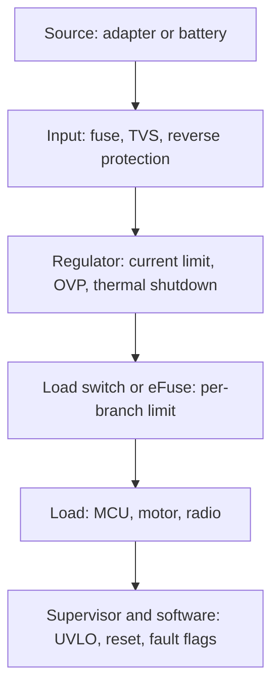

::: testing
Whether you treat protection as a design requirement with a physical reason behind it, not as "add a fuse because the textbook says so". The interviewer wants to hear three things: **what physically breaks** for each fault (heat for overcurrent, dielectric or junction breakdown for overvoltage, undefined behaviour for undervoltage), **where the faults come from** (shorts, hot-plug, load dumps, regulator failure, a dying battery), and **how you layer defences** from cheap passive parts to active monitoring. A good answer also separates protecting the *hardware* from protecting the *function* (keeping the system in a safe, known state).
:::

::: why
Real boards get abused: a screwdriver across a connector, a 24 V adapter plugged into a 12 V input, a battery sagging under a motor stall, a cable hot-plugged with 10 m of inductance behind it. Without protection, a single bad event turns a USD 0.50 fault into a dead board, a burnt connector or, with lithium cells, a fire ([[q0327]]). In an interview, this question separates people who only know the nominal operating point from people who design for what happens outside it. Protection is also where cost is traded against risk, so it shows engineering judgement.
:::

::: concepts
- **Joule heating** ($P = I^2R$): heat grows with the square of current, and a short circuit is a huge current through a tiny resistance. See [[q0006]] and [[q0007]].
- **Absolute maximum ratings**: the voltage and current limits in a datasheet beyond which damage is possible, as opposed to the recommended operating range.
- **Dielectric and junction breakdown**: oxides, capacitors and PN junctions have a voltage past which they conduct or fail ([[q0102]], [[q0063]]).
- **Brown-out / undervoltage**: below the minimum supply the logic is not guaranteed to work, and FETs may not fully turn on.
- **Inductive kick and inrush**: switching inductors and charging big capacitors create transient overstress ([[q0144]], [[q0343]]).
- **Defence in depth**: several independent layers (fuse, current limit, thermal shutdown, supervisor) so no single failure is fatal.
:::

::: answer
"I protect against these because every part has a limit, and real systems regularly leave the nominal range. Overcurrent, usually a short or a stalled motor, is a heat problem: power is $I^2R$, so ten times the current is a hundred times the heating. Traces fuse, connectors melt, batteries vent. Overvoltage is a breakdown problem: gate oxides, capacitor dielectrics and junctions have a hard limit, so a spike or the wrong adapter can permanently kill a part, often silently. Undervoltage is a function problem: a microcontroller below its minimum supply can execute garbage, corrupt flash, and a FET with too little gate drive sits half on and cooks itself.

So I'd layer it. At the input: a fuse or eFuse, a TVS for spikes, reverse-polarity protection. At the regulator: current limit, thermal shutdown, and overvoltage protection. At the system level: a supervisor or brown-out reset and undervoltage lockout so the system only runs when the rails are good. And in software, fault flags so the system can degrade gracefully instead of just dying.

What I'd pick depends on cost, the consequence of failure, and whether the fault is a one-off or repetitive. A hobby LED board gets a resistor; a battery pack gets redundant protection."
:::

::: technical
**Overcurrent.** A fault with resistance $R_f$ across a source $V$ draws $I = V/R_f$, limited only by source impedance. A 5 V rail shorted through $R_f = 10$ mΩ would want 500 A and dissipate $I^2R = 2.5$ kW in a few millimetres of copper. In reality the source resistance, supply current limit and the fault's own resistance cap it, but still far beyond ratings. Consequences: conductor and connector heating (the IPC-2221 trace-rise formula $I = kΔT^{0.44}A^{0.725}$ shows the nonlinear heating), solder reflow, fuse-like trace failure, battery thermal runaway, and voltage droop that resets the rest of the system.

**Overvoltage.** Gate oxides in modern CMOS tolerate only a few volts above the supply. Power MOSFET $V_{GS}$ limits are commonly $\pm 20$ V and $V_{DS}$ is rated by the device ([[q0102]]). Electrolytic and ceramic capacitors have rated voltages, and ceramics also lose capacitance under DC bias. Inputs exceeding $V_{DD}+0.3$ V forward-bias the ESD diodes ([[q0112]]) and can trigger latch-up.

**Undervoltage.** Logic needs $V_{DD}$ above a minimum for timing to meet spec. Flash writes during a sagging rail corrupt memory. MOSFETs with $V_{GS}$ below the plateau have high $R_{DS(on)}$, so a switch that is meant to be on dissipates $I^2R_{DS(on)}$ heavily. Batteries also need undervoltage cut-off to avoid permanent damage ([[q0330]]).

**Mitigation layers:** fuse/PTC/eFuse (current), TVS/Zener/MOV/crowbar (voltage), current-limited regulators, supervisors/UVLO, thermal shutdown, and software monitoring.
:::

::: short
"Every component has limits, and real systems leave the nominal range: shorts, hot-plug spikes, wrong adapters, sagging batteries. Overcurrent is a heating problem since power goes as I squared R. Overvoltage causes breakdown of oxides and capacitors. Undervoltage makes logic misbehave and FETs run half on. So I layer protection: a fuse or eFuse and TVS at the input, current limit and thermal shutdown in the regulator, and a supervisor or UVLO so the system only runs when the rails are healthy."
:::

::: long
"I'd start from the failure physics for each case, because that decides the protection.

Overcurrent first. A short circuit or a stalled motor pulls far more current than anything is designed for, and heating goes as I squared R. A 5 V rail into a 10 milliohm short would nominally want 500 A. Even the few amps that a real supply delivers can burn a thin trace, overheat a connector or push a lithium cell into thermal runaway. The defence is a limit on the current, either passive, like a fuse or a polyfuse, or active, like a current-limited regulator, load switch or eFuse.

Overvoltage next. Gate oxides, capacitors and PN junctions have a breakdown voltage. The causes are a wrong adapter, a hot-plug spike, an inductive kick from a motor, or a regulator that fails short and passes the input straight to the output. The defences are clamps like TVS diodes and Zeners, a crowbar that shorts the rail and blows the fuse, an overvoltage lockout that disconnects the load, and input ratings with margin.

Undervoltage is the sneaky one. Nothing burns, but the microcontroller can run corrupted code or write garbage to flash, and a MOSFET with too little gate drive turns half on and overheats. A supervisor or brown-out detector holds the system in reset until the rail is good, and UVLO keeps converters and loads off.

I'd layer these so no single failure is fatal, and add status flags so software knows what happened. How much I add depends on the cost of failure: a coin-cell toy needs almost nothing; a battery-powered motor drive needs all of it."
:::

::: terms
- **Overcurrent protection (OCP)**: limiting or interrupting current when it exceeds a threshold.
- **Overvoltage protection (OVP)**: clamping or disconnecting when voltage exceeds a threshold.
- **Undervoltage lockout (UVLO)**: holding a circuit off until the supply is high enough, usually with hysteresis.
- **Brown-out**: a supply sag that is below the operating minimum but not zero.
- **Absolute maximum rating**: a stress limit beyond which permanent damage may occur; not an operating condition.
- **TVS diode**: a clamping diode sized for short, high-energy transients.
- **eFuse / load switch**: an integrated FET with current limit, OVP and fault reporting.
- **Crowbar**: a device that deliberately shorts the rail (often an SCR) to blow a fuse during OVP.
:::

::: exceptional
**An average answer** says "to avoid damage" and lists a fuse and a Zener.

**An exceptional answer**:
- Ties each fault to its **physical mechanism**: $I^2R$ heating, oxide/junction breakdown, and loss of logic or FET enhancement.
- Names the **sources** of each fault (short, stall, hot-plug, regulator failure, load dump, dying battery), since you can only protect against what you have identified.
- Describes **layers** (input, regulator, system, software) and explains why more than one is needed.
- Separates **protect the hardware** from **keep the function safe** (a defined fault state, restart policy).
- Mentions the trade-offs: cost, voltage drop and loss of the protection element, false trips, and nuisance resets.
:::

::: mistakes
- **Treating protection as only a fuse.** A fuse handles gross overcurrent, but does nothing for a 30 V spike lasting 100 µs or a slow sag to 2.5 V.
- **Ignoring undervoltage.** Many field failures are brown-outs and corrupted state, not smoke. Undervoltage handling is as important as OVP.
- **Sizing protection to the nominal, not the fault.** A TVS rated for 100 W is useless against a 5 J inductive spike. Compute the fault energy.
- **Clamping below the normal operating range.** A 5 V rail with a 5.1 V Zener clamp conducts on supply tolerance and ripple and burns.
- **Believing the datasheet maximum is a safe operating point.** Absolute maximum means "may be damaged", and reliability suffers well before it.
- **Forgetting the response of the protection itself.** A hiccup or latched shutdown must be compatible with what the system needs, see [[q0456]].
:::

::: deep
## Start from what physically breaks

Protection is not a ritual. For each fault, there is a mechanism that makes the damage or malfunction happen, and the protection is whatever interrupts that mechanism. The three faults in the question have three different mechanisms.

### Overcurrent is a heat problem

Power dissipated in any conductor is $P = I^2R$. A short circuit does two things at once: the current is large and, usually, it flows through a small path whose resistance cannot be spread over a large volume. Take a 5 V rail shorted through a $10\,\text{m}\Omega$ path (a solder bridge plus a couple of traces):

$$I_{ideal} = \frac{5}{0.010} = 500\ \text{A}, \qquad P = I^2R = 500^2\times 0.010 = 2.5\ \text{kW}$$

No real supply delivers 500 A through a small board, so the supply's own limit, its source impedance and the cable resistance bound the current. But even 10 A through a 0.25 mm wide, 1 oz copper trace is a fuse waiting to blow. The IPC-2221 empirical relation $I = k\,\Delta T^{0.44}A^{0.725}$ (with $A$ in mil², $k = 0.048$ for external layers) gives the temperature rise of a trace of a given cross-section:

```plot
{"title":"Temperature rise of an external trace (IPC-2221; default 10 mil, 1 oz)","x":{"label":"Current","unit":"A","min":0,"max":2.5},"y":{"label":"Temperature rise","unit":"°C","min":0,"max":120},"vars":{"k":0.048,"a":"w*1.378*oz"},"series":[{"label":"ΔT from IPC-2221 (k = 0.048)","fn":"pow(x/(k*pow(a,0.725)),1/0.44)"}],"points":[{"x":1,"y":"pow(1/(k*pow(a,0.725)),1/0.44)","label":"1 A"},{"x":2,"y":"pow(2/(k*pow(a,0.725)),1/0.44)","label":"2 A"}],"hlines":[{"at":100,"label":"100 °C rise (edge of formula validity)"}],"params":[{"name":"w","label":"Trace width","min":5,"max":25,"value":10,"step":0.5,"unit":"mil"},{"name":"oz","label":"Copper weight","min":0.5,"max":2,"value":1,"step":0.5,"unit":"oz"}],"readouts":[{"label":"ΔT at 1 A","expr":"pow(1/(k*pow(a,0.725)),1/0.44)","unit":"°C"},{"label":"ΔT at 2 A","expr":"pow(2/(k*pow(a,0.725)),1/0.44)","unit":"°C"},{"label":"Current for a 10 °C rise","expr":"k*pow(10,0.44)*pow(a,0.725)","unit":"A"}]}
```
Figure: Heating rises faster than $I^2$ (the exponent is $1/0.44 \approx 2.27$). Doubling the current from 1 A to 2 A raises this trace from about 13 °C to about 64 °C above ambient. A short circuit doesn't just run hotter, it leaves the safe region entirely. Drag the width to 20 mil: the same 2 A now heats it by only about 20 °C, because cross-section enters with an exponent of 0.725.

Beyond conductors, the same heat appears in connectors (contact resistance), FETs (loss $I^2R_{DS(on)}$), inductors (saturation, see [[q0046]]) and above all in batteries, where overcurrent heats the cell internally and can start thermal runaway ([[q0332]]). A short can also pull a shared supply down, resetting everything else on the rail. That is a second reason to limit it.

### Overvoltage is a breakdown problem

Insulators and junctions survive only up to a field strength. Concretely:

- **Gate oxide**: in modern logic it is a few nanometres thick, so the allowed $V_{DD}$ is only slightly above nominal. Power MOSFETs typically allow $\pm 20$ V on $V_{GS}$ ([[q0102]]).
- **Capacitors**: voltage rating applies to the dielectric; for ceramics, the effective capacitance also falls with DC bias.
- **PN junctions** break down in reverse (avalanche/Zener, [[q0063]]); that is useful in clamps, destructive when the energy is not absorbed.
- **I/O pins**: voltages beyond the rails forward-bias the ESD diodes ([[q0112]]), pushing current into the supply, which can latch up the device.

Where does the extra voltage come from? A wrong or unregulated adapter, hot-plugging a cable (the cable inductance rings with the input capacitance and can overshoot to roughly twice the supply), an inductive kick from a motor or relay ([[q0144]]), an automotive load dump, ESD, or a regulator that fails short from input to output. That last case is why OVP matters even on "internal" rails.

### Undervoltage is a function problem

Undervoltage is quiet. The microcontroller still runs, just wrongly. Below the minimum $V_{DD}$, gate delays grow and timing margins disappear, flip-flops capture wrong values, and a flash write can be half-completed. A MOSFET load switch driven from a sagging rail is only partly on, so $R_{DS(on)}$ rises and the dissipation $I^2R_{DS(on)}$ climbs just when the supply is weak. Batteries add another reason: discharging a lithium cell below its minimum permanently damages it ([[q0330]]).

## The protection toolbox

| Fault | Passive / simple | Active / integrated | System / software |
|---|---|---|---|
| Overcurrent | Fuse, PTC, series resistor, inrush NTC | Current-limited LDO or buck, eFuse, load switch, cycle-by-cycle limit | Fault flag, retry policy, torque limit |
| Overvoltage | Zener, TVS, MOV, crowbar + fuse | OVP controller, OVP-rated load switch, regulator OVP pin | Shut down, lower setpoint |
| Undervoltage | Bulk capacitance, hold-up | UVLO, supervisor / reset IC, brown-out detector | Save state, enter safe mode |
| Reverse polarity | Series diode | P-FET or ideal-diode controller | n/a |
| Over-temperature | Thermal fuse | Thermal shutdown in the IC | Throttle, derate |


Figure: Each stage has its own protection, so one failure doesn't take out the rest. A fuse at the input saves the board from a gross fault; the eFuse protects one branch; the supervisor protects the function. Think of it as a path from the connector inward.

## How much protection? A cost-risk judgement

The right answer is not "everything everywhere". It is proportional to consequence:

- A single LED indicator: a resistor is a current limit and that is enough.
- A USB-powered gadget: reverse polarity is unlikely, but ESD, a PTC or load switch and a TVS are cheap.
- A lithium battery pack ([[q0295]]): dual independent protections (a protection IC plus fuse or a second monitor) because the failure is a fire.
- An automotive or industrial input: 24/48 V systems and load dumps need TVS and OVP with real energy ratings.

When you choose a protection device, size it to the fault, not the nominal operating point: the **energy** the TVS must absorb, the **$I^2t$** that a fuse can pass, the **steady heat** a linear current limit dissipates (with a 12 V input and a 1 A limited short it dissipates 12 W in the pass element), and the **recovery policy** (latched, hiccup, auto-restart) the system can tolerate. These are the topics of [[q0455]] to [[q0459]].

## Experiment with it

```sim
{"id":"flyback-protection","protection":"tvs","l":0.01,"i0":1,"vsupply":12}
```
Figure: Switch off an inductive load with no protection, then change the setting to a diode, Zener, RC or TVS. Watch the switch-node peak voltage and the time the current takes to decay: protection is always a trade between how high the voltage is allowed to go and how fast the energy is removed.

## Where this shows up

Every power input on every board. Even a simple Arduino-class board has a polyfuse on USB, a diode for reverse polarity, ESD diodes on I/O, a brown-out detector in the MCU and thermal shutdown in the regulator. It is the same layering at hobby scale.
:::

::: applications
- **USB-powered devices**: a PTC (resettable fuse) or load switch limits current, a TVS or ESD array clamps spikes at the connector.
- **Battery packs**: a protection IC plus MOSFETs disconnects on overcurrent, overvoltage, undervoltage and over-temperature ([[q0304]]).
- **Automotive electronics**: TVS and reverse-polarity protection against load dump and miswiring; cold-crank dips make UVLO and brown-out behaviour critical.
- **Motor drivers**: current limit for stall, inductive-kick clamping, undervoltage lockout so the gate drive never half-enhances FETs ([[q0207]]).
- **Microcontrollers**: brown-out reset and a supervisor guard flash and state during a sagging rail.
- **Server and industrial hot-swap**: hot-swap controllers limit inrush and trip on overcurrent when a card is inserted.
:::

::: assumptions
I assumed a typical low-voltage electronics context (a few volts to tens of volts, amps not kiloamps). Mains-powered products add safety standards, creepage and clearance, and certified fuses, which are a different level of rigour. I also assumed the common situation where faults are rare but must be survivable: for a system where a trip is intolerable (safety-critical, life support), the design philosophy changes to redundancy and graceful degradation rather than shutdown. Another valid answer would be framed around specific domains (battery safety, automotive, or ESD) rather than generic power rails. The ordering of layers is a judgement and depends on cost and consequence.
:::

::: followups
### What is the difference between protecting against a short and protecting against an overload?
A short is a near-zero resistance fault, so current is set by the source and wiring, and it should be cleared in microseconds to milliseconds (fuse, cycle-by-cycle limit). An overload is a load that simply draws more than its rating, such as a motor with too much torque, and current is a few times nominal. Overload protection tolerates a delay (a PTC, thermal trip, or timed limit) because brief overloads such as motor start-up are legitimate. Using one threshold for both nuisance-trips the overload case or fails to catch the short.

### Why not set the overcurrent limit just above the normal maximum current?
Because real loads have legitimate peaks: capacitor inrush, motor start-up (several times running current) and tolerance of the limit itself, which is typically $\pm 10$% or worse. A limit just above nominal trips constantly. Choose the threshold above the worst legitimate peak and below the level that damages the weakest element, and use blanking or a time delay to ride through short, legitimate peaks.

### A rail fails short from input to output. What protects the load?
The regulator cannot, so something downstream must: an OVP clamp or crowbar, or an OVP-capable load switch on the load side that disconnects when the rail exceeds a threshold. A Zener or TVS alone only clamps if it can sink the available fault current; otherwise it burns out, so it is paired with a fuse or sized for the worst case. This is why OVP is a separate layer from the regulator that might be the cause of the fault.

### What if the protection itself fails?
Then the system is as unprotected as before, so critical systems use independent redundant protection (for example a battery protection IC plus a secondary monitor and a fuse), and choose failure modes carefully: a fuse fails open (safe), a TVS usually fails short (also safe for the load, but blows the fuse), and a MOSFET switch can fail short or open depending on the damage. Design so the failure of the protection moves the system toward a safe state.

### Scenario: your board resets randomly when the motor starts. Where do you look?
Probably a supply sag or a brown-out: the motor inrush (see [[q0343]]) pulls the shared rail below the MCU's brown-out level. Scope the MCU rail with the motor starting. Fixes are a separate regulator or a local LC filter or bulk capacitor for the MCU, a soft start for the motor, a lower-impedance supply, and checking the brown-out threshold and reset behaviour of the MCU. It is a classic example where "no component failed" yet an undervoltage event broke the function.
:::

::: interpretations
"Over/undervoltage" and "overcurrent and/or" are loosely worded, so the question means protection against each of the three faults separately or in combination, not a single device. It is also asking for **how** (the mechanisms and parts) and **why** (what would otherwise go wrong). This page is the broad overview. [[q0455]] covers detecting the conditions, [[q0456]] the reactions, [[q0457]] the power-supply view, [[q0458]] the embedded-system view and [[q0459]] limiting load current.
:::

::: references
- Horowitz & Hill, *The Art of Electronics*, 3rd ed.: the power-supply and protection sections (regulators with current limiting, crowbars, transient suppression).
- IPC-2221, *Generic Standard on Printed Board Design*: the conductor current-capacity charts and formula quoted above (a newer, more accurate data set is in IPC-2152).
- Manufacturer datasheets for eFuses, load switches and supervisors (TI, Analog Devices, onsemi): the "absolute maximum ratings" and "UVLO / OVP" sections are the best practical examples.
- Erickson & Maksimovic, *Fundamentals of Power Electronics*: converter fault and protection discussion.
:::

::: rubric
- Names the physical damage mechanism for each fault: heat, breakdown, and malfunction :: Explaining why shows you are not reciting a list of parts.
- Quantifies overcurrent with $I^2R$ (a short with real numbers) :: Shows you can estimate how bad a fault is, not just that it is bad.
- Gives realistic sources of the faults: shorts, hot-plug, inductive kicks, regulator failure, sagging battery :: You can only protect against faults you can identify.
- Describes layered protection from input to system level :: A single device cannot cover every fault or its own failure.
- Treats undervoltage as a functional problem (brown-out, half-on FETs) :: Many candidates only discuss overvoltage and overcurrent.
- Mentions device sizing against energy, $I^2t$ and thermal limits, and false-trip trade-offs :: Shows engineering judgement beyond naming components.
- Notes that cost and consequence set how much protection to use :: Shows maturity: protection is a risk-cost trade.
:::

::: quiz
```json
[
 {"type":"mcq","level":"fundamental","q":"Why is overcurrent so damaging compared with a modest voltage increase in a conductor?","options":["Heating grows with the square of current ($P=I^2R$)","Current has no effect on temperature","Voltage drops to zero in a short","Copper is a poor conductor at high current"],"answer":0,"explain":"Dissipated power is $I^2R$, so doubling current quadruples heating (and in real traces the temperature rise grows even faster than $I^2$). The other options are false."},
 {"type":"numeric","level":"fundamental","q":"A 5 V rail is shorted through a total path resistance of 20 mΩ. What power would be dissipated in the short if the supply could deliver the full current? Answer in watts.","answer":1250,"tolerance":0.02,"unit":"W","explain":"$I = 5/0.020 = 250$ A and $P = I^2R = 250^2\\times0.02 = 1250$ W (equivalently $V^2/R = 25/0.02$). In practice the source limit prevents this, but it shows why the fault must be limited."},
 {"type":"mcq","level":"intermediate","q":"Which of these is mainly an undervoltage hazard in an embedded system?","options":["A TVS clamping a spike","Writing flash while the rail sags, corrupting memory","A fuse blowing in a short","A Zener clamp conducting at 6 V"],"answer":1,"explain":"Below the minimum supply the logic may misbehave and a flash program/erase can be incomplete, corrupting memory. A brown-out detector or supervisor prevents this by holding reset."},
 {"type":"truefalse","level":"intermediate","q":"A fuse alone adequately protects a 3.3 V microcontroller from a brief 30 V transient lasting 50 µs.","answer":false,"explain":"A fuse is slow (its $I^2t$ rating is far larger than what a 50 µs spike supplies), so the transient damages the silicon before the fuse opens. A TVS or clamp responds in nanoseconds."},
 {"type":"multi","level":"advanced","q":"Select all that are legitimate reasons NOT to set an overcurrent trip point only slightly above the nominal maximum load current.","options":["Load inrush and motor start-up currents can legitimately be several times nominal","The trip-point tolerance of the protection device may be around 10% or more","Overcurrent has no effect on temperature below the trip point","Nuisance trips would reset the system under normal conditions"],"answer":[0,1,3],"explain":"Inrush, tolerance and nuisance trips are all good reasons to leave margin and use blanking or time delay. Current below the trip point still heats the conductor, so option 3 is false."},
 {"type":"mcq","level":"advanced","q":"A buck regulator's high-side FET fails short. Which protection is the correct one for the load?","options":["The regulator's current limit","An independent OVP clamp, crowbar or OVP load switch downstream","A bigger output capacitor","Thermal shutdown inside the same regulator"],"answer":1,"explain":"With the FET shorted, the regulator's own control loop cannot regulate or shut down the output; input voltage passes to the load. Protection must be independent of the failed part, e.g. a clamp or crowbar plus fuse, or an OVP load switch."}
]
```
:::
