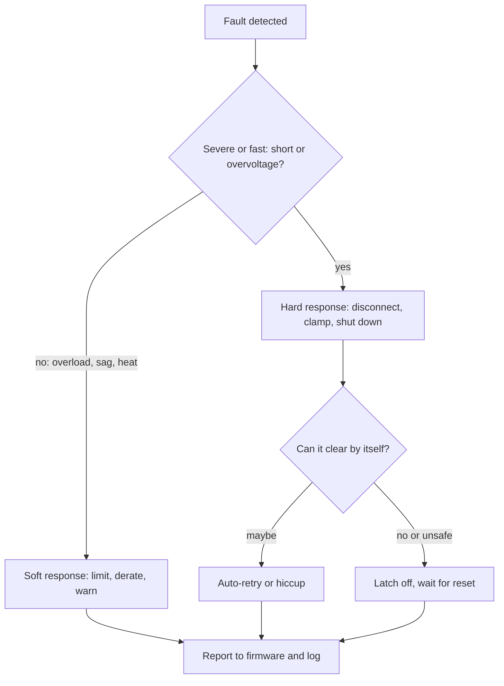

::: testing
Whether you know that "detect" is only half of protection and that the **response** is a design decision with trade-offs. The interviewer wants a menu (limit, shut down, disconnect, clamp, warn, degrade), the difference between **latch-off, auto-retry and hiccup**, an understanding that response time must match the hazard, and that the system also needs a **safe state** and a way to tell software what happened. Mentioning foldback, hold-up energy for a clean shutdown, and the false-trip versus under-protection trade-off marks a strong candidate.
:::

::: why
A detector with no sensible response is just an alarm. The wrong response can do more harm than the fault: a motor controller that latches off at a brief current spike leaves a robot dead in traffic; a supply that retries forever into a short cooks itself slowly; an embedded system that loses power with no warning corrupts its flash. In design reviews the question is always "and then what happens?", so being able to choose the response deliberately is a mark of a real power or systems engineer.
:::

::: concepts
- **Fault detection** ([[q0455]]): comparators, supervisors and current-sense chains that produce a fault flag.
- **Current limiting and foldback**: holding the current at a ceiling, or reducing it as the output voltage collapses, so a short dissipates less.
- **Latch-off vs auto-retry vs hiccup**: three restart policies after a trip, with different trade-offs.
- **Disconnect element**: a series switch, eFuse or fuse that physically isolates the faulty branch ([[q0459]]).
- **Clamping and crowbar**: shunting energy away instead of interrupting it ([[q0144]]).
- **Hold-up energy**: energy stored in capacitance that gives the system time to react to a power loss, $E=\tfrac12C(V_1^2-V_2^2)$.
:::

::: answer
"It depends on the fault and how bad the consequence is, so I think of it as a menu from gentle to drastic.

The gentlest response is just to flag it: set a status bit or interrupt so firmware knows and can log it or throttle the load. Next is limiting: a current-limited regulator or foldback holds the current at a safe value so the system keeps running at reduced power. If limiting isn't enough, I shut down: turn off the converter or open a series switch. Here the restart policy matters. Latch-off stays off until someone resets it, which is safest but needs intervention. Auto-retry tries again after a delay, and hiccup mode does short attempts with long pauses, so a persistent short only sees a few percent duty and the average heating is small. For overvoltage, I can clamp with a TVS or crowbar the rail and blow a fuse, or disconnect the load with an OVP switch.

I'd also make the response match the speed of the hazard: nanoseconds for a spike, microseconds for a short, milliseconds for an overload. And for an embedded system I'd use the warning to enter a safe state: stop the motors, save to non-volatile memory using hold-up capacitance, and reset cleanly."
:::

::: technical
**Responses by fault and speed**

| Response | How | Typical speed | Notes |
|---|---|---|---|
| Flag / interrupt | Comparator or PG pin to MCU | µs to ms | No protection by itself |
| Current limit | Constant-current clamp in regulator or switch | µs | Pass element dissipates $(V_{in}-V_{out})I_{lim}$ |
| Foldback | Limit falls as $V_{out}$ falls | µs | Reduces short-circuit dissipation; can block start-up into some loads |
| Latch-off | Fault latch disables the switch | µs | Needs power-cycle or reset |
| Auto-retry / hiccup | Timer re-enables after a pause | ms | Average short-circuit power $\approx$ duty $\times$ limit power |
| Disconnect | Fuse, PTC, eFuse, load switch | µs to s | Isolates branch |
| Clamp / crowbar | TVS, Zener, SCR across rail | ns to µs | Shunts energy; paired with fuse |
| Degrade / derate | Firmware lowers load or speed | ms to s | For thermal, battery sag |

**Example numbers.** A linear regulator, 12 V in, 5 V out, limited at 2 A: during a hard short the pass element dissipates $12\times2 = 24$ W; with foldback to 0.6 A it dissipates $12\times 0.6 = 7.2$ W. Hiccup with 3 ms on and 150 ms off has duty $3/153\approx2\%$, so average dissipation is about 0.47 W.

**Clean shutdown.** A 470 µF hold-up capacitor discharging from 12 V to 8 V (the minimum the regulator needs) supplies $\tfrac12(470\,\mu F)(12^2-8^2)=18.8$ mJ, which at a 0.5 W load is about 38 ms: ample time for firmware to write state to flash.
:::

::: short
"It depends on how bad the fault is. The gentlest is to just flag it so firmware can react. Then limiting, like current limit or foldback. Then shutdown, either latched or with auto-retry or hiccup so a persistent short sees only a few percent duty. For overvoltage I can clamp with a TVS or crowbar a rail and blow a fuse, or disconnect the load. I match the response speed to the hazard, and in an embedded system I use the warning to go to a safe state and save data before power is lost."
:::

::: long
"I think of the response as a menu, from gentle to drastic, and I choose by consequence and speed.

The gentlest is to flag it: pull a fault pin or raise an interrupt so firmware can log it, warn, or reduce load. That alone doesn't protect hardware, so it's usually paired with something faster.

Next is limiting. A current-limited regulator or load switch clamps the current to a safe value so the system keeps running at reduced capacity. Foldback goes further: as the output voltage collapses, the limit drops too, so a hard short only produces a fraction of the full-limit dissipation. For example, a 12 V to 5 V linear stage limited at 2 A burns 24 W in a short; foldback to 0.6 A makes it 7 W.

If limiting isn't enough, shut down. Latch-off holds the output off until a reset, which is safest when a fault means something is broken. Auto-retry restarts after a delay. Hiccup mode does short attempts with long pauses, say 3 ms on and 150 ms off, so the average power in a short is about 2% of the limit power, and it recovers by itself when the fault clears.

For overvoltage the options are to clamp it, with a TVS or Zener, to crowbar the rail with an SCR so a fuse blows, or to disconnect the load with an OVP switch.

Speed matters: a spike needs a nanosecond clamp, a short circuit needs a microsecond comparator, an overload can use a slower thermal response.

And in an embedded system I use the warning to reach a safe state: stop actuators, and use hold-up capacitance to save data to flash before the rail collapses, then reset cleanly."
:::

::: terms
- **Latch-off**: the output stays off after a fault until power is cycled or a reset is applied.
- **Auto-retry**: the output re-enables after a delay and trips again if the fault persists.
- **Hiccup mode**: auto-retry with a low duty cycle, so average fault power is small.
- **Foldback current limit**: the current limit decreases as the output voltage falls.
- **Crowbar**: an SCR or similar that shorts the rail on overvoltage, forcing a fuse to open.
- **Power-fail warning**: an early signal that the supply is going away, giving firmware time to save state.
- **Safe state**: a defined condition (outputs off, actuators braked, data saved) the system goes to on fault.
- **Fault flag / PG**: status output reporting the condition to the system.
:::

::: exceptional
**An average answer** says "shut it off" or "blow a fuse".

**An exceptional answer**:
- Lays out a **menu** of responses and picks by **consequence and speed**.
- Differentiates **latch, retry and hiccup**, with the duty-cycle calculation of average fault power.
- Explains **foldback** and its start-up trade-off.
- Separates **protect the hardware** (limit, disconnect, clamp) from **protect the function** (safe state, data saving with hold-up energy).
- Notes **nuisance trips** and inrush, and says how to avoid them (blanking, soft-start).
- Ties to **diagnostics**: reporting and logging so the fault can be understood afterwards.
:::

::: mistakes
- **Shutting everything down for any fault.** A transient spike on a non-critical rail shouldn't take down the whole system; choose a response proportional to the fault.
- **Auto-retrying forever into a hard short at full duty.** Without a pause (hiccup), the average fault power equals the full limit power and parts overheat anyway.
- **Using a latch where unattended recovery is required.** A remote sensor that latches off after a brown-out stays dead; auto-restart is better there.
- **Foldback that prevents start-up.** A load that draws more current at low voltage (a stalled motor, a constant-power converter, a cold incandescent lamp, a big capacitor) may not start under a foldback limit.
- **No path to tell software.** If the fault is invisible, field failures become impossible to diagnose.
- **Forgetting the response itself can create transients.** Switching off an inductive load with a fast switch creates a kick ([[q0144]]).
:::

::: deep
## A fault needs a policy

A detector ([[q0455]]) produces one bit: fault or no fault. The engineering decision is what to do with that bit. It helps to ask four questions: how fast must I act, how bad is it if I act too early (a false trip) or too late, can the fault clear by itself, and who needs to know?


Figure: Severe, fast faults go to a hard response; slow or partial faults get a soft one. The restart policy depends on whether the fault is expected to clear. Reporting is the last step in every branch.

## Limiting: keep running, with less

A current limit is the mildest "automatic" response. A linear regulator or load switch senses the current and reduces its drive so that the current does not exceed $I_{lim}$ (see [[q0459]] for the circuit). The output voltage simply collapses as needed. The system survives, but the pass element carries the whole difference: for a 12 V input and 5 V output, a short with a 2 A limit dissipates

$$P = (V_{in}-V_{out})\,I_{lim} = (12-0)\times 2 = 24\ \text{W}$$

which is far more than the same regulator dissipates in normal operation, $(12-5)\times 2 = 14$ W at the knee. A small package cannot survive this indefinitely, so thermal shutdown backs up the current limit.

**Foldback** reduces the limit as the output voltage falls. The V-I characteristic looks like this:

```plot
{"title":"Constant-current limit versus foldback limit (5 V output)","x":{"label":"Output current","unit":"A","min":0,"max":2.5},"y":{"label":"Output voltage","unit":"V","min":0,"max":6},
 "series":[
  {"label":"constant-current limit (2 A)","points":[[0,5],[2,5],[2,0]]},
  {"label":"foldback (2 A knee, 0.6 A short-circuit)","points":[[0,5],[2,5],[0.6,0]],"color":"orange","dashed":true}
 ],
 "points":[{"x":0.6,"y":0,"label":"short: 12 V x 0.6 A = 7.2 W"},{"x":2,"y":0,"label":"short: 12 V x 2 A = 24 W"}]}
```
Figure: Both curves are flat until the 2 A knee. With a plain current limit a short still delivers 2 A, so the pass device dissipates 24 W; with foldback the current falls to 0.6 A as the voltage collapses, and dissipation falls to 7.2 W. The price: the load line of a load that needs more current at low voltage can intersect the foldback curve at the wrong point, so the supply can't start.

## Shutdown: how to come back

Once a switch is open, the policy for restoring it matters.

| Policy | How it works | Pros | Cons |
|---|---|---|---|
| Latch-off | Fault latch disables the output until reset or power cycle | Safest; no repeated stress | Needs intervention; a transient fault leaves system dead |
| Auto-retry (continuous) | Re-enables after a delay; trips again if the fault persists | Self-healing | Repeated stress if the fault persists |
| Hiccup | Retry with a long off-time and a short on-time | Low average power in a short | Slow recovery; the load sees periodic restarts |

Hiccup arithmetic: with 3 ms on and 150 ms off, the duty cycle is $3/(3+150)=1.96\%$, so a 24 W fault becomes an average of about 0.47 W.

```timing
{"signals":[
 {"name":"SHORT","wave":"00111111111111111111"},
 {"name":"OUT_EN","wave":"11110000011000000110","color":"accent"},
 {"name":"OC_TRIP","wave":"00010000001000000010","color":"red"}
],"hscale":0.8}
```
Figure: A short appears at the third tick. The converter trips, turns the output off, waits several ticks, and tries again. Each attempt trips immediately while the short persists, so the output is only on for a small fraction of the time. Once the short is removed (not shown), the next attempt succeeds and the output stays on.

## Disconnect and clamp

For a branch that has failed (a shorted cable, a faulty peripheral), a series element isolates it. A fuse is the one-shot option, a PTC polyfuse resets after cooling, and an eFuse or load switch with a current limit and fault flag is the electronic version that can retry or latch under control ([[q0459]]). Disconnecting is the cleanest response when the fault will not go away by itself.

For overvoltage, you can shunt instead of break. A TVS or Zener clamps the node; the energy goes into the clamp, which must be rated for the fault energy. A **crowbar** (an SCR triggered by an OVP detector) shorts the rail deliberately, forcing a series fuse or the supply's own current limit to remove the voltage. The crowbar is brutal but very robust, used in older power supplies and in protecting expensive loads. Another option is an OVP switch, which opens in series when $V_{in}$ exceeds a threshold, so the load never sees the excess.

## Protect the function: safe state and hold-up

Hardware that survives is not enough if the system corrupts its data or leaves a motor energised. A clean response includes:

1. **Early warning**: a comparator on the input (or a brown-out interrupt) that fires before the regulated rail collapses.
2. **Safe state**: stop PWM, brake or coast actuators, open relays, put outputs in known levels.
3. **Save state**: write critical data to non-volatile memory, which needs the rail to stay up for several milliseconds.
4. **Reset cleanly**: hold the MCU in reset until the supply is back above a threshold (see [[q0458]]).

The time budget comes from **hold-up energy**. With a bulk capacitor $C$ discharging from $V_1$ (when the warning fires) to $V_2$ (when the regulator drops out), the energy is $\tfrac12C(V_1^2-V_2^2)$. For 470 µF from 12 V to 8 V that is 18.8 mJ, which supports a 0.5 W load for about 38 ms. A few milliseconds of flash writing at 0.5 W is only a few mJ, so the budget works with margin. If the margin isn't there, increase $C$, lower the load during shutdown, or raise the warning threshold.

## Match the response to the hazard

| Hazard | Time scale | Response |
|---|---|---|
| ESD, switching spike | ns | Passive clamp (TVS, ESD diode) |
| Hard short | 1 µs to 10 µs | Fast comparator, cycle-by-cycle limit, disconnect |
| Motor overload | ms to s | Delayed trip, derate, thermal model |
| Slow overheating | s to min | Thermal shutdown, firmware derating |
| Brown-out / sag | ms | Supervisor reset, hold-up, safe state |

Blanking and filtering decide the boundary between a fault and normal behaviour. A load with 5 A of inrush for 2 ms must not trip a 3 A limit with a 1 ms delay. Choose delays shorter than the time the hardware can survive the fault, but longer than any legitimate peak.

## Always tell someone

A fault flag to the MCU, a counter in non-volatile memory, or just a status LED turns a mysterious dead board into a diagnosable one. In production, log the cause and a timestamp or event count; it is invaluable for field failure analysis.
:::

::: applications
- **USB and battery-powered devices**: load switches with current limit and fault pins; hiccup or latch selectable on the part.
- **Buck/boost converters**: hiccup mode on short, cycle-by-cycle current limit, thermal shutdown ([[q0265]]).
- **Automotive modules**: smart high-side switches that limit, report and retry lamp and solenoid loads.
- **Hot-swap and server boards**: eFuses and hot-swap controllers that latch or retry on overcurrent.
- **Industrial motor drives**: desaturation detection turning off the IGBT or FET within microseconds, then a controlled fault state.
- **Data loggers and smart meters**: power-fail warning and hold-up capacitors to save data when mains or battery drops.
:::

::: assumptions
I assumed a low-voltage DC system with an electronic response. In mains-powered or high-power equipment, the response is governed by safety standards that may require specific fusing and certified disconnects, and a latched output with manual reset may be mandatory. For battery systems ([[q0295]]), the protection IC usually disconnects with a series FET and has no retry until a charger is attached. Valid alternatives exist: some systems prefer to keep running in a degraded mode at all cost (life-critical equipment), others prefer immediate and safe stop. Which one is right depends on the consequence of failure, which is an engineering and sometimes regulatory judgement.
:::

::: followups
### When would you choose latch-off over hiccup?
When retrying could cause harm or the fault means something is broken: a battery pack with a cell fault, a motor driver after a desat event, a heater stuck on. Also when an unattended retry would damage the load or when you want a technician to investigate. Hiccup suits faults that may be transient or user-fixable (a cable shorted briefly) and where unattended recovery is valuable, such as USB ports or remote equipment.

### What is the downside of foldback current limiting?
It can prevent start-up into loads that draw more current at low voltage, such as a motor at stall, a constant-power load (a downstream switching converter draws more current as its input falls) or a large capacitor. The supply can lock itself at the foldback point and never reach the normal region. Mitigations: a higher short-circuit current, a start-up override or soft-start, or constant-current limit with thermal shutdown instead.

### How do you size the hold-up capacitor for a clean shutdown?
Find the energy needed during the shutdown sequence $E = P\,t$ (load power times the time to save state), choose the voltage window $V_1$ (warning threshold) to $V_2$ (regulator dropout), and solve $C = 2E/(V_1^2-V_2^2)$. For 0.5 W over 10 ms, $E = 5$ mJ, with 12 V to 8 V: $C = 0.010/80 = 125$ µF; add margin of 2 to 3 times for tolerance and ageing. Remember to account for capacitor DC-bias derating and low-temperature ESR.

### What if the fault clears while the system is in hiccup mode?
At the next retry the output ramps normally and stays on, so recovery is automatic after at most one off-time (about 150 ms in the example). If the load is sensitive to periodic restarts, that off-time should be as short as the thermal budget allows. With latch-off, the same event leaves the output off until reset.

### Scenario: your product trips its overcurrent protection every time the motor starts. What do you change?
Check whether the trip is legitimate. Motor start-up draws several times the running current ([[q0343]]). Options: soft-start or ramp the motor command to reduce inrush, add a blanking time to the comparator longer than the start-up peak but shorter than the damage time, raise the limit if the hardware allows, or use a two-level scheme with a fast trip at high current and a slower trip at moderate current. Do not simply remove the protection.
:::

::: interpretations
"What can you do?" is intentionally broad. I read it as: what are the possible responses after detection, and how do you choose among them? I covered both the hardware-protection responses and the system-level safe-state responses. The detection side is [[q0455]], protection of a supply is [[q0457]], and the embedded view of voltage faults is [[q0458]].
:::

::: references
- Erickson & Maksimovic, *Fundamentals of Power Electronics*: converter operation and current limiting concepts.
- Horowitz & Hill, *The Art of Electronics*, 3rd ed.: regulators with current limiting and foldback, crowbar overvoltage protection, supply protection.
- Regulator, load-switch and eFuse datasheets from major manufacturers describe latch, auto-retry and hiccup options; the datasheet fault-behaviour sections are the best real examples.
- IEC/UL product safety standards for mains-powered equipment (consult the relevant standard for your product class).
:::

::: rubric
- Gives a menu of responses: flag, limit, shut down, disconnect, clamp, derate :: The question is "what can you do", so breadth matters.
- Differentiates latch-off, auto-retry and hiccup, with trade-offs :: Restart policy is the key design decision after a trip.
- Explains foldback and its start-up problem :: Shows you understand dissipation in a short and load-line interactions.
- Matches response speed to the hazard :: Different faults need ns, µs or ms reactions.
- Covers overvoltage-specific responses: clamp, crowbar, OVP disconnect :: Overvoltage needs a different toolkit than overcurrent.
- Includes a safe state and data save for embedded systems :: Protects function, not just hardware.
- Mentions false trips, blanking and reporting faults :: Shows practical, field-aware judgement.
:::

::: quiz
```json
[
 {"type":"mcq","level":"fundamental","q":"Which restart policy leaves the output off after a fault until power is cycled or reset?","options":["Hiccup mode","Latch-off","Auto-retry","Foldback"],"answer":1,"explain":"Latch-off holds the output off until a reset. Auto-retry and hiccup restart on their own, and foldback is a limiting behaviour rather than a restart policy."},
 {"type":"numeric","level":"fundamental","q":"A hiccup supply is on for 2 ms and off for 98 ms during a persistent short. What is its duty cycle, in percent?","answer":2,"tolerance":0.02,"unit":"%","explain":"Duty $= 2/(2+98) = 2\\%$, so the average fault power is about 2% of the on-time power."},
 {"type":"numeric","level":"intermediate","q":"A 12 V to 5 V linear regulator has a 2 A current limit. How much power does the pass element dissipate if the output is hard-shorted? Answer in watts.","answer":24,"tolerance":0.02,"unit":"W","explain":"With the output at 0 V, the pass element drops all 12 V at 2 A: $P = 12\\times2 = 24$ W."},
 {"type":"numeric","level":"intermediate","q":"A 220 µF capacitor discharges from 12 V to 8 V while powering the system during a power-fail shutdown. How much energy does it supply, in millijoules?","answer":8.8,"tolerance":0.02,"unit":"mJ","explain":"$E=\\tfrac12C(V_1^2-V_2^2)=0.5\\times220\\times10^{-6}\\times(144-64)=8.8$ mJ."},
 {"type":"mcq","level":"advanced","q":"Why can foldback current limiting prevent a constant-power load from starting?","options":["Constant-power loads draw more current at lower input voltage, so the load line can intersect the foldback curve at a low-voltage point","Foldback increases the supply voltage","Constant-power loads draw no current","Foldback only works above 50 V"],"answer":0,"explain":"A constant-power load draws $I=P/V$, which rises as the voltage collapses. During start-up it can meet the reduced foldback limit at a low voltage and stay there, never reaching the normal operating point."},
 {"type":"truefalse","level":"advanced","q":"A crowbar protects against overvoltage by clamping the rail to a safe voltage and continuing to supply the load.","answer":false,"explain":"A crowbar deliberately shorts the rail, which drives the supply into current limit or blows a fuse. It removes the overvoltage by removing the supply, not by regulating it."}
]
```
:::
