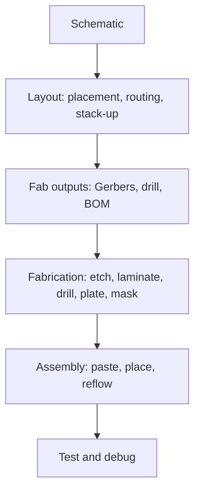

::: testing
Whether you can explain a PCB in one clear sentence and then show you know what is actually *in* one: copper conductors etched on an insulating substrate, with pads, vias, soldermask and silkscreen, built from layers. The interviewer is also checking that you see **why** it exists (repeatable, compact, controlled-impedance interconnect that machines can assemble) and can name applications across the range, from a one-layer remote control to a 20-layer server board. A good answer volunteers one real design consideration, not just a definition.
:::

::: why
Nearly every electronic product you will touch as a hardware engineer lives on a printed circuit board, so the vocabulary (pads, vias, layers, stack-up, fab, assembly) is the shared language of the job. It is also where schematics become physical: parasitics, heat, EMI and manufacturability are all decided by the layout. Interviewers use this simple opener to find out whether you have actually designed or built a board or only drawn schematics.
:::

::: concepts
- **Conductors on an insulator**: copper tracks provide the "wires", the substrate holds and separates them ([[q0055]]).
- **Layers**: boards can have one, two or many copper layers connected by vias ([[q0466]]).
- **Pads and vias**: pads are the exposed copper where parts are soldered, vias are plated holes that join layers.
- **Soldermask and silkscreen**: the protective coating and the printed legend ([[q0473]], [[q0472]]).
- **Manufacturing flow**: design files (Gerbers), fabrication, assembly, test.
- **Alternatives**: breadboards, perfboard, point-to-point wiring ([[q0461]]) and integrated circuits ([[q0462]]).
:::

::: answer
"A printed circuit board is a flat insulating board with copper conductors etched onto it, and it's what holds the components and wires them together. The usual material is fibreglass-epoxy, FR-4, with a thin layer of copper, about 35 microns for one ounce, patterned into traces. Components are soldered onto pads, and vias, which are plated holes, connect traces between layers. On top you get soldermask, the green coating that protects the copper and prevents solder bridges, and silkscreen, the printed labels.

The reason we use them instead of wires is that they're repeatable, compact, and machines can build them, so the thousandth board is the same as the first. And because the geometry is controlled, you can control things like trace impedance and loop area, which matters at high speed.

Applications are everywhere: phones, laptops, cars, medical devices, appliances, even a simple remote control. They range from a single-layer board with a few traces to dense multilayer boards with ten or twenty layers, like in servers or phones. Specialised types include flexible boards for cameras and hinges, and metal-core boards for LED lighting and power."
:::

::: technical
A PCB is a laminated structure of patterned conductor (almost always copper) on a dielectric substrate that mechanically supports components and electrically connects them according to a netlist.

**Typical construction.** Substrate FR-4 (woven glass reinforced epoxy), total thickness commonly 1.6 mm; copper foil 0.5, 1 or 2 oz/ft² (about 17.5, 35 or 70 µm); outer layers coated with soldermask (about 20 to 30 µm) and legend ink; exposed copper is protected by a surface finish (HASL, ENIG, OSP). Multilayer boards bond copper-clad cores with prepreg (partly cured resin-glass) under heat and pressure.

**Features.** Traces (conductors), pads (solder sites), through-hole vias (plated barrels, drill diameters of 0.2 to 0.3 mm are common for standard fabrication, vendor-dependent), blind or buried vias in HDI boards, planes (large copper areas for power and ground), mounting holes, board outline and fiducials for assembly.

**Why it is used.** Reproducibility; small size; controlled impedance ($Z_0$ set by trace width, dielectric height and $\varepsilon_r$); defined current return paths and shielding using planes; compatibility with automated pick-and-place and reflow soldering.

**Typical numbers.** 1 oz copper has sheet resistance about 0.5 mΩ/square; a 0.25 mm wide, 50 mm long trace has resistance about 0.1 Ω.
:::

::: short
"A PCB is an insulating board, usually fibreglass-epoxy FR-4, with copper traces etched on it that connect components soldered to pads. Vias connect layers, soldermask protects the copper and silkscreen labels the parts. We use them because they're repeatable, compact, machine-assembled and let you control impedance and return paths. They're in everything from remote controls to servers, from a single layer up to twenty or more layers."
:::

::: long
"A printed circuit board is a flat insulating board with copper conductors on it. It holds the components mechanically and connects them electrically, replacing a bundle of loose wires with patterned copper.

The usual construction is FR-4, which is woven fibreglass in epoxy, at around 1.6 millimetres thick, with copper foil of typically 35 microns, which is one ounce per square foot. The copper is etched into traces. Components sit on pads, which are exposed bits of copper where the solder goes. Vias are plated holes that connect traces on different layers. Over the top there's soldermask, the green coating that protects the copper and stops solder bridging, and silkscreen, the white legend with the reference designators.

Boards can be a single copper layer for simple cheap products, two layers for most hobby and mid-complexity designs, and four, six or many more layers for dense, high-speed designs, where inner layers are used as ground and power planes.

Why do we use them? They're repeatable, so the thousandth board is identical to the first; compact; and cheap at volume because machines place and solder the parts. They also give you controlled geometry, so you can set a trace to 50 ohms and keep return paths short, which matters for signal integrity and EMI.

Applications are everywhere: consumer electronics, cars, medical equipment, industrial controls, aerospace. Variants include flexible boards for cameras and hinges, rigid-flex, metal-core boards for LED lighting and power, and high-frequency boards on PTFE laminates for RF."
:::

::: terms
- **Trace**: a copper conductor on a PCB layer.
- **Pad**: exposed copper where a component lead is soldered.
- **Via**: a plated hole connecting copper on different layers.
- **Substrate / laminate**: the insulating base material (commonly FR-4); see [[q0470]].
- **Copper weight (oz)**: foil thickness expressed as mass per area; 1 oz is about 35 µm.
- **Soldermask**: the polymer coating that leaves only pads exposed ([[q0473]]).
- **Silkscreen (legend)**: printed text and symbols for assembly and debugging ([[q0472]]).
- **Gerber / fab files**: the manufacturing data set sent to the board house.
:::

::: exceptional
**An average answer** says "a board with copper tracks that connects components".

**An exceptional answer**:
- Names the **construction**: substrate, copper, vias, soldermask, silkscreen, finish, and typical numbers (1.6 mm, 35 µm).
- Explains **why PCBs beat wiring**: repeatability, assembly automation, controlled impedance and return paths.
- Gives a **range of applications** and **types** (single-layer to multilayer, flex, metal-core, RF).
- Shows one **design consideration**: current capacity of traces, parasitics ([[q0463]]), or manufacturing limits.
- Mentions the flow from **schematic to layout to Gerbers to fab to assembly**.
:::

::: mistakes
- **Saying PCBs are "just wires".** Traces have resistance, inductance and capacitance that matter at speed ([[q0463]]).
- **Saying FR-4 is the board.** FR-4 is the dielectric; the board also includes copper, mask, finish and vias.
- **Calling soldermask "the layer that conducts".** It is an insulator; the exposed pads are copper.
- **Thinking green is a functional requirement.** It is a colour choice ([[q0471]]).
- **Treating "PCB" and "PCBA" as the same.** The PCB is the bare board; the PCBA is the assembled board with components.
- **Confusing PCB and IC.** A PCB connects packaged parts; an IC is a silicon die ([[q0462]]).
:::

::: deep
## What problem a PCB solves

Imagine building a circuit with 40 components and 100 connections using hand-soldered wires. The result is a rat's nest: slow to build, easy to miswire, bulky, unrepeatable and mechanically fragile. A PCB replaces the wires with copper traces defined by a photographic or laser-imaged pattern, so the interconnect is fixed by the design files and produced identically every time. It also holds the parts rigidly, which is why it survives vibration and handling.

## Anatomy

```svg
<svg viewBox="0 0 700 310" xmlns="http://www.w3.org/2000/svg" font-family="Inter, sans-serif" font-size="13">
  <rect x="20" y="20" width="420" height="270" rx="8" fill="var(--d-box)" stroke="var(--d-ink)" stroke-width="2"/>
  <g fill="none" stroke="var(--d-ink)" stroke-width="1.5">
    <circle cx="45" cy="45" r="9"/><circle cx="415" cy="45" r="9"/><circle cx="45" cy="265" r="9"/><circle cx="415" cy="265" r="9"/>
  </g>
  <g fill="none" stroke="var(--d-accent)" stroke-width="6" stroke-linejoin="round">
    <path d="M170 122 H141 V225"/>
    <path d="M300 122 H350 V193"/>
  </g>
  <path d="M350 207 V250 H400" fill="none" stroke="var(--d-blue)" stroke-width="6" stroke-dasharray="10 6"/>
  <g fill="var(--d-orange)">
    <rect x="170" y="118" width="22" height="9"/><rect x="170" y="134" width="22" height="9"/><rect x="170" y="150" width="22" height="9"/><rect x="170" y="166" width="22" height="9"/>
    <rect x="278" y="118" width="22" height="9"/><rect x="278" y="134" width="22" height="9"/><rect x="278" y="150" width="22" height="9"/><rect x="278" y="166" width="22" height="9"/>
    <rect x="70" y="225" width="22" height="18"/><rect x="130" y="225" width="22" height="18"/>
  </g>
  <rect x="192" y="112" width="86" height="70" fill="var(--d-box)" stroke="var(--d-ink)" stroke-width="2"/>
  <circle cx="200" cy="120" r="3" fill="var(--d-ink)"/>
  <text x="235" y="152" text-anchor="middle" fill="var(--d-ink)">U1</text>
  <rect x="96" y="229" width="30" height="10" fill="none" stroke="var(--d-ink)" stroke-width="1.5"/>
  <text x="111" y="222" text-anchor="middle" fill="var(--d-ink)">R1</text>
  <circle cx="350" cy="200" r="8" fill="var(--d-box)" stroke="var(--d-ink)" stroke-width="2"/>
  <circle cx="350" cy="200" r="3" fill="none" stroke="var(--d-ink)" stroke-width="1.5"/>
  <g stroke="var(--d-muted)" stroke-width="1" fill="none">
    <path d="M462 62 L296 122"/><path d="M462 106 L352 160"/><path d="M462 150 L358 198"/>
    <path d="M462 194 L236 160"/><path d="M462 238 L420 262"/><path d="M462 282 L430 282"/>
  </g>
  <g fill="var(--d-ink)">
    <text x="468" y="66">Pad: solder lands here</text>
    <text x="468" y="110">Copper trace: the "wire"</text>
    <text x="468" y="154">Via: plated hole to another layer</text>
    <text x="468" y="198">Component body and silkscreen</text>
    <text x="468" y="242">Mounting hole</text>
    <text x="468" y="286">Substrate (FR-4) under mask</text>
  </g>
  <text x="352" y="274" fill="var(--d-blue)" font-size="12">other layer</text>
</svg>
```
Figure: A top view of a small board. Components (U1, R1) are soldered to orange pads. Solid traces connect pads on the top layer; a via drops a signal to another layer (dashed), where it continues as a trace. Mounting holes, board outline and silkscreen labels complete the picture. Soldermask covers everything except the pads.

### From top to bottom

A two-layer board is a sandwich: soldermask, top copper, FR-4 core, bottom copper, soldermask. Multilayer boards repeat the pattern with more cores and prepreg ([[q0466]]). Vias are the vertical interconnect: the drill is made after lamination, then the barrel is copper-plated.

### Sizing numbers worth knowing

- 1 oz copper is 35 µm thick, with sheet resistance $\rho/t = 1.7\times10^{-8}/35\times10^{-6}\approx0.49$ mΩ per square. A trace that is 0.25 mm wide and 50 mm long is 200 squares, so about 0.098 Ω (see [[q0467]]).
- Standard low-cost fabrication commonly offers minimum trace/space around 0.15 mm (6 mil) and minimum drill around 0.3 mm; finer geometry costs more (vendor-dependent: check the fab's capability sheet).
- Typical overall thickness is 1.6 mm (a common standard thickness).

## From idea to board


Figure: Each stage has its own design-rule checks. Layout must obey the fab's limits (trace/space, drill, annular ring) and the assembly's (pad shapes, spacing). Errors found at the end are the most expensive.

## Why use one

| Advantage | Why it matters |
|---|---|
| Repeatable | Same geometry and electrical behaviour on every board |
| Compact and rigid | Components can be dense and survive vibration |
| Controlled impedance | Trace width and dielectric set $Z_0$ for high-speed signals |
| Return paths and shielding | Ground planes give short loops, low EMI |
| Automated assembly | Pick-and-place and reflow reduce cost and defects |
| Documented | Design files define the product exactly |

The costs: design effort, a fab cost and lead time (so prototypes are not instant), and the need to get it right before ordering. For quick experiments, breadboards or perfboard are better ([[q0461]]).

## Applications by complexity

- **Single-layer**: calculators, remote controls, simple power supplies, low-cost appliances.
- **Double-layer**: hobby boards, mid-complexity controllers, LED drivers.
- **4 to 8 layers**: embedded systems, USB and Ethernet devices, motor controllers.
- **10 to 30+ layers**: servers, networking equipment, smartphones (with HDI features), test equipment.
- **Flex and rigid-flex**: cameras, hinges, wearables ([[q0465]]).
- **Metal-core**: LED lighting and power electronics where heat spreading matters ([[q0464]]).

## A design consideration to mention

Current capacity is a classic: a 10 mil (0.25 mm) external trace in 1 oz copper carries about 0.9 A for a 10 °C rise using the IPC-2221 curve, and 50 mil (1.27 mm) carries about 2.8 A (see [[q0467]] for the calculation). Parasitics are another: a 50 mm trace on a board has about 14 nH of inductance and 6 pF of capacitance, which looks like nothing at 1 kHz and a lot at 1 GHz ([[q0463]]).
:::

::: applications
- **Consumer electronics**: smartphones, laptops, TVs, wearables use dense multilayer and HDI boards.
- **Automotive**: engine controllers, infotainment and battery management boards, built to survive vibration and temperature.
- **Medical devices**: monitors, implants and imaging equipment, often with rigid-flex and strict reliability.
- **Industrial control**: PLCs, motor drives and power supplies with thick copper and creepage design.
- **Aerospace and defence**: high-reliability boards on specialised laminates.
- **Telecom and data centres**: high-layer-count boards with controlled impedance for multi-gigabit links.
:::

::: assumptions
I described the common rigid, copper-on-FR-4 board because that is what the question most likely means. The numbers (1.6 mm, 35 µm, 0.15 mm trace and space, 0.3 mm drill) are typical for low-cost prototype fabrication; precision, HDI and flex processes go much finer, and fabricators differ. Some PCBs are not rigid FR-4 at all: they can be flexible (polyimide), ceramic, metal-core or PTFE-based. If the interviewer wants the "PCB vs IC" distinction or a comparison with breadboards, see [[q0462]] and [[q0461]].
:::

::: followups
### How does a signal get from the top layer to the bottom layer?
Through a via: a drilled hole whose barrel is copper-plated so it connects the copper on each layer it passes. A typical through-via is about 0.3 mm drill with a pad of 0.6 mm. It adds a small inductance (about 1 nH for a 1.6 mm board) and capacitance (about 0.5 pF), which matter at high speed ([[q0463]]).

### What does "1 oz copper" mean?
It originally means one ounce of copper spread over one square foot, which gives a thickness of about 35 µm (1.37 mil). Thicker copper (2 oz, 3 oz or more) carries more current and spreads heat, but limits the finest trace and space the fab can etch.

### Why are inner layers often used for ground and power?
Solid planes give low-impedance power distribution and a continuous return path under signal traces, which shortens loop area and reduces EMI and crosstalk. Plane capacitance between power and ground also helps decoupling. See [[q0466]] for stack-up and [[q0463]] for the parasitics involved.

### What if you need ten copies of a board by next week?
Order from a prototype fab with a quick-turn service (days) and assembly, or hand-assemble from a stencil and hot-air or reflow oven. For one-off experiments before layout, build the schematic on a breadboard or perfboard to reduce risk, then spin the PCB once the design works ([[q0461]]).

### Scenario: your board works on the bench but fails EMC testing. What in the PCB could be the cause?
Look at return paths (a split in the ground plane under a fast signal), loop areas (large power loops), unfiltered cables, too few decoupling capacitors near ICs, fast edges on long traces without termination, and the stack-up (no adjacent reference plane). Changes are made in layout: add a continuous plane, shorten loops, add filtering.
:::

::: interpretations
"Name some applications" is open: give a range across complexity and industry. The question is a general opener, so keep the definition crisp and add two or three concrete features and uses. Related questions go deeper into types ([[q0464]]), flex boards ([[q0465]]) and layers ([[q0466]]).
:::

::: references
- IPC-2221, *Generic Standard on Printed Board Design*: general rules for conductor, hole and layer design.
- Horowitz & Hill, *The Art of Electronics*, 3rd ed.: the chapter on construction techniques (printed circuit boards, prototyping).
- Howard Johnson & Martin Graham, *High-Speed Digital Design: A Handbook of Black Magic*: PCB interconnect behaviour at speed.
- Board-house design guidelines and capability sheets (from your chosen fabricator) for current minimum trace/space and drill sizes.
:::

::: rubric
- Defines a PCB as copper conductors on an insulating substrate that mounts and connects components :: This is the core definition.
- Names the main parts: traces, pads, vias, soldermask, silkscreen, substrate :: Shows you know the construction.
- Gives typical numbers (FR-4, 1.6 mm, 1 oz copper) :: Numbers signal real experience.
- Explains why PCBs are used: repeatability, density, automation, controlled impedance :: The "why" separates understanding from definition.
- Offers a range of applications and types :: The question asks for applications.
- Mentions one design consideration (current capacity, parasitics, manufacturability) :: Shows engineering depth beyond the definition.
:::

::: quiz
```json
[
 {"type":"mcq","level":"fundamental","q":"What is a via?","options":["A plated hole that connects copper on different layers","A silkscreen symbol","A type of soldermask opening","The copper on the outside edge of a board"],"answer":0,"explain":"A via is a drilled hole with copper plating on its barrel, joining traces on different layers."},
 {"type":"mcq","level":"fundamental","q":"Which part of a PCB provides the electrical conductors?","options":["FR-4 core","Soldermask","Copper foil","Silkscreen"],"answer":2,"explain":"Copper carries the current. FR-4 is the insulating substrate, soldermask the protective coating and silkscreen the printed legend."},
 {"type":"numeric","level":"intermediate","q":"A 1 oz copper layer is 35 µm thick with resistivity $1.7\\times10^{-8}\\ \\Omega\\text{m}$. What is its sheet resistance in mΩ per square?","answer":0.486,"tolerance":0.03,"unit":"mΩ/sq","explain":"$R_s=\\rho/t=1.7\\times10^{-8}/35\\times10^{-6}=4.86\\times10^{-4}\\ \\Omega=0.486$ mΩ per square."},
 {"type":"numeric","level":"intermediate","q":"Using that sheet resistance (0.49 mΩ/sq), what is the resistance of a 0.25 mm wide, 50 mm long trace in ohms?","answer":0.098,"tolerance":0.03,"unit":"Ω","explain":"The trace is $50/0.25=200$ squares, so $R=200\\times0.00049=0.098\\ \\Omega$."},
 {"type":"truefalse","level":"advanced","q":"A PCB and a PCBA are the same thing.","answer":false,"explain":"A PCB is the bare board; a PCBA (printed circuit board assembly) has the components soldered on."}
]
```
:::
