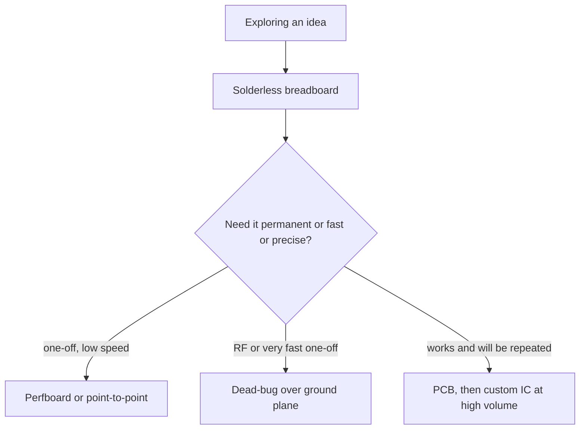

::: testing
Whether you can compare implementation options along the axes that actually decide the choice: **speed to build, cost per unit and up-front cost, performance (parasitics, noise, frequency), reliability, repeatability and the stage of the project**. The interviewer wants a judgement, "use a breadboard to explore, a PCB to prove and ship, an IC when volume and integration justify it", with numbers or at least mechanisms behind each point. A common trap is to treat the list as a ranking; it is a progression with a break-even at each step.
:::

::: why
Real projects pass through several of these. You breadboard a sensor circuit on day one, solder a perfboard version to take to a demo, spin a PCB when it works, and if the product sells in the hundreds of thousands, someone integrates half of it into an ASIC. Choosing the wrong stage wastes weeks (a PCB spin for an untested idea) or produces misleading results (debugging a 50 MHz circuit on a breadboard). Understanding the physical differences, especially parasitics, also explains why a circuit that "worked on the breadboard" fails on the PCB or the other way round.
:::

::: concepts
- **Parasitics**: unintended R, L and C from contacts, wires and layout ([[q0011]], [[q0463]]).
- **Non-recurring engineering (NRE) vs unit cost**: setup costs spread over volume, versus per-unit cost.
- **Prototype vs production**: speed of iteration versus repeatability and reliability.
- **Signal integrity**: controlled impedance and short loops are available only with controlled geometry ([[q0460]]).
- **Integration**: an IC puts many components on one die, reducing size, power and cost at volume ([[q0462]]).
- **Reliability**: mechanical connections (contacts, solder joints, wires) fail in different ways.
:::

::: answer
"They're points along a progression from fast and flexible to optimised and permanent, and I'd choose by the stage and the requirements.

A solderless breadboard is the fastest: no tools, instant changes, reusable parts. But the contacts are flaky, resistance varies, and the strips add a few picofarads between rows, plus long jumpers add around a nanohenry per millimetre. So it's good for low-frequency, low-current exploration, up to maybe a few MHz, and bad for anything fast, precise or high current.

A soldered perfboard or point-to-point wiring is permanent and more robust, and good for a one-off, but it's slow, error-prone, and not repeatable. Dead-bug point-to-point over a ground plane is actually a classic for RF prototypes because it gives short leads.

A PCB takes days to design and a week or so to fab, but then it's repeatable, compact, has controlled impedance and return paths, and machines can assemble it. Per-unit cost is low at volume.

An IC is the extreme: the biggest NRE, months of design and mask costs that can be huge, but at high volume the unit cost is tiny, and it gives the smallest size, lowest power and best performance. So it only makes sense when volume or performance demands it."
:::

::: technical
| | Solderless breadboard | Perfboard / stripboard | Point-to-point / dead-bug | PCB | IC (custom) |
|---|---|---|---|---|---|
| Build time | Minutes | Hours | Hours | Days to weeks (design + fab) | Months to years |
| Change a connection | Seconds | Cut/re-solder | Re-solder | Cut trace or new spin | New masks |
| NRE | About 0 | About 0 | About 0 | Tens to hundreds of USD (prototype) | Tens of thousands to millions of USD |
| Cost per unit at volume | High (labour) | High (labour) | High (labour) | Low | Very low |
| Parasitics | High, variable | Moderate | Low if done well | Controlled | Smallest |
| Practical speed | Up to a few MHz (rough) | Tens of MHz | Hundreds of MHz+ possible | GHz with care | Highest |
| Current capacity | About 1 A per contact (rough) | Wire/solder limited | Wire limited | Set by copper | On-die limits |
| Reliability | Poor (vibration, contact wear) | Good | Fair | Excellent | Excellent |
| Repeatability | Poor | Poor | Poor | Excellent | Excellent |

**Breadboard parasitics (typical, not guaranteed).** Adjacent rows add on the order of 2 to 5 pF; contact resistance is tens of mΩ initially and can grow with wear; a jumper wire has about 1 nH/mm (a 100 mm wire is about 110 nH, a 10 mm wire about 7 nH). A 100 nH jumper into 10 pF resonates at $f_0=1/(2\pi\sqrt{LC})=159$ MHz. A 5 pF stray at 10 MHz is $X_C=3.2$ kΩ.

**Break-even.** With illustrative costs (prototype PCB NRE 150 USD, 5 USD per unit; hand-wired 25 USD per unit; custom IC NRE 500,000 USD, 0.5 USD per unit), a PCB beats hand wiring at about 8 units, and the IC beats the PCB above about 111,000 units.
:::

::: short
"A breadboard is fastest to change but has flaky contacts and a few picofarads and nanohenries of parasitics, so it's for exploration at low frequency. Perfboard or point-to-point is permanent but slow and not repeatable. A PCB takes days to fab but is repeatable, compact, with controlled impedance and cheap at volume. An IC has the biggest up-front cost but the best size, power and performance at high volume. So you progress from breadboard to PCB, and to an IC only when volume justifies it."
:::

::: long
"I'd treat them as stages, and the choice depends on where the project is.

A solderless breadboard is for exploration. You can change anything in seconds and reuse parts. But the spring contacts are unreliable, resistance varies, adjacent rows add a few picofarads, and jumpers add about a nanohenry per millimetre. A 100 millimetre wire is around 100 nanohenries, which with 10 picofarads rings at about 160 megahertz. So it's fine for low-speed, low-current prototyping up to a few megahertz, and useless for fast edges, RF, precision analogue or high current.

Perfboard and point-to-point wiring are soldered, so they're robust, and good for a one-off. But they're slow to build, easy to miswire and impossible to reproduce reliably. A dead-bug RF prototype, with short leads soldered over a copper ground plane, is a legitimate high-frequency technique for that reason.

A PCB costs a few days to design and a week or so to fab, so it's slow to iterate, but once it works, every board is identical. You get controlled impedance, short return paths, planes, and automated assembly, and the unit cost drops fast with volume. That's why anything shipped is a PCB.

An IC is the extreme. You pay tens of thousands to millions of dollars up front and wait months, but at high volume the unit cost is tiny and you get the smallest size, lowest power and best performance. With plausible numbers, a PCB beats hand wiring after about eight units, and a custom IC beats a PCB around a hundred thousand units. In practice you use catalogue ICs on a PCB long before you ever design your own."
:::

::: terms
- **Solderless breadboard**: a plastic board with spring-clip strips for pushing in parts without soldering.
- **Perfboard / stripboard**: a board with a hole grid (stripboard has copper strips) where parts are soldered.
- **Point-to-point / dead-bug**: parts soldered directly to each other and to a ground plane, with no board pattern.
- **NRE (non-recurring engineering)**: one-time cost of design, tooling and masks.
- **Unit cost**: cost to make one more copy.
- **Parasitic**: unintended resistance, inductance or capacitance in the interconnect ([[q0463]]).
- **Tape-out**: sending a finished IC design to the foundry for mask making.
- **ASIC**: application-specific integrated circuit.
:::

::: exceptional
**An average answer** lists pros and cons from memory: "breadboards are easy but messy".

**An exceptional answer**:
- Frames it as a **progression** with **break-even points** in time and cost, and gives the cost model (NRE plus per-unit).
- Quantifies **breadboard parasitics** (a few pF between rows, about 1 nH/mm of wire, contact resistance) and what frequency that limits.
- Knows **dead-bug and point-to-point** is a real RF technique, not just a hack.
- Explains why **PCBs** give controlled impedance and return paths ([[q0460]]).
- Understands **ICs** as integration that trades NRE for unit cost, power and size, and that most designs use catalogue ICs on a PCB ([[q0462]]).
- Mentions **reliability** (contacts versus solder joints) and **repeatability**.
:::

::: mistakes
- **Using a breadboard for fast or precise circuits.** A 100 MHz clock, a sensitive amplifier or a switching converter behaves differently there; results are misleading.
- **Assuming a perfboard prototype will match the PCB.** Lead lengths and grounding differ, so noise and stability change.
- **Treating the five options as a quality ranking.** Each is right for some stage; an IC is not "better" for a 10-unit product.
- **Ignoring NRE.** The cheapest per unit is not the cheapest overall unless volume pays for the setup.
- **Forgetting reliability.** A breadboard in a demo that someone bumps will fail; use soldered builds for anything that moves.
- **Calling "IC" and "PCB" interchangeable.** An IC is a silicon die in a package ([[q0462]]).
:::

::: deep
## A progression, not a list

Each option exists because it is the best trade-off at some point in a project's life. The axes that matter are: (1) time to build and to change, (2) up-front cost versus per-unit cost, (3) electrical performance, and (4) mechanical reliability and repeatability.


Figure: The decision is driven by what you need next. A PCB is the default for anything that will be built more than a handful of times; a custom IC is justified only by volume or performance that discrete parts cannot reach.

## The solderless breadboard

### What it really is

A breadboard is rows of spring-steel clips in plastic. A component lead pushed into the clip is held by spring force against a nickel-silver strip. Every strip is a conductor, so the whole board is a network of long, closely spaced parallel conductors.

### Parasitics

- **Contact resistance**: tens of milliohms when new, increasing with wear, oxidation and wire gauge. Irrelevant for logic, destructive for milliohm-level current sensing or precision low-resistance measurements.
- **Inter-row capacitance**: adjacent strips act as parallel plates, a few picofarads each (vendor-dependent; the power rails run along the whole board and are worse). Vary by board.
- **Wire inductance**: a round wire of diameter $d$ and length $l$ has $L\approx2\times10^{-7}\,l\,[\ln(4l/d)-0.75]$ henries. For a 0.64 mm wire, 100 mm gives about 114 nH and 10 mm gives about 7 nH, which matches the rule of thumb of about 1 nH per millimetre.

```circuit
{"caption":"Breadboard interconnect as seen by a fast signal","elements":[
 {"t":"V","a":[0,3],"b":[0,7],"label":"V_s"},
 {"t":"wire","pts":[[0,3],[0,2],[3,2]]},{"t":"gnd","at":[0,7]},
 {"t":"L","a":[3,2],"b":[8,2],"label":"L_{jumper}","value":"100 nH"},
 {"t":"R","a":[8,2],"b":[12,2],"label":"R_c","value":"20 mΩ"},
 {"t":"wire","pts":[[12,2],[18,2]]},{"t":"dot","at":[15,2]},
 {"t":"C","a":[15,2],"b":[15,6],"label":"C_{stray}","value":"5 pF","labelSide":"other"},{"t":"gnd","at":[15,6]},
 {"t":"R","a":[18,2],"b":[18,6],"label":"load"},{"t":"gnd","at":[18,6]}
]}
```
Figure: The long jumper (inductance), the spring contact (resistance) and the strip-to-strip capacitance form a low-pass network with a resonance that the ideal schematic does not show. With 100 nH and the 5 pF shown the resonance is near 225 MHz; add the load's own input capacitance to reach 10 pF and it falls to about 160 MHz. Edges faster than a few nanoseconds ring.

The reactances show the damage: at 10 MHz a 100 nH wire has $X_L=2\pi f L=6.3$ Ω and a 5 pF stray capacitor has $X_C=3.2$ kΩ; at 100 MHz the wire is 63 Ω, already comparable to a 50 Ω line, and the capacitor is 318 Ω.

> [!UNCERTAIN]
> Breadboard capacitance, contact resistance and current rating (often quoted around 1 A per contact) differ between manufacturers and with age. The values here are typical ranges used for estimation, not specifications.

## Perfboard, stripboard and point-to-point

Soldered joints are low-resistance and permanent, so reliability is far better than a breadboard. But you route by hand with wire, so wiring is slow, and the layout changes with each builder: ground paths are ad hoc, loops are large, and a second copy will not behave identically. Good practice improves performance: use a ground bus or a continuous copper ground, keep leads short, put decoupling capacitors at the pins ([[q0032]]).

**Dead-bug / manhattan construction** is the exception where hand wiring beats a PCB for a prototype: components soldered with minimum-length leads onto an unbroken copper-clad board, either upside down (dead bug) or on small islands (Manhattan). It gives a ground plane and very short connections, so RF and very fast analogue prototypes behave closer to a final PCB. It is still not repeatable.

## The PCB

A PCB gives defined geometry ([[q0460]]): traces of known width over a reference plane have predictable impedance, loops are small by design, and every unit is the same. The costs are design time, fab lead time and the "getting it wrong" penalty (a spin costs days). Machines can place parts, so labour cost per unit falls to near zero at volume. Prototypes cost on the order of tens to a few hundred USD (varies with fab, layers, quantity and speed), which is the NRE in the model below.

## The IC

A custom IC (ASIC) puts the circuit on one die. The benefits are size, power (on-chip interconnects are tiny, with femtofarad parasitics), speed and, at volume, the lowest cost per unit. The costs are huge NRE: design, verification, mask sets (from tens of thousands of USD on mature nodes through multi-project wafers to millions on advanced nodes: vendor- and node-dependent), and a design cycle of many months. Mistakes cost a re-spin. So custom ICs make sense only at high volume or when performance or size demand them. Most products use catalogue ICs soldered to a PCB: this gets the benefits of integration without the NRE ([[q0462]]).

## The cost model

Per-unit total cost at quantity $n$ is $C(n)=C_{unit}+\text{NRE}/n$. With illustrative numbers:

- Hand-wired board: 25 USD per unit (parts and one hour of labour), no NRE.
- PCB: 150 USD NRE, 5 USD per unit.
- Custom IC: 500,000 USD NRE, 0.5 USD per unit.

Break-even PCB vs hand wiring: $5+150/n=25\Rightarrow n=7.5$. Break-even IC vs PCB: $0.5+500000/n=5+150/n\Rightarrow n\approx111{,}000$.

```plot
{"title":"Illustrative total cost per unit versus volume","x":{"label":"Units built","min":1,"max":10000000,"log":true},"y":{"label":"Cost per unit","unit":"USD","min":0.1,"max":1000,"log":true},
 "series":[
  {"label":"hand-wired (25 USD each)","fn":"25"},
  {"label":"PCB (150 NRE + 5 each)","fn":"5+150/x","color":"orange"},
  {"label":"custom IC (500k NRE + 0.5 each)","fn":"0.5+500000/x","color":"green"}
 ],
 "vlines":[{"at":7.5,"label":"PCB beats wiring"},{"at":111000,"label":"IC beats PCB"}]}
```
Figure: At small volume the NRE dominates, so the setup-free option wins; as volume grows, the option with the lowest unit cost takes over. The numbers are illustrative: the shape (two crossovers) is the point, and real values depend on complexity.

## Beyond cost: what else decides

- **Frequency and noise**: for anything above a few MHz, or any sensitive analogue, go to a PCB (or dead-bug).
- **Current and power**: breadboard contacts and perfboard tracks are poor for amps; a PCB can use wide or thick copper ([[q0467]]).
- **Mechanical**: moving or handheld products need soldered connections.
- **Time**: a deadline of tomorrow means breadboard; a deadline of a product launch means PCB.
- **Learning**: the breadboard teaches and tests the idea cheaply before you commit to layout.
:::

::: applications
- **Education and quick experiments**: breadboards for testing sensor and op-amp circuits.
- **One-off hobby projects and demos**: soldered perfboard or stripboard.
- **RF and very high-speed prototyping**: dead-bug or Manhattan construction.
- **Every shipping product**: PCB-based designs, often with a mix of catalogue ICs.
- **High-volume consumer chips**: phone SoCs and sensors, where the NRE is spread over millions of units.
- **Test fixtures and legacy equipment**: hand-wired point-to-point assemblies in older instruments.
:::

::: assumptions
I treated "ICs" as a custom integrated circuit (an ASIC) as an *alternative way to implement the whole function*. If the interviewer means "just using off-the-shelf ICs on a PCB", the comparison changes (that is the standard PCB approach, and catalogue ICs are cheap). The cost numbers are illustrative: real NRE and unit prices vary widely with technology node, volume, complexity and the fab. The performance limits for breadboards are rough rules of thumb: some circuits work above 10 MHz on a breadboard, and some fail below 1 MHz if the layout is poor. A valid alternative framing is by stage of the project (explore, prove, ship).
:::

::: followups
### Why does a circuit that works on a breadboard sometimes fail on a PCB?
The breadboard adds parasitics that may have been helping (extra capacitance damping an oscillation, or series resistance in contacts acting as an unintended snubber). On the PCB the real circuit's faster edges and higher bandwidth make an under-damped amplifier, ringing in a loop, or marginal timing visible. Also component values and decoupling may not be the same, and ground return paths differ. Fix by simulating with parasitics and checking stability margin.

### When would you choose a perfboard over a PCB?
For a one-off or a few units that must be robust, a simple low-frequency circuit, a tight deadline (no fab wait), or when the design may still change. If the circuit has more than a few ICs, fast signals, or you need more than a couple of copies, the time spent wiring exceeds the PCB cost.

### What is a "dead-bug" prototype and why use it?
Parts are glued upside down (legs up) or soldered onto copper-clad board islands, and connected with the shortest possible wires directly to a ground plane. It minimises lead length and loop area, so RF, fast analogue and high-gain stages behave much closer to the final PCB than on a breadboard or perfboard.

### What if the volume is 50,000 units? Do you design an IC?
Not automatically. The break-even depends on the NRE and what an IC saves. At 50,000 units with 500,000 USD NRE, the NRE alone is 10 USD per unit, which exceeds the whole PCB solution in the example. Alternatives: a catalogue IC or SoC on a PCB, an FPGA, or a structured ASIC. A custom IC needs volume, a performance need (power, size) that catalogue parts cannot meet, or a strategic reason.

### Scenario: a prototype switching converter oscillates on the breadboard but is fine on the PCB. Why?
The breadboard's wire inductance (about 1 nH/mm) and stray capacitance give the switch node large loops and ringing, and the contact resistance and long input wires change the input impedance and loop dynamics. Switching converters need short, tight power loops ([[q0463]]), which only layout can give. Don't trust a breadboard for a switcher; prototype on a PCB or evaluation board.
:::

::: interpretations
The source question mixes five things in one: PCB, solderless breadboard, "soldered breadboard" (taken here as perfboard or stripboard), point-to-point wire soldering, and ICs. I read "ICs" as having the function integrated on a custom chip, and noted the alternative reading (catalogue ICs on a PCB). Compare [[q0462]] for the PCB-versus-IC difference and [[q0460]] for what a PCB is.
:::

::: references
- Horowitz & Hill, *The Art of Electronics*, 3rd ed.: the chapter on construction techniques covers breadboards, perfboard, wire-wrap, dead-bug and PCB.
- Howard Johnson & Martin Graham, *High-Speed Digital Design: A Handbook of Black Magic*: wire and interconnect inductance and capacitance.
- Weste & Harris, *CMOS VLSI Design*: why integration reduces parasitics and cost at volume, and the economics of ASICs.
- Fabricator and breadboard manufacturer specification sheets for real contact resistance, capacitance and current ratings.
:::

::: rubric
- Names the options and the stage of project each suits :: The question is a choice among several tools.
- Covers speed to build/change and cost (NRE vs per-unit) :: The central economic trade-off.
- Quantifies breadboard parasitics and the frequency limit :: Shows you know why breadboards fail for fast circuits.
- States perfboard/point-to-point robustness and non-repeatability, with dead-bug as an RF technique :: Shows a nuanced understanding.
- Explains PCB benefits: repeatability, controlled impedance, automated assembly :: Why PCBs are the shipping default.
- Explains the IC trade-off (NRE, volume, size, power) and break-even :: Completes the progression.
- Mentions reliability and that real products use catalogue ICs on PCBs :: Demonstrates practical judgement.
:::

::: quiz
```json
[
 {"type":"mcq","level":"fundamental","q":"Which option is best for quickly testing an idea at low frequency?","options":["Custom IC","Solderless breadboard","Multilayer PCB","Wire-wrapped backplane"],"answer":1,"explain":"A solderless breadboard allows instant changes and reuse of parts. It is poor for speed, precision and reliability, but those matter less in early exploration."},
 {"type":"numeric","level":"fundamental","q":"Using the rule of about 1 nH per millimetre, what is the inductance of a 50 mm jumper in nH?","answer":50,"tolerance":0.1,"unit":"nH","explain":"50 mm times about 1 nH/mm gives about 50 nH (the round-wire formula gives about 50 nH for a 0.64 mm wire)."},
 {"type":"numeric","level":"intermediate","q":"A 100 nH jumper and 10 pF of stray capacitance form an LC resonance. At what frequency in MHz?","answer":159,"tolerance":0.02,"unit":"MHz","explain":"$f_0=1/(2\\pi\\sqrt{LC})=1/(2\\pi\\sqrt{10^{-7}\\times10^{-11}})=159$ MHz."},
 {"type":"numeric","level":"intermediate","q":"A PCB costs 150 USD NRE and 5 USD per unit; hand wiring costs 25 USD per unit with no NRE. At how many units do they cost the same per unit?","answer":7.5,"tolerance":0.02,"unit":"units","explain":"$5+150/n=25\\Rightarrow n=150/20=7.5$. Above about 8 units the PCB is cheaper."},
 {"type":"mcq","level":"advanced","q":"Which statement about dead-bug or Manhattan construction is most accurate?","options":["It is useless above 1 MHz","It uses very short leads over a ground plane, making RF prototypes behave closer to a final PCB","It is the only way to make a repeatable product","It has the same parasitics as a solderless breadboard"],"answer":1,"explain":"Dead-bug prototypes keep leads short and use a solid ground plane, so they work well at RF, although they are still hand-built and not repeatable."},
 {"type":"truefalse","level":"advanced","q":"A custom IC is always the cheapest way to build a product once the design works.","answer":false,"explain":"Total cost includes NRE; at low volume the NRE per unit dwarfs any unit-cost savings, so catalogue parts on a PCB are cheaper below the break-even volume."}
]
```
:::
