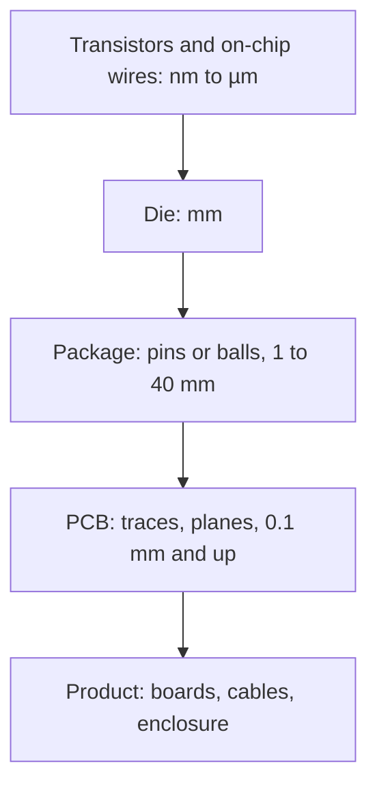

::: basics
### In plain words
An IC (integrated circuit) is a tiny piece of silicon where transistors and their wiring are built together at nanometer scale, then sealed in a package. A PCB is the larger board that the packaged ICs, resistors, capacitors and connectors are soldered onto, with copper traces wiring them together. The IC is where the active work happens: switching, amplifying and computing. The PCB mostly connects. ICs take months and a lot of money to make, and they cannot be modified. PCBs take days and can be reworked.

### Picture it
Think of a city. The PCB is the street map: roads connect buildings, and you can add a bridge or close a road with a small effort. The IC is a skyscraper with billions of tiny rooms and corridors inside, all built at once from a master plan. You cannot move a wall once the tower is built. Inside the tower the corridors (wires) are very thin and resistive, while city streets are wide.

### Words you need
- **Die**: the piece of silicon cut from a wafer that holds the integrated circuit.
- **Package**: the housing with pins or balls that lets a die be soldered to a board.
- **Photolithography**: patterning with light, used at nanometer scale for ICs.
- **Metal stack**: the layers of on-chip wiring above the transistors.
- **Parasitics**: unwanted resistance, inductance and capacitance. See [[q0463]].

### The simplest example
Compare the wires. An on-chip copper wire 1 µm wide and 0.2 µm thick has a resistance of about 85 Ω per millimeter. A PCB trace 0.25 mm wide and 35 µm thick has only about $1.7 \times 10^{-8} / (0.25 \times 10^{-3} \times 35 \times 10^{-6}) = 1.9$ mΩ per millimeter, about 40,000 times less. But chip distances are around 100 times shorter and the loads are tiny, so chips are faster and use less power overall. That is the whole idea. The rest of this page covers the packaging hierarchy, processes and costs, package parasitics, and why you cannot fix a bug in silicon with a jumper wire.
:::

::: testing
Whether you understand the **levels of electronic packaging**: an IC is a piece of silicon with transistors and nanometre-scale wiring built by semiconductor fabrication, while a PCB is a board-level interconnect and mounting platform built from copper and laminate. The interviewer wants the right relationship ("ICs are mounted on PCBs"), the difference in **scale, materials, process and function** (active devices versus mostly passive interconnect), and the consequences: parasitics, cost model and what can be changed after manufacture. Candidates who just say "an IC is smaller" miss the point.
:::

::: why
Interviewers ask this to check that you can place components in the hierarchy of a system. If you do not know what is inside an IC and what is outside it, you cannot reason about why a pin has capacitance, why bypass capacitors go on the board and not the die, or why a design decision (integrate or use discrete parts) has the cost it does. It is also a useful bridge between the "devices" part of the field (semiconductors, transistors) and the "board" part (layout, routing, power).
:::

::: concepts
- **Integrated circuit**: transistors and interconnect fabricated together on one piece of semiconductor ([[q0064]], [[q0065]]).
- **Packaging hierarchy**: die, package, board, module, system.
- **Active vs passive**: an IC contains transistors that amplify and switch; a plain PCB mainly connects ([[q0460]]).
- **Scale and parasitics**: nanometre geometry gives femtofarad capacitances; board geometry gives picofarads and nanohenries ([[q0463]]).
- **Process**: photolithography on wafers in a cleanroom versus laminate and copper etching.
- **Cost model**: IC NRE is huge but unit cost tiny; PCB NRE small ([[q0461]]).
:::

::: answer
"They sit at different levels of the same hierarchy. An IC, an integrated circuit, is a tiny piece of silicon, the die, where transistors, and sometimes resistors and capacitors, are fabricated together and wired by nanometre-scale metal layers. It's packaged in plastic or ceramic with pins or balls. A PCB is the board that those packaged ICs, plus passives and connectors, are soldered onto, and its copper traces wire the packages together.

The differences follow from that. Function: an IC is where the active devices live, amplifying, switching and computing; a PCB is mostly passive interconnect and mechanical support. Scale: IC features are tens of nanometres to a micron and a die is a few millimetres across; a PCB trace is about a tenth of a millimetre or more, and boards are centimetres. Process: ICs are made by photolithography on silicon wafers in a cleanroom over months, with huge up-front tooling costs; PCBs are made by laminating and etching copper in days with small tooling costs. And you can rework a PCB, cut a trace or swap a part, but you can't touch the inside of a chip.

So in a real product, ICs do the processing and the PCB connects them with power, ground and signals."
:::

::: technical
**Hierarchy.** transistor → die (IC) → package → PCB → module/enclosure → system.

| | IC | PCB |
|---|---|---|
| Substrate | Single-crystal silicon wafer (or SiC, GaN, GaAs) | Glass-epoxy laminate (FR-4), polyimide, ceramic |
| Conductors | Copper or aluminium metal stack, about 0.1 to 1 µm thick | Copper foil 17.5 to 105 µm thick |
| Smallest features | Tens of nm (transistors) to µm (upper metal) | About 0.1 mm trace/space (standard), 0.05 mm (HDI) |
| Devices | Transistors, diodes, resistors, capacitors | Mostly passive copper; parts soldered on |
| Layers | Roughly 6 to 15+ metal layers | 1 to 30+ copper layers |
| Size | mm² to cm² | cm² to hundreds of cm² |
| Process | Photolithography, doping, deposition; fab cleanroom, months | Lamination, etching, drilling, plating; days to weeks |
| Rework | Impossible after fabrication (except focused ion beam) | Cut, jumper, replace parts |
| Parasitics | fF, pH, high wire resistance | pF, nH, low resistance |

**Interconnect contrast.** On-chip wire 1 µm wide and 0.2 µm thick copper has about 85 Ω per mm; a 0.25 mm wide, 35 µm thick PCB trace about 2 mΩ per mm: roughly 40,000 times less resistance per length. Capacitance per length is similar, around 0.1 to 0.2 pF/mm in both (process- and layout-dependent), but on-chip distances are around 100 times shorter, so total parasitics are far smaller on-die.

**Transistor count.** Modern processors hold billions to tens of billions of transistors; a PCB might hold tens to thousands of components.
:::

::: short
"An IC is a piece of silicon with transistors and nanometre-scale wiring fabricated together, put in a package. A PCB is the board that ICs and other parts are soldered onto, with copper traces connecting them. So ICs are the active devices and a PCB is mostly interconnect and support. IC features are nanometres to microns, PCB traces about a tenth of a millimetre. ICs take months in a cleanroom with huge tooling cost and can't be modified, while PCBs take days and can be reworked."
:::

::: long
"They're different levels of the same hierarchy: ICs go on PCBs.

An integrated circuit is a piece of silicon, the die, usually a few millimetres across, where transistors, and sometimes resistors, capacitors and inductors, are made together by photolithography, doping and deposition, and wired by a stack of metal layers a fraction of a micron thick. That die is mounted in a package, plastic or ceramic, with bond wires or bumps to pins or balls. A modern processor has billions of transistors.

A printed circuit board is a laminate, typically FR-4, with copper traces about 35 microns thick and at least 0.1 millimetre wide, and the packages, passives and connectors are soldered to it. It's mostly a passive interconnect plus mechanical support, power distribution and heat spreading, and it carries up to a few thousand parts.

The practical differences follow from scale and process. Feature size is thousands of times smaller on the chip. A chip wire has high resistance, tens of ohms per millimetre, but tiny capacitance and short length; a PCB trace has milliohms per millimetre but picofarads and nanohenries. A chip takes months in a cleanroom fab and costs from tens of thousands to millions of dollars in masks, so it has to be right; a PCB takes days, costs tens of dollars to prototype, and you can cut a trace or swap a part to fix it.

So in a product the ICs do the processing, sensing and power conversion, and the PCB connects them with power, ground and signals."
:::

::: terms
- **Die**: the piece of silicon cut from a wafer that holds the integrated circuit.
- **Package**: the housing (QFN, BGA, SOIC) that protects the die and provides pins or balls.
- **Wafer**: the thin slice of semiconductor on which many dies are made at once.
- **Photolithography**: patterning with light and photoresist, used for both ICs and PCBs but at very different scales.
- **Metal stack**: the layers of on-chip wiring above the transistors.
- **Bond wire**: a fine wire connecting a die pad to a package lead.
- **PCBA**: a PCB with components assembled.
- **NRE (non-recurring engineering)**: one-time cost such as masks or tooling ([[q0461]]).
:::

::: exceptional
**An average answer** says "a PCB is a board and an IC is a chip".

**An exceptional answer**:
- States the **relationship**: ICs mount on PCBs, with the die-package-board hierarchy.
- Contrasts **function** (active devices versus interconnect), **materials**, **feature size**, **process** and **cost model**.
- Quantifies **scale** (nm versus 0.1 mm, billions of transistors versus hundreds of parts) and one **electrical consequence** (on-chip resistance high, board resistance low; parasitic scale).
- Notes that **PCBs can contain embedded parts** and that **ICs can contain passives**, so the boundary is not absolute.
- Mentions that **ICs cannot be reworked**, so verification precedes tape-out.
:::

::: mistakes
- **Saying a PCB "is a big IC".** A PCB has no semiconductor devices of its own; it is conductor and insulator.
- **Saying an IC "is just a smaller PCB".** An IC contains doped silicon transistors; it is fabricated by a different process.
- **Mixing up "chip" and "board" in power discussions.** Bypass capacitors and bulk storage sit on the board near the package, not on the die (though the die has a little on-chip capacitance).
- **Treating package pins as ideal.** The package adds capacitance and inductance in the path between die and board ([[q0463]]).
- **Assuming you can fix a chip bug like a PCB bug.** A silicon bug needs a new mask set (re-spin), or firmware or workarounds.
- **Forgetting that PCBs sometimes embed ICs or passives.** Embedded-component boards exist, but the board is still the interconnect.
:::

::: deep
## The hierarchy

Electronics is built in levels, and each level has its own materials, dimensions and tools:


Figure: A transistor sits inside a die, the die in a package, packages on a PCB, PCBs in a product. Each step multiplies the length scale by roughly 10 to 1000, and each step adds parasitics that the lower level did not have.

```svg
<svg viewBox="0 0 700 340" xmlns="http://www.w3.org/2000/svg" font-family="Inter, sans-serif" font-size="12.5">
  <rect x="30" y="270" width="640" height="34" fill="var(--d-box)" stroke="var(--d-ink)" stroke-width="2"/>
  <text x="350" y="292" text-anchor="middle" fill="var(--d-ink)">PCB substrate (FR-4), about 1.6 mm thick</text>
  <g fill="var(--d-orange)">
    <rect x="40" y="263" width="115" height="7"/><rect x="145" y="258" width="55" height="12"/>
    <rect x="500" y="258" width="55" height="12"/><rect x="545" y="263" width="115" height="7"/>
  </g>
  <rect x="190" y="130" width="320" height="120" rx="6" fill="var(--d-box)" stroke="var(--d-ink)" stroke-width="2"/>
  <text x="350" y="148" text-anchor="middle" fill="var(--d-muted)">package (plastic body)</text>
  <path d="M190 232 H165 V258" fill="none" stroke="var(--d-ink)" stroke-width="5"/>
  <path d="M510 232 H535 V258" fill="none" stroke="var(--d-ink)" stroke-width="5"/>
  <rect x="290" y="226" width="120" height="7" fill="var(--d-muted)"/>
  <rect x="305" y="196" width="90" height="30" fill="var(--d-blue)" fill-opacity="0.3" stroke="var(--d-blue)" stroke-width="2"/>
  <text x="350" y="216" text-anchor="middle" fill="var(--d-ink)">die</text>
  <path d="M312 196 Q250 160 200 230" fill="none" stroke="var(--d-ink)" stroke-width="1.6"/>
  <path d="M388 196 Q450 160 500 230" fill="none" stroke="var(--d-ink)" stroke-width="1.6"/>
  <g stroke="var(--d-muted)" stroke-width="1" stroke-dasharray="4 3" fill="none">
    <path d="M395 196 L505 112"/><path d="M395 226 L505 126"/>
  </g>
  <g>
    <rect x="505" y="10" width="185" height="120" rx="4" fill="none" stroke="var(--d-muted)"/>
    <text x="598" y="27" text-anchor="middle" fill="var(--d-ink)">zoom: inside the die</text>
    <rect x="530" y="104" width="140" height="18" fill="var(--d-muted)" fill-opacity="0.35"/>
    <text x="600" y="117" text-anchor="middle" fill="var(--d-ink)" font-size="11">silicon substrate</text>
    <rect x="530" y="92" width="140" height="12" fill="var(--d-green)" fill-opacity="0.5"/>
    <text x="600" y="101" text-anchor="middle" fill="var(--d-ink)" font-size="10">transistors</text>
    <g stroke="var(--d-accent)" stroke-width="2.5">
      <path d="M540 88 H590"/><path d="M610 80 H660"/><path d="M550 72 H640"/><path d="M560 64 H650"/><path d="M545 56 H620"/>
    </g>
    <g stroke="var(--d-ink)" stroke-width="1.5"><path d="M565 88 V92"/><path d="M565 88 V72"/><path d="M635 80 V72"/><path d="M600 72 V64"/><path d="M600 64 V56"/></g>
    <text x="598" y="44" text-anchor="middle" fill="var(--d-ink)" font-size="11">metal layers (nm to µm)</text>
  </g>
  <g fill="var(--d-ink)">
    <text x="40" y="208">PCB trace:</text>
    <text x="40" y="222">35 µm thick,</text>
    <text x="40" y="236">≥ 0.1 mm wide</text>
    <text x="40" y="150">bond wire: about 25 µm</text>
    <text x="40" y="165">diameter, 1 to 5 mm long</text>
    <text x="40" y="322" fill="var(--d-muted)">PCB: board-level interconnect, mm to cm scale</text>
    <text x="400" y="322" fill="var(--d-muted)">IC: transistors on one die, nm to µm scale</text>
  </g>
  <path d="M175 152 L232 190" stroke="var(--d-muted)" fill="none"/>
</svg>
```
Figure: A packaged IC on a PCB. The die (blue) sits inside the plastic body and connects to the leads through thin bond wires; the leads are soldered to copper pads, and PCB traces carry the signals away. The zoom shows the die's own wiring: many thin metal layers connected by vias, above the transistor layer in the silicon.

## What an IC contains that a PCB does not

An IC is built on semiconductor: doped regions form transistors, diodes, resistors and capacitors ([[q0065]], [[q0072]]). It is the place where **gain and switching** happen. A PCB has no gain. Whatever active function a board performs is performed by ICs (or discrete transistors) mounted on it.

A modern processor has billions of transistors on a few hundred square millimetres. The smallest features (transistor gate lengths and fin dimensions, lowest metal pitch) are in the range of several to a few tens of nanometres. Marketing "node names" such as 5 nm or 3 nm no longer correspond directly to a physical dimension, so quote them with care. The upper metal layers are wider and thicker (up to micrometres) because they carry power and long signals.

## Scale and parasitics: why they behave differently

Compare the wiring of both worlds:

- **PCB trace**: 0.25 mm × 35 µm copper. Resistance per length $\rho/(wt)=1.7\times10^{-8}/(0.25\times10^{-3}\times35\times10^{-6})=1.9\ \text{m}\Omega/\text{mm}$. Inductance about 0.3 nH/mm over a plane, capacitance about 0.1 pF/mm ([[q0463]]).
- **On-chip wire**: 1 µm × 0.2 µm copper. Resistance per length $1.7\times10^{-8}/(10^{-6}\times0.2\times10^{-6})=85\ \Omega/\text{mm}$. Capacitance per length similar (about 0.1 to 0.2 pF/mm). Inductance is usually negligible except for top-layer power and clock distribution.

So on a chip, wires are resistive (RC delay dominates, which is why long on-chip wires need repeaters), while on a board wires are low-resistance and the inductance and the transmission-line behaviour dominate at high speed. The huge saving of integration comes from **length**: a 1 mm on-chip path has about 0.1 to 0.2 pF; a signal that leaves the chip must drive the pad, bond wire or bump, package, and then the PCB trace and the next package. The I/O driver sees a few picofarads and has to be sized much larger than internal gates.

> [!UNCERTAIN]
> On-chip capacitance per length and wire dimensions depend on process node, metal layer and layout. The values above are typical orders of magnitude used for intuition, not data for a specific process.

## The cost and risk model

- **IC**: mask sets, design tools, verification and fab time bring non-recurring cost from tens of thousands of USD (mature nodes, shared wafers) to many millions (advanced nodes), and a design cycle of months to years. The unit cost afterwards can be cents to a few dollars at high volume. A bug usually means a new mask revision.
- **PCB**: tooling is essentially a photomask or direct imaging file, so prototypes cost tens to hundreds of USD with delivery in days. A bug can often be fixed by cutting a trace and adding a jumper, or by a new spin in days.

That is why a hardware team spends effort simulating and verifying chips, and why a system designer prefers a catalogue IC on a PCB unless volume justifies a custom chip ([[q0461]]).

## The package as a bridge

The package turns nanometre-scale die pads into pins or balls that a PCB can use. It also adds parasitics: lead inductance of a few nH (less for BGA and QFN, more for long-lead packages), a pF or so of pin capacitance, and thermal resistance from die to board. This is why some high-speed parts specify decoupling placement and why exposed thermal pads must be soldered to copper on the PCB ([[q0463]]).

## Blurring the line

- Some boards embed passive components or bare dies inside the laminate.
- Interposers and substrates (organic or silicon) are "PCB-like" platforms inside a package, with finer pitch than a PCB.
- Multi-chip modules and system-in-package place several dies and passives in one package.
- Thin-film and thick-film hybrid circuits sit between a PCB and an IC.

The distinction remains: the IC is where silicon devices are built, the PCB is where packaged parts are interconnected.

## Worked example: delay scaling, RC on the chip and flight time on the board

Use the per-length numbers above: the on-chip wire has 85 Ω/mm and 0.15 pF/mm. A distributed RC line has a 50 % delay of about $0.38\,RC$ for the total resistance and capacitance, and both grow with length, so delay grows as the square of length:

| On-chip wire length | R | C | Delay ($0.38RC$) |
|---|---|---|---|
| 1 mm | 85 Ω | 0.15 pF | 4.8 ps |
| 5 mm | 425 Ω | 0.75 pF | 121 ps |
| 10 mm | 850 Ω | 1.5 pF | 485 ps |

```plot
{"title":"On-chip RC wire delay vs length (85 Ω/mm, 0.15 pF/mm)","x":{"label":"Wire length","unit":"m","min":0.0005,"max":0.02,"log":true},"y":{"label":"Delay","unit":"s","min":1e-12,"max":2e-9,"log":true},
 "vars":{"rm":85000,"cm":1.5e-10},
 "series":[{"label":"0.38·R·C = 0.38·rm·cm·L²","fn":"0.38*rm*cm*x*x"}],
 "points":[{"x":0.001,"y":4.8e-12,"label":"1 mm: 4.8 ps"},{"x":0.01,"y":4.85e-10,"label":"10 mm: 485 ps"}]}
```
Figure: On a log-log plot the delay is a straight line of slope 2, because both R and C grow with length. Ten times the length costs a hundred times the delay, which is why long on-chip wires are broken up with repeaters.

Going from 1 mm to 10 mm multiplies the length by 10 but the delay by 100. Breaking the 10 mm wire into ten 1 mm segments with repeaters brings the wire delay to about 48 ps (plus ten repeater delays, which is why you do not use too many). That is what a chip's physical design tools do automatically, and it is why interconnect delay is a first-order concern at advanced nodes.

The PCB is a different regime. A 100 mm trace of the section given above has only $100\times1.9\text{ m}\Omega = 0.19$ Ω of resistance, so there is no RC delay to speak of. Instead the delay is the flight time: with an effective dielectric constant near 3.4 (typical for an outer-layer microstrip on FR-4, check yours) the signal travels at $c/\sqrt{3.4} = 1.6\times10^8$ m/s, which is 6.1 ps/mm, so 100 mm takes 0.61 ns. With 0.3 nH/mm and 0.1 pF/mm the characteristic impedance is $\sqrt{L/C} = \sqrt{0.3\text{ nH}/0.1\text{ pF}} = 55$ Ω, and the line only needs termination when the edge time is comparable to or shorter than the round-trip delay. In short, on a chip you worry about resistance and capacitance, on a board you worry about inductance, capacitance and reflections.

## Worked example: why leaving the chip costs power

Switching a capacitance $C$ between 0 and $V$ dissipates $CV^2$ per full cycle, and for a signal that toggles at rate $f$ with activity factor $\alpha$ the power is $P = \alpha CV^2f$. Take a 1 mm on-chip wire (0.15 pF) at 1 V toggling every cycle at 1 GHz: $P = 0.15\text{ pF}\times1^2\times10^9 = 0.15$ mW. Now take an output pin driving about 10 pF (pad, package, 50 mm of trace and a receiver) at 1.8 V and 100 MHz with the data toggling on half the cycles: $P = 0.5\times10\text{ pF}\times1.8^2\times10^8 = 1.6$ mW. That is a hundred megahertz signal costing ten times the power of a gigahertz internal wire, because the capacitance is nearly 70 times bigger and the voltage swing larger. A chip with a 64-bit bus pays 64 times that. Hence designers keep as much communication as possible on the die, use lower I/O voltage and serial links, and place memory in the same package when power matters.

## Worked example: the volume break-even for a custom chip

Suppose a function can be built either from catalog parts on a PCB for 8 USD of parts per unit, or as a custom IC that costs 2 USD per unit at volume, after a one-time development cost of 500,000 USD (an assumed mature-node figure). The extra cost per unit saved by integration is 6 USD, so the break-even volume is $500{,}000/6 \approx 83{,}000$ units. At an advanced-node NRE of 5 million USD the break-even is about 833,000 units. These figures are made up to show the method, and they leave out board assembly savings, the risk of a respin and time to market, but the structure explains the general pattern: low-volume products use PCBs of catalog ICs, high-volume products justify custom silicon, and mid-volume products reach for FPGAs or structured ASICs.

> [!UNCERTAIN]
> NRE and unit-cost figures vary enormously with the process, the IP licensed, the design team and the year. Use the numbers above as a template for the calculation, never as quotes.

## Verifying on the bench

- **Trace delay and impedance:** use a TDR, or a fast edge generator and a scope, to launch a step into a test trace and measure the round-trip time of the reflection from the open end. Half of that is the one-way delay. The result should match about 6 ps/mm (for outer-layer microstrip on FR-4); the step height of any mismatch gives the impedance.
- **Trace resistance:** with a 4-wire milliohm meter across a long trace, confirm it matches $\rho L/(wt)$ for the actual copper weight and plating.
- **Pin and package parasitics:** measure the input capacitance of an unpowered IC pin with an LCR meter (a few pF), and look at the ring frequency of a bypass capacitor and its loop to estimate the loop inductance.
- **Power of a bus:** measure supply current of an I/O bank with the bus idle and toggling, subtract, and compare with $\alpha CV^2f$ for the board's measured capacitance.
:::

::: applications
- **Microcontroller boards**: the MCU die is an IC; the board provides power, crystals, connectors and wiring.
- **Smartphones**: one or two huge SoC ICs plus memory, RF and power ICs on a dense multilayer PCB.
- **Power supplies**: a controller IC and passives on a PCB, with copper carrying amps.
- **Sensors**: MEMS or CMOS sensor dies packaged and mounted on a PCB.
- **FPGA development boards**: the FPGA IC and the board's power, clocks and I/O.
- **Custom ASIC products**: the IC integrates the function; the PCB is smaller and simpler as a result.
:::

::: assumptions
I treated "IC" as a monolithic semiconductor chip and "PCB" as a conventional rigid laminate board. The boundaries blur with embedded-component boards, interposers and system-in-package modules, and the numbers (wire dimensions, capacitance, trace sizes, transistor counts) are typical orders of magnitude, not specifications of any process. If the interviewer meant the **PCB-versus-IC cost trade** (build a function on a board from parts, or integrate it), the answer is the NRE-versus-unit-cost comparison in [[q0461]]. A different but valid angle is to answer by function: ICs compute, PCBs connect.
:::

::: followups
### Why can't you just put everything on a PCB instead of designing an IC?
You can, if the function needs few transistors, but the PCB has no active devices of its own: you would use discrete transistors or catalogue ICs. Anything with millions of gates would need billions of transistors, which at discrete-part size would be impossible in power, speed, cost and size. Integration is what makes computing practical: shorter wires, smaller capacitances (so lower power and higher speed) and mass production on a wafer.

### Where do decoupling capacitors go: on the chip or on the PCB, and why?
Mostly on the PCB, as close to the package as possible, because the capacitors needed for supply stability (nF to µF) are too large to integrate economically on the die, though the die has some on-chip decoupling (pF to nF). The PCB capacitors, the package and the on-die capacitance form a network with different frequency ranges ([[q0032]], [[q0142]]).

### Why does the package matter for speed?
Pin and lead inductance and capacitance sit in series with the signal and the supply: a 5 nH lead with 5 pF pin capacitance resonates near 1 GHz, and switching current through the supply lead creates ground bounce $V=L\,di/dt$. Package choice (BGA, QFN) and pin assignment (supply and ground pins next to signals) are used to minimise it.

### What if an IC has a bug after manufacture? How does it differ from a PCB bug?
For an IC the options are: fix in firmware or software, use a hardware workaround on the board, or do a re-spin of masks (months, large cost), sometimes just a metal-layer change if the design planned spare cells. On a PCB you can often fix with a jumper or cut a trace in minutes and re-spin the board in days.

### Scenario: an interviewer shows an unlabelled black chip on a green board and asks what is "the circuit" there. What do you say?
The chip is an IC: the active circuit is inside it, built from transistors you cannot see. The board's copper around it makes the connections: power and ground, clocks, I/O to other chips, and the passives (decoupling, pull-ups, filters). To understand the circuit, identify the part number, read its datasheet's block diagram, then trace the board's connections to see what surrounds it.
:::

::: interpretations
"PCB versus IC" is a basic hierarchy question; some people confuse the two terms or think of "integrated circuits" as "chips on a board". I answered by contrasting function, scale, materials, process and cost, and by explaining how the two relate. For comparing implementation options (breadboard, PCB, custom IC) see [[q0461]], and for what a PCB is see [[q0460]].
:::

::: references
- Weste & Harris, *CMOS VLSI Design*: fabrication process, on-chip interconnect, and scaling.
- Sedra & Smith, *Microelectronic Circuits*: integrated-circuit fabrication overview and devices (introductory chapters).
- Howard Johnson & Martin Graham, *High-Speed Digital Design: A Handbook of Black Magic*: package and board parasitics.
- IPC-2221 for PCB design basics (generic board design standard).
:::

::: rubric
- States that ICs are mounted on PCBs: the hierarchy die, package, board :: This is the essential relationship.
- Contrasts function: transistors and gain versus interconnect and support :: Distinguishes active devices from passive structure.
- Gives scale and material differences (nm to µm versus 0.1 mm, silicon versus FR-4 and copper) :: Shows quantitative understanding.
- Describes the different manufacturing processes and cost models :: Explains why ICs need huge NRE and PCBs do not.
- Notes the difference in parasitics (on-chip resistance high; board low R but pF and nH) :: Links the physical difference to electrical behaviour.
- Mentions rework and the impossibility of fixing silicon :: Shows practical awareness of risk.
- Mentions the package as the bridge and its parasitics :: Completes the hierarchy.
:::

::: quiz
```json
[
 {"type":"mcq","level":"fundamental","q":"Which statement correctly describes the relationship between ICs and PCBs?","options":["Packaged ICs are mounted and wired together on a PCB","A PCB is mounted inside an IC","They are the same thing at different sizes","ICs replace the copper on a PCB"],"answer":0,"explain":"The PCB provides the interconnect, power and mechanical support; the ICs, in packages, are soldered on it."},
 {"type":"mcq","level":"fundamental","q":"Which of these contains transistors?","options":["A bare PCB","An IC die","The soldermask","The silkscreen"],"answer":1,"explain":"Transistors are fabricated in the semiconductor of the die. A bare PCB is copper and laminate."},
 {"type":"numeric","level":"intermediate","q":"A PCB trace is 0.25 mm wide and 35 µm thick copper ($\\rho=1.7\\times10^{-8}\\ \\Omega$m). What is its resistance per millimetre, in mΩ/mm?","answer":1.94,"tolerance":0.03,"unit":"mΩ/mm","explain":"$R/l=\\rho/(wt)=1.7\\times10^{-8}/(0.25\\times10^{-3}\\times35\\times10^{-6})=1.94$ Ω/m, which is 1.94 mΩ/mm."},
 {"type":"numeric","level":"intermediate","q":"An on-chip copper wire is 1 µm wide and 0.2 µm thick. What is its resistance per millimetre, in ohms?","answer":85,"tolerance":0.03,"unit":"Ω/mm","explain":"$R/l=1.7\\times10^{-8}/(10^{-6}\\times0.2\\times10^{-6})=8.5\\times10^{4}$ Ω/m = 85 Ω/mm."},
 {"type":"truefalse","level":"advanced","q":"Because on-chip capacitance per millimetre is similar to a PCB's, on-chip signals are not faster than board signals.","answer":false,"explain":"Capacitance per length is similar, but on-chip distances and loads are far smaller (and gates drive femtofarad loads), so total capacitance and delay are much smaller; wire resistance matters instead on chip."},
 {"type":"mcq","level":"advanced","q":"A bug is found in a fabricated custom IC. What is typically required to fix it in silicon?","options":["Cut a trace and add a jumper","A new mask revision (re-spin) of at least some layers","Reflow the package","Replace the soldermask"],"answer":1,"explain":"The on-die circuit cannot be modified physically, so a fix normally means new masks (often only upper metal layers if the design allowed), or a firmware/board workaround."}
]
```
:::
