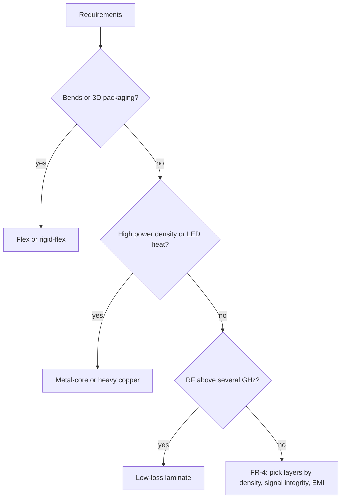

::: testing
Whether you can organise a sprawling topic into sensible axes and match each type to its job. The interviewer is looking for the main families (**by layer count**, **by rigidity**, **by substrate material**, **by process such as HDI or heavy copper**), a trade-off for each (cost, density, thermal and RF performance, mechanical flexibility, reliability) and an application that is actually well suited. A strong answer also notes that these axes combine (for example a 6-layer rigid-flex HDI board).
:::

::: why
Choosing the board type is among the first and most expensive decisions in a hardware project: it sets cost, size, thermal and EMI behaviour, and which fabricators can build it. A designer who defaults to "4-layer FR-4" will be stuck when an LED array needs heat spreading, a camera module needs a hinge, or a radar needs low-loss laminate. In an interview this question shows breadth and the habit of choosing technology by requirements ([[q0460]], [[q0466]]).
:::

::: concepts
- **Layer count**: single-sided, double-sided and multilayer boards trade cost against routing density and signal quality ([[q0466]]).
- **Rigid vs flexible**: polyimide flex and rigid-flex boards permit bending and 3D packaging ([[q0465]]).
- **Substrate material**: FR-4, high-Tg, PTFE/RF laminates, polyimide, ceramic and metal-core change loss, temperature capability and thermal conduction ([[q0469]]).
- **HDI (high-density interconnect)**: microvias and fine lines for dense BGAs and compact products.
- **Heavy copper**: 3 oz and thicker foil for high current.
- **Thermal resistance** $R_{th}=t/(kA)$: why metal-core boards spread heat better than FR-4.
:::

::: answer
"I'd sort them along a few axes.

By layer count: single-sided boards, one copper layer, are the cheapest and fine for simple products like calculators and remote controls. Double-sided boards have copper on both faces with plated through-holes, the default for hobby and mid-complexity work. Multilayer boards, four, six or more layers, add inner planes for power and ground and extra routing, so they give better signal integrity and EMI and higher density, at higher cost. That's what you see in anything with fast digital or dense BGAs.

By rigidity: rigid boards are standard. Flex boards use polyimide so they can bend, great for cameras, hinges and wearables, but costlier and more delicate. Rigid-flex combines both.

By material: standard FR-4 for most things, high-Tg FR-4 for lead-free assembly, PTFE or Rogers-type laminates for RF and microwave where loss matters, ceramic for high-temperature or high-frequency, and metal-core boards, aluminium base with a thin dielectric, for LEDs and power because they conduct heat far better.

And by process: HDI with microvias and fine traces for compact designs like phones, and heavy copper for high current.

The trade is always cost versus density, performance and form factor, so I'd choose the simplest type that meets the requirements."
:::

::: technical
| Type | Construction | Strengths | Limits | Typical use |
|---|---|---|---|---|
| Single-sided | 1 copper layer on core | Cheapest, simple | Routing needs jumpers; no planes | Calculators, remotes, simple supplies |
| Double-sided | 2 layers, plated through-holes | Low cost, easy routing | Limited impedance control and EMI | Hobby, mid-complexity controllers |
| Multilayer (4 to 30+) | Cores + prepreg, inner planes | Density, planes, controlled impedance, EMI | Cost, lead time, harder rework | Computers, networking, embedded SoCs |
| HDI | Microvias (laser), blind/buried vias, fine lines | Highest density, small BGAs | Higher cost, special processes | Phones, wearables, cameras |
| Rigid-flex / flex | Polyimide with copper (see [[q0465]]) | Bends, saves connectors and space | Cost, bend limits, design rules | Cameras, medical, aerospace |
| RF / high-frequency | PTFE or ceramic-filled laminates | Low $\tan\delta$, stable $\varepsilon_r$ | Cost, harder processing | Radar, antennas, microwave links |
| Metal-core (MCPCB / IMS) | Copper, thin dielectric, aluminium base | Heat spreading | Usually single layer, heavy | LED lighting, power |
| Ceramic | Alumina, AlN with thick/thin film copper | High temperature, thermal, stable | Cost, brittle | Power modules, RF, sensors |
| Heavy copper | 3 oz to 10+ oz foil | High current, thermal | Wider spacing, etch limits | Power supplies, motor drives |

**Thermal example (1-D conduction through the dielectric, 1 cm² footprint).** $R_{th}=t/(kA)$. FR-4 1.6 mm at $k\approx0.3$ W/mK: 53 K/W. MCPCB dielectric 100 µm at $k\approx2$ W/mK: 0.5 K/W. A 3 W LED then rises about 160 K versus 1.5 K across the dielectric (values idealised: real boards add spreading and thermal vias).
:::

::: short
"By layer count: single-sided is cheapest for simple products, double-sided is the default, multilayer adds planes for signal integrity and density. By rigidity: rigid, flex for bending, and rigid-flex combining both. By material: FR-4 for most, PTFE or Rogers-type laminates for RF, ceramic for high temperature, metal-core with an aluminium base for LEDs and power. And HDI with microvias for dense designs like phones. I'd choose the simplest type that meets density, thermal, RF and form-factor needs."
:::

::: long
"I'd organise PCB types along four axes.

First, layer count. Single-sided boards have one copper layer, so they're the cheapest and used for calculators, remotes and simple power supplies, but routing is limited. Double-sided boards have copper on both faces connected by plated through-holes, which covers a huge amount of hobby and mid-complexity work. Multilayer boards, four, six, up to thirty plus, add inner layers, usually dedicated ground and power planes, which gives short return paths, controlled impedance, lower EMI and higher routing density. The cost is higher price, longer lead time and harder rework.

Second, rigidity. Rigid is the standard. Flex boards use polyimide so they can bend, so they replace cables and connectors in cameras, hinges and wearables. Rigid-flex combines rigid sections for components and flex sections for interconnect.

Third, material. Standard FR-4 handles most designs. High-Tg versions survive lead-free reflow and heat better. PTFE or ceramic-filled laminates have low loss and stable permittivity for RF and microwave. Ceramic substrates handle high temperature and heat. And metal-core boards, copper over a thin dielectric on an aluminium base, conduct heat roughly a hundred times better than FR-4 through the thickness, so they're used for LED lighting and power.

Fourth, process. HDI uses laser microvias and fine lines to pack dense BGAs into phones and wearables. Heavy copper boards carry high currents.

These combine, so I'd start from requirements: density, frequency, heat, bending and cost, and pick the simplest type that satisfies them."
:::

::: terms
- **Layer count**: the number of copper layers in the board.
- **Multilayer PCB**: a board with inner copper layers laminated between cores and prepreg.
- **HDI**: high-density interconnect, using microvias and fine features.
- **Microvia**: a laser-drilled via, typically spanning only one dielectric layer.
- **Flex / rigid-flex**: boards on polyimide that bend, or that combine rigid and flexible regions.
- **MCPCB / IMS**: metal-core or insulated-metal-substrate board, used for heat spreading.
- **Tg**: glass transition temperature of the resin; above it the laminate softens ([[q0469]]).
- **Heavy copper**: foil of 3 oz or more for high current.
:::

::: exceptional
**An average answer** lists "single, double, multilayer, flex".

**An exceptional answer**:
- Sorts types along **independent axes** (layers, rigidity, material, process) and notes that they **combine**.
- Gives each type's **trade-off** (cost, density, thermal, RF, bend) and a **matching application**.
- Quantifies something: the **thermal resistance** advantage of metal core, or the benefit of inner planes.
- Names **HDI, RF laminates, heavy copper, ceramic and embedded components** as specialised types.
- Ends with a **selection logic**: start from requirements and choose the simplest type that meets them.
:::

::: mistakes
- **Equating "multilayer" with "better".** More layers cost more and complicate rework; use the simplest stack that meets routing, signal integrity and EMI needs.
- **Using FR-4 for microwave circuits without checking loss.** At several GHz FR-4's loss tangent dominates the link budget ([[q0469]]).
- **Treating flex as "just a thin PCB".** It has special rules (bend radius, copper type, stiffeners, coverlay), see [[q0465]].
- **Expecting a metal-core board to carry complex routing.** Most are single-layer with limited routing options.
- **Forgetting the fabricator's capability.** HDI, flex and RF boards need specific suppliers and longer lead times.
- **Choosing by price alone.** A cheap board that fails thermal or EMI testing is more expensive.
:::

::: deep
## Four axes, not one list

"Types of PCBs" is easier to answer if you recognise the independent decisions:

1. **How many copper layers?** (single-sided, double-sided, multilayer)
2. **Rigid or flexible?**
3. **What dielectric and base material?** (FR-4, high-Tg, PTFE, polyimide, ceramic, metal)
4. **What special process?** (HDI microvias, heavy copper, embedded components, controlled depth)

A smartphone board is a multilayer, HDI, rigid FR-4-like board often connected by rigid-flex to the camera and display. An LED street light is a single-layer metal-core board. Both are "PCBs" but share little else.

```svg
<svg viewBox="0 0 700 330" xmlns="http://www.w3.org/2000/svg" font-family="Inter, sans-serif" font-size="13">
<text x="105" y="14" text-anchor="middle" font-weight="600" fill="var(--d-ink)">Single-sided</text>
<text x="105" y="30" text-anchor="middle" fill="var(--d-muted)" font-size="11.5">1 copper layer</text>
<rect x="25" y="48" width="160" height="5" fill="var(--d-orange)" stroke="var(--d-ink)" stroke-width="0.8"/>
<rect x="25" y="53" width="160" height="46" fill="var(--d-box)" stroke="var(--d-ink)" stroke-width="0.8"/>
<text x="335" y="14" text-anchor="middle" font-weight="600" fill="var(--d-ink)">Double-sided</text>
<text x="335" y="30" text-anchor="middle" fill="var(--d-muted)" font-size="11.5">2 layers, plated through-holes</text>
<rect x="255" y="48" width="160" height="5" fill="var(--d-orange)" stroke="var(--d-ink)" stroke-width="0.8"/>
<rect x="255" y="53" width="160" height="46" fill="var(--d-box)" stroke="var(--d-ink)" stroke-width="0.8"/>
<rect x="255" y="99" width="160" height="5" fill="var(--d-orange)" stroke="var(--d-ink)" stroke-width="0.8"/>
<rect x="329" y="48" width="12" height="56" fill="var(--d-bg, #fff)" stroke="var(--d-ink)" stroke-width="0.8"/>
<rect x="329" y="48" width="3" height="56" fill="var(--d-orange)"/><rect x="338" y="48" width="3" height="56" fill="var(--d-orange)"/>
<text x="565" y="14" text-anchor="middle" font-weight="600" fill="var(--d-ink)">Multilayer (4 layers)</text>
<text x="565" y="30" text-anchor="middle" fill="var(--d-muted)" font-size="11.5">inner planes, through vias</text>
<rect x="485" y="48" width="160" height="5" fill="var(--d-orange)" stroke="var(--d-ink)" stroke-width="0.8"/>
<rect x="485" y="53" width="160" height="10" fill="var(--d-green)" fill-opacity="0.25" stroke="var(--d-ink)" stroke-width="0.8"/>
<rect x="485" y="63" width="160" height="5" fill="var(--d-orange)" stroke="var(--d-ink)" stroke-width="0.8"/>
<rect x="485" y="68" width="160" height="22" fill="var(--d-box)" stroke="var(--d-ink)" stroke-width="0.8"/>
<rect x="485" y="90" width="160" height="5" fill="var(--d-orange)" stroke="var(--d-ink)" stroke-width="0.8"/>
<rect x="485" y="95" width="160" height="10" fill="var(--d-green)" fill-opacity="0.25" stroke="var(--d-ink)" stroke-width="0.8"/>
<rect x="485" y="105" width="160" height="5" fill="var(--d-orange)" stroke="var(--d-ink)" stroke-width="0.8"/>
<rect x="559" y="48" width="12" height="62" fill="var(--d-bg, #fff)" stroke="var(--d-ink)" stroke-width="0.8"/>
<rect x="559" y="48" width="3" height="62" fill="var(--d-orange)"/><rect x="568" y="48" width="3" height="62" fill="var(--d-orange)"/>
<text x="105" y="184" text-anchor="middle" font-weight="600" fill="var(--d-ink)">HDI</text>
<text x="105" y="200" text-anchor="middle" fill="var(--d-muted)" font-size="11.5">microvias, blind/buried vias</text>
<rect x="25" y="218" width="160" height="5" fill="var(--d-orange)" stroke="var(--d-ink)" stroke-width="0.8"/>
<rect x="25" y="223" width="160" height="7" fill="var(--d-green)" fill-opacity="0.4" stroke="var(--d-ink)" stroke-width="0.8"/>
<rect x="25" y="230" width="160" height="5" fill="var(--d-orange)" stroke="var(--d-ink)" stroke-width="0.8"/>
<rect x="25" y="235" width="160" height="24" fill="var(--d-box)" stroke="var(--d-ink)" stroke-width="0.8"/>
<rect x="25" y="259" width="160" height="5" fill="var(--d-orange)" stroke="var(--d-ink)" stroke-width="0.8"/>
<rect x="25" y="264" width="160" height="7" fill="var(--d-green)" fill-opacity="0.4" stroke="var(--d-ink)" stroke-width="0.8"/>
<rect x="25" y="271" width="160" height="5" fill="var(--d-orange)" stroke="var(--d-ink)" stroke-width="0.8"/>
<rect x="66" y="223" width="8" height="7.0" fill="var(--d-orange)" stroke="var(--d-ink)" stroke-width="0.6"/>
<rect x="136" y="264" width="8" height="7.0" fill="var(--d-orange)" stroke="var(--d-ink)" stroke-width="0.6"/>
<rect x="101" y="235" width="8" height="24.0" fill="var(--d-orange)" stroke="var(--d-ink)" stroke-width="0.6"/>
<text x="335" y="184" text-anchor="middle" font-weight="600" fill="var(--d-ink)">Flex / rigid-flex</text><text x="335" y="200" text-anchor="middle" fill="var(--d-muted)" font-size="11.5">polyimide bends; rigid areas carry parts</text>
<rect x="255" y="218" width="45" height="46" fill="var(--d-box)" stroke="var(--d-ink)" stroke-width="1"/><rect x="370" y="218" width="45" height="46" fill="var(--d-box)" stroke="var(--d-ink)" stroke-width="1"/>
<path d="M300 230 C315 230 315 268 335 268 C355 268 355 230 370 230" fill="none" stroke="var(--d-purple)" stroke-width="7" stroke-opacity="0.6"/>
<path d="M300 227 C315 227 315 265 335 265 C355 265 355 227 370 227" fill="none" stroke="var(--d-orange)" stroke-width="2.5"/>
<text x="565" y="184" text-anchor="middle" font-weight="600" fill="var(--d-ink)">Metal-core (MCPCB)</text>
<text x="565" y="200" text-anchor="middle" fill="var(--d-muted)" font-size="11.5">thin dielectric on aluminium base</text>
<rect x="485" y="218" width="160" height="6" fill="var(--d-orange)" stroke="var(--d-ink)" stroke-width="0.8"/>
<rect x="485" y="224" width="160" height="5" fill="var(--d-green)" fill-opacity="0.4" stroke="var(--d-ink)" stroke-width="0.8"/>
<rect x="485" y="229" width="160" height="40" fill="var(--d-muted)" fill-opacity="0.45" stroke="var(--d-ink)" stroke-width="0.8"/>
</svg>
```
Figure: Cross-sections of six common types. Orange is copper, grey-green is dielectric or prepreg, purple is polyimide and the heavy grey base is aluminium. Note the plated through-hole in the double-sided and multilayer boards, the tiny microvias and buried via in HDI, the thin bendable polyimide between rigid parts in rigid-flex, and the thin dielectric on a thick metal base in metal-core boards.

## By layer count

### Single-sided

One copper layer on one side of the core. Components are usually through-hole (leads pass through to the copper side) or surface-mount on the copper side. No plated holes are needed so it is the cheapest process. The routing is constrained: crossing traces need wire jumpers or zero-ohm links. It suits low-complexity, low-speed, cost-driven designs (simple LED drivers, basic power supplies).

### Double-sided

Copper on both faces with **plated through-holes (PTH)** joining them. This doubles routing area, allows SMD parts on both sides, and is the standard for prototyping and moderate designs. Limits: no dedicated inner reference plane, so impedance control and EMI performance depend on a poured ground on one layer and careful routing, and decoupling loops are larger ([[q0463]]).

### Multilayer

Cores (copper-clad laminate) and prepreg are stacked with copper foils and pressed. Common counts are 4, 6, 8 and up to 20 to 30+. The standard 4-layer stack of signal, ground, power, signal has a solid ground plane under the top signals, so loop areas are small and traces can be controlled-impedance, which matters for USB, Ethernet, DDR and RF. Costs rise with layers (rough multipliers of a couple of times for 4 layers versus 2, depending on fab and volume), as do lead time and rework difficulty. See [[q0466]] for the layers themselves.

## By rigidity

- **Rigid**: standard laminate; stiff and robust.
- **Flex**: polyimide film with copper, thin (0.1 mm or less) and bendable; replaces cable harnesses and connectors ([[q0465]]).
- **Rigid-flex**: rigid sections (parts) connected by integrated flex sections, with no connectors in between. Higher cost but higher reliability and 3D packaging.

## By material

| Material | $\varepsilon_r$ (typical) | Loss ($\tan\delta$, typical) | Notes |
|---|---|---|---|
| Standard FR-4 | about 4.2 to 4.7 | about 0.02 at 1 GHz | Cheap, most boards |
| High-Tg FR-4 | similar | similar | Tg of about 170 °C or more; better for lead-free reflow and thermal cycling |
| PTFE / hydrocarbon RF laminates | about 2.2 to 3.5 | about 0.001 to 0.004 | RF and microwave; costlier and harder to process |
| Polyimide | about 3.4 | about 0.002 to 0.02 | Flex and high-temperature rigid boards |
| Ceramic (alumina, AlN) | about 9 to 10 for alumina | very low | High temperature, thermal; brittle, costly |
| Metal-core | dielectric layer thin, $k\approx1$ to 3 W/mK | n/a | Heat spreading; mainly single-layer |

> [!UNCERTAIN]
> Material properties vary by supplier, resin system, glass style and frequency. The values above are typical ranges for orientation; use the specific laminate datasheet for design ([[q0469]]).

### Why the metal core matters thermally

Heat conduction through a layer: $R_{th}=t/(kA)$. For a 1 cm² footprint:

- FR-4, 1.6 mm, $k\approx0.3$ W/mK: $R_{th}=0.0016/(0.3\times10^{-4})=53$ K/W.
- MCPCB dielectric, 100 µm, $k\approx2$ W/mK: $R_{th}=0.0001/(2\times10^{-4})=0.5$ K/W. The aluminium base itself (1.5 mm, $k\approx200$ W/mK) adds only 0.075 K/W.

```plot
{"title":"Temperature rise across the board dielectric (1-D, 1 cm² under the part)","x":{"label":"Power dissipated","unit":"W","min":0,"max":3},"y":{"label":"Rise across dielectric","unit":"K","min":0,"max":170},
 "series":[
  {"label":"FR-4 1.6 mm (53 K/W)","fn":"53.3*x"},
  {"label":"metal-core, 100 µm dielectric (0.5 K/W)","fn":"0.5*x","color":"green"}
 ],
 "points":[{"x":3,"y":160,"label":"3 W LED: 160 K"},{"x":3,"y":1.5,"label":"1.5 K"}]}
```
Figure: The same 3 W LED sees about 160 K across a plain FR-4 board's thickness but only about 1.5 K across a metal-core dielectric. Real FR-4 boards use thermal vias and copper spreading to do much better than the 1-D number, but the metal core still wins when power density is high.

## HDI

HDI boards use **laser-drilled microvias** (typically spanning one dielectric layer, about 0.1 mm diameter), **blind and buried vias**, via-in-pad and 75 µm or finer trace and space. This lets fine-pitch BGAs (0.4 mm pitch or less) escape-route on fewer layers and shrinks the board. The costs are special processing (sequential lamination, laser drilling, filled vias), and the fab must be qualified. It is the technology behind phones, wearables and compact modules.

## Heavy copper and power

Copper from 3 oz (105 µm) to 10 oz or more carries high currents and spreads heat in power supplies, motor drives and automotive modules. The trade-off is a coarser minimum trace/space (etching a thick foil undercuts) and bowing or thickness-induced lamination challenges.

## Other special types

- **Embedded components**: resistors, capacitors or ICs inside the laminate for density.
- **Backplanes**: thick, high-layer-count boards with connectors for racks.
- **Ceramic and thick-film**: for high temperature, hermeticity and RF.
- **Hybrid stackups**: RF laminate on top layers with FR-4 for the rest, to save cost.

## How to choose


Figure: Pick the specialised type only if a hard requirement forces it; otherwise stay with FR-4 and choose layer count (two layers for simple, four for fast digital or dense designs, more for BGAs and many rails). Each branch can still be combined with the others.
:::

::: applications
- **Single-sided**: small appliances, cheap toys, remote controls, simple LED strips.
- **Double-sided**: Arduino-class boards, power adapters, sensor modules.
- **Multilayer**: laptops, routers, industrial controllers, anything with DDR, USB 3 or Ethernet.
- **HDI**: smartphones, smartwatches, camera modules.
- **Flex and rigid-flex**: foldable displays, endoscopes, camera gimbals, automotive sensors ([[q0465]]).
- **RF laminate**: radar sensors, satellite links, 5G antenna boards.
- **Metal-core**: LED lighting, power LEDs, motor drives and power converters.
:::

::: assumptions
The relative costs and property values are typical orders of magnitude; actual prices depend on quantity, fabricator, size, finish, lead time and specification, and material properties depend on the supplier and frequency. I treated the categories as independent axes, though fabricators sometimes group them differently (for example "RF" as a category of its own). The thermal numbers are one-dimensional estimates through the thickness; real heat flow spreads laterally and uses vias. For a cost-focused answer, the point is to select the cheapest technology meeting the requirement; for a high-reliability answer, qualification and standards (IPC classes) become decisive.
:::

::: followups
### When would you choose four layers over two for a design?
When you have fast digital signals, USB or Ethernet, a BGA or fine-pitch part that is hard to fan out, or need low EMI. A solid ground plane under signals reduces loop area and gives controlled impedance, and a second plane for power gives low-impedance distribution. A 2-layer board can work for slow signals with careful ground pours and short decoupling loops but is much harder to make pass EMC if edges are fast.

### Why is a metal-core PCB usually single-layer, and what is the catch?
Making vias and multiple layers through a metal base needs insulated holes and more complex lamination, so most MCPCBs are single-layer (copper, thin dielectric, metal) with limited routing. The thermal performance is excellent, but you can't route a dense design on it; many LED boards use a simple series/parallel layout, and drivers sit on a separate FR-4 board.

### Why use a rigid-flex board instead of two rigid boards and a connector?
It removes the connector (a cost and a common failure point under vibration), reduces weight and height, and allows 3D folding. The trade-offs are higher board cost, longer lead time, less ability to replace one rigid part separately, and special design rules. It pays off in high-reliability or space-constrained products like medical devices, aerospace and cameras.

### What would you use for a 10 GHz radar front-end and why?
A low-loss, stable-permittivity RF laminate (PTFE or ceramic-filled hydrocarbon) on the RF layers, possibly in a hybrid stack with FR-4 for digital and power layers. FR-4 at 10 GHz loses roughly 0.8 dB per inch (extrapolating the 0.4 dB per inch at 5 GHz), versus 0.1 to 0.15 dB per inch for good RF laminates, and its permittivity is less well controlled, which affects antenna and filter tuning ([[q0469]]).

### Scenario: your LED board runs 40 K hotter than the thermal model predicted. What do you check?
First the board type: is it plain FR-4 with no thermal vias? The LED's thermal pad must connect to copper that spreads heat; check the dielectric thermal conductivity on a metal-core board (specs from 1 to 8 W/mK exist), the thickness of the dielectric, void-free soldering of the thermal pad, and the heat sink or enclosure contact. A cheap MCPCB with a low-conductivity dielectric can be much worse than the datasheet number suggests.
:::

::: interpretations
"Different types of PCBs" is open-ended; I interpreted it as including layer count, rigidity, material and process, because interviewers accept any sensible organisation. Flex PCBs have their own question ([[q0465]]); layers and materials are expanded in [[q0466]] and [[q0469]].
:::

::: references
- IPC-2221 (generic PCB design) and IPC-2223 (flexible printed board design) for design rules that differ by board type; IPC-6012 for rigid board qualification classes.
- Howard Johnson & Martin Graham, *High-Speed Digital Design*: why multilayer boards with planes perform better.
- Clyde Coombs (ed.), *Printed Circuits Handbook*: board types, materials and processes.
- Laminate manufacturers' datasheets (Isola, Rogers and others) for real $\varepsilon_r$, $\tan\delta$, $T_g$ and thermal conductivity.
:::

::: rubric
- Organises types along sensible axes (layers, rigidity, material, process) :: Shows structured thinking rather than a random list.
- Describes single, double and multilayer with trade-offs and uses :: These are the baseline types every interviewer expects.
- Covers flex/rigid-flex and why :: Shows awareness of mechanical form-factor options.
- Mentions material choices (FR-4, high-Tg, RF laminate, ceramic, metal-core) :: Different materials solve loss, temperature and heat problems.
- Mentions HDI or heavy copper :: Shows breadth beyond the basics.
- Quantifies one trade-off (thermal resistance, cost, loss) :: Numbers differentiate understanding from memorisation.
- Gives a selection logic starting from requirements :: Shows engineering judgement.
:::

::: quiz
```json
[
 {"type":"mcq","level":"fundamental","q":"Which board type is best for a low-cost remote control with simple routing?","options":["Single-sided","20-layer HDI","Ceramic RF","Rigid-flex"],"answer":0,"explain":"A single-sided board is the cheapest and meets the simple routing needs of a basic product."},
 {"type":"mcq","level":"fundamental","q":"What does a plated through-hole (via) on a double-sided board do?","options":["Connects copper on the two layers","Provides mechanical strength only","Acts as silkscreen","Cools the board"],"answer":0,"explain":"The copper plating on the barrel joins the top and bottom copper layers."},
 {"type":"numeric","level":"intermediate","q":"The thermal resistance through 1.6 mm of FR-4 ($k=0.3$ W/mK) over 1 cm² is approximately how many K/W?","answer":53.3,"tolerance":0.03,"unit":"K/W","explain":"$R_{th}=t/(kA)=0.0016/(0.3\\times10^{-4})=53.3$ K/W."},
 {"type":"numeric","level":"intermediate","q":"A 100 µm metal-core dielectric with $k=2$ W/mK over 1 cm² carries 3 W. What is the temperature rise across it in kelvin?","answer":1.5,"tolerance":0.03,"unit":"K","explain":"$R_{th}=10^{-4}/(2\\times10^{-4})=0.5$ K/W, so $\\Delta T=3\\times0.5=1.5$ K."},
 {"type":"mcq","level":"advanced","q":"Why choose a PTFE-based laminate over FR-4 for a 10 GHz circuit?","options":["Lower dielectric loss and more stable permittivity","Higher dielectric constant","It is cheaper","It is thicker"],"answer":0,"explain":"At microwave frequencies FR-4's loss tangent (about 0.02) causes high attenuation and its permittivity varies; PTFE or RF laminates have $\\tan\\delta$ around 0.001 to 0.004."},
 {"type":"truefalse","level":"advanced","q":"Adding more copper layers always improves a design with no downside.","answer":false,"explain":"More layers add cost, lead time, thickness and rework difficulty. Use the simplest stack that meets routing, signal-integrity and EMI needs."}
]
```
:::
