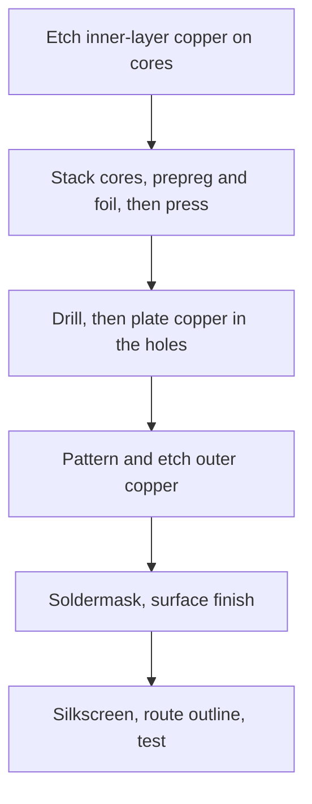

::: basics
### In plain words
A circuit board is a flat sandwich of thin copper sheets and insulating layers, pressed together into one solid piece. The copper carries current, the insulation keeps the copper layers apart, and coatings on the outside protect it and label it. Knowing what each layer is made of lets you predict how the board behaves.

### Picture it
Think of a layered sandwich. Thin slices of cheese (copper) sit between slabs of bread (the insulating layers). The bread is glass cloth soaked in epoxy. Some slabs come already baked hard, and others are a sticky spread that melts in the oven and glues the sandwich together. A glossy glaze on top (soldermask) and writing in icing (silkscreen) finish it. The analogy is loose on one point: the copper is etched into tracks and shapes, not left as full slices.

### Words you need
- **Core**: a rigid, fully cured sheet of glass and epoxy with copper on one or both faces.
- **Prepreg**: glass cloth with partly cured epoxy. It melts under heat and pressure and glues layers together.
- **Ounce (oz) of copper**: a foil weight. 1 oz is about 35 µm thick ([[q0467]]).
- **Soldermask**: the green polymer coating that covers copper except at the pads.
- **Silkscreen**: the white ink text and symbols printed on top.
- **Surface finish**: a thin coating on exposed pads that keeps them solderable (HASL, ENIG, OSP).

### The simplest example
Stack a common 4-layer board from the top down. Top copper is 0.035 mm and prepreg is 0.2 mm. The inner copper is 0.0175 mm and the core is 1.0 mm. Then comes another 0.0175 mm of inner copper, 0.2 mm of prepreg and 0.035 mm of bottom copper. These add up to 1.505 mm. Two soldermask coats of 0.025 mm add 0.05 mm, giving 1.555 mm, which is the ordinary 1.6 mm board. That is the whole idea. The rest of this page covers each layer in detail, the vias that connect layers, and how the stack-up sets impedance.
:::

::: testing
Whether you can describe a real PCB cross-section from top to bottom and name the material of each layer: **silkscreen, soldermask, copper, prepreg, core**, plus surface finish and plated vias. The interviewer wants the physical stack (not only "signal, ground, power"), a sense of typical thicknesses, and the distinction between **cores** (cured laminate) and **prepreg** (the glue layer that bonds them). A good answer also separates the **physical layers** from the **CAD layers** in layout software, which include solder paste and drill files.
:::

::: why
Every layout decision (impedance, current capacity, via aspect ratio, thermal path, board thickness) depends on the stack-up. If you cannot say what is physically between two copper layers, you cannot predict trace impedance or cross-talk. Designers also choose and specify layers with their fabricator, so the vocabulary (core, prepreg, oz, finish) is used daily. This question sits at the start of the materials sequence: conductors ([[q0467]], [[q0468]]), insulators ([[q0469]], [[q0470]]), then coatings and legend ([[q0471]] to [[q0473]]).
:::

::: concepts
- **Copper layers**: the conductive foil patterned into traces, planes and pads ([[q0467]]).
- **Core**: a rigid, fully cured glass-epoxy laminate clad with copper on one or both sides.
- **Prepreg**: "pre-impregnated" glass cloth with partly cured resin, which melts and bonds layers during lamination.
- **Soldermask and silkscreen**: the polymer coating and the printed legend ([[q0473]], [[q0472]]).
- **Surface finish**: a thin metallic or organic coating on exposed copper pads (HASL, ENIG, OSP).
- **Vias**: drilled holes with copper plated on their walls.
:::

::: answer
"A typical rigid PCB is a sandwich. In the middle is the substrate, FR-4, which is woven fibreglass cloth in epoxy resin. On it are layers of copper foil, usually 35 microns, one ounce, on the outside and often half an ounce on the inside, etched into traces, planes and pads.

In a multilayer board you build it from cores, which are fully cured laminate with copper on both sides, and prepreg, which is glass cloth with partly cured epoxy. Under heat and pressure the prepreg melts and bonds everything into one solid board. A common four-layer 1.6 millimetre board is: top copper, prepreg about 0.2 millimetres, inner copper, a core around a millimetre, inner copper, prepreg, bottom copper.

Then on the outside there's soldermask, a green epoxy coating of about 20 to 30 microns that covers the copper except at the pads, and silkscreen, a white ink legend on top of that. The exposed pads get a surface finish, such as HASL, ENIG or OSP, to stay solderable. And through the board are vias, holes with copper plated on the walls to connect the layers.

In layout software there are also non-physical layers, like solder paste and drill, used to make the stencil and drill the holes."
:::

::: technical
**Typical 4-layer, 1.6 mm board (illustrative, fab-specific).**

| Layer | Material | Typical thickness |
|---|---|---|
| Silkscreen | Epoxy ink | 15 to 25 µm |
| Soldermask | Liquid photoimageable (LPI) epoxy | 20 to 30 µm over copper |
| L1 copper | Foil + plating | 35 µm (1 oz) |
| Prepreg | Glass cloth + epoxy | about 0.2 mm |
| L2 copper | Foil | 17.5 µm (0.5 oz) |
| Core | Cured FR-4 | about 1.0 mm |
| L3 copper | Foil | 17.5 µm |
| Prepreg | Glass cloth + epoxy | about 0.2 mm |
| L4 copper | Foil + plating | 35 µm |

Copper plus dielectric sum to $35+210+17.5+1065+17.5+210+35=1591$ µm; adding mask brings it to about 1.6 mm.

**Copper weight.** 1 oz/ft² = 305 g/m²; thickness = $305/8960$ kg/m³ $\approx34$ µm (nominal 35 µm).

**Lamination.** Prepreg flows and cures under heat and pressure (typically in the range of 170 to 190 °C, vendor-dependent), bonding cores and foils.

**Vias.** Drilled after lamination; barrel plated with copper (IPC-6012 specifies minimum average plating thickness, about 20 µm for Class 2 and 25 µm for Class 3).

**Surface finish.** HASL (solder dip), ENIG (nickel 3 to 6 µm with a very thin immersion gold layer, about 0.05 to 0.1 µm), OSP (organic film), immersion silver or tin.
:::

::: short
"A rigid PCB is copper foil layers on FR-4, which is fibreglass cloth in epoxy. Multilayer boards are built from cores, which are cured laminate with copper on both sides, and prepreg, partly cured glass-epoxy that bonds the layers under heat and pressure. Outside, there's soldermask, a green epoxy coating that covers everything but the pads, silkscreen ink for labels, and a surface finish such as ENIG or HASL on the pads. Vias are plated holes connecting the layers. A typical 1.6 millimetre four-layer board has 35 micron outer copper and 0.2 millimetre prepreg."
:::

::: long
"A rigid PCB is a laminated sandwich of copper and glass-epoxy, with a coating and a legend on top.

The base material is FR-4, woven fibreglass cloth impregnated with epoxy resin. The conductors are copper foil, normally 35 microns thick, which is one ounce per square foot, on the outer layers, and often half an ounce, 17.5 microns, on inner layers. The foil is etched into traces, planes and pads.

Multilayer boards are built from two kinds of dielectric. A core is a fully cured laminate with copper bonded to one or both sides. Prepreg is 'pre-impregnated' glass cloth with partly cured epoxy. When you stack cores, prepreg and foil and press them with heat, the prepreg melts, flows into the etched gaps, and cures, bonding everything into one solid board. A typical four-layer 1.6 millimetre board is 35 microns top copper, about 0.2 millimetres prepreg, 17.5 microns inner copper, a core around a millimetre, another inner layer, prepreg, and bottom copper.

After lamination you drill holes, plate copper into them so they conduct, which makes vias, and pattern the outer layers. Then you apply the soldermask, a green epoxy about 20 to 30 microns thick that covers copper except at pads, a surface finish on the pads such as HASL, ENIG or OSP to keep them solderable, and finally the silkscreen legend, a white epoxy ink with part names and outlines.

In CAD, there are also non-physical layers: the paste layer, which makes the stencil, drill layers, and the board outline. The stack-up the fab uses to hit your impedance is the physical one, so you should agree it with them."
:::

::: terms
- **Core**: a cured glass-epoxy laminate with copper on one or both faces.
- **Prepreg**: glass cloth with partly cured resin that bonds layers during lamination.
- **Foil**: the thin copper sheet laminated to the dielectric; weight is expressed in oz/ft².
- **Stack-up**: the ordered list of layers with materials and thicknesses.
- **LPI soldermask**: liquid photoimageable soldermask, the common type ([[q0473]]).
- **Legend / silkscreen**: the printed text and symbols layer ([[q0472]]).
- **Surface finish**: coating on exposed copper to prevent oxidation and enable soldering.
- **Plated through-hole (PTH)**: a drilled hole with copper-plated walls.
:::

::: exceptional
**An average answer** says "copper, FR-4, soldermask, silkscreen".

**An exceptional answer**:
- Draws the **top-to-bottom** stack and gives **typical thicknesses** (35 µm copper, 0.2 mm prepreg, 1.0 mm core, 20 to 30 µm mask).
- Explains **core versus prepreg** and how lamination works.
- Mentions **surface finish** and **plated vias** as part of the physical structure.
- Distinguishes **physical layers** from **CAD layers** (paste, drill, outline).
- Notes that the **stack-up determines impedance and thickness**, and that you agree it with the fabricator.
:::

::: mistakes
- **Saying "FR-4 is the PCB".** FR-4 is the dielectric; copper, mask, legend and finish are separate layers ([[q0470]]).
- **Mixing up core and prepreg.** Core is cured and rigid with copper bonded; prepreg is the uncured bonding sheet.
- **Forgetting that plating adds thickness.** Outer copper ends up thicker than the starting foil because of via plating.
- **Calling the soldermask "insulation between layers".** Mask is on the outside; inner insulation is core and prepreg.
- **Assuming the 1.6 mm board is all FR-4.** About 0.1 mm is copper and a similar fraction is mask, finish and ink.
- **Ignoring finish.** HASL, ENIG and OSP differ in flatness, shelf life and cost.
:::

::: deep
## A real board, layer by layer

```svg
<svg viewBox="0 0 760 316" xmlns="http://www.w3.org/2000/svg" font-family="Inter, sans-serif" font-size="12.5">
<rect x="200" y="30" width="240" height="17" fill="var(--d-bg, #fff)" fill-opacity="0.9" stroke="var(--d-ink)" stroke-width="0.8"/>
<rect x="200" y="47" width="240" height="17" fill="var(--d-green)" fill-opacity="0.55" stroke="var(--d-ink)" stroke-width="0.8"/>
<rect x="200" y="64" width="240" height="16" fill="var(--d-orange)" fill-opacity="1" stroke="var(--d-ink)" stroke-width="0.8"/>
<rect x="200" y="80" width="240" height="36" fill="var(--d-green)" fill-opacity="0.18" stroke="var(--d-ink)" stroke-width="0.8"/>
<rect x="200" y="116" width="240" height="14" fill="var(--d-orange)" fill-opacity="1" stroke="var(--d-ink)" stroke-width="0.8"/>
<rect x="200" y="130" width="240" height="70" fill="var(--d-box)" fill-opacity="1" stroke="var(--d-ink)" stroke-width="0.8"/>
<rect x="200" y="200" width="240" height="14" fill="var(--d-orange)" fill-opacity="1" stroke="var(--d-ink)" stroke-width="0.8"/>
<rect x="200" y="214" width="240" height="36" fill="var(--d-green)" fill-opacity="0.18" stroke="var(--d-ink)" stroke-width="0.8"/>
<rect x="200" y="250" width="240" height="16" fill="var(--d-orange)" fill-opacity="1" stroke="var(--d-ink)" stroke-width="0.8"/>
<rect x="200" y="266" width="240" height="17" fill="var(--d-green)" fill-opacity="0.55" stroke="var(--d-ink)" stroke-width="0.8"/>
<rect x="200" y="283" width="240" height="17" fill="var(--d-bg, #fff)" fill-opacity="0.9" stroke="var(--d-ink)" stroke-width="0.8"/>
<rect x="391" y="64" width="18" height="202" fill="var(--d-bg, #fff)" stroke="var(--d-ink)" stroke-width="0.8"/>
<rect x="391" y="64" width="3.5" height="202" fill="var(--d-orange)"/><rect x="405.5" y="64" width="3.5" height="202" fill="var(--d-orange)"/>
<path d="M400 27 V60" stroke="var(--d-muted)" stroke-width="1" fill="none"/>
<text x="190" y="42.5" text-anchor="end" fill="var(--d-ink)" font-weight="600">Silkscreen (legend ink)</text>
<text x="454" y="42.5" fill="var(--d-muted)" font-size="11.5">white epoxy ink, about 15 to 25 µm</text>
<text x="190" y="59.5" text-anchor="end" fill="var(--d-ink)" font-weight="600">Soldermask</text>
<text x="454" y="59.5" fill="var(--d-muted)" font-size="11.5">green LPI epoxy, about 20 to 30 µm</text>
<text x="190" y="76.0" text-anchor="end" fill="var(--d-ink)" font-weight="600">L1: top copper</text>
<text x="454" y="76.0" fill="var(--d-muted)" font-size="11.5">copper foil, 35 µm (1 oz) + plating</text>
<text x="190" y="102.0" text-anchor="end" fill="var(--d-ink)" font-weight="600">Prepreg</text>
<text x="454" y="102.0" fill="var(--d-muted)" font-size="11.5">glass cloth + partly cured epoxy, about 0.2 mm</text>
<text x="190" y="127.0" text-anchor="end" fill="var(--d-ink)" font-weight="600">L2: inner copper</text>
<text x="454" y="127.0" fill="var(--d-muted)" font-size="11.5">copper, 17.5 µm (0.5 oz)</text>
<text x="190" y="169.0" text-anchor="end" fill="var(--d-ink)" font-weight="600">Core</text>
<text x="454" y="169.0" fill="var(--d-muted)" font-size="11.5">cured FR-4 glass-epoxy, about 1.0 mm</text>
<text x="190" y="211.0" text-anchor="end" fill="var(--d-ink)" font-weight="600">L3: inner copper</text>
<text x="454" y="211.0" fill="var(--d-muted)" font-size="11.5">copper, 17.5 µm (0.5 oz)</text>
<text x="190" y="236.0" text-anchor="end" fill="var(--d-ink)" font-weight="600">Prepreg</text>
<text x="454" y="236.0" fill="var(--d-muted)" font-size="11.5">glass cloth + partly cured epoxy, about 0.2 mm</text>
<text x="190" y="262.0" text-anchor="end" fill="var(--d-ink)" font-weight="600">L4: bottom copper</text>
<text x="454" y="262.0" fill="var(--d-muted)" font-size="11.5">copper foil, 35 µm (1 oz) + plating</text>
<text x="190" y="278.5" text-anchor="end" fill="var(--d-ink)" font-weight="600">Soldermask</text>
<text x="454" y="278.5" fill="var(--d-muted)" font-size="11.5">green LPI epoxy</text>
<text x="190" y="295.5" text-anchor="end" fill="var(--d-ink)" font-weight="600">Silkscreen (legend ink)</text>
<text x="454" y="295.5" fill="var(--d-muted)" font-size="11.5">white epoxy ink</text>
<text x="400" y="24" text-anchor="middle" fill="var(--d-ink)" font-size="11.5">plated via barrel (about 20 µm+ Cu)</text>
</svg>
```
Figure: A 4-layer board cross-section (thicknesses not to scale). The three dielectric layers (two prepregs and a core) separate four copper layers. Soldermask and silkscreen cover the outside; a plated via barrel connects layers. The thick core gives mechanical stiffness; the thin prepregs set the spacing between outer signal layers and the inner planes, which sets controlled impedance.

### Copper

Copper foil is rated by weight per area. One ounce spread over one square foot is 305 g/m², which at copper's density of 8960 kg/m³ is a thickness of about 34 µm, usually quoted as 35 µm (1.37 mil). Half-ounce is 17.5 µm; two-ounce is 70 µm. Outer layers start with thin foil and are plated up in the process (the via plating also deposits on the surface), which is why outer layers are often specified as "finished 1 oz". Foil comes electro-deposited (the standard) or rolled-annealed (for flex, see [[q0465]]), and with different surface roughness (smoother foil reduces high-frequency loss).

### Core and prepreg

Both are glass-reinforced epoxy. The reinforcement is woven E-glass cloth in styles with different thread counts (for example 106, 1080, 2116, 7628), which sets thickness and resin content. A **core** is fully cured (C-stage) and clad with copper on one or both sides, so it is rigid and flat, and the inner-layer pattern is etched on it. **Prepreg** is B-stage: the resin is partly cured and tacky. In the press, at high temperature (typically around 170 to 190 °C) and pressure, the resin liquefies, fills the gaps between the copper features, and then cures fully, bonding adjacent layers. The final dielectric spacing after pressing is slightly thinner than the nominal prepreg thickness, depending on copper coverage.

> [!UNCERTAIN]
> Exact laminate thicknesses, glass styles and press conditions vary by fabricator and material system (and the standard stack-ups differ between fabs). The numbers here are typical values for orientation; request the fab's stack-up for impedance calculations.

### Soldermask

A 20 to 30 µm polymer coating (LPI epoxy) that covers the copper except at pads. It prevents solder bridges, protects copper from oxidation and contamination and adds some insulation ([[q0473]]).

### Silkscreen / legend

Ink (usually white epoxy, or increasingly direct inkjet) printed on the mask with reference designators, polarity marks and logos ([[q0472]]).

### Surface finish

Exposed copper oxidises, so pads get a finish:

| Finish | Idea | Notes |
|---|---|---|
| HASL | Dipped in molten solder and levelled with hot air | Cheap; uneven surface hurts fine pitch |
| Lead-free HASL | Same, with lead-free solder | Common; uneven |
| ENIG | Electroless nickel + immersion gold | Flat, long shelf life; thin gold (about 0.05 to 0.1 µm) protects nickel; "black pad" risk |
| OSP | Organic film on copper | Cheap, flat; short shelf life, one or two reflows |
| Immersion silver / tin | Thin metal film | Flat; handling and storage sensitive |

### Vias

After lamination, holes are drilled and cleaned; the walls are made conductive (electroless copper) and electroplated to a thickness (IPC-6012 requires an average of about 20 µm for Class 2 and 25 µm for Class 3). The barrel is the conductor between layers. The aspect ratio (board thickness divided by drill diameter) matters for plating quality: 1.6 mm with a 0.3 mm drill is about 5:1, which is routine; very high ratios (above 8:1 to 10:1) are harder.

## How the board is made (in order)


Figure: The inner layers are made first because they must be inside the stack; the outer layers are patterned after drilling and plating so the vias connect everything. Mask, finish and legend are last.

## Physical layers versus CAD layers

Layout software shows more layers than the board has. Typical CAD layers are: copper layers (L1 top, inner, bottom), top and bottom soldermask openings, top and bottom paste (stencil openings for solder paste, not part of the board), silkscreen top/bottom, drill and outline. The fab builds only the physical items; the paste layer goes to the stencil maker for assembly. [[q0474]] asks the same layers question in the stack-up context.

## Stack-up sets impedance

For a signal on L1 with a continuous plane on L2, the dielectric height is the prepreg thickness (here about 0.2 mm), and with $\varepsilon_r\approx4.2$ to 4.5 a 50 Ω microstrip is about 0.33 mm wide (IPC-2141-style estimate for 35 µm copper). Change the prepreg to 0.1 mm and the same impedance needs a trace about 0.15 mm wide. This is why the stack-up is agreed with the fab before routing (see [[q0463]] for parasitics and the microstrip calculator in [[q0469]]).

## Worked example: adding up the stack-up

The cross-section above can be checked by adding its layers. Two soldermask layers of 25 µm give 0.050 mm. Two outer copper layers at 35 µm give 0.070 mm, and two inner layers at 17.5 µm give 0.035 mm. The two prepregs at 0.2 mm each add 0.400 mm, and the core is 1.0 mm. The total is 1.555 mm. The technical section's slightly thicker nominal dielectrics (210 µm prepreg, 1.065 mm core) give 1.59 mm before mask; either way the stack lands on the ordinary 1.6 mm board. In reality pressing squeezes resin out of the prepreg and into the gaps between copper features, so the finished thickness depends on how much copper the layer holds, and a fab quotes 1.6 mm with a tolerance of about ±10 %. The practical consequence is that the "0.2 mm" dielectric under a trace is a nominal figure. A board with solid ground pours has less resin flow than one with sparse copper, and the impedance shifts with it; this is why controlled-impedance orders carry a tolerance (±10 % is common) and a test coupon.

Sheet resistance follows from the same thickness. Copper at $1.7\times10^{-8}$ Ω·m gives $\rho/t = 0.49$ mΩ per square for 35 µm and 0.97 mΩ per square for 17.5 µm. That is why power traces go on the outer layers, and why a trace 5 squares long on a half-ounce inner layer already has about 5 mΩ.

## Worked example: a via barrel as a resistor and an inductor

Take the via drilled at 0.3 mm in a 1.6 mm board (aspect ratio 5.3:1, routine) with 25 µm of plating. The barrel is a thin copper tube whose cross-section is roughly $\pi(d-t)t = \pi\times0.275\text{ mm}\times25\ \mu\text{m} = 2.16\times10^{-8}$ m². Its resistance is

$$R = \frac{\rho L}{A} = \frac{1.7\times10^{-8}\times1.6\times10^{-3}}{2.16\times10^{-8}} = 1.3\ \text{m}\Omega$$

(slightly more in practice, since plated copper has a bit higher resistivity than bulk). That is negligible at DC. But the via is also a small inductor. A commonly used approximation for a via through a board of height $h$ and drill diameter $d$ (both in inches) is $L\approx5.08\,h\,[\ln(4h/d)+1]$ nH. With $h = 0.063$ in and $d = 0.0118$ in, $4h/d = 21.3$ and $L\approx1.3$ nH. At 100 MHz its reactance is $2\pi\times10^8\times1.3\text{ nH} = 0.82$ Ω, about 600 times its DC resistance, and at 1 GHz it is 8.2 Ω. Therefore a via is a resistor for power and an inductor for signals, and a bypass capacitor connected through a long via loses most of its value at high frequency. This explains the layout rules: put capacitors close to the pin with the via right at the pad, and use several vias in parallel for the return path.

> [!UNCERTAIN]
> The via inductance formula is an engineering approximation. It ignores the proximity of return vias and planes, which can reduce the effective inductance a lot, so treat the 1.3 nH as an upper-bound-style estimate.

## Why the barrel can crack: the z-axis expansion

FR-4 expands much more in thickness than in plane because the glass cloth only constrains the plane. Typical values (vary by material) are a z-axis CTE around 50 to 70 ppm/K below the glass transition temperature (about 130 to 140 °C for standard FR-4) and 250 to 300 ppm/K above it, against 17 ppm/K for copper. Heat a board from 25 °C to a 260 °C lead-free reflow peak, using 60 ppm/K for 110 K and 280 ppm/K for 125 K: the board grows by $110\times60\times10^{-6}+125\times280\times10^{-6} = 4.2\ \%$ in thickness, while the copper barrel grows by $235\times17\times10^{-6} = 0.4\ \%$. The difference of 3.8 % is about 60 µm over 1.6 mm, and the plated barrel has to stretch by that strain every reflow cycle without cracking. Copper plating with good ductility (often an elongation requirement of several percent or more) and adequate thickness can take it, but a thin or brittle barrel, or a high aspect ratio, can crack after a few cycles. This is why high-reliability boards specify a higher-Tg or lower-CTE laminate, 25 µm plating (Class 3), and why you limit the number of rework heat cycles ([[q0470]]).

## Verifying on the bench

- **Microsection:** the definitive stack-up check is to cut, pot and polish a cross-section of a coupon and measure the layers under a microscope. Fabs do it routinely; ask for the section report from your build, and compare dielectric heights and plating thickness with the plan.
- **Impedance coupon:** a TDR on the fab's test coupon gives the measured $Z_0$ of the real stack-up, to compare with the target (typically ±10 %).
- **Via resistance:** build a test pattern with a chain of many vias in series and measure with a 4-wire ohmmeter; dividing by the number of vias gives per-via resistance, and any outlier points at a thin or cracked barrel. Repeat after several reflow cycles to see degradation.
- **Thickness and flatness:** a caliper or micrometer gives the overall thickness; compare with the nominal 1.6 mm and note the tolerance. Bow and twist can be checked by laying the board on a flat surface after reflow.
:::

::: applications
- **Consumer PCBs**: 2 to 4 layers, 1.6 mm, 35 µm copper, green mask, HASL or ENIG.
- **Fine-pitch BGA boards**: ENIG finish for flatness, with thinner prepreg and more layers.
- **Power boards**: thicker outer copper (2 oz or more) and thicker cores ([[q0467]]).
- **RF boards**: low-loss laminate in place of FR-4 for the layers carrying signals ([[q0469]]).
- **Flex circuits**: polyimide base and coverlay in place of FR-4 and mask ([[q0465]]).
- **High-reliability boards**: specified plating thickness and IPC Class 3 requirements.
:::

::: assumptions
I described a conventional rigid FR-4 board built by lamination; HDI, flex, metal-core and RF boards change materials and sequence. Thicknesses are typical values from common prototype stack-ups and differ between fabricators and with copper coverage. The silkscreen and mask are included as "layers" because many people count them; others count only copper and dielectric layers (the "layer count" of a board is the number of copper layers). If the interviewer wants the stack-up from a design view (signal/ground/power ordering), see [[q0474]] to [[q0476]].
:::

::: followups
### What is the difference between a core and prepreg?
A core is a fully cured laminate (cured glass-epoxy with copper on one or both sides); it is rigid and flat and carries etched inner-layer patterns. Prepreg is glass cloth with partly cured resin that flows and bonds in the press. Cores provide the structure, prepreg the glue and the dielectric spacing between adjacent layer sets.

### Why is the soldermask usually not counted as a layer in "layer count"?
Layer count refers to copper layers, because that is what determines routing capacity and cost. Mask and silkscreen are coatings. A "2-layer" board therefore has two copper layers but several physical layers.

### How would a thicker prepreg affect a 50 Ω microstrip?
Thicker dielectric between trace and plane reduces capacitance per length and raises impedance, so the trace must be wider to keep 50 Ω. Doubling the height from 0.1 mm to 0.2 mm roughly doubles the required width (about 0.15 mm to 0.34 mm for $\varepsilon_r\approx4.3$ and 35 µm copper, from an IPC-2141-style estimate; check with a field solver). Thicker dielectric also reduces coupling to the plane, increasing crosstalk to neighbours.

### What if you need a 1 mm thick board instead of 1.6 mm?
Use thinner cores and prepregs in the stack-up, possibly fewer layers, and recompute impedance. Thin boards are more flexible, warp more in reflow, and may need support in assembly; connectors with fixed board-thickness requirements (edge connectors, card guides) will need the right thickness.

### Scenario: your fab's impedance report is 8% off from your calculation. What do you check?
Prepreg and core thickness after press (resin flows into copper-free areas, so thickness depends on coverage), copper roughness and thickness after plating, soldermask over the trace (lowers impedance by a few ohms), the dielectric constant at your frequency, and etch factor (trace width and trapezoid shape). Ask for the fab's actual stack-up and measured widths, and use their field-solver numbers.
:::

::: interpretations
Q474 asks the same wording ("What are the layers of a PCB? what are they made of?") under the stack-up topic; this page covers the **physical layers and their materials**, while [[q0474]] approaches it from the **stack-up design** side (how layers are assigned to signals and planes). "Layers" is read here to include the mask, legend and finish as well as copper and dielectric.
:::

::: references
- IPC-2221 (generic printed board design) and IPC-6012 (qualification and performance of rigid boards) for layer, plating and finish definitions.
- IPC-4101 (specification for base materials for rigid and multilayer printed boards) for laminate and prepreg classes; IPC-4412 for glass fabric styles.
- Clyde Coombs (ed.), *Printed Circuits Handbook*: laminates, prepreg, lamination, plating and finishes.
- Fabricator stack-up and capability sheets (published by board houses) for real thickness options.
:::

::: rubric
- Lists the physical layers: silkscreen, soldermask, copper, prepreg, core :: These are the core of the answer.
- States materials: copper foil, glass-epoxy FR-4, LPI epoxy mask, epoxy ink :: The question asks what they are made of.
- Gives typical thicknesses :: Quantities show real familiarity.
- Explains core versus prepreg and lamination :: This distinguishes someone who understands construction.
- Mentions vias and surface finish :: Completes the physical structure.
- Distinguishes physical layers from CAD layers :: Shows layout-tool experience.
- Notes that the stack-up sets impedance and is agreed with the fab :: Connects construction to design.
:::

::: quiz
```json
[
 {"type":"mcq","level":"fundamental","q":"Which layer bonds the cores together in a multilayer board during lamination?","options":["Soldermask","Prepreg","Silkscreen","Surface finish"],"answer":1,"explain":"Prepreg is partly cured glass-epoxy that melts, flows and cures in the press, gluing cores and foils together."},
 {"type":"mcq","level":"fundamental","q":"What is the base material (dielectric) of the most common PCBs?","options":["Polyimide film","Woven glass cloth in epoxy (FR-4)","Alumina","PTFE"],"answer":1,"explain":"FR-4 is woven fibreglass in epoxy resin, the standard rigid PCB dielectric."},
 {"type":"numeric","level":"intermediate","q":"1 oz/ft² copper has a mass of about 305 g/m². Using a density of 8960 kg/m³, what is its thickness in µm?","answer":34,"tolerance":0.03,"unit":"µm","explain":"$t=m/\\rho=0.305\\ \\text{kg/m}^2/8960\\ \\text{kg/m}^3=3.4\\times10^{-5}$ m $=34$ µm."},
 {"type":"numeric","level":"intermediate","q":"A stack-up has outer copper 35 µm ×2, inner copper 17.5 µm ×2, prepreg 210 µm ×2 and a 1065 µm core. What is the total thickness (without mask) in mm?","answer":1.59,"tolerance":0.02,"unit":"mm","explain":"$70+35+420+1065=1590$ µm = 1.59 mm; mask and finish bring it to about 1.6 mm."},
 {"type":"mcq","level":"advanced","q":"Which statement about 'layer count' is correct?","options":["It counts silkscreen and mask","It counts the copper layers","It counts all CAD layers","It counts only inner layers"],"answer":1,"explain":"Layer count refers to the number of copper layers, because they set routing capacity and cost."},
 {"type":"truefalse","level":"advanced","q":"The solder paste layer in CAD software is a physical layer of the finished board.","answer":false,"explain":"The paste layer describes stencil openings used during assembly; it is not part of the bare board."}
]
```
:::
