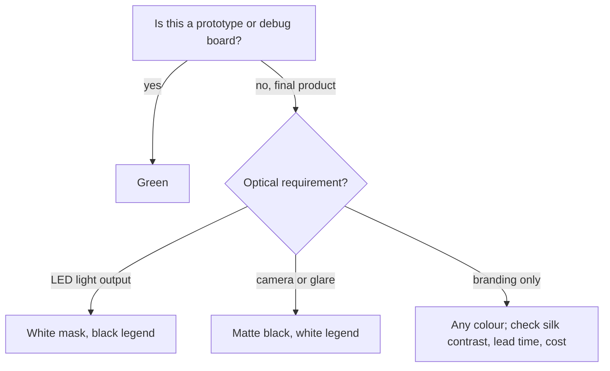

::: testing
Whether you know that board colour is the colour of the **soldermask** (not the laminate), and whether you can give honest, reasoned explanations rather than a confident myth. The interviewer expects a few commonly cited reasons for green (inspection contrast, mature chemistry and supply chain, cost, military-spec heritage) and some candour about which are well established and which are folklore, plus the other colours and their genuine trade-offs: black hides traces, white suits LED boards, others are cosmetic.
:::

::: why
Colour is the one PCB decision that looks purely aesthetic yet has real consequences: inspectability by humans and cameras, silkscreen readability, light reflection for LEDs and sensors, lead time and sometimes cost. Product designers will ask you to make the board black "to look premium", and you should know what that costs in debuggability. The question also checks that you understand the coating stack: the green is the mask over the FR-4, not the FR-4 itself ([[q0473]], [[q0466]]).
:::

::: concepts
- **Soldermask is the coloured layer**: a polymer coating (LPI epoxy) over the copper; the laminate underneath is tan or yellowish ([[q0473]]).
- **Contrast**: the visibility of copper features, pads and silkscreen against the mask.
- **AOI (automated optical inspection)**: cameras that check boards; their algorithms are tuned to the colour.
- **Photoimageable chemistry**: the mask is exposed to UV and developed, so pigments affect cure and resolution.
- **Silkscreen colour pairing**: white legend on green; black legend on white mask ([[q0472]]).
- **Reflectivity**: light colours reflect LED light; dark ones absorb it.
:::

::: answer
"The colour you see is the soldermask, the polymer coating over the copper, not the fibreglass underneath, which is tan. Green is the default mostly for practical reasons. It's the oldest and most mature mask chemistry, so it's the cheapest, the most consistent, and every fab and assembly line is set up for it. Green also gives good visual contrast against copper traces and white silkscreen, and it's comfortable for people inspecting boards under bright light, and automated optical inspection systems are tuned to it. Part of the story, often repeated but I wouldn't claim it with certainty, is a military-spec heritage.

Other colours are available: red, blue, yellow, white, black, purple, even matte versions. The electrical function is the same, because it's just a pigment in the mask, but they have trade-offs. Black or matte black looks premium and hides the traces, but makes visual inspection, debugging and rework much harder, and the silkscreen needs to be white. White is used on LED boards because it reflects light, but it can yellow with heat and UV, and the legend must be black. Red and blue are mostly cosmetic and sometimes cost a bit more or take slightly longer to produce.

So I'd keep green for development boards where I need to debug and use a different colour for the final product only if the marketing benefit is worth the inspection cost."
:::

::: technical
**What is coloured.** The soldermask (LPI epoxy, about 20 to 30 µm over copper) contains a pigment. The base laminate (FR-4) is a pale tan/yellow-green translucent colour; copper under the mask appears as a lighter shade of the mask colour, and bare finished pads (HASL silver, ENIG gold) stand out.

**Reasons given for green (with confidence).**
1. *Mature chemistry and supply chain* (high confidence): green was the first widely adopted LPI mask colour, so processes, inks and inspection are most tuned and cheapest at volume.
2. *Contrast and eye comfort* (commonly stated; plausible): green contrasts with copper-coloured pads and white silkscreen and is restful under bright inspection light.
3. *AOI tuning* (plausible): inspection systems and algorithms are calibrated for green boards.
4. *Military-spec heritage* (frequently repeated, not verified here): attributed to specifications from the early days of the industry.

**Colours and effects.** Black: hides traces and reduces contrast, may need more careful imaging. White: high reflectance (useful for LED boards), but may yellow with heat and UV. Red/blue/yellow/purple: cosmetic. Matte versions reduce glare for camera-based or optical applications.

**Electrical.** Mask thickness and permittivity (about 3 to 4, loss similar to the epoxy) matter, colour does not, except that black masks must use insulating pigments (not conductive carbon) to hold surface insulation: check the supplier specification.
:::

::: short
"The colour is the soldermask, the polymer coating over the copper, not the fibreglass. Green is the default because it's the most mature and cheapest mask chemistry, it gives good contrast with copper and white silkscreen, it's easy on the eyes, and inspection systems are tuned to it. There's also some military-spec folklore. Other colours, red, blue, black, white, yellow, work electrically the same: black looks premium but hides traces and makes debugging harder, white is good for LED reflectivity, and the rest are cosmetic."
:::

::: long
"First, the colour comes from the soldermask, the thin polymer coating over the copper. The fibreglass underneath is a pale tan, so when you scratch a green board you see copper or beige.

Why green? There are a few reasons I'm fairly confident about. It's the oldest and most mature mask chemistry, so it's the cheapest, the most consistent, and every fab line and assembly shop is tuned to it. It gives good visual contrast against the copper and the white silkscreen, and it's easy on the eyes of people inspecting boards for hours under bright light. Automated optical inspection is typically calibrated for green too. There's also an often-repeated story that early military specifications called for green; I'd mention it as folklore rather than fact, because I haven't seen the spec.

Other colours are standard options now: red, blue, yellow, purple, white, black, and matte versions. The electrical function is the same, because it's just pigment in the mask, but the trade-offs are real. Black, especially matte black, looks premium and hides the layout, but it kills contrast, so visual inspection, probing and rework are harder, and the mask may need different imaging, so the finest mask dams can be larger. White is used on LED boards for reflectivity, but it can yellow with heat and UV, and you need a black silkscreen. Yellow has poor contrast with white legend. Red and blue are mostly cosmetic and may cost a little more or have longer lead times at some fabs.

So I'd use green for development and debugging, and only choose another colour for the final product if the benefit, aesthetics or optical properties, outweighs the inspection cost."
:::

::: terms
- **Soldermask**: the polymer coating that defines the board's colour and covers copper except at pads ([[q0473]]).
- **LPI (liquid photoimageable)**: the mask type applied wet, exposed through a pattern and developed.
- **AOI**: automated optical inspection of boards using cameras.
- **Silkscreen / legend**: the printed text layer; its colour is chosen to contrast with the mask ([[q0472]]).
- **Matte vs glossy mask**: surface finish of the mask; matte reduces glare and reflections.
- **Dam**: the strip of mask between adjacent pads that prevents solder bridging.
- **Reflectance**: fraction of light reflected by the surface, important for LED lighting boards.
- **Pigment**: the colouring component of the mask.
:::

::: exceptional
**An average answer** says "green is easy on the eyes" or repeats the military story as fact.

**An exceptional answer**:
- States that **colour = soldermask**, with the tan laminate beneath.
- Gives **several reasons for green** and **separates well-founded ones** (mature chemistry, supply chain, inspection tuning) **from folklore** (military spec).
- Lists **other colours with real trade-offs**: black (inspection), white (LED reflectivity, yellowing), yellow (silk contrast), others (cosmetic, lead time or cost).
- Mentions **silkscreen pairing**, **AOI**, **mask dam resolution** and **insulating pigment** for black.
- Gives a **practical recommendation**: green for development, colour for the final product only when justified.
:::

::: mistakes
- **"The FR-4 itself is green."** The laminate is tan; green is the soldermask.
- **Stating the military-spec origin as fact.** It is commonly repeated but unverified; present it as folklore.
- **Choosing black for a prototype.** It hides traces and makes debugging and rework slower.
- **White silkscreen on a white or yellow mask.** The legend becomes unreadable; use black legend.
- **Assuming colour changes electrical behaviour.** It doesn't, apart from mask thickness and material; check carbon-filled black masks for insulation.
- **Ignoring lead time.** Non-standard colours can add days or cost at some fabs.
:::

::: deep
## What exactly is green?

Open a board and look at an exposed edge: the core is pale tan or yellow-green and slightly translucent; the copper is pink; and the surface coating is the coloured layer. That coating is the **soldermask** ([[q0473]]): an epoxy or acrylic polymer, 20 to 30 µm thick, that covers the copper everywhere except the pads. It is a liquid photoimageable (LPI) resin: sprayed or curtain-coated, exposed to UV through a film or by laser direct imaging, developed to open the pads, and cured. A pigment gives it colour.

```svg
<svg viewBox="0 0 700 300" xmlns="http://www.w3.org/2000/svg" font-family="Inter, sans-serif" font-size="12.5">
<rect x="20" y="10" width="200" height="90" rx="6" fill="#1d6b3b" stroke="var(--d-ink)" stroke-width="1"/>
<path d="M40 35 H110 V75 H170" fill="none" stroke="#3a9a5e" stroke-width="7" stroke-linejoin="round"/>
<rect x="162" y="67" width="22" height="16" fill="#d8d8d8" stroke="#888" stroke-width="0.8"/>
<rect x="32" y="27" width="18" height="16" fill="#d8d8d8" stroke="#888" stroke-width="0.8"/>
<text x="120" y="32" fill="#ffffff" font-size="13" font-weight="600">R1  U2</text>
<text x="120" y="118" text-anchor="middle" fill="var(--d-ink)" font-weight="600">Green</text>
<text x="120" y="135" text-anchor="middle" fill="var(--d-muted)" font-size="11.5">inspects well; cheapest, default</text>
<rect x="246" y="10" width="200" height="90" rx="6" fill="#b02a2a" stroke="var(--d-ink)" stroke-width="1"/>
<path d="M266 35 H336 V75 H396" fill="none" stroke="#d05a5a" stroke-width="7" stroke-linejoin="round"/>
<rect x="388" y="67" width="22" height="16" fill="#d8d8d8" stroke="#888" stroke-width="0.8"/>
<rect x="258" y="27" width="18" height="16" fill="#d8d8d8" stroke="#888" stroke-width="0.8"/>
<text x="346" y="32" fill="#ffffff" font-size="13" font-weight="600">R1  U2</text>
<text x="346" y="118" text-anchor="middle" fill="var(--d-ink)" font-weight="600">Red</text>
<text x="346" y="135" text-anchor="middle" fill="var(--d-muted)" font-size="11.5">good contrast; cosmetic</text>
<rect x="472" y="10" width="200" height="90" rx="6" fill="#1f4fa3" stroke="var(--d-ink)" stroke-width="1"/>
<path d="M492 35 H562 V75 H622" fill="none" stroke="#4a7fd4" stroke-width="7" stroke-linejoin="round"/>
<rect x="614" y="67" width="22" height="16" fill="#d8d8d8" stroke="#888" stroke-width="0.8"/>
<rect x="484" y="27" width="18" height="16" fill="#d8d8d8" stroke="#888" stroke-width="0.8"/>
<text x="572" y="32" fill="#ffffff" font-size="13" font-weight="600">R1  U2</text>
<text x="572" y="118" text-anchor="middle" fill="var(--d-ink)" font-weight="600">Blue</text>
<text x="572" y="135" text-anchor="middle" fill="var(--d-muted)" font-size="11.5">good contrast; cosmetic</text>
<rect x="20" y="156" width="200" height="90" rx="6" fill="#d4b21a" stroke="var(--d-ink)" stroke-width="1"/>
<path d="M40 181 H110 V221 H170" fill="none" stroke="#ecd45a" stroke-width="7" stroke-linejoin="round"/>
<rect x="162" y="213" width="22" height="16" fill="#d8d8d8" stroke="#888" stroke-width="0.8"/>
<rect x="32" y="173" width="18" height="16" fill="#d8d8d8" stroke="#888" stroke-width="0.8"/>
<text x="120" y="178" fill="#222222" font-size="13" font-weight="600">R1  U2</text>
<text x="120" y="264" text-anchor="middle" fill="var(--d-ink)" font-weight="600">Yellow</text>
<text x="120" y="281" text-anchor="middle" fill="var(--d-muted)" font-size="11.5">bright; low silk contrast</text>
<rect x="246" y="156" width="200" height="90" rx="6" fill="#eeeeee" stroke="var(--d-ink)" stroke-width="1"/>
<path d="M266 181 H336 V221 H396" fill="none" stroke="#cfcfcf" stroke-width="7" stroke-linejoin="round"/>
<rect x="388" y="213" width="22" height="16" fill="#d8d8d8" stroke="#888" stroke-width="0.8"/>
<rect x="258" y="173" width="18" height="16" fill="#d8d8d8" stroke="#888" stroke-width="0.8"/>
<text x="346" y="178" fill="#222222" font-size="13" font-weight="600">R1  U2</text>
<text x="346" y="264" text-anchor="middle" fill="var(--d-ink)" font-weight="600">White</text>
<text x="346" y="281" text-anchor="middle" fill="var(--d-muted)" font-size="11.5">reflective; LED boards</text>
<rect x="472" y="156" width="200" height="90" rx="6" fill="#161616" stroke="var(--d-ink)" stroke-width="1"/>
<path d="M492 181 H562 V221 H622" fill="none" stroke="#2e2e2e" stroke-width="7" stroke-linejoin="round"/>
<rect x="614" y="213" width="22" height="16" fill="#d8d8d8" stroke="#888" stroke-width="0.8"/>
<rect x="484" y="173" width="18" height="16" fill="#d8d8d8" stroke="#888" stroke-width="0.8"/>
<text x="572" y="178" fill="#ffffff" font-size="13" font-weight="600">R1  U2</text>
<text x="572" y="264" text-anchor="middle" fill="var(--d-ink)" font-weight="600">Black</text>
<text x="572" y="281" text-anchor="middle" fill="var(--d-muted)" font-size="11.5">traces hidden; hard to inspect</text>
</svg>
```
Figure: The same mini board (a trace, two pads and white legend) over six mask colours. Notice how the trace (the mask over copper appears lighter) is clearly visible on green, red, blue and yellow, is low-contrast on white, and almost vanishes on black. The legend needs the right colour too: white text on green, red, blue and black; black text on white and yellow.

## Reasons for green

**1. Mature chemistry, supply chain and cost (high confidence).** Green was the first LPI mask colour to be widely used, so the formulations, application equipment, process windows and defect statistics are best known for it. When every shop makes mostly green, the ink is the cheapest, the lead times shortest and the process most repeatable.

**2. Contrast and visual comfort (plausible, commonly cited).** Green provides good contrast against copper-coloured traces, and a good contrast with white silkscreen. Human eyes are most sensitive to green wavelengths, and a green background is restful for people looking at boards under strong light for long shifts, an argument for green over high-chroma red.

**3. Inspection systems (plausible).** AOI machines use cameras with controlled lighting, and thresholds are tuned on green boards; other colours may need recipe changes. Manufacturers will do it, but green is the default case.

**4. Military-specification heritage (unverified folklore).** It is often said that early military specs for PCBs required green. I have not seen a specification text that requires it; present this as a story, not a fact.

> [!UNCERTAIN]
> The relative importance of these reasons is debated and the history is not well documented. The mature-chemistry and inspection-tuning arguments are the ones consistent with how fabricators describe their processes; treat the military and eye-comfort stories as plausible but unproven.

## Other colours: what changes

| Colour | Pros | Cons | Typical use |
|---|---|---|---|
| Green | Cheapest, best-tuned process, good contrast | Plain | Default for everything |
| Red | Good contrast, distinctive | Slight cost or lead-time premium at some fabs | Branding, hobby boards |
| Blue | Good contrast, distinctive | Same as red | Branding, hobby boards |
| Yellow | Bright | Low contrast with white silkscreen; fades | Cosmetic |
| White | Highly reflective (LED light output, uniform lighting) | Shows dirt and flux; can yellow with heat and UV; needs black legend | LED strips and lighting boards |
| Black (matte or gloss) | Premium look; hides layout; low glare | Traces invisible; AOI and manual inspection harder; dark mask can need different exposure | Consumer products, audio, cameras |
| Purple, orange, others | Cosmetic | Availability, cost | Branding |

Additional engineering notes:

- **Resolution and mask dams.** Pigments absorb or scatter UV differently, so cure depth and the smallest reliable mask dam between pads can differ by colour; black and white sometimes have larger minimum dam or clearance (fabricator-specific: check capability sheets).
- **Light reflection.** White improves LED board luminous efficiency by reflecting emitted light (reflectance in the range of 80 to 90% is typical of white masks), but yellowing over life reduces it. Black minimises stray reflections for optical sensors and cameras (a "matte black" board is chosen for glare and flare reasons).
- **Thermal.** The mask is thin; colour has a negligible effect on conduction. Radiative effects are small compared to convection in most products.
- **Insulation.** Mask thickness and dielectric strength matter for creepage and high voltage; the pigment should not reduce insulation. Black masks must use non-conductive pigments, because carbon black at high loading can be conductive: check the supplier specification for the surface insulation resistance.
- **Debugging.** Dark masks hide cuts, jumper wires and solder bridges: development boards are almost always green for that reason.

## Choosing


Figure: Start from function: debugging favours green; optical needs (reflectivity or low glare) justify white or black; pure branding is allowed but check legend contrast and the fab's capability and cost.

## What does not change with colour

Electrical function: traces, planes and vias behave identically. Impedance changes with the mask only through thickness and permittivity (a mask over a microstrip trace lowers $Z_0$ by roughly a few ohms, an effect that depends on the mask thickness and trace geometry; it's accounted for in the fabricator's field solver). Colour does not change flammability rating or the substrate. IPC specifications for mask thickness, adhesion and insulation apply to every colour.
:::

::: applications
- **Development boards, prototypes and test fixtures**: green for easy inspection.
- **LED lighting and displays**: white mask for reflectivity.
- **Audio, camera and premium consumer products**: matte black for aesthetics and low glare.
- **Branded hobby and educational boards**: red, blue, purple or yellow.
- **Optical sensors and lidar boards**: matte black to reduce reflected light.
- **Aerospace and medical boards**: usually green or the colour required by the specification and inspection procedure.
:::

::: assumptions
I assume a conventional LPI soldermask over FR-4. Thin film or dry-film masks, flex coverlay (usually amber polyimide) and other coatings have different colours and rules ([[q0465]]). The reliability of the reasons for green varies, and I flagged the folklore. Cost and lead-time differences by colour depend on the fabricator; many prototype houses offer all common colours at similar prices. Reflectance, yellowing and minimum dam widths are typical qualitative statements, not specifications.
:::

::: followups
### Why is flex circuitry often orange or amber instead of green?
Flex boards use a polyimide coverlay instead of soldermask, and polyimide film is naturally amber/orange (it absorbs blue light). The colour is therefore the material's own colour, not a chosen pigment. Flexible soldermask can be added to some flex boards and is available in other colours.

### Does black soldermask affect impedance or signal integrity?
Not through colour itself. Any mask over a microstrip trace adds a dielectric layer that lowers impedance by a few ohms and raises capacitance. Mask thickness and dielectric constant matter, not pigment. Because black masks use different pigments and fillers, the permittivity may differ slightly; the fabricator's field solver or test coupons will include it for controlled-impedance work.

### What colour silkscreen would you use on a white board?
Black (or another dark colour), because white ink on a white or light yellow mask has no contrast. Many fabs offer black silkscreen only on light masks. If the board is black, use white.

### What if the product design requires black boards but the engineers need to debug?
Debug on green development boards with the same layout, and switch to black for production after validation, accepting that the mask may change slightly in thickness and the first black build needs a check for impedance and mask-dam yield. Provide test points and silkscreen markings that remain visible, and keep a few green boards for lab use.

### Scenario: the AOI machine produces many false calls after you switched to a black mask. Why?
The trace and pad edges have low contrast against a dark mask, so edge detection thresholds that were tuned for green fail. The assembly house must re-tune lighting and thresholds (for example using angled or infrared illumination) or you accept more manual inspection. Using a matte rather than glossy black reduces glare and false calls.
:::

::: interpretations
"Why are PCBs often green" is partly an engineering and partly a history question. I answered with the reasons that are best supported and labelled the story about military specifications as folklore. "What other colours could they be" is answered with the standard fabricator options and their trade-offs. See [[q0473]] for what soldermask does and [[q0472]] for the legend that needs contrast against it.
:::

::: references
- IPC-SM-840, *Qualification and Performance Specification of Permanent Solder Mask and Flexible Dielectric Coatings*: the standard for mask properties (applies regardless of colour).
- Fabricator capability sheets and soldermask supplier data sheets (for colour options, minimum mask dam by colour, and thickness).
- Clyde Coombs (ed.), *Printed Circuits Handbook*: soldermask materials and processing.
- Assembly and AOI equipment documentation (for the effect of board colour on inspection recipes).
:::

::: rubric
- States that the colour is the soldermask, not the laminate :: The basic fact that frames the whole question.
- Gives reasons for green: mature chemistry and supply chain, contrast, inspection tuning :: Shows understanding of why a default emerges.
- Treats military-spec and similar claims with caution :: Interviewers value calibrated honesty over confident myths.
- Names other colours (red, blue, black, white, yellow, purple) :: Directly answers the second half of the question.
- Gives genuine trade-offs: black hides traces, white for LED reflectivity, silkscreen contrast :: Turns the answer into engineering judgement.
- Mentions AOI, mask dams or pigment considerations :: Shows manufacturing awareness.
- Recommends green for debug boards :: Practical advice.
:::

::: quiz
```json
[
 {"type":"mcq","level":"fundamental","q":"What gives a PCB its colour?","options":["The soldermask coating","The FR-4 laminate","The copper","The silkscreen only"],"answer":0,"explain":"The soldermask over the copper is pigmented; the laminate underneath is a pale tan colour."},
 {"type":"mcq","level":"fundamental","q":"Which silkscreen colour is appropriate on a white soldermask?","options":["White","Black","Yellow","Clear"],"answer":1,"explain":"Black legend contrasts with white mask; white legend would be unreadable."},
 {"type":"mcq","level":"intermediate","q":"Which is the main reason white soldermask is chosen for LED boards?","options":["It reflects light, improving output and uniformity","It conducts heat better","It has lower resistivity","It is cheaper than green"],"answer":0,"explain":"White mask reflects emitted light (typically 80 to 90% reflectance when new). It is not cheaper and does not conduct heat better; it can yellow with heat and UV."},
 {"type":"truefalse","level":"intermediate","q":"The colour of the soldermask changes the electrical behaviour of the copper traces underneath.","answer":false,"explain":"Colour is only a pigment choice. Electrical behaviour depends on the mask's thickness and dielectric constant, not on its colour (apart from checking that black masks use insulating pigments)."},
 {"type":"mcq","level":"advanced","q":"A team switches from green to matte black soldermask and AOI false calls increase. What is the most likely cause?","options":["Reduced contrast between mask and copper edges and pads","The copper resistivity changed","The FR-4 changed colour","The silkscreen disappeared"],"answer":0,"explain":"Dark mask reduces edge contrast, so thresholds tuned for green boards misjudge features; the inspection recipe has to be retuned."},
 {"type":"truefalse","level":"advanced","q":"It is well documented that early military specifications required PCBs to be green.","answer":false,"explain":"This is commonly repeated but not reliably documented; the better-supported reasons for green are mature mask chemistry, supply chain, contrast and inspection tuning."}
]
```
:::
