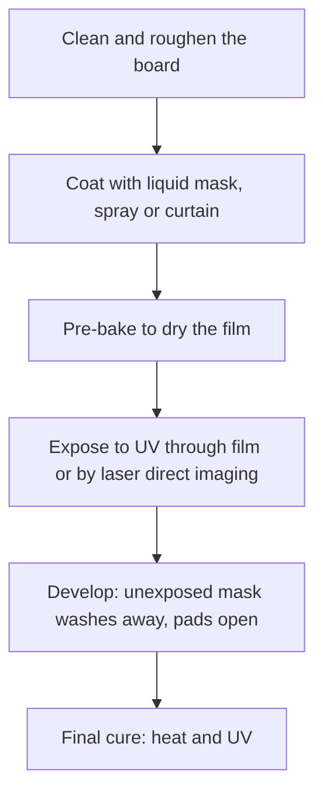

::: basics
### In plain words
Soldermask is the thin polymer coating over a circuit board's copper, with openings only where you want to solder or make contact. Solder sticks to bare copper but not to the mask. So the mask keeps solder on the pads, stops it from bridging between close-spaced pins, and protects the copper from corrosion and accidental shorts.

### Picture it
Imagine a baking tray with a non-stick coating, except for small bare patches. Spread melted butter on it and the butter pools only on the bare patches. The soldermask is the non-stick coating and the pads are the bare patches. The strip of coating between two patches keeps the butter in each patch apart. The analogy is loose on one point: the mask is also a permanent protective skin, not just a tool for assembly.

### Words you need
- **Soldermask opening**: the hole in the coating over a pad. It is a bit larger than the pad.
- **Mask expansion**: how much larger the opening is than the pad on each side, to allow for alignment error (about 0.05 mm is typical).
- **Solder dam**: the strip of mask left between two neighboring pads.
- **LPI mask**: liquid photoimageable mask, put on wet, exposed to UV and developed.
- **Tented via**: a via covered by mask so solder and flux stay out.
- **Pitch**: the center-to-center distance between neighboring pins.

### The simplest example
The solder dam is the pitch minus the pad width minus twice the expansion. For 0.5 mm pitch, 0.25 mm pads and 0.05 mm expansion, the dam is 0.5 - 0.25 - 0.1 = 0.15 mm, comfortable. For 0.4 mm pitch and 0.2 mm pads it is 0.4 - 0.2 - 0.1 = 0.10 mm, right at the usual limit. That is the whole idea. The rest of this page covers how the mask is made, mask-defined versus copper-defined pads, via tenting, and the electrical effects.
:::

::: testing
Whether you know both **what** soldermask is (a thin polymer coating over the copper, with openings at pads) and **why** it is there (prevent solder bridges, protect copper, insulate, define where solder goes), plus the practical layout implications: **mask expansion, solder dams, SMD versus NSMD pads, tented vias**. The interviewer is also listening for the confusion trap: soldermask is not solder paste, not the silkscreen and not the laminate.
:::

::: why
Every assembled board depends on the mask. A good mask definition is what lets a 0.4 mm-pitch QFN be reflowed without bridges; a bad one leads to bridging, tombstoning, or solder wicking down vias. The mask is also the board's first line of defence against corrosion and contamination, and it sets the colour of the board ([[q0471]]). Designers make mask decisions in every footprint (expansion, dams, via tenting), so this is a practical question with real consequences.
:::

::: concepts
- **Soldermask (solder resist)**: a polymer coating covering the copper except where soldering or contact is needed ([[q0466]]).
- **LPI (liquid photoimageable) mask**: the dominant type, applied wet, exposed to UV through a pattern, developed and cured.
- **Mask opening and expansion**: the opening is slightly larger than the pad by an expansion margin to allow for registration error.
- **Solder dam (web)**: the strip of mask between adjacent pads.
- **SMD vs NSMD pads**: mask-defined versus copper-defined pad openings.
- **Via tenting and plugging**: covering or filling vias to keep solder and contamination out.
:::

::: answer
"Soldermask is the thin polymer coating on the outside of a PCB, usually green, that covers the copper everywhere except the pads and other places you want exposed. It's an epoxy-based film about 20 to 30 microns thick, normally applied as a liquid, exposed with UV through the pattern, developed to open the pads, and cured.

It does several jobs. During soldering it acts as a barrier so solder only sticks to the pads, which stops bridges between fine-pitch pins and keeps solder from running along traces. It protects the copper from oxidation, corrosion, moisture and contamination. It insulates the traces from accidental shorts, for example from a dropped screwdriver or a metal enclosure. And it gives a bit of mechanical protection from scratches.

For layout, you define the opening around each pad, a bit larger than the pad to allow for registration error, say 50 microns per side, and you keep a minimum strip of mask, a solder dam, between pads, typically 0.1 millimetres or more depending on the fab. You can have pads defined by the copper, NSMD, which is common for BGAs, or by the mask, SMD. Vias are usually tented, covered with mask, to keep solder out.

It's different from solder paste, which is the solder alloy put onto pads with a stencil, and from the silkscreen, which is the text layer on top."
:::

::: technical
**Material.** Epoxy or acrylate-epoxy polymer with pigment and filler; typical cured thickness about 20 to 30 µm over copper (thinner on trace corners and on bare laminate depends on process), dielectric constant about 3 to 4, high insulation resistance and good adhesion to copper and laminate; resists solder temperatures (reflow 245 to 260 °C), fluxes and cleaning chemicals.

**Types.** LPI (liquid photoimageable, the standard), dry-film mask (for high-reliability or special cases), thermal-cure screen-printed mask (older, cheaper, coarser), and flexible mask or coverlay for flex ([[q0465]]).

**Process.** Clean and roughen the board, coat (curtain or spray), pre-bake, expose through film or with laser direct imaging (LDI), develop (in an aqueous alkaline solution) to open pads, final cure (thermal and UV, about 150 °C).

**Layout parameters (typical, fab-specific).** Mask expansion about 0.05 mm (2 mil) per side; minimum solder dam about 0.1 mm (4 mil) for green LPI; registration tolerance about ±0.05 to 0.075 mm; via tenting for vias up to about 0.3 to 0.4 mm drill.

**Solder dam.** dam = pitch − pad width − 2 × expansion. For 0.5 mm pitch, 0.25 mm pads, 0.05 mm expansion: 0.15 mm. For 0.4 mm pitch, 0.2 mm pads: 0.10 mm, borderline; reduce expansion to 0.025 mm to get 0.15 mm, or open a single window for the whole row.
:::

::: short
"Soldermask is the thin polymer coating over the copper on a PCB, the green layer, with openings at the pads. It's an LPI epoxy about 20 to 30 microns thick. It stops solder bridging between pads and keeps solder on the pads during assembly, protects the copper from oxidation and moisture, and insulates the traces. In layout you set the opening slightly bigger than each pad, keep a minimum mask dam between fine-pitch pads, and usually tent the vias. It's different from solder paste and from the silkscreen."
:::

::: long
"Soldermask, also called solder resist, is the polymer coating on the outside of a PCB that covers the copper everywhere except where you want to solder or make contact. It's what gives most boards their colour. It's an epoxy-based material, about 20 to 30 microns thick, and almost always a liquid photoimageable mask: it's coated on, exposed to UV through the pattern, developed to open the pads, and then cured.

Its functions are four. First, it controls solder: molten solder doesn't wet the mask, so solder stays on the pads, and the mask between pins, the solder dam, stops bridges, which matters a lot at fine pitch. It also stops solder from wicking along traces. Second, protection: it seals the copper against oxidation, corrosion, moisture, fingerprints and dust. Third, insulation: it prevents shorts between bare traces and conductive things like screwdrivers, shields and enclosures. Fourth, it adds mechanical protection against scratches.

For the designer, the mask opening around each pad is made slightly larger than the pad, typically by about 50 microns per side, to allow for registration error. Between pads you need a minimum mask web, around 0.1 millimetres, so the dam is pitch minus pad width minus twice the expansion, and for very fine pitches you reduce the expansion or open a single window. Pads can be copper-defined, NSMD, the usual choice for BGAs, or mask-defined, SMD, for small pads where adhesion matters. Vias are normally tented, covered by mask, to keep solder and flux out.

And it's easy to confuse: soldermask is a permanent coating on the board; solder paste is the solder powder and flux you print through a stencil; silkscreen is the printed legend on top."
:::

::: terms
- **Soldermask / solder resist**: the polymer coating on a PCB that leaves only pads exposed.
- **LPI**: liquid photoimageable soldermask, the standard process.
- **Mask expansion**: how much larger the mask opening is than the pad on each side.
- **Solder dam / mask web**: mask strip between two adjacent pad openings.
- **SMD pad**: solder-mask-defined pad (mask overlaps the copper).
- **NSMD pad**: non-solder-mask-defined pad (copper defines the pad; mask opening is larger).
- **Via tenting**: covering a via with mask so it is closed to solder and contamination.
- **Solder paste**: solder alloy powder in flux, applied by stencil, not the same as mask.
:::

::: exceptional
**An average answer** says "it's the green coating that protects the board".

**An exceptional answer**:
- Names the **four functions** (solder control, corrosion protection, insulation, mechanical protection) and the **material** (LPI epoxy, 20 to 30 µm) and **process**.
- Gives **layout parameters**: expansion, dam width, via tenting, with a **dam calculation**.
- Distinguishes **SMD vs NSMD** pads and says when each is used.
- Knows the **confusions** (mask vs paste vs silkscreen) and **colour implications** ([[q0471]]).
- Mentions **side effects** such as a small impedance reduction on microstrip, and **flex coverlay** as the alternative.
:::

::: mistakes
- **Confusing soldermask with solder paste.** Mask is the board coating; paste is the solder material printed through the stencil for reflow.
- **Zero mask expansion.** Registration error would make the mask encroach on pads, reducing the solderable area.
- **No mask dam on fine pitch.** If the web between pads is below the fab's minimum, the mask lifts or is removed, and bridges occur; gang-open rows.
- **Leaving vias open under parts.** Solder can wick down the hole and starve the joint; tent or plug vias near pads.
- **Treating mask as a high-voltage insulator.** It is a thin protective coating; for high-voltage creepage and clearance, rely on spacing, not on mask.
- **Ignoring mask over high-speed traces.** It adds capacitance and lowers impedance by a few ohms.
:::

::: deep
## What it is, physically

The mask is the outermost, coloured layer of the board over the copper ([[q0466]]). It is a polymer film cured onto the board: epoxy-based, filled and pigmented, thick enough to insulate (20 to 30 µm over copper) and chemically robust enough to survive soldering, flux, cleaning and years of humidity. Where you want to solder (pads, test points, connector fingers) the mask is removed in the pattern step, leaving copper exposed for the finish ([[q0468]]).

## What it does

1. **Controls solder.** Molten solder does not wet the mask surface, so it stays on the pads and cannot bridge across the mask. Between the pads of a fine-pitch IC the mask web is what separates adjacent joints. During wave soldering it keeps solder off traces.
2. **Protects copper.** Exposed copper oxidises, tarnishes and corrodes in humidity, and flux residues can attack it. The mask seals the traces.
3. **Insulates.** It prevents accidental shorts between traces, and between traces and anything conductive that touches the board (tools, shields, enclosure screws). It is not designed to be a safety-rated barrier for hazardous voltages.
4. **Mechanical and handling protection** against scratches and abrasion.
5. **Adds a visual layer**: colour and contrast for inspection ([[q0471]]).

## How it is made (LPI)


Figure: Exposed areas of the mask polymerise and stay; unexposed areas (over the pads) dissolve in the developer. The pattern comes from your mask layers in the Gerber files, so every opening you draw is exactly where copper is exposed.

## Defining the openings

```svg
<svg viewBox="0 0 700 270" xmlns="http://www.w3.org/2000/svg" font-family="Inter, sans-serif" font-size="12.5">
  <text x="170" y="22" text-anchor="middle" fill="var(--d-ink)" font-weight="600">NSMD: mask opening larger than the pad</text>
  <text x="525" y="22" text-anchor="middle" fill="var(--d-ink)" font-weight="600">SMD: mask overlaps the pad edge</text>
  <rect x="20" y="170" width="300" height="40" fill="var(--d-box)" stroke="var(--d-ink)"/>
  <rect x="375" y="170" width="300" height="40" fill="var(--d-box)" stroke="var(--d-ink)"/>
  <text x="170" y="195" text-anchor="middle" fill="var(--d-muted)">laminate</text>
  <text x="525" y="195" text-anchor="middle" fill="var(--d-muted)">laminate</text>
  <g fill="var(--d-orange)" stroke="var(--d-ink)" stroke-width="0.8">
    <rect x="60" y="156" width="70" height="14"/><rect x="210" y="156" width="70" height="14"/>
    <rect x="415" y="156" width="70" height="14"/><rect x="565" y="156" width="70" height="14"/>
  </g>
  <g fill="var(--d-green)" fill-opacity="0.55" stroke="var(--d-ink)" stroke-width="0.8">
    <rect x="20" y="146" width="28" height="24"/><rect x="142" y="146" width="56" height="24"/><rect x="292" y="146" width="28" height="24"/>
    <rect x="375" y="146" width="52" height="24"/><rect x="473" y="146" width="104" height="24"/><rect x="623" y="146" width="52" height="24"/>
  </g>
  <path d="M60 156 Q95 100 130 156 Z" fill="var(--d-blue)" fill-opacity="0.3" stroke="var(--d-blue)" stroke-width="1.2"/>
  <path d="M210 156 Q245 100 280 156 Z" fill="var(--d-blue)" fill-opacity="0.3" stroke="var(--d-blue)" stroke-width="1.2"/>
  <path d="M427 156 Q450 105 473 156 Z" fill="var(--d-blue)" fill-opacity="0.3" stroke="var(--d-blue)" stroke-width="1.2"/>
  <path d="M577 156 Q600 105 623 156 Z" fill="var(--d-blue)" fill-opacity="0.3" stroke="var(--d-blue)" stroke-width="1.2"/>
  <path d="M130 90 L142 140" stroke="var(--d-muted)" fill="none"/>
  <text x="170" y="84" text-anchor="middle" fill="var(--d-ink)" font-size="11.5">mask dam between pads</text>
  <path d="M48 120 L55 150" stroke="var(--d-muted)" fill="none"/>
  <text x="25" y="112" fill="var(--d-ink)" font-size="11.5">mask expansion gap</text>
  <text x="170" y="232" text-anchor="middle" fill="var(--d-muted)" font-size="11.5">copper defines the pad; solder wets the whole top and sides</text>
  <text x="525" y="232" text-anchor="middle" fill="var(--d-muted)" font-size="11.5">mask defines the pad; copper edge is covered</text>
  <text x="170" y="250" text-anchor="middle" fill="var(--d-muted)" font-size="11.5">usual choice for BGA and fine pitch</text>
  <text x="525" y="250" text-anchor="middle" fill="var(--d-muted)" font-size="11.5">used when the pad is tiny or adhesion matters</text>
</svg>
```
Figure: Cross-sections through two pads. Left, NSMD: the mask opening is bigger than the copper, so solder wets the top and the sides of the pad and the copper sets the joint area. Right, SMD: the mask overlaps the pad edge, so the mask defines the joint area, and the copper edge is protected and anchored. The dam is the mask strip between the two openings.

**Mask expansion** is the amount (per side) by which the opening exceeds the pad; a typical value is 0.05 mm (2 mil), chosen to cover the fab's registration tolerance (±0.05 to 0.075 mm). If the opening were exactly pad size, a small mis-registration would put mask over part of the pad.

**NSMD (non-solder-mask-defined)** pads are the standard for most SMT parts and especially BGAs: copper edges are precisely etched (better dimensional control than the mask), and solder wraps the sides of the pad for a stronger joint. Their drawback is the small gap where the pad's copper edge and mask are not in contact, with a risk of the trace leaving the pad being exposed; keep escape traces narrow. **SMD (solder-mask-defined)** pads suit very small pads where copper adhesion is a concern or where a trace leaves the pad and must be covered. They have a stress concentration at the mask edge and slightly less fatigue life in BGA joints, which is why NSMD is preferred for BGAs.

## The solder dam

The mask web between two openings must be wide enough for the mask to adhere and survive development and soldering:

$$\text{dam}=\text{pitch}-\text{pad width}-2\times\text{expansion}$$

```plot
{"title":"Solder dam between fine-pitch pads (expansion 0.05 mm per side)","x":{"label":"Pad width","unit":"mm","min":0.15,"max":0.45},"y":{"label":"Mask dam","unit":"mm","min":0,"max":0.5},
 "vars":{"e":0.05},
 "series":[
  {"label":"0.4 mm pitch","fn":"0.4-x-2*e"},
  {"label":"0.5 mm pitch","fn":"0.5-x-2*e","color":"orange"},
  {"label":"0.65 mm pitch","fn":"0.65-x-2*e","color":"green"}
 ],
 "hlines":[{"at":0.1,"label":"typical minimum dam 0.1 mm (fab-specific)","color":"red"}]}
```
Figure: The dam shrinks one-for-one with pad width. A 0.5 mm pitch part with 0.25 mm pads has a 0.15 mm dam, comfortable; a 0.4 mm pitch part with 0.2 mm pads has exactly 0.10 mm, at the usual limit. Reducing the expansion to 0.025 mm raises it to 0.15 mm. Many fabs will not guarantee a dam below their minimum; instead they remove it, opening one window across the row of pads, which is acceptable if the pad pitch is wide enough that paste volume and stencil design prevent bridging.

> [!UNCERTAIN]
> Minimum dam, expansion and registration values depend on the fabricator, mask colour and copper thickness (a thicker copper makes thin mask webs harder to hold). Use your fab's capability table, and apply the formula above to check.

## Vias and the mask

- **Tented vias**: the mask covers the via opening (no mask-opening in the layer), closing it against solder and flux ingress. This is fine for small vias (about 0.3 mm or less), but flux can be trapped inside.
- **Plugged or filled vias**: the hole is filled with mask or resin to make a closed, flat surface; needed for via-in-pad under BGAs and for vacuum fixtures.
- **Open vias**: mask openings around the via (also used for test points).

Vias within the pads of a leaded or paste-reflowed part wick solder away, which creates voids and weak joints, so they are kept out of pads or filled and capped.

## Electrical and thermal effects

- **Insulation**: surface insulation resistance is high (the mask is part of the board's moisture protection), though not rated for hazardous-voltage barriers: rely on creepage and clearance.
- **Dielectric over traces**: a 25 µm mask with $\varepsilon_r\approx3.5$ over a microstrip adds capacitance and reduces the impedance of the trace by a few ohms (about 1 to 3 Ω for typical geometries; fabricators include it in controlled-impedance calculations).
- **Thermal**: thin and a poor conductor, so mask over a thermal pad increases resistance. Large copper areas used for heat spreading are therefore left with mask openings only when needed (for heat sink contact).
- **RF**: mask has loss, so some RF boards leave mask off the RF traces (or use low-loss mask) to reduce attenuation at high GHz.

## Other things to know

- **Colour and pigment**: colours differ in UV cure behaviour and contrast ([[q0471]]).
- **Flex**: flexible boards use polyimide coverlay or flexible mask ([[q0465]]).
- **Mask is not the legend**: silkscreen goes on top of the mask ([[q0472]]).
- **Peel and crack failures**: contamination before coating or over-cure causes adhesion loss, with delamination during reflow ("mask peeling").
- **Conformal coating** is a separate, post-assembly protective layer over the whole assembly, not the soldermask.

## Soldermask, solder paste, and the paste layer

Three often-confused things:

| Item | What it is | When it is applied |
|---|---|---|
| Soldermask | Permanent polymer coating on the board | During board fabrication |
| Solder paste | Solder powder in flux, printed on pads through a stencil | During assembly, before parts are placed |
| Paste layer (CAD) | The stencil aperture pattern | Data for the stencil maker; not part of the bare board |

The mask opening defines where the copper is exposed; the paste apertures define where solder is deposited, often slightly smaller than the pad.
:::

::: applications
- **Fine-pitch SMT assembly**: mask dams prevent bridges on QFP, QFN and BGA parts.
- **Wave soldering of through-hole parts**: mask keeps solder off the traces.
- **Harsh or humid environments**: mask as the first moisture and corrosion barrier, often with conformal coating.
- **High-density mobile boards**: LDI-imaged masks with tiny openings and tight registration.
- **LED and optical boards**: white or black mask chosen for reflectivity or glare ([[q0471]]).
- **Via-in-pad BGAs**: filled and capped vias with the mask defining pad openings.
:::

::: assumptions
I describe the LPI soldermask used on rigid boards. Thickness, expansion, dam widths and tolerances are typical values that vary by fabricator, mask colour and copper weight; the formulas are exact, the limits are not. Flex boards, ceramic boards and boards with selective finishes use different coatings. Some high-speed or RF designs remove or customise the mask locally, and some safety standards treat mask as part of reinforced insulation only if qualified for it (rare), so the general rule is that mask is protective, not a safety barrier.
:::

::: followups
### What is the difference between SMD and NSMD pads, and which would you choose for a BGA?
NSMD (copper-defined) pads have a mask opening larger than the pad, so the copper edge defines the pad area and solder wraps the sides, giving more controlled geometry and stronger joints. SMD (mask-defined) pads have mask overlapping the copper. For BGAs, NSMD is generally preferred because it is better controlled and gives better fatigue life; for very small pads where copper adhesion or trace exit is the concern, SMD is used.

### What mask dam would you expect on a 0.4 mm pitch QFN with 0.2 mm pads?
With 0.05 mm expansion per side: $0.4-0.2-0.1=0.1$ mm, at the minimum for most fabs. Reduce expansion to 0.025 mm for 0.15 mm, or accept gang-opened pad rows, but verify with the fab, as the minimum depends on mask type and colour.

### Why are vias under or near pads tented or filled?
Open vias wick solder out of the joint during reflow, causing starved joints and voids, and can leak flux. Tenting closes the via from the side, filling makes a flat surface suitable for via-in-pad, and keeping vias away from pads avoids the issue. For BGAs, via-in-pad should be filled and capped.

### What if the mask is peeling after reflow?
Likely poor adhesion: contamination or oxide before coating, incomplete cure, or mismatch between mask and surface finish chemistry. Check the fab's process: cleaning and roughening, cure profile, compatibility with ENIG or HASL, and moisture (bake the board before reflow). Mask peel can also follow excessive rework temperatures.

### Scenario: your 0.5 mm pitch QFP bridges frequently after reflow although the stencil is correct. What do you check in the mask?
Check the mask web between the pads: if the fab removed the dam (below its minimum), the solder can flow between pads. Check your expansion and pad widths (dam = pitch − pad − 2 × expansion), the actual mask registration on the boards (a shifted mask eats into pads on one side and widens the gap on the other), and whether the mask has been thinned or has lifted at the dam. Fix by narrowing expansion, pad width, or using a tighter-registration process (LDI).
:::

::: interpretations
"What is soldermask?" asks for the definition, so I also answered what it does and how it is defined in layout, since interviewers often follow with expansion and dam questions. The coloured layer is discussed in [[q0471]], the legend printed on top in [[q0472]], and the overall layer structure in [[q0466]].
:::

::: references
- IPC-SM-840, *Qualification and Performance Specification of Permanent Solder Mask and Flexible Dielectric Coatings*.
- IPC-7351 (land pattern standard) and IPC-7095 (BGA design and assembly process implementation) for SMD versus NSMD guidance.
- Fabricator capability sheets: minimum solder dam, registration tolerance and via tenting limits.
- Clyde Coombs (ed.), *Printed Circuits Handbook*: soldermask materials and processes.
:::

::: rubric
- Defines soldermask as the polymer coating with pad openings :: The core definition.
- Lists its functions: solder control, protection, insulation, mechanical :: The question asks what it is for.
- Mentions material and thickness (LPI epoxy, 20 to 30 µm) :: Shows concrete knowledge.
- Explains mask expansion, solder dam and the dam calculation :: Layout-level understanding.
- Distinguishes SMD versus NSMD pads :: A common follow-up for BGAs.
- Mentions via tenting or plugging :: Shows assembly awareness.
- Distinguishes mask from solder paste and silkscreen :: Avoids a common confusion.
:::

::: quiz
```json
[
 {"type":"mcq","level":"fundamental","q":"What is the main purpose of soldermask during assembly?","options":["Keep solder only on the pads and prevent bridges","Conduct current between layers","Provide the board's stiffness","Print reference designators"],"answer":0,"explain":"Molten solder does not wet the mask, so it stays on the exposed pads; the mask web between pins prevents bridges."},
 {"type":"mcq","level":"fundamental","q":"Which is the correct description of solder paste?","options":["The permanent coating on a finished board","Solder alloy powder in flux printed on pads through a stencil","The text layer on a PCB","A type of laminate"],"answer":1,"explain":"Solder paste is applied during assembly; soldermask is the permanent board coating and silkscreen is the legend."},
 {"type":"numeric","level":"intermediate","q":"A 0.5 mm pitch part has 0.25 mm wide pads and the mask expansion is 0.05 mm per side. What is the mask dam width in mm?","answer":0.15,"tolerance":0.02,"unit":"mm","explain":"dam $=0.5-0.25-2\\times0.05=0.15$ mm."},
 {"type":"numeric","level":"intermediate","q":"A 0.4 mm pitch part has 0.2 mm pads. With 0.025 mm expansion per side, what is the dam in mm?","answer":0.15,"tolerance":0.02,"unit":"mm","explain":"dam $=0.4-0.2-2\\times0.025=0.15$ mm; with 0.05 mm expansion it would be 0.10 mm."},
 {"type":"mcq","level":"advanced","q":"Why are NSMD pads usually preferred for BGAs?","options":["Copper defines the pad precisely and solder wraps the pad edge, improving joint control and fatigue life","They need no mask","They are always larger","They reduce board colour options"],"answer":0,"explain":"Etched copper edges are more precisely controlled than mask openings, and the solder wets the side of the pad, giving a better, more reliable joint than mask-defined pads."},
 {"type":"truefalse","level":"advanced","q":"Soldermask over a microstrip trace has no effect on its characteristic impedance.","answer":false,"explain":"The mask is a dielectric layer over the trace, adding capacitance and lowering $Z_0$ by a few ohms for typical geometries."}
]
```
:::
