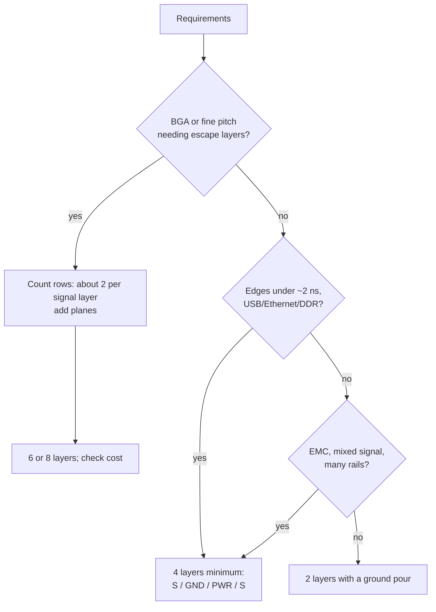

::: testing
Whether you can turn a pile of requirements into a **layer-count decision with reasons**, not just say "four is standard." The interviewer wants to hear the drivers (routing density, signal speed, power delivery, EMI, board size, cost) and a method: estimate, try, and add layers only when a specific need justifies the money. They also want to hear that more layers is not automatically better: each pair of layers costs, and sometimes a smaller 4-layer board beats a bigger 2-layer board.
:::

::: why
Layer count is one of the first decisions in a layout and one of the hardest to change later. Pick too few and you can't route or pass EMC; pick too many and you waste budget on a product that ships in thousands. Hardware engineers get asked "why is it a 6-layer board?" in design reviews all the time, and the right answer is a concrete reason, not a habit. Interviewers use it to see whether you think in terms of constraints and trade-offs, which is the heart of design work.
:::

::: concepts
- **Routability**: whether the nets physically fit. Fine-pitch BGAs and high pin counts drive layers. See [[q0481]].
- **Reference planes**: fast signals need a continuous plane next to them for a short return path. See [[q0478]] and [[q0486]].
- **Rise time vs. trace length**: when a trace behaves as a transmission line instead of a wire. See [[q0479]].
- **Power distribution**: planes for low-impedance rails versus wide traces. See [[q0480]].
- **EMI/emissions**: more planes shrink loop areas and shield inner layers. See [[q0489]] and [[q0490]].
- **Cost and manufacturability**: layers, via types, board area and quantity all feed the price.
:::

::: answer
"I'd start from what the board has to do and work upward from two layers, adding only when I can name the reason.

First is routing density. Look at the densest part: a fine pitch BGA, a QFN with lots of pins, or a big connector. If I can't escape the signals on top and bottom, I need more signal layers. Second is signal speed. Anything with edges faster than a nanosecond or two, like USB, Ethernet, SDRAM or a fast SPI, wants a solid ground plane right below it so the return current path is short. That alone pushes me to four layers: signal, ground, power, signal. Third is power: a few rails and some high current points are much easier with a power plane or at least a second copper layer. And fourth is EMI: a ground plane cuts loop area and the radiation that comes with it.

Cost comes in last, but it's real. Four layers cost noticeably more than two, six more than four, and HDI is another jump. Sometimes a four-layer board is actually cheaper overall because it is much smaller or needs fewer respins. I'd sketch the stackup early, route the hardest block first, and bump the layer count only when something genuinely won't route or won't pass."
:::

::: technical
**Decision drivers, roughly in order:**

1. **Escape routing of the densest device.** With via-in-pad off, dog-bone escape and one trace between adjacent vias, a full BGA array escapes about **two rows of balls per signal layer**. A 16 × 16, 0.8 mm-pitch array with a 6 × 6 power/ground core has 5 signal rows from the edge to the centre, so it needs $\lceil 5/2\rceil = 3$ signal layers. Add the planes and you are at 6 layers. If the pitch allows two traces between vias, or via-in-pad/microvias are used, the count drops.

2. **Signal integrity.** A trace is a transmission line when its delay exceeds roughly one sixth of the rise time $t_r$. At about 6 ps/mm, the critical length is $\ell_c \approx t_r/(6\times 6\text{ ps/mm})$: ~28 mm for 1 ns, ~10 mm for 350 ps. The spectral knee is $f_{knee} \approx 0.35/t_r$ (350 MHz at 1 ns). If any signal needs impedance control or a short return path, you need an adjacent plane, hence at least 4 layers.

3. **Power integrity.** Plane pairs with 0.1–0.2 mm dielectric give about 0.12–0.25 nF/in² and nH-fraction inductance. For rails drawing amps or a core with fast di/dt, planes beat traces.

4. **EMI.** Return-current loop area is the main radiation lever; a plane under every signal minimizes it.

5. **Cost.** Price rises with layer count, board area, via technology and tolerance class. As a ballpark many fabs charge roughly 1.5–3× for a 4-layer compared with an equal-size 2-layer in prototype quantities, more again for 6+ layers or HDI.

> [!UNCERTAIN]
> The cost ratios depend heavily on fab, volume and lead time. Treat them as an order-of-magnitude intuition and ask for quotes at your real quantity.

**Rule-of-thumb mapping:** 2 layers for slow, low-pin-count, cost-driven boards; 4 layers for most MCU boards with USB/Ethernet or any fast edge; 6 layers for BGA processors, DDR and several rails; 8+ for large FPGAs/SoCs, multiple DDR channels and high-speed SerDes.
:::

::: short
"I'd choose the fewest layers that satisfy routing, signal integrity and EMI, and I'd name the reason for each layer. Dense BGAs drive signal layers, about two rows of balls per layer. Fast edges or controlled impedance need an adjacent ground plane, so I'd go to four layers: signal, ground, power, signal. Multiple rails, DDR or SerDes push me to six or eight. Cost goes up with each pair, so I only add layers when something won't route or won't pass EMC."
:::

::: long
"I treat it as a constraint problem. Start with the requirements: how many nets, which parts, how fast the edges are, how much current, how big the board can be, and what the cost target is.

The first filter is the densest component. If there's a fine-pitch BGA, I count rows of balls from the edge to the centre. With normal dog-bone escape and one trace between vias, I get about two rows per signal layer, so a big BGA decides the number of signal layers. If it's only QFPs and 0.5 mm QFNs, two or four layers is usually enough.

The second filter is signal speed. If a signal has an edge faster than a nanosecond or so, or is a differential pair like USB, I want a continuous reference plane directly under it, with a thin dielectric between them. That's the point where two layers stop working well, because the return current has no clean path and the loop radiates. So the usual starting point is four layers: top signal, ground, power, bottom signal.

Third, power. If I've got several rails or a processor that draws fast current steps, a power plane or at least a dedicated pair of planes gives me low impedance and built-in high-frequency decoupling. Fourth is EMI: planes reduce loop area and shield the inner layers.

Then I weigh cost. Two to four layers is a real price step, four to six another, and HDI with microvias is a bigger one. But a four-layer board that's half the area of a two-layer one, or that passes EMC the first time, can be cheaper overall. So I'd sketch a stackup, route the hardest block first, and add layers only when I can say exactly what it buys me."
:::

::: terms
- **Signal layer**: copper layer used mainly for routing traces.
- **Plane layer**: mostly solid copper for ground or power, serving as return path and distribution.
- **Escape routing / breakout**: routing signals out from under a dense package such as a BGA.
- **Dog-bone**: short stub connecting a BGA pad to a via placed beside it.
- **Via-in-pad / microvia / HDI**: techniques that place vias in pads or use small laser-drilled vias to increase density at higher cost.
- **Critical length**: the trace length beyond which transmission-line effects matter for a given rise time.
- **Knee frequency**: $\approx 0.35/t_r$, the frequency below which most of the edge's energy lies.
- **Return path**: the path current takes back to the source, closest underneath the trace at high frequency.
:::

::: exceptional
An average answer says "2 layers for simple, 4 for complex, more for high speed." An exceptional answer:

- Gives a **method**: densest part first, then fastest signals, then power, then EMI, then cost.
- Quantifies something: two BGA rows per layer; 0.35/$t_r$; critical length ≈ $t_r/(6 t_{pd})$.
- Knows that the real minimum for good signal integrity is "every fast signal has an adjacent plane," not "N layers."
- Mentions cost and that smaller board area with more layers may be cheaper overall.
- Mentions practical checks: do a quick floorplan and test-route, ask the fab, review similar reference designs or the processor vendor's layout guide, and allow spare layers for respins.
:::

::: mistakes
- **"More layers always means better."** Extra layers add cost, drill/via complexity and thickness constraints. Choose by need.
- **Choosing layers by pin count alone.** A 100-pin 0.5 mm QFP may route fine on two layers. A 100-ball BGA with 0.5 mm pitch may need six.
- **Counting only signal layers.** You need planes, and an even total (cores are pairs of copper).
- **Believing 4 layers automatically guarantees EMC.** A four-layer board with a split ground plane or a signal routed across a gap still radiates.
- **Ignoring return paths when "saving" a layer.** Routing a clock on an inner layer with no plane next to it is worse than outer-layer routing with a plane.
- **Ignoring fab capability.** Trace/space, via size and aspect ratio limits at a cheap fab may force more layers than a more capable one.
:::

::: deep
## Start with the constraints, not the layer count

Think of the layer count as an *output*. The inputs are:

| Input | Question to ask |
|---|---|
| Parts | Package pitch, pin count, any BGA or fine-pitch QFN? |
| Speed | Fastest edge rate (not clock!) and any controlled-impedance interfaces? |
| Power | How many rails, how much current, any fast load steps? |
| Environment | EMC limits, ESD exposure, mixed analog/digital? |
| Mechanics | Board area, thickness, connector placement |
| Business | Cost target, volume, schedule, number of expected respins |

## Escape routing: a calculation

Consider a BGA with ball pitch $p$ and via/pad diameter $d_v$. The channel between two vias has width $p - d_v$, and $n$ traces of width $w$ and spacing $s$ need $nw + (n+1)s$. Using 0.8 mm pitch, a 0.45 mm via pad and 0.1 mm/0.1 mm trace and space:

$$p - d_v = 0.35\ \text{mm},\qquad 1\text{ trace: } 0.1 + 2(0.1) = 0.30\ \text{mm}\ \checkmark,\qquad 2\text{ traces: } 2(0.1)+3(0.1) = 0.5\ \text{mm}\ \times$$

So one trace per channel. With one trace per channel, each ring of balls inward needs its own extra layer; as a first-order estimate, **two rows per layer** (outer row escapes directly outward on the top layer, the second row through the channels between the first-row vias).

For a 16 × 16 array: rows from edge to centre $=16/2 = 8$. If the centre 6 × 6 are power/ground, there are $8-3 = 5$ signal rows. Signal layers $\approx \lceil 5/2 \rceil = 3$. With two plane layers plus 3 signal layers you are at 5, rounded to **6** because layers come in pairs. Using 0.5 mm pitch the channel is only 0.25 mm wide, and you need via-in-pad, microvias or HDI.

```svg
<svg viewBox="0 0 600 300" xmlns="http://www.w3.org/2000/svg" font-family="Inter, sans-serif" font-size="13">
  <line x1="40" y1="22" x2="360" y2="22" stroke="var(--d-muted)" stroke-dasharray="5 4"/><text x="40" y="14" fill="var(--d-muted)" font-size="12">package edge (routing leaves this way)</text>
  <g stroke="var(--d-accent)" stroke-width="3" fill="none"><line x1="80" y1="60" x2="80" y2="22"/><line x1="140" y1="60" x2="140" y2="22"/><line x1="200" y1="60" x2="200" y2="22"/><line x1="260" y1="60" x2="260" y2="22"/><line x1="320" y1="60" x2="320" y2="22"/><polyline points="80,120 110,90 110,22"/><polyline points="140,120 170,90 170,22"/><polyline points="200,120 230,90 230,22"/><polyline points="260,120 290,90 290,22"/></g>
  <g fill="var(--d-box)" stroke="var(--d-ink)" stroke-width="1"><circle cx="80" cy="60" r="13"/><circle cx="140" cy="60" r="13"/><circle cx="200" cy="60" r="13"/><circle cx="260" cy="60" r="13"/><circle cx="320" cy="60" r="13"/><circle cx="80" cy="120" r="13"/><circle cx="140" cy="120" r="13"/><circle cx="200" cy="120" r="13"/><circle cx="260" cy="120" r="13"/><circle cx="320" cy="120" r="13"/><circle cx="80" cy="180" r="13"/><circle cx="140" cy="180" r="13"/><circle cx="200" cy="180" r="13"/><circle cx="260" cy="180" r="13"/><circle cx="320" cy="180" r="13"/><circle cx="80" cy="240" r="13"/><circle cx="140" cy="240" r="13"/><circle cx="200" cy="240" r="13"/><circle cx="260" cy="240" r="13"/><circle cx="320" cy="240" r="13"/></g>
  <g fill="var(--d-red)"><circle cx="110" cy="150" r="5"/><circle cx="170" cy="150" r="5"/><circle cx="230" cy="150" r="5"/><circle cx="290" cy="150" r="5"/></g>
  <g stroke="var(--d-red)" stroke-width="2" stroke-dasharray="4 3" fill="none"><polyline points="80,180 110,150"/><polyline points="140,180 170,150"/><polyline points="200,180 230,150"/><polyline points="260,180 290,150"/></g>
  <text x="370" y="64" fill="var(--d-accent)">Row 1: leaves straight out</text>
  <text x="370" y="124" fill="var(--d-accent)">Row 2: through a channel</text>
  <text x="370" y="144" fill="var(--d-accent)">(1 trace per channel, now full)</text>
  <text x="370" y="184" fill="var(--d-red)">Row 3+: no room left, so a via</text>
  <text x="370" y="204" fill="var(--d-red)">drops it to an inner layer</text>
  <text x="40" y="285" fill="var(--d-muted)" font-size="12">Channel between pads = pitch − pad = 0.35 mm, which fits one 0.1 mm trace with 0.1 mm spacing</text>
</svg>
```
Figure: Top view of BGA pads (circles). The outer rows can leave on the top layer, but the channels between pads hold only one trace, so deeper rows must drop through vias onto inner signal layers. That is where layer count comes from.

## Speed: when does a trace need a plane?

A trace is electrically long when the round-trip delay is comparable to the rise time. A common rule of thumb says treat it as a transmission line if the one-way delay exceeds $t_r/6$ (some use $t_r/4$ or $t_r/10$). With about 6 ps/mm in microstrip on FR-4:

$$\ell_c = \frac{t_r}{6\cdot 6\ \text{ps/mm}}$$

```plot
{"title":"Critical length vs signal rise time (6 ps/mm, t_r/6 rule)","x":{"label":"Rise time","unit":"s","min":1e-10,"max":1e-8,"log":true},"y":{"label":"Critical length","unit":"mm","min":1,"max":400,"log":true},
 "vars":{"td":6e-12},
 "series":[{"label":"ℓ_c = t_r / (6·t_pd)","fn":"x/(6*td)"}],
 "points":[{"x":1e-9,"y":27.8,"label":"1 ns → 28 mm"},{"x":3.5e-10,"y":9.7,"label":"350 ps → 9.7 mm"}]}
```
Figure: Faster edges shorten the length at which a trace must be treated as a transmission line. At 1 ns, anything longer than about 28 mm needs a defined impedance and a clean return; at 350 ps, about 10 mm. Note that rise time, not clock frequency, is what counts.

Even slow clocks often have fast edges. A 1 MHz SPI clock driven by a modern MCU pin may switch in 1–2 ns, and the harmonics reach hundreds of MHz.

## Power and EMI

A power/ground plane pair 0.1 mm apart gives roughly 0.25 nF per square inch, and the plane inductance per square is $\mu_0 h \approx 0.13$ nH/□ at $h=0.1$ mm. A power trace of 10 cm would be about 100 nH. At 100 MHz that's 63 Ω vs. about 0.08 Ω for one square of plane. See [[q0488]]. For EMI, planes put the return current directly under each trace, which shrinks the loop area $A$ that radiates as $E \propto f^2 A I$.

## Putting it together: a worked decision

**Board:** STM32-class MCU in a 100-pin LQFP, USB full-speed, a 3.3 V buck, SPI flash, 30 mm × 40 mm.
- Densest part: 0.5 mm LQFP, escapes on top. No BGA.
- Speed: USB FS edges are 4–20 ns, flash SPI maybe 1–3 ns. Transmission line effects marginal, but EMC matters.
- Power: one buck, one 3.3 V rail, low current.
- Verdict: 2 layers can work if one layer is a mostly solid ground pour, but a 4-layer (signal / GND / 3V3 / signal) gives much simpler routing and cleaner EMC. If cost is tight, route on 2 layers with careful ground.

**Board:** i.MX or Zynq-class SoC in 0.8 mm BGA with DDR3.
- Densest part: 400-ball BGA, deep rows.
- Speed: DDR clocks at hundreds of MHz with sub-nanosecond edges and strict length matching.
- Verdict: 6-layer minimum (more likely 8), typically signal–GND–signal–power–GND–signal or similar, per the SoC vendor's reference stackup. See [[q0476]].


Figure: A quick decision flow. Always follow it with a test-route of the hardest section before committing.

> [!INTERVIEW]
> If you are asked this about a specific product, ask clarifying questions first: highest-speed signal, densest part, volume, EMC requirement. Then give your starting layer count and say what would make you change it.

## Worked example: what the second plane buys you in loop area

The qualitative claim "a plane shrinks the loop" is worth putting numbers on, because it is the real reason a 4-layer board beats a 2-layer one for fast signals. Take a 30 mm signal run with a 0.2 mm-wide trace and compare two ways of providing its return:

- **2-layer board, return trace 10 mm away** (a typical result when the ground return is routed wherever it fits). Two parallel round conductors or thin strips separated by $d$ with width $w$ have loop inductance per length of roughly $L' \approx \frac{\mu_0}{\pi}\ln\frac{d}{w}$:

$$L' \approx 4\times10^{-7}\,\ln\frac{10}{0.2} = 1.56\ \mu\text{H/m} = 1.56\ \text{nH/mm}$$

- **4-layer board, solid plane 0.2 mm below the trace.** For a 50 Ω microstrip on FR-4 with $\varepsilon_{eff}\approx 3.3$, $L' = Z_0\sqrt{\varepsilon_{eff}}/c = 50\times1.817/(3\times10^{8}) = 0.30\ \mu\text{H/m} = 0.30$ nH/mm.

The inductance falls about 5×, but the radiating **loop area** per unit length falls much more: $10\ \text{mm}$ of separation versus $0.2$ mm of dielectric is a factor of 50, or $20\log_{10}(50)=34$ dB less far-field emission from differential-mode radiation, all else equal (emission is proportional to loop area). That single number is why "fast signal means adjacent plane" wins over "route everything carefully on two layers."

The same loops also make noise. If a 30 mm run switches a 100 mA current step in 1 ns, the loop-inductance drop is $v = L\,di/dt$:

$$v_{2L} = (1.56\ \text{nH/mm})(30\ \text{mm})\frac{0.1}{1\ \text{ns}} = 47\ \text{nH}\times 0.1\ \text{A/ns} = 4.7\ \text{V},\qquad v_{4L} = 9\ \text{nH}\times0.1\ \text{A/ns} = 0.9\ \text{V}$$

Both numbers are upper bounds because the driver's own source impedance limits the current step, but the ratio is the point: the plane does not make the problem vanish, it cuts it by 5× in inductance and by far more in radiated area.

## When fewer layers is the better engineering answer

The "add layers when something fails" rule has a mirror image: do not keep a stackup you cannot justify. Signs that a design is over-layered are an inner signal layer with only a handful of traces, a power plane that is really a single wide rail, and a thick stackup chosen out of habit when thinner 4-layer would do. Trimming from 6 to 4 layers is realistic when the densest part is a 0.5 mm QFN, no DDR is present, and the fastest edge is a 20 MHz SPI with 2 ns rise (critical length about 55 mm by the $t_r/6$ rule, longer than the board). In that case a 4-layer board with a solid ground under both outer layers is both cheaper and quieter than 6.

Conversely, escaping a BGA is the one place where the layer count is a hard geometric fact rather than a judgment call. If the channel computation shows one trace per channel and you have 5 signal rows, three signal layers are non-negotiable unless you change the technology (via-in-pad, microvias, a coarser-pitch package).

## Real-hardware considerations

- **Fab capability is the hidden input.** The 0.1 mm trace/space and 0.45 mm via-pad numbers above are a standard-class process; a fab offering 0.075 mm/0.075 mm and a smaller pad can turn a 6-layer board into a 4-layer one at a higher per-layer price. Get the fab's capability sheet before committing.
- **Stackup thickness and via aspect ratio.** A 1.6 mm board with 0.2 mm drilled vias has an 8:1 aspect ratio, which many fabs consider the practical limit for plating reliability. More layers in the same 1.6 mm means thinner dielectrics (good for plane capacitance, bad for trace width at a given impedance) or a thicker board.
- **Cost is not linear.** Price steps at 2→4, 4→6 and anywhere a technology feature kicks in: blind or buried vias, via-in-pad with fill and cap, controlled-impedance testing, tight tolerances. Add layers before you add exotic via types when possible.

## Bench verification

You can check a layer-count decision after the fact. A near-field probe over the board while a clock is running shows whether radiation is concentrated at a spot where a return path is broken (a plane split, a via transition without a stitching via). A TDR or a VNA-based measurement on a coupon built into the panel confirms the controlled-impedance target: a 50 Ω single-ended trace should measure within the fab's stated tolerance, commonly specified around ±10 %. If a prototype fails a pre-compliance scan, compare the failing frequency to the board's resonances before blaming layer count; a cable or a heatsink is often the actual antenna.
:::

::: applications
- **Arduino-class or sensor boards**: 2 layers, with a ground pour on the bottom, because edges are slow and pin counts small.
- **Raspberry Pi-class single-board computers**: 4 or 6 layers because of BGA SoC and DDR.
- **Laptop motherboards and phones**: 8–12+ layers with HDI/microvias for the density.
- **Motor controller with 30 A phases**: 2 or 4 layers with 2 oz copper; the layer count is driven by current, not signals.
- **Industrial PLC I/O**: 4 layers for surge/ESD robustness and clear return paths.
:::

::: assumptions
- Standard rigid FR-4 boards from a commercial fab, not flex or ceramic.
- Layer counts are usually even because laminates are built from copper-clad cores; odd counts exist but warp and cost more.
- Heuristics (two rows per layer, $t_r/6$, 6 ps/mm) are first-order. Real decisions use test-routing, a fab quote, and the SoC vendor's design guide.
- The answer changes for high-power boards (copper weight and thermal dominate), RF boards (stackup chosen for the laminate and the RF layer), and low-volume prototypes (where respins and time outweigh unit cost).
- With via-in-pad or HDI, the layer count for a BGA drops, at higher per-layer cost.
:::

::: followups
### Why do boards come in even layer counts?
Cores have copper on both sides, so stacking cores and prepreg naturally gives an even number. A 5-layer board is possible, but the stack is asymmetric, which makes warp worse, and fabs usually price it close to a 6-layer anyway. So I'd round up to 6 and use the extra layer as a second ground plane.

### When can I get away with two layers?
Slow signals (edges over ~5 ns), few nets, no BGA, one or two rails, and a ground pour on one side, kept unbroken under critical traces. Typical examples: small MCU boards, LED drivers, simple sensor boards. I'd still run EMC pre-compliance if it is a product.

### Is a 4-layer board always cheaper than a bigger 2-layer board?
No. At small sizes and large quantities, 2-layer is cheaper. A 4-layer wins if it shrinks the board a lot, removes expensive jumpers/shielding, or avoids EMC redesign. I'd compare the total cost including board area, assembly and respin risk.

### What if the DDR layout guide shows 6 layers but we only have budget for 4?
First check the guide, since vendors often provide a "reduced-cost" stackup, for example for lower-speed DDR or fewer chips. Otherwise reduce the requirement (single chip, lower speed, a smaller BGA package) or use via-in-pad/HDI. Compromising SI on DDR by squeezing it onto 4 layers without simulation is how projects slip, so I'd show the trade-off with numbers.

### Scenario: your 2-layer prototype fails radiated emissions at 150 MHz. Do you just add layers?
Not blindly. I'd first find the source: near-field probing usually points to a clock or switching loop. Then fix the return path (solid ground under it, shorter loops, series damping resistor on the edge). If a ground plane can't be added on two layers without losing routing, the next revision goes to four layers with ground right under the top signal layer. The reason is the cause, not the checkbox.
:::

::: interpretations
"How to choose how many layers" can mean the **first-pass estimate** at the start of a project (this page) or **trimming layers** on a mature design to cut cost. The method is the same: find which constraint is binding. The sibling [[q0476]] is about *which* stackup (the arrangement of those layers) once the count is chosen, and [[q0481]] covers which components drive the count up.
:::

::: references
- Bogatin, *Signal and Power Integrity: Simplified*: rise time, knee frequency and when interconnects need to be treated as transmission lines.
- Johnson & Graham, *High-Speed Digital Design: A Handbook of Black Magic*: the case for ground planes and signal-layer assignment.
- Ott, *Electromagnetic Compatibility Engineering*: PCB layer arrangement and ground planes for EMC.
- IPC-2221 and IPC-2226 (HDI) for general design and HDI design guidance.
:::

::: rubric
- Names routing density, signal speed, power delivery, EMI and cost as drivers :: These are the five real inputs to the decision, and a complete list shows a design mindset.
- Starts low and adds layers only for a stated reason :: Shows cost awareness and avoids cargo-cult stackups.
- Uses the densest part (BGA/fine pitch) as the first filter and quantifies escape routing :: A concrete method beats a slogan.
- Ties fast edges to the need for an adjacent reference plane (4 layers minimum) :: Return path and impedance control are the usual real reason for four layers.
- Mentions rise time (not clock rate) and critical length or knee frequency :: Demonstrates correct signal integrity reasoning.
- Mentions cost trade-offs and fab capability :: Real projects are constrained by budget and manufacturing.
- Suggests verifying with a floorplan or test route and vendor reference stackups :: This is how engineers avoid committing to the wrong count.
:::

::: quiz
```json
[
 {"type":"mcq","level":"fundamental","q":"Which is the most common minimum layer count when a design includes a fast USB or Ethernet interface and has to pass EMC testing?","options":["1 layer","2 layers with no ground pour","4 layers (signal / ground / power / signal)","16 layers"],"answer":2,"explain":"A continuous ground plane next to the top signal layer gives short return paths and controlled impedance. Four layers is the usual minimum; 1 or 2 layers rarely provide that."},
 {"type":"numeric","level":"intermediate","q":"A trace in microstrip has 6 ps/mm delay and the signal has a 1.5 ns rise time. Using the $t_r/6$ rule, what is the critical length in mm?","answer":41.7,"tolerance":0.03,"unit":"mm","explain":"$\\ell_c = t_r/(6\\,t_{pd}) = 1500\\text{ ps}/(6\\times6\\text{ ps/mm}) = 41.7$ mm. Traces longer than that should be treated as transmission lines."},
 {"type":"numeric","level":"intermediate","q":"A BGA has 12 rows from the edge to the centre of the array, and the 4 innermost rows are power/ground that don't need escape routing. With two rows per signal layer, how many signal layers are needed?","answer":4,"tolerance":0.01,"unit":"layers","explain":"Signal rows = 12 − 4 = 8. Two rows per layer gives 8/2 = 4 signal layers (before adding plane layers)."},
 {"type":"truefalse","level":"intermediate","q":"Adding layers always reduces the cost of a PCB because routing is easier.","answer":false,"explain":"Fabrication cost rises with layer count. More layers can lower total cost only when they shrink the board substantially or prevent respins or EMC failures."},
 {"type":"mcq","level":"advanced","q":"A 0.8 mm-pitch BGA uses 0.45 mm via pads, and your fab's minimum trace/space is 0.1 mm / 0.1 mm. How many traces fit between adjacent vias?","options":["0","1","2","3"],"answer":1,"explain":"The channel is 0.8 − 0.45 = 0.35 mm. One trace needs 0.1 + 2×0.1 = 0.3 mm (fits), two traces need 2×0.1 + 3×0.1 = 0.5 mm (do not). So one trace per channel, which is why you need more layers as BGA rows increase."}
]
```
:::
