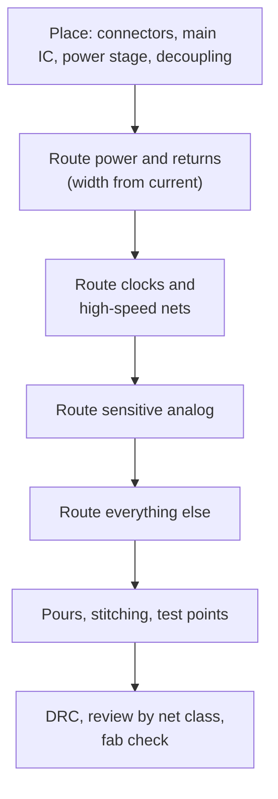

::: testing
Whether you have a **working mental checklist** for layout, and whether you know *why* each rule exists. The interviewer is listening for ordering (place first, route critical nets first), return paths, loop area, trace width for current, spacing for crosstalk and voltage, decoupling, plane continuity and manufacturability. Reciting a list of rules without reasons is a weak answer; a strong one ties each rule to a physical cause and a number, and says when a rule can be bent.
:::

::: why
Layout is where schematics become real, and most first-spin failures (noise, resets, EMC failures, overheating traces, assembly yield) trace back to a handful of layout habits. Companies want interns who already have good habits, because fixing a layout after fabrication costs a respin. This answer is also the umbrella under which the later, more specific questions sit: grounding ([[q0484]]–[[q0500]]), decoupling ([[q0501]]–[[q0513]]), high-speed routing ([[q0514]]–[[q0521]]) and power-stage layout.
:::

::: concepts
- **Placement drives routing**: good routes follow from good placement. See [[q0483]].
- **Return paths and loop area**: every signal has a loop; keep it small. See [[q0478]], [[q0486]].
- **Current capacity and voltage drop**: width, copper weight, temperature rise. See [[q0007]].
- **Crosstalk and spacing**: coupling falls with spacing and rises with height above the plane. See [[q0490]].
- **Decoupling**: short loops from capacitor to pins. See [[q0503]].
- **DFM**: manufacturable trace/space, annular rings, acid traps, copper balance. See [[q0474]].
:::

::: answer
"I work in a fixed order and for each rule I try to know the reason.

First I place the parts well, with the critical ones first: the connectors, the main IC, the power stage and the decoupling capacitors, because routing is a consequence of placement. Then I route the critical nets before anything else: power and ground returns, clocks and other high-speed signals, and sensitive analog. Then everything else.

The rules I use: keep traces short and direct; give every signal a continuous return path by keeping a ground plane under it and never routing across a gap; keep loop areas small, especially for switching currents and fast edges; put decoupling capacitors right at the supply pins with the shortest possible path to the pin and to ground; size traces for current, so about 0.3 millimetres per amp for 1 ounce outer copper at a 10 degree rise, and wider for voltage drop; space traces apart to limit crosstalk, such as three trace widths centre to centre; run adjacent layers orthogonally; keep noisy and sensitive circuits apart; use 45 degree bends rather than sharp acute angles; and avoid stubs.

Then manufacturing: respect the fab's minimum trace, space and annular ring, balance copper, add test points and fiducials, and run the design rule check. And I review the layout like a schematic, one net class at a time."
:::

::: technical
**Priority order:** placement, then (1) power paths and return, (2) clocks/high-speed, (3) sensitive analog, (4) everything else.

**Current capacity (IPC-2221 curves, 10 °C rise, 1 oz):**

$$I = k\,\Delta T^{0.44}A^{0.725}$$

with $A$ in mil², $k=0.048$ (external) or $0.024$ (internal). Solving for width:

| Current | Outer, 1 oz | Inner, 1 oz | Outer, 2 oz |
|---|---|---|---|
| 0.5 A | 0.12 mm | 0.30 mm | 0.06 mm |
| 1 A | 0.30 mm | 0.78 mm | 0.15 mm |
| 2 A | 0.78 mm | 2.0 mm | 0.39 mm |
| 5 A | 2.8 mm | 7.2 mm | 1.4 mm |
| 10 A | 7.2 mm | 18.7 mm | 3.6 mm |

These are DC and for a quiet 10 °C rise; allow margin, parallel vias and a voltage-drop check.

**Resistance.** $R = \rho L/(wt)$. A 1 mm × 50 mm trace in 1 oz copper is 24 mΩ, so 1 A drops 24 mV, which may matter for a 1.0 V core rail.

**Crosstalk.** The "3W rule" (centre-to-centre spacing ≥ 3× trace width) cuts coupled energy to a small fraction for traces near a plane; use more for clocks and sensitive nets.

**Voltage clearance.** IPC-2221 specifies minimum spacing that grows with voltage (for example, on the order of 0.1 mm up to 30 V and about 0.6 mm by 31–100 V for uncoated external conductors, and larger above 150 V).

> [!UNCERTAIN]
> Clearance values depend on altitude, pollution degree, coating and the safety standard that applies (for mains, creepage/clearance from IEC/UL standards govern). Check the table or standard for your voltage; don't rely on this summary.

**Corners.** 90° bends have a small extra capacitance (femtofarads for typical widths); the effect is negligible below GHz. 45° or rounded corners are still good practice, and acute angles should be avoided for manufacturing.
:::

::: short
"Place first, then route the critical nets in order: power, clocks and fast signals, sensitive analog, then the rest. Keep traces short, keep a continuous ground plane under every signal so the return is directly beneath it, and keep loop areas small. Put decoupling right at the pins. Size traces for current, space traces to limit crosstalk, avoid stubs and acute angles, keep noisy and quiet circuits apart, and respect the fab's rules."
:::

::: long
"My routing process is a priority order, and each rule has a reason behind it.

I start with placement, because a bad placement can't be routed well. Critical parts go first: connectors, the main IC, the power stage and the decoupling capacitors right at the pins.

Then I route the nets that matter in priority order. Power paths and their returns first: I size them from the current, about 0.3 millimetres per amp on an outer one-ounce layer for a 10 degree rise, check the voltage drop, and use planes or pours where I can. Then clocks and high-speed signals, over an unbroken ground plane, short, with no stubs, with a ground via at every layer change. Then sensitive analog, away from switching nodes and clocks. Then the rest.

A few rules apply to everything. Keep loop areas small, because the loop is what radiates and picks up noise: for every signal ask where the return current goes. Never route across a gap in the reference plane. Keep decoupling capacitors close to the pins, with the via right next to the pad. Space traces out: at least three trace widths centre to centre for parallel runs, more for clocks. Run adjacent layers orthogonally. Use 45 degree bends and avoid acute angles. Separate noisy circuits like switching regulators from sensitive ones like ADC inputs or crystals.

For manufacturability I use the fab's minimum trace, space and annular ring with some margin, balance the copper, add test points, and run design rules. Then I review the board net class by net class."
:::

::: terms
- **Return path**: the path the signal's current takes back to the source.
- **Loop area**: area enclosed by signal and return; sets radiation and pickup.
- **IPC-2221**: generic standard on printed board design, including current and clearance tables.
- **3W rule**: centre-to-centre spacing of at least three trace widths.
- **Stub**: dangling trace segment off a signal path.
- **Acid trap**: an acute-angle copper corner that can trap etchant (a historic DFM concern).
- **Teardrop**: widened junction between a trace and a pad or via for strength.
- **DRC**: design rule check, an automated check of spacing and connectivity.
:::

::: exceptional
An exceptional answer gives the rules in a sensible *order* and attaches a *reason or number* to each. For example, 0.3 mm per amp for outer 1 oz, 3W for spacing, "loop area, not trace length, is what radiates." It distinguishes real rules (return path, loop area, decoupling placement) from folklore (90° corners). It also says that rules of thumb are starting points: you verify with simulation, the vendor's layout guide and measurements, and you break rules knowingly.
:::

::: mistakes
- **Routing before placing carefully.** Fixing a bad placement mid-route costs more than redoing it.
- **Thinking short traces are enough** and ignoring the return path. A short trace over a gap in the plane radiates more than a long one over solid ground.
- **Treating 90° corners as an SI disaster.** The effect is small below GHz. Acute angles and manufacturing are the real concern.
- **Sizing traces by "what looks wide enough"** instead of from current, copper weight and temperature rise.
- **Forgetting that inner layers carry about half the current** of outer layers at the same width.
- **Following the rules blindly:** a 3W spacing between a clock and its own return makes no sense. Know which rule applies to which net.
:::

::: deep
## Rule 0: placement determines routing

You can't route your way out of a poor placement. Good placement puts connected parts close together, decoupling capacitors adjacent to the pins they serve, switching power stages compact, and sensitive analog away from noisy digital. See [[q0483]]. A good rule is to look at the ratsnest: if the lines cross in a tangle, move parts, not traces.


Figure: A fixed routing order, from the nets that matter most to those that matter least. Each step uses up routing resources, so you give the best resources (short paths, clean reference planes) to the nets that need them.

## The return path rule, with numbers

At high frequency the return current runs in the plane directly beneath the trace. A signal with an unbroken plane below it has a small loop; the same signal crossing a slot has a loop as large as the detour. Loop inductance $L\approx 1$ nH/mm of detour on a single trace, which at 100 MHz is 0.63 Ω per mm and creates common-mode currents that radiate. The total radiated field from a small loop scales with $f^2 I A$, so doubling loop area doubles the field, and doubling frequency quadruples it. See [[q0489]].

## Trace width for current

```plot
{"title":"Trace width for 10 °C rise (IPC-2221 curves, 1 oz copper)","x":{"label":"Current (A)","min":0.1,"max":10},"y":{"label":"Width (mm)","min":0,"max":20},
 "vars":{"dt":10},
 "series":[{"label":"Outer layer","fn":"pow(x/(0.048*pow(dt,0.44)),1/0.725)/1.378*0.0254"},{"label":"Inner layer","fn":"pow(x/(0.024*pow(dt,0.44)),1/0.725)/1.378*0.0254","color":"orange"}],
 "points":[{"x":5,"y":2.77,"label":"5 A: 2.8 mm outer"},{"x":5,"y":7.19,"label":"5 A: 7.2 mm inner"}]}
```
Figure: Inner layers need roughly 2.6× the width for the same current because they can't shed heat as well. The curves are conservative design aids, not physical laws; check temperature rise on the real board. Also check the voltage drop: 1 A over 50 mm of 0.3 mm wide trace is $1.68\times10^{-8}\times0.05/(0.3\times10^{-3}\times35\times10^{-6}) = 80$ mΩ, so 80 mV.

## Spacing

Two parallel traces couple through mutual capacitance and inductance. The coupling falls roughly as $1/(1+(s/h)^2)$ for spacing $s$ and height $h$ above the plane (a crude proxy). With $h=0.2$ mm: $s=0.2$ mm gives 0.5, $s=0.6$ mm (3W for 0.2 mm traces) gives 0.1, and $s = 1$ mm gives 0.04. See [[q0490]].

```sim
{"id":"crosstalk","spacing":0.2,"h":0.2,"len":50,"tr":1e-9}
```
Figure: Move the spacing from 0.2 mm to 0.6 mm, then change h. The sim shows near- and far-end crosstalk for a 1 ns edge; both fall as the spacing grows and rise as the plane gets farther away.

## Decoupling and the power loop

Decoupling capacitors must be close, with the *loop* small: pin → capacitor → ground via → plane → pin. The via and pad should be right next to the capacitor pads, not hung on a long trace. Each millimetre of trace adds about 1 nH. A 100 nF capacitor with 1 nH mounting and 5 nH of long trace (a 5 mm stub) has a self-resonance of $1/(2\pi\sqrt{LC})$: with 6 nH it's 6.5 MHz vs 15.9 MHz with 1 nH. See [[q0503]], [[q0509]].

## Switching nodes and sensitive nodes

The switching node in a buck converter has fast dV/dt; keep it compact, don't route anything sensitive under or next to it, and put a solid ground plane directly beneath. Keep feedback dividers, crystal traces, ADC inputs and reference pins away from it. Put a ground pour or plane between the two circuit types and a guard ring only where it helps.

## Bends, stubs and vias

- **Corners:** use 45° or arcs, mainly for manufacturing and to avoid acute-angle etch problems. SI benefits are small below GHz.
- **Stubs:** avoid T-branches on fast nets; daisy-chain through each pin instead.
- **Vias:** each costs inductance (~1 nH for a 1.6 mm barrel) and capacitance; minimize them on fast nets and add return vias.
- **Clearances to the board edge, mounting holes and cut-outs:** keep traces away; route copper no closer than the fab's edge rule (often 0.25–0.5 mm).

## Manufacturability

- Trace/space at least the fab's capability *plus margin*: 0.15 mm / 0.15 mm (6 mil) is cheap and common; 0.1 mm is standard at most fabs for a small premium; finer costs more.
- Annular ring and via sizes from the fab's table.
- Balanced copper to limit warping, with hatched or solid pours.
- Thermal reliefs on pads tied to big planes so they solder.
- Teardrops where traces join pads or vias.
- Fiducials and test points for assembly and bring-up.
- Silkscreen: polarity, pin 1, test labels, and keep it off pads.

## Rules that are folklore

- "Never route at 90°": mostly a manufacturing and tidiness rule; a 90° bend on a 50 Ω trace adds a few tens of femtofarads, which matters only at multi-GHz.
- "Ground and power traces must be as thick as possible": sometimes yes, but planes are better than thick traces.
- "Place caps on the same side as the IC": desirable for the shortest loop, but if only the back side works with the via, pad-to-pad inductance still is smaller than a long trace; judge by the loop.

> [!INTERVIEW]
> Close your answer with the sentence: "And I treat these as defaults: when a rule conflicts with another, I resolve it by asking which one has the bigger loop area or current." It shows you understand the physics underneath the checklist.
:::

::: applications
- **Switching regulators**: compact hot loop, solid ground below, feedback traces routed away from the switch node.
- **Microcontroller boards**: decoupling at each supply pin, crystal traces short and guarded, reset and boot lines away from noise.
- **Motor drivers**: wide power traces or pours, star return of power ground, sense lines Kelvin-routed.
- **USB and Ethernet interfaces**: controlled-impedance pairs over unbroken ground, short stubs, ESD parts at the connector.
- **Sensor front ends**: analog nets short, guarded, far from digital.
:::

::: assumptions
- FR-4 multilayer, signals from DC to a few hundred MHz knee frequency, typical commercial fab rules.
- IPC-2221 current numbers are for DC in still air and a 10 °C rise; real boards with pours, planes or forced air behave differently. For pulsed currents, thermal mass matters.
- The 3W rule and coupling proxy assume traces near a plane; without a plane, spacing must be larger.
- Rules differ for RF (where trace shape and length matter explicitly), high voltage (creepage), and power electronics (current paths and thermal).
- Every rule has exceptions: for instance, you may deliberately create a controlled slot, or stub a test point.
:::

::: followups
### How wide should a trace be for 3 A?
By IPC-2221 for a 10 °C rise on 1 oz copper: about 1.4 mm outer, 3.6 mm inner. I'd round up, say 2 mm outer, and check the voltage drop: 100 mm of 2 mm trace at 3 A is $1.68\times10^{-8}\times0.1/(2\times10^{-3}\times35\times10^{-6})\times3 = 72$ mV. For a heavy rail, I'd use a pour or 2 oz copper.

### Why use 45° corners instead of 90°?
Mostly good practice and manufacturing: avoiding acute angles that could trap etchant, and keeping the trace neat. There's a small capacitance at a 90° corner (the effective trace width at the diagonal is $\sqrt2 w$) but it's femtofarads, negligible below several GHz. Don't overstate the SI argument.

### What do you do when two rules conflict, such as shortest path versus staying over the plane?
Return path wins. A longer trace over solid ground has a smaller loop than a short trace over a gap. Similarly, decoupling placement beats routing neatness: caps adjacent to pins, even if it makes traces awkward.

### How do you protect a sensitive analog net from a noisy switching node?
Distance, plane and orthogonality: route them on different layers if possible, with a ground plane between them, keep the sensitive trace short and away from the switch node, and use a guard ground trace with stitching vias only if there is room. Place filter components at the receiving end.

### Scenario: your board has a 20 MHz clock that radiates in EMC testing. List what you'd check in the layout.
(1) Does the clock trace have an unbroken ground plane beneath and no slots? (2) Is it short and on an inner layer if possible? (3) Does it have a series damping resistor near the driver to slow the edge? (4) Is there a layer change without a ground via? (5) Does it run parallel to cables or near the board edge? (6) Are the decoupling capacitors close to the oscillator? Then I'd probe near-field to confirm.
:::

::: interpretations
"General rules of thumb for board routing" is broad. I interpret it as the *baseline checklist* that applies to any board, and point to the specific sibling pages for grounding ([[q0484]]–[[q0500]]), decoupling ([[q0501]]–[[q0513]]), high-speed routing ([[q0514]]–[[q0521]]), high-current routing ([[q0534]]–[[q0541]]), power-supply layout ([[q0542]]–[[q0553]]) and placement ([[q0483]]).
:::

::: references
- IPC-2221 (Generic Standard on Printed Board Design) for current-carrying capacity and conductor spacing tables, and IPC-2152 for more recent current-capacity data.
- Johnson & Graham, *High-Speed Digital Design: A Handbook of Black Magic*: routing, ground planes and crosstalk.
- Ott, *Electromagnetic Compatibility Engineering*: PCB layout for EMC.
- Montrose, *Printed Circuit Board Design Techniques for EMC Compliance*: layout rules and the reasons behind them (topic level).
:::

::: rubric
- Place before route; route critical nets first :: Ordering is the core of a good layout process.
- Return path and loop area :: The physical basis of most rules.
- Trace width from current and copper weight, with a number :: Shows quantitative sizing.
- Decoupling close to pins with short loops :: One of the most important practical rules.
- Spacing/crosstalk (3W) and orthogonal adjacent layers :: Standard SI practice.
- Separate noisy and sensitive circuits :: Fundamental partitioning.
- DFM: fab limits, copper balance, test points; and knows which rules are folklore :: Shows maturity and experience.
:::

::: quiz
```json
[
 {"type":"mcq","level":"fundamental","q":"Which should generally be routed first?","options":["Low-speed GPIO to LEDs","Power paths, clocks/high-speed and sensitive nets","Silkscreen text","Unused pins"],"answer":1,"explain":"Critical nets get the best routing resources first; the rest are routed around them."},
 {"type":"numeric","level":"intermediate","q":"Using IPC-2221 external curve ($k=0.048$, $\\Delta T=10$ °C, 1 oz, area in mil² with 1.378 mil thickness), what outer-layer trace width in mm is needed for 2 A?","answer":0.78,"tolerance":0.05,"unit":"mm","explain":"Area in mil² is $A=(I/(k\\Delta T^{0.44}))^{1/0.725}=(2/(0.048\\times2.754))^{1.379}\\approx 42.4$ mil². Dividing by the 1.378 mil copper thickness gives a width of 30.8 mil = 0.78 mm."},
 {"type":"truefalse","level":"intermediate","q":"A 90° bend on a 50 Ω trace is a major signal-integrity problem at 100 MHz.","answer":false,"explain":"The extra capacitance is on the order of tens of femtofarads, negligible at 100 MHz. 45° bends are still good practice for manufacturing and neatness."},
 {"type":"numeric","level":"intermediate","q":"A trace 1 mm wide, 50 mm long, 1 oz copper (35 µm), carries 1 A. What is the voltage drop in mV? ($\\rho=1.68\\times10^{-8}$ Ω·m)","answer":24,"tolerance":0.03,"unit":"mV","explain":"$R=\\rho L/(wt)=1.68\\times10^{-8}\\times0.05/(10^{-3}\\times35\\times10^{-6})=0.024$ Ω, so $V=IR=24$ mV."},
 {"type":"mcq","level":"advanced","q":"Two rules conflict: a signal can be routed shorter across a gap in its reference plane, or longer over solid ground. Which should you generally choose?","options":["The shorter one","The longer one over solid ground","Either; they're equivalent","Neither; route it on the power plane"],"answer":1,"explain":"Return-path continuity dominates. Over a gap the return current detours, so the loop area (and radiation/crosstalk) is larger than for the longer trace over solid ground."}
]
```
:::
