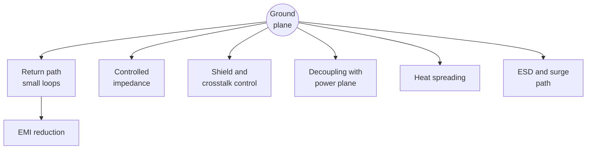

::: basics
### In plain words
A ground plane does much more than serve as zero volts. It is the return path for signals, which keeps loops small. It sets the impedance of the traces above it, shields layers from each other, adds capacitance with a power plane, spreads heat, gives static-discharge current an easy path, balances the copper so the board stays flat, and acts as the other half of an antenna. Cutting the plane weakens every one of these jobs.

### Picture it
Think of a Swiss army knife: one tool, many uses. The plane is one large sheet of copper placed a small, controlled distance from everything else, and each job uses a different property of that sheet. A knife with a snapped blade loses only that function. A plane with a slot cut in it loses several functions at once, because all its jobs depend on it staying continuous.

### Words you need
- **Return path**: the route current takes back to its source, directly under the trace at high frequency ([[q0478]]).
- **Controlled impedance**: a trace built to a set ratio of voltage to current for fast signals, which needs a plane beneath it ([[q0479]]).
- **Shielding**: keeping fields from one circuit out of another ([[q0490]]).
- **ESD (electrostatic discharge)**: a sudden spark of static current, like the zap from a doorknob.
- **Inductance**: resistance to sudden changes in current. A fast current change through it creates a voltage.

### The simplest example
Take ESD. A standard 8 kV test spark delivers about 30 A, rising in about 0.8 ns. That is about 37.5 A per nanosecond. The voltage across a ground connection is $L\,di/dt$, inductance times the rate of change. With 1 nH of inductance it is about 38 V. With 5 nH of thin trace, about 188 V. A plane with a via right at the protection part keeps the inductance, and the spike, small. For the antenna job, a quarter-wave antenna at 2.4 GHz is about 31 mm long and needs a ground sheet to work against. That is the whole idea. The rest of this page covers each job in turn and what a slot does to it.
:::

::: testing
Whether you see a ground plane as a **multi-purpose structure**, not just a zero-volt node. Beyond a common reference, a plane gives signals a return path and a defined impedance, reduces loop area (EMI and crosstalk), shields between layers, adds capacitance to a power plane, spreads heat, gives ESD and surge currents a low-inductance path, balances copper for mechanical flatness, and serves as the counterpoise for antennas. The interviewer wants several of these with reasons, and ideally a number for one or two.
:::

::: why
A single plane often replaces what would otherwise be separate fixes: a shield, a heat spreader, extra decoupling, an ESD path. Knowing all its jobs also tells you what breaks when you cut it up: every function above degrades. In interviews this question separates the answer "it's the zero reference" from the engineer's answer "it's the return path, the shield, the heat sink and half the EMC strategy."
:::

::: concepts
- **Return path**: current returns under the trace at high frequency. See [[q0478]].
- **Controlled impedance**: a reference plane defines $Z_0$. See [[q0479]].
- **Shielding and crosstalk**: a plane terminates fields. See [[q0490]].
- **Plane capacitance**: ground-power pair for decoupling. See [[q0480]].
- **Thermal spreading**: copper conducts heat in-plane. See [[q0540]].
- **ESD path**: low inductance to carry fast surge current. See [[q0562]].
:::

::: answer
"A ground plane does a lot more than serve as zero volts.

First, it's the return path. At high frequency the return current flows right under each signal, which keeps loops small and so reduces radiation, pickup and crosstalk. Second, it gives traces a defined characteristic impedance, since microstrip and stripline need a reference plane. Third, it shields: a plane between two signal layers keeps their fields from coupling, and it terminates the electric field of traces above it. Fourth, next to a power plane it forms a capacitor that helps high-frequency decoupling. Fifth, it's a heat spreader, because copper conducts heat much better than FR-4; a plane under a hot chip with thermal vias is the standard way to cool it. Sixth, it's a low-inductance path for ESD and surge current, so a strike at a connector can be shunted to ground without blowing up a chip. Seventh, it balances the copper on the board so it doesn't warp. And for an antenna it's often the counterpoise, the other half of the radiator.

So when I'm tempted to cut a plane for routing, I think about which of those jobs I'm giving up."
:::

::: technical
**Functions and numbers (1 oz copper, $\varepsilon_r=4.3$):**

| Function | Mechanism | Number |
|---|---|---|
| Return path / small loop | Lowest-inductance return under the trace | 0.3 nH/mm loop at $h=0.2$ mm; 80% of current within ±3h |
| Controlled impedance | Field between trace and plane | 50 Ω with $w=0.335$ mm at $h=0.2$ mm |
| Crosstalk/EMI reduction | Image current cancels trace field | Loop area 100× smaller than a ground trace 20 mm away |
| Shielding between layers | Planes terminate electric field; eddy currents at HF | skin depth 6.5 µm at 100 MHz vs 35 µm copper |
| Decoupling | Parallel-plate with power plane | 0.12–0.25 nF/in² at 0.2–0.1 mm |
| Heat spreading | In-plane conduction, $k\approx385$ W/m·K | 1 oz plane: ~30 K/W from a 4 mm source to 50 mm diameter; ~7.5 K/W with 4 such layers |
| ESD/surge path | Low inductance to dissipate fast transients | 30 A in 0.8 ns: $L\,di/dt$ = 37 V per nH |
| Mechanical balance | Copper symmetry limits warp | Copper balance target within a few tens of percent top-to-bottom |
| Antenna counterpoise | Image of a monopole | Quarter-wave: 31 mm at 2.4 GHz |

> [!UNCERTAIN]
> The ESD figure uses the commonly quoted IEC 61000-4-2 8 kV contact discharge waveform (about 30 A first peak, about 0.8 ns rise); check the standard for the exact parameters. Thermal numbers use an idealised infinite-sheet spreading model and ignore the board's other layers and convection. Treat all values as order-of-magnitude.
:::

::: short
"Beyond being the reference, a ground plane is the return path that keeps loops small, so it cuts radiation, pickup and crosstalk; it defines trace impedance; it shields between layers; next to a power plane it adds high-frequency decoupling capacitance; it spreads heat; it gives ESD and surge currents a low-inductance path; it balances copper to limit warp; and it's the counterpoise for antennas. Cutting it up gives up all of those at once."
:::

::: long
"A ground plane gets described as the zero-volt reference, but that's the least interesting thing it does.

Its biggest job is being the return path. At high frequency the return current runs directly under the signal in the plane, so loops are tiny, and that's what keeps radiation, pickup and crosstalk down. For the same reason it's what defines a trace's characteristic impedance: microstrip and stripline are defined relative to the plane, and a 0.33 millimetre trace over 0.2 millimetres of FR-4 gives 50 ohms.

Second, shielding. A plane between two signal layers terminates the electric field of each so they don't couple. And at high frequency, once the skin depth is smaller than the copper thickness, it also blocks magnetic fields.

Third, power integrity. A plane next to a power plane forms a parallel-plate capacitor, about a quarter of a nanofarad per square inch at 0.1 millimetre, with very low inductance, which helps decoupling above where discrete capacitors work.

Fourth, thermal. Copper conducts heat roughly a thousand times better than FR-4, so a plane under a hot part spreads the heat sideways: a one-ounce plane can take a 4 millimetre heat source down to about 30 degrees per watt, and four planes in parallel get you near 7.

Fifth, ESD and surge. A fast transient, like an 8 kilovolt discharge with about 30 amps at nanosecond edges, creates a voltage of L di/dt, so you need the lowest inductance path, which is a plane with vias to it.

And smaller things: copper balance to keep the board flat, and it acts as the counterpoise for antennas.

So when I think about cutting or splitting a plane, I ask which of these jobs I'm giving up."
:::

::: terms
- **Return path**: path the signal's current takes back to the source.
- **Image plane**: a plane that makes a trace's field look like a trace and its mirror-image opposite current.
- **Characteristic impedance ($Z_0$)**: $\sqrt{L'/C'}$ of the trace-plane pair.
- **Thermal spreading resistance**: resistance to heat flow from a small source into a larger sheet.
- **ESD (IEC 61000-4-2)**: electrostatic discharge test waveform with fast, high peak current.
- **Counterpoise**: the ground structure that forms the other half of an antenna.
- **Copper balance**: roughly equal copper area per layer to limit warp.
- **Skin depth**: depth at which current density falls to 1/e.
:::

::: exceptional
An exceptional answer gives at least five functions, each with its physical reason, and puts a number on two or three (return loop, thermal spreading resistance, ESD $L\,di/dt$). It recognises that all functions rely on the plane being unbroken and close to the signals, and it names the exceptions where the plane is a hindrance (high-impedance nodes, inductors, some antenna keep-outs). It also mentions the limits: planes shield electric fields at all frequencies but magnetic fields only above a few MHz at 1 oz thickness.
:::

::: mistakes
- **Listing only "reference potential" and "return path"** when asked for *other* functions.
- **Saying a plane shields everything.** At low frequency, a thin copper plane doesn't stop magnetic fields.
- **Using the plane as a heat sink without vias.** Heat has to get into the plane: thermal vias under the part.
- **Believing ESD is a "high-voltage" problem only.** The damage comes from current and $L\,di/dt$ voltage across package and trace inductance.
- **Ignoring copper balance** and getting a board that warps through reflow.
- **Forgetting the antenna case:** a "ground plane" under or near an antenna is part of its design.
:::

::: deep
## One structure, many jobs

The reason a plane does so many things is that it is a large, low-impedance conductor placed at a controlled small distance from everything else on the board. Each function exploits one of those properties.


Figure: One plane, many jobs: signal return and fields (return path, impedance, shielding, EMI), power integrity (decoupling), and the jobs that just need a big conductor (heat spreading, ESD; mechanical balance and antenna counterpoise are covered below). All of them depend on the plane staying continuous.

## 1. Return path and the image trick

A trace over a plane is mathematically equivalent to the trace plus an *image* trace below the plane carrying the opposite current. The two form a transmission line (a pair of opposing currents), whose fields cancel quickly with distance. This is why a trace over a plane radiates much less than the same trace with a far-away return. See [[q0478]], [[q0486]].

## 2. Controlled impedance

$Z_0 = \sqrt{L'/C'}$ requires a definite $C'$ (to the plane) and $L'$ (loop). For a 0.3 mm trace at $h=0.2$ mm, $Z_0\approx 53$ Ω, $L'\approx0.32$ nH/mm and $C'\approx0.11$ pF/mm. Without the plane none of these is defined. See [[q0476]].

## 3. Shielding and crosstalk

The electric-field part: the plane intercepts field lines, so a signal on one side of the plane couples little to the other. The magnetic part: at frequencies where the skin depth is less than the copper thickness, eddy currents oppose the field.

```plot
{"title":"Skin depth in copper vs frequency","x":{"label":"Frequency","unit":"Hz","min":1e3,"max":1e10,"log":true},"y":{"label":"Skin depth","unit":"m","min":1e-7,"max":1e-2,"log":true},
 "vars":{"rho":1.68e-8,"mu0":1.2566e-6},
 "series":[{"label":"δ = √(ρ/(π f μ0))","fn":"sqrt(rho/(pi*x*mu0))"}],
 "hlines":[{"at":35e-6,"label":"1 oz copper: 35 µm","color":"orange"}],
 "points":[{"x":1e8,"y":6.52e-6,"label":"100 MHz: 6.5 µm"},{"x":3.5e6,"y":35e-6,"label":"δ = 35 µm at 3.5 MHz"}]}
```
Figure: Below about 3.5 MHz, the skin depth exceeds the 35 µm plane thickness and the plane does little to block magnetic fields by absorption; above it, the shielding improves with frequency. Electric-field shielding is effective at all frequencies, and the image-current cancellation works regardless. For details see [[q0490]].

## 4. Capacitance with the power plane

Ground and power planes 0.1 mm apart give $C = \varepsilon_0\varepsilon_rA/h=0.25$ nF per square inch (3.8 nF for 100 × 100 mm). The loop inductance per square is $\mu_0h=0.13$ nH, so the pair is a very low-inductance capacitor and extends decoupling above the range where discrete capacitors work. See [[q0480]].

## 5. Heat spreading

Copper's $k\approx385$ W/m·K. A 1 oz layer has a sheet thermal conductance $kt=385\times35\times10^{-6}=13.5$ mW/K per square. For a circular heat source of radius $a$ spreading into a sheet out to radius $b$:

$$R_{th}=\frac{\ln(b/a)}{2\pi k t}$$

```plot
{"title":"Spreading thermal resistance of one 1 oz copper plane (source radius 2 mm)","x":{"label":"Plane radius b (mm)","min":3,"max":100},"y":{"label":"R_th (K/W)","min":0,"max":50},
 "vars":{"a":2,"k":385,"t":35e-6},
 "series":[{"label":"ln(b/a)/(2π k t)","fn":"ln(x/a)/(2*pi*k*t)"}],
 "points":[{"x":25,"y":29.8,"label":"b = 25 mm: 29.8 K/W"}]}
```
Figure: Spreading resistance grows only logarithmically with plane size, so the first few millimetres of copper do most of the work: from 5 mm to 25 mm radius, only 19 K/W more. A 1 W source into a single 1 oz plane out to 25 mm radius sits about 30 °C above the plane edge. Four parallel layers (connected by thermal vias) give about 7.5 K/W. This ignores heat lost to air, so real boards are better. See [[q0540]].

## 6. ESD and surge current

IEC 61000-4-2 level 4 (8 kV contact) is commonly specified with about a 30 A first peak, with roughly 0.8 ns rise. Voltage across a connection of inductance $L$ is $L\,di/dt$: for 5 nH of trace, $5\text{ nH}\times30\text{ A}/0.8\text{ ns}=188$ V; for 1 nH it's 38 V. A TVS diode clamps the voltage, but the loop through the TVS and the ground connection must be low inductance. The plane (with vias directly at the TVS ground pad) is the best path.

## 7. Mechanical balance

A board with copper on one side and mostly bare on the other bows after reflow. A ground plane on both halves of the stack keeps copper area balanced. Fabs have guidelines (typically within a few tens of percent).

## 8. Antenna counterpoise

A quarter-wave monopole needs a ground plane at least about $\lambda/4$ across. At 2.4 GHz, $\lambda_0/4=31$ mm; at 868 MHz it's 86 mm. A small board's ground plane is part of the antenna: change it and the tuning changes. That's why modules specify the keep-out and the ground area.

## What goes wrong when the plane is cut

| Function | Effect of a slot or split |
|---|---|
| Return path | Detour, larger loop, radiation |
| Impedance | Bump at the slot |
| Shielding | Aperture leakage |
| Decoupling | Less capacitance, plane resonances |
| Heat | Longer thermal path |
| ESD | Higher inductance, higher $L\,di/dt$ |

Hence: don't cut planes casually; see [[q0485]] and [[q0493]].

> [!INTERVIEW]
> If you can give one more than the interviewer expects, give the thermal one. "A 1 oz plane takes a 4 mm heat source to about 30 K/W" is a surprising and memorable number.

## Worked example: the thermal path is vias plus plane in series

The spreading figure of 30 K/W assumes heat is already in the plane. Getting it there takes thermal vias, and they are often the larger resistance. A plated via of 0.3 mm drill with 25 µm barrel copper through a 1.6 mm board has a copper cross-section of $A=\pi d t=\pi(0.3\times10^{-3})(25\times10^{-6})=2.36\times10^{-8}\ \text{m}^2$, so

$$R_{via}=\frac{\ell}{kA}=\frac{1.6\times10^{-3}}{385\times2.36\times10^{-8}}=176\ \text{K/W}$$

One via is a poor conductor: 176 K/W is worse than the plane. Nine vias on a 1 mm grid under an exposed pad in parallel give $176/9=19.6$ K/W, and sixteen give 11 K/W. In series with the plane's 29.8 K/W spreading resistance, a 1 W source under nine vias sits at roughly $19.6+29.8\approx49$ K/W, or 49 °C above the plane's edge temperature; sixteen vias give about 41 °C. This is a conservative estimate: solder or epoxy filling the barrels adds conduction, and the board's other planes and convection reduce the number. The ranking is robust: more vias help until the plane's spreading resistance dominates, and then the lever is more plane area or more layers. In the followup scenario an 80 °C rise on a 1 W part is then explained by a thermal-path problem, such as unplated or too few vias, a non-wetted pad, or a plane broken by anti-pads, rather than by the plane itself.

## Worked example: ESD with a real clamp

The page's $L\,di/dt$ numbers ignore the clamp, but the clamp and the inductance add. Suppose a TVS clamps at 12 V at the peak current (an illustrative value; read the device's dynamic clamping curve in its datasheet) and its ground return has inductance $L_g$. The protected node sees the clamp voltage plus the inductive drop in the ground leg during the 30 A first peak, whose rise is 0.8 ns, a slope of 37.5 A/ns:

| TVS ground-leg inductance | $L_g\,di/dt$ | Approximate peak at protected pin |
|---|---|---|
| 0.5 nH (via at the pad into a plane) | 19 V | 31 V |
| 1 nH (via 1 mm away) | 37.5 V | 49.5 V |
| 5 nH (several mm of trace) | 188 V | 200 V |

The inductive term can dwarf the clamp, which is why the TVS ground via goes at the pad and why the TVS sits at the connector, before any trace to the IC. The table also shows why the same TVS "works" on one layout and not on another: nothing about the part changed, only $L_g$. Note that the protected IC's input also has its own tolerance; whether 31 V or 200 V matters depends on the IC's absolute maximum and its internal ESD structure.

## Limiting cases: when a function stops working

- **Shielding.** The magnetic shielding of a 35 µm plane is negligible below a few MHz, as the skin-depth plot shows, but the electric shielding is complete provided the plane is continuous. A shield-can or a thicker plate helps only when it is thick compared with the skin depth at the frequency you care about.
- **Counterpoise.** A quarter-wave monopole wants a plane of order $\lambda/4$, but a board smaller than that still works with a detuned, lower-efficiency pattern; modules specify the ground area they were tuned for, so follow it.
- **Thermal.** Once the source is spread out over the whole board, additional planes only help through their parallel conduction; the board edge, enclosure and airflow set the final rise.
- **Mechanical balance.** For a thin or large board, even a modest copper imbalance can bow it by enough to crack BGA joints. The limits are a fab recommendation, not a physical constant.

## Real-hardware considerations

- **Skin depth is the reason for plane layer assignments.** A plane's useful surface is the face toward the signal; at 100 MHz current penetrates 6.5 µm, so a 17.5 µm inner layer is already many skin depths thick, and a thinner copper weight does not change the high-frequency story.
- **Thermal vias and solder.** Open vias under an exposed pad can wick solder away; many fabs and assemblers prefer tented, filled or smaller-diameter vias (0.2 to 0.3 mm). Check the land-pattern recommendation in the part's datasheet.
- **ESD currents are not on the plane's surface evenly.** The path from connector to chassis or to the board's ground can be dominated by one stitching via; give the discharge several.
- **Coupling between functions.** A plane carrying heavy return currents for heat spreading and for a power stage has noise voltages on it; the sensitive circuits sharing the plane see them. The plane does not isolate functions; placement does.

## Bench verification

For thermal verification, run the real power with an infrared camera or a thermocouple on the case and on the plane at a distance; compare the temperature difference to $\Delta T=P\,R_{th}$ for the via-plus-spreading estimate. For ESD, a pre-compliance discharge (even a pen-type ESD gun) while probing the protected node with a short, well-grounded probe reveals the spike: the 31 V versus 200 V difference above is visible on a fast scope. For shielding and crosstalk, measure coupling between two traces on opposite sides of a plane with a network analyzer and compare against the same traces without the plane.
:::

::: applications
- **QFN/DFN regulators and power ICs**: exposed pad soldered to a ground plane with thermal vias for cooling.
- **Connectors with ESD parts**: TVS ground pins stitched straight to the plane.
- **Wireless modules and chip antennas**: datasheets specify the ground-plane size and keep-out.
- **High-speed digital boards**: planes for impedance control, crosstalk reduction and decoupling.
- **Power converters**: ground plane under the switching loop to reduce its inductance and radiate less.
:::

::: assumptions
- Multilayer FR-4 with a continuous plane; numbers for 1 oz copper and $\varepsilon_r=4.3$.
- The thermal spreading model assumes an infinite thin sheet and ignores convection and neighbouring layers. Real results depend on vias, board area and airflow.
- The ESD waveform is the commonly cited IEC 61000-4-2 contact waveform; the actual standard defines levels and waveforms precisely.
- Antenna requirements are design-specific; follow the part's layout guide.
- The magnetic shielding discussion assumes a solid plane; perforated or cut planes shield less.
:::

::: followups
### How does a ground plane help with heat?
Copper has a thermal conductivity of about 385 W/m·K, roughly a thousand times FR-4's, so a plane spreads heat laterally. Heat has to get into it: thermal vias under the exposed pad connect the pad to the plane. A single 1 oz plane gives about 30 K/W for a small source spreading to 50 mm diameter; several planes in parallel scale that down.

### Why does a ground plane help with ESD?
ESD current has nanosecond edges and tens of amps, so the voltage across any connection is $L\,di/dt$. A plane gives the lowest-inductance path from the connector's TVS or shield to the rest of the system's ground, and it spreads the current over a big area. A thin ground trace with 5 nH would see about 190 V; the plane/via connection maybe a few volts.

### Does a ground plane shield low-frequency magnetic fields?
Not by absorption: at 1 kHz, skin depth is about 2 mm, far more than the 35 µm of copper. Shielding at low frequency requires high-permeability materials or loop-area reduction. Above a few MHz, eddy currents in the plane oppose the field, and shielding improves.

### Is there any case where a ground plane is bad for an antenna?
Under a chip antenna or PCB-trace antenna: the plane under it detunes it and reduces efficiency. Datasheets specify a keep-out. For a monopole, the plane is required. The guideline depends on the antenna type.

### Scenario: a power IC overheats on a board with a ground plane. What do you check?
Whether heat actually reaches the plane: the IC's exposed pad needs several thermal vias (for example 0.3 mm vias on a 1 mm grid) into the plane, solder coverage of the pad, and whether the plane is continuous near the part (not broken up by anti-pads). Compute the expected rise: 1 W at 30 K/W spreading resistance is 30 °C, so if I'm seeing 80 °C there's a thermal path problem, not just a plane problem. I'd also check airflow and the other layers.
:::

::: interpretations
The question asks for functions *in addition to* providing a common reference. The "return path" and "impedance control" answers are covered more deeply in [[q0478]] and [[q0486]]; the shielding explanation is the subject of [[q0490]]; the layers on which planes sit are in [[q0491]]. I treat "ground plane" as a continuous layer, not a pour.
:::

::: references
- Ott, *Electromagnetic Compatibility Engineering*: ground planes, shielding, ESD and PCB layout.
- Johnson & Graham, *High-Speed Digital Design: A Handbook of Black Magic*: ground planes, image theory and return paths.
- Incropera et al., *Fundamentals of Heat and Mass Transfer*: conduction and spreading resistance (topic level).
- IEC 61000-4-2 (ESD immunity test) for the discharge waveform parameters.
:::

::: rubric
- Return path / small loops reduce EMI and crosstalk :: The principal electrical function beyond "reference".
- Defines/controls characteristic impedance :: A key high-speed function.
- Shielding between layers (with the E-field vs H-field nuance) :: Shows depth.
- Capacitance with a power plane for decoupling :: Power-integrity function.
- Heat spreading, with thermal vias :: A non-electrical function many forget.
- ESD/surge current path via low inductance :: Real-world robustness function.
- Copper balance or antenna counterpoise :: Less obvious but real uses.
:::

::: quiz
```json
[
 {"type":"mcq","level":"fundamental","q":"Which of these is NOT a typical function of a ground plane?","options":["Return path for high-frequency currents","Heat spreading","Increasing a trace's propagation speed above that of light","Reference for controlled impedance"],"answer":2,"explain":"Nothing exceeds the speed of light; the plane's roles are return path, impedance reference, shielding, decoupling, heat spreading and ESD path."},
 {"type":"numeric","level":"intermediate","q":"Using $R_{th}=\\ln(b/a)/(2\\pi k t)$ with $a=2$ mm, $b=25$ mm, $k=385$ W/m·K and $t=35$ µm, what is the spreading resistance in K/W?","answer":29.8,"tolerance":0.03,"unit":"K/W","explain":"$\\ln(12.5)=2.526$; $2\\pi kt=2\\pi\\times385\\times35\\times10^{-6}=0.0847$ W/K; ratio 29.8 K/W."},
 {"type":"numeric","level":"intermediate","q":"A 30 A ESD peak with 0.8 ns rise flows through a 2 nH connection. Estimate $L\\,di/dt$ in V.","answer":75,"tolerance":0.03,"unit":"V","explain":"$L\\,di/dt=2\\times10^{-9}\\times30/(0.8\\times10^{-9})=75$ V."},
 {"type":"truefalse","level":"intermediate","q":"A 35 µm copper plane effectively absorbs a 1 kHz magnetic field.","answer":false,"explain":"At 1 kHz the skin depth in copper is about 2 mm, much larger than 35 µm, so absorption is negligible. Shielding by thin copper only works above a few MHz."},
 {"type":"mcq","level":"advanced","q":"Why do heat-spreading planes need thermal vias under a hot IC?","options":["Vias increase the plane's electrical conductivity","FR-4 between the IC pad and the plane is a poor thermal conductor; vias provide a copper path into the plane","Vias reduce ESD","They are only for electrical return"],"answer":1,"explain":"Heat from the pad has to get into the plane; through the dielectric it is a poor path, so a via array provides a low-resistance thermal route."}
]
```
:::
