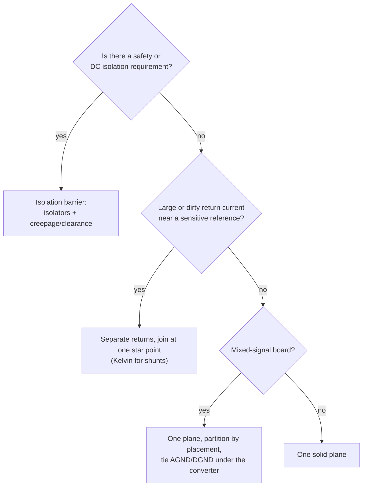

::: basics
### In plain words
Separating grounds is a tool for specific problems, not a default. You do it for safety isolation, to break ground loops between pieces of equipment, to keep large or noisy return currents out of a sensitive reference, and to steer static sparks to the metal case. On a single board you usually do not cut the plane. You place noisy and quiet circuits in different regions of one plane and join them at one deliberate point.

### Picture it
Picture a street where heavy trucks and bicycles both head for the same town center. Sharing a lane, the trucks shove the cyclists around, so each gets its own lane and they meet at one intersection. The analogy breaks in one place: a signal that crosses between separated grounds loses its return path, so crossings must happen at the join.

### Words you need
- **Common-impedance coupling**: a shared conductor turns one circuit's current into voltage for another ([[q0484]], [[q0497]]).
- **Galvanic isolation**: no wired connection at all between two circuits. Signals cross by light or magnetism.
- **Ground loop**: a closed loop of ground connections that picks up interference.
- **Star point**: the one place where separate returns join ([[q0495]]).
- **ADC**: a chip that turns a voltage into a number. Its smallest step is called an LSB.

### The simplest example
A motor draws 5 A through a shared ground conductor of 10 mΩ. The drop is 5 × 0.010 = 50 mV. A 16-bit ADC with a 3.3 V range splits it into 65,536 steps of about 50 µV each, so that shift is an error of about 990 steps. Giving the motor its own return, joined to the ADC's ground at one point, keeps the 50 mV out of the measurement. That is the whole idea. The rest of this page covers the reasons to separate, how to do it on one board, the classic failures, and why chip datasheets often say to tie the analog and digital ground pins (AGND, DGND) together.
:::

::: testing
Whether you know that **separating grounds is a tool for specific problems, not a default**, and can name those problems: safety isolation, breaking ground loops between systems, keeping large or dirty return currents out of a sensitive reference, different voltage references, and chassis/ESD handling. A strong answer also states how to separate correctly (a deliberate single connection, isolation barrier, or placement-based partition over one plane) and the main pitfall: a split that signals cross loses its return path.
:::

::: why
"Should I split AGND and DGND?" is one of the most debated layout questions, and bad answers cause real failures: split planes with signals crossing them radiate and pick up noise, while merged grounds with a shunt or motor return running through the reference give wrong measurements. This question sets up the rest of the grounding section ([[q0494]]-[[q0500]]), which covers topologies, star grounding and what happens when ground potential varies.
:::

::: concepts
- **Common-impedance coupling**: shared return conductors couple circuits. See [[q0484]], [[q0497]].
- **Return path continuity**: signals crossing a split lose their return. See [[q0486]].
- **Galvanic isolation**: no DC path between domains, using transformers, optocouplers or capacitive isolators.
- **Ground loops**: two ground connections form a pickup loop. See [[q0492]].
- **Star/single-point grounding**: one deliberate join. See [[q0495]].
- **Safety earth vs. signal ground**: different jobs. See [[q0484]].
:::

::: answer
"I separate grounds only when I can name the problem it solves, and I do it carefully.

The main reasons are these. First, safety and isolation: if one side is mains-referenced or high voltage and the other is touchable, they can't share a ground, so I use an isolation barrier with creepage and clearance. Second, ground loops: when two separate pieces of equipment are connected by a cable and each is grounded, the loop picks up noise and carries current; isolating or having a single connection fixes it. Third, large or noisy return currents: a motor driver returning 5 amps through a shared conductor can lift the reference of a precision ADC by tens of millivolts, so I keep the power return and the sense or analog reference separate, and join them at one point. Fourth, different reference potentials, like a battery negative versus a high-side sensing domain, or a chassis ground used for ESD and shield terminations that I connect through a defined path.

How I do it matters. On a single board I usually don't cut the plane; I place noisy and quiet circuits in different regions so their return currents don't overlap, and connect them at one defined point. If I do split, no signal crosses the split except at the bridge. And for true isolation, the signals cross through isolators, not wires."
:::

::: technical
**Reasons to separate (and the numbers behind them):**

| Reason | Mechanism | Example number |
|---|---|---|
| Safety/isolation | No DC path between hazardous and accessible circuits | Isolators plus creepage/clearance per the applicable safety standard |
| Ground loop | Loop area picks up $V=\omega BA$; ground potential differences drive current | 1 µT at 50 Hz through a 0.1 m² cable loop: 31 µV |
| Noisy return currents | $V=I R_g$ or $L\,di/dt$ in a shared conductor | 5 A through 10 mΩ = 50 mV, about 990 LSB of a 3.3 V 16-bit ADC (LSB 50 µV) |
| Different references | Floating, high-side, battery-negative domains | Level shifters, isolated amplifiers |
| Chassis/ESD | Shield and ESD currents routed to chassis, not signal ground | 30 A, 0.8 ns ESD edge; $L\,di/dt$ of 37 V per nH |

**How to separate:**
1. *Placement partition on one plane* (default on a board): regions, one plane, no splits.
2. *Single-point connection* (star): separate traces or plane regions joined at one node (shunt, ADC, supply entry).
3. *Isolation*: transformers, optocouplers, digital isolators, isolated DC-DC; different grounds with no DC path.
4. *Controlled coupling*: ferrite bead, 0 Ω link, or capacitor (e.g., chassis to signal ground through a capacitor and resistor) where DC separation but HF connection is wanted.

**Rule:** any signal crossing between separated grounds needs a return path: cross only at the connection point, or through an isolator.

> [!UNCERTAIN]
> Creepage/clearance values, ESD waveforms and the use of ferrites or capacitors between grounds depend on the applicable safety/EMC standard and the product. Check the relevant standard and the isolator and converter datasheets instead of relying on these examples.
:::

::: short
"I separate grounds for specific reasons: safety isolation, breaking ground loops between systems, keeping large or noisy return currents out of a sensitive reference like a shunt or an ADC, different voltage references, and chassis/ESD handling. On one board I usually partition by placement over a single plane and join returns at one deliberate point rather than cutting the plane. Where the separation is real, signals cross through isolators. The cardinal sin is a split that fast signals cross, because they lose their return path."
:::

::: long
"My rule is to separate grounds only when I can name the problem it solves.

The first is safety. If part of the system is mains-referenced or high voltage and another part is touchable, they need galvanic isolation: no shared ground, isolators between them, and creepage and clearance on the board.

The second is ground loops. When two grounded systems are connected by a signal cable, the loop through both grounds picks up magnetic fields and carries noise current. For example 1 microtesla of 50 hertz field through a loop of 0.1 square metres induces about 30 microvolts, which is enormous against a millivolt-level sensor. Isolating the link, or having just one ground connection, breaks it.

The third is dirty return current. Say a motor driver returns 5 amps and the return trace has 10 milliohms shared with an ADC's reference: that's 50 millivolts, about a thousand LSBs of a 16-bit converter. So I keep the high-current return and the sense reference on separate paths and join them at a single point, like a shunt resistor's terminals with a Kelvin connection.

The fourth is different references, like a battery-negative domain or a high-side measurement, and chassis ground, which is for shield terminations and ESD, and tied to signal ground through a deliberate path.

How I implement it matters more than the decision. Within a board I generally keep one solid plane and partition by placement, so each block's return current stays in its own area. If I do split or use separate planes, no fast signal crosses the gap except at the bridge, and real isolation uses isolators. I verify it by looking at the return paths, not just the net names."
:::

::: terms
- **Galvanic isolation**: no DC conduction path between two circuits.
- **Ground loop**: closed conductor path through grounds that picks up noise or carries current.
- **Single-point (star) ground**: all returns meet at one node.
- **Kelvin connection**: separate force and sense paths.
- **Chassis ground**: enclosure/shield connection, often tied to earth.
- **Creepage / clearance**: surface and air distances required for safety.
- **Partition by placement**: separating returns by where circuits sit over one plane.
- **Common-mode choke / ferrite bead**: elements that connect grounds at HF or block HF noise.
:::

::: exceptional
An exceptional answer lists the reasons with a number or two (31 µV loop pickup; 50 mV across 10 mΩ equals about 1000 LSB), distinguishes *separating* from *splitting a plane*, and describes the right implementation for each case (isolation barrier for safety, star/Kelvin for shunts, placement partition for mixed-signal, chassis via capacitor/resistor for shields). It explicitly warns that signals crossing a split lose their return path, and notes that many modern mixed-signal ICs expect a single ground with AGND/DGND pins tied under the part.
:::

::: mistakes
- **Splitting AGND/DGND by habit** and routing signals across the gap.
- **Joining separated grounds at multiple points**, recreating a ground loop.
- **Assuming isolation just means separate nets.** It needs no DC path and enough creepage/clearance.
- **Tying chassis directly to signal ground everywhere** and carrying ESD current through logic.
- **Leaving the connection point undefined** so the grounds float relative to each other.
- **Using a ferrite or 0 Ω link without checking the return path** for signals crossing it.
:::

::: deep
## When separation is the right tool

The tool is for a specific problem: *a conductor carries current that you don't want to share with something else.* Four situations make that true.

```circuit
{"caption":"Separate returns joined at one star point","elements":[
 {"t":"V","a":[0,2],"b":[0,8],"label":"V_s"},
 {"t":"wire","pts":[[0,2],[0,0],[16,0]]},
 {"t":"dot","at":[8,0]},
 {"t":"wire","pts":[[8,0],[8,1]]},
 {"t":"I","a":[8,1],"b":[8,5],"label":"I_{motor}","value":"5 A"},
 {"t":"wire","pts":[[8,5],[8,8]]},
 {"t":"wire","pts":[[16,0],[16,1]]},
 {"t":"R","a":[16,1],"b":[16,5],"label":"R_{sensor}","value":"quiet load"},
 {"t":"wire","pts":[[16,5],[16,10],[2,10],[2,8]]},
 {"t":"wire","pts":[[0,8],[2,8]]},
 {"t":"dot","at":[2,8]},
 {"t":"gnd","at":[1,8]},
 {"t":"R","a":[2,8],"b":[8,8],"label":"R_{pg}","value":"10 mΩ"},
 {"t":"text","at":[3.2,9.2],"text":"power return: 5 A × 10 mΩ = 50 mV","anchor":"start","color":"red"},
 {"t":"text","at":[3.2,11.4],"text":"sense return: bottom wire, separate trace, no motor current","anchor":"start","color":"green"},
 {"t":"text","at":[3.2,12.8],"text":"star point at the supply (dot)","anchor":"start","muted":true}
]}
```
Figure: The motor's 5 A returns through its own conductor $R_{pg}$ to the star point at the supply. The quiet load returns through a different trace, so the 50 mV across $R_{pg}$ never appears in series with its reference. Compare with [[q0484]], where both loads shared the return.

### 1. Safety and isolation

Where one section is connected to hazardous voltage (mains, a high-voltage battery) and another to user-accessible circuitry, a fault must not put hazardous voltage on the accessible part. Standards define required insulation, creepage and clearance distances depending on working voltage, pollution degree and altitude (this page doesn't reproduce the tables; use the applicable standard). In practice: an isolation barrier on the PCB (a gap in copper on all layers, with the required distance), isolated DC-DC converters and signal isolators bridging it, and no copper crossing the gap.

### 2. Ground loops

Two systems each grounded (to earth, or through their chassis) and connected by a signal cable form a loop: ground-potential difference drives current through the cable shield or ground wire, and the loop picks up magnetic fields. Induced voltage is $V=\omega BA$: for 50 Hz, $B=1$ µT and $A=0.1$ m², that's 31 µV. Ground potential differences between buildings or equipment can be volts. The cures: isolate the link (isolation amplifier, transformer, optocoupler, digital isolator), use a differential receiver with good common-mode rejection, break one ground connection, or shield and terminate carefully.

### 3. Large or noisy return currents

A motor, relay, LED bank or switching stage draws amps through the return. Any conductor shared with a sensitive reference turns that current into voltage. Quantifying:

```plot
{"title":"Ground error caused by a shared 10 mΩ return vs load current","x":{"label":"Load current (A)","min":0,"max":10},"y":{"label":"Error (LSB of 16-bit, 3.3 V ADC)","min":0,"max":2100},
 "vars":{"r":0.01,"lsb":50.354e-6},
 "series":[{"label":"I × 10 mΩ / LSB","fn":"x*r/lsb"}],
 "points":[{"x":5,"y":993,"label":"5 A: about 990 LSB"}]}
```
Figure: At 5 A through a shared 10 mΩ, the reference shift is about 990 LSB of a 16-bit converter; every amp costs about 200 LSB. A precision measurement can't share a return with that current. The cure is a separate return joined at one point, or a plane layout that keeps the motor current away from the ADC.

For shunt-based current measurement the same idea gives the Kelvin connection: the high current path goes through the shunt's outer terminals; the sense traces from the shunt's inner terminals go to the amplifier with no load current in them. See [[q0557]].

### 4. Different reference potentials and chassis

- **High-side sensing and floating domains**: a measurement referenced to a node that is not system ground needs an isolated or differential front end, not a shared ground.
- **Battery systems**: battery negative may differ from the ground of a charger or a pack monitor; they're tied through a defined element.
- **Chassis ground**: cable shields, connector shells and ESD protection connect to chassis, which in turn connects to earth in line-powered equipment. Chassis and signal ground are joined at one point, often through a capacitor in parallel with a high-value resistor (value and arrangement depend on the product's EMC and safety design), so that ESD and common-mode currents flow through the chassis rather than through logic.

## How to separate on one board


Figure: A practical decision flow. Most boards end up in the last two boxes; real separation is for isolation and for dirty-current reference problems.

**One plane, partition by placement.** Put analog parts in one region and digital in another, and keep the digital return currents (which follow their signals) out of the analog region. A plane has low impedance, so the return currents spread only as far as their signals take them at high frequency. No gap means no crossing problem.

**Split planes (use rarely).** If you do give different regions separate copper, rules: (1) all signals between them cross at a single bridge, with the bridge connection under the signal path; (2) no other signals cross the gap; (3) power planes' splits match; (4) place the join near the converter or the supply entry.

**Where the datasheet says "connect AGND and DGND".** Mixed-signal ADC/DAC datasheets often show separate AGND/DGND pins that should be tied to the same plane directly under the device, because the chip's internal return currents are already partitioned. Splitting the board plane at that part usually *worsens* performance.

**Controlled links.** A ferrite bead or 0 Ω resistor between two grounds blocks high-frequency noise from sneaking between them while connecting DC. But signals crossing that link have a high-impedance return, so keep crossing signals to a minimum. A capacitor between grounds (for example chassis to signal ground) gives an HF connection and DC isolation.

## The two classic failures

1. **The split with a crossing.** A clock crosses a gap between AGND and DGND. Its return current has to detour around the end of the gap, forming a big loop that radiates and couples. Fix: remove the split (partition by placement) or route the clock over the bridge.
2. **The shared return.** A shunt's sense ground is the same conductor as the load return. The measurement includes $I\cdot R$ of the trace. Fix: Kelvin connection.

> [!INTERVIEW]
> A crisp answer: "I separate grounds for isolation, ground loops, and dirty returns. On a board I partition by placement over one plane; I'd only split for a barrier, and I'd never let a fast signal cross the split."
:::

::: applications
- **Mains-powered products**: isolation barrier between primary and secondary, with chassis ground handled per safety rules.
- **Motor drives and inverters**: power-stage returns separated from gate-drive and sense returns, joined at a defined point.
- **Precision data acquisition**: Kelvin-connected shunts and a quiet analog region over a single plane.
- **Industrial I/O and sensors**: isolated inputs to avoid ground loops across long cables.
- **Battery-powered systems with high-side monitoring**: isolated or differential measurement front ends.
:::

::: assumptions
- Multilayer FR-4 board with a solid plane as the default; 2-layer boards use the same ideas with pours and star returns.
- Safety isolation requirements are set by standards and the product category, which this answer doesn't reproduce.
- Numbers (31 µV, 50 mV, 990 LSB) are illustrations with stated assumptions.
- Mixed-signal chips are assumed to follow their datasheet's grounding guidance, which sometimes says to join AGND and DGND under the part.
- At very high frequencies (RF), "separate" grounds are still connected by capacitance and fields; shielding and layout dominate.
:::

::: followups
### Why shouldn't I just split AGND and DGND on every mixed-signal board?
The split forces return currents of any crossing signal to detour, creating large loops and noise, while a single plane with careful placement already keeps digital returns out of the analog region, since high-frequency return currents follow their signals. Most converter datasheets recommend a single ground plane under the part for this reason.

### How do you connect two grounds that must be separate at DC?
Decide what you need: if isolation, there's no connection and signals cross through isolators. If you need HF connection but DC separation (chassis to signal ground), use a capacitor, possibly with a resistor in parallel. If you need a single reference point, use one deliberate link (a 0 Ω resistor or a short trace) at the star point so the connection is visible and changeable.

### What is a ground loop and how do you break one?
Any closed path through ground connections: for example two equipment chassis connected by a cable whose shield or return is grounded at both ends. Differences in ground potential drive current; the loop area picks up magnetic fields. Break it with isolation, by grounding at one end only (for low frequency), using a differential receiver or balanced line, or adding a common-mode choke. Don't remove safety earth to fix it.

### What if the ADC datasheet says to connect AGND and DGND at one point near the ADC, but my board has a continuous plane?
A continuous plane already provides that connection everywhere; the "one point" advice assumes separate planes. I'd keep the plane solid, place the ADC at the boundary between analog and digital regions, keep digital traces from running through the analog region and tie the AGND/DGND pins to the plane directly under the part, as the layout section usually illustrates.

### Scenario: your 24-bit load cell amplifier reads 20 µV higher whenever the heater turns on. The grounds are on a shared plane. What do you change?
Suspect common-impedance coupling: the heater's current returns through plane area near the amplifier's reference. Measure with the heater on between the amplifier ground and the supply entry. Fixes: route the heater return along its own path (wide trace or plane region) straight to the supply entry or input capacitor, keep it away from the amplifier region, make the bridge sense Kelvin-connected, and check the amplifier's reference/supply decoupling. If that's impossible on this board, move the amplifier or isolate it.
:::

::: interpretations
"Separate your ground reference potentials" can mean literally separate nets (isolated grounds), separate regions of one plane, or separate returns joined at a point. I cover all three. The topologies themselves are in [[q0494]] and [[q0495]], the pros and cons of combining vs separating analog/digital/power grounds in [[q0496]], and what happens when ground potentials differ in [[q0497]]-[[q0500]].
:::

::: references
- Ott, *Electromagnetic Compatibility Engineering*: grounding (single-point, multipoint, hybrid), ground loops and isolation.
- Horowitz & Hill, *The Art of Electronics*, 3rd ed.: ground loops, isolation and mixed-signal grounding.
- Morrison, *Grounding and Shielding: Circuits and Interference* (topic level).
- The datasheet layout sections of mixed-signal converters, and the applicable product safety standard for isolation distances.
:::

::: rubric
- Names safety/isolation as a reason :: The one case where separation is mandatory.
- Ground loops between systems :: A classic reason with a physical mechanism.
- Dirty return currents vs sensitive references (shunt, ADC) :: The most common board-level reason.
- Different references and chassis/ESD handling :: Completes the set.
- Single-point connection / star / Kelvin :: How to separate correctly.
- Placement partition on one plane rather than splitting :: Shows modern practice.
- Warns that signals crossing a split lose their return :: The key failure mode.
:::

::: quiz
```json
[
 {"type":"mcq","level":"fundamental","q":"Which is a legitimate reason to separate grounds?","options":["Because analog and digital should always be on different planes","A mains-referenced section and a user-accessible section need galvanic isolation","To make the board look tidier","To reduce the layer count"],"answer":1,"explain":"Safety isolation requires no shared ground between hazardous and accessible circuits. The other options are habits, not reasons."},
 {"type":"numeric","level":"intermediate","q":"A motor returns 5 A through a 10 mΩ conductor shared with a 16-bit ADC reference (3.3 V full scale). About how many LSBs of error is that? (Round to the nearest 10.)","answer":990,"tolerance":0.05,"unit":"LSB","explain":"$V=5\\times0.01=50$ mV. LSB = 3.3/65536 = 50.35 µV. 50 mV / 50.35 µV ≈ 993."},
 {"type":"numeric","level":"intermediate","q":"A 50 Hz magnetic field of 1 µT passes through a ground loop of area 0.1 m². What voltage is induced in µV? ($V=\\omega BA$)","answer":31.4,"tolerance":0.03,"unit":"µV","explain":"$V=2\\pi\\times50\\times10^{-6}\\times0.1=3.14\\times10^{-5}$ V = 31.4 µV."},
 {"type":"truefalse","level":"intermediate","q":"If AGND and DGND are on separate copper regions, it is fine for a fast clock to cross the gap anywhere.","answer":false,"explain":"The clock's return current can't cross the gap directly and detours around it, creating a large loop that radiates and couples noise. Cross only at the bridge, or avoid the split."},
 {"type":"mcq","level":"advanced","q":"An ADC datasheet shows separate AGND and DGND pins. On a board with a solid ground plane, what is usually the best practice?","options":["Cut the plane under the ADC to separate them","Tie both pins to the continuous plane directly under the device, keeping digital traces out of the analog area","Connect AGND to the power plane","Leave DGND floating"],"answer":1,"explain":"Chip-internal returns are already partitioned; a continuous plane under the part joins them with low impedance, and placement keeps digital currents out of the analog region. Cutting the plane forces crossing signals to detour."}
]
```
:::
