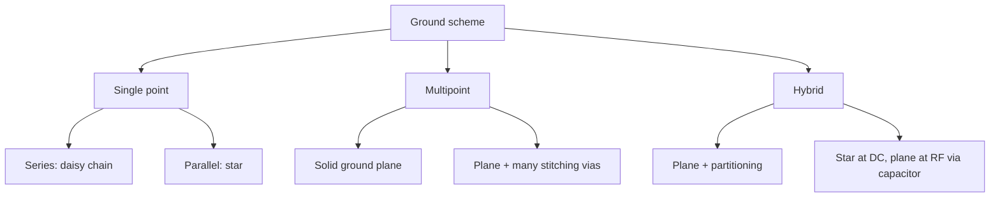

::: basics
### In plain words
A ground layout scheme is the way you wire ground on a board. In single-point grounding, every circuit returns to one common point, either in a chain or in a star with a separate path for each circuit. In multipoint grounding, a solid ground plane lets every circuit drop into ground at the nearest spot. A hybrid mixes the two. Low-frequency, sensitive circuits tolerate a star. Fast digital circuits need a plane. Most modern boards use a plane with careful placement.

### Picture it
Think of drainage in a neighborhood. In a chain, all the houses empty into one shared pipe, so the last house sees everyone else's flow. In a star, each house has its own pipe to a treatment plant, so no house affects another. In a plane, the whole neighborhood sits on a flat, tiled floor with drains everywhere, so water leaves right where it lands. The analogy is loose: at high frequency a star's long pipes behave like inductors and the plane wins.

### Words you need
- **Common-impedance coupling**: a shared ground segment turns one circuit's current into noise for another ([[q0484]]).
- **Series (daisy-chain) ground**: circuits connected in a line to one ground point.
- **Star (parallel) ground**: each circuit has its own return to a common point ([[q0495]]).
- **Multipoint ground**: connecting every circuit to a plane at the nearest point ([[q0486]]).
- **Partitioning**: grouping analog, digital and power circuits into regions so their returns stay apart ([[q0493]]).

### The simplest example
Take a 50 mm ground trace, 0.25 mm wide in 1 oz copper. It is about 98 mΩ with about 60 nH of inductance, so inductance takes over above roughly 250 kHz. At 1 MHz its impedance is about 0.39 Ω. A 10 mA return current then shifts the ground by about 4 mV, which is about 5 LSB on a 12-bit, 3.3 V ADC (0.8 mV per LSB). One square of plane is only about 1.6 mΩ at 1 MHz, so the same current gives about 0.02 mV. That is the whole idea. The rest of this page compares the four schemes, why frequency decides, and a mixed-signal example.
:::

::: testing
Whether you can name the standard ways of wiring ground on a board and, more importantly, say **when each one wins**. The hidden sub-skills are:

1. Knowing that every ground connection has resistance *and* inductance, so a "ground" is really a shared impedance carrying other circuits' return currents.
2. Separating **single-point** (series and parallel/star), **multipoint** (ground plane) and **hybrid** schemes.
3. Tying the choice to frequency: low-frequency analog tolerates a star, high-speed digital needs a plane.
4. Mentioning split or partitioned planes and why they are controversial.
:::

::: why
Most "mystery" board problems (an ADC that reads noise whenever the radio transmits, a microcontroller that resets when a motor starts, a board that fails EMC) are really ground problems. A schematic shows one ideal ground symbol. The PCB has dozens of centimetres of copper between those symbols, and each segment has resistance, inductance and a return current flowing through it. Choosing the ground scheme is choosing where those return currents go and who shares a path with whom. Interviewers ask this because the answer shows whether you think of ground as a node or as a conductor.
:::

::: concepts
- **Ground is a conductor, not a node.** Every segment has $R$ and $L$, so current through it creates a voltage ($IR + L\,di/dt$). See [[q0484]].
- **Common-impedance coupling.** Two circuits that share a return path disturb each other through the voltage drop on the shared segment. See [[q0001]] and [[q0004]].
- **Return current follows the path of least impedance**: DC takes least resistance, high-frequency takes least inductance, which means directly under the signal trace. See [[q0486]].
- **Single-point vs multipoint grounding**: connect each circuit to ground at one place, or at as many places as possible.
- **Ground plane**: a solid copper layer that gives the lowest $R$ and $L$ ([[q0486]], [[q0488]]).
- **Partitioning**: grouping analog, digital and power circuitry into regions so their return currents stay out of each other's way ([[q0493]]).
:::

::: answer
"There are really three families. The first is single-point grounding, where every circuit gets its own wire or trace back to one common point. That comes in a series or daisy-chain version, which is simple but lets circuits share return paths, and a parallel or star version, where each circuit has a dedicated return, so nothing shares an impedance except at the star point. The second is multipoint grounding, which is basically a solid ground plane: every circuit drops straight into the plane through the nearest via, so the return path is as short and as low inductance as possible. The third is a hybrid, where you use a plane for everything but partition the board so noisy digital and power returns stay in their own region and the sensitive analog area sits in a quiet corner, joined at one place.

Which one I pick depends on frequency. Below roughly a megahertz, the resistance of the ground path dominates and a star keeps return currents from sharing a drop. Above ten megahertz or so, inductance dominates, long star traces become antennas and high-impedance paths, and you want a plane with lots of vias. Most modern boards are a solid plane with careful placement, plus a star only at the board level, for example where a power input ties analog and digital returns together."
:::

::: technical
**Why the scheme matters.** A ground path of length $\ell$ has $Z_g = R_g + j\omega L_g$. Any return current $I$ flowing through a shared segment produces $V = I\,Z_g$, and that voltage appears as noise in every circuit that references that segment. The goal of a ground scheme is to minimise $|Z_g|$ and to keep high-current or fast-edge returns out of segments shared with sensitive circuits.

**Series (daisy-chain) single point.** Circuits A, B, C connect in a line to the one ground point. Cheapest, but the segment nearest the supply carries the sum of all return currents and the farthest circuit sees every upstream drop. Acceptable only when circuits have similar currents and the sensitive one sits closest to the ground point.

**Parallel (star) single point.** Each circuit has its own return to the star point, so the voltage drop of circuit A's return never appears in circuit B's reference. Best for low-frequency, mixed-level systems, but traces get long, and past about $f = R_g/(2\pi L_g)$ the inductive term dominates.

**Multipoint.** Every circuit connects to a low-impedance ground plane at the nearest point. Link lengths are short, so $L_g$ is small. This is the default above roughly 10 MHz.

**Hybrid.** Plane plus partitioning, or plane plus capacitors: for example a cable shield bonded through a capacitor so it behaves as a star at DC but multipoint at RF.

**Rule of thumb (flag as approximate):** single point below about 1 MHz, multipoint above about 10 MHz, hybrid in between. This guidance is commonly attributed to Henry Ott's EMC texts; the exact thresholds depend on the physical size of the board and edge rates.

**Numbers.** A 50 mm, 0.25 mm wide, 1 oz trace has $R \approx 98\ \text{m}\Omega$ and, with no plane nearby, $L \approx 60$ nH, so the inductive term overtakes the resistive term at only about 250 kHz. A square of 1 oz plane has $R \approx 0.5\ \text{m}\Omega$ and an inductance of roughly $\mu_0 h \approx 0.25$ nH when the plane is 0.2 mm below the signal layer.
:::

::: short
"The main ground layout schemes are single-point, which can be series daisy-chain or parallel star, multipoint, which is a solid ground plane, and hybrids. Star grounding keeps circuits from sharing return impedance and suits low-frequency analog. A plane gives the lowest inductance and is the right answer for fast digital. In practice I use a solid plane, partition the board so noisy and quiet circuits don't share return paths, and join sections at one controlled point."
:::

::: long
"I'd start with what ground really is on a board: it's copper with resistance and inductance, and every circuit's return current flows through it. So the layout scheme is really about who shares a return path with whom.

First family: single-point grounding. In the series version you daisy-chain circuits to one ground point. It's easy, but the circuit furthest along sees the drops of everything upstream, so a noisy power stage can corrupt a sensor. The parallel version is the star: each circuit has its own return to a single point, so one circuit's current can't create a voltage in another's reference. That's great at low frequency for mixed analog and power, but the traces are long, and once you're past a few hundred kilohertz their inductance dominates and the star stops working.

Second family: multipoint grounding, where you pour a solid ground plane on a layer next to the signals and connect every part to it with a short via. High-frequency return current naturally flows right under the signal trace, so the loop area and inductance are tiny. That's the default for anything with fast edges.

Third, hybrids. Almost every real board is a plane, with the layout partitioned: motor drivers and switching regulators in one area, digital in another, analog front end in a quiet corner, and the zones tied together at one place such as near the power entry or under an ADC. Sometimes people cut the plane into islands, but I'm cautious about that, because a signal crossing a split loses its return path and radiates.

My rule of thumb is single-point below about a megahertz, plane above about ten, and a hybrid between, but the real answer is to look at the return current paths for the worst-case signals."
:::

::: terms
- **Single-point ground**: every circuit connects to ground at one location.
- **Series (daisy-chain) ground**: circuits share one return line that picks up each circuit in turn.
- **Parallel / star ground**: each circuit has its own dedicated return to a central point.
- **Multipoint ground**: each circuit grounds to a plane at the nearest point.
- **Common-impedance coupling**: noise caused by two circuits sharing a return segment.
- **Return current**: the current that flows back to the source; at high frequency it hugs the signal trace.
- **Ground partitioning**: placing circuit blocks so their return currents do not overlap.
- **Hybrid ground**: a scheme that behaves as single-point at low frequency and multipoint at high frequency.
:::

::: exceptional
An average answer lists "star, daisy-chain, plane" and stops. An exceptional one:

- Starts from "ground is an impedance, $Z = R + j\omega L$", and defines the schemes by *who shares a return segment*.
- Gives the frequency rule and a number showing why: a 50 mm trace crosses over from resistive to inductive near 250 kHz, a plane doesn't until much higher.
- Explains that a plane is not "no scheme": **placement and partitioning** still decide where return current flows.
- Raises the split-plane controversy and the safe pattern (one bridge, signals cross only at the bridge).
- Names a concrete hybrid, such as a cable shield tied through a capacitor, or an ADC under which analog and digital return are joined.
:::

::: mistakes
- **"Star grounding is always best."** At high frequency a star's long traces are inductive. Use it for low-frequency, mixed-signal power distribution, not for fast digital.
- **"A ground plane means I can ignore ground."** Current still takes the lowest-impedance path; a slot or a noisy block placed beside an ADC can still cause trouble.
- **Treating ground as zero volts everywhere.** It is a conductor with a voltage drop; see [[q0497]].
- **Cutting the plane into islands by default.** Signals crossing the gap lose their return path. See [[q0496]].
- **Mixing up ground with earth/chassis.** Safety earth and chassis are separate concepts with their own connection rules.
:::

::: deep
## First principles: ground is a shared impedance

The ideal ground symbol is a single node at 0 V. On a real board, "ground" is a network of copper segments. Take any segment and model it as a resistor in series with an inductor:

$$Z_g(f) = R_g + j\,2\pi f L_g$$

If two circuits, A and B, return their currents through the same segment, the voltage across that segment is $V = (I_A + I_B)\,Z_g$. Circuit A's reference voltage now moves whenever circuit B draws current. That is **common-impedance coupling**, and it is the single idea behind every ground layout scheme.

```circuit
{"elements":[
 {"t":"V","a":[0,2],"b":[0,6],"label":"V_{S}"},
 {"t":"wire","pts":[[0,2],[0,0],[11,0]]},
 {"t":"R","a":[5,0],"b":[5,4],"label":"Load A\n(sensitive)"},{"t":"dot","at":[5,0]},
 {"t":"R","a":[11,0],"b":[11,4],"label":"Load B\n(noisy)"},
 {"t":"wire","pts":[[0,6],[1,6]]},{"t":"gnd","at":[0,6]},
 {"t":"R","a":[1,6],"b":[4,6],"label":"R_{g1}","labelSide":"other"},
 {"t":"wire","pts":[[4,6],[7,6]]},
 {"t":"wire","pts":[[5,4],[5,6]]},{"t":"dot","at":[5,6]},
 {"t":"R","a":[7,6],"b":[10,6],"label":"R_{g2}","labelSide":"other"},
 {"t":"wire","pts":[[10,6],[11,6],[11,4]]},
 {"t":"text","at":[5.5,8.6],"text":"Series (daisy-chain) ground: A's reference sits on top of R_g1 carrying A + B return current","anchor":"middle","muted":true}
]}
```
Figure: In a daisy-chain ground, the return current of the noisy Load B flows through R_g2 and then R_g1. The sensitive Load A shares R_g1, so its ground reference moves by (I_A + I_B)·R_g1 every time B changes current.

## The four layout schemes

**1. Series single-point (daisy chain).** Simple, one trace, but the segment nearest the source carries everything. Put the most sensitive circuit nearest the ground point and the noisiest farthest away if you must use it.

**2. Parallel single-point (star).** Each circuit has a dedicated return. The shared impedance shrinks to whatever is at the star point itself. We cover this scheme in detail in [[q0495]].


Figure: A quick taxonomy. The choice between branches is driven by frequency, current levels and how sensitive the circuits are.

**3. Multipoint (ground plane).** The plane acts as a very wide, short conductor. Resistance is tiny (about 0.5 mΩ per square for 1 oz copper) and, importantly, inductance per square is set by the distance to the signal layer $h$: $L_{sq} \approx \mu_0 h$. With $h = 0.2$ mm that is about 0.25 nH, 200 times lower than a 50 mm trace with no plane nearby.

**4. Hybrid.** Real designs combine the two: a plane, but with placement and routing that deliberately keep return paths separate.

## Why frequency decides

```plot
{"title":"Ground path impedance: 50 mm trace vs 1-square plane","x":{"label":"f","unit":"Hz","min":1e4,"max":1e9,"log":true},"y":{"label":"|Z|","unit":"Ω","min":1e-4,"max":1e3,"log":true},
 "vars":{"rt":0.098,"lt":"60e-9","rp":"0.49e-3","lp":"0.25e-9"},
 "series":[{"label":"50 mm trace, no plane","fn":"sqrt(rt^2+(2*pi*x*lt)^2)","color":"red"},{"label":"1 square of 1 oz plane","fn":"sqrt(rp^2+(2*pi*x*lp)^2)","color":"accent"}],
 "vlines":[{"at":"rt/(2*pi*lt)","label":"trace corner ≈ 260 kHz"}]}
```
Figure: Below the corner frequency both paths look like resistors, and a star is fine. Above it the trace turns inductive and its impedance climbs at 20 dB/decade, while the plane stays two orders of magnitude lower. Skin effect adds resistance at very high frequency, which this simple model leaves out.

Numbers from the plot: at 1 MHz a 10 mA return current across the trace produces about $0.01 \times 0.39 \approx 4$ mV of ground shift, enough to be several LSBs of a 12-bit ADC with a 3.3 V range (1 LSB is 0.8 mV). Over one square of plane the same current gives about 0.02 mV (1.6 mΩ at 1 MHz).

## Where the return current actually goes

At DC, return current spreads out across the whole plane in proportion to conductance. As frequency rises it concentrates directly beneath the signal trace, because the loop with least inductance is the loop with least area. This is why the *plane under the trace* matters more than the plane's total size. A plane with a slot under a trace forces the return to detour around the slot, increasing loop area, inductance and radiation.

## Partitioned and split planes

Partitioning means grouping circuits into regions (analog, digital, power) and arranging the layout so currents stay in their region. It does not require cutting the plane. A **split plane** physically separates ground into islands joined at a single point. Splits work when no signal crosses the gap and the connection is under the mixed-signal device, but any trace crossing a split loses its image current path, so the loop opens up. The decision is covered in [[q0496]] and [[q0493]].

## A worked mixed-signal example

Suppose a board has a 12-bit ADC (3.3 V, 0.8 mV/LSB), a switching 5 V buck that draws pulses of 2 A, and an MCU. The buck's input capacitor loop carries 2 A edges at 1 A/ns-ish rates:

1. **Don't** chain the buck's power ground, the MCU and the ADC on one trace; every buck edge appears as $L\,di/dt$ on the ADC reference.
2. **Do** keep the buck's high-$di/dt$ loop (input cap, switch, diode/sync FET) compact on the top layer with its own short ground return to the plane.
3. **Do** place the ADC and its reference away from the buck, with the plane unbroken underneath, and route its analog input over the quiet plane region.
4. **Do** make a single deliberate connection of regions if you partition: usually the plane is continuous, and the "partition" is only placement.

## What real hardware looks like

A typical 4-layer board is Signal / GND / Power / Signal. The second layer is an unbroken ground plane, so *every* surface signal has a nearby return. Stitching vias around the edges and next to layer-transition vias keep the return path short ([[q0487]]). Test points and probe points are placed on the ground so you can measure ground noise itself ([[q0492]]).

> [!INTERVIEW]
> If you only have 30 seconds, say: "Ground is an impedance, so I choose the scheme by who shares a return path. Star for low-frequency mixed-signal, plane for fast edges, and in practice a plane with partitioned placement."

> [!UNCERTAIN]
> The 1 MHz and 10 MHz boundaries for single-point versus multipoint are a rule of thumb that appears in EMC texts. Real crossovers depend on board size, edge rate and the circuits involved, so treat them as guidance, not limits.
:::

::: applications
- **Four-layer MCU board**: signal/GND/PWR/signal stackup, with the unbroken GND plane under the signals (multipoint).
- **Precision data-acquisition board**: analog front end placed in one region, a single connection of analog and digital returns under the ADC.
- **Audio amplifier**: the speaker return currents are brought back to a star point at the power-supply capacitors so they never share a trace with the preamp reference.
- **Motor-control PCB**: power-stage ground (high current) kept as a separate heavy pour, joined to the logic ground at one point near the shunt or driver.
- **RF boards**: unbroken plane with dense via stitching, since all grounding is multipoint at those frequencies.
:::

::: assumptions
- Board-level conductors are the concern. Cable shields, chassis and safety earth have their own rules.
- Numbers assume 1 oz (35 µm) copper, a 0.2 mm dielectric between signal and plane, and a trace with no nearby reference. Real values shift with stackup.
- The single-point versus multipoint frequency rule is a rule of thumb, not a standard.
- If the system is purely digital with no sensitive analog, a plain solid plane is almost always the right answer. If you are building a high-resolution (16 bit or more) analog front end, star-like placement matters more.
- Some designers prefer a split plane for mixed-signal; others say never split. Both can work if signal routing is controlled ([[q0496]]).
:::

::: followups
### Which scheme would you use for a board with a 24-bit ADC and a motor driver?
A solid plane on layer 2, with the motor driver and its bulk capacitors in one corner and the ADC in the opposite corner. I'd keep the motor's high-current return path a short, wide route straight back to the supply input, join everything at the power entry, and run no digital or motor trace over the ADC's region. A star on a separate power ground can make sense if the motor current is many amps, tied to the logic ground at one point.

### Why does single-point grounding fail at high frequency?
The wires or traces needed to reach the single point are long, so their inductance is large. A 50 mm trace is about 60 nH, which is 0.4 Ω at 1 MHz and 38 Ω at 100 MHz. That makes the "ground" at the circuit far from 0 V, and the long return makes a big loop that radiates.

### What's the difference between series and parallel single-point grounding?
In series, circuits share one run of ground wire and pick up each other's return drops. In parallel (star), each circuit has its own return, so the only shared impedance is at the point itself. Parallel is better electrically but costs more wiring.

### What if my ground plane is split and a clock crosses the split?
The clock's return current can't follow it, so it detours to the nearest bridge, enlarging the loop. You get ringing, crosstalk and radiated emissions. Fix it by routing the clock over the bridge, adding a stitching capacitor across the split, or removing the split.

### Scenario: your ADC reading changes when the MCU toggles an LED. How do you debug it?
I'd look at the shared return first. Probe ground-to-ground between the ADC's ground pin and the LED return with a short ground spring. If I see a mV-level step when the LED switches, the LED current shares an impedance with the ADC reference. I'd route the LED return directly to the plane at a different via, or add a local connection to the star point, and reduce the LED current edge with a resistor or slower GPIO.
:::

::: interpretations
"Ground layout schemes" most likely means *topologies of ground distribution* (single-point series and parallel, multipoint, hybrid) rather than the physical features of a plane. If the interviewer wants *layout practices* in general, widen to plane, pour, stitching and partitioning, as covered in [[q0485]]. Star grounding gets its own question at [[q0495]], and the analog/digital separation decision at [[q0496]].
:::

::: references
- Henry W. Ott, *Electromagnetic Compatibility Engineering*: chapters on grounding, covering single-point, multipoint and hybrid grounding.
- Howard Johnson and Martin Graham, *High-Speed Digital Design: A Handbook of Black Magic*: chapters on grounding and return paths.
- Eric Bogatin, *Signal and Power Integrity: Simplified*: chapters on ground, return paths and loop inductance.
- Horowitz and Hill, *The Art of Electronics*, 3rd ed.: the section on grounding and ground loops in the chapter on construction techniques.
:::

::: rubric
- Names single-point (series and parallel/star), multipoint (plane) and hybrid schemes :: The question asks for "some" schemes, and the standard taxonomy is what the interviewer is listening for.
- Explains ground as an impedance with R and L and common-impedance coupling :: This is the reason any scheme exists; without it the list is just memorised jargon.
- Ties the scheme choice to frequency with a rough threshold :: Shows you know star works at low frequency and a plane at high frequency, and why.
- Explains why multipoint/plane has low inductance (short, wide, close to the signal) :: This is the physical justification for the default modern choice.
- Mentions partitioning or hybrid practice and the split-plane caution :: Real boards are hybrids; the caution shows experience.
- Gives a concrete example (ADC with motor driver, power entry join) :: Examples show you can apply the schemes, not only list them.
:::

::: quiz
```json
[
 {"type":"mcq","level":"fundamental","q":"Which scheme gives each circuit its own dedicated return path to one common point?","options":["Series (daisy-chain) ground","Multipoint ground","Parallel (star) ground","A split plane"],"answer":2,"explain":"A star (parallel single-point) ground gives each circuit its own return, so no two circuits share a return segment. Daisy-chain shares one run, and multipoint connects each circuit to a plane at the nearest point."},
 {"type":"mcq","level":"fundamental","q":"For fast digital logic with edge rates of 1 ns, which ground scheme is the usual default?","options":["Star with long traces","Series daisy-chain","A solid ground plane with short connections (multipoint)","A floating ground"],"answer":2,"explain":"At fast edge rates inductance dominates, so you want the shortest, widest return, which is a plane under the signals. Long star traces are inductive."},
 {"type":"numeric","level":"intermediate","q":"A ground return trace has $L = 60$ nH. What is the magnitude of its reactance at 100 MHz? (Give in ohms; ignore resistance.)","answer":37.7,"tolerance":0.02,"unit":"Ω","explain":"$X_L = 2\\pi f L = 2\\pi \\cdot 10^8 \\cdot 60\\times10^{-9} = 37.7\\ \\Omega$. Even small currents create large voltages over this."},
 {"type":"numeric","level":"intermediate","q":"The trace in a daisy-chain ground has $R = 0.1\\ \\Omega$ and carries 50 mA of combined return current at DC. What ground shift does a sensitive circuit at the end of that segment see, in mV?","answer":5,"tolerance":0.02,"unit":"mV","explain":"$V = IR = 0.05 \\times 0.1 = 5$ mV. For a 12-bit ADC with 3.3 V range (0.8 mV/LSB) that is more than six LSBs."},
 {"type":"truefalse","level":"advanced","q":"Splitting a ground plane into analog and digital islands always lowers noise, even if signals cross the split.","answer":false,"explain":"A trace crossing a split loses its image return current directly beneath it. The return detours, the loop area and inductance grow, and emissions and crosstalk increase. Splits only help if no signals cross them except at a deliberate bridge."},
 {"type":"multi","level":"advanced","q":"Select all that are reasons a plane (multipoint) beats a long star trace above about 10 MHz.","options":["Lower loop inductance because the return runs directly under the signal","Lower DC resistance of copper at RF","Shorter connections from each part to ground","Return current spreads over a wide conductor"],"answer":[0,2,3],"explain":"Planes win through low inductance: short connections, close coupling to the signal and a wide conductor. Copper's DC resistance is not the reason; at RF inductance sets the impedance."}
]
```
:::
