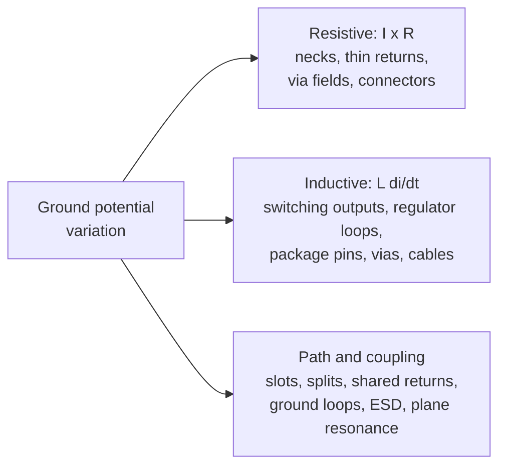

::: basics
### In plain words
Voltage differences appear across ground for a few distinct physical reasons. Resistive drop is steady current flowing through the resistance of ground copper. Inductive drop is fast-changing current flowing through ground inductance. Path distortion is slots, splits and crowded via areas that force current to detour. And coupled sources are fields and outside connections that push voltage into ground. Knowing which one you have tells you which fix to use.

### Picture it
Think of a road network. A narrow road slows every car a little: that is resistive drop. A heavy truck that must suddenly change speed shoves everything around it: that is inductive drop, where the fast change is the problem. A road closure forces a long detour: path distortion. And a loud concert next door shaking the whole street is coupling. Each problem needs a different fix: widen the road, slow the truck, reopen the road or soundproof the street. The analogy is loose, since current is not traffic.

### Words you need
- **Sheet resistance**: the resistance of one square patch of copper, any size, about 0.49 mΩ for standard 1 oz foil.
- **Inductance**: resistance to sudden changes in current. The voltage it makes is $V = L\,di/dt$, inductance times the rate of change.
- **Ground bounce**: a ground shift when many outputs switch at once.
- **Plane discontinuity**: a slot, split or via cluster that forces return current to detour ([[q0486]]).
- **Ground loop**: a closed ground path that picks up magnetic fields ([[q0497]]).

### The simplest example
For the resistive source, 5 A flowing across 3 squares of 1 oz copper gives $5 \times 3 \times 0.49\ \text{m}\Omega \approx 7.4$ mV. For the inductive source, a 1 nH connection carrying a current that changes by 1 A per nanosecond gives $L\,di/dt = 1\ \text{nH} \times 1\ \text{A/ns} = 1$ V. Same ground, different mechanism: the first needs more copper, the second needs a smaller loop and closer decoupling capacitors. That is the whole idea. The rest of this page lists typical culprits and sizes for each mechanism and ties them together on one example board.
:::

::: testing
Whether you can list the real physical causes of ground voltage differences and group them by mechanism, rather than saying "noise". The hidden sub-skills:

1. Separating **resistive** ($IR$), **inductive** ($L\,di/dt$) and **coupled** (external fields, capacitive, shared return) sources.
2. Knowing which layout features create each one (neck-downs, slots, via fields, connectors, package pins).
3. Estimating the size of each with a quick calculation.
4. Tying the cause to the cure, which sets up [[q0499]].
:::

::: why
If you can't name the source you can't fix it. A ground offset that is mostly DC IR drop is cured with copper; one that is $L\,di/dt$ is cured by loop area and decoupling; one that is coupled from outside needs shielding or isolation. In interviews, answering with a *categorised* list plus numbers separates engineers who have debugged a real board from those who recite "noise and parasitics".
:::

::: concepts
- **Ohmic drop**: $V = IR$ along a ground conductor; sheet resistance of 1 oz copper is about 0.5 mΩ per square. See [[q0001]].
- **Inductive drop**: $V = L\,di/dt$; any fast current in any ground conductor. See [[q0509]].
- **Shared return (common impedance)**: two circuits using one path ([[q0494]]).
- **Plane discontinuities**: slots, splits, antipads and via fields force return current to detour ([[q0486]]).
- **Magnetic and electric coupling**: ground loops pick up flux; electric fields couple through capacitance.
- **Plane-pair resonance**: the power/ground plane pair is a cavity with resonances at $f = c/(2\ell\sqrt{\varepsilon_r})$.
:::

::: answer
"I group the sources into three buckets. The first is resistive: any DC or low-frequency current through ground copper makes an IR drop. 5 amps across three squares of one-ounce copper, which is about half a milliohm per square, gives about 7 millivolts, and neck-downs, thin traces, vias and connector pins make it much worse.

The second is inductive, which is usually the bigger one on fast boards. Every time current changes quickly through any ground path, you get L di/dt. That happens when many outputs switch at once, called ground bounce or SSN, with switching regulators and their hot loops, through package ground pins and through connectors and cables. A nanohenry with a 1 amp per nanosecond edge is a volt.

The third is everything that changes the path or injects voltage: slots, splits and via fields that force return currents to detour, shared return paths between noisy and quiet circuits, magnetic pickup in ground loops, capacitive coupling from nearby noisy nodes, and resonances of the power-ground plane pair. Even external things like ESD events or a cable connected to a different ground can inject voltage. Once I know which bucket it is, the cure is different: more copper, smaller loops and better decoupling, or breaking the loop."
:::

::: technical
**1. Resistive (DC and low frequency).**
$$\Delta V = I\,R_{sq}\,N_{sq},\qquad R_{sq}=\frac{\rho}{t}\approx 0.49\ \text{m}\Omega\ \text{(1 oz, 35 µm)}$$
where $N_{sq}$ is the number of squares (length/width) the current traverses. 5 A over 3 squares: 7.4 mV. A 2 mm wide, 10 mm long neck (5 squares) carrying 5 A: 12 mV. Contributors: narrow necks between regions, via fields that perforate the plane, long thin ground traces, connector contact resistance (tens of mΩ per pin), and small ground pour areas fed from one edge.

**2. Inductive (fast current).**
$$\Delta V = L\frac{di}{dt}$$
- *Simultaneous switching* of $N$ outputs through shared pin inductance: $V = N L\,di/dt$.
- *Switching-regulator hot loops*: a few nH with several amps in ~10 ns.
- *Connector and cable ground pins*: ~10 nH per pin. 1 A in 10 ns → 1 V.
- *Vias and package leads*: each ~0.5–1.5 nH.

**3. Path distortion.** Slots, splits, antipad clusters and plane cutouts make return current detour. The loop grows, so $L$ grows; a trace crossing a gap develops tens of nH of extra inductance.

**4. Coupled sources.**
- *Magnetic*: flux $\Phi$ through a ground loop induces $V = d\Phi/dt$ in it.
- *Electric*: noisy nodes couple through $C\,dV/dt$ into high-impedance ground paths.
- *External*: ESD, EFT, a cable referenced to a different ground, lightning-induced common-mode.

**5. Plane resonance.** A power-ground plane pair of length $\ell$ resonates near $f_n = n\,c/(2\ell\sqrt{\varepsilon_r})$; for 100 mm on FR-4 ($\varepsilon_r\approx 4.2$) the first mode is near 730 MHz, where noise can build up in the planes.
:::

::: short
"I group the sources into resistive, inductive and coupled. Resistive is IR drop through copper, about half a milliohm per square for one-ounce copper, made worse by neck-downs, vias and connectors. Inductive is L di/dt from fast current: simultaneous switching, switching-regulator loops, package pins and connectors, and it's usually larger on fast boards. Coupled covers return paths detoured by slots, shared returns, ground loops picking up magnetic fields, and external injection like ESD or a cable at another potential."
:::

::: long
"I find it easiest to sort the sources by mechanism, because each one has a different cure.

First, resistive drops. Return current times the resistance of the copper it flows through. One-ounce copper is about half a milliohm per square, so 5 amps across three squares is about 7 millivolts. It gets worse wherever the copper narrows: a neck between two regions, a ground trace instead of a plane, a field of vias that perforates the plane, a connector pin with tens of milliohms of contact resistance. This is the DC and slow part, and it matters for precision analog.

Second, inductive drops, V equals L di/dt. This is usually the bigger problem on modern boards because edges are fast. Eight outputs switching together through five nanohenries of package ground gives you most of a volt, that's ground bounce. A switching regulator's input loop does the same with amps. Connector pins are about ten nanohenries each, so one amp in ten nanoseconds is a volt. Vias and package leads add a nanohenry apiece.

Third, anything that distorts the return path or injects a voltage. A slot or split in the plane makes the return detour, which makes the loop bigger. Shared return paths between a noisy circuit and a quiet one couple them. Ground loops pick up magnetic flux, and a board connected through a cable to something at a different ground sees that offset. ESD and external fields inject too, and at high frequencies the power and ground planes themselves are a cavity that can resonate, around 730 megahertz for a 100 millimetre FR-4 board.

Once I can say which bucket, I know the cure: more copper for resistive, smaller loops and decoupling for inductive, and fix the path or break the loop for the third."
:::

::: terms
- **Sheet resistance**: resistance of a square of conductor; $\rho/t$, about 0.49 mΩ/sq for 1 oz copper.
- **IR drop**: voltage across a conductor due to current through its resistance.
- **L di/dt**: voltage across an inductance caused by changing current.
- **Ground bounce / SSN**: ground shift caused by simultaneous switching through shared inductance.
- **Antipad**: clearance hole in a plane where a via passes through without connecting.
- **Common-impedance coupling**: disturbance through a shared conductor.
- **Ground loop**: a closed conductive loop through grounds that picks up magnetic noise.
- **Plane resonance**: standing-wave modes of a power/ground plane pair.
:::

::: exceptional
An average answer lists "current, switching and noise". An exceptional one:

- Groups causes into **resistive, inductive, path/coupling**, and gives the equation for each.
- Quotes quick numbers: ≈0.5 mΩ/sq → 7 mV for 5 A over 3 squares; ~10 nH per connector pin → 1 V for 1 A/10 ns; ~0.5–1.5 nH per via.
- Points at *layout features* that create the problem: neck-downs, via-field "Swiss cheese", slots, splits, thin returns through connectors.
- Mentions external injection (ESD, cable at other potential) and plane resonance, not just on-board current.
- Says which cure targets which source.
:::

::: mistakes
- **Calling everything "noise".** The cure depends on mechanism; say which.
- **Only counting DC IR drop.** On fast boards the $L\,di/dt$ drop is typically larger.
- **Thinking a plane has zero resistance.** It is low, but 10 A in a neck of a few squares is tens of mV.
- **Forgetting connectors.** A single ground pin between boards is often the largest impedance in the whole return path.
- **Overlooking via fields and anti-pads.** A row of closely spaced vias can slice a plane so current must squeeze between them.
:::

::: deep
## Three mechanisms, one equation

Between any two points on a ground network, the voltage difference is, to first order,

$$\Delta V(t) = I(t)\,R + L\frac{dI(t)}{dt} + \text{(induced and injected terms)}$$

The resistive and inductive terms come from current you already have in the circuit. The induced and injected terms come from fields and external connections. The sources below are all ways to make one of those terms large.

## Resistive sources

A plane is a resistor sheet. A square of any size has the same resistance, $R_{sq}=\rho/t$. For 1 oz copper ($t = 35$ µm, $\rho = 1.72\times10^{-8}\ \Omega\text{m}$) that is 0.49 mΩ. Count squares along the current path and multiply.

```plot
{"title":"DC ground drop vs return current (1 oz copper)","x":{"label":"I","unit":"A","min":0,"max":10},"y":{"label":"ΔV","unit":"V","min":0,"max":0.1},
 "vars":{"rs":"0.49e-3"},
 "series":[{"label":"3 squares (open plane)","fn":"x*rs*3"},{"label":"5 squares (2 mm neck, 10 mm long)","fn":"x*rs*5","color":"orange"},{"label":"20 squares (thin ground trace)","fn":"x*rs*20","color":"red"}],
 "points":[{"x":5,"y":"5*rs*3","label":"7.4 mV"},{"x":5,"y":"5*rs*5","label":"12 mV"}]}
```
Figure: DC drop grows linearly with current and with the number of squares. Even a few milliohms matter: 5 A through a 20-square trace gives about 49 mV, a large error for a precision converter, while an open plane keeps it near 7 mV.

Common resistive culprits:

- **Neck-downs** where the plane squeezes between mounting holes, connectors or a keep-out.
- **Via fields** (BGA breakout, connector pin fields) that remove copper in rows, so current has to weave between holes.
- **Thin return traces** used in place of a plane on a 2-layer board.
- **Connector contacts** and board-to-board links: 10–50 mΩ per pin is typical (vendor-dependent).
- **Single-point feeds**, where the whole board's return enters at one corner so current crosses the entire board.

## Inductive sources

Fast current changes through *any* inductance produce a voltage. The inductance may be tiny (1 nH) but $di/dt$ is huge in modern logic:

```sim
{"id":"ground-bounce","n":16,"l":3e-9,"cl":15e-12,"tr":1e-9,"vdd":3.3}
```
Figure: With 16 outputs and 3 nH of shared ground inductance the bounce is large. Reduce L (more ground pins, closer decoupling), slow the edge, or cut N, and watch the false-trigger margin return.

Typical inductive sources and sizes:

| Source | Typical inductance | Example drop |
|---|---|---|
| IC package ground lead / bond wire | 1–5 nH | 8 outputs × 20 mA / 1 ns through 5 nH ≈ 0.8 V |
| One via through a 1.6 mm board | ≈1.3 nH (Johnson-style estimate for 0.3 mm drill) | 1 A in 5 ns ≈ 0.26 V |
| Connector ground pin | ≈5–15 nH | 1 A in 10 ns ≈ 1 V |
| Switching regulator hot loop | 2–10 nH | 3 A in 5 ns through 5 nH ≈ 3 V (typically the origin of SW-node ringing) |
| Ground wire 100 mm | ≈100 nH | 100 mA in 10 ns ≈ 1 V |

(The via figure uses the commonly quoted partial-inductance formula $L\approx 5.08\,h\,[\ln(4h/d)+1]$ nH with $h$ and $d$ in inches; treat it as an estimate.)

## Path distortion

A signal's return current at high frequency flows in the plane directly under the trace. Anything in that plane that stops it, such as a slot, a split, a cutout, or a dense row of antipads, forces the return to detour. The extra loop area adds inductance and, more importantly for ground potential, makes the "ground" under one end of the trace a different voltage from the other end because the same return current now flows through a longer, higher-inductance path. A trace crossing a gap can easily add tens of nH.


Figure: A map of where ground voltage differences come from. Each box lists the specific layout and system features to look for when debugging.

## Coupled and external sources

- **Ground loops.** Any loop enclosing area $A$ in a magnetic field $B(t)$ picks up $V = A\,dB/dt$. Two boards connected by both a cable shield and a signal ground form a loop.
- **Capacitive coupling.** A noisy node with fast $dV/dt$ injects current $C\,dV/dt$ into any nearby high-impedance ground path, for example the SW node of a buck near a sensitive trace.
- **Cable at another potential.** Two pieces of equipment on different mains outlets can have ground offsets of volts at 50/60 Hz and noise at kHz–MHz; the offset appears across the connecting cable's ground.
- **ESD and EFT.** A discharge into a connector pushes tens of amps in nanoseconds through ground; even a nanohenry gives tens of volts. Fast TVS parts and ground connection geometry decide how much reaches the circuit.
- **Plane resonance.** The power/ground pair is a parallel-plate cavity. For a 100 mm board on FR-4 ($\varepsilon_r\approx4.2$), the first resonance is about $c/(2\ell\sqrt{\varepsilon_r}) \approx 730$ MHz. Edge-rate content at that frequency can excite it, producing standing-wave voltage between planes. Decoupling capacitors and thin dielectrics damp this.

## Putting it together on a real board

Consider a 4-layer MCU board with a 5 V buck feeding 3.3 V logic and a 12-bit ADC:

1. The buck's input capacitor loop (1.5 nH, 2 A edges in 10 ns) puts about $1.5\text{ nH}\times 0.2\text{ A/ns}=0.3$ V on the ground right next to it unless the loop is tiny.
2. The MCU has 40 outputs; when 16 toggle together through 3 nH of package ground, bounce is a volt or more (the sim above shows about 2.3 V), a danger to quiet inputs and the ADC reference.
3. The connector to a sensor board has a single ground pin of 10 nH; the sensor's 5 mA edge in 5 ns gives 10 nH × 1 mA/ns = 10 mV of offset between the boards.
4. The plane has a slot where a mounting hole and a connector keep-out nearly meet: a 3 A return crosses 3 squares of copper: 4.4 mV DC, plus a detour.

Each is a different mechanism, and fixing them takes different tools ([[q0499]]).

> [!UNCERTAIN]
> Via, pin and loop inductance values are typical estimates (they depend on geometry, return path and vendor). Use them for order of magnitude, and use a field solver or datasheet when you need more.
:::

::: applications
- **Switching regulator layout**: shrinking the hot loop to cut $L\,di/dt$ ground shift next to the converter.
- **Microcontroller I/O banks**: limiting simultaneous output switching and adding ground pins to cut bounce.
- **Board-to-board connectors**: dedicating many pins to ground and spreading them among signals to cut shared return inductance.
- **Data-acquisition boards**: keeping the ADC away from via fields, necks and high-current returns.
- **ESD protection design**: placing TVS and ground connection at the connector so the surge current doesn't cross sensitive ground.
:::

::: assumptions
- 1 oz (35 µm) copper, 0.49 mΩ per square; different thicknesses scale inversely.
- Inductances are order-of-magnitude values for typical packages and via geometries.
- The first-order model $IR + L\,di/dt$ ignores skin effect and proximity effects, which raise resistance at high frequency.
- Plane resonance uses a simple rectangular cavity and ignores the presence of components, vias and loading.
- Another way to answer is by *circuit block*: "digital, power stage, connector, analog". The mechanisms are the same.
:::

::: followups
### Which source dominates on a fast digital board, resistive or inductive?
Usually inductive. A few nH with 1 A/ns is a volt, while the DC IR drop of an open plane is milliohms times amps, i.e. millivolts. DC drop still matters for precision analog and for large currents.

### How would you estimate the ground drop from a connector?
Per pin: $R_{contact}\approx$ tens of mΩ and $L\approx$ 5–15 nH (vendor-dependent, check the connector datasheet). 1 A with 10 ns edges gives about 10 nH × 0.1 A/ns = 1 V of $L\,di/dt$. That's why connectors need many ground pins interleaved with the signals.

### Why does a slot in the plane make ground potential worse?
The return current can't flow under the trace across the slot, so it detours around it. The loop area grows, the inductance grows, and the voltage developed along the return for a given $di/dt$ grows. The two sides of the slot can sit at different potentials.

### What if a plane's first resonance falls near a harmonic of your clock?
The planes can amplify noise at that frequency. I'd add decoupling caps with ESR to damp it, reduce plane dimensions or spacing, add stitching vias, and possibly change the clock or add spread spectrum. Damping through ESR and thin dielectric usually helps more than adding cap count.

### Scenario: DC offset between two ADC channels appears only when the heater is on. What do you check?
The heater's several-amp return path. A common culprit is a thin neck or shared ground between the heater and the ADC. 3 A across 5 squares is 7 mV, which is about 9 LSB at 12 bits. I'd measure ground-to-ground with a short ground spring while the heater cycles, then reroute the heater return to the supply directly.
:::

::: interpretations
"Ground plan" is a typo for "ground plane". The question asks for the sources of *potential variation across the ground plane*: the physical causes of voltage differences between points. Consequences of that variation are in [[q0497]], preventive layout in [[q0499]], and system-level resilience in [[q0500]].
:::

::: references
- Henry W. Ott, *Electromagnetic Compatibility Engineering*: sections on common-impedance coupling, ground loops and inductance of conductors.
- Howard Johnson and Martin Graham, *High-Speed Digital Design: A Handbook of Black Magic*: simultaneous switching noise, via and package inductance, and plane resonances.
- Eric Bogatin, *Signal and Power Integrity: Simplified*: partial inductance, ground bounce and return paths.
- Connector manufacturers' datasheets (per-pin contact resistance and inductance figures vary by part).
:::

::: rubric
- Names resistive ($IR$) sources with sheet-resistance numbers :: DC drop through copper is the simplest mechanism, and numbers show practice.
- Names inductive ($L\,di/dt$) sources: SSN, regulators, packages, vias, connectors :: This is the dominant mechanism in fast designs.
- Mentions path distortion (slots, splits, via fields, shared returns) :: Layout features that create or worsen ground drops.
- Mentions coupled/external sources (ground loops, ESD, cables, plane resonance) :: Shows system-level breadth.
- Quantifies at least one example from each category :: Interviewers want to see order-of-magnitude judgement.
- Connects source to cure :: Sets up the follow-up question about avoiding variation.
:::

::: quiz
```json
[
 {"type":"mcq","level":"fundamental","q":"Which expression gives the inductive contribution to a ground voltage difference?","options":["$I R$","$L\\,dI/dt$","$I^2 R$","$C\\,dV/dt$"],"answer":1,"explain":"A changing current through an inductance develops $L\\,dI/dt$. $IR$ is the resistive part and $C\\,dV/dt$ is a coupled current, not a voltage."},
 {"type":"mcq","level":"fundamental","q":"Roughly what is the sheet resistance of 1 oz (35 µm) copper?","options":["0.5 Ω/sq","5 mΩ/sq","0.5 mΩ/sq","50 µΩ/sq"],"answer":2,"explain":"$R_{sq}=\\rho/t = 1.72\\times10^{-8}/35\\times10^{-6}\\approx 0.49$ mΩ per square."},
 {"type":"numeric","level":"intermediate","q":"5 A of DC return current flows through a 2 mm wide, 10 mm long neck of 1 oz copper (0.49 mΩ/sq). What is the voltage drop, in mV?","answer":12.25,"tolerance":0.03,"unit":"mV","explain":"Squares = 10/2 = 5. R = 5 × 0.49 mΩ = 2.45 mΩ. V = 5 A × 2.45 mΩ = 12.25 mV."},
 {"type":"numeric","level":"intermediate","q":"A connector ground pin has 10 nH inductance. A return current changes by 0.5 A in 5 ns. What voltage appears across the pin, in volts?","answer":1,"tolerance":0.02,"unit":"V","explain":"$V = L\\,di/dt = 10\\text{ nH}\\times 0.5\\text{ A}/5\\text{ ns} = 10^{-8}\\times10^{8}=1$ V."},
 {"type":"numeric","level":"advanced","q":"A rectangular power/ground plane pair is 150 mm long on FR-4 ($\\varepsilon_r = 4.2$). Estimate the first resonance $f = c/(2\\ell\\sqrt{\\varepsilon_r})$ in MHz.","answer":488,"tolerance":0.03,"unit":"MHz","explain":"$f = 3\\times10^8/(2\\times0.15\\times\\sqrt{4.2}) = 3\\times10^8/(0.3\\times2.049)=488$ MHz."},
 {"type":"multi","level":"advanced","q":"Select all that can make ground potential vary across a board.","options":["A slot in the ground plane under a fast trace","A single ground pin on a board-to-board connector carrying fast return current","Using more ground vias around a connector","Simultaneous switching of many outputs through a shared package ground"],"answer":[0,1,3],"explain":"Slots force detours, a single connector ground pin has high inductance, and simultaneous switching develops $N L\\,di/dt$. More ground vias lower the impedance and reduce variation."}
]
```
:::
