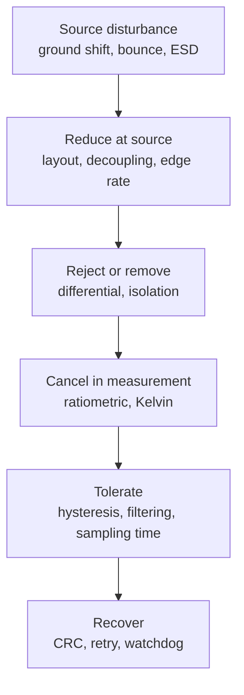

::: testing
Whether you can think **beyond layout**: assuming the ground *will* move, how do you architect the system so that it still works? The hidden sub-skills:

1. Choosing signalling that rejects common-mode offsets (differential, current-mode, isolated).
2. Making measurements ratiometric or differential so offsets cancel.
3. Adding margin and filtering (hysteresis, RC, CRC, retries, watchdogs) so a transient causes a recoverable glitch instead of a failure.
4. Protecting against large events (ESD, surges) with proper clamp and return path.
5. Knowing the cost and limits of each technique.
:::

::: why
Layout rules ([[q0499]]) reduce ground disturbances but never eliminate them, and some are outside your control: a cable plugged into a different supply, a motor on another board, an ESD zap. Products that ship have been designed so that a ground shift is a non-event. Interviewers ask this to find out whether you design *defensively*: the answer separates "I follow layout rules" from "I architect for robustness".
:::

::: concepts
- **Common-mode rejection**: differential receivers and amplifiers respond to the difference between two lines and ignore voltage common to both ([[q0497]]).
- **Galvanic isolation**: no conductive path, so ground offsets between sides do not matter up to the isolation rating.
- **Ratiometric measurement**: when the measured quantity and the reference share the same disturbance, the ratio is unchanged.
- **Hysteresis and filtering**: Schmitt inputs and RC filters turn narrow glitches into nothing.
- **Error detection and recovery**: CRC, retries, watchdogs, brown-out resets.
- **Protection**: TVS and clamp placement so surge current stays out of sensitive ground ([[q0498]]).
:::

::: answer
"I assume the ground will move and design so the system doesn't care. There are four layers to that.

First, signalling: on anything that leaves a board or crosses a noisy area, I use differential links like RS-485, CAN or LVDS, where the receiver only looks at the difference between the two wires and ignores a ground offset of volts. When grounds can't be tied together at all, or voltages are large, I use galvanic isolation with a digital isolator or optocoupler, so there's no path for the offset to matter.

Second, measurements: I make them differential or ratiometric. For example, a bridge sensor measured by an ADC that uses the same excitation as its reference, with a Kelvin connection at the sensor, so supply and ground shifts cancel in the ratio.

Third, margin and filtering: Schmitt-trigger inputs, slower edges, RC filters on slow signals, and sampling the ADC away from switching edges.

Fourth, recovery: CRC and retry on communications, watchdogs, brown-out resets and state that comes back safely, so a disturbance causes a retry instead of a crash. And I put TVS and clamp parts right at the connector, with a short low-impedance path to ground, so a big event doesn't flow through the sensitive circuits."
:::

::: technical
**1. Reject common mode.**
- Differential links: RS-485 receivers specify a common-mode input range of −7 V to +12 V (TIA/EIA-485); LVDS tolerates on the order of ±1 V; CAN transceivers typically tolerate several volts (vendor-dependent). A differential receiver's error from common-mode voltage $V_{cm}$ is $V_{cm}/\text{CMRR}$: 1 V at 100 dB CMRR gives $1/10^5 = 10$ µV.
- Instrumentation or differential amplifiers for sensors, with the sensing leads kept as a twisted pair.
- Current-loop signalling (4–20 mA) is insensitive to ground offset up to its compliance voltage.

**2. Break the path.** Digital isolators (capacitive/magnetic) and optocouplers remove the conductive link; the spec to check is working voltage, surge rating and **CMTI** (common-mode transient immunity, typically tens of kV/µs, vendor-dependent). An isolated DC-DC or isolated power stage supplies the far side.

**3. Make measurements immune.**
- *Ratiometric*: ADC reference = sensor excitation. If the supply moves 1 %, the ratio $V_{sensor}/V_{ref}$ doesn't.
- *Kelvin sensing*: sense leads at the sensor/shunt, not through current-carrying copper.
- *Synchronous sampling*: sample the ADC when the switching converter and digital I/O are quiet.
- *Oversampling/averaging*: reduces uncorrelated noise (not correlated offsets).

**4. Add margin.** Schmitt inputs with ≥ 0.3–0.5 V of hysteresis, slower edge rates, RC filtering on slow inputs. For a 10 kΩ + 1 nF input filter ($\tau = 10$ µs), a 0.8 V, 5 ns glitch leaves about $0.8\times5\text{ ns}/10\ \mu\text{s} = 0.4$ mV.

**5. Recover.** CRC and retransmission, timeouts, watchdog reset, brown-out detection, idempotent commands, safe defaults.

**6. Protect.** TVS diodes and series impedance at the connector entry, a low-inductance route to chassis or main ground, and a layout where surge current never passes the sensitive reference.
:::

::: short
"I assume ground will move and design around it. For links, I use differential or isolated signalling so a ground offset is rejected or irrelevant. For measurements, I use differential, Kelvin or ratiometric methods so offsets cancel. I add margin with hysteresis, RC filtering, slower edges and sampling away from switching. Then recovery: CRC and retry, watchdog and brown-out reset. And big events get clamped at the connector with a short return so they don't flow through sensitive ground."
:::

::: long
"My approach is to assume the ground will move and make sure the system either doesn't see it or recovers if it does.

First, signalling. Anything that crosses a board boundary, a long cable or a noisy region I'd make differential: RS-485, CAN, LVDS, or a differential ADC input. The receiver only looks at the difference between the two wires, so a ground offset shows up equally on both and gets rejected. An RS-485 receiver handles minus 7 to plus 12 volts of common-mode, and an instrumentation amp with 100 dB of CMRR turns a volt of common-mode into about 10 microvolts. When the grounds are really at different potentials, or there's a safety requirement, I use galvanic isolation, a digital isolator or optocoupler plus an isolated supply, so no current can flow between the two grounds. I'd check its working voltage and common-mode transient immunity.

Second, the measurement itself. I'd make it ratiometric, like a bridge sensor and ADC sharing the same reference, and use Kelvin connections so the sense wires don't carry load current. And I'd schedule ADC sampling away from switching edges.

Third, margin. Schmitt trigger inputs with hysteresis, slower edges, and a simple RC on slow lines: a 10 kilohm and 1 nanofarad filter with a 10 microsecond time constant turns a 5 nanosecond, 0.8 volt glitch into well under a millivolt.

Fourth, recovery. CRC with retries on communications, a watchdog, brown-out detection, safe default states, so if a glitch does get through, the system recovers.

And finally protection: a TVS and a short, fat path to the main ground at the connector so ESD or surge current goes straight to ground at the entrance and doesn't flow through the circuitry."
:::

::: terms
- **Common-mode rejection ratio (CMRR)**: ratio of differential gain to common-mode gain; sets how well a differential receiver ignores a shared offset.
- **Galvanic isolation**: electrical separation with no conductive path between two circuits.
- **CMTI**: common-mode transient immunity, the maximum $dV/dt$ between isolated grounds that an isolator tolerates without error.
- **Ratiometric**: a measurement whose result is a ratio, so shared disturbances cancel.
- **Kelvin (4-wire) sensing**: separate current and sense connections so lead drops do not affect the measurement.
- **Hysteresis (Schmitt trigger)**: different rising and falling thresholds, rejecting small glitches.
- **TVS**: transient-voltage-suppression diode that clamps surges.
- **Watchdog / brown-out reset**: hardware that resets the system if software hangs or the supply droops.
:::

::: exceptional
An average answer says "use differential signalling and isolation". An exceptional one:

- Organises the answer as **reject, break, cancel, tolerate, recover, protect**, and gives a technique for each.
- Quantifies: CMRR 100 dB → 10 µV per volt of common mode; RS-485 −7 to +12 V; RC filter making a 0.8 V, 5 ns glitch 0.4 mV.
- Distinguishes **rejecting** an offset (differential) from **removing** it (isolation) and cancelling it (ratiometric).
- Mentions **CMTI** and isolation ratings as the real limits of isolators, and CMRR falling with frequency.
- Treats software/system recovery (CRC, watchdog, brown-out) as part of the hardware answer.
:::

::: mistakes
- **"Differential signalling removes the need for good grounds."** The receiver still has a common-mode range; exceed it and the link fails. Also CMRR degrades with frequency.
- **Isolating signals but not the power** (or forgetting the isolator's own ground reference), leaving a conductive path through a shared supply.
- **Ignoring isolation ratings.** CMTI and working voltage are specified; a motor drive can exceed an isolator's $dV/dt$ tolerance.
- **Filtering to hide a correlated offset.** A filter helps with narrow glitches but not with a steady shift that varies with load.
- **Relying on software to fix hardware offsets** without checking the ADC sampling relative to switching.
:::

::: deep
## Think in layers

Ground disturbances travel through a signal chain. At every stage you can do something about them:


Figure: The defence is layered. [[q0499]] covers the first box (reduce at source). This answer covers the remaining four: reject or remove, cancel, tolerate, recover.

## Reject: differential and current-mode signalling

A single-ended receiver compares its input to its own ground, so a ground offset adds directly ([[q0497]]). A differential receiver looks at $V_A - V_B$. A common-mode offset $V_{cm}$ appears on both lines and subtracts out, up to the receiver's common-mode range and limited by CMRR.

```circuit
{"elements":[
 {"t":"box","at":[0,0],"w":7,"h":6,"label":"Driver\n(board A)","pins":[{"side":"right","pos":1,"name":"A"},{"side":"right","pos":3,"name":"B"}]},
 {"t":"box","at":[17,0],"w":7,"h":6,"label":"Receiver\n(board B)","pins":[{"side":"left","pos":1,"name":"A"},{"side":"left","pos":3,"name":"B"}]},
 {"t":"wire","pts":[[7,1],[17,1]]},{"t":"wire","pts":[[7,3],[17,3]]},
 {"t":"text","at":[12,-0.8],"text":"twisted pair: carries V_A − V_B","anchor":"middle"},
 {"t":"wire","pts":[[3,6],[3,9],[8,9]]},{"t":"gnd","at":[3,9]},
 {"t":"V","a":[8,9],"b":[16,9],"label":"V_{off}"},
 {"t":"wire","pts":[[16,9],[21,9],[21,6]]},{"t":"gnd","at":[21,9]},
 {"t":"text","at":[12,11.6],"text":"ground offset between boards: appears as common-mode, rejected by the receiver","anchor":"middle","muted":true}
]}
```
Figure: Board A and board B grounds differ by V_off (here modelled as a source between them). The differential pair carries only V_A − V_B, so the receiver output is unchanged as long as V_off stays inside its common-mode range.

Quantities worth remembering:

| Interface | Common-mode tolerance (typical) | Note |
|---|---|---|
| RS-485 | −7 V to +12 V at the receiver (per TIA/EIA-485) | Needs a ground reference conductor or isolation beyond that |
| CAN | several volts (transceiver-dependent, often −2 to +7 V or wider) | Vendor-dependent; check the part |
| LVDS | about ±1 V | Intended for short on-board/cable links |
| Instrumentation amp | limited by input range and CMRR | 100 dB → 10 µV per volt |

For an instrumentation amplifier or differential ADC front end, a ground offset $V_{cm}$ becomes an error $V_{cm}/\text{CMRR}$. CMRR drops at higher frequency and with resistor mismatch, so a 100 dB part at DC may be 60 dB at 100 kHz:

```sim
{"id":"diff-amp-cmrr","vd":0.01,"vcm":1,"mismatch":0.001,"gain":1}
```
Figure: Apply 1 V of common mode with a small differential signal. Increase the resistor mismatch and watch the common-mode gain, and so the error, grow: matched resistors (or an instrumentation amplifier with laser-trimmed ones) are what give high CMRR.

**Current-mode signalling** (4–20 mA loops) is also insensitive to ground offset up to the loop's compliance voltage, which is why it dominates in industrial sensing.

## Remove: galvanic isolation

When grounds can differ by more than a receiver's common-mode range, or for safety, break the conductive path. Digital isolators transfer data through a capacitive or magnetic barrier; optocouplers use light; isolated DC-DC converters (small transformers) supply the far side. Check:

- **Working voltage and surge rating** for the application.
- **CMTI**: the maximum $dV/dt$ between the two grounds that the isolator tolerates. Fast power stages (SiC/GaN) can have $dV/dt$ of tens of V/ns, so choose parts accordingly. (Typical datasheet CMTI values range from tens to over 100 kV/µs; vendor-dependent.)
- **Parasitic capacitance** across the barrier: a few pF, which still lets fast common-mode transients couple through.
- **Both sides need a reference**: the isolator itself doesn't make the far side float usefully unless its supply is isolated too.

## Cancel: ratiometric and Kelvin measurement

A resistive bridge (strain gauge, load cell) gives an output proportional to its *excitation*: $V_{out} = V_{ex}\cdot S\cdot\epsilon$. If the same $V_{ex}$ serves as the ADC reference, the code is

$$\text{code} = 2^N\frac{V_{out}}{V_{ref}} = 2^N S\epsilon,$$

independent of $V_{ex}$. A 1 % supply droop changes $V_{out}$ and $V_{ref}$ together and the code is unchanged. The same trick cancels drifting references in thermistor dividers.

**Kelvin sensing** uses separate force and sense connections, so the sensed voltage does not include the drop in the current-carrying copper. A shunt sensed with Kelvin traces ignores the ground drop under its pads. The difference can be milli-volts for amps of current.

**Synchronous sampling.** If a switching regulator runs at a known frequency, trigger the ADC at a fixed phase when the converter is in a quiet part of its cycle, or sample at the same phase repeatedly so the disturbance becomes a constant offset that can be calibrated. This is a neat firmware-plus-hardware trick used in precision motor-control current sensing.

## Tolerate: margin, hysteresis, filtering

- **Hysteresis**: a Schmitt input with, say, 0.4 V of hysteresis ignores glitches smaller than that on a slow edge.
- **RC filter** on slow signals (buttons, enables, resets): $\tau = RC$; a glitch of amplitude $V$ and duration $t \ll \tau$ passes at about $V t/\tau$. For $\tau = 10$ µs, 0.8 V and 5 ns: 0.4 mV.
- **Slower edges** on outputs lower $di/dt$ and bounce ([[q0498]]).
- **Lower impedance drivers and stiffer pull-ups** for noise-sensitive lines such as reset and enable.
- **Digital filtering** of ADC data: median filter to throw out spikes, oversampling for uncorrelated noise.

Be honest about limits: filtering and averaging treat noise that's random or short; they do nothing for an offset that tracks load current.

## Recover: assume the glitch gets through

Some events will exceed the margins. A robust system makes them survivable:

- **CRC and retry** on serial links (UART, SPI to remote devices, RS-485) with timeouts.
- **Watchdog** timers to restart a hung MCU, and **brown-out detect** with controlled reset.
- **Idempotent commands**, so a repeated message doesn't do damage.
- **Safe defaults** on outputs after reset (motor off, heater off).
- **Reset and enable lines**: keep them well filtered and pulled strongly; reset glitches are a classic ground-bounce failure.

## Protect: ESD and surges

An ESD event can push tens of amps through ground in a few ns. A nanohenry of shared ground gives tens of volts. So:

1. Place the TVS or clamp at the connector, referenced to the same ground the cable shield uses.
2. Keep the surge current's path from the connector to the clamp to the main ground *short and wide*, and keep it away from the sensitive reference.
3. Use series resistance or ferrite beads (carefully) between the clamp and the IC.
4. Tie the shield or chassis in a controlled manner (often a capacitor-and-resistor to signal ground, or directly to chassis).

> [!INTERVIEW]
> A great closing line: "Layout reduces it, topology rejects it, architecture tolerates it, and firmware recovers from it."

> [!UNCERTAIN]
> Common-mode ranges for CAN and CMTI figures for isolators vary by part and vendor, so check the datasheet. The RS-485 range (−7 V to +12 V) is the standard receiver requirement.
:::

::: applications
- **RS-485 industrial bus** where nodes are on different power circuits: differential with a ground reference or isolated transceiver.
- **Automotive CAN networks**: differential signalling that tolerates the large ground shifts across a vehicle.
- **Load-cell and thermocouple front ends**: ratiometric excitation with an instrumentation amplifier and Kelvin wiring.
- **Isolated gate drivers and motor control**: isolators with high CMTI so fast switching edges do not corrupt control signals.
- **Medical and mains-referenced instrumentation**: galvanic isolation for patient safety.
- **Battery-pack monitors**: differential and isolated links that tolerate large ground offsets.
:::

::: assumptions
- Disturbances are *bounded*: offsets within the common-mode range or isolation rating. A 100 V event on a 12 V common-mode range will damage a part regardless.
- CMRR figures are DC or low-frequency values; they fall with frequency.
- Ratiometric cancellation assumes the reference and sensor see the *same* disturbance with the same timing.
- Another valid architecture is to minimise the number of grounds, e.g. one board with a single plane and no cables, avoiding the problem rather than tolerating it.
- Cost, size, and power matter: isolators add cost and delay, differential links add pins.
:::

::: followups
### When would you choose isolation over a differential link?
When ground offset can exceed the differential receiver's common-mode range, when there's a safety requirement (mains, patient), when high-voltage transients (like fast power stages) are present, or when ground loops make the system noisy. Differential rejects within a range; isolation removes the path entirely.

### What is CMTI and why does it matter?
Common-mode transient immunity: the maximum $dV/dt$ between the two sides' grounds that the isolator can tolerate without a data error. SiC/GaN inverters can slew tens of V/ns, which would couple through a few pF of barrier capacitance. For a gate driver I'd want CMTI well above the expected $dV/dt$ with margin.

### How does a ratiometric measurement cancel ground or supply shifts?
The sensor output and the ADC reference both scale with the same excitation, so the code depends only on the ratio. A 1 % excitation shift changes both by 1 % and the ratio is unchanged. It only cancels disturbances common to both, not noise in the sensing leads.

### What if the interviewer says you can't use isolation or differential signalling for cost?
I'd reduce the problem at the source first: fewer ground-sharing paths, a solid plane, edge-rate control. Then add margin: a Schmitt input, RC filtering, lower speed, and a robust protocol with CRC and retries. For an analog sensor, I'd use a ratiometric scheme and a short Kelvin connection. Cheaper but less immune.

### Scenario: a motor-control board resets randomly when the motor starts. How do you make it resilient?
First check for brown-out and ground bounce at the MCU supply and reset pins. Then add local bulk and ceramic capacitance and a short motor return to the supply, filter the reset line, enable the brown-out detector with a safe reset state, and watchdog the firmware. If the control signals cross to another board, I'd isolate or make them differential.
:::

::: interpretations
"More resilient against ground disturbances" is a *system* question. It differs from [[q0499]] (avoid variation through layout) by assuming that some variation remains and asking how to design the signalling, measurement, firmware and protection so it does no harm.
:::

::: references
- Henry W. Ott, *Electromagnetic Compatibility Engineering*: grounding, shielding, ground loops, and transient protection.
- Horowitz and Hill, *The Art of Electronics*, 3rd ed.: differential amplifiers, instrumentation amps and ground-loop treatment.
- TIA/EIA-485 (RS-485) standard: common-mode range and balanced signalling.
- ISO 11898 (CAN) physical layer standard, and datasheets for digital isolators (CMTI, working voltage).
:::

::: rubric
- Differential or current-mode signalling for common-mode rejection (with CMRR or range numbers) :: This is the standard first answer to ground offsets.
- Galvanic isolation for large offsets, with the specs to check (working voltage, CMTI) :: Shows you know when rejection is not enough.
- Ratiometric and Kelvin measurement techniques :: Makes analog measurements insensitive to shared disturbances.
- Margin: hysteresis, RC filtering, slower edges, sampling away from switching :: Turns glitches into non-events.
- Recovery: CRC/retry, watchdog, brown-out, safe defaults :: Acknowledges that something will slip through.
- Protection at the connector (TVS, short return, shield strategy) :: Large events must be kept out of sensitive grounds.
- Distinguishes this from layout rules by assuming ground still moves :: Shows system-level thinking.
:::

::: quiz
```json
[
 {"type":"mcq","level":"fundamental","q":"Why does a differential link tolerate a ground offset between two boards?","options":["The offset appears equally on both wires and cancels in the difference","Differential links have lower resistance","They use higher voltages","They remove the need for any ground"],"answer":0,"explain":"The receiver looks at $V_A - V_B$. A shared offset adds equally to both, so the difference is unchanged, as long as it stays within the receiver's common-mode range."},
 {"type":"mcq","level":"fundamental","q":"Which technique removes the conductive path between two grounds entirely?","options":["Twisted pair","Schmitt trigger","Galvanic isolation","A bigger decoupling capacitor"],"answer":2,"explain":"Digital isolators, optocouplers and transformers transfer information without a conductive connection, so ground offsets (within rating) don't matter."},
 {"type":"numeric","level":"intermediate","q":"An instrumentation amplifier has CMRR = 100 dB. A 2 V common-mode ground offset is present. What is the input-referred error in µV?","answer":20,"tolerance":0.02,"unit":"µV","explain":"100 dB = $10^5$. Error = 2 V / $10^5$ = 20 µV."},
 {"type":"numeric","level":"intermediate","q":"A 20 kΩ + 2 nF RC filter on a reset line sees a 1.0 V glitch of 10 ns. Approximately how large is the glitch at the filter output, in mV? (Use $V t/\\tau$.)","answer":0.25,"tolerance":0.03,"unit":"mV","explain":"$\\tau = 20\\text{k}\\times 2\\text{n} = 40$ µs. Output ≈ $1\\text{ V}\\times 10\\text{ ns}/40\\ \\mu\\text{s} = 0.25$ mV."},
 {"type":"mcq","level":"advanced","q":"A ratiometric bridge measurement has its excitation droop by 2 %. The ADC uses the excitation as its reference. What happens to the output code?","options":["It drops by 2 %","It rises by 2 %","It is essentially unchanged","It drops by 4 %"],"answer":2,"explain":"Both $V_{out}$ and $V_{ref}$ scale by the same factor, so the ratio $V_{out}/V_{ref}$ and the code are unchanged."},
 {"type":"truefalse","level":"advanced","q":"Averaging many ADC samples will remove a ground offset that is proportional to a load current that is always on.","answer":false,"explain":"Averaging reduces uncorrelated noise. A correlated, steady offset passes straight through. You need to reduce the shared impedance, use a differential/Kelvin or ratiometric measurement, or calibrate it."}
]
```
:::
