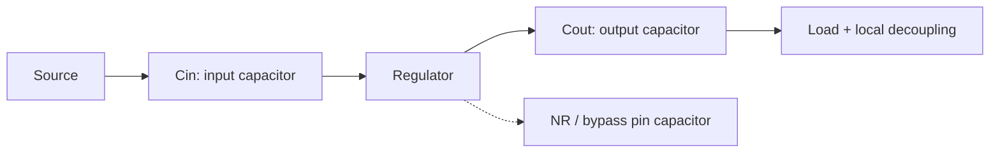

::: testing
Whether you can look at an IC and say **which pins need local capacitance, and what each one is protecting**. The hidden sub-skills:

1. Seeing beyond VDD: analog supplies, references, bias and PLL pins, regulator inputs and outputs, and reset/enable lines.
2. Matching the need to the mechanism (current bursts, noise rejection, stability, filtering).
3. Knowing the difference between *decoupling a supply* and *adding capacitance to a signal* (the latter slows it down).
4. Reading datasheets for required values and placement.
:::

::: why
New engineers decouple the obvious VDD pins and forget the reference, bias or PLL supply pins that actually set the system's noise floor. In an interview, listing the different categories and giving a reason for each tells the interviewer you have looked at real datasheets. In practice, a missing capacitor on a reference pin or a regulator's input can cause oscillation, jitter, or ADC noise that is awkward to trace.
:::

::: concepts
- **Supply (power) pins**: digital cores, I/O banks, and analog supplies draw or are sensitive to fast current changes ([[q0501]]).
- **Reference and bias nodes**: high-impedance or low-noise outputs whose voltage sets accuracy.
- **Regulator input/output**: capacitors for stability and transient response.
- **Bypass vs decoupling vs bulk**: roles and values ([[q0032]], [[q0143]], [[q0502]]).
- **Noise coupling through the supply**: PSRR and shared-rail interaction ([[q0142]]).
- **Not every signal**: adding capacitance to a data or analog signal changes its bandwidth ([[q0513]]).
:::

::: answer
"The main category is power supply pins: every VDD or VCC, on digital chips, op-amps, ADCs and so on, gets its own capacitor, because that's where the fast current bursts happen and where noise couples in. That includes separate supplies on the same chip: analog supply, I/O bank supplies, PLL and oscillator supplies, which often want their own, sometimes smaller or extra-filtered, capacitors.

Then there are things that aren't supplies but behave like them: reference voltage pins, internal bias or reference-bypass pins, and regulator outputs and inputs. An ADC reference pin must stay quiet, because any noise there goes straight into the conversion, and it's also often driven by a buffer that needs a specific capacitor for stability. LDO and switching regulator inputs and outputs need capacitors for loop stability and to supply load steps. Low-noise LDOs have a noise-reduction pin with its own capacitor. And sensitive control lines like reset or enable get a small filter capacitor sometimes, to avoid glitches.

What I wouldn't do is decouple an arbitrary signal line: a capacitor on a data or analog signal just slows it down, so for signals the answer is filtering, not decoupling."
:::

::: technical
**Categories and reasons.**

| Node | Why decouple | Typical practice |
|---|---|---|
| Digital core/IO supply (VDD, VCCIO) | Fast switching current; supply droop/bounce; noise injected into other chips | 100 nF per pin (or pin pair) + a few µF per IC; designed network for FPGAs/SoCs |
| Analog supply (AVDD, ±V of op-amps) | PSRR falls with frequency; supply noise couples to output; amplifier stability | 100 nF + 1–10 µF per supply pin, often a ferrite/RC from the digital rail |
| Reference pin (VREF, bandgap output) | Reference noise adds directly to every conversion; the internal buffer may need the cap for stability | Datasheet value, e.g. 1–10 µF low-ESR ceramic, sometimes with a series resistor |
| PLL/VCO/oscillator supply | Supply noise becomes phase noise and jitter | 10 nF + 100 nF + ferrite, close to pin |
| Regulator input | Source impedance and input transients; stability | Ceramic at input pin per datasheet |
| Regulator output | Control-loop stability, load-step response | Datasheet min/max C and ESR |
| LDO noise-reduction / bypass pin | Filters the reference noise; sets start-up time | Typically 10 nF–1 µF per datasheet |
| Bias/compensation pins | Set internal operating points or compensation | Datasheet value |
| Reset/enable/sense (selectively) | Prevent false triggers from supply noise or ground bounce | Small RC (e.g. 100 nF) when specified or needed |

**Mechanisms.** (1) *Charge delivery* for current bursts: $\Delta V = I\,t/C$. (2) *Noise bypass*: a low-impedance path so noise at frequency $f$ sees $1/(2\pi f C)$, not the signal path. (3) *Stability*: a regulator or op-amp's loop assumes a certain capacitor and ESR at its output or supply. (4) *Filtering*: reference and bias nodes need low bandwidth so their noise stays below the LSB.

**Example numbers.** An ADC with a 12-bit, 3.3 V range has an LSB of 0.8 mV; reference noise of 1 mV RMS would already cost more than one LSB. A reference pin with a 10 µF capacitor, driven through 10 Ω, has a pole at $1/(2\pi\times10\times10\ \mu\text{F})=1.6$ kHz, filtering the higher-frequency noise.
:::

::: short
"Supply pins first: every VDD, including separate analog, I/O and PLL supplies, because that's where fast current bursts and noise coupling occur. Then reference and bias pins, since their noise goes straight into accuracy and their buffers often need a specified capacitor. Regulator inputs and outputs for stability and load steps, and LDO noise-reduction pins. I would not decouple arbitrary signal lines, since a capacitor there just slows the signal."
:::

::: long
"I think of it in categories, by what the node is doing.

First, power supply pins, every one. Digital cores and I/O banks draw nanosecond current bursts, so each supply pin gets a local capacitor, typically 100 nanofarads, plus a few microfarads per chip. Analog supplies, like op-amp rails and ADC analog supplies, need decoupling too, because supply rejection falls off with frequency and any noise on the rail ends up at the output. They often get extra filtering, like a ferrite bead or small resistor from the digital rail. PLL and oscillator supplies are a special case because supply noise turns into phase noise, so I'd add a small value like 10 nanofarads next to the 100 nF and maybe a ferrite.

Second, reference and bias pins. An ADC or DAC reference sets the scale of every conversion, so noise on it is noise in every reading. The reference buffer often needs a specific capacitor for stability, usually a microfarad or ten, low ESR, so I follow the datasheet. Same for internal bias pins and compensation pins.

Third, regulators. The input needs a capacitor to supply pulsed current and keep the source impedance low, and the output needs one for loop stability and load transients. A low-noise LDO has a bypass pin where a capacitor filters its internal reference.

And sometimes sensitive control lines, a reset or enable line, get a small capacitor, to avoid being triggered by ground bounce.

What I don't do is treat an ordinary data or analog signal like that, since a capacitor on a signal line is a low-pass filter. There the tool is filtering and it's a deliberate trade-off."
:::

::: terms
- **VDD / VCC / AVDD / VCCIO**: supply pins for core, analog and I/O sections.
- **VREF**: reference voltage pin or output.
- **PSRR**: power supply rejection ratio.
- **Noise-reduction (NR) / bypass pin**: LDO pin that filters the internal reference.
- **PLL / VCO supply**: supply for a phase-locked loop and its oscillator; noise on it causes jitter.
- **Ferrite bead**: lossy inductor used to isolate a supply branch.
- **Compensation pin**: pin where a capacitor sets an internal loop's stability.
- **ESR**: equivalent series resistance of the capacitor; sometimes required in a given range.
:::

::: exceptional
An average answer says "power supplies". An exceptional one:

- Splits the answer by **function**: supplies (digital, analog, PLL, I/O), references and bias, regulators (in/out/NR), and sensitive control lines.
- Ties each category to a **mechanism** (current bursts, PSRR, stability, noise filtering) and a **typical value**.
- Gives a numeric example, such as reference noise vs ADC LSB, or a reference RC corner.
- Notes that *signals* are filtered, not decoupled, and that decoupling can hurt (reference or regulator needing a specific ESR).
- Says to follow the datasheet where it specifies a value or placement.
:::

::: mistakes
- **Only decoupling VDD.** Reference, bias, PLL and regulator pins are where many noise problems start.
- **Putting a large capacitor on a reference output without checking.** Some reference buffers become unstable with the wrong load capacitance ([[q0513]]).
- **Decoupling data lines** "to reduce noise". That cuts the bandwidth and slows the edges.
- **Using one capacitor for the analog and digital supply without isolation.** The digital noise couples straight in; use separate capacitors and a ferrite or RC.
- **Ignoring AVDD vs DVDD pins on mixed-signal parts.** Each needs its own capacitor at its own pin.
:::

::: deep
## Think "what does this node need?"

A decoupling capacitor does one or more of four jobs. For each pin on a datasheet, ask which job applies.

1. **Charge reservoir**: the circuit draws fast current bursts (digital supplies).
2. **Noise bypass**: the circuit is sensitive to noise on the node (analog supplies, references).
3. **Stability**: a feedback loop expects a certain capacitance and ESR (LDO outputs, reference buffers, op-amp supplies).
4. **Filter**: the node's bandwidth is deliberately limited (reference nodes, bias pins, NR pins).

```circuit
{"elements":[
 {"t":"box","at":[10,0],"w":9,"h":16,"label":"Mixed-signal\nMCU / ADC","pins":[{"side":"left","pos":1,"name":"VDD"},{"side":"left","pos":7,"name":"AVDD"},{"side":"left","pos":13,"name":"VREF"}]},
 {"t":"term","at":[0,1],"label":"3.3 V","side":"left"},
 {"t":"wire","pts":[[0,1],[10,1]]},{"t":"dot","at":[5,1]},
 {"t":"C","a":[5,1],"b":[5,4],"label":"C_1","value":"100 nF"},{"t":"gnd","at":[5,4]},
 {"t":"term","at":[0,7],"label":"3.3 V","side":"left"},
 {"t":"wire","pts":[[0,7],[1,7]]},
 {"t":"FB","a":[1,7],"b":[4,7],"label":"FB"},
 {"t":"wire","pts":[[4,7],[10,7]]},{"t":"dot","at":[7,7]},
 {"t":"C","a":[7,7],"b":[7,10],"label":"C_2","value":"1 µF"},{"t":"gnd","at":[7,10]},
 {"t":"wire","pts":[[10,13],[6,13]]},{"t":"dot","at":[6,13]},
 {"t":"C","a":[6,13],"b":[6,16],"label":"C_3","value":"4.7 µF"},{"t":"gnd","at":[6,16]},
 {"t":"text","at":[3,12],"text":"reference node: cap value per datasheet","anchor":"middle","muted":true}
]}
```
Figure: Three kinds of decoupled node on one IC: the digital supply (VDD) with a plain 100 nF; the analog supply (AVDD), isolated from the digital rail by a ferrite bead and decoupled with its own capacitor; and the reference pin, whose capacitor value is dictated by the datasheet.

## Supplies

**Digital core and I/O supplies.** These draw bursts every clock edge. The need for local charge is covered in [[q0501]]. Each VDD pin or pair gets its own capacitor. Many processors have several I/O banks with separate supplies (VCCIO, VDDQ); each is decoupled separately because each bank switches independently.

**Analog supplies (op-amps, ADCs, DACs, sensors).** Analog circuits convert supply noise to output noise through the PSRR, which typically falls with frequency (for a typical op-amp from ~100 dB at DC to 40–60 dB at 1 MHz and lower still above). Decoupling at the pin restores the supply's low impedance at high frequency. Typical: 100 nF plus 1–10 µF at each supply pin. If the analog rail is derived from the digital rail, add a ferrite bead or small resistor, then a capacitor, so digital noise doesn't pass.

**PLL, oscillator and clock supplies.** Noise on a VCO supply modulates its frequency: supply noise → phase noise → jitter. These pins often have a dedicated LDO and several capacitor values (e.g. 10 nF + 100 nF), sometimes with a ferrite, located right at the pins. Datasheets often specify this.

**RF supplies.** Power amplifiers and LNAs want very small values (10–100 pF, C0G) at the pin for RF bypass, with larger ones further away.

## References and bias nodes

An ADC's code is $\text{code}=2^N V_{in}/V_{REF}$. A reference with noise $v_n$ gives codes that vary by $2^N v_n/V_{REF}$. With 12 bits and a 3.3 V reference, 1 mV RMS noise is about 1.2 LSB RMS, and the whole point of a 12-bit converter is lost. So references have:

- a **bypass capacitor** (1–10 µF, low ESR) to keep high-frequency noise off,
- sometimes an **RC filter** with a corner of a few kHz: for 10 Ω and 10 µF the corner is $1/(2\pi RC)=1.6$ kHz,
- and a **stability requirement**: the reference buffer's output stage assumes a certain load capacitance and ESR. Too little or too much can cause oscillation. Check the datasheet's allowed range.

Internal bias or compensation pins (e.g. a bandgap bypass, a compensation node on a regulator, or a charge-pump flying capacitor) have their own datasheet values and are not "optional".

## Regulators


Figure: A regulator needs capacitors at three places beyond the load's own decoupling: the input (low source impedance, pulsed input current), the output (loop stability, load-step response), and the noise-reduction/bypass pin of low-noise LDOs.

- **Input capacitor:** supplies pulsed current in a switching regulator, keeps the source impedance low for an LDO, and prevents oscillation with a long input cable.
- **Output capacitor:** part of the loop; many LDOs specify minimum and sometimes ESR range. Modern ceramic-stable LDOs accept low-ESR ceramics; older ones need ESR above some value.
- **NR/bypass pin:** a capacitor from this pin filters the internal reference's noise but also slows start-up (the RC time constant).

Whatever the regulator, its stability requirements are datasheet-specific. The network-level view of how a set of capacitors keeps the rail impedance down looks like this:

```sim
{"id":"decap-network","preset":"mixed","ztarget":0.05}
```
Figure: The decoupling network plot shows how a set of capacitors keeps a supply's impedance below the target across frequency. Switch to 'single' to see what a lone capacitor misses.

## Control pins: selectively

A reset, enable, or interrupt line connected to a high-impedance input may pick up ground bounce or coupled noise and trigger falsely. A small capacitor (1–100 nF) to ground, often with a series resistor, forms an RC filter: with 10 kΩ and 100 nF, $\tau=1$ ms, filtering anything shorter than microseconds. This is filtering, not supply decoupling, but it is common practice for reset and enable pins and on manual switches. Verify it doesn't violate required timing (reset pulse width, startup sequencing).

## What you do *not* decouple

Ordinary signal lines, such as an SPI clock or an analog sensor output, do not get a capacitor to ground, since $C$ with the source impedance forms a low-pass filter that rounds edges and limits bandwidth. If noise is the problem, treat it deliberately (RC filter sized for the signal's bandwidth) and accept the trade.

> [!INTERVIEW]
> Say it like this: "Anything that either draws fast current, needs a quiet voltage, or has a feedback loop that expects a capacitor: supplies, references and regulator pins. And I follow the datasheet for the values."

> [!UNCERTAIN]
> Typical PSRR and capacitor values vary by part and are given as examples. Always use the vendor's recommended values and placement for references, regulators, PLLs and RF devices.
:::

::: applications
- **Op-amp circuits**: 100 nF plus a few µF at each supply pin to preserve stability and PSRR.
- **ADC/DAC boards**: analog and digital supplies decoupled separately; reference pin with datasheet-specified capacitor.
- **PLLs and clock generators**: dedicated, filtered supply with local capacitors.
- **LDO and buck regulators**: input and output capacitors per datasheet; NR pin capacitor on low-noise LDOs.
- **Microcontroller boards**: 100 nF on each VDD pin, extra on VDDA and VREF+, and a filter on reset.
:::

::: assumptions
- Standard CMOS mixed-signal parts with datasheets that call out supply, reference and bias pins.
- Values shown are typical; datasheet requirements override.
- "Decouple" here includes bypassing, bulk and filtering; the terms overlap in practice ([[q0032]]).
- For low-speed, low-current parts (e.g. a simple logic gate on a slow bus), a single 100 nF per chip is common practice.
- Another valid answer groups the list into "things that draw current", "things that need to be quiet" and "things with loops".
:::

::: followups
### Why does an ADC's reference pin need a capacitor?
The reference sets the scale for every conversion, so any noise on it appears in the output code, and the converter's sampling also pulls charge from the reference in bursts. A capacitor (typically 1–10 µF low ESR) holds the reference steady against those bursts and filters noise. The reference buffer's stability may also depend on it, so use the datasheet value.

### Why do PLL supplies often get extra decoupling?
Supply noise modulates the VCO frequency, so it appears as phase noise and jitter. A dedicated filtered supply with 10 nF and 100 nF capacitors and sometimes a ferrite bead keeps digital switching noise out and reduces jitter.

### Should you decouple a digital data line?
No. A capacitor on the line forms an RC low-pass with the driver impedance and rounds the edges. For a 50 Ω driver and 100 pF the corner is 32 MHz, already limiting a fast bus. If noise is the issue, fix the source (return path, termination) or deliberately filter slow signals.

### What happens if you put the wrong capacitor on an LDO output?
Some LDOs need ESR in a specified range for stability; a very low-ESR ceramic can cause oscillation, while others are designed for ceramics and may specify a minimum capacitance. The loop's phase margin depends on the output capacitor, so follow the datasheet's stable region.

### Scenario: your 16-bit ADC has 8 LSB of noise, and the supply and reference pins have 100 nF only. What would you check?
The reference pin: does the datasheet want 10 µF low-ESR there? Measure the reference with a short-lead probe or a differential probe while the ADC samples. Then check AVDD for digital noise coupling and add a ferrite/RC, and verify the ground return of the reference capacitor goes straight to the ADC's analog ground. At 16 bits the LSB is about 50 µV, so tens of µV of reference noise matters.
:::

::: interpretations
"Signals" here is used loosely to mean *nodes*: supply rails, reference pins, bias nodes, etc. Strictly, decoupling is applied to supply and reference nodes, not to information-carrying signals. This page focuses on which nodes to decouple; values are in [[q0502]], exceptions in [[q0513]], and why many capacitors are used in [[q0506]].
:::

::: references
- Horowitz and Hill, *The Art of Electronics*, 3rd ed.: bypassing, power supplies, and references.
- Analog Devices, *Data Conversion Handbook*: chapters on converter grounding, decoupling and references.
- Howard Johnson and Martin Graham, *High-Speed Digital Design: A Handbook of Black Magic*: power-system decoupling.
- Individual device datasheets (ADCs, LDOs, PLLs, op-amps) for the pins that require specific capacitors.
:::

::: rubric
- Supply pins (digital, analog, I/O) with the reason (current bursts, PSRR/noise) :: The primary and expected answer.
- Reference and bias pins, since noise goes directly into accuracy :: The more thoughtful answer many miss.
- PLL/oscillator supplies for jitter :: Shows understanding that supply noise becomes phase noise.
- Regulator input/output/NR pins for stability and transient response :: Shows knowledge of regulator requirements.
- Distinguishes decoupling a supply from capacitively loading a signal :: Avoids a common error.
- Defers to datasheet values and placement :: Professional practice.
:::

::: quiz
```json
[
 {"type":"mcq","level":"fundamental","q":"Which of these should you ordinarily decouple?","options":["A high-speed SPI clock line","An op-amp's supply pins","A UART data line","A sensor's analog output signal"],"answer":1,"explain":"Supply pins are the standard decoupling targets. A capacitor on a data or analog signal line would filter the signal, not decouple a supply."},
 {"type":"mcq","level":"fundamental","q":"Why does an ADC reference pin typically need a capacitor?","options":["To increase the reference voltage","To keep reference noise out of every conversion and support the converter's sampling bursts","To reduce power consumption","To act as the clock"],"answer":1,"explain":"Reference noise adds directly to the code and sampling pulls charge in bursts. A low-ESR capacitor stabilises and filters the reference."},
 {"type":"numeric","level":"intermediate","q":"A 12-bit ADC has a 3.3 V reference. The reference has 1.6 mV RMS noise. Approximately how many LSBs RMS does this correspond to?","answer":1.99,"tolerance":0.03,"unit":"LSB","explain":"LSB = 3.3/4096 = 0.806 mV. 1.6 mV / 0.806 mV = 1.99 LSB RMS."},
 {"type":"numeric","level":"intermediate","q":"A reference pin is driven through 10 Ω with a 10 µF capacitor. What is the RC corner frequency, in kHz?","answer":1.59,"tolerance":0.02,"unit":"kHz","explain":"$f=1/(2\\pi RC)=1/(2\\pi\\times10\\times10\\times10^{-6})=1592$ Hz = 1.59 kHz."},
 {"type":"mcq","level":"advanced","q":"Why do PLL and VCO supply pins often get extra decoupling and filtering?","options":["They draw the most current","Supply noise modulates the VCO frequency and appears as phase noise and jitter","They operate at DC","They have no ground pin"],"answer":1,"explain":"The oscillator frequency depends on its supply, so noise there becomes jitter. A filtered, locally decoupled supply reduces it."},
 {"type":"truefalse","level":"advanced","q":"Adding a large capacitor to ground on a data line is a good way to decouple it and improve signal integrity.","answer":false,"explain":"A capacitor on a signal line forms a low-pass filter with the source impedance, rounding edges and limiting bandwidth. Signal integrity issues are fixed with return paths and termination, not capacitance to ground."}
]
```
:::
